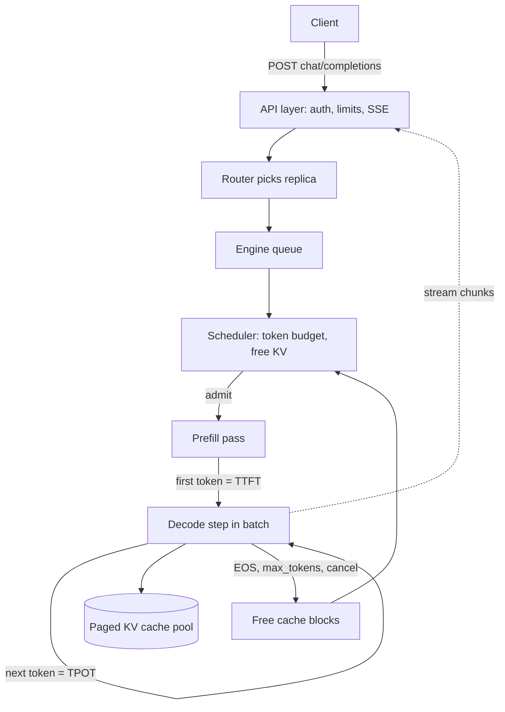

## TL;DR
Model serving is everything between a trained checkpoint and an HTTP response. For LLMs each request is a
stateful loop of unknown length whose KV cache grows while it runs, so the scheduler, not the model,
decides what the hardware delivers.

## Why it exists
- **A checkpoint answers nothing.** Someone must put weights on a device, tokenize, run the forward pass,
  sample, detokenize and stream back, for hundreds of users at once, without one user's 20k-token
  document starving everyone else. That set of responsibilities is "serving".
- **An LLM request is a loop, not a pass.** Classic ML serving (one request, one forward pass, scale
  horizontally) works because a classifier's cost is fixed. An LLM runs one forward pass per generated
  token, and a one-word answer and a 2,000-word essay arrive looking identical.
- **The loop is stateful.** Each step needs the KV cache of every earlier token, so the state lives on the
  GPU for the life of the request and grows every step. Memory, not compute, usually caps how many
  requests a card can hold.
- **GPUs are efficient only when busy.** A single decode request reads all weights per token: for an 8B
  model in fp16 that is ~16 GB per token, so ~3 TB/s of bandwidth caps it near 200 tokens/s with the
  arithmetic units idle. Put 32 requests in the same step and the same ~16 GB yields 32 tokens.
- **Batching loops is a scheduling problem.** Variable-length, variable-lifetime loops are something the
  one-request-one-pass model never had to solve. The whole module works through these three facts; this
  lesson is the map.

## How it works
### The layers of a serving stack
From the outside in:

| # | Layer | What it owns |
|---|---|---|
| 1 | **API layer** | HTTP server with a chat/completions protocol (most self-hosted engines expose an OpenAI-compatible endpoint): auth, rate limits, validation, SSE streaming, cancellation on client disconnect |
| 2 | **Router** | Picks a replica. Round-robin works until you care about prefix-cache locality or model-per-tenant isolation; then routing becomes content-aware |
| 3 | **Engine** | Owns the GPU(s): vLLM, SGLang, TGI, TensorRT-LLM, llama.cpp and others. Loads weights (optionally quantized, optionally sharded with tensor parallelism), owns the KV-cache pool, runs the scheduler |
| 4 | **Scheduler** | Each iteration decides which waiting requests get prefill and which running ones get a decode step, under a token budget and free KV memory. The heart of the system: continuous batching and paged memory live here |
| 5 | **Model executor and kernels** | The forward pass: attention kernels reading the paged cache, fused matmuls, CUDA graphs to cut launch overhead, on-device sampling |

### The request lifecycle
1. **Arrive and queue.** The request is tokenized and waits in a queue.
2. **Prefill.** When admitted, the prompt runs in one compute-heavy pass that populates the KV cache. The
   first token comes out of it; that time is the **time to first token (TTFT)**.
3. **Decode.** The request joins the running batch and gets one step per iteration alongside every other
   running request. The spacing between its tokens is the **time per output token (TPOT)**.
4. **Leave.** It exits on an end-of-sequence token, on hitting `max_tokens`, or on client cancel, and its
   cache blocks are freed for the next request.
- **Why this keeps the GPU full:** requests join and leave at iteration granularity rather than waiting
  for a whole batch to finish. That is continuous batching.

### Why memory arithmetic comes first
- **Weights are fixed; the cache is variable.** An 8B-parameter model in fp16 is about 16 GB of weights.
- **Per-token cache is model-specific:** around 128 KB for a GQA model with 8 KV heads and 32 layers.
- **The pool is what is left.** The engine reserves a fraction of VRAM (vLLM's default is 90%) and gives
  what remains after weights to the cache pool.
- **The real concurrency limit** is free cache tokens divided by typical sequence length. That is why "how
  many users can one H100 serve" has no answer until you know sequence lengths. The KV-cache memory
  estimation lesson does this arithmetic in full.

### Where the trade-offs live
Every serving knob trades latency against throughput:

| Knob | Gain | Cost |
|---|---|---|
| Bigger batch | More tokens/s for the whole GPU | Longer TPOT per user, because each decode step reads more cache |
| Larger `max_model_len` | Admits longer documents | Fewer requests fit |
| Quantized weights or cache | Frees memory and bandwidth | A quality cost you must measure |
| Speculative decoding | Lower per-token latency | Extra compute |

The rest of this module makes each of those trades deliberate.

### Startup, cold start and scaling
- **What startup does:** load tens of gigabytes of weights (local disk, network storage or a model hub),
  profile a worst-case forward pass to size the cache pool, and usually capture CUDA graphs.
- **How long:** from tens of seconds to several minutes depending on model size and storage. So LLM
  replicas cannot be autoscaled like stateless web pods, because a spike is over before a new replica is
  warm.
- **The usual answers:** a warm floor of replicas sized for normal peak; weights pre-staged on local NVMe
  or baked into the image; scaling on queue depth or cache utilization (which lead) rather than CPU or
  request count (which lag or mislead).

### Managed API versus self-hosting
- **A provider API is serving outsourced.** The same machinery runs on their side; pricing, rate limits
  and prompt-caching rules are its visible surface.
- **Self-hosting buys control** (data residency, custom models, predictable cost at high utilization) at
  the price of owning everything above.
- **The mechanics are identical,** so understanding them makes you better at both. The decision itself is
  covered in the infrastructure and economics module.

## Diagram
Follow one request from the API to the GPU and back; the scheduler loop is where TTFT and TPOT are made.



## Examples
### A minimal stack: OpenAI-compatible engine plus a streaming client
The server flags encode the memory and concurrency decisions above.

```python
# Terminal (one GPU, a GQA model that fits in fp16):
#   vllm serve meta-llama/Meta-Llama-3-8B-Instruct \
#       --max-model-len 8192 --gpu-memory-utilization 0.9 \
#       --max-num-seqs 128 --enable-prefix-caching
# The startup log prints how many KV-cache blocks were allocated; that number
# times the block size is the pool of context tokens the scheduler can hand out.

import time
from openai import OpenAI

client = OpenAI(base_url="http://localhost:8000/v1", api_key="unused")

t0 = time.perf_counter()
first = None
n = 0
stream = client.chat.completions.create(
    model="meta-llama/Meta-Llama-3-8B-Instruct",
    messages=[{"role": "system", "content": "You are a terse assistant."},
              {"role": "user", "content": "Explain continuous batching in 3 sentences."}],
    max_tokens=200,
    stream=True,                                   # SSE: one chunk per sampled token
)
for chunk in stream:
    if chunk.choices and chunk.choices[0].delta.content:
        if first is None:
            first = time.perf_counter() - t0      # time to first token
        n += 1
total = time.perf_counter() - t0
print(f"TTFT={first*1000:.0f} ms, chunks={n}, "
      f"TPOT≈{(total-first)/max(n-1,1)*1000:.1f} ms/chunk")
# Run two copies of this script at once: TTFT barely moves, TPOT rises slightly,
# and the server's tokens/sec roughly doubles — the signature of a batched decode loop.
```

### Worked scenario: how many users does that one GPU hold?
Same 8B GQA model, one 80 GB GPU, the flags above. Illustrative arithmetic, ignoring activation and
CUDA-graph memory, which take a few more GB in practice.

| Step | Value |
|---|---|
| VRAM the engine may use (`--gpu-memory-utilization 0.9`) | 0.9 × 80 GB = 72 GB |
| Minus fp16 weights | 72 − 16 = 56 GB for the cache pool |
| Cache per token (2 × 32 layers × 8 KV heads × 128 dim × 2 bytes) | 131,072 bytes = 128 KB |
| Pool in tokens | 56 GB ÷ 128 KB ≈ 427,000 tokens |
| Every request at the 8,192-token cap | ≈ 52 concurrent |
| Typical request of 2,000 tokens | ≈ 213 fit, but `--max-num-seqs 128` caps it at 128 |

- **Read it as:** the binding limit moves between the sequence cap and the memory pool depending on the
  length mix, so you cannot quote a user count without the length distribution.

```python
pool_tokens = (0.9 * 80e9 - 16e9) / (2 * 32 * 8 * 128 * 2)
for avg_len in (8192, 2000):
    print(avg_len, min(int(pool_tokens // avg_len), 128))   # 52, then 128 (seq cap binds)
```

## Production patterns
- **Instrument before tuning.** On day one, scrape the engine's Prometheus `/metrics` endpoint (vLLM
  exposes request queue depth, running requests, KV-cache usage, preemptions, TTFT and TPOT histograms)
  and build a dashboard of TTFT, TPOT, tokens/s per GPU and cache utilization. Alert on p99 TTFT, not
  averages.
- **Cap per-endpoint lengths at the gateway.** Enforce a maximum prompt size and a default `max_tokens`
  per route before requests reach the engine, so one runaway generation cannot hold cache blocks for
  minutes. Monitor requests rejected or truncated per route.
- **Cache-aware routing for multi-turn traffic.** Route by a session or conversation id (consistent
  hashing) so turn *n* lands on the replica that prefilled turns 1 to *n−1*. Monitor fleet-wide prefix-cache
  hit rate against a single replica's.
- **Warm floor plus queue-based autoscaling.** Keep enough warm replicas for normal peak, pre-stage
  weights on local NVMe or in the image, and scale on queue depth or KV-cache utilization. Monitor time
  from scale-up decision to first served token.
- **Propagate client disconnects.** Stream with SSE and make sure the proxy and API layer abort the
  engine request when the client goes away. Monitor generated tokens versus tokens delivered to clients.

## Trade-offs
- **Bigger batches vs per-token latency.** Batching more requests per step raises GPU throughput but
  lengthens each request's per-token latency. Flips toward smaller batches when the product is
  interactive and TPOT is the user-visible metric.
- **Long `max_model_len` vs concurrency.** Long limits serve document workloads but shrink concurrency,
  because every admitted request may claim that much cache. Flips when p99 prompt length is far below the
  cap and admission uses actual lengths.
- **Self-hosting vs managed API.** Self-hosting gives data control and a lower cost per token at high,
  steady utilization. A managed API wins when traffic is bursty or small, because idle GPUs cost the same
  as busy ones.
- **Streaming vs simplicity.** Streaming tokens improves perceived latency and lets clients cancel early,
  but complicates proxies, retries and observability. It stops being worth it for short structured
  outputs consumed by machines.

## Pitfalls
- **Capacity-planning from weight size alone.** Symptom: the engine admits far fewer concurrent requests
  than expected, or preempts them mid-generation under load. Fix: add the cache to the plan.
- **Measuring latency with a single request and shipping.** Symptom: TPOT doubles the first time real
  concurrency arrives, because decode steps now read many caches per iteration.
- **A generic HTTP load balancer in front of prefix-cached replicas.** Symptom: fleet-wide prefix hit rate
  far below what one replica achieves, because turn *n* of a conversation lands on a GPU that never
  prefilled turns 1 to *n−1*.
- **Treating `max_tokens` as cosmetic.** Symptom: a few runaway requests hold cache blocks for minutes and
  starve the queue, visible as TTFT spikes unrelated to request rate.
- **Ignoring client disconnects.** Symptom: GPU time spent generating tokens nobody reads, showing up as
  throughput that does not translate into completed requests.
- **The wrong chat template.** Serving an instruct model with a template other than the one it was trained
  with (often a hand-built prompt string) raises no error. Symptom: answers that ramble, ignore the system
  prompt or fail to stop, because the model never sees the role markers it expects.
- **Autoscaling on CPU utilization or request count.** Symptom: new replicas become ready minutes after
  the queue already blew through the TTFT budget, then idle after the spike.

## When to use
You meet serving the moment a model leaves a notebook. Use this lesson as the map.
- **Find the layer:** when a question is about *why* a number looks the way it does, place it in API,
  router, scheduler, memory or kernels, then go deep: prefill vs decode for the latency split, KV-cache
  memory estimation for capacity, continuous batching and paging for scheduling, engines for which
  software to run.
- **Measure from day one:** TTFT, TPOT, tokens per second per GPU and cache utilization, because every
  later decision is made against those four.
- **Interviews:** explain the request lifecycle end to end and name which resource (memory, bandwidth,
  compute) binds at each phase.

## Role lens
- **Engineer:** Stands up an engine with an OpenAI-compatible endpoint, sets memory and concurrency flags
  from measured sequence lengths, and instruments TTFT and TPOT before tuning anything.
- **Architect:** Owns the managed-versus-self-hosted decision, the GPU tier and replica count, and the
  routing design that keeps tenant isolation and cache locality from fighting each other.
- **FDE:** Deploys the stack inside a customer's VPC, explains why their latency differs from the demo,
  and translates their document sizes and user counts into a concrete GPU footprint.

## Check yourself
**Q:** A customer runs an 8B model on one 80 GB GPU and reports that p50 latency is fine but p99 TTFT
spikes to several seconds every few minutes with no change in request rate. Walk through where in the
serving stack you would look, and why.
**A:** TTFT is dominated by queueing plus prefill, so periodic spikes with flat request rate point at
admission, not load. First suspect is a few very long prompts: a 20k-token prefill is compute-heavy and,
without chunked prefill, blocks a whole iteration so every waiting request's TTFT jumps. Second is memory:
if long-running generations fill the KV-cache pool, new requests wait for blocks to free, and the engine
may preempt running sequences, which shows as both TTFT and TPOT spikes. Check the engine's metrics for
queue depth, cache utilization and preemption count at the spike times. Fixes, in order: cap `max_tokens`
and prompt length per endpoint, enable chunked prefill so long prompts are interleaved with decode steps,
and if cache utilization is pinned at 100%, either lower concurrency, quantize the cache, or add a replica.

## Interview questions
### Why can't you serve an LLM like a classic stateless prediction service?
- **Cost is not fixed per request.** An LLM request is one forward pass per output token, and the length
  is unknown at arrival, so per-request cost varies by orders of magnitude.
- **It holds state.** The KV cache sits on the GPU for the request's whole life and grows every step, so
  memory, not CPU, decides how many requests a replica holds.
- **It must be batched.** Single-request decode leaves the GPU's arithmetic idle, so the engine batches
  many live loops per step, which needs an iteration-level scheduler.

### Users say the chatbot "types slowly" at peak but dashboards show record tokens/s. What is going on?
- **That is the throughput-latency trade.** Larger batches raise aggregate tokens/s, but each decode step
  reads more KV cache, so every user's TPOT grows.
- **Confirm with metrics:** running requests per step and TPOT p95 rising together while TTFT is flat.
- **Fix by product goal:** lower the maximum concurrent sequences per replica and add replicas, or split
  interactive and batch traffic onto separate deployments with different limits.

### When would you not self-host, even with a capable platform team?
- **Bursty or small traffic.** Idle GPUs cost the same as busy ones, so low or spiky utilization makes a
  managed API cheaper per useful token.
- **Cold starts you cannot hide.** Replicas take tens of seconds to minutes to warm, so spiky demand needs
  a paid warm floor anyway.
- **Self-host when** data residency, custom or fine-tuned models, or high steady utilization make control
  and unit cost win.

### How would you capacity-plan one 80 GB GPU for an 8B model?
- **Start from the pool:** 90% of 80 GB minus 16 GB of fp16 weights leaves about 56 GB for cache.
- **Per-token cost:** about 128 KB for a 32-layer GQA model with 8 KV heads, so roughly 427,000 cached
  tokens.
- **Divide by the real length mix,** not the cap: ~52 requests at 8k tokens each, far more at 2k, then
  check which limit (memory or the sequence cap) binds and leave headroom for activations.

### Why do LLM replicas autoscale badly, and what do you do about it?
- **Startup is slow:** loading weights, profiling the cache pool and capturing CUDA graphs take tens of
  seconds to minutes.
- **CPU and request count mislead:** they lag the real pressure, which shows first as queue depth and
  KV-cache utilization.
- **So** keep a warm floor for normal peak, pre-stage weights on local NVMe or in the image, and scale on
  leading signals.

## Quiz
### Q: Why is serving an LLM fundamentally different from serving a classification model?
- [ ] LLM weights are larger, so they must be loaded lazily from disk per request
- [x] Each LLM request is a stateful loop of unknown length whose working set grows while it runs
- [ ] LLM requests cannot be batched, so each one needs a dedicated GPU
- [ ] Classifiers return probabilities while LLMs return text, which changes the serialization layer
> A classifier costs one fixed forward pass; an LLM request runs one forward pass per generated token,
> holds a growing KV cache on the GPU throughout, and finishes at an unpredictable time. Batching is not
> only possible but essential, which is the opposite of the third option.

### Q: Which single quantity most directly determines how many concurrent requests one GPU can hold?
- [ ] Peak FLOPS of the GPU divided by model parameter count
- [ ] Number of CPU cores available to the tokenizer
- [x] Free VRAM after weights, divided by per-request KV-cache size at typical sequence length
- [ ] Network bandwidth between the API server and the engine
> Concurrency is a memory question: each running request pins its KV cache for its whole lifetime. FLOPS
> affects how fast steps run, not how many requests fit, and the tokenizer and network are rarely the
> binding resource.

### Q: A team doubles concurrent users on the same GPU and sees per-token latency rise while total tokens/sec also rises. What is happening?
- [ ] The GPU is thermally throttling under the extra load
- [ ] The tokenizer has become the bottleneck
- [x] Decode is bandwidth-bound; larger batches amortize weight reads but each step now reads more KV cache
- [ ] Prefix caching is evicting entries faster than it can fill them
> Batching lets one weight read serve many requests, so aggregate throughput climbs. But each decode step
> also reads every running request's cache, so step time grows and every user's TPOT lengthens. That is
> the expected shape of the throughput-versus-latency curve, not a fault.
