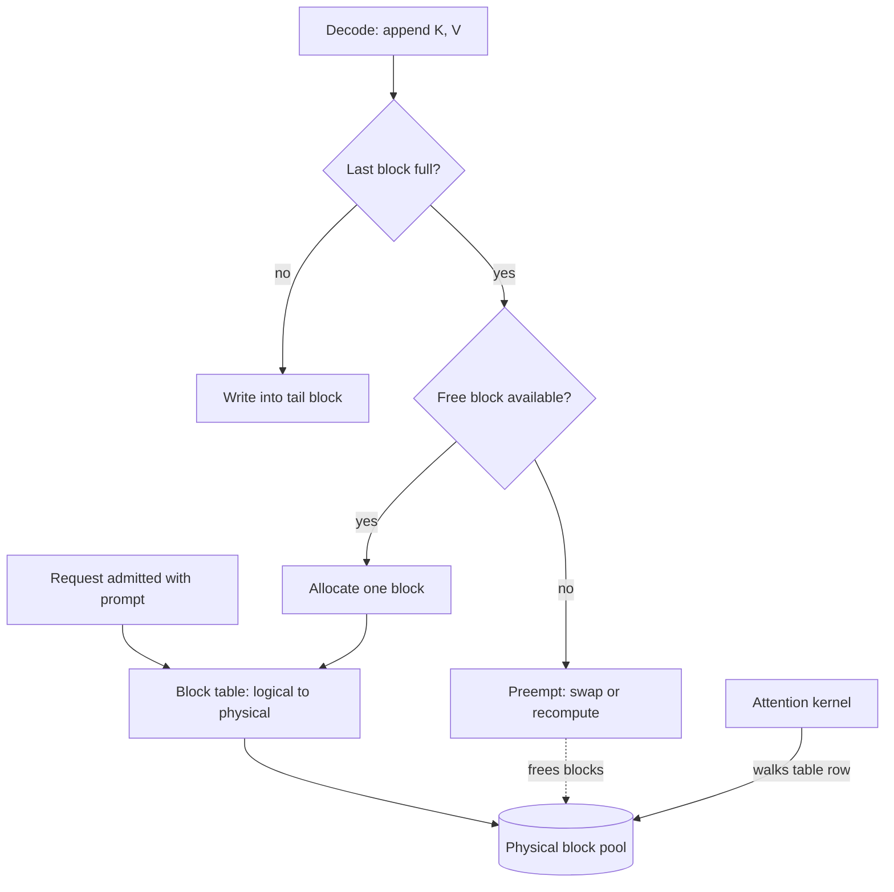

## TL;DR
PagedAttention stores each request's KV cache in fixed-size blocks (usually 16 tokens) behind a
per-request block table, so memory is allocated on demand and shared. The recovered memory becomes more
concurrent requests, which is where vLLM's throughput gains come from.

## Why it exists
- **Every token in flight costs memory.** About 0.5 MB per token for a Llama-2-7B-style model in fp16
  (see the KV-cache lesson for the derivation).
- **Output length is unknown at admission.** Kernels before PagedAttention expected each sequence's K and
  V to be contiguous, so the only safe move was a contiguous slab for the maximum length. For a
  2,048-token limit that is about 1 GB per request, whether it generates 20 tokens or 2,000.
- **Reservation wastes memory three ways.** *Reserved* slots hold tokens not generated yet; *internal
  fragmentation* is the part a request never reaches because it stops early; *external fragmentation* is
  holes between slabs of different sizes, too small for the next arrival.
- **Most memory was waste.** The vLLM paper measured that in prior systems only roughly 20–40% of
  KV-cache memory actually held token state.
- **The naive fixes fail.** Exact-length allocation is impossible (length unknown). Reallocate-and-copy
  copies hundreds of megabytes every few tokens and still fragments. A lower length limit refuses
  legitimate long requests. The answer was the OS move for RAM: drop physical contiguity and translate
  addresses through a table.

## How it works
### Blocks and block tables
- **Physical blocks.** The cache is carved into blocks of a fixed number of tokens, B. For one layer a
  block holds K and V for B tokens across all KV heads: `2 × n_kv_heads × head_dim × B ×
  bytes_per_element`.
- **Worked size.** Llama-2-7B, fp16, B = 16: 2 × 32 × 128 × 16 × 2 = 262,144 bytes, 256 KB per layer, or
  8 MB per block summed over 32 layers. That is exactly 16 tokens × 0.5 MB.
- **Logical blocks.** Each request owns a sequence of logical blocks (block 0 holds tokens 0–15, block 1
  holds 16–31, and so on).
- **Block table.** Maps each logical block to the physical block holding it. Logical blocks are
  contiguous; physical blocks can be anywhere in the pool. This is a page table, and the lookup is the
  address translation.

### Allocation on demand
1. **Admit** a request with only the blocks its prompt needs.
2. **Grow** by one block when the last block fills during decode.
3. **Waste** is only the unused tail of the final block, strictly less than B tokens per sequence.
4. **No external fragmentation**, because every block has the same size, so any free block fits any
   request. Fixed-size units are the one scheme where freed space is always reusable, which is why the
   OS page allocator works the same way.

### The attention kernel
- **Inputs.** A block-table tensor of shape [num_seqs, max_blocks_per_seq] plus each sequence's current
  length.
- **Per sequence.** Take the new token's query, walk that row of the table, load K and V from each
  physical block, and accumulate attention block by block.
- **Online softmax.** Softmax needs the maximum and sum over *all* scores, unknown until the last block.
  The kernel keeps a running maximum *m*, a running denominator *l* and a running weighted sum of V, and
  rescales by `exp(m_old − m_new)` whenever a later block raises the maximum (the FlashAttention trick).
  The output is exact; only the layout changed.
- **The indirection costs something.** Accesses are less coalesced than for one contiguous tensor, so the
  kernel is somewhat slower. The design accepts that *because* decode throughput is limited by how many
  sequences fit, not per-sequence kernel speed.
- **The name outlived the kernel.** Current engines often run FlashAttention- or FlashInfer-family kernels
  that accept a block table directly, so "PagedAttention" now names the memory-management scheme.

### Sizing the pool
1. Measure what the weights take.
2. Run a dummy forward pass at the maximum batch to find peak activation memory.
3. Give the rest of the configured budget (vLLM's `gpu_memory_utilization`, historically defaulting to
   0.9) to the block pool.
4. Capacity in tokens is `num_blocks × B`; the scheduler admits a request only when enough free blocks
   exist for its prompt.

### Sharing and copy-on-write
- **Reference counts.** Requests reference blocks indirectly, so two can map the same physical block.
- **Within a request.** Parallel sampling (`n > 1`) and beam search share the prompt's blocks instead of
  copying them.
- **Across requests (prefix caching).** Full blocks are hashed by their content and the prefix before
  them, so a matching system prompt reuses resident blocks and skips that part of prefill.
- **Copy-on-write.** Before writing into a shared block the engine copies it, the same rule as `fork()`.

### Running out of blocks
- **Preemption.** On-demand allocation can run the pool dry mid-generation. The scheduler then swaps a
  sequence's blocks to CPU memory or frees them and recomputes the prefix later. Which an engine offers
  varies by version: vLLM's V1 engine recomputes only.

| Option | Cost grows with | Rough fit |
|---|---|---|
| Swap | cache bytes over PCIe | long sequences |
| Recompute | prefill FLOPs to rebuild | short sequences |

- **Neither wins universally.** The crossover depends on hardware and how busy the GPU already is.
- **The signal.** Preemption counters rising in the metrics mean the pool is too small for the traffic.

### Choosing the block size
| Block size | Gains | Costs |
|---|---|---|
| Larger | fewer table entries, better coalescing | more waste in the last block, coarser prefix sharing (only complete blocks are shared) |
| Smaller | less tail waste, finer sharing | more table entries, worse coalescing |

Sixteen tokens is the common compromise.

## Diagram
A request's logical blocks map through its block table to scattered physical blocks; a full last block
triggers one more allocation, and an empty pool triggers preemption.



## Examples
### Capacity: contiguous vs paged on an 80 GB GPU
A Llama-3-8B-class model (32 layers, 8 KV heads, head_dim 128, fp16).

| Quantity | Value |
|---|---|
| KV per token | 2 × 32 × 8 × 128 × 2 = 131,072 bytes = 128 KB |
| One 16-token block, all layers | 2 MB |
| Weights | ~16 GB |
| Budget at 0.9 | 72 GB |
| Activation peak (illustrative) | 2 GB |
| Block pool | about 54 GB = 27,648 blocks ≈ 442,000 tokens |

Chats averaging 1,500 actual tokens under an 8,192-token limit:

| Allocator | Memory per request | Requests that fit |
|---|---|---|
| Contiguous | 8,192 × 128 KB = 1 GB, always | 54 |
| Paged | ~1,500 tokens + a partial block ≈ 188 MB | around 290 (about 5× more) |

The paged kernel also never copies anything when a chat runs long. The script reproduces the arithmetic:

```python
def kv_capacity(gpu_gb, weights_gb, util=0.9, act_gb=2.0,
                layers=32, kv_heads=8, head_dim=128, dtype_bytes=2, block=16):
    per_token = 2 * layers * kv_heads * head_dim * dtype_bytes          # bytes
    pool = (gpu_gb * util - weights_gb - act_gb) * 2**30
    blocks = int(pool // (per_token * block))
    return per_token, blocks, blocks * block

per_tok, blocks, tokens = kv_capacity(80, 16)
print(f"{per_tok/1024:.0f} KB/token, {blocks} blocks, {tokens} tokens of KV")
for avg_len, max_len in [(1500, 8192), (6000, 8192)]:
    contiguous = tokens // max_len                       # reserves max_len per request
    paged = tokens // (avg_len + 15)                     # actual tokens + at most one partial block
    print(f"avg {avg_len}: contiguous fits {contiguous}, paged fits {paged}")
```

### A toy block allocator with sharing and copy-on-write
Pure Python, runnable as is. It shows on-demand growth, `fork()`-style sharing for parallel sampling and
copy-on-write of a shared tail block.

```python
class BlockPool:
    def __init__(self, num_blocks, block=16):
        self.block, self.free = block, list(range(num_blocks))
        self.ref = [0] * num_blocks

    def alloc(self):
        if not self.free:
            raise MemoryError("out of blocks: preempt a sequence")
        b = self.free.pop()
        self.ref[b] = 1
        return b

    def release(self, b):
        self.ref[b] -= 1
        if self.ref[b] == 0:
            self.free.append(b)

class Sequence:
    def __init__(self, pool, n_prompt=0):
        self.pool, self.len, self.table = pool, 0, []
        for _ in range(n_prompt):
            self.append()

    def append(self):                              # store one new token's K and V
        p = self.pool
        if self.len % p.block == 0:                # last block full, or no block yet
            self.table.append(p.alloc())
        elif p.ref[self.table[-1]] > 1:            # copy-on-write a shared partial block
            p.release(self.table[-1])
            self.table[-1] = p.alloc()             # (a real engine also copies its K/V)
        self.len += 1

    def fork(self):                                # parallel sampling: share, do not copy
        child = Sequence(self.pool)
        child.len, child.table = self.len, list(self.table)
        for b in self.table:
            self.pool.ref[b] += 1
        return child

pool = BlockPool(num_blocks=8)
a = Sequence(pool, n_prompt=40)                    # 40 tokens -> 3 blocks (16 + 16 + 8)
b = a.fork()                                       # n=2 sampling shares all 3
print(a.table, b.table, "free:", len(pool.free))   # [7, 6, 5] [7, 6, 5] free: 5
a.append(); b.append()                             # both write into the shared tail block
print(a.table, b.table, "free:", len(pool.free))   # [7, 6, 4] [7, 6, 5] free: 4
```

## Production patterns
- **Profile, then set the memory fraction.** When deploying a new model or GPU, start vLLM at the
  default `gpu_memory_utilization` (0.9) and raise it only after re-profiling activation peaks with your
  real `max_model_len` and batch size. Monitor KV-cache usage and OOMs.
- **Alert on preemptions, not OOMs.** Under lazy allocation a small pool shows up as preemptions and
  latency jitter. Scrape the engine's Prometheus metrics endpoint and alert when the preemption counter
  rises steadily while KV-cache usage sits near 100%.
- **Cap context per route.** When long-document chats share a deployment with short Q&A, lower
  `max_model_len` (or route long requests to their own deployment) so a few long chats cannot drain the
  pool. Monitor block usage per route and p95 prompt length.
- **Design prompts for block sharing.** Turn on prefix caching (`--enable-prefix-caching` in vLLM) and
  keep the system prompt and tool definitions byte-identical and first, with dates and user IDs after
  them. Monitor the prefix-cache hit rate and time to first token.
- **Stretch the pool with an FP8 cache.** When block usage is the bottleneck, set the KV-cache dtype to
  fp8 (`--kv-cache-dtype fp8` in vLLM) and run your eval set before rollout. It roughly doubles tokens
  of capacity per GPU.

## Trade-offs
- **Recovered memory vs kernel speed.** You recover most memory lost to reservation and fragmentation,
  but the kernel pays an indirection and coalescing cost per block. It is a net loss only when the batch
  is too small for extra sequences to matter, such as one long request alone on a GPU.
- **More admissions vs mid-generation exhaustion.** On-demand allocation admits many more requests, but
  can run out of blocks mid-generation, so the system needs a preemption policy (swap or recompute) that
  contiguous reservation never needed.
- **Free sharing vs memory-manager complexity.** Block sharing makes beam search, parallel sampling and
  prefix caching nearly free in memory, at the cost of reference counting and copy-on-write logic that
  is harder to reason about.
- **Large vs small blocks.** Larger blocks give faster kernels and fewer table entries; smaller ones
  waste less in partial blocks and share prefixes at finer granularity. The best size flips as average
  request length shrinks.

## Pitfalls
- **Reading the gain as "a faster attention kernel".** The kernel is slightly slower; the 2–4× comes from
  batching more sequences. If your batch is already small, you will not see it.
- **Ignoring preemption metrics.** A pool slightly too small shows up as a throughput cliff and jittery
  latency under load, not as an OOM, because sequences are silently swapped or recomputed.
- **Expecting prefix caching to share partially identical prompts.** Only whole blocks with identical
  content and prefix are shared, so a timestamp in the first line of the system prompt defeats it. The
  symptom is a prefix-cache hit rate near zero for prompts that look identical.
- **Setting `gpu_memory_utilization` to 0.98 for more blocks.** It then OOMs when another process, a CUDA
  graph or a larger-than-profiled activation peak needs the headroom.

## When to use
You do not switch PagedAttention on: every mainstream open engine (vLLM, SGLang, TensorRT-LLM and others)
uses block-based KV management. The decision is how to configure and observe it.
- **Sizing a deployment:** use the block arithmetic for tokens of capacity, expected tokens per request,
  and therefore concurrency.
- **In production:** watch block utilization and preemption counts. They tell you whether to lower
  `max_model_len`, raise the memory fraction, add prefix caching, or add GPUs.
- **Interviews:** explain the three kinds of waste, why fixed-size blocks remove two of them, and why the
  win is measured in concurrent sequences rather than kernel speed.

## Role lens
- **Engineer:** Tunes block pool size, `max_model_len` and prefix caching in the engine config, and reads
  preemption and cache-hit metrics to diagnose latency jitter under load.
- **Architect:** Translates block capacity into a concurrency and context-length policy per GPU tier, and
  decides whether prompt design should favour shared prefixes to exploit block sharing.
- **FDE:** Explains to a customer why their self-hosted engine serves 5× more chats than their old
  contiguous deployment, and why a dynamic header in their system prompt kills prefix reuse.

## Check yourself
**Q:** A team sees aggregate throughput collapse by half whenever traffic shifts from short Q&A to long
document chats, with no OOM errors. Using PagedAttention concepts, what is happening and what would you
change?
**A:** Long chats consume many more blocks per sequence, so the pool runs out mid-generation and the
scheduler starts preempting sequences, swapping their blocks to CPU or dropping them and recomputing the
prefix. Both cost time and the recomputation or swap traffic halves useful throughput while never raising
an OOM, because allocation is lazy. I would confirm with the preemption and block-usage metrics, then
either shrink demand per sequence (lower `max_model_len`, shorter retrieved context, fp8 KV cache),
increase supply (higher memory fraction after re-profiling activation peaks, a GQA model, more GPUs with
tensor parallelism), or cap concurrency so admitted requests finish instead of thrashing. If the chats
share a long system prompt, enabling prefix caching recovers blocks too.

## Interview questions
### What problem does PagedAttention solve, and why is the analogy to virtual memory apt?
- **Problem:** output length is unknown at admission, so contiguous KV buffers must reserve the maximum
  length, wasting memory to reservation, internal and external fragmentation.
- **Analogy:** like OS paging, logical blocks map through a per-request table to physical blocks anywhere
  in the pool, so contiguity is no longer needed and any free block fits any request.

### Your vLLM deployment shows latency spikes under load but no OOMs. How do you debug it?
- **Check KV-cache usage and preemption counters first.** Usage pinned near 100% with rising preemptions
  means the pool is too small for the traffic mix.
- **Then look at demand.** Compare prompt-length and output-length distributions before and after the
  spikes; a shift to long documents drains blocks.
- **Fix by shrinking demand or growing supply:** lower `max_model_len`, cap concurrent sequences, enable
  an fp8 cache or prefix caching, or add GPUs.

### When would PagedAttention give you little or no benefit?
- **Small batches.** The win comes from fitting more sequences; one long request alone on a GPU only pays
  the indirection cost of the slower kernel.
- **Requests that always use their full length.** If actual length is close to the limit, contiguous
  reservation wastes little, so paging recovers little.

### How would you pick a block size, and what does it change?
- **Larger blocks:** fewer table entries and better memory coalescing, but more tail waste per sequence
  and coarser prefix sharing because only complete blocks are shared.
- **Smaller blocks:** less waste and finer sharing, at more table overhead. Sixteen tokens is the common
  default; deviate only after measuring with your length distribution.

### Estimate how many 1,500-token chats fit on an 80 GB GPU for an 8B GQA model.
- **Per token:** 2 × 32 layers × 8 KV heads × 128 × 2 bytes = 128 KB.
- **Pool:** 80 × 0.9 − 16 GB weights − ~2 GB activations ≈ 54 GB, about 442,000 tokens.
- **Answer:** around 290 chats paged versus 54 with contiguous 8,192-token reservations, roughly 5× more.

## Quiz
### Q: Where does most of PagedAttention's throughput improvement come from?
- [ ] A faster attention kernel that reads memory in larger contiguous chunks
- [x] Fitting far more concurrent sequences in the same KV-cache memory because little is wasted
- [ ] Skipping attention over padding tokens inside each block
- [ ] Storing keys and values in 8-bit precision inside each block
> The paged kernel is actually slightly slower than a contiguous one because of the indirection. The
> gain comes from eliminating reservation and fragmentation waste, so many more sequences are decoded
> per step on a memory-bound workload.

### Q: Why does fixed block size eliminate external fragmentation?
- [ ] Because blocks are allocated at startup and never freed
- [ ] Because the block table compacts memory after each request finishes
- [x] Because any free block can satisfy any allocation, so freed space is always reusable
- [ ] Because blocks are always allocated in contiguous runs per sequence
> External fragmentation arises when freed holes are the wrong size for the next request. With one
> block size there is no wrong size; the only waste left is the unused tail of a sequence's last block.

### Q: Two requests share a 400-token system prompt but one adds a date on its first line. What happens
to block sharing under prefix caching?
- [ ] Both still share all prompt blocks because the hash ignores digits
- [ ] They share blocks after the differing line once the content realigns
- [x] They share nothing, because block hashes include the full prefix and diverge from the first block
- [ ] They share blocks only if both requests arrive in the same batch
> Blocks are identified by their content and everything before them, so a difference in the first block
> changes every subsequent hash. Shared content must be a byte-identical prefix to be reused.
