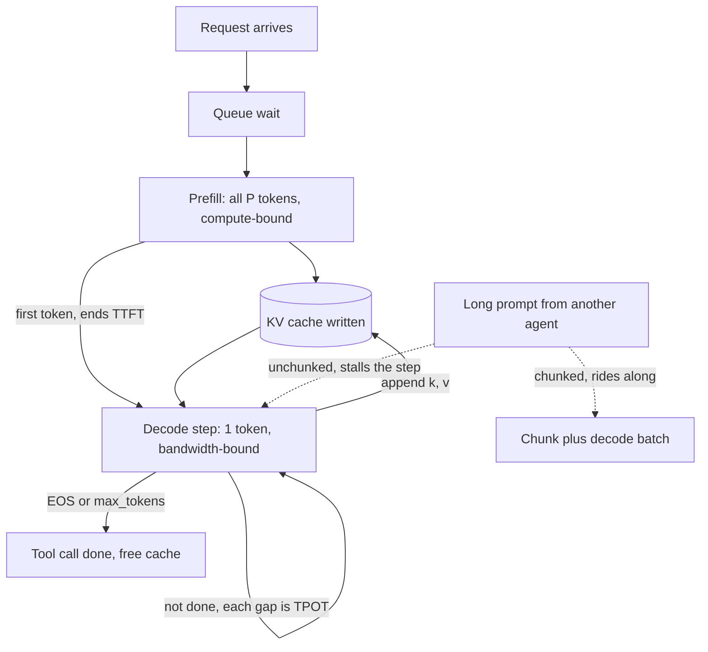

## TL;DR
Every agent step has two phases with opposite hardware profiles. Prefill reads the whole transcript at
once, is compute-bound and sets TTFT; decode writes the tool call token by token, is bandwidth-bound and
sets TPOT. Agents are prefill-heavy.

## For agent builders
- **Why it matters for agents.** An agent step is usually a long prompt (system prompt, tool schemas,
  transcript) and a short output (a tool call). So prefill, not decode, is most of each step's GPU work,
  and it grows every step unless the prefix is reused.
- **Where it shows up in your stack.** Provider usage fields that report input, cached-input and output
  tokens separately and price them differently; TTFT and TPOT histograms and `--enable-chunked-prefill`
  on self-hosted engines such as vLLM.
- **What you control.** Prompt length per step (trim tool output, compact history), prefix stability so
  caching skips prefill, per-step `max_tokens`, and whether intermediate steps stream at all.
- **What you can skip.** Disaggregated serving internals and KV transfer protocols unless you run a large
  self-hosted fleet. The intensity argument and the two cost formulas are enough.

## Why it exists
- **The split falls out of autoregression, not design.** The prompt is known in full, so all its tokens go
  through the model together as one big matmul per layer. Generated tokens are not known in advance, so
  each depends on the previous one and is produced sequentially. Same weights, radically different shapes
  of work.
- **GPU efficiency depends on that shape.** A matmul over 2,000 prompt tokens reads each weight once and
  uses it 2,000 times, saturating the arithmetic units. A decode step over one token uses each weight once,
  so the GPU waits on memory.
- **So prefill is cheap per token.** Prefill of a 4,000-token prompt takes about as long as a dozen or so
  decode steps, not 4,000 of them (illustrative: ~70 ms of compute-bound prefill against ~5.5 ms per
  bandwidth-bound step). A faster GPU helps prefill a lot and decode barely at all.
- **"Cost is proportional to tokens" is wrong.** It predicts a long prompt with a short answer costs the
  same as a short prompt with a long answer; the second occupies the GPU far longer. It also predicts
  batching helps uniformly, when batching rescues decode and does almost nothing for prefill.
- **Every serving metric belongs to one phase.** TTFT, TPOT and throughput are each a statement about
  prefill or decode, and you cannot tune what you have not separated. An agent's per-step latency is
  mostly TTFT, because its outputs are short.

## How it works
### The two phases side by side
| | Prefill | Decode |
|---|---|---|
| Input per request | *P* prompt embeddings, `[P, d_model]` | one new token, `[1, d_model]` |
| Work per layer | dense matmuls over all *P* rows, causal attention among *P* positions | same matmuls over one row, one query against every cached K and V |
| Cache effect | writes K and V for every position | appends one K and one V |
| Arithmetic intensity | roughly *P* FLOPs per weight byte | a handful of FLOPs per byte |
| Bound | compute (for prompts over a few hundred tokens) | memory bandwidth |
| Sets | TTFT; the last position's logits give the first token | TPOT |
| Batching helps? | barely | it is the throughput lever |

### Prefill
- **Cost** scales with *P* for the matmuls and with *P²* for attention, mitigated by fused attention
  kernels that avoid materializing the full matrix.
- **Compute-bound,** so TTFT grows roughly linearly with prompt length and shrinks with more FLOPs.
- **In an agent loop** the prompt at step *n* is everything from steps 1 to *n−1*, so without prefix
  reuse each step's TTFT is larger than the last, even when the new tool result is tiny.

### Decode
- **Per step** the GPU reads all weights plus the request's entire KV cache:

```
step_time ≈ (weight_bytes + cache_bytes) / bandwidth
```

- **TPOT is almost independent of prompt length,** except through the cache-read term.
- **Batching *B* requests** reads the weights once for *B* tokens, which is why continuous batching is the
  throughput lever for decode and irrelevant for prefill.
- **The amortization is partial.** Every request's KV cache is its own and is read separately, so the cache
  term grows linearly with *B* and context length. At large batches of long contexts it, not the weights,
  sets step time, which is why decode at scale is limited by cache bytes (GQA, cache quantization) as much
  as by weight bytes.

### Why they interfere
- **Same GPU, same iteration.** Admit a 10k-token prompt into a batch of 50 decoding requests and that
  iteration takes as long as the prefill. All 50 users see a pause: a TPOT spike caused by someone else's
  TTFT.
- **The reverse also hurts.** Prioritizing decode makes new arrivals wait, and TTFT climbs.
- **So the two phases trade against each other inside every scheduling decision.**

### Techniques that manage the collision
| Technique | How | Cost |
|---|---|---|
| **Chunked prefill** | Split long prompts into fixed-size chunks (a token budget per iteration) run alongside the decode batch. Decode tokens ride along at near-zero marginal cost because the iteration was compute-bound anyway, and no single iteration becomes a stall | Slightly longer TTFT for the long prompt |
| **Prefill vs decode priority** | Scheduler policy: prefill-first minimizes TTFT, decode-first smooths TPOT | Depends on the product |
| **Disaggregated serving** | Prefill on one GPU pool, decode on another, KV cache transferred over the interconnect. Each pool is tuned for its phase (prefill wants FLOPs, decode wants bandwidth and memory) and one phase cannot spike the other | The transfer and a more complex system; pays at scale |
| **Prefix caching** | Reuse an already-computed KV prefix so part of prefill is skipped | The biggest TTFT lever when prompts share a long system prompt, and for every step of an append-only agent transcript |
| **Speculative decoding** | Turns several decode steps into one verification pass | Uses the slack compute bandwidth-bound decode leaves idle |

### What the metrics mean
- **TTFT** ≈ queue wait + prefill time (+ a cache transfer in disaggregated setups).
- **TPOT** ≈ decode step time, which rises with batch size and with the total cache the batch reads.
- **Throughput** in tokens/sec is dominated by decode batching. Prefill throughput is a separate number,
  and it is what a long-document, short-answer workload (and most agent traffic) actually consumes.
- **Agent step latency** ≈ TTFT + output tokens × TPOT + tool time. With 50 to 200 output tokens per tool
  call, the TTFT term is often the one to attack.

## Diagram
One agent step's path: prefill fills the cache once, then decode loops until the tool call is complete,
and an unchunked long prompt from another agent can stall that loop.



## Examples
### A phase cost calculator
Rounded, illustrative figures for one 80 GB GPU serving an 8B GQA model in fp16 (weights ~16 GB, cache
~128 KB per token) at ~3 TB/s and ~900 TFLOPs. Pure Python; it reproduces the scenario below.

```python
BW, FLOPS = 3e12, 900e12            # illustrative: ~3 TB/s, ~900 TFLOPs
W, KV = 16e9, 2 * 32 * 8 * 128 * 2  # 8B fp16 weights, bytes of KV per token

def prefill_s(prompt):              # compute-bound: 2 FLOPs per param per token
    return 2 * 8e9 * prompt / FLOPS

def decode_step_s(ctx_tokens_in_batch):  # bandwidth-bound: weights once + every cache
    return (W + ctx_tokens_in_batch * KV) / BW

for name, p, o in [("A", 4000, 50), ("B", 200, 1000)]:
    dec = sum(decode_step_s(p + i) for i in range(o))
    print(f"{name}: prefill {prefill_s(p)*1e3:5.1f} ms, decode {dec:5.2f} s, "
          f"{dec/o*1e3:.1f} ms per output token")
print(f"32 B-like requests near the end: {decode_step_s(32 * 1200)*1e3:.1f} ms/step")
# A: prefill  71.1 ms, decode  0.28 s, 5.5 ms per output token
# B: prefill   3.6 ms, decode  5.36 s, 5.4 ms per output token
# 32 B-like requests near the end: 7.0 ms/step
```

### Worked scenario: a long prompt and a long answer
Request A: 4,000-token prompt, 50-token answer. Request B: 200-token prompt, 1,000-token answer.

| | Request A | Request B |
|---|---|---|
| Prefill work | 2 × 8e9 × 4,000 = 64 TFLOPs; ~70 ms at ~900 TFLOPs | 20× less work: a few milliseconds |
| TTFT on an idle GPU | ~100 ms (plus attention and overhead) | dominated by queueing |
| Bytes per decode step | ~16 GB weights + ~0.5 GB cache (4,050 tokens × 128 KB) | ~16 GB + ~0.15 GB |
| Decode step | ~5.5 ms | ~5.4 ms |
| Decode total | 50 tokens ≈ ~280 ms | 1,000 tokens ≈ 5.4 s |
| Total GPU time | 0.1 + 0.28 ≈ 0.4 s | 0.005 + 5.4 ≈ 5.4 s |

- **B has one-twentieth the prompt tokens but occupies the GPU 13× longer,** nearly all of it streaming the
  same 16 GB of weights over and over.
- **Batch 32 B-like requests** and the step rises only to ~7 ms (weights read once, cache reads grow), so
  aggregate throughput goes up ~25× while each user's TPOT rises from 5.4 to 7 ms.
- **Admit one A-like prompt without chunked prefill:** that iteration takes ~100 ms instead of 7 ms, and all
  32 users see a visible hitch.
- **With chunked prefill at a 512-token budget,** A's prefill spreads over 8 iterations of ~15 ms each. A's
  TTFT becomes ~120 ms instead of ~100 ms, and nobody else stalls.

### Agent scenario: one late step of a tool-calling agent
Same illustrative 8B setup. At step 10 the agent's transcript is 20,000 tokens and it emits a 100-token
tool call. Only the last ~1,000 tokens (the newest tool result) are new.

| | No prefix reuse | Prefix cached, 1,000 new tokens |
|---|---|---|
| Prefill | 2 × 8e9 × 20,000 ≈ 320 TFLOPs, ~356 ms | ~18 ms |
| Decode step (16 GB + 20,000 × 128 KB ≈ 2.6 GB of cache) | ~6.2 ms | ~6.2 ms |
| Decode total, 100 tokens | ~0.62 s | ~0.62 s |
| Prefill share of the step | ~36% | ~3% |

```python
step = dict(prompt=20_000, new=1_000, out=100)
pre_full = prefill_s(step["prompt"])                 # ~0.356 s
pre_cached = prefill_s(step["new"])                  # ~0.018 s
dec = sum(decode_step_s(step["prompt"] + i) for i in range(step["out"]))   # ~0.62 s
print(f"TTFT {pre_full*1e3:.0f} ms -> {pre_cached*1e3:.0f} ms, decode {dec:.2f} s")
```

- **Read it as:** a single step looks decode-heavy, but prefill grows every step while decode stays flat.
  Without reuse, a 12-step run prefills ~171,000 tokens (~3 s) for a 6k prefix plus 1.5k per step; with
  reuse it prefills roughly the transcript once.
- **Shorter tool calls help less than you think.** Halving output tokens saves ~0.3 s here; a stable prefix
  saves ~0.34 s on this step and more on every later one.

## Production patterns
- **Treat agent steps as prefill-heavy traffic.** Keep the prefix stable and append-only, trim tool
  results before appending, and route by agent run id so the cached prefix is on the same replica.
  Monitor cached versus uncached input tokens per step; uncached should stay near the newest step's size.
- **Chunked prefill with a deliberate budget.** For mixed workloads enable chunked prefill
  (`--enable-chunked-prefill` in vLLM, on by default in recent versions) and set the per-iteration token
  budget with `--max-num-batched-tokens`: smaller favours TPOT, larger favours TTFT and prefill throughput.
  Monitor TPOT p99 when long prompts arrive.
- **Separate histograms per phase.** Export TTFT and per-token latency as separate histograms (engines
  such as vLLM publish both on `/metrics`) and set an SLO on each. Monitor them against prompt-length and
  output-length percentiles, not a blended "latency".
- **Split pools by workload shape.** Put long-document, short-answer traffic and chat on separate
  deployments with different scheduler settings, routed by endpoint. Monitor each pool's utilization;
  move to full prefill/decode disaggregation (supported in frameworks such as SGLang and NVIDIA Dynamo)
  only when interference is measurable at scale.
- **Meter input and output tokens separately.** Bill and budget per phase, with output priced well above
  input, as public API price lists do. Agents consume far more input than output tokens, so input volume
  often dominates their bill despite the lower unit price. Monitor GPU-seconds per input token and per
  output token per tenant.
- **Reproduce stutter on purpose.** In load tests, inject a long prompt into a loaded replica and confirm
  TPOT of the other streams stays within budget. Monitor the per-iteration step time during the injection.

## Trade-offs
- **Chunked prefill: smooth TPOT vs long-prompt TTFT.** It smooths TPOT for everyone and raises
  utilization, but lengthens TTFT for long prompts. Flips when the workload is mostly long prompts with
  short answers and TTFT is the metric sold.
- **Disaggregation: isolation vs complexity.** Separate phases let each pool be sized for its bottleneck,
  but add KV transfer and operational complexity. It pays only at a scale where interference is
  measurable.
- **Prefill-first vs decode-first.** Prefill-first minimizes TTFT at the cost of decode stalls; decode-first
  does the opposite. Choose by whether users wait for the first token or read the stream.
- **More FLOPs vs more bandwidth.** Faster-FLOPs hardware shortens prefill substantially but barely moves
  decode. Worth it for document-heavy, short-output workloads, not for chat with long answers.

## Pitfalls
- **Benchmarking "latency" as a single number.** Symptom: fine average latency, but users complain about
  the pause before text appears or about stuttering mid-stream. Fix: report TTFT and TPOT separately.
- **Assuming cost is proportional to total tokens.** Symptom: a pricing or capacity model wildly wrong for
  long-output workloads, because output tokens cost far more GPU time than input tokens. Fix: model input
  and output tokens with separate unit costs.
- **Leaving chunked prefill off on a mixed workload.** Symptom: periodic TPOT spikes across all users that
  coincide with the arrival of long prompts, not with request rate. Fix: enable chunked prefill with a
  per-iteration token budget.
- **Expecting a GPU upgrade to speed up chat decode.** Symptom: TTFT improves while tokens/sec per user is
  unchanged, because bandwidth did not change much. Fix: compare GPUs on memory bandwidth for decode.
- **Reporting prefill and decode throughput as one "tokens/sec".** Symptom: capacity estimates off by an
  order of magnitude when the input/output mix shifts. Fix: track input and output tokens/sec separately.
- **Sizing an agent fleet from chat benchmarks.** Symptom: chat-shaped load tests (short prompt, long
  answer) look fine, then agents with 20k-token transcripts and 100-token outputs saturate prefill and
  TTFT climbs every step. Fix: load-test with replayed agent traces.

## When to use
This split is the first thing to apply when a latency or cost number looks wrong.
- **Attribute the metric:** TTFT problems lead to prefill (prompt length, queueing, prefix caching,
  chunking); TPOT problems lead to decode (batch size, cache size, bandwidth, quantization).
- **Size hardware:** summarizing long documents wants FLOPs and prefill throughput; chat with long answers
  wants bandwidth and memory.
- **Price and budget:** count input and output tokens separately, because they cost different resources.
- **Agents:** when per-step latency grows over a run, look at prefill (prompt growth, cache misses) before
  decode.
- **Interviews:** explaining why decode is bandwidth-bound and prefill compute-bound, with the
  arithmetic-intensity reasoning, is the baseline for any serving question.

## Role lens
- **Engineer:** Enables chunked prefill and sets the per-iteration token budget, reads TTFT and TPOT as
  separate histograms, and attributes spikes to the phase that caused them.
- **Architect:** Chooses GPU types and whether to disaggregate the phases based on the workload's
  input/output mix, and sets latency targets per phase rather than one blended number.
- **FDE:** Explains to a customer why their long-document pipeline and their chat assistant need different
  tuning, and reproduces their stutter by injecting a long prompt into a loaded replica.

## Check yourself
**Q:** A document-summarization service has 15k-token prompts and 300-token outputs. A chat assistant has
300-token prompts and 1,500-token outputs. Both run on identical GPUs. Which hardware upgrade would help
each, which scheduling settings differ, and how should the two be billed relative to each other?
**A:** Summarization is prefill-dominated: 15k tokens of compute-bound matmul per request (for an 8B
model, 2 × 8e9 × 15,000 ≈ 240 TFLOPs, a few hundred milliseconds on one GPU), so TTFT is the pain and more
FLOPs per GPU would help directly; prefix caching helps only if documents share prefixes, which they
usually do not. Chat is decode-dominated: 1,500 bandwidth-bound steps per request, so more
bandwidth and more memory for larger batches help, and FLOPs do not. Scheduling: summarization benefits
from chunked prefill so that its long prompts do not stall other users, and from a higher per-iteration
token budget; chat wants a large `max_num_seqs`, decode-friendly scheduling and possibly speculative
decoding. Billing: compare cost per token, not per request. With the illustrative figures from
the example, a prefill token costs ~70 ms / 4,000 ≈ 0.02 ms of GPU time, while a decode token costs a share
of a ~7 ms step, ≈ 0.2 ms even when 32 users share each step: roughly an order of magnitude more. So
input and output tokens must be metered and priced separately, with output well above input, which is
the shape of public API price lists. A blended per-token price would undercharge the chat product and
overcharge the summarizer.

## Interview questions
### Why is prefill compute-bound and decode bandwidth-bound if they run the same weights?
- **Arithmetic intensity differs.** Prefill multiplies each weight by all *P* prompt rows, roughly *P* FLOPs
  per weight byte, enough to saturate tensor cores.
- **Decode has one row per request.** Each step reads all weights and the cache for a handful of FLOPs per
  byte, so memory bandwidth sets the step time.

### Every few minutes all chat users see their stream freeze for a fraction of a second. How do you debug it?
- **Correlate:** check whether freezes line up with long-prompt arrivals rather than request rate, using
  per-iteration step time and the prompt-length log.
- **Mechanism:** an unchunked long prefill makes one iteration as long as the prefill, so every decoding
  user's TPOT spikes.
- **Fix:** enable chunked prefill with a token budget, or route long-document traffic to its own pool.

### Your agent's per-step latency grows from 0.7 s at step 1 to 2 s at step 15, though tool results are small. Why?
- **Prefill is growing.** Each step's prompt contains the whole transcript, so without prefix reuse TTFT
  rises roughly linearly with step number while decode time per step stays flat.
- **Check** cached versus uncached input tokens per step and whether steps land on the same replica.
- **Fix:** stable byte-identical prefix, append-only history, session-affine routing, trimmed tool output,
  and compaction at a boundary when the transcript gets long.

### When would you not disaggregate prefill and decode?
- **Below the scale where interference is measurable.** Chunked prefill gets most of the benefit on one
  pool without KV transfer.
- **When the interconnect is slow or the system must stay simple,** because each request's cache must move
  between pools and both pools need capacity planning.
- **Do it** at large scale with mixed traffic, when each pool can be sized for its own bound.

### Roughly how much more GPU time does an output token cost than an input token?
- **Input:** ~70 ms of prefill for 4,000 tokens is ≈ 0.02 ms per token on the illustrative 8B setup.
- **Output:** a ~7 ms decode step shared by 32 users is ≈ 0.2 ms per token, about an order of magnitude
  more.
- **So** meter and price them separately; blended per-token pricing misprices both workloads.

### A team doubles GPU FLOPs for its agent platform. Which workloads benefit and which do not?
- **Benefit:** long-prompt, short-output workloads (summarization, classification over documents, most
  tool-calling agent steps), because prefill and TTFT are compute-bound.
- **Barely benefit:** chat with long answers, because decode tracks memory bandwidth, which did not change
  much. Measure TTFT and per-user tokens/sec separately to show it.

## Quiz
### Q: Why is the decode phase memory-bandwidth-bound while prefill is compute-bound?
- [ ] Decode uses a different, slower set of kernels than prefill
- [x] Decode reads all weights and the cache to produce one token per request, while prefill reuses each weight across every prompt token
- [ ] Prefill does not need to write to the KV cache
- [ ] Decode runs on the CPU in most engines
> Arithmetic intensity is FLOPs per byte moved. Prefill performs thousands of operations per weight byte;
> decode performs one or a few, so its time is set by how fast memory can be streamed. Same kernels, same
> device, different shape of work.

### Q: What is the primary purpose of chunked prefill?
- [ ] To reduce the total compute needed for long prompts
- [ ] To allow prompts longer than the context window
- [x] To interleave pieces of a long prompt with decode steps so one prefill does not stall every running request
- [ ] To compress the KV cache written during prefill
> Chunking does not reduce work; it spreads it across iterations so decode batches keep flowing. The
> prefill's own TTFT gets slightly longer, in exchange for smooth TPOT for everyone else.

### Q: A team upgrades to a GPU with twice the FLOPs and similar memory bandwidth. Which metric improves most?
- [ ] Time per output token for a single chat request
- [x] Time to first token on long prompts
- [ ] Maximum number of concurrent requests
- [ ] KV-cache memory per token
> Prefill is compute-bound, so doubling FLOPs roughly halves its time and TTFT drops. Decode is
> bandwidth-bound and gains little; concurrency is set by memory capacity; cache size per token is a model
> property.

## Use cases & projects
### Use cases
- **Explaining agent step latency.** Long prompts and short tool-call outputs make prefill the main cost of
  each step, so TTFT, not TPOT, is what grows across a run.
- **Reading provider bills.** Input, cached-input and output tokens are priced differently because the two
  phases cost differently; agent cost models need all three per step.
- **Fixing stream stalls on shared replicas.** Chunked prefill keeps one agent's long prompt from freezing
  every other user's stream.
- **Deciding what to stream.** Intermediate tool-call steps rarely need streaming; final answers do.

### Mini project
**Per-step phase profile of an agent run (1-2 hours).**
- **Goal:** show how prefill and decode time evolve across the steps of one agent task.
- **Steps:** run a 15-step tool-calling agent; per step, log input tokens, cached input tokens, output
  tokens, TTFT and total generation time; repeat with tool results trimmed to a fixed size.
- **Done when:** you have a chart of TTFT and decode time per step for both runs, and a sentence explaining
  which phase grew and why trimming changed it.
