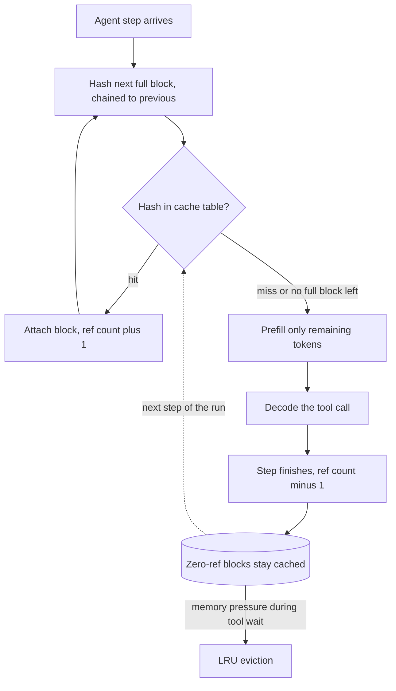

## TL;DR
An agent re-sends its system prompt, tool schemas and trajectory every step. Prefix caching keeps that
prefix's KV cache alive, so each step prefills only the newest tokens, cutting TTFT and compute. Exact
under causal attention, but only for byte-identical beginnings.

## For agent builders
- **Why it matters for agents.** Step *n* of an agent loop begins with steps 1 to *n−1*. With a stable,
  append-only transcript each step prefills only the newest tool result; without it, every step
  re-prefills the whole trajectory and step latency and cost climb with step count.
- **Where it shows up in your stack.** Hosted APIs: automatic caching or explicit breakpoints such as
  `cache_control`, and cached-token fields in `usage`. Self-hosted: `--enable-prefix-caching` in vLLM,
  RadixAttention in SGLang, and the router that decides which replica sees step *n*.
- **What you control.** Prompt layout (system prompt and tool definitions first, byte-identical), whether
  history is append-only or rewritten, where timestamps and run ids go, deterministic ordering of retrieved
  chunks and tool lists, and routing every step of a run to the same replica.
- **What you can skip.** The hash-table and radix-tree internals. Know that block keys are chained, that
  the first changed token ends reuse, and how to read hit-rate counters.

## Why it exists
- **Agent prompts are mostly repetition.** A system prompt is the same thousands of tokens on every call; a
  few-shot block is the same examples; turn *n* of a chat begins with turns 1 to *n−1*; an agent loop
  re-sends the whole trajectory every tool step.
- **Repeating it is pure waste.** Prefill is compute-bound and linear in prompt length, so a 3,000-token
  boilerplate prefix costs 3,000 tokens of matmul on every request, producing exactly the same K and V
  vectors every time.
- **The naive fixes fall short.** "Shorten the prompt" has a floor, because instructions, tool schemas and
  examples are there for quality. "Cache the response" only works for identical full prompts, which almost
  never recur beyond FAQs. What recurs is the *beginning*.
- **Causal attention makes the beginning exploitable.** Position *i* attends only to positions ≤ *i*, so a
  prefix's cache is a pure function of the prefix tokens and the weights. One request's first 3,000 tokens
  give bit-for-bit what the next request with the same 3,000 tokens would compute.
- **Paging made it cheap.** The work left is keeping blocks, finding them fast and reclaiming them under
  pressure. Blocks are already the allocation unit, so sharing is a reference count, not a copy.

## How it works
### Content-addressed blocks
- **A prefix is a sequence of full blocks.** The engine hashes each block's content, typically the hash of
  the previous block combined with this block's token ids.
- **So a key encodes everything before the block,** not just its own 16 tokens. That matters because the
  same 16 tokens at a different position, or after a different prefix, have different K and V (position
  and preceding context both feed in).
- **Agent consequence:** an edit at step 3 of a transcript invalidates every block after it, including all
  later steps, even if they are unchanged.

### Lookup on arrival
1. **Walk the prompt** block by block at admission, computing hashes and looking each up.
2. **Take the longest chain of hits from the start** as the cached prefix.
3. **Attach those physical blocks** to the new request's block table and increment their reference counts.
4. **Prefill only the remaining tokens.** In some engines a partial last block is always recomputed,
   because only full blocks are cached.
- **TTFT drops** in proportion to the fraction of the prompt that hit. For an agent step that is usually
  everything except the latest tool call and result.

### Two payoffs: compute and memory
| Payoff | Arithmetic (8B model, illustrative peak rates) |
|---|---|
| **Prefill compute** | A 3,000-token prefix is 2 × 8e9 × 3,000 ≈ 48 TFLOPs, on the order of 50 ms on one GPU, against a millisecond or two for a 50-token question. With a hit, TTFT is dominated by the question and the queue |
| **Capacity** | Requests sharing a prefix point at the same physical blocks. 100 concurrent requests with that prefix (at 128 KB per token, ~390 MB each) hold one copy instead of 100: roughly 39 GB returned to live sequences |

- **On long shared prefixes the capacity win is often worth more than the TTFT gain,** because it raises
  the batch size. Many concurrent agent runs sharing one tool-schema block is exactly this case.

### Lifetime and eviction
- **Zero-reference blocks stay cached.** When a request finishes, its blocks are not returned to the free
  list; they stay in the cache table, reclaimable in LRU order when live sequences need memory.
- **Tool waits are the danger window.** Between steps, an agent's transcript has no running request, so its
  blocks are zero-reference and evictable while the tool runs.
- **Load decides residency.** Under light load a system prompt stays resident indefinitely; under heavy
  load it is evicted and recomputed. The hit-rate metric tells you which regime you are in.
- **Two data structures, same behaviour.** SGLang uses a radix tree, so requests sharing a long ancestor
  and diverging late reuse the ancestor and evict leaves first. vLLM's hash table reaches the same
  behaviour with per-block LRU.

### What counts as "the same prefix"
- **Token identity, not semantic similarity.** A single different token invalidates every block from that
  point on.
- **Classic mistakes:** a timestamp, request id, user name, step counter or randomly ordered retrieval
  results or tool list near the top of the prompt.
- **Layout rule for an agent prompt:**
  1. Stable content first: system prompt, tool definitions, few-shot examples.
  2. Slowly changing content next: conversation history, the append-only trajectory, documents.
  3. The volatile part last: the current question, current time, latest tool result.
- **Chat templates must be stable too.** A template that emits the date, or formats the system prompt
  differently when tools are present, silently breaks sharing.
- **The key covers everything that changes K and V.** A different LoRA adapter or different image inputs
  produce different caches, so engines mix those identities into the block hash, and two tenants on
  different adapters never share.

### Multi-replica serving
- **A cache lives on one GPU.** Behind a plain load balancer, an agent's next step lands on a replica that
  has never seen its trajectory.
- **Options:** sticky routing by tenant, conversation or agent run id, consistent hashing on a prefix hash
  computed at the router, or a router that queries replicas' cache state.
- **Without one,** fleet hit rate is far below a single replica's, and the problem is routing, not the
  engine.

### Managed APIs
- **Same mechanism, different controls.** Some providers cache automatically above a minimum prompt
  length; others need explicit cache breakpoints in the request.
- **Pricing shape:** most price cached input tokens at a fraction of normal input, and some (Anthropic's
  explicit breakpoints, for example) also charge a premium to write an entry. Lifetime is short (minutes) unless refreshed, so a slow tool call can outlive it.
- **Look the numbers up, do not memorize them,** because rules differ per provider and change over time.
  The discipline is identical: stable prefix first, measure hit rate, keep volatile content out of the top.

### Sampling independence and correctness
- **The cache stores K and V, not outputs,** so it is independent of temperature, seed and sampling
  settings; reuse never changes the sampled distribution.
- **One numerical subtlety:** with batched kernels, a prefix cached in one batch shape may differ in the
  last bits from a fresh prefill in another, so cached and uncached runs are not always bit-identical even
  at temperature 0. Agent evals should not demand bit-identical trajectories.

## Diagram
On arrival the engine walks the prompt's chained block hashes; the first miss ends reuse, and only the
remaining tokens (for an agent step, the newest tool result) are prefilled.



## Misconceptions
- **"Prefix caching is a semantic cache that reuses answers to similar prompts."** It reuses K and V for
  a byte-identical token prefix and still runs the model on the rest. Similar wording, a reordered tool
  list or a different chat template is a miss.
- **"Serving from the cache changes what the model samples."** The cache holds K and V, which causal
  attention makes a pure function of the prefix and the weights, so reuse is exact and independent of
  temperature or seed. Batched kernels can still differ in the last bits, so do not demand bit-identical
  trajectories.
- **"One volatile token costs only that token."** Block keys chain the previous key, so the first changed
  token invalidates every later block. A step id placed before the system prompt turns 19,548 prefill
  tokens into 127,510 over a 10-step run, about 6.5x.
- **"Enabling `--enable-prefix-caching` is enough on a fleet."** The cache lives on one GPU. Behind
  round-robin routing an agent's next step usually lands on a replica that never saw its trajectory, so
  route by run or conversation id.
- **"Once cached, my agent's prefix stays cached."** Between steps its blocks have zero references and
  are LRU-evictable under load, and hosted caches expire after minutes, so a slow tool call can outlive
  the entry.
- **"The payoff is only lower TTFT."** Requests sharing a prefix share physical blocks. 100 concurrent
  requests on a 3,000-token prefix hold one copy instead of 100, roughly 39 GB returned to live
  sequences, which raises the batch size.

## Examples
### Agent scenario: prefill tokens for a 10-step run, simulated
Pure Python, no GPU. A 6,000-token prefix (system prompt plus tool schemas), 1,500 tokens appended per step
(tool call plus result). The only difference between runs is one step id placed before the system prompt.

```python
import hashlib

BLOCK = 16

def block_hashes(ids):
    out, prev = [], b""
    for i in range(0, len(ids) - len(ids) % BLOCK, BLOCK):
        prev = hashlib.sha256(prev + str(ids[i:i + BLOCK]).encode()).digest()
        out.append(prev)
    return out

def run_agent(header, steps=10, prefix=6000, per_step=1500):
    """Total prefill tokens for one agent run; header(step) is what precedes the system prompt."""
    cache, transcript, prefilled = set(), [], 0
    for s in range(steps):
        prompt = header(s) + list(range(prefix)) + transcript
        hit = 0
        for h in block_hashes(prompt):
            if h not in cache:
                break                                   # first miss ends reuse
            hit += BLOCK
        prefilled += len(prompt) - hit
        cache.update(block_hashes(prompt))
        transcript += [100_000 + s * per_step + j for j in range(per_step)]  # tool call + result
    return prefilled

print("stable prefix    :", run_agent(lambda s: []))              # 19548
print("step id at top   :", run_agent(lambda s: [900_000 + s]))   # 127510
```

| Run | Prefill tokens over 10 steps | Per step after step 1 |
|---|---|---|
| Stable prefix, append-only | 19,548 | ~1.5k (the newest tool result) |
| Step id before the system prompt | 127,510 | the whole prompt, growing by 1.5k each step |

- **About 6.5x more prefill** from one token, because chained hashes make every later block miss.

### Measure prompt layout in vLLM's offline engine
The two prompt styles contain identical content; only the position of the volatile part changes.

```python
import time
from vllm import LLM, SamplingParams

llm = LLM("meta-llama/Meta-Llama-3-8B-Instruct", enable_prefix_caching=True,
          max_model_len=8192, gpu_memory_utilization=0.9)
sp = SamplingParams(temperature=0, max_tokens=32)

system = "You are a contracts assistant.\n" + ("Policy clause.\n" * 400)   # ~1.2k+ tokens, stable
questions = [f"Question {i}: does clause {i} allow early termination?" for i in range(20)]

def run(prompts):
    llm.generate(prompts[:1], sp)                      # warm: first call pays full prefill
    t = time.perf_counter(); llm.generate(prompts[1:], sp)
    return (time.perf_counter() - t) / (len(prompts) - 1)

good = [f"{system}\n{q}" for q in questions]                               # stable prefix first
bad  = [f"Request-id: {i}\n{system}\n{q}" for i, q in enumerate(questions)]  # volatile token first

print(f"stable-first : {run(good)*1000:.0f} ms/request")
print(f"volatile-first: {run(bad)*1000:.0f} ms/request")
# Expect the stable-first layout to be markedly faster per request: the >1k-token
# policy block hits the cache on every call. The volatile-first layout misses on
# every block because the first few tokens differ, so every request re-prefills the whole block.
# llm.llm_engine metrics (or the server's /metrics endpoint) expose the prefix hit rate.
```

- **Confirm with the counters, not only the timer.** On a server, the prefix-cache query and hit counters
  on `/metrics` give the hit rate directly; timings on a small offline run are noisy.

### Why one early token kills every later hit: a block-hash simulator
Each block's key chains the previous key, exactly as described above.

```python
import hashlib

BLOCK = 16

def block_hashes(token_ids):
    """Chained hash per full block: each key covers the whole prefix up to that block."""
    hashes, prev = [], b""
    for i in range(0, len(token_ids) - len(token_ids) % BLOCK, BLOCK):
        h = hashlib.sha256(prev + str(token_ids[i:i + BLOCK]).encode()).digest()
        hashes.append(h); prev = h
    return hashes

def cached_tokens(cache, token_ids):
    hit = 0
    for h in block_hashes(token_ids):
        if h not in cache: break          # longest chain of hits from the start
        hit += BLOCK
    cache.update(block_hashes(token_ids))
    return hit

system = list(range(1000, 4000))          # 3,000 stable "system prompt" tokens
cache = set()
for turn, q in enumerate([[1, 2, 3] * 10, [4, 5, 6] * 10]):
    print("stable-first  turn", turn, cached_tokens(cache, system + q))   # 0, then 2992
cache = set()
for req_id in (7, 8):
    print("id-first   request", req_id, cached_tokens(cache, [req_id] + system))  # 0, 0
```

- **2992, not 3,000:** the block holding the system prompt's last 8 tokens also holds question tokens, so
  it differs and is recomputed.
- **The id-first layout never hits,** because the first block differs and every chained key after it does
  too.

### Worked scenario: an agent loop on a four-replica fleet
A 4k-token system prompt plus a growing trajectory, 10 tool steps per task, illustrative.

| Setup | What prefills each step | Fleet effect |
|---|---|---|
| Timestamp at the top, round-robin routing | the whole prompt, every step | TTFT grows with trajectory length; hit rate near zero |
| Timestamp moved to the end, still round-robin | the shared system prompt hits once each replica is warm, but the trajectory since that replica last saw the task re-prefills on most steps (the previous step's replica comes back only about 1 time in 4) | fleet hit rate well below what one replica serving the whole task would reach |
| Stable prefix and routing by conversation id | only the newest tool result | step latency stops growing, except the decode-side cache-read term |

## Production patterns
- **Lint agent prompt templates for cache stability.** In CI, render each template twice with different
  volatile inputs (time, user, request id, step number) and assert that the token ids of the stable section
  are identical. Also serialize tool lists in a fixed order. Monitor prefix hit rate per route after every
  template change.
- **Route every step of a run to the same replica.** Use consistent hashing on conversation, tenant or
  agent run id at the gateway, or a cache-aware router (SGLang's router offers one), so repeat traffic hits
  a warm replica. Monitor fleet hit rate against single-replica hit rate.
- **Track hit rate and TTFT as a pair, with preemptions.** Enable caching (`--enable-prefix-caching` in
  vLLM, on by default in recent versions) and chart prefix hit rate, TTFT p50/p95 and the preemption
  counter together; a falling hit rate with rising preemptions means the pool is too small.
- **Log cached tokens per agent step from managed-API responses.** Place stable content first and add
  breakpoints where the provider needs them (for example `cache_control` blocks on Anthropic's Messages
  API). Log the cached token counts the response reports (`usage.cache_read_input_tokens` on Anthropic,
  `usage.prompt_tokens_details.cached_tokens` on OpenAI) per step, and alert when a step after the first
  reads near zero.
- **Compact history at a boundary, not every step.** Summarizing or trimming earlier turns invalidates
  every block after the edit. Do it once when context nears the limit, accept one miss, then append again.
- **Isolate untrusted tenants.** Where cross-tenant timing probes matter, give tenants separate replicas or
  a per-tenant salt in the block hash (vLLM accepts a per-request `cache_salt`). Monitor per-tenant hit
  rate to confirm sharing only happens within a tenant.

## Trade-offs
- **Skipped prefill vs held VRAM.** It cuts TTFT and GPU time for shared prefixes and agent trajectories,
  but holds cached blocks live sequences could use. The gain reverses when the pool is tight and cached
  blocks keep getting evicted, for example during long tool waits.
- **Layout discipline vs prompt freedom.** Stable-first, volatile-last improves hit rate but constrains
  prompt design (no "current time" in the system prompt). It becomes irrelevant when prompts share nothing
  beyond a short system line.
- **Append-only history vs context size.** Never editing history maximizes hits but lets the transcript
  grow; compaction saves tokens and memory at the cost of one full re-prefill per compaction.
- **Cache-aware routing vs load balance.** It raises fleet-wide hit rate but concentrates a tenant's or a
  run's traffic on one replica. Worth it when prefixes are long and tenants are many.
- **Managed-API write premium vs read discount.** Where the provider charges for writes, they cost more
  than plain input and reads cost less. It pays once a prefix is reused a few times within the cache lifetime, as in any multi-step agent
  run, and loses money on one-off prompts.

## Pitfalls
- **A timestamp, request id or user name at the top of the prompt.** Symptom: hit rate near zero despite a
  long identical system prompt, and agent step latency that grows every step. Fix: move volatile fields to
  the end of the prompt.
- **Retrieval results or tool lists before the question in a non-deterministic order.** Symptom: hits only
  on the system prompt, never on the document block, with TTFT still scaling with retrieved length. Fix:
  sort retrieved chunks deterministically (for example by document id) and serialize tools in fixed order.
- **Rewriting earlier turns on every step.** Symptom: cached tokens drop to the system-prompt length on
  every step even though the prefix looks stable. Fix: keep the trajectory append-only and compact only
  at a boundary.
- **Round-robin load balancing across replicas.** Symptom: single-replica hit rate far higher than the
  fleet's, and TTFT that depends on which replica the request landed on. Fix: route by conversation or
  tenant id.
- **Measuring hit rate on a benchmark that replays one prompt.** Symptom: 95% hits on the dashboard and 20%
  in production, because real conversations diverge after the system prompt. Fix: replay sampled
  production traffic or recorded agent trajectories.
- **Assuming the cache stores responses.** Symptom: confusion when the same prompt yields different text at
  non-zero temperature, which is expected because only K and V are reused. Fix: use a response cache for
  repeated full prompts.
- **One prefix cache across mutually untrusted tenants.** Invisible in metrics, but a hit is measurably
  faster than a miss, so a tenant can probe whether someone recently sent a given prefix (a timing side
  channel). Isolate tenants by replica or mix a per-tenant salt into the block hash, which some engines
  support, at the cost of cross-tenant hits.

## When to use
- **Use when** prompts share a long common beginning: product system prompts, few-shot blocks, tool
  schemas, multi-turn chat, and agent loops that re-send the trajectory each step. That is the majority of
  production workloads and almost every agent.
- **Measure** prefix hit rate (or cached tokens per agent step) and TTFT before and after, and check the
  preemption counter to confirm cached blocks are not starving live sequences.
- **Expect little** for single-shot workloads with unique prompts, such as bulk document summarization.
- **On managed APIs,** put the stable part first and add explicit cache breakpoints where the provider
  requires them.
- **Interviews:** explain why causal attention makes reuse exact, why one changed token invalidates
  everything after it, and how routing affects fleet hit rate.

## Role lens
- **Engineer:** Restructures prompts so stable content comes first, enables the flag or cache
  breakpoints, and tracks hit rate and TTFT as a pair in the serving dashboard.
- **Architect:** Decides on cache-aware routing versus simple load balancing and how much of the pool
  cached prefixes may hold, trading hit rate against live concurrency.
- **FDE:** Audits a customer's prompt templates for volatile tokens near the top and shows the TTFT and
  cost difference with a before-and-after measurement on their traffic.

## Check yourself
**Q:** A customer's agent loop sends a 4k-token system prompt plus the growing trajectory on every tool
step, and complains that each step's latency grows and that prefix caching "does not work" on their
four-replica deployment. What would you check, and what would you change?
**A:** First confirm the prefix really is identical across steps: look for a timestamp, step counter or
freshly serialized tool list near the top, and check that the chat template emits the system prompt
identically whether or not tools are present. Second, check routing: four replicas behind round-robin
means each step lands on a replica that likely has not seen the prefix, so the fleet hit rate is poor
even if the engine's is fine; route by conversation id or prefix hash so a trajectory sticks to one
replica. Third, verify the trajectory is append-only: if the agent rewrites or summarizes earlier steps,
every block after the edit is invalidated, which is correct behaviour and must be weighed against context
savings. Finally check the preemption and eviction metrics; if the pool is saturated the cached blocks are
being evicted between steps, and the fix is memory or admission limits, not the cache flag. With those in
place, each step should prefill only the newest tool result, and step latency should stop growing with
trajectory length except for the decode-side cache-read term.

## Interview questions
### Why is prefix caching exact rather than an approximation?
- **Causality:** K and V at position *i* depend only on tokens ≤ *i* and the weights, so a byte-identical
  prefix yields bit-for-bit the same cache (up to batch-shape floating-point differences).
- **It stores K and V, not outputs,** so sampling settings are untouched and reuse never changes the
  distribution the model samples from.

### How does an engine find a cached prefix, and why are block hashes chained?
- **Lookup:** hash each full block in order and take the longest run of hits from the start; attach those
  blocks and prefill the rest.
- **Chaining:** each key combines the previous block's hash with this block's tokens, because the same 16
  tokens after a different prefix have different K and V. One early difference therefore misses every
  later block.

### Your agent fleet's hit rate is 70% on one replica but 20% fleet-wide. What do you change?
- **Diagnosis:** routing, not the engine. Round-robin sends each agent step to a replica that likely never
  prefilled that run's trajectory.
- **Fix:** consistent hashing on conversation, tenant or run id, or a cache-aware router; then watch for
  hot replicas, since locality concentrates load.

### An agent's cached input tokens fall to near zero on every step after a prompt refactor. How do you find the cause?
- **Diff two rendered prompts token by token** from consecutive steps of one run and find the first
  differing position; everything after it misses.
- **Usual culprits:** a timestamp or step counter moved into the system prompt, tool schemas serialized in
  a different order, or history rewritten each step.
- **Prevent it** with a CI lint that renders templates with different volatile inputs and asserts the
  stable section's token ids match.

### When would you turn prefix caching off or isolate it?
- **Mutually untrusted tenants:** hit latency leaks whether someone else sent a prefix, so isolate by
  replica or salt the hash per tenant.
- **Unique-prompt bulk jobs:** little to gain while cached blocks compete with live sequences.
- **A saturated pool:** evictions make hits rare, and the fix is memory or admission limits.

### Estimate what a 3,000-token shared system prompt saves on an 8B model at 100 concurrent requests.
- **Compute:** about 48 TFLOPs per request, roughly 50 ms of prefill at illustrative peak rates, skipped on
  every hit.
- **Memory:** ~390 MB of cache per request at 128 KB per token; one shared copy instead of 100 returns about
  39 GB to live sequences, which raises batch size.

## Quiz
### Q: Why can the KV cache of a prompt prefix be reused exactly by a different request?
- [ ] Because the engine stores the model's output for that prefix
- [x] Because with causal attention, K and V at each position depend only on the tokens before it, so an identical prefix yields identical cache
- [ ] Because the attention weights are averaged across requests
- [ ] Because prefix tokens are not attended to by later tokens
> Causality makes the cache for positions 1..n a pure function of tokens 1..n. Nothing that follows can
> change it, so the vectors computed once are correct for any request beginning with those tokens. Outputs
> are not stored; later tokens do attend to the prefix.

### Q: A system prompt is 3,000 tokens and byte-identical across requests, but the measured hit rate is near zero. What is the most likely cause?
- [ ] The system prompt is too long to cache
- [ ] Temperature is set above zero, which disables caching
- [x] A volatile token such as a timestamp or request id appears before the system prompt in the rendered prompt
- [ ] The model uses grouped-query attention, which is incompatible with prefix caching
> Block hashes include everything before the block, so any difference at the start changes every hash.
> Length is not a problem, sampling settings do not affect K and V, and GQA simply makes the cache smaller.

### Q: What is the main reason prefix caching under-delivers on a multi-replica deployment?
- [ ] Each replica has a smaller KV pool, so eviction is more frequent
- [x] Without cache-aware routing, repeat requests land on replicas that have not computed the prefix
- [ ] Hashes are computed differently on each replica
- [ ] Replicas cannot share GPU memory over the network
> The cache is local to a GPU. If a load balancer spreads a tenant's requests across replicas, most of them
> are cold on arrival. Sticky or hash-based routing fixes it; the engine was never the problem.

## Use cases & projects
### Use cases
- **Long-running coding and research agents.** An append-only transcript with a stable prefix keeps step
  20's prefill close to step 2's, so latency and cost stop growing with step count.
- **Many agents sharing one toolset.** Concurrent runs that share the same system prompt and tool schemas
  point at one physical copy of those blocks, which raises how many runs a replica holds.
- **Multi-turn support assistants on hosted APIs.** Cache breakpoints after the system prompt and history
  turn most input tokens into discounted cached reads.
- **Multi-replica agent platforms.** Routing by run id is what turns a single-replica hit rate into a
  fleet-wide one.

### Mini project
**Prefix-stability audit for an agent loop (1-2 hours).**
- **Goal:** prove which parts of your agent's prompt break caching, and fix them.
- **Steps:** build a 10-step agent with two fake tools; log input and cached-input tokens per step from the
  provider usage fields (or vLLM's `/metrics` when self-hosting); run it once as written, once with a
  timestamp injected before the system prompt, and once rewriting the oldest turn every step; then add a
  CI test that renders the template twice with different volatile inputs and compares stable token ids.
- **Done when:** you have a per-step table for all three runs, the baseline's cached tokens climb on every
  step after the first, and the CI test fails on the timestamp variant.
