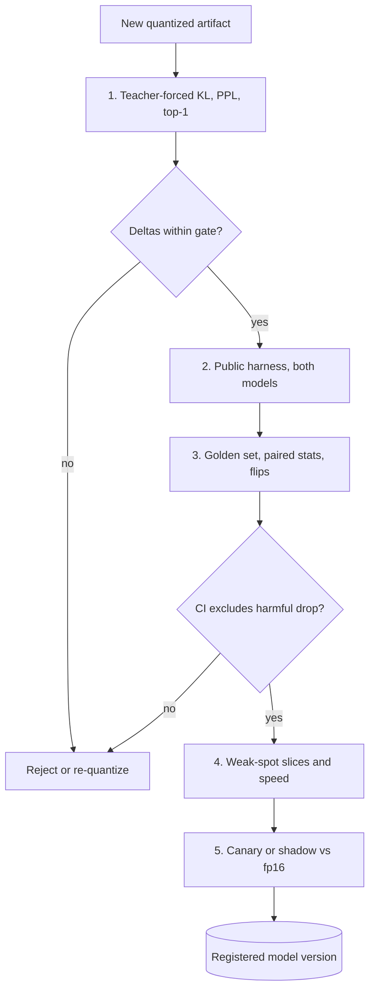

## TL;DR
Measure a quantized model against its own full-precision baseline on your workload. KL divergence and
perplexity are cheap early signals and paired golden-set evals the acceptance test; long context, math,
code, strict formats and rare languages break first, and averages hide it.

## Why it exists
- **The pressure to quantize is constant.** A 4-bit checkpoint lets a 70B model fit where a 16-bit one did
  not and roughly quarters the bytes decode must stream. The Training & adaptation lesson covers *how*
  GPTQ, AWQ, int8 and fp8 work; this one is about *whether the result is still the model you tested*.
- **Model cards invite a bad inference.** A card says something like "perplexity 5.47 → 5.62 on
  WikiText-2" (illustrative numbers), and teams read that as "lossless enough" and deploy.
- **Perplexity averages away the decisive tokens.** It averages log-loss over every token of generic text,
  and most tokens are easy. A task often hinges on a few (a digit, a function name, a closing brace) whose
  probabilities can shift a lot while the average barely moves.
- **Error concentrates where you were not looking.** GPTQ or AWQ calibration data, often a few hundred
  segments of web text, may not resemble your domain. Outlier activation channels, which LLM.int8() showed
  emerge above a few billion parameters, make some layers far more fragile than others.
- **Small eval sets are noisy.** With a few hundred items the noise exceeds the effect you are hunting, so
  a naive "accuracy dropped 1%" is often meaningless either way. Trusting vendor benchmarks or eyeballing
  chats fails on the rare, high-stakes behaviours production exposes at scale.

## How it works
A layered measurement from cheap distribution fidelity to expensive task evidence, always with the
full-precision model as the control.

### Step 1: distribution fidelity with teacher forcing
Run the same fixed text through both models and compare next-token distributions position by position.
The forced identical context isolates quantization error from sampling and from divergence after a first
wrong token. One pass gives three numbers:

| Signal | What it is | Why |
|---|---|---|
| Perplexity delta | on held-out text: WikiText-2 and C4 are conventional, plus a sample of *your* domain text | calibration mismatch shows on your domain |
| Mean KL divergence | per-token KL from the fp16 distribution to the quantized one | catches distribution moves even when perplexity improves by accident; the most sensitive cheap signal |
| Top-1 agreement | fraction of positions where both argmax tokens match | under greedy decoding, a direct proxy for how often the quantized model goes a different way |

- **The KL formula** is `KL(P_fp16 || P_quant)`, summed over the vocabulary at each position and averaged
  over positions.
- **Look at the KL tail too** (99th-percentile or maximum per-token KL), *because* damage concentrates on
  a few positions and a small mean can hide a handful of badly wrong ones.
- **Tooling.** llama.cpp's perplexity tool can save full-precision logits and report KL statistics,
  including percentiles, against a quantized run.
- **Put it in CI.** These are deterministic and take minutes, so they belong in CI for every new quantized
  artifact.

### Step 2: public benchmarks, run yourself
- **Re-run a standard harness** (EleutherAI's lm-evaluation-harness is the usual one) on both models with
  identical settings.
- **What survives:** knowledge-style multiple choice (MMLU-type) tends to survive 4-bit well.
- **What breaks first:** multi-step arithmetic (GSM8K-type), code generation (HumanEval-type) and
  instruction-following format checks (IFEval-type).
- **Report the delta, not the absolute score,** with a confidence interval.

### Step 3: your golden set, your graders
1. **Same everything:** the release golden dataset, *same* prompts, *same* system prompt, *same* decoding
   parameters.
2. **Greedy first** to remove sampling noise, then repeat with the production configuration over several
   seeds.
3. **Same task graders.** For open-ended outputs, use pairwise LLM-as-judge with the fp16 output as the
   reference and randomised position.
4. **Paired statistics** (paired bootstrap or a sign test on per-item wins), because every prompt is
   scored under both models. Do not compare two independent means.
5. **Count the flips:** items that went correct → wrong and wrong → correct.

Why pairing matters, on 300 items at 80% accuracy:

| Analysis | Standard error of the difference | 95% interval |
|---|---|---|
| Two independent runs | √(2 × 0.8 × 0.2 / 300) ≈ 3.3 points | about ±6.4 |
| Paired, models disagree on 15 items (5%) | √(0.05 / 300) ≈ 1.3 points | near ±2.5 |

The same data now resolves effects less than half the size.

- **Flips hide in the average.** A model can hold accuracy flat while 10 answers break and 10 others
  happen to improve; the users who owned those 10 broken answers see a regression.
- **Flips cost nothing extra.** The flip count is the discordant count that drives the paired statistics.

### Step 4: stress the known weak spots
Add targeted slices *because* average scores mask them:
- **Long-context retrieval:** needle-style prompts at your maximum context, especially if the KV cache is
  quantized too.
- **Multilingual prompts, numbers and dates.**
- **JSON or tool-call validity rates.**
- **Refusal or safety behaviour,** which can shift in either direction.
- **Speed:** weight-only 4-bit helps bandwidth-bound decode, but some kernels slow prefill through
  dequantisation overhead, so a "faster" model can raise time to first token.

### Step 5: production confirmation
- **Canary or shadow** the quantized model and compare task metrics and user-facing signals against the
  fp16 fleet before full rollout.
- **Register it as a new model version** with its own evaluation record, because that is what it is.

### Knowing where damage comes from
| Scheme | Behaviour |
|---|---|
| Weight-only (W4A16: GPTQ, AWQ, NF4) | activations stay 16-bit; usually little loss on 7B-and-larger models; smaller models lose more at the same bit width |
| Weight-and-activation (W8A8 int8, fp8) | faster tensor-core math for prefill and large batches, but must handle activation outliers (what SmoothQuant-style scaling and fp8's dynamic range address) |
| KV cache fp8 | generally reported as low-impact |
| KV cache 4-bit | where long-context retrieval tends to degrade |

- **"4-bit" is not one thing.** Group size, per-channel versus per-tensor scales and the calibration set
  all move the result, so two "4-bit" files of the same model can differ more from each other than either
  differs from fp16.

## Diagram
The evaluation ladder: each rung is more expensive and closer to real outcomes, and a failure at any
gate stops the artifact before the next rung.



## Examples
### Teacher-forced comparison: KL, top-1 agreement, perplexity
Compares a full-precision model and its 4-bit counterpart on domain text. Run it on your own text, not
only WikiText, and gate on the deltas before investing in slower task evals.

```python
import math, torch, torch.nn.functional as F
from transformers import AutoModelForCausalLM, AutoTokenizer, BitsAndBytesConfig

name = "Qwen/Qwen2.5-0.5B"                        # swap in the checkpoint you plan to ship
tok = AutoTokenizer.from_pretrained(name)
fp16 = AutoModelForCausalLM.from_pretrained(name, torch_dtype=torch.float16, device_map="cuda").eval()
q4 = AutoModelForCausalLM.from_pretrained(
    name, device_map="cuda",
    quantization_config=BitsAndBytesConfig(load_in_4bit=True, bnb_4bit_quant_type="nf4",
                                           bnb_4bit_compute_dtype=torch.float16)).eval()

texts = open("domain_sample.txt").read().split("\n\n")[:200]   # YOUR domain, same text for both
kl = agree = nll16 = nll4 = n = 0
with torch.no_grad():
    for t in texts:
        ids = tok(t, return_tensors="pt", truncation=True, max_length=1024).input_ids.cuda()
        lp = F.log_softmax(fp16(ids).logits[0, :-1].float(), -1)   # predictions for positions 1..T
        lq = F.log_softmax(q4(ids).logits[0, :-1].float(), -1)     # identical context: teacher forced
        tgt = ids[0, 1:]
        kl += (lp.exp() * (lp - lq)).sum(-1).sum().item()           # KL(P_fp16 || P_q4), summed
        agree += (lp.argmax(-1) == lq.argmax(-1)).sum().item()
        nll16 += -lp.gather(1, tgt[:, None]).sum().item()
        nll4 += -lq.gather(1, tgt[:, None]).sum().item()
        n += tgt.numel()
print(f"tokens={n}  mean KL/token={kl/n:.4f}  top-1 agreement={agree/n:.2%}")
print(f"ppl fp16={math.exp(nll16/n):.3f}  ppl 4bit={math.exp(nll4/n):.3f}")
# Next: run the golden set under both models with identical decoding and compare with paired bootstrap.
```

### Paired bootstrap with flip counts on a golden set
Pure Python, runnable as is. Feed it per-item correctness for both models on the same prompts; it
reports the delta, a 95% interval and the list of broken items someone must read.

```python
import random

def paired_report(fp16_ok, quant_ok, n_boot=5000, seed=0):
    """fp16_ok, quant_ok: per-item 0/1 correctness on the SAME prompts and decoding."""
    assert len(fp16_ok) == len(quant_ok)
    n = len(fp16_ok)
    diffs = [q - f for f, q in zip(fp16_ok, quant_ok)]       # -1 broke, +1 fixed, 0 same
    broke, fixed = diffs.count(-1), diffs.count(1)
    rng = random.Random(seed)
    boots = sorted(sum(rng.choice(diffs) for _ in range(n)) / n for _ in range(n_boot))
    lo, hi = boots[int(0.025 * n_boot)], boots[int(0.975 * n_boot)]
    print(f"n={n} delta={sum(diffs)/n:+.1%} 95% CI [{lo:+.1%}, {hi:+.1%}] "
          f"broke={broke} fixed={fixed}")
    return [i for i, d in enumerate(diffs) if d == -1]       # items someone must read

# Illustrative: 300 items, fp16 at 80%, 15 disagreements (10 broke, 5 fixed)
fp16 = [1] * 240 + [0] * 60
quant = fp16.copy()
for i in range(10):
    quant[i] = 0                                            # correct -> wrong
for i in range(240, 245):
    quant[i] = 1                                            # wrong -> correct
print("read these:", paired_report(fp16, quant))
# n=300 delta=-1.7% 95% CI [-4.3%, +0.7%] broke=10 fixed=5
```

The interval straddles zero, so the net number alone is inconclusive, yet ten specific answers broke.
Read them: if they share a pattern (dates, long inputs, JSON), that slice is the real finding.

## Production patterns
- **KL gate in CI for every artifact.** When a new quantized file is built, run a teacher-forced pass on a
  fixed domain sample (the script above, or llama.cpp's perplexity tool saving base logits and comparing
  KL). Fail the build if mean or 99th-percentile KL exceeds the threshold set from earlier good artifacts.
- **Harness runs on both models, same config.** Run lm-evaluation-harness against fp16 and quantized
  builds in the same job, for example `lm_eval --model hf --model_args pretrained=<path> --tasks
  gsm8k,ifeval`, and store the deltas with intervals. Watch the reasoning, code and format tasks.
- **Paired golden-set gate with a flip review.** Use the release golden set, greedy decoding, paired
  bootstrap, and require a human to read every correct → wrong flip before approval. Track flip counts per
  slice over releases.
- **Change one thing at a time.** Evaluate weight quantization and KV-cache quantization (for example
  vLLM's `--kv-cache-dtype fp8`) as separate candidates, so long-context loss is attributed correctly.
- **Shadow before rollout.** Mirror a slice of production traffic to the quantized deployment, compare
  task metrics and JSON validity against the fp16 fleet, and keep the quantized build as its own
  registry version with its evaluation record.

## Trade-offs
- **Cheap signals vs task truth.** Perplexity and KL are cheap and sensitive, but they measure
  distribution drift on fixed text, not task outcomes; a model can pass them and still fail a
  format-critical workflow.
- **Golden-set evals vs cost and noise.** They are the real acceptance test, yet they cost GPU time and
  need enough items for paired statistics; on small sets judge disagreement can exceed the quantization
  effect.
- **Greedy vs sampled comparison.** Greedy gives a clean comparison but is not how production runs;
  sampled comparisons are realistic but need several seeds to average out noise.
- **Strict thresholds vs serving cost.** Stricter acceptance protects quality but can block a quantization
  that would have cut serving cost in half; the right threshold depends on what the task's errors cost.

## Pitfalls
- **Comparing against a published fp16 score.** Re-run the fp16 model yourself under identical prompts and
  settings; otherwise the "regression" is really a harness difference.
- **Judging by chat impressions.** Fluency survives quantization long after arithmetic, code and
  long-context recall have degraded, so the demo looks fine and the eval does not. Fix: run the ladder,
  starting with the weak-spot slices.
- **Ignoring the calibration set.** A GPTQ or AWQ file calibrated on English web text can degrade
  noticeably on code or another language. The tell is a domain KL far above the WikiText KL.
- **Quantizing weights and KV cache at once** and attributing any loss to the weights. Test them
  separately, since long-context failures usually trace to the cache.
- **Calling a 0.8-point drop "within noise" or "significant"** without a confidence interval from paired
  per-item results.
- **Reporting only net accuracy.** Equal numbers of fixed and broken items cancel in the mean. Symptom: an
  eval that says "no change" followed by specific, reproducible complaints from production users. Fix:
  report broke and fixed counts and read every broken item.

## When to use
- **Run the full ladder** whenever a quantized artifact is a production candidate: a new checkpoint, a new
  quantization method or group size, a new engine kernel, or KV-cache quantization.
- **Gates:** make steps 1 and 3 mandatory in the model release pipeline and steps 2 and 4 part of the
  evaluation record. Skip the expensive steps only for throwaway experiments.
- **Weight by business cost:** watch the categories that break first; a support bot may tolerate what a
  code assistant cannot.
- **Interviews:** the expected answer to "how do you know 4-bit is fine?" is this ladder plus why
  perplexity alone is not enough, not a quoted benchmark number.

## Role lens
- **Engineer:** Owns the teacher-forced comparison script and the golden-set run, with paired statistics,
  wired into CI so every quantized artifact gets a delta report automatically.
- **Architect:** Sets the acceptance thresholds per use case and the policy that quantized models are
  registered, evaluated and rolled out as distinct model versions.
- **FDE:** Builds the domain text sample and golden set from the customer's own data, and shows them the
  measured quality-versus-cost curve before recommending a quantized deployment.

## Check yourself
**Q:** A team reports that their 4-bit model's WikiText perplexity rose by 2% and MMLU dropped by 0.3
points, and concludes it is safe for their contract-extraction product. What would you push back on?
**A:** Both signals are generic. WikiText perplexity averages over easy tokens of encyclopaedic prose,
and MMLU is multiple choice, which is the category that survives quantization best. Contract extraction
depends on long inputs, exact numbers and dates, and valid structured output, which are exactly the
categories that degrade first, and none were measured. I would ask for KL and top-1 agreement on a sample
of their contracts, a paired comparison of extraction accuracy and JSON validity on their golden set under
identical prompts and decoding, a long-context slice at their maximum document length, separate tests if
the KV cache is quantized, and confidence intervals on every delta, plus the list of flipped items
so someone reads what actually broke. A 0.3-point MMLU drop without an interval is not evidence either
way.

## Interview questions
### Why is perplexity alone not enough to accept a quantized model?
- **It averages over easy tokens.** Tasks hinge on a few decisive tokens (digits, names, braces) whose
  probabilities can move a lot while mean log-loss barely changes.
- **It ignores the rest of the distribution.** KL divergence and top-1 agreement catch shifts in
  alternative tokens, and task evals catch what actually breaks.

### Your 4-bit model passes all benchmarks but users report broken JSON. How do you investigate?
- **Reproduce with a paired slice:** run fp16 and quantized on the same structured-output prompts with
  identical decoding and compare validity rates and flips.
- **Check what changed together:** if the KV cache was also quantized, test it separately; check the
  calibration data's domain.
- **Mitigate:** a different group size or method, an 8-bit build, or constrained decoding for the JSON
  path, then add the slice to the gate.

### How many golden-set items do you need to detect a 2-point drop?
- **Independent runs** at 80% accuracy on 300 items give about ±6.4 points, far too wide.
- **Paired analysis** with ~5% disagreement gives about ±2.5 on the same 300 items, still wider than the
  effect, so 300 is not enough.
- **Solve for n:** a ±2-point half-width needs 0.05 × (1.96 ÷ 0.02)² ≈ 480 items; detecting a 2-point drop
  with 80% power needs roughly 0.05 × ((1.96 + 0.84) ÷ 0.02)² ≈ 980, fewer if disagreement is lower.

### When would you accept a measurable quality drop from quantization?
- **When the error cost is low and the saving is large:** for example a support bot where halving serving
  cost outweighs a small, interval-backed drop on non-critical slices.
- **Never silently:** flips on high-stakes slices are read by a human, and the threshold is set per use
  case, not globally.

### Two "4-bit" builds of the same model behave differently. Why?
- **Different recipes:** group size, per-channel versus per-tensor scales and calibration set all move the
  error, so two files can differ more from each other than from fp16.
- **So** evaluate each artifact, and treat each as its own registered model version.

## Quiz
### Q: Why is per-token KL divergence a better early signal of quantization damage than perplexity alone?
- [ ] KL is cheaper to compute because it does not need the reference text
- [x] KL measures how far the whole next-token distribution moved, so it catches shifts that leave average log-loss almost unchanged
- [ ] Perplexity cannot be computed for quantized models
- [ ] KL directly predicts task accuracy on downstream benchmarks
> Perplexity only scores the probability of the actual next token. KL compares the full distributions,
> so it flags cases where alternative tokens gain or lose mass even when the target token's probability
> is similar.

### Q: Two evaluations of the same quantized model on a 300-item golden set use the same prompts for both models. Which analysis is most appropriate?
- [ ] Compare the two mean accuracies and call any drop above 1% a regression
- [ ] Run the quantized model five times and average, ignoring the fp16 run
- [x] A paired per-item comparison with a bootstrap confidence interval on the difference
- [ ] A chi-squared test on the total number of correct answers
> Because each item is scored under both models, pairing removes item difficulty from the variance and
> makes the test far more sensitive at the same sample size. Independent-mean comparisons waste that
> structure.

### Q: Which category is most likely to show quantization damage first?
- [ ] Short factual multiple-choice questions
- [ ] Casual conversational fluency
- [x] Multi-step arithmetic, code and long-context retrieval with strict output formats
- [ ] Translation between high-resource European languages
> Tasks that hinge on a few decisive tokens over long chains, or on recalling a detail far back in a
> quantized KV cache, amplify small distribution shifts. Fluency and recognition-style tasks are robust.
