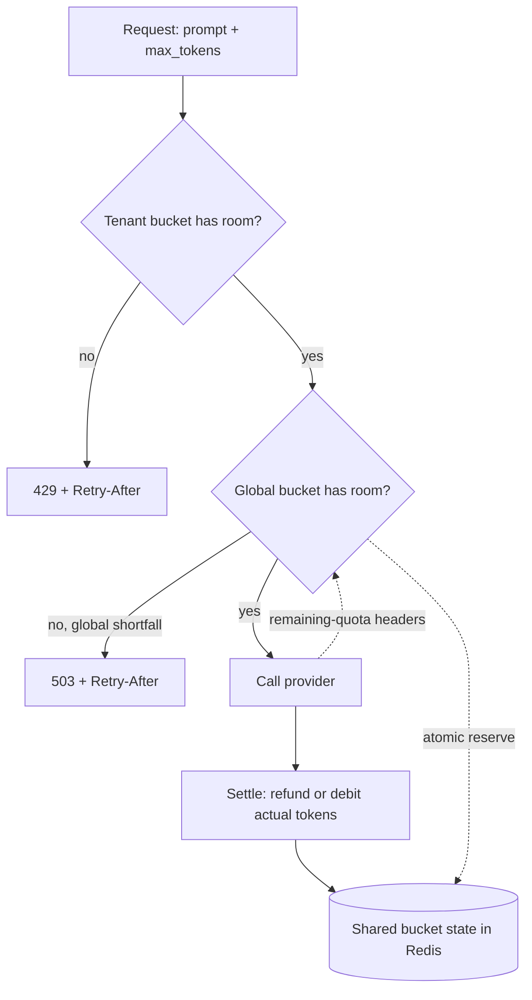

## TL;DR
Rate limiting bounds a caller's work per unit of time: inbound to protect shared GPUs and quota, outbound
to stay under provider request and token limits. Cost is unknown until a request
finishes, so limiters reserve an estimate and settle on the actual.

## Why it exists
- **The resource is shared, finite and expensive.** A provider gives your organisation a quota, typically
  requests and tokens per minute per model, and when it is exceeded the 429s hit every caller in the
  organisation. A self-hosted GPU has a fixed token budget per second.
- **One bad caller hurts everyone.** Without an inbound limiter, one customer's retry loop or one agent
  stuck in a tool cycle exhausts the shared allowance, every other customer sees errors, and the bill
  arrives anyway.
- **"Let the provider's 429 be our limiter" fails four ways.** The blast radius is the whole organisation;
  it is reactive (requests already queued, latency already spent); you cannot prioritise, because the
  provider does not know which tenants matter; and every rejected request comes back as a retry.
- **"Limit requests per minute like any web API" fails too.** One request can carry 200 tokens or 200,000,
  so a request limit is gamed (pack more work per call) and does not protect the resource that runs out:
  tokens.
- **So LLM rate limiting must** be cost-aware, estimate costs before they are known, and run in two
  directions at once.

## How it works
### Units
| Who | Units limited |
|---|---|
| Providers | requests per minute, tokens per minute (sometimes input and output separately, sometimes per day too), occasionally concurrency |
| Your inbound limiter | per-tenant requests, per-tenant tokens and, for agents, steps or dollars per task |

The exact names and tiers vary by vendor and are published in their docs; mirror them inbound.

### Algorithms, and why the token bucket wins here
| Algorithm | How it works | Weakness |
|---|---|---|
| **Token bucket** | capacity *B*, refills at *r* units per second; admit a request costing *c* if the bucket holds at least *c*, then remove it | bursts up to *B* may exceed an upstream's own windowing |
| **Leaky bucket** | requests drain at a fixed rate, smoothing output; equivalent in enforcement (the GCRA formulation) | reshapes bursts into delay rather than admitting them |
| **Fixed window** | a counter per minute | allows 2× the limit across a boundary: full allowance at 0:59 and again at 1:00 |
| **Sliding window log** | store every request's timestamp; exact | memory grows with traffic |
| **Sliding window counter** | weight the previous window's count by its overlap with the current one | approximate, but constant memory; good enough for most inbound limits |

- **Why token bucket:** it permits bursts up to *B* while enforcing a long-run average of *r*, and its
  state is two numbers (level, last refill time).
- **It fits LLM traffic,** which is bursty and cost-weighted; the "tokens" in the name map directly onto
  LLM tokens if you set the units that way.

### Reserve, then settle
Cost = input tokens (countable before sending) + output tokens (known only at the end, but bounded by
`max_tokens`).

1. **Reserve** input plus an output estimate at admission.
2. **Settle** when the response arrives: refund the difference, or *debit* when the actual exceeds the
   estimate, letting the bucket go into debt that later refill pays off. Refunding in only one direction
   turns every underestimate into silent overspend.

| Reservation | Gain | Cost |
|---|---|---|
| Full `max_tokens` | never overshoots | under-uses quota when clients set generous limits |
| Expected output length | uses quota well | occasionally overshoots and takes a provider 429 |

- **Pick by how expensive an overshoot is for you.**
- **Generous `max_tokens` hurts everyone:** clients who set it far above their needs shrink everyone's
  headroom.
- **Check your provider's accounting** before sizing reservations: some count cached prompt tokens
  differently toward input-token limits, and the exact accounting is vendor-specific.

Worked numbers in a bucket with 80,000 tokens of capacity:

| Event | Bucket effect |
|---|---|
| Request reserves a 20,000-token prompt plus `max_tokens` 4,000 | takes 30% of the burst at once |
| It actually generates 600 tokens | settlement returns 3,400 |
| Three such requests arrive together | they hold 72,000 of the 80,000; the fourth waits for refill (or for the first three to settle and refund): the limiter doing its job |
| A single 100,000-token request | can never fit: reject with a non-retryable error, or size the bucket above the largest request you intend to accept |

### Distributed enforcement
Several replicas share one provider quota, so state must be shared or the quota partitioned:

| Option | How | Cost |
|---|---|---|
| Shared state | Redis, with check-and-decrement done atomically in a Lua script | a round trip and a dependency |
| Static partitioning | each of three replicas gets a third | wastes headroom whenever load is uneven |
| Central gateway | one process enforces policy | the usual home for per-tenant policy |

- **Atomicity matters** because two replicas that read, decide and then write will both admit the last
  unit.

### The response contract and the feedback loop
- **Inbound rejections return 429 with `Retry-After`** and remaining-limit headers. A standard set of
  header names is being defined by the IETF; providers currently use their own.
- **Outbound, read the provider's remaining-quota and reset headers** and slow down before the first 429,
  decreasing the local rate when headroom is thin.
- **Keep 429 for "you exceeded your allowance" and 503 for "we are out of capacity";** clients fix them
  differently.

### Fairness and layering
- **Per-tenant buckets** sized from the plan.
- **A global bucket** from the provider quota minus a safety margin: running at around 80% leaves room
  for retries and bursts.
- **Priority borrowing:** high-priority traffic borrows from the global bucket before low-priority does.
- **Refund across layers:** if the tenant bucket admits but the global bucket then rejects, return the
  tenant's reservation, or the tenant is charged for work that never ran.
- **More quota:** multiple keys, workspaces or regions multiply quota when a single bucket is not enough.

## Diagram
Each request passes the tenant bucket, then the shared global bucket, before any provider call; the
settle step afterwards corrects the reservation using the real output length.



## Examples
### Cost-aware token bucket with reserve and settle
Capacity is ten seconds of refill so short bursts are absorbed, the refill rate is 80% of an
illustrative provider limit, and unused reservations are refunded once the real output length is known.
In production the bucket lives in Redis with `try_reserve` as an atomic script.

```python
import time, threading

class TokenBucket:
    """Cost-aware limiter: `capacity` units, refilled continuously at `rate` units/second."""
    def __init__(self, capacity: float, rate: float):
        self.capacity, self.rate = capacity, rate
        self.level, self.updated = capacity, time.monotonic()
        self.lock = threading.Lock()
    def _refill(self):
        now = time.monotonic()
        self.level = min(self.capacity, self.level + (now - self.updated) * self.rate)
        self.updated = now
    def try_reserve(self, cost: float) -> float:
        """Reserve `cost` now. Returns 0 if admitted, else seconds until it would fit."""
        if cost > self.capacity:              # would never fit: reject outright, do not say "retry later"
            raise ValueError("request larger than bucket capacity")
        with self.lock:
            self._refill()
            if self.level >= cost:
                self.level -= cost
                return 0.0
            return (cost - self.level) / self.rate
    def settle(self, reserved: float, actual: float):
        with self.lock:                       # refund unused quota, or debit an overshoot (level may go
            self.level = min(self.capacity, self.level + reserved - actual)   # negative = a debt)

# Illustrative provider limit of 400k tokens/minute; run at 80% to leave headroom for retries.
TPM = 400_000 * 0.8
tpm_bucket = TokenBucket(capacity=TPM / 6, rate=TPM / 60)     # 10 s of burst, ~5,333 tokens/s

def call_llm(prompt_tokens: int, max_tokens: int):
    reserved = prompt_tokens + max_tokens                  # safe estimate; expected output is the alternative
    wait = tpm_bucket.try_reserve(reserved)
    if wait > 0:
        raise RateLimited(retry_after=round(wait, 1))      # inbound: 429 + Retry-After; outbound: sleep
    resp = provider.generate(max_tokens=max_tokens)
    tpm_bucket.settle(reserved, prompt_tokens + resp.usage.output_tokens)
    return resp
```

### The same bucket shared across replicas in Redis
A production shape: the refill-and-reserve runs as one Lua script, so two replicas can never both admit
the last unit. Uses redis-py's `register_script`; calling `TIME` inside a script that then writes needs
Redis 5 or later.

```python
import redis

RESERVE = """
local cap, rate, cost = tonumber(ARGV[1]), tonumber(ARGV[2]), tonumber(ARGV[3])
local t = redis.call('TIME')
local now = tonumber(t[1]) + tonumber(t[2]) / 1000000
local s = redis.call('HMGET', KEYS[1], 'level', 'updated')
local level = math.min(cap, (tonumber(s[1]) or cap) + (now - (tonumber(s[2]) or now)) * rate)
local wait = 0
if level >= cost then level = level - cost else wait = (cost - level) / rate end
redis.call('HSET', KEYS[1], 'level', level, 'updated', now)
redis.call('EXPIRE', KEYS[1], 3600)
return tostring(wait)
"""

r = redis.Redis()
reserve = r.register_script(RESERVE)

def try_reserve(key, capacity, rate, cost):
    if cost > capacity:                    # can never fit: non-retryable error, not an endless Retry-After
        raise ValueError("request larger than bucket capacity")
    return float(reserve(keys=[key], args=[capacity, rate, cost]))   # 0.0 means admitted

def settle(key, reserved, actual):
    # Refund or debit; the next reserve clamps the level back to capacity.
    r.hincrbyfloat(key, "level", reserved - actual)

wait = try_reserve("rl:model:tpm", 53_333, 5_333, 24_000)
```

## Production patterns
- **Two-layer limiter at the gateway.** Per-tenant request and token buckets inbound, one global token
  bucket per provider model outbound, both checked before retrieval or prompt assembly. Monitor
  rejection rate per tenant and upstream 429 rate, which should be near zero.
- **Atomic Redis bucket shared by replicas.** Run reserve as a Lua script (as above) keyed per tenant and
  per model, with a TTL so idle keys expire. Monitor Redis latency on the limiter path, because it now
  sits on every request.
- **Header-driven outbound pacing.** Parse the provider's remaining-requests, remaining-tokens and reset
  headers after each call and lower the local refill rate when headroom is thin. Monitor quota
  utilisation against the provider's limit.
- **Reservation accuracy tracking.** Log reserved versus actual tokens per route; if the ratio drifts far
  from 1, tighten `max_tokens` defaults or switch to expected-output reservations. Monitor the
  reservation-to-actual ratio.
- **Separate keys for heavy workloads.** Give a nightly batch job or a dominant tenant its own provider key
  or workspace, so it cannot starve interactive traffic. Monitor per-key utilisation.

## Trade-offs
- **Bursts vs upstream windowing.** Token buckets admit bursts, which users like, but a burst that fits
  your bucket may still exceed the provider's own windowing; keep burst capacity below what the upstream
  tolerates.
- **Safe vs full reservations.** Reserving `max_tokens` never overshoots but strands quota when clients
  over-specify; reserving an expected output uses quota fully but accepts occasional provider 429s. Pick
  by how costly an upstream rejection is.
- **Shared vs partitioned state.** A shared Redis limiter is exact across replicas at the price of a round
  trip and a dependency; static partitioning is free and sufficient when replicas are few and load is
  even.
- **Isolation vs utilisation.** Strict per-tenant limits guarantee fairness but block legitimate spikes;
  borrowing unused global headroom improves utilisation at the cost of weaker isolation.

## Pitfalls
- **Limiting requests only.** Symptom: provider 429s while your requests-per-minute dashboard is green,
  because long prompts exhausted the token limit.
- **Fixed windows.** Symptom: bursts of upstream 429s at minute boundaries as callers double-spend across
  the edge.
- **Non-atomic check-then-decrement across replicas.** Symptom: overshoot that scales with replica count
  and vanishes in single-instance tests.
- **Never refunding reservations.** Symptom: sustained throughput far below quota while the limiter
  reports itself full.
- **Bucket capacity below the largest legitimate request.** Symptom: a few long-document requests get
  `Retry-After` indefinitely while everything else flows, because they can never fit.
- **Limiting after expensive work** (retrieval, prompt assembly). Symptom: CPU and vector-store load that
  does not fall when requests are rejected.
- **Counting tokens with the wrong tokenizer.** Symptom: systematic under- or over-reservation that
  appears the day a new model is added.
- **Treating 429 and 503 as interchangeable.** Symptom: clients back off per-caller when the problem is
  global, or hammer a saturated server believing they are under quota.

## When to use
- **Inbound:** in front of every LLM endpoint that serves more than one tenant or more than one
  application.
- **Outbound:** in front of every provider key that more than one process uses.
- **Start with** per-tenant request and token buckets plus one global token bucket per provider model;
  add priority borrowing and per-agent step budgets when agents appear.
- **Measure** rejection rate per tenant, quota utilisation against the provider's limit,
  reservation-to-actual ratio and upstream 429 rate; the last should be near zero if the outbound
  limiter works.
- **Interviews:** expect why requests per minute is insufficient, how to limit when cost is unknown up
  front, and how to make a limiter correct across replicas.

## Role lens
- **Engineer:** Implements the bucket in Redis with an atomic script, wires reserve and settle around
  every provider call, and returns 429 with Retry-After from the API layer.
- **Architect:** Allocates provider quota across tenants, priorities and regions, decides the safety
  margin, and defines what each plan tier is entitled to in tokens, not just requests.
- **FDE:** Explains to a customer why their nightly batch job starved the chat assistant, and configures
  per-workload buckets or separate keys so the two no longer share one allowance.

## Check yourself
**Q:** You have a single provider key limited to one million tokens per minute, three application
replicas and forty tenants of very different sizes. Design the rate limiting and explain each choice.

**A:** Two layers. Outbound: one global token bucket per provider model, held in Redis so all three
replicas share it, with capacity set to perhaps ten seconds of refill and the rate at about 80% of the
limit to leave headroom for retries. Each call reserves prompt tokens plus an output estimate and refunds
the difference on completion, because output length is unknown until the response ends. Inbound: a
per-tenant token bucket sized from the tenant's plan, enforced before retrieval or prompt assembly so
rejected requests cost nothing. Interactive traffic may borrow from global headroom before batch traffic
does. Rejections return 429 with Retry-After and limit headers; a global shortfall returns 503 instead so
clients back off correctly. I would read the provider's remaining-quota headers to slow down before the
first upstream 429, and monitor upstream 429 rate, per-tenant rejection rate and reservation accuracy. If
one tenant genuinely needs most of the quota, I would give them a separate key rather than let them
dominate the shared bucket.

## Interview questions
### What is a token bucket, and why does it suit LLM traffic better than a fixed window?
- **Definition:** a bucket of capacity *B* refilling at *r* units per second; a request costing *c* is
  admitted if *c* units are available. It allows bursts up to *B* with a long-run average of *r*.
- **Why it fits:** costs can be weighted in LLM tokens, and it has no window boundary, so a caller cannot
  spend twice the limit across 0:59 and 1:00.

### Your request dashboard is green but the provider keeps returning 429s. What is happening?
- **You are limiting requests, not tokens.** A few long prompts exhaust tokens per minute while the
  request count looks healthy.
- **Or replicas are racing:** a non-atomic check-then-decrement lets each replica admit the last unit, so
  overshoot grows with replica count.
- **Fix** with a token-weighted bucket shared atomically in Redis, at about 80% of the provider limit.

### Would you reserve the full `max_tokens` or an expected output length?
- **Full `max_tokens`** never overshoots, but strands quota when clients set generous limits.
- **Expected output** uses quota fully but occasionally overshoots into a provider 429, so settlement must
  debit as well as refund.
- **Choose by the cost of an upstream rejection:** for user-facing chat, overshoot hurts more than
  stranded quota.

### A bucket holds 80,000 tokens. A request reserves a 20,000-token prompt plus 4,000 `max_tokens` and generates 600. Walk through it.
- **Admission takes 24,000,** 30% of the burst; three such requests hold 72,000 and the fourth waits.
- **Settlement refunds 3,400** once the 600-token output is known.
- **A 100,000-token request never fits,** so it must get a non-retryable error rather than `Retry-After`.

### Why return 503 rather than 429 when the global bucket is empty?
- **429 blames the caller,** who would wrongly reduce their own rate while the real problem is global.
- **503 says the server is out of capacity,** so clients back off appropriately and engineers look at
  global quota rather than the tenant's plan.

## Quiz
### Q: Why is a requests-per-minute limit insufficient for LLM traffic?
- [ ] Providers do not publish request limits, only token limits
- [x] Requests vary in cost by orders of magnitude, so the real constraint, tokens per minute, can be exhausted by a few large requests
- [ ] Request counts cannot be shared across replicas
- [ ] Token limits are easier to compute than request counts
> A single 150k-token request costs as much as hundreds of short ones. Limiting requests alone leaves the
> token quota unprotected, which is why provider 429s appear while request dashboards look healthy.

### Q: What is the main weakness of a fixed-window counter?
- [ ] It requires storing a timestamp for every request
- [x] A caller can spend a full allowance at the end of one window and again at the start of the next, producing a 2× burst
- [ ] It cannot be implemented atomically in Redis
- [ ] It does not allow any bursting at all
> Fixed windows reset abruptly, so two full allowances can land within seconds across the boundary.
> Sliding windows and token buckets spread enforcement continuously and avoid the edge.

### Q: Why does an LLM token limiter reserve at admission and settle at completion?
- [ ] Because provider APIs require clients to pre-declare token usage
- [ ] To make the limiter work without a shared store
- [x] Because output token count is unknown until generation finishes, so the limiter must charge an estimate first and correct it afterwards
- [ ] To allow retries to reuse the original reservation
> Input tokens can be counted up front but output tokens cannot; `max_tokens` only bounds them. Reserving
> an estimate prevents overshoot while settling refunds unused quota so throughput is not stranded.
