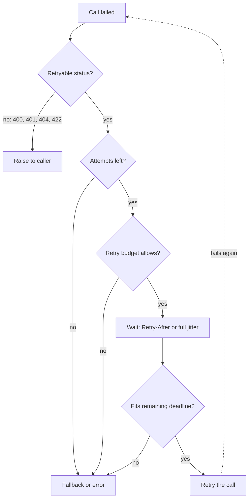

## TL;DR
An agent retries at several layers at once: SDK, framework node, tool and the model itself. Classify
errors, back off with jitter, honour `Retry-After`, cap attempts per run, and use idempotency keys, or a
hiccup becomes duplicate actions and an outage.

## For agent builders
- **Why it matters for agents.** Retry layers multiply inside a loop: SDK retries × framework node
  retries × the model re-calling a failed tool × the user pressing "regenerate". A run that should cost 10
  calls can cost 100, and a retried tool call can send a second email.
- **Where it shows up in your stack.** `max_retries` and `timeout` on the Anthropic and OpenAI clients;
  LangChain's `.with_retry()`; LangGraph's per-node `RetryPolicy`; tenacity around tool functions; and
  LangSmith traces, where stacked retries are visible as repeated spans.
- **What you control.** Which single layer retries transport errors, which tool errors go back to the
  model as observations instead, a per-run retry and step budget, and idempotency keys on every
  side-effecting tool.
- **What you can skip.** Comparing jitter formulas in depth. Use full jitter, honour `Retry-After`, and
  spend the attention on layering and budgets.

## Why it exists
- **Provider APIs fail a small fraction of the time by design:** 429 when shared capacity is tight, 529
  or 503 when overloaded, 5xx during deployments, connection resets through proxies, timeouts on long
  generations.
- **One retry fixes most of it.** At a 1% independent failure rate and 100,000 calls a day that is 1,000
  user-visible errors; a single retry cuts it to about 10, because two independent failures have
  probability 0.01%. That is why every SDK retries by default.
- **Correlated failures break the arithmetic,** and during an incident they always are. Each retry is new
  load on a saturated system; three immediate retries quadruple offered load.
- **Layers multiply.** An SDK retrying twice (3 attempts), a service retrying three times (4) and a
  browser retrying three times (4) turn one click into up to 3 × 4 × 4 = 48 attempts. That retry storm
  can turn a 30-second blip into an outage lasting many minutes.
- **LLM calls raise the stakes.** Each attempt costs seconds and money, a timed-out call may already have
  done its work (or run a tool with side effects), and a stream cannot be retried once tokens reach the
  user. The question is which failures, how often, how spaced, under what limit, with what duplicate
  guarantee.

## How it works
### Classify first
| Retry | Do not retry |
|---|---|
| 408, 429, 500, 502, 503, 504 | 400 (malformed request, context-length overflow) |
| 529 (Anthropic's overloaded status) | 401 and 403 (credentials) |
| connection errors | 404 (wrong model id) |
| timeouts, only when the operation is idempotent | 413, 422 and content-policy refusals |

- **Non-retryable errors fail identically next time.**
- **A 429 needs a second look:** a per-minute rate limit clears in seconds, a monthly quota exhaustion does
  not, and `Retry-After` tells you which.

### Exponential backoff with jitter
1. **Grow the wait geometrically:** before attempt *n*, wait `min(cap, base × 2ⁿ)`, so a persistent fault
   quickly spreads retries thin.
2. **Add jitter,** because pure exponential backoff synchronizes: every client that failed at the same
   instant retries at the same instant, in waves at 1 s, 2 s, 4 s.
3. **Pick a jitter style:**
   - *Full jitter:* uniform between 0 and the exponential ceiling.
   - *Decorrelated jitter:* uniform between the base and three times the previous wait, capped.
- **Evidence:** Brooker's simulations showed both complete the same work with far fewer total calls than
  un-jittered backoff, which is why full jitter is a common library default.

### Honour the server's schedule
- **Use `Retry-After` instead of your own schedule** when present: the server knows when capacity
  returns, and waiting less is wasted load that may count against you.
- **Parse both forms:** a number of seconds or an HTTP date.
- **Still cap it.** A `Retry-After` longer than the request's remaining deadline means "give up or fall
  back now", not "sleep".
- **Slow down before the first 429.** Providers also return remaining-quota and reset headers; an outbound
  rate limiter can read them.

### Caps and budgets
| Control | Scope | Typical setting | What it bounds |
|---|---|---|---|
| Max attempts | per request | two or three | worst case for one call |
| Total deadline (includes backoff sleeps) | per request | from latency budget | a 30-second provider timeout cannot become a two-minute wait |
| Retry budget | per client | retries below roughly 10% of recent requests (the SRE book's figure) | aggregate amplification to about 1.1× instead of 3× |

- **Budget as a token bucket.** Every successful request deposits 0.1 tokens, every retry spends one, and
  retries stop when the bucket is empty.
- **Normal operation:** the bucket stays full and nothing changes.
- **Outage:** nothing succeeds, so it drains after a few retries and the client degrades to one attempt
  per request, exactly what you want from a fleet hammering a saturated provider.

Worked numbers, a fleet at 200 requests per second when the provider goes fully down:

| Policy | Load on the provider | During recovery |
|---|---|---|
| Three attempts, no budget | 600 requests per second | every rejected request comes back twice more, so partial recovery meets up to triple load and can stay pinned in overload |
| 10% budget | about 220 | offered load is near real demand from the start; successes refill the budget only as the provider heals |

### Retry at one layer
- **Know what the SDK does.** The official Anthropic and OpenAI SDKs retry twice by default with
  exponential backoff and honour `Retry-After` (check the current defaults for your version).
- **Either disable it and own the policy, or let it be the only retrying layer;** two layers multiply.

### LLM-specific rules
- **Tight time-to-first-token timeout plus a retry** beats a long total timeout plus a retry, because
  stalled requests rarely recover and the user is waiting.
- **Never retry a stream after the first token was forwarded;** restart it as a new message id so the
  client can discard the partial one.
- **Give every retried operation an idempotency key,** so a retried tool call does not send a second email.
- **Prompt caching makes retried prefill cheaper,** since the retry reads the prefix the first attempt
  wrote, provided it got far enough (on Anthropic an entry becomes readable once the first response
  begins).
- **Hedged requests** start a second attempt once the first exceeds the p95 latency and keep whichever
  finishes first. Only the slowest 5% of calls spawn a hedge, so tail latency drops for a few percent of
  extra load; firing immediately would double it. It needs cancellation of the loser (Dean and Barroso's
  "tail at scale" pattern).
- **A wrong answer is not a transient failure.** Validation-driven regeneration is a separate loop with
  its own bound, usually with a changed prompt or temperature.

### Retry layers in an agent loop
| Layer | What fails | Who should handle it |
|---|---|---|
| Model transport | 429, 5xx, 529, connection reset | the SDK, as the single retrying layer |
| Framework node | an exception escaping a graph node | a node retry policy only if the SDK does not already retry; otherwise none |
| Tool transport | a tool's HTTP API times out or returns 503 | the tool wrapper, with jittered backoff and an idempotency key |
| Tool semantics | bad arguments, "not found", permission denied | return the error to the model as the tool result, so it can change the call |
| Output validation | unparseable tool arguments or JSON | a bounded re-ask with the validation error, usually once or twice |

- **Semantic errors are not retried, they are reported.** The model sees "customer 4412 not found" and
  can search instead; a blind retry would fail identically.
- **Count every layer against one run budget.** A cap on total model calls and tool calls per run is
  the agent version of the retry budget, because it bounds what any loop of retries can cost.

## Diagram
Each failure passes through four gates in order; any "no" ends the loop with an error or a fallback
instead of another attempt.



## Misconceptions
- **"More retries make the system more reliable."** That holds only for independent failures. During an
  incident failures are correlated, so three attempts per request triple load on a saturated provider; a
  retry budget of about 10% keeps amplification near 1.1×.
- **"Exponential backoff is enough on its own."** Every client that failed at the same instant computes
  the same schedule and returns in waves at 1, 2 and 4 seconds. Full jitter spreads those waves.
- **"Adding retries at my layer is harmless."** Layers multiply: 3 SDK attempts × 4 service attempts × 4
  browser attempts is 48 calls for one click. Pick one retrying layer, usually the SDK, and use a breaker
  and fallback above it.
- **"A timeout means the call did nothing, so retrying is safe."** A timed-out model or tool call may
  already have run its side effect. Retry only under the same idempotency key, or reconcile first.
- **"Every failed tool call should be retried in code."** Retry transport faults (5xx, timeouts) in code,
  but return semantic errors such as "customer 4412 not found" to the model as the tool result, because a
  blind retry fails identically and the model can change the call.

## Examples
### Retry helper with full jitter, Retry-After and a budget
The helper decides by status code, prefers the server's `Retry-After`, otherwise sleeps with full jitter
under a cap, refuses to exceed the request's deadline, and consults a process-wide retry budget so an
incident cannot multiply load. In an async service replace `time.sleep` with `await asyncio.sleep`.

```python
import random, time

RETRYABLE = {408, 429, 500, 502, 503, 504, 529}
BASE_S, CAP_S, MAX_ATTEMPTS, DEADLINE_S = 0.5, 8.0, 3, 30.0

class RetryBudget:
    """Process-wide: retries may not exceed `ratio` of recent requests (use a sliding window in prod)."""
    def __init__(self, ratio=0.1): self.ratio, self.requests, self.retries = ratio, 0, 0
    def allow(self): return self.retries < self.ratio * max(self.requests, 10)

budget = RetryBudget()

def call_with_retry(send):
    deadline = time.monotonic() + DEADLINE_S
    budget.requests += 1
    for attempt in range(MAX_ATTEMPTS):
        try:
            return send()                                   # raises ApiError(status, retry_after)
        except ApiError as e:
            last_try = attempt == MAX_ATTEMPTS - 1
            if e.status not in RETRYABLE or last_try or not budget.allow():
                raise
            if e.retry_after is not None:                   # the server knows when capacity returns
                delay = min(float(e.retry_after), CAP_S * 4)
            else:
                delay = random.uniform(0, min(CAP_S, BASE_S * 2 ** attempt))   # full jitter
            if time.monotonic() + delay > deadline:
                raise                                       # a retry that cannot finish in time is waste
            budget.retries += 1
            time.sleep(delay)
```

- **`retry_after` is assumed to be seconds already.** If the header carries the HTTP-date form, convert
  it first with `email.utils.parsedate_to_datetime` and subtract the current time, or `float()` raises.

### Token-bucket retry budget, simulated through an outage
Pure Python, runs as is. Successes deposit 0.1, retries spend 1; during a full outage the bucket drains
and the fleet falls back to one attempt per request.

```python
class TokenBucketBudget:
    def __init__(self, capacity=10.0, deposit=0.1):
        self.tokens, self.capacity, self.deposit = capacity, capacity, deposit
    def on_success(self):
        self.tokens = min(self.capacity, self.tokens + self.deposit)
    def try_retry(self):
        if self.tokens >= 1:
            self.tokens -= 1
            return True
        return False

b = TokenBucketBudget()
calls = 0
for _ in range(200):                 # 200 requests while the provider is fully down
    calls += 1                       # first attempt always goes out
    for _ in range(2):               # up to 2 retries per request
        if not b.try_retry():
            break
        calls += 1
print(calls)   # 210: 10 retries drained the bucket, then one attempt per request (vs 600 with no budget)
```

### Worked amplification audit
One user click traced through a stack that retries at three layers, then after the fix:

| Layer | Attempts before | Attempts after |
|---|---|---|
| Browser | 4 (retries three times) | 1 (no retries) |
| Service | 4 (retries three times) | 1 per target (breaker and fallback instead) |
| SDK | 3 (retries twice) | 3 (the only retrying layer) |
| Worst case per click | 3 × 4 × 4 = 48 | 3 per target tried, so 6 if the fallback rung also runs |

### Agent tool wrapper: retry transport, report semantics
Transport failures are retried with jitter under the same key; semantic failures go back to the model as
the tool result. `ToolHTTPError` and `send_email_api` stand in for your tool client.

```python
import random, time

TRANSIENT = {408, 429, 500, 502, 503, 504}

class RunBudget:
    """Caps every call a run makes, retries included."""
    def __init__(self, max_calls=40): self.left = max_calls
    def spend(self):
        self.left -= 1
        if self.left < 0:
            raise RuntimeError("run budget exhausted: stop and report")

def call_tool(fn, args, key, budget, attempts=3, base=0.5, cap=4.0):
    """Returns a tool-result dict the agent appends to its transcript."""
    for attempt in range(attempts):
        budget.spend()                                  # every attempt counts against the run
        try:
            return {"ok": True, "result": fn(**args, idempotency_key=key)}   # same key on every attempt
        except ToolHTTPError as e:
            if e.status in TRANSIENT and attempt < attempts - 1:
                time.sleep(random.uniform(0, min(cap, base * 2 ** attempt)))  # full jitter
                continue
            # Semantic error, or retries exhausted: let the model decide what to do next.
            return {"ok": False, "error": f"{e.status}: {e.message}", "retryable": e.status in TRANSIENT}

run_budget = RunBudget(max_calls=40)                  # shared by every model and tool call in this run
result = call_tool(send_email_api, {"to": "a@example.com", "body": "..."},
                   key=f"{run_id}:step4:email", budget=run_budget)
```

### Worked scenario: layered retries in a 10-step agent during a provider blip
Illustrative: the provider fails every attempt for 20 seconds; the agent is at step 6.

| Layers that retry | Attempts for step 6 alone | What the trace shows |
|---|---|---|
| SDK 3 attempts × LangGraph node 3 attempts × user regenerate 2 | 3 × 3 × 2 = 18 | 18 model spans for one step, then the whole run restarts |
| SDK only (node retry off), then fallback | 3 then 1 on the fallback | 4 spans, run continues from step 6 |
| Plus a per-run budget of 40 calls | never above 40 for the run | runaway loops stop with a clear "budget exhausted" result |

## Production patterns
- **Errors as observations, plus a run budget.** Agent teams retry only transport failures in code, return
  semantic tool errors to the model as tool results, bound output re-asks to one or two, and cap total
  calls per run. Monitor calls per run, tool error rate by tool, and runs ended by the budget.
- **SDK as the single retry layer.** Keep the official SDK's retries and set them explicitly, for example
  `max_retries` and `timeout` on the Anthropic or OpenAI Python client, and remove retries above it.
  Monitor the amplification factor (provider calls per user request).
- **Process-wide retry budget.** Wrap outbound calls in a token bucket or sliding-window budget of about
  10% of recent requests. Monitor budget exhaustion events; they should appear only during incidents.
- **Tight TTFT timeout for chat.** Set a short time-to-first-token budget, retry once, then fall back,
  because a stalled stream rarely recovers. Monitor TTFT p95 and success-after-retry rate.
- **Quota-aware pacing.** Read the provider's remaining-quota and reset headers into an outbound rate
  limiter so the client slows before the first 429. Monitor 429 rate and remaining-quota headroom.
- **Batch jobs retry through the queue.** For pipelines, cap backoff in minutes and re-enqueue with a
  delay instead of sleeping in a worker, with an idempotency key per item. Monitor retries per job and
  dead-letter queue depth.

## Trade-offs
- **Success rate vs amplification.** Retries raise success rates when failures are independent but
  amplify load when correlated. The retry budget makes the trade safe; without it the first incident
  proves the point.
- **Provider-friendly vs user-friendly caps.** A higher backoff cap is gentler on the provider but worse
  for the user. Interactive features: one or two short retries, then fall back. Batch pipelines: cap in
  minutes and let the queue absorb it.
- **Hedging vs load.** Hedged requests cut tail latency but add load (a few percent when fired at the
  p95, up to double when fired immediately) and need cancellation. They pay off only when
  time-to-first-token variance is high and the call is cheap relative to the user's time.
- **Retrying timeouts vs duplicates.** Retrying after timeouts recovers from stalls but risks duplicated
  effects; without idempotency keys the safe choice is to surface the timeout.
- **Model-driven recovery vs code retries.** Handing a tool error to the model lets it fix arguments or
  pick another tool, but each recovery is a full model call and can loop. Code retries are cheaper for
  pure transport faults; the model is better only when the request itself must change.

## Pitfalls
- **Retrying 400s and context-length errors.** Symptom: the identical error three times in a row in the
  logs and triple the latency on every such request.
- **No jitter.** Symptom: load spikes at 1, 2 and 4 seconds after an incident starts, a sawtooth on the
  provider's error graph.
- **Stacked retries across SDK, service and client.** Symptom: one user action producing 20 or more
  provider calls in a single trace.
- **Ignoring `Retry-After`.** Symptom: long streaks of 429s whose remaining-quota headers never recover,
  because your retries keep spending the refill.
- **`time.sleep` inside an async handler.** Symptom: every in-flight request stalls whenever one request
  backs off.
- **Retrying inside an open stream.** Symptom: duplicated paragraphs appear in the user interface.
- **Framework retries on top of SDK retries.** Symptom: a LangSmith trace shows nine model spans for one
  agent step during a blip. Fix: turn retries off in either the node policy or the client, not both.
- **Retrying a semantic tool error in code.** Symptom: the same "not found" error three times, then the
  run fails without the model ever seeing it. Fix: return it as the tool result.

## When to use
- **Always have an explicit policy** for every outbound LLM call, even if it is "the SDK's two attempts
  and nothing else".
- **Choose numbers from the latency budget:** interactive paths get one or two retries with a small cap,
  then a fallback; background jobs get more attempts, a larger cap and a queue to wait in.
- **Pair retries** with idempotency keys for side effects, a circuit breaker when the dependency can be
  down for minutes, and a rate limiter so retries never push you over quota.
- **Measure** retry rate, success-after-retry rate and the amplification factor (provider calls per user
  request).
- **Interviews:** name classification, exponential backoff with full jitter, `Retry-After`, per-request
  caps plus a global budget, and explain why layering retries is dangerous.

## Role lens
- **Engineer:** Configures or replaces SDK retries, implements jittered backoff and a budget, and makes
  sure async code never blocks the event loop while waiting.
- **Architect:** Sets the policy per traffic class, decides which layer owns retries, and defines the
  amplification factor the system may impose on providers during incidents.
- **FDE:** Traces a customer's "the API is flaky" complaint to stacked retries in their integration and
  tunes their client against the provider's Retry-After and quota headers.

## Check yourself
**Q:** You are shipping a chat feature that calls a hosted LLM through an SDK that already retries twice.
Describe the retry policy you would deploy end to end and justify each number.

**A:** I would make the SDK the only retrying layer for transport-level failures, keep its default of two
attempts, and set its timeout from the product's latency budget rather than the long default, since a
chat user leaves after a few seconds. Retries apply only to 408, 429, 5xx, 529 and connection errors; a
400 or a context-length error goes straight to the caller. Backoff is exponential with full jitter and
honours Retry-After. Above the SDK I add a circuit breaker and a fallback rather than more retries, so an
outage costs one short wait and then a different target, and a process-wide retry budget of about 10% so
that an incident cannot triple our load on the provider. Every turn carries an idempotency key, which
makes retrying a timed-out tool call safe, and streaming responses are never retried after the first
token; a failure there becomes a new message. I would monitor the amplification factor to prove the
policy holds.

## Interview questions
### Why is exponential backoff without jitter not enough?
- **Backoff spreads one client's retries,** but every client that failed at the same instant computes the
  same schedule and retries in synchronized waves at 1, 2 and 4 seconds.
- **Jitter randomizes each wait** (full jitter: uniform from 0 to the ceiling), flattening the waves and,
  in Brooker's simulations, completing the same work with far fewer calls.

### One user click produces 40 provider calls in a trace. How do you find and fix it?
- **Look for stacked retries:** browser, service and SDK each retrying multiplies attempts (3 × 4 × 4 = 48
  worst case).
- **Fix by choosing one retrying layer,** usually the SDK, and replace retries above it with a breaker
  and fallback.
- **Add a retry budget** so even a misconfigured layer cannot amplify load during an incident.

### Your agent's send_email tool timed out. Should the loop retry it?
- **Not unless the operation is idempotent,** because the timed-out call may already have sent the email or
  created the ticket. Without an idempotency key, surface the timeout instead.
- **With a key, retry under the same key,** so the email provider deduplicates; never let the model
  regenerate the call with a fresh key.
- **With no key, reconcile before acting:** look the effect up in the target system (sent-mail log, ticket
  search by run id), then record the result or report the timeout to the model, rather than retrying blind.

### Design the retry policy for a LangGraph agent whose nodes call a hosted model and three HTTP tools.
- **One layer for model transport:** keep the SDK's `max_retries` and leave node retry policies off for
  model nodes (or the reverse), so attempts do not multiply.
- **Tool wrappers retry 5xx and timeouts** with full jitter and idempotency keys; semantic errors return to
  the model as tool results.
- **A per-run budget** on model and tool calls, plus a fallback model after retries, bounds cost; LangSmith
  traces confirm the amplification factor.

### The provider goes fully down and your fleet sends 200 requests per second. What load does it see?
- **Three attempts, no budget:** about 600 requests per second, and up to triple load during partial
  recovery, which can keep the provider pinned in overload.
- **A 10% retry budget:** about 220, close to real demand, because the bucket drains after a few retries
  and refills only as successes return.

### How do you handle a 429 differently from a 503?
- **A 429 can mean two things:** a per-minute rate limit that clears in seconds, or quota exhaustion that
  does not. `Retry-After` and the reset headers tell you which.
- **A 503 is server-side capacity:** retry with jittered backoff, then fall back. In both cases cap the
  wait at the remaining deadline.

## Quiz
### Q: Why add random jitter to exponential backoff?
- [ ] It shortens the average wait so users see lower latency
- [x] It desynchronizes clients that failed at the same moment, so their retries do not arrive in simultaneous waves
- [ ] It is required for the server's Retry-After header to be respected
- [ ] It prevents the exponential delay from exceeding the cap
> Without jitter every client that failed together retries together at 1, 2 and 4 seconds, recreating the
> overload. Spreading each wait uniformly over the window flattens those waves; Brooker's simulations
> showed it also reduces total calls.

### Q: Which of these should be retried against the same endpoint without changing the request?
- [x] A 503 Service Unavailable
- [ ] A 400 reporting that the prompt exceeds the context window
- [ ] A 401 Unauthorized
- [ ] A 422 reporting an invalid tool schema
> A 503 is a capacity signal that will likely clear. The other three describe defects in the request or
> credentials that will fail identically on every attempt, so retrying only adds latency and cost.

### Q: What does a client-wide retry budget provide that a per-request maximum attempt count does not?
- [ ] A guarantee that no single request waits longer than the deadline
- [ ] Protection against retrying non-idempotent operations
- [x] A bound on aggregate load amplification when every request is failing at once
- [ ] Automatic detection of which errors are transient
> Three attempts per request still means 3× load when all requests fail together. A budget limits retries
> to a fraction of recent traffic, so during an incident the extra load stays near 10% instead of 200%.

## Use cases & projects
### Use cases
- **Agents on rate-limited provider APIs.** One retry layer that honours `Retry-After` keeps runs alive
  through 429 bursts without multiplying load.
- **Tool calls to flaky internal services.** Transient tool errors are retried in code, while validation
  errors go back to the model as observations it can correct.
- **Side-effecting agent actions.** Retries on payment, email or ticket tools carry an idempotency key, so
  a timeout never becomes a duplicate action.
- **Batch evaluation runs.** A retry budget stops an eval sweep of thousands of agent runs from turning a
  provider hiccup into a self-inflicted outage.

### Mini project
**Find and collapse stacked retries (1-2 hours).**
- **Goal:** measure how many model calls one agent run really makes when every layer retries, then fix it.
- **Steps:** build a small tool-calling loop with SDK retries, a tenacity wrapper on the tool and a
  framework-level retry; inject a 20% transient failure rate; count attempts per run; then move transport
  retries to one layer with full jitter and a per-run retry budget.
- **Done when:** you have a before/after table of attempts per run and p95 latency, and the after column
  shows attempts close to the step count with no duplicate tool side effects.
