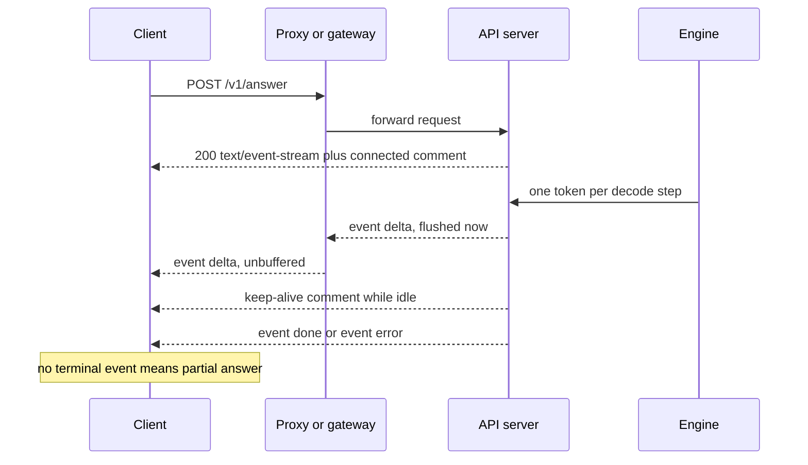

## TL;DR
Streaming sends each token as it is decoded, so users feel time-to-first-token, not total time.
Server-Sent Events (SSE) is the usual transport: plain one-way HTTP. The price: errors and usage arrive
in-band, and no hop may buffer.

## Why it exists
- **Total time is long; the first token is early.** Decoding produces one token at a time, so total
  time is roughly `TTFT + (n_tokens − 1) × TPOT`. A 500-token answer at 20 ms per token takes 10 s to
  finish, but the first token exists after a few hundred milliseconds.
- **Users judge the first visible change.** For a chat answer the second term dominates: several
  seconds in which the server already has most of the answer and the user sees nothing. A
  non-streaming UI feels broken at exactly the output lengths that make LLMs useful.
- **The naive fixes each fail somewhere.**
  - *Polling a job endpoint* adds a round trip per poll, gives latency granularity equal to the poll
    interval and multiplies request volume.
  - *A raw chunked `text/plain` body* gets tokens out early but has no framing: the client cannot tell
    a token from a mid-stream error, a tool-call argument fragment or the final usage record.
  - *WebSockets* give full duplex and framing, but need a protocol upgrade, long-lived connection
    state and their own reconnect logic, and are the thing most likely to be blocked by a corporate
    proxy, all for a channel where only one side talks.
- **SSE sits in the gap.** An ordinary HTTP response with `Content-Type: text/event-stream`, trivial
  line-based framing with named events, and native browser support. That is why OpenAI- and
  Anthropic-style APIs stream over it, and why every hop between engine and screen must carry it
  without buffering.

## How it works
### The wire format
- **Events are separated by a blank line.** The body is UTF-8 text; each line is `field: value`.
- **The fields that matter:**

| Field | Meaning |
|---|---|
| `data:` | The payload; several `data:` lines in one event are joined with newlines |
| `event:` | Optional name the client can dispatch on |
| `id:` | Lets a reconnecting client send `Last-Event-ID` |
| `retry:` | Reconnect delay hint |
| line starting with `:` | A comment the client ignores, which makes `: keep-alive` a free heartbeat |

- **The response stays open.** Under HTTP/1.1 it is sent with `Transfer-Encoding: chunked`; under
  HTTP/2 as an open stream.
- **Framing is the blank line, not network packets.** One TCP read can hold half an event or three of
  them, and can even split a multi-byte UTF-8 character. So a client must decode bytes incrementally,
  buffer until it sees the blank line, and only then parse the event.

A token stream is just:

```
event: delta
data: {"text": "The"}

event: delta
data: {"text": " KV"}

event: done
data: {"usage": {"output_tokens": 2}}

```

### What flows through it
Providers map generation onto events differently, but the shape is the same.

| | OpenAI-style chat completions | Anthropic Messages API |
|---|---|---|
| Framing | A sequence of `data:` JSON chunks, each carrying a `delta` | Named events |
| Start | First chunk typically has only the role and empty content | `message_start` (with input-token usage) |
| Content | Content fragments in `delta` | `content_block_start`, repeated `content_block_delta` (`text_delta`, or `input_json_delta` carrying partial JSON for tool use), `content_block_stop` |
| End | A literal `data: [DONE]` sentinel | `message_delta` (stop reason, output-token usage), then `message_stop` |
| Usage | Only in a final chunk if you ask: `stream_options: {"include_usage": true}` | In `message_start` and `message_delta` |
| Keep-alive | | Periodic `ping` events |

Two consequences follow:
- **Tool-call arguments arrive as JSON fragments** that are only parseable at the end of the block.
- **The authoritative token count is at the tail**, so a client that disconnects early never sees it.

### The path from GPU to screen
1. **Engine emits.** vLLM, SGLang, TGI or a provider's fleet emits one token per decode step per
   sequence.
2. **Serving layer serialises and flushes.** It writes the token as an event and *flushes* it; a
   framework that buffers generator output defeats the whole point.
3. **Every intermediary forwards.** Your reverse proxy, an API gateway, a load balancer, maybe a CDN,
   then the client's HTTP library. HTTP allows each to buffer a response body, and several do by
   default (nginx `proxy_buffering`, compression layers that wait for a full block).
4. **Fix it per hop:**
   - send `X-Accel-Buffering: no` and `Cache-Control: no-cache` headers;
   - disable compression for `text/event-stream`;
   - send heartbeats, so idle-connection timers on load balancers (commonly around a minute) do not
     close a stream during a long prefill or a reasoning pause.

### Semantics that change once you stream
- **`200` means "the stream opened", not "the answer succeeded".** The status code is sent before
  generation starts.
- **Failures travel in-band.** A model error, content-filter stop or upstream timeout must arrive as an
  `error` event or a `finish_reason`, and clients must treat the output they have as partial.
- **Streams are not resumable.** `EventSource` auto-reconnects and sends `Last-Event-ID`, but an LLM
  server cannot replay generation from an id, so a dropped stream is a cancel-and-restart.
- **`EventSource` only issues `GET` without custom headers.** Real clients consume the provider's
  `POST` stream with `fetch` and a `ReadableStream` reader.
- **Connection limits bite.** On HTTP/1.1 browsers allow six connections per origin, which runs out
  if every tab holds a stream open.

## Diagram
The 200 is committed before the first token. After that, tokens, heartbeats and the terminal event
all travel inside one open response, through every hop.



## Examples
### SSE endpoint with heartbeats, in-band errors and disconnect handling
A minimal SSE endpoint that forwards an engine's tokens with correct framing, a connect comment that
forces intermediaries to commit to the response, heartbeats on idle, in-band errors and a stop on
client disconnect. The token source is a stand-in for an engine or provider stream.

```python
import asyncio, json
from fastapi import FastAPI, Request
from fastapi.responses import StreamingResponse

app = FastAPI()

def sse(event: str, data: dict) -> str:
    return f"event: {event}\ndata: {json.dumps(data)}\n\n"      # blank line terminates the event

async def token_source(prompt: str):                             # stand-in for an engine stream
    for i, tok in enumerate(("Stream", "ing", " works", ".")):
        await asyncio.sleep(0.3); yield i, tok

@app.post("/v1/answer")
async def answer(req: Request):
    body = await req.json()
    q: asyncio.Queue = asyncio.Queue()

    async def pump():                                            # engine -> queue, errors in-band
        n = 0
        try:
            async for i, tok in token_source(body["prompt"]):
                await q.put(("delta", {"i": i, "text": tok})); n += 1
            await q.put(("done", {"output_tokens": n}))
        except Exception as e:
            await q.put(("error", {"message": str(e)}))          # status is already 200

    async def gen():
        task = asyncio.create_task(pump())
        yield ": connected\n\n"                                  # comment: flushes proxies, no client event
        try:
            while True:
                try:
                    ev, data = await asyncio.wait_for(q.get(), timeout=15)
                except asyncio.TimeoutError:
                    yield ": keep-alive\n\n"; continue           # heartbeat beats idle timeouts
                if await req.is_disconnected(): break            # client left: stop forwarding
                yield sse(ev, data)
                if ev in ("done", "error"): break
        finally:
            task.cancel()                                        # propagate the stop upstream

    return StreamingResponse(gen(), media_type="text/event-stream",
        headers={"Cache-Control": "no-cache", "X-Accel-Buffering": "no"})
```

### A client parser that survives split reads
Runnable without a server: the wire bytes are cut into 11-byte reads, which splits events and the
two-byte `é` across reads. Decoding incrementally and buffering to the blank line still yields clean
events. (This sketch handles LF line endings only; a full parser also accepts CRLF and CR.)

```python
import codecs, json

def parse_sse(chunks):
    dec = codecs.getincrementaldecoder("utf-8")()   # keeps half a character between reads
    buf = ""
    for chunk in chunks:
        buf += dec.decode(chunk)
        while "\n\n" in buf:                        # an event ends at a blank line, not a read
            raw, buf = buf.split("\n\n", 1)
            event, data = "message", []
            for line in raw.split("\n"):
                if not line or line.startswith(":"):
                    continue                        # comments and heartbeats
                field, _, value = line.partition(":")
                value = value[1:] if value.startswith(" ") else value
                if field == "event":
                    event = value
                elif field == "data":
                    data.append(value)
            if data:
                yield event, "\n".join(data)

wire = ('event: delta\ndata: {"text": "café"}\n\n: keep-alive\n\n'
        'event: done\ndata: {"usage": {"output_tokens": 2}}\n\n').encode()
reads = [wire[i:i + 11] for i in range(0, len(wire), 11)]   # one read ends mid-é
for ev, data in parse_sse(reads):
    print(ev, json.loads(data))
# delta {'text': 'café'}
# done {'usage': {'output_tokens': 2}}
```

### Worked scenario: what streaming buys, and the buffering signature
Same 500-token answer at 20 ms per token, TTFT ~300 ms (illustrative).

| Setup | First visible text | Answer complete | What the user sees |
|---|---|---|---|
| Non-streaming JSON | ~10.3 s | ~10.3 s | Spinner for 10 s |
| Streaming, every hop unbuffered | ~0.3 s | ~10.3 s | Text from the first second |
| Streaming, one proxy buffering | ~10.3 s | ~10.3 s | Spinner, then everything at once |

The third row is why "all events arrived within the last 100 ms of the response" is the alert to set:
generation ran at normal speed, but an intermediary held the bytes.

## Production patterns
- **Disable buffering per hop, explicitly.** When SSE crosses nginx, set `proxy_buffering off;` in the
  streaming location (or send `X-Accel-Buffering: no` from the app) and exclude `text/event-stream`
  from gzip. Monitor the gap between first and last event arrival against generation time.
- **Heartbeat below the shortest idle timer.** Emit `: keep-alive` comments on a timer shorter than any
  load balancer idle timeout on the path (the example uses 15 s). Monitor stream drops clustered at a
  fixed duration, such as exactly 60 s.
- **Always end with a terminal event.** Every stream ends with `done` or `error` (or the provider's
  `finish_reason`); the client marks the answer incomplete if the stream closes without one. Monitor
  stream completion rate and the share of non-normal finish reasons.
- **Ask for usage in-stream and reconcile.** Pass `stream_options={"include_usage": True}` on
  OpenAI-style calls and record usage from `message_delta` on Anthropic. Reconcile against the
  provider's usage reports, because disconnected streams never deliver the tail.
- **Propagate disconnects upstream.** On client disconnect, cancel the producer task and close the
  provider or engine stream. Monitor tokens generated after disconnect and spend versus active streams.
- **Coalesce at the edge on busy servers.** Batch tokens into one event every few tens of milliseconds
  when frame or render overhead shows up. Monitor events per second and inter-event gap distribution.

## Trade-offs
- **Perceived latency vs total time.** Perceived latency drops to TTFT, but completion time does not
  improve and may rise slightly from per-token serialisation and small TCP writes. The gain disappears
  when the consumer is a machine that needs the whole JSON, although early cancellation and
  idle-timeout liveness still argue for streaming there.
- **Simplicity vs two-way talk.** SSE is simple and proxy-friendly because it is one-directional; the
  moment the client must talk mid-stream (interrupt, barge-in voice, collaborative edits) you need
  WebSockets or a second request channel.
- **Coalescing vs smoothness.** Several tokens per event every few tens of milliseconds cuts frame and
  render overhead on busy servers, at the cost of visibly choppier output at low concurrency.
- **Latency vs validation.** Structured output cannot be validated until the final event, so a
  streaming JSON response either needs an incremental parser or loses the latency benefit for
  machine consumers.
- **Visibility vs lost accounting.** Streaming exposes TTFT and inter-token gaps to measurement, but
  pushes usage and cost data to the end of the stream where disconnects can lose it.

## Pitfalls
- **A proxy or middleware buffers the body.** Symptom: a stream that works on localhost and arrives
  all at once in production after the full generation time.
- **Browser `EventSource` against an authenticated `POST` endpoint.** Symptom: 401 or 405 errors,
  because `EventSource` can only `GET` without custom headers. Fix: `fetch` with a stream reader.
- **No heartbeats during long prefill or thinking pauses.** Symptom: streams dying at a fixed interval
  (often exactly 60 s) with no error from either end.
- **Treating the `200` as success.** Ignoring in-band `error` events or stop reasons shows up as
  truncated answers logged as successes and never retried.
- **Rendering each delta straight into Markdown.** Symptom: flickering, half-open code fences and
  broken links until the closing token arrives.
- **Counting SSE chunks as tokens.** Servers may coalesce or split, so usage numbers disagree with the
  provider's bill.
- **Treating each network read as one event.** Symptom: intermittent JSON parse errors or garbled
  non-ASCII characters only on slow or distant networks, where reads split events differently than
  on localhost.
- **Assuming a disconnect stops generation.** It does not unless you propagate the stop. Symptom: GPU
  time and provider spend that stay flat when traffic drops.

## When to use
- **Stream by default** for anything a human reads that is longer than a sentence, and for long-running
  machine calls where early cancellation and liveness matter (agent steps, tool-argument generation).
- **Do not bother** for short classification, extraction or embedding calls, or for batch pipelines
  that validate the complete output anyway.
- **Measure** TTFT, the distribution of inter-event gaps, stream completion rate and disconnect rate.
  Alert on "all events arrived within the last 100 ms of the response", the buffering signature.
- **Interviews:** write the SSE framing from memory, explain why not WebSockets, name the buffering
  layers, and describe how error semantics change once the status code has been sent.

## Role lens
- **Engineer:** Implements the generator and client parser, sets the anti-buffering headers and
  heartbeats, and handles partial JSON for streamed tool calls.
- **Architect:** Decides where streaming terminates (gateway vs service), which hops are allowed to
  buffer, and whether interactive and batch traffic share the same path.
- **FDE:** Debugs "it streams in dev but not behind the customer's proxy", usually a buffering or
  idle-timeout setting on infrastructure the customer owns.

## Check yourself
**Q:** A customer reports that your streaming endpoint "works on localhost but does not stream in
production, the whole answer just appears after ten seconds". How do you diagnose it, in what order?
**A:** First confirm the server really flushes per token by hitting the service directly with
`curl -N` from inside the environment; if tokens trickle there, the server is fine. Then walk the
hops outward: the reverse proxy (nginx buffers upstream responses by default; set
`X-Accel-Buffering: no` or disable `proxy_buffering`), any compression middleware or gateway that
waits for a full block before emitting, a CDN or WAF that caches or inspects bodies, and the load
balancer's idle timeout. Finally check the client: awaiting the whole response body instead of
reading the stream reproduces the exact symptom. Verify by sending a `: connected` comment first; if
even that arrives late, the problem is an intermediary, not the model.

## Interview questions
### Why not just poll a job endpoint or return a chunked plain-text body?
- **Polling** adds a round trip per poll, gives latency granularity equal to the poll interval and
  multiplies request volume, so it is both slower and more expensive.
- **Raw chunked text** gets bytes out early but has no framing: the client cannot separate tokens from
  a mid-stream error, a tool-argument fragment or the usage record.
- **SSE adds just enough framing** (named events, a blank-line delimiter, comments for heartbeats) on
  ordinary HTTP, so it fixes both without a protocol upgrade.

### Your stream returned 200, sent 300 tokens, then the model failed. How should the system behave?
- **Server:** the status is already committed, so send an in-band `error` event (or a non-normal
  finish reason) and close the stream.
- **Client:** keep the partial text, mark it incomplete, and never append a retry's output to it,
  because that duplicates content; retry from scratch if at all.
- **Logging:** record it as a failure, not a success, so truncated answers show up in error rates.

### Streams die after exactly 60 seconds during long reasoning, with no error. Debug it.
- **The tell is the fixed duration.** It points at an idle timer on an intermediary (proxy or load
  balancer), not at the model.
- **Confirm** by checking whether any bytes were sent in the minute before the cut; during hidden
  reasoning there often are none.
- **Fix** with heartbeat comments on a timer shorter than the idle timeout, and raise the idle setting
  on hops you own.

### When would you not stream a response?
- **Short machine calls** such as classification, extraction or embeddings, where the whole answer
  arrives in well under a second anyway.
- **Batch pipelines** that validate the complete output before using it, so early tokens buy nothing.
- **Caveat:** long machine calls can still benefit, because streaming gives early cancellation and an
  idle-timeout liveness signal.

### How do you get accurate token usage for streamed calls, including abandoned ones?
- **Ask for it:** OpenAI-style APIs send usage only in a final chunk when you set the include-usage
  stream option; Anthropic sends it in `message_start` and `message_delta`.
- **Disconnects lose the tail**, so record received text and treat a tokenized estimate as a lower
  bound.
- **Reconcile** against the provider's usage reports, not streamed chunk counts, because servers
  coalesce or split tokens per event.

## Quiz
### Q: Why is SSE preferred over WebSockets for streaming LLM tokens to a browser?
- [ ] SSE delivers each message with lower latency than a WebSocket frame
- [x] Token output is one-directional, and SSE gives framing over ordinary HTTP that proxies, gateways and provider APIs already handle
- [ ] WebSockets cannot carry JSON payloads reliably
- [ ] SSE supports binary token ids while WebSockets are text only
> SSE is not faster per message; it wins because it is plain HTTP for a one-way channel, so it needs
> no protocol upgrade or connection state and survives intermediaries. WebSockets are the right tool
> only when the client must send data mid-stream.

### Q: A streamed response returned HTTP 200, emitted 300 tokens, then the model errored. What must the client do?
- [ ] Nothing special; the 200 status already indicates the request succeeded
- [ ] Automatically retry and append the new output to the 300 tokens it has
- [x] Handle the in-band error event or finish reason and treat the 300 tokens as a partial, failed result
- [ ] Wait for the `[DONE]` sentinel, which is always sent after errors
> Once streaming starts the status code is fixed, so failures can only be signalled inside the stream.
> Appending a retry's output would duplicate content; the partial answer must be marked incomplete and
> the retry started from scratch.

### Q: Every token of a stream arrives at once, exactly when generation finishes. What is the most likely cause?
- [ ] Time-to-first-token is unusually high because of a long prompt
- [x] An intermediary or middleware is buffering the response body until it completes
- [ ] The model does not support streaming so the server falls back to a single response
- [ ] The client negotiated HTTP/2, which does not allow chunked transfer
> Buffering is the classic signature: generation ran at normal speed but a proxy, compression layer or
> the client's own body reader held the bytes. High TTFT would delay the first token, not bunch all of
> them, and HTTP/2 streams SSE fine without chunked encoding.
