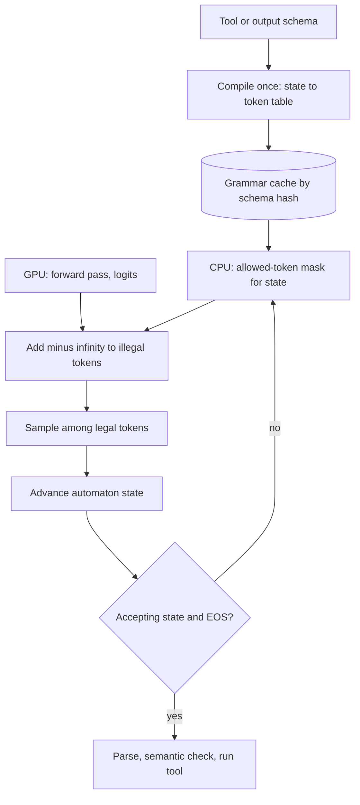

## TL;DR
Every agent tool call must parse. Constrained decoding masks illegal tokens' logits each step, so
output matches a schema, regex, grammar or choice set by construction. It ends parse-and-retry loops
but guarantees shape, not truth, and can shift what the model says.

## For agent builders
- **Why it matters for agents.** An agent loop breaks on the first unparseable tool call or routing
  decision. Constrained decoding is the mechanism under strict tool calling and structured outputs, so it
  decides whether step 12 of a run can crash on a stray Markdown fence.
- **Where it shows up in your stack.** Hosted "structured outputs" and strict tool-calling modes, the
  `response_format` JSON Schema on vLLM's OpenAI-compatible server (with XGrammar as a backend), SGLang,
  llama.cpp GBNF grammars, and libraries such as Outlines and Instructor on top.
- **What you control.** Tool and output schemas (flat, static, versioned), field order (reasoning before
  answer), whitespace rules, the semantic validators behind the parser, and the retry budget per step.
- **What you can skip.** Writing your own logits processor or automaton compiler. Know that masking
  happens at the logits, that grammars are compiled and cached, and what the guarantee does not cover.

## Why it exists
- **Agent code needs parseable output.** A JSON object with known fields, a function call with typed
  arguments, one of five labels for a router.
- **"Mostly complies" is the problem.** Models wrap JSON in Markdown fences, add a trailing comma, rename a
  field, emit a comment, or start with "Sure, here is the JSON". At a 2% failure rate, a million calls a
  day break twenty thousand times, clustered on the hardest inputs.
- **Agents compound the rate.** A run makes many tool calls in sequence, so a small per-call failure rate
  becomes a large per-run one (see the worked table below).
- **Validate-and-retry is not enough.** Still worth having for semantic checks, but each retry doubles
  latency and cost on requests that were already slow, the failure rate never reaches zero, and small or
  heavily quantized models can loop without converging.
- **Regex repair is brittle the other way:** it silently accepts malformed intent.
- **Constrained decoding attacks the root.** The engine knows from the grammar and the output so far which
  tokens are legal and zeroes the rest before sampling, so invalid output becomes impossible, not
  unlikely. Open engines (vLLM, SGLang, llama.cpp, TensorRT-LLM) and hosted "structured outputs" and
  strict tool-calling modes all use it; it is now the default.

## How it works
### Where the constraint sits
1. Each decode step produces a logits vector over the vocabulary.
2. A *logits processor* computes the allowed token ids for the current state and adds −∞ to every other
   entry.
3. Softmax assigns those tokens zero probability; temperature, top-p and the rest apply only among the
   allowed ones.

The model is never asked to do anything; it is simply not permitted to make certain moves.

### Tool calling is the same mechanism
- **Schema per tool plus a choice of tool.** Function-calling APIs are structured generation: the tool
  name is an enum and the arguments follow that tool's schema.
- **Same automaton idea** over the argument schema in hosted "strict" tool modes and open engines' tool
  parsers, which is why argument validity is high while argument *correctness* still needs checks.

### The token-versus-character problem
- **Grammars are over characters; models emit tokens.** A vocabulary of 100k+ entries has many tokens that
  straddle grammar boundaries: `"na`, `me":`, ` {"`.
- **Brute force is too slow.** "For each of 128k tokens, would appending its characters keep the output
  valid?" costs a full grammar walk per token per step, far too slow for a decode step budgeted in
  milliseconds.

### Outlines' insight: precompute the index
1. **Compile** the regex (or the regex derived from a JSON schema) into a deterministic finite automaton.
2. **For every automaton state,** walk every vocabulary token through it and record which tokens are legal
   and which state each leads to.
3. **At generation time** track the current state; the allowed set is a table lookup.

The expensive scan happens at compile time *because* it depends only on the grammar and the tokenizer,
not on the request.

### A tiny index
Pattern: "exactly three digits, then stop". Toy vocabulary: `7`, `42`, `123`, `1234`, `a`, ` 5`.

| State | Legal tokens → next state | Illegal |
|---|---|---|
| start (no digits) | `7` → one digit, `42` → two digits, `123` → accepting | `1234`, `a`, ` 5` |
| two digits | single-digit tokens only | everything longer |
| accepting | end-of-sequence only | all others |

Multi-character tokens jump several automaton steps at once, which a character-level check cannot see
without walking each token.

### Regular vs context-free grammars
- **Non-recursive JSON schemas** compile to regexes.
- **Recursive or deeply nested grammars** need a pushdown automaton (a context-free grammar): llama.cpp's
  GBNF grammars and XGrammar implement this. Nested tool arguments (a list of objects with sub-objects)
  land here.
- **XGrammar caches** the tokens whose legality does not depend on the stack, so most steps are still a
  lookup.

### What the automaton controls
- **No stopping halfway.** End-of-sequence is allowed only in an accepting state.
- **Forced tokens.** When exactly one token is legal (a closing brace, a fixed key name), some engines skip
  sampling and append it directly, saving decode steps on boilerplate.
- **Hard enums, ranges and patterns.** A `"status"` field declared as `enum: ["open", "closed"]` cannot
  come back as `"Closed"`; a tool name cannot be one the agent does not have.

### The cost at serving time
- **Overlap with the forward pass.** Grammar state advance and mask computation run on the CPU while the
  GPU computes the same step's forward pass.
- **Compact application.** The result is a per-sequence bitmask over the vocabulary applied just before
  sampling. When mask computation is slower than the forward pass, it shows up directly as higher time
  per output token.
- **Jump-forward.** Appending runs of forced tokens without sampling is what SGLang calls jump-forward
  decoding.
- **Scaling.** Every sequence in a batch can carry a different grammar (each agent has its own tool set),
  so CPU-side work (compiling grammars, computing each mask) must scale with concurrency; applying the
  mask on the GPU is cheap.

### What it does not control
- **Truth.** A valid schema says nothing about whether values are true; a hallucinated invoice number
  passes a regex for invoice numbers, and a well-formed tool call can target the wrong record. Semantic
  validation (Pydantic validators, cross-field rules, database lookups) still belongs after generation,
  with retry-with-feedback for *those* failures.
- **The distribution.** Where the model wanted to write prose, it must choose whitespace or a quote, and
  may take a low-probability path.
- **Not true conditional sampling.** Masking and renormalising each step is not sampling from the model's
  distribution conditioned on valid output. The mask is greedy and local, so the model can be steered into
  a prefix whose only legal continuations it finds unlikely, and it can never back up.
- **Tokenization artefacts.** Forcing output to begin with `{` rather than ` {` can land the model in a
  token sequence it rarely saw in training.
- **Reasoning can suffer.** One 2024 study (Tam et al.) reported that strict format restrictions can
  degrade reasoning performance in some settings, which is why the rules below exist.

### Design rules that follow
- **Reason before answering.** Put a free-text `reasoning` or `analysis` field *before* the answer fields,
  or run a two-stage pipeline: think freely, then extract under constraint.
- **Keep schemas flat and small.** Prefer enums to open strings; order fields the way evidence appears.
- **Cache grammars by schema hash.** Compilation ranges from milliseconds to seconds for large schemas, and
  a per-request dynamic schema throws that away every call.
- **JSON mode is not schema enforcement.** JSON mode guarantees syntactically valid JSON of any shape;
  structured-output modes enforce your schema's fields, types and enums.
- **Check backend coverage.** Hosted strict modes and open-engine backends support a *subset* of JSON
  Schema (for example requiring every field and forbidding additional properties), so validate the schema
  against the backend before relying on a feature.

## Diagram
One constrained decode step inside an agent's tool call: the CPU computes the grammar mask while the GPU
runs the forward pass, the mask is applied to the logits, and the sampled token advances the automaton
until the call is complete and goes to semantic validation.



## Misconceptions
- **"Constrained decoding means putting the schema in the prompt."** Prompting asks; constraining forbids.
  The engine adds −∞ to every illegal token's logit before sampling, so invalid output is impossible
  rather than unlikely, whatever the prompt says.
- **"A schema-valid tool call is a correct tool call."** The grammar guarantees shape, not truth: a
  hallucinated order id or wrong amount passes every type check. Semantic validators and lookups still run
  after parsing, before the tool executes.
- **"The constrained output is what the model would have said, just tidied up."** The mask is greedy and
  local, not sampling conditioned on valid output, so it can steer the model down unlikely paths, and an
  answer field placed before reasoning commits it early. Put `reasoning` first or think, then extract.
- **"With a strict schema the call can never fail to parse."** Output cut at `max_tokens` is still
  truncated JSON (check `finish_reason`), and some backends ignore keywords such as `minimum`, `pattern` or
  `format: date`. Re-validate with Pydantic.
- **"JSON mode already enforces my schema."** JSON mode guarantees syntactically valid JSON of any shape;
  structured-output modes enforce your fields, types and enums.
- **"Masking is expensive because every step checks the whole vocabulary."** The state-to-token table is
  compiled once per schema and tokenizer, so a step is a lookup. The real cost is compilation, paid again
  whenever a request brings a new schema, visible as higher TTFT.

## Examples
### The token index for "exactly three digits", in pure Python
Runnable as is. It builds the state-to-token table from the tiny index above at compile time, then
decodes greedily with a fake model that prefers illegal tokens.

```python
VOCAB = ["7", "42", "123", "1234", "a", " 5", "<eos>"]
ACCEPT = 3                                      # DFA for "exactly three digits": state = digits seen

def step(state, ch):
    return state + 1 if ch.isdigit() and state < ACCEPT else None   # None = dead state

def build_index(vocab):
    """Compile time: for every DFA state, which tokens are legal and where they lead."""
    index = {}
    for s in range(ACCEPT + 1):
        index[s] = {}
        for tok in vocab:
            if tok == "<eos>":
                if s == ACCEPT:
                    index[s][tok] = "done"      # EOS only in the accepting state
                continue
            cur = s
            for ch in tok:                      # walk every character of the token
                cur = step(cur, ch)
                if cur is None:
                    break
            if cur is not None:
                index[s][tok] = cur
    return index

def constrained_greedy(scores, index):
    """Run time: a lookup per step, then argmax among allowed tokens only."""
    state, out = 0, []
    while state != "done":
        allowed = index[state]
        tok = max(allowed, key=lambda t: scores.get(t, float("-inf")))
        out.append(tok)
        state = allowed[tok]
    return "".join(t for t in out if t != "<eos>")

index = build_index(VOCAB)
for s, allowed in index.items():
    print(s, allowed)       # 0 {'7': 1, '42': 2, '123': 3} ... 3 {'<eos>': 'done'}
# The "model" prefers 1234 and a, both illegal from the start state.
fake_logits = {"1234": 5.0, "a": 4.0, "<eos>": 3.0, "42": 1.0, "7": 0.5}
print(constrained_greedy(fake_logits, index))   # -> 427
```

### Worked scenario: parse failures across an agent run
A 10-step agent makes one tool call per step. Illustrative rates; the point is how per-call rates
compound per run (run failure = 1 − (1 − p)^10).

| Setup | Per-call failure | Runs with at least one failure | Extra calls per 1,000 runs |
|---|---|---|---|
| Prompt-only JSON, 2% parse failures | 2% | about 18% | about 200 retries, more if retries fail |
| Prompt-only JSON plus semantic validators (2% parse, 1% wrong values) | about 3% | about 26% | about 300, a full extra call each |
| Constrained decoding, shape guaranteed | 0% parse | 0% from shape | 0 for shape |
| Constrained plus semantic validators (say 1% wrong values) | 1% semantic | about 10% | about 100, spent only on meaning |

Constrained decoding removes the shape column entirely; the remaining retry budget goes to errors no
grammar can express. Check `finish_reason` too: output cut at `max_tokens` is the one way a constrained
call still fails to parse.

### Agent router step: schema-constrained tool choice
A router picks one of the agent's tools under a JSON Schema via `response_format`, with reasoning first.
The enum makes an unknown tool name impossible; Pydantic and a lookup catch wrong-but-valid values.

```python
from typing import Literal
from openai import OpenAI
from pydantic import BaseModel

TOOLS = {"search_orders": lambda q: f"orders matching {q}", "refund": lambda q: f"refund for {q}"}

class Route(BaseModel):
    reasoning: str                                        # free text FIRST
    tool: Literal["search_orders", "refund", "ask_human"]
    query: str

client = OpenAI(base_url="http://localhost:8000/v1", api_key="EMPTY")

def route(user_msg: str, retries: int = 1) -> str:
    msgs = [{"role": "system", "content": "Pick the next tool for this support agent."},
            {"role": "user", "content": user_msg}]
    for _ in range(retries + 1):
        resp = client.chat.completions.create(
            model="Qwen/Qwen2.5-7B-Instruct", messages=msgs, temperature=0,
            response_format={"type": "json_schema",
                             "json_schema": {"name": "route", "schema": Route.model_json_schema()}})
        r = Route.model_validate_json(resp.choices[0].message.content)   # shape is guaranteed
        if r.tool == "ask_human":
            return "escalated"
        if r.query.strip():                                              # semantic check, not shape
            return TOOLS[r.tool](r.query)
        msgs += [{"role": "assistant", "content": resp.choices[0].message.content},
                 {"role": "user", "content": "query was empty; give a concrete query"}]
    return "escalated"

print(route("I was charged twice for order 1182, please fix it."))
```

### A choice constraint from scratch
The output must be exactly one of a fixed set of choices, then stop. The allowed-token table is a trie
built once from the tokenizer, so each step is a lookup rather than a vocabulary scan: the structure
Outlines and XGrammar generalise to regexes and grammars.

```python
import torch
from transformers import AutoModelForCausalLM, AutoTokenizer, LogitsProcessor, LogitsProcessorList

name = "Qwen/Qwen2.5-0.5B-Instruct"
tok = AutoTokenizer.from_pretrained(name)
model = AutoModelForCausalLM.from_pretrained(name, torch_dtype=torch.float16).cuda().eval()

class ChoiceConstraint(LogitsProcessor):
    """Allow only token sequences that spell one of `choices`, then EOS."""
    def __init__(self, choices, prompt_len):
        self.trie, self.prompt_len = {}, prompt_len
        for c in choices:                                   # built ONCE: grammar x tokenizer
            # one canonical tokenization per choice; real engines allow every token path that spells it
            node = self.trie
            for t in tok(c, add_special_tokens=False).input_ids:
                node = node.setdefault(t, {})
            node[tok.eos_token_id] = {}                     # accepting state: EOS becomes legal
    def __call__(self, input_ids, scores):
        node = self.trie
        for t in input_ids[0, self.prompt_len:].tolist():  # replay emitted tokens to find the state
            node = node.get(t, {})
        allowed = list(node) or [tok.eos_token_id]
        mask = torch.full_like(scores, float("-inf"))
        mask[0, allowed] = 0.0
        return scores + mask                                # every other token gets probability 0

msgs = [{"role": "user", "content": "Is the sky green? Answer with one word."}]
ids = tok.apply_chat_template(msgs, add_generation_prompt=True, return_tensors="pt").cuda()
proc = LogitsProcessorList([ChoiceConstraint(["yes", "no", "unknown"], ids.shape[1])])
out = model.generate(ids, max_new_tokens=5, do_sample=False, logits_processor=proc)
print(repr(tok.decode(out[0, ids.shape[1]:], skip_special_tokens=True)))   # -> 'no'
```

### Production call: schema-constrained output plus semantic validation
Against vLLM's OpenAI-compatible server (hosted providers accept the same `response_format` shape). The
reasoning field comes first, and Pydantic re-validates after generation because some backends ignore
numeric bounds. In an agent this is the extraction step that fills a ticket before a tool files it.

```python
from typing import Literal
from openai import OpenAI
from pydantic import BaseModel, Field

class Ticket(BaseModel):
    analysis: str                                         # free-text reasoning FIRST
    category: Literal["billing", "bug", "account", "other"]
    priority: int = Field(ge=1, le=4)                     # bounds may be ignored by the backend

client = OpenAI(base_url="http://localhost:8000/v1", api_key="EMPTY")
resp = client.chat.completions.create(
    model="Qwen/Qwen2.5-7B-Instruct",
    messages=[{"role": "user", "content": "Classify this ticket: 'I was charged twice this month.'"}],
    response_format={"type": "json_schema",
                     "json_schema": {"name": "ticket", "schema": Ticket.model_json_schema()}},
    temperature=0,
)
ticket = Ticket.model_validate_json(resp.choices[0].message.content)   # shape AND bounds checked
print(ticket.category, ticket.priority)
```

## Production patterns
- **Strict tool calling and native structured outputs, not hand-rolled processors.** When output feeds
  agent code, pass a JSON Schema via `response_format` or the tool definitions (or the engine's grammar or
  choice mode) and let the engine's backend, such as XGrammar in vLLM, do the masking. Monitor validity
  rate; it should sit at 100%, and anything less usually means output truncated at `max_tokens` (check
  `finish_reason`) or a schema feature the backend does not enforce.
- **Static tool schemas, cached grammars.** Keep tool and output schemas versioned in code and identical
  across requests and agent steps, with no request ids or dates inside enums, so compiled grammars are
  reused. Monitor TTFT for first-seen schemas versus cached ones.
- **Think, then extract.** For planning and reasoning-heavy steps, put an `analysis` field first or split
  into a free call plus a constrained extraction call. Monitor task accuracy and agent run success against
  an unconstrained baseline, not just validity.
- **Validate semantics with bounded retries per step.** Parse with Pydantic `model_validate_json`, enforce
  cross-field rules and lookups (does that order id exist?), and retry at most once or twice with the
  error message fed back into the transcript. Monitor retry rate and the share of steps that exhaust
  retries and escalate.
- **Schema compatibility test in CI.** Run every tool and output schema through the target backend with a
  few fixture prompts, asserting that unsupported keywords (`format: date`, `minimum`, `pattern`) are
  either enforced or re-checked after generation.

## Trade-offs
- **Guaranteed validity vs distribution shift.** Retries vanish, but the constraint can push the model
  down low-probability paths; the cost is small for flat schemas and grows with rigid, deeply nested ones.
- **Compile-once tables vs dynamic schemas.** Per-step masking becomes nearly free, but a new schema per
  request (tool lists rebuilt per user) pays compilation each time; the win flips to a loss without a
  grammar cache.
- **Hosted strict modes vs open engines.** Hosted modes are zero-effort, yet support a schema subset and
  hide the mechanism; open engines expose regex, grammar and choice modes but you own backend selection
  and version drift.
- **Constraints vs validate-and-retry.** Retry handles semantic errors no grammar can express, at a full
  extra call per failure; combining both gives shape for free and spends retries only on meaning.

## Pitfalls
- **Trusting schema-valid tool calls as correct.** Symptom: clean JSON with invented identifiers or wrong
  numbers that no parser will ever flag, and the agent acts on them. Fix: semantic validators and lookups
  after parsing, before the tool runs.
- **Answer field first, `reasoning` last.** The model commits to an answer before it has "thought";
  accuracy on reasoning tasks drops compared with unconstrained prompting. Fix: reasoning field first.
- **A fresh, slightly different schema per request** (a timestamp or request id baked into an enum).
  Symptom: high time to first token from grammar compilation on each call. Fix: static, versioned schemas.
- **JSON Schema features the backend ignores** (`format: date`, `minimum`, `pattern` in some modes),
  discovered in production when out-of-range values come through. Fix: a CI compatibility test, and
  re-validate with Pydantic.
- **Forgetting whitespace is part of the grammar.** Unbounded whitespace between tokens lets a model loop
  on spaces or newlines until `max_tokens`; forbidding it forces minified JSON the model rarely saw in
  training. Set the whitespace pattern deliberately.

## When to use
- **Use when** output is consumed by code: tool arguments, routing decisions, extraction, classification
  into a fixed label set, memory writes, batch data transformation.
- **Prefer** the engine's or provider's native structured-output or strict tool mode over hand-rolled
  logits processors, and keep Pydantic (or equivalent) validation plus bounded retries for semantics.
- **Avoid** for free-form writing such as the agent's final answer to a user; be careful with
  reasoning-heavy planning steps, where a two-stage design keeps accuracy.
- **Measure** validity rate, retry rate, time to first token with and without the grammar, and task
  accuracy against an unconstrained baseline.
- **Interviews:** explain why masking happens at the logits, how compile-time precomputation solves the
  token-boundary problem, and what the guarantee does not cover.

## Role lens
- **Engineer:** Defines Pydantic models, passes the schema to the engine's structured-output mode, caches
  compiled grammars, and adds semantic validators and bounded retries behind them.
- **Architect:** Sets the contract between model outputs and downstream services, chooses hosted strict
  modes versus open-engine backends, and mandates where free-text reasoning precedes structured answers.
- **FDE:** Turns a customer's extraction target into a schema the backend fully supports, then proves
  validity and accuracy on their documents against the unconstrained baseline.

## Check yourself
**Q:** A team switched an extraction pipeline from prompt-and-retry to constrained JSON decoding.
Validity went to 100%, but accuracy on a set of hard cases dropped several points. What would you
investigate and change?
**A:** Constrained decoding changed the distribution the model samples from, not just the format. I
would first check field order: if the answer fields come before any reasoning field, the model is forced
to commit before working through the evidence, and moving a free-text analysis field to the front or
splitting into a think-then-extract two-stage call usually recovers the loss. I would check whether the
grammar forces unusual tokenizations (no leading space, escaped newlines) that differ from how the model
saw JSON in training, and whether the schema is stricter than necessary, with enums that exclude valid
answers. Then I would compare accuracy on the same prompts under unconstrained decoding plus parsing to
quantify the gap, and keep semantic validators and bounded retries for the residual errors.

## Interview questions
### How does constrained decoding guarantee valid JSON, and why at the logits?
- **Mechanism:** a logits processor adds −∞ to every token the grammar forbids from the current state, so
  softmax gives them zero probability and the sampler cannot pick them.
- **Why the logits:** it is the last point before sampling where the engine can remove choices, so
  validity holds by construction instead of being checked and retried afterwards.

### Your agent's tool calls always parse now, but it still takes wrong actions. What do you add?
- **Shape is not truth:** strict mode guarantees the call matches the schema, not that the order id
  exists or the amount is right.
- **Semantic validators before the tool runs:** Pydantic rules, cross-field checks and lookups against the
  system of record, with the error fed back for one or two bounded retries, then escalation.
- **Schema design:** enums for closed sets, a reasoning field first, and a run-level eval of action
  correctness, not just validity rate.

### Why can't you just check each vocabulary token against the grammar at every step?
- **Cost:** 100k+ tokens, each needing a grammar walk, per step per sequence, far beyond a millisecond
  decode budget.
- **Fix:** precompute, per automaton state, the legal tokens and their next states once per grammar and
  tokenizer; runtime is a lookup, and XGrammar extends this to context-free grammars.

### TTFT jumped after you enabled structured outputs for a self-hosted agent fleet. What do you look at?
- **Grammar compilation:** is each request or agent step sending a slightly different schema (tool lists
  rebuilt per user, dates in enums), defeating the cache?
- **Schema size and nesting:** large or recursive schemas compile slowly; flatten or version them.
- **CPU saturation:** mask computation runs on the CPU per sequence, so check CPU utilisation under
  concurrency and TPOT as well as TTFT.

### When would you not use constrained decoding?
- **Free-form writing,** where no consumer parses the output, such as the agent's reply to the user.
- **Reasoning-heavy answers** unless the schema lets the model reason first or you extract in a second
  call, because strict formats can degrade reasoning.
- **When only semantics matter:** the grammar cannot catch wrong values, so validation is still needed.

### What is the difference between JSON mode and schema-enforced structured outputs?
- **JSON mode** guarantees syntactically valid JSON of any shape: fields can be missing or renamed.
- **Structured outputs** enforce your fields, types and enums, but backends support a subset of JSON
  Schema, so check which keywords are actually enforced.

## Quiz
### Q: Why do libraries like Outlines precompute a table from automaton states to allowed tokens?
- [ ] To reduce the model's vocabulary size at load time
- [ ] Because logits cannot be modified after the forward pass
- [x] So each decode step is a lookup instead of checking every vocabulary token against the grammar
- [ ] To make sampling deterministic regardless of temperature
> Checking 100k+ tokens against a grammar every step is far too slow. The grammar and tokenizer are
> fixed, so the legality of each token from each state can be computed once and reused for every
> request.

### Q: What does constrained decoding guarantee about a generated JSON object?
- [ ] That every value is factually consistent with the input
- [x] That it parses and conforms to the schema's structure, types and enums
- [ ] That it is the most probable output the model could produce
- [ ] That it matches what the model would have produced without the constraint
> The automaton only forbids tokens that would break the grammar. Content is still the model's guess,
> so semantic validation and retries remain necessary for correctness.

### Q: A reasoning-heavy classification task loses accuracy under a strict schema. What is the most likely effective fix?
- [ ] Raise the temperature so the model explores more tokens
- [ ] Remove enums so the model can write any label
- [x] Add a free-text reasoning field before the answer field, or extract in a second constrained call
- [ ] Switch from JSON to YAML output
> Forcing an immediate answer removes the model's chance to work through the problem in prose. Letting
> it reason first, then constraining the final fields, restores the behaviour that unconstrained
> prompting had.

## Use cases & projects
### Use cases
- **Tool-calling agents.** Strict tool modes guarantee every call names a real tool and matches its
  argument schema, so the loop never crashes on a parse error.
- **Routers and planners.** An enum-constrained routing step picks the next tool, subagent or model with
  no free-text parsing.
- **Extraction into agent memory.** Facts written to a memory store or database come out in a fixed schema
  that downstream retrieval can rely on.
- **Small self-hosted agent models.** Constraints make 7B-class models usable for tool calls they would
  otherwise format wrong a few percent of the time.

### Mini project
**Constrained versus prompted tool calls in a tiny agent (2-3 hours).**
- **Goal:** measure what constrained decoding removes and what it leaves for semantic validation.
- **Steps:** build a 3-tool support agent (search orders, refund, ask human) against vLLM or a hosted API;
  run 50 scripted tasks with prompt-only JSON and again with a JSON Schema in `response_format`; log
  parse failures, semantic failures (unknown order id, empty query), retries and TTFT per step; add a
  Pydantic validator with one retry.
- **Done when:** you have a per-setup table of parse failures, semantic failures, retries and task
  success, with parse failures at zero under constraints and a note on which errors remained.
