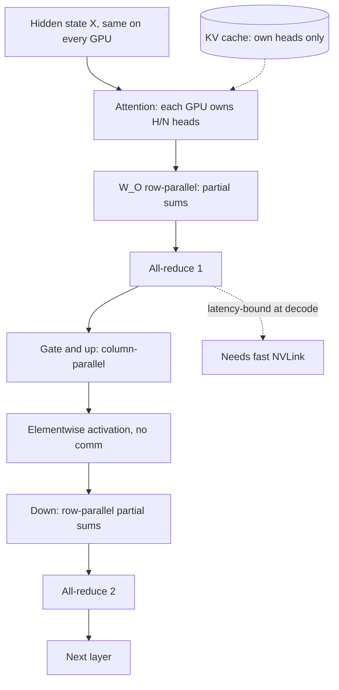

## TL;DR
Tensor parallelism splits every weight matrix across N GPUs, joined by two all-reduces per layer. It
fits oversized models and pools bandwidth for faster decode, but needs a fast intra-node link because
decode sends hundreds of tiny all-reduces per token.

## Why it exists
- **The model does not fit.** A 70B-parameter model in bf16 is about 140 GB of weights. No single 80 GB
  GPU can hold it, let alone leave room for a KV cache.
- **Pipeline parallelism fits but does not speed up a token.** GPU 0 runs layers 1–40, GPU 1 runs 41–80.
  A request still passes through them one after another, so per-token latency does not improve, and
  keeping both busy needs several requests in flight at different stages.
- **Offloading is too slow.** Keeping part of the weights in CPU memory and streaming them in means PCIe,
  roughly 50–100× slower than HBM, so decode slows to seconds per token.
- **Quantization alone is not always enough.** It halves or quarters bytes but costs quality. A 4-bit 70B
  model still needs about 40 GB: it fits an 80 GB card, not a 24 GB one, and leaves little cache room on a
  48 GB one.
- **TP pools bandwidth.** It splits *inside* each layer, so every GPU works on the same token at once on
  its slice. Bandwidth-bound decode gets faster roughly in proportion to N while exchanges stay small.
  That is why TP is the default within a node and why the interconnect sets its limits.

## How it works
### Megatron-style partitioning of the MLP
For a two-matrix MLP `Y = GeLU(X·A)·B`, with A of shape [h, 4h] and B of shape [4h, h]:
1. **Split A by columns** into N pieces. Each GPU computes `GeLU(X·A_i)`, a [tokens, 4h/N] slice. No
   communication is needed *because* GeLU is elementwise, so each slice is independent.
2. **Split B by rows** to match. GPU i computes `GeLU(X·A_i)·B_i`: full output shape [tokens, h], but
   only its share of the sum.
3. **One all-reduce** adds the N partial outputs, and every GPU has the full Y.

Llama-style SwiGLU MLPs have three matrices with the same pattern: gate and up projections
column-parallel, down projection row-parallel, one all-reduce.

### Attention, embeddings and the LM head
- **Attention is split by heads.** With 64 query heads and TP = 8, each GPU owns 8 query heads, their
  projections and the K/V heads they attend with, so attention for those heads is entirely local.
- **Output projection W_O is row-parallel,** producing partial sums that one all-reduce combines.
- **Embeddings and the LM head** are split along the vocabulary dimension.
- **Net result:** two all-reduces per layer per forward pass, and every GPU holds 1/N of the weights.

### The KV cache is sharded too
- **Per-GPU cache per token is the full figure ÷ N,** because each GPU stores K and V only for its heads.
  The aggregate free memory of all N GPUs serves as cache.
- **Often the real reason for TP = 4 over TP = 2,** even when the weights fit at TP = 2.
- **GQA constraint.** Llama-3-70B has 8 KV heads, so TP up to 8 gives each GPU at least one. Beyond that,
  KV heads are replicated across GPUs that share them, which engines support but which forfeits part of
  the saving.
- **Divisibility.** Attention heads, MLP intermediate size and vocabulary should all divide by the TP
  degree, which is why TP degrees are almost always powers of two.

### Why the interconnect decides everything
- **Message size at decode.** Each all-reduce exchanges a [tokens_in_step, hidden] activation. With 32
  sequences, hidden 8,192, bf16: 32 × 8,192 × 2 = 512 KB. An 80-layer model issues 160 per step.
- **Latency-bound, not bandwidth-bound.** The cost is per-collective latency, dozens of microseconds each
  on NVLink with NCCL (an illustrative order of magnitude).
- **Acceptable on NVLink, ruinous elsewhere.** A few milliseconds of overhead per step is fine when the
  step is 10 ms. On PCIe-only hosts each collective is slower; across nodes over Ethernet or even
  InfiniBand, latency × 160 per token is ruinous.
- **Hence the rule:** tensor parallel within a node, pipeline parallel (or independent replicas) across
  nodes.

### A step-time model

```
t_step(N) ≈ (weight_bytes + kv_bytes_read) / (N × HBM_bw)  +  2 × n_layers × t_allreduce(N)  +  overhead
```

- **The first term shrinks as 1/N; the second does not.** It grows slightly with N because a ring
  all-reduce takes 2(N − 1) steps (each GPU sends about 2(N − 1)/N of the message), so bandwidth cost is
  nearly flat in N while latency is not. Speedup saturates once collectives rival the memory term.
- **Illustrative 70B bf16 on H100-class GPUs:**

| | TP = 4 | TP = 8 |
|---|---|---|
| Memory term: 141 GB ÷ (N × 3.35 TB/s) | ≈ 10.5 ms | ≈ 5.3 ms |
| 160 all-reduces at an assumed 20 µs | 3.2 ms | 3.2 ms |
| Step | ≈ 13.7 ms | ≈ 8.5 ms |

- **So 2× the GPUs buys 1.6×.**
- **Engines fight the second term.** vLLM, for example, ships a custom all-reduce kernel for small
  messages over NVLink, and CUDA graphs remove per-kernel launch overhead from the decode step.

### Prefill is a different regime
- **Messages are large:** [prompt_tokens, hidden], so 4,096 × 8,192 × 2 bytes = 64 MiB each for the model
  above. Collectives become bandwidth-bound, not latency-bound.
- **NVLink hides them** behind prefill's large matmuls; over PCIe they can become a large share of time
  to first token.

### When TP speeds up a model that already fits
- **TP = 2** roughly halves the weight bytes each GPU reads per step, so single-stream decode gets faster,
  but less than 2× because of the all-reduces.
- **Two replicas** (data parallelism) give 2× throughput with zero communication at the same per-token
  latency.
- **Rule:** tokens per second per user → TP; aggregate tokens per dollar at acceptable latency →
  replicas, as long as each replica has enough KV room.

### Related splits
| Split | What is divided | Note |
|---|---|---|
| Pipeline | layer ranges | cross-node friendly, adds latency |
| Expert | whole experts of a mixture-of-experts model | tokens exchanged via all-to-all |
| Context / sequence | a very long prompt, for prefill | splits prefill work across GPUs |

All three are combined with TP in large deployments. At inference on a single node, TP alone is the
common case.

## Diagram
One transformer layer at TP = N: each GPU computes its heads and its MLP slice locally, and two
all-reduces per layer stitch the partial sums back together.



## Examples
### Row- and column-parallel MLP with one all-reduce
Run with `torchrun --nproc_per_node=2`. Each rank keeps only its weight slice and computes a partial
output; the single all-reduce recovers the full result. Rank 0 checks it against the unsharded
computation and prints the bytes the collective moved, the per-layer communication cost discussed above.

```python
# torchrun --nproc_per_node=2 tp_mlp.py
import torch, torch.distributed as dist
import torch.nn.functional as F

dist.init_process_group("nccl")
rank, N = dist.get_rank(), dist.get_world_size()
torch.cuda.set_device(rank); dev = f"cuda:{rank}"
h, ff, tokens = 4096, 11008, 8                     # hidden, intermediate, tokens in this decode step
torch.manual_seed(0)                               # identical full weights on every rank
A = torch.randn(h, ff, dtype=torch.float16) * 0.02  # up projection  [h, ff]
B = torch.randn(ff, h, dtype=torch.float16) * 0.02  # down projection [ff, h]
X = torch.randn(tokens, h, dtype=torch.float16)

A_i = A[:, rank * ff // N:(rank + 1) * ff // N].to(dev)   # column-parallel slice of A
B_i = B[rank * ff // N:(rank + 1) * ff // N, :].to(dev)   # matching row-parallel slice of B
X = X.to(dev)

Z_i = F.gelu(X @ A_i)                              # [tokens, ff/N]; elementwise GeLU needs no comm
Y_i = Z_i @ B_i                                    # partial sum with full output shape [tokens, h]
dist.all_reduce(Y_i, op=dist.ReduceOp.SUM)         # the one collective for this MLP

if rank == 0:
    ref = F.gelu(X.cpu().float() @ A.float()) @ B.float()
    print("max abs error vs unsharded:", (Y_i.cpu().float() - ref).abs().max().item())
    print("bytes moved by the all-reduce:", Y_i.numel() * Y_i.element_size())
    print("weight bytes held per rank:", (A_i.numel() + B_i.numel()) * 2)
dist.destroy_process_group()
```

### Worked sizing: Llama-3-70B-class at TP = 4 vs TP = 2
80 layers, 8 KV heads, head_dim 128: 320 KB of fp16 KV per token. 80 GB GPUs, 0.9 budget, an
illustrative 2 GB activation reserve.

| | TP = 4 | TP = 2 |
|---|---|---|
| Weights per GPU | about 35 GB | about 70 GB |
| KV per token per GPU | 80 KB | 160 KB |
| Left for cache (72 GB budget) | about 35 GB, roughly 450k tokens | essentially nothing |
| Weight-read floor per step | 35 GB ÷ 3.35 TB/s ≈ 10 ms | n/a |
| Verdict | single-stream decode capped near 95 tokens/s before all-reduce overhead | not a usable deployment in bf16 |

### Step-time model across TP degrees
Pure Python, using the formula and the assumed 20 µs per all-reduce. TP = 1 is hypothetical (the model
does not fit), shown only as the baseline.

```python
HBM_BW = 3.35e12                     # bytes/s per H100-class GPU (published figure)

def t_step_ms(n, weight_gb=141, kv_gb=0.0, layers=80, t_allreduce_us=20):
    mem = (weight_gb + kv_gb) * 1e9 / (n * HBM_BW)          # shrinks as 1/N
    comm = 0 if n == 1 else 2 * layers * t_allreduce_us * 1e-6  # does not shrink
    return (mem + comm) * 1e3

base = None
for n in (1, 2, 4, 8):
    ms = t_step_ms(n)
    base = base or ms
    print(f"TP={n}: step {ms:5.1f} ms, {1e3/ms:4.0f} tok/s per stream, "
          f"speedup {base/ms:3.1f}x on {n} GPUs")
# TP=2: 24.2 ms, TP=4: 13.7 ms, TP=8: 8.5 ms -> 5.0x on 8 GPUs, and the gap widens with slower links
```

## Production patterns
- **Smallest TP that leaves KV room.** When a model needs more than one GPU, start at the smallest power
  of two that fits weights plus a healthy cache (`--tensor-parallel-size 4` in vLLM) and scale throughput
  with replicas. Monitor KV-cache usage and preemptions per replica.
- **Verify the topology before benchmarking.** Run `nvidia-smi topo -m` and confirm the GPUs in a TP group
  show NV# (NVLink) entries, not PHB, NODE or SYS (PCIe and socket hops). `NCCL_DEBUG=INFO` logs
  which transport NCCL chose at startup.
- **TP inside the node, pipeline across nodes.** For models that need more than one node, combine tensor
  parallel within each NVLink node with pipeline parallel across nodes (vLLM's
  `--pipeline-parallel-size`). Monitor per-stage utilisation for pipeline bubbles.
- **Keep CUDA graphs on for decode.** Avoid eager mode (`--enforce-eager` in vLLM) in production, because
  CUDA graphs remove per-kernel launch overhead, which grows as a share of the step as TP shortens each
  rank's compute and adds collective kernels. Monitor TPOT after any engine flag change.
- **Benchmark the TP curve per hardware SKU.** Measure tokens/s per request and aggregate tokens/s at TP =
  1, 2, 4 (where the model fits) on the exact node type, and record where speedup flattens.

## Trade-offs
- **Lower per-token latency vs all-reduce overhead.** Pooled bandwidth makes latency fall with TP, but
  each extra GPU adds collective overhead; the gain flips negative once collective latency rivals the
  shrinking step time.
- **Fits big models vs a larger failure domain.** Weights and KV cache divide by N, so a large model fits
  and serves long contexts, but N GPUs are tied to one request stream and a single GPU failure takes the
  whole replica down.
- **TP vs data-parallel replicas.** TP gives faster single-stream decode; replicas give more total
  throughput per GPU-hour. Which wins depends on whether the SLO is per-user speed or cost.
- **TP vs pipeline parallelism.** TP has no pipeline bubble and lower latency, but demands a fast
  intra-node interconnect; pipeline parallelism tolerates slow links between nodes.

## Pitfalls
- **TP across PCIe-only GPUs or across nodes.** Decode can end up slower than a single GPU with a
  quantized model. Symptom: tokens/s barely improves or regresses as TP grows.
- **A TP degree that does not divide the KV head count.** It forces KV replication. Symptom: less cache
  capacity than the per-GPU arithmetic predicted.
- **Assuming TP = 2 doubles throughput.** Throughput per GPU usually drops relative to two replicas,
  because communication is pure overhead when the batch already saturates one GPU. Fix: benchmark
  against two replicas before choosing.
- **Forgetting per-rank overhead.** Each TP rank keeps its own CUDA context, NCCL buffers and activation
  workspace, so per-GPU cache room is less than weights ÷ N suggests.
- **Mixing GPU models or driver versions in a TP group.** Collectives run at the pace of the slowest
  device, and some combinations fail to initialise at all. Keep each TP group homogeneous.

## When to use
- **Use when** the model does not fit one GPU at an acceptable precision, or it fits but single-stream
  decode latency is the binding SLO and the GPUs share NVLink.
- **Keep the degree small:** usually the smallest power of two that leaves healthy KV room; prefer
  replicas for scaling throughput beyond that.
- **Avoid across nodes:** use pipeline parallelism or more replicas instead.
- **Measure:** tokens/s per request and aggregate tokens/s at TP = 1, 2, 4 before committing; the curve
  shows where communication starts to dominate on your hardware.
- **Interviews:** draw the column/row split, count the all-reduces per layer, and explain why the
  interconnect, not FLOPs, limits TP.

## Role lens
- **Engineer:** Picks `tensor_parallel_size`, verifies NVLink topology with `nvidia-smi topo -m`, and
  benchmarks per-request versus aggregate throughput across TP degrees before locking a config.
- **Architect:** Decides the node shape and parallelism strategy per model tier: TP within NVLink nodes,
  replicas for scale, pipeline across nodes, and the failure domain each implies.
- **FDE:** Diagnoses a customer's slow 70B deployment on PCIe-attached GPUs and proposes a quantized
  single-GPU or NVLink-node alternative with measured tokens/s to back it.

## Check yourself
**Q:** A customer has eight A10G-class GPUs (24 GB each, PCIe only, no NVLink) and wants to serve a 70B
model with sub-50 ms time per output token. Will TP = 8 get them there, and what would you propose?
**A:** Fitting is possible: 140 GB of bf16 weights divided eight ways is 17.5 GB per GPU, leaving a few
GB each for KV cache, which is thin but workable with a short context cap. The latency target is the
problem. An 80-layer model issues about 160 all-reduces per decode step; over PCIe each one costs far
more than on NVLink, and the per-GPU weight read of 17.5 GB at A10G-class bandwidth is already tens of
milliseconds. Sub-50 ms per token is unrealistic on that box. I would propose a 4-bit quantized 70B at
TP = 2 or 4 to cut both bytes and collectives, evaluate its quality on their tasks, or move to an
NVLink-connected node, and I would benchmark TP = 2, 4 and 8 on their hardware rather than argue from
first principles alone.

## Interview questions
### Walk me through how a Megatron-style MLP is split across GPUs.
- **First matrix by columns:** each GPU computes its slice of the intermediate activation, and the
  elementwise nonlinearity needs no communication.
- **Second matrix by rows:** each GPU produces a full-shape partial sum of the output.
- **One all-reduce** sums the partials; with the attention output projection that is two per layer.

### Decode got slower when you moved from TP = 4 to TP = 8. What do you check?
- **Topology first:** `nvidia-smi topo -m` to see whether all eight GPUs share NVLink or some pairs cross
  PCIe or sockets.
- **Then the step budget:** the memory term halved, but 160 latency-bound all-reduces per step did not,
  and slower links make each one cost more.
- **Also** check whether the KV head count forces replication at TP = 8, and compare against two TP = 4
  replicas.

### When would you choose replicas over tensor parallelism?
- **When the model fits one GPU** and the goal is aggregate throughput: replicas scale linearly with zero
  communication.
- **When nodes lack NVLink:** collectives over PCIe eat the bandwidth gain, so replicas of a quantized
  model are often faster and cheaper.

### How does TP change KV-cache capacity, and where does GQA limit it?
- **Cache per GPU divides by N,** because each GPU stores K and V only for its heads, so aggregate free
  memory becomes cache.
- **GQA caps the split:** with 8 KV heads, beyond TP = 8 heads are replicated and the saving shrinks.

### Estimate per-token decode latency for a 70B bf16 model at TP = 8 on H100-class GPUs.
- **Memory term:** 141 GB ÷ (8 × 3.35 TB/s) ≈ 5.3 ms.
- **Communication:** 2 × 80 layers = 160 all-reduces at an assumed ~20 µs ≈ 3.2 ms.
- **Total** about 8.5 ms plus overhead, versus about 13.7 ms at TP = 4: 1.6× for twice the GPUs.

## Quiz
### Q: In Megatron-style tensor parallelism, why is the first MLP matrix split by columns and the second by rows?
- [ ] Because column splits are faster for cuBLAS and row splits save memory
- [x] So the elementwise activation between them needs no communication and one all-reduce finishes the layer
- [ ] Because the second matrix is transposed in memory in most checkpoints
- [ ] So that each GPU can hold a different attention head
> Splitting A by columns yields independent slices of the intermediate activation; the nonlinearity acts
> on each slice alone. Splitting B by rows lets each GPU produce a partial sum of the output that one
> all-reduce completes.

### Q: What primarily limits how many GPUs you can usefully put in a tensor-parallel group at decode time?
- [ ] The total FLOPs of the GPUs
- [ ] The size of the vocabulary
- [x] The latency of the two all-reduces per layer relative to the shrinking per-step compute
- [ ] The number of transformer layers, since each GPU needs at least one
> Decode messages are tiny, so collectives are latency-bound. As N grows each step gets shorter while
> the number of collectives stays fixed, so communication becomes the dominant cost, especially without
> NVLink.

### Q: A model fits comfortably on one GPU. You need twice the aggregate throughput at the same per-token latency. Which option is usually best?
- [ ] Tensor parallelism across two GPUs
- [x] Two independent replicas behind a load balancer
- [ ] Pipeline parallelism across two GPUs
- [ ] CPU offloading half the layers to free memory for a larger batch
> Replicas double throughput with no communication overhead and keep latency unchanged. TP would lower
> per-token latency but spends bandwidth and time on all-reduces, so throughput per GPU is lower.
