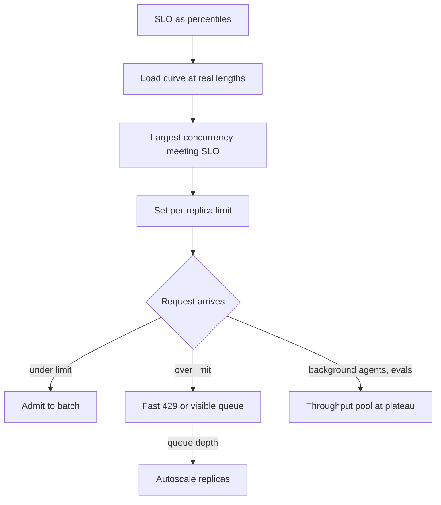

## TL;DR
Batching multiplies throughput almost for free until compute or KV memory saturates, but every added
request lengthens each step and the queue. Agents pay that latency on every sequential step, so pick
separate operating points for interactive and background agents.

## For agent builders
- **Why it matters for agents.** A 10-step agent pays queue wait and step time ten times in a row, so a
  latency regression that is mild for chat is multiplied for agents. Background agents and eval runs are
  the opposite case: nobody waits, so run them at the throughput end.
- **Where it shows up in your stack.** Provider interactive versus batch tiers (OpenAI Batch, Anthropic
  Message Batches), rate limits per API key, your agent framework's max parallel tool calls or
  sub-agents, and vLLM `--max-num-seqs` when self-hosting.
- **What you control.** How many calls each agent keeps in flight, which traffic goes to a batch tier,
  per-step timeouts, and admission limits in front of your own replicas.
- **What you can skip.** Deriving the M/M/1 formula; remember ρ = 0.9 means about 10× service time and
  that the tail breaks first.

## Decision case
### Scenario
A support-automation company self-hosts an 8B agent model for two workloads on the same illustrative
replica as the worked example below (80 GB GPU, ~3.35 TB/s, 4k-token contexts).
- **Interactive support agents.** Users wait on 10-step runs of about 1,500 output tokens. Daytime peak
  is 12,000 output tok/s; overnight it falls to about 1,500 tok/s.
- **Nightly eval and back-office agents.** 400M output tokens per night, finished inside an 8-hour window
  (28,800 s), so about 13,889 tok/s on average.
- **Constraints.**
  - *Latency:* interactive TPOT p95 ≤ 15 ms, so decode per run stays near 22 s.
  - *Budget:* ≤ $300 per day, at an assumed $3 per GPU-hour, so 4 GPUs ($288 per day).
  - *Data residency:* traces may not leave the company's cloud account, which rules out a provider
    batch API.
  - *Team and deadline:* two platform engineers who already run Kubernetes; six weeks.
- **Capacity per replica** (from the bandwidth model below): capped at B = 68, step ~14.9 ms and about
  4,556 tok/s; full at B ≈ 120, step ~22.7 ms and about 5,289 tok/s. Interactive replicas are planned at
  75 % of capped capacity (about 3,417 tok/s) for burst headroom.

### Options
| Option | How it works | Latency SLO | Night throughput | Budget |
|---|---|---|---|---|
| **1. Shared pool, run full** | 4 replicas at B ≈ 120 all day | Fails: ~23 ms TPOT, ~34 s decode per run | 21,156 tok/s, ample | 4 GPUs, $288 |
| **2. Shared pool, capped** | 4 replicas at B = 68; batch jobs fill spare slots at night | Step time meets 15 ms, but at night (ρ ≈ 0.84) batch requests hold the slots and interactive runs queue for admission | 18,224 − 1,500 = 16,724 tok/s, done in ~6.6 h | 4 GPUs, $288 |
| **3. Dedicated pools** | 4 capped interactive + 3 full batch replicas, always on | Meets it, isolated | 15,867 tok/s, done in ~7.0 h | 7 GPUs, $504: over budget |
| **4. Time-split pools** | Day: 4 capped interactive. Night: 1 capped interactive + 3 replicas relaunched at full batch | Meets it; night interactive load is 1,500 of 3,417 tok/s on its own replica | 15,867 tok/s, done in ~7.0 h | 4 GPUs, $288 |

### Decision
**Option 4, time-split pools.**
- **Latency** rules out option 1, and the queueing argument rules out option 2: even with a fast step,
  a slot held by a batch request lands in interactive TTFT, and that wait is paid on every agent step.
- **Budget** rules out option 3; option 4 buys the same isolation with the same 4 GPUs by moving three
  replicas between operating points twice a day.
- **Day sizing holds.** 12,000 ÷ 3,417 ≈ 3.5, so 4 capped replicas run at ρ ≈ 0.66.
- **Night sizing holds.** 3 × 5,289 = 15,867 tok/s finishes 400M tokens in about 7.0 h, leaving about an
  hour of slack in the window.
- **Team fit.** Two Kubernetes deployments with different `--max-num-seqs` values, scaled on a schedule,
  are within a two-person team's six weeks.
- **What would change it.**
  - *Residency relaxed:* send the nightly work to a provider batch tier (roughly half the interactive
    price at the time of writing) and shrink the fleet.
  - *Nightly volume above ~457M tokens* (15,867 × 28,800) or a shorter window: add a fourth batch GPU.
  - *Night interactive load above ~3,400 tok/s:* keep two interactive replicas at night.
  - *Engine priority scheduling that load tests show protects interactive TTFT:* option 2 becomes viable
    and drops the twice-daily switch.

### Trade-offs accepted
- **Two switchovers a day.** Relaunching replicas drains in-flight work and costs warm-up time. Watch
  switchover duration and batch requests failed during the drain.
- **Thin night margin.** About one hour of slack: watch nightly completion time and tokens per night,
  and alert when the projected finish passes the window.
- **Lower daytime efficiency.** Capped replicas give about 14 % fewer tokens per GPU than running full
  (4,556 vs 5,289). Watch goodput per GPU-hour in capacity reviews.
- **One interactive replica at night.** No redundancy for night users; watch night TTFT p95 and replica
  restarts, and fail over to a batch replica if it goes down.

### Review rubric
- **Constraints first.** The write-up states the latency SLO, budget, residency rule and window as
  numbers before naming any option.
- **Sizing is shown.** Replica counts come from per-replica capacity at the SLO-capped batch, with
  headroom stated, and every figure can be recomputed from the inputs.
- **Queueing is addressed.** It explains where interactive requests wait (admission, not only step time)
  and why utilisation near 1 is acceptable for batch but not for interactive traffic.
- **Each rejected option names its failing constraint**, not a vague preference.
- **Reversal triggers are measurable**, such as a token volume, a load level or a test result.
- **Monitoring is named** for every accepted trade-off: the metric and the threshold that would trigger
  a change.

## Why it exists
- **A GPU at concurrency 1 is mostly idle.** It streams 16 GB of weights through its memory system to
  produce a single token, then does it again. Producing 32 tokens per pass instead costs almost nothing
  extra, which is why continuous batching exists and why self-hosting is affordable at all.
- **The same arithmetic makes 32 users share one pipeline.** Each step is a little slower, new arrivals
  wait for a slot, and under bursty traffic the wait, not the step, becomes the latency.
- **Not choosing gets the worst of both.**
  - Run at high utilisation for low cost per token and p99 explodes, because queueing delay grows
    without bound as utilisation approaches 100 %.
  - Run at low concurrency for tight latency and you pay for GPUs that are 80 % idle.
- **"Autoscale on GPU utilisation" does not resolve it.** The usual metric (what `nvidia-smi` reports)
  is the fraction of time any kernel is running, not compute in use, so a decode loop at batch 4 and one
  at batch 200 can both read near 100 %. It says the GPU is busy, not how much headroom remains or how
  long the queue is.
- **Providers price the trade-off explicitly.** Interactive endpoints are tuned for latency and cost
  more; batch endpoints run at the throughput end with multi-hour completion windows at roughly half
  the interactive price at the time of writing. Self-hosting, you make that choice per workload.

## How it works
### The shape of the curve
- **Throughput** (aggregate output tokens/s) against concurrency rises almost linearly, bends, and
  plateaus.
- **Per-request latency** (TPOT, and TTFT once queueing starts) stays nearly flat, turns upward at a
  knee, then climbs steeply.
- **The decode-phase mechanism** is a single line:

```
step_time ≈ (weight_bytes + B × kv_bytes_per_seq) / bandwidth        (bandwidth-bound regime)
throughput ≈ B / step_time          per-request TPOT ≈ step_time
```

1. **While `weight_bytes` dominates**, *B* can grow with little effect on step time, so throughput
   scales with *B*.
2. **As `B × kv_bytes` catches up** (long contexts do this quickly), each new sequence costs every other
   one real latency.
3. **Eventually** arithmetic overtakes bandwidth and the step becomes compute-bound, or KV memory fills
   and the engine can admit no one. From there additional load only lengthens the queue.

### Queueing sits on top
- **Arrivals are random even below the knee.** Little's law: average requests in the system equal
  arrival rate times average time in system (`L = λW`).
- **Time in system grows like `service_time / (1 − ρ)`** for a simple single-server queue, where ρ is
  utilisation.

| Utilisation ρ | Time in system vs service time |
|---|---|
| 0.5 | 2× |
| 0.9 | 10× |

- **LLM service times are long and highly variable** (output length is unknown in advance), which makes
  the tail worse than the simple model predicts.
- **So** interactive services target moderate utilisation, and TTFT p99 is the first thing to break
  under load.

### Choosing the operating point
1. **Write the SLO as percentiles**, for example TTFT p95 ≤ 1 s and TPOT p95 ≤ 50 ms for chat.
2. **Run a load curve** at realistic prompt and output lengths and find the largest concurrency at which
   both hold. That is the replica's *goodput* capacity.
3. **Set the engine's per-replica concurrency limit** (`max_num_seqs` in vLLM) and token budget there,
   with headroom for bursts.
4. **Shed or queue beyond it visibly:** a fast 429 with `Retry-After`, or a queue position, instead of a
   silent 10-second TTFT.
5. **Autoscale on queue depth or TTFT**, not on GPU utilisation.
6. **Separate pools:** interactive traffic at the knee, batch and background jobs at the plateau where
   each token is cheapest and nobody is waiting.

### Techniques move the curve; they do not remove it
| Technique | What it shifts |
|---|---|
| Continuous batching | Sequences join and leave every step instead of waiting for the slowest |
| PagedAttention | Stops KV fragmentation, so more sequences fit before memory binds |
| Chunked prefill | Bounds prefill work per step, so new arrivals do not stall running streams |
| Disaggregated prefill and decode | Puts the phases on different GPUs, so one workload's TTFT stops competing with another's TPOT |
| Quantisation | Shrinks bytes per step and KV footprint |
| Speculative decoding | Lowers latency at low concurrency but spends compute the plateau needs, so it can reduce peak throughput |

Each shifts the knee rightward or the floor downward; none lets you run at 100 % utilisation with flat
latency.

### If you do not run the engine
- **You still own the trade-off.** You do not set the batch size, but you choose between interactive
  and batch tiers, how many requests to keep in flight per key, which timeouts to accept, and whether
  to pay for provisioned or dedicated capacity when tail latency matters.
- **The provider's rate limits are**, in effect, the operating point they chose for you.

### Agents on the curve
- **Sequential steps multiply latency.** Run time ≈ steps × (queue wait + TTFT + decode) + tool time, so
  operating near the knee costs an agent several times what it costs a single chat turn.
- **Agents generate their own load.** Parallel tool calls, sub-agents and retries put several requests
  in flight per user, so concurrency rises faster than user count; cap in-flight calls per run.
- **Two traffic classes, two points.** Interactive agents sit at the knee; background agents, evals and
  trace backfills belong at the plateau.
- **Batch tiers fit single calls, not loops.** A provider batch API returns results within hours, so it
  suits one-shot work (LLM-judge grading of finished trajectories, re-scoring traces); a multi-step run
  would wait a batch window per step, so run whole agent loops on a high-concurrency pool instead.

## Diagram
How an operating point is chosen and enforced: the SLO picks the concurrency, and everything above that
limit is shed, queued visibly or sent to a cheaper pool, which is where background agents and evals go.



## Examples
### Worked scenario: what a latency target costs in throughput
One replica, using the illustrative bandwidth model from the TPOT lesson: an 8B fp16 model (16 GB of
weights, 128 KB of KV cache per token) on an 80 GB GPU with about 3.35 TB/s of memory bandwidth. Every
request has 4k tokens of context, so each sequence holds about 0.5 GB of KV cache.
- **Memory caps concurrency first.** After weights and a few GB of working space, roughly 60 GB remain,
  so at most about 120 sequences can be resident.
- **The model.** Bytes per step at *B* sequences are `16 GB + B × 0.5 GB`, so TPOT ≈ `(16 + 0.5B) / 3350`
  seconds and throughput ≈ `B / TPOT`.

| TPOT SLO | Bandwidth limit on *B* | Binding limit | Step time | Throughput |
|---|---|---|---|---|
| ≤ 50 ms (chat) | `16 + 0.5B ≤ 167 GB`, *B* up to about 300 | Memory, ~120 | `(16 + 60) / 3350 ≈ 23 ms` | about 120 / 0.023 ≈ 5,300 tokens/s |
| ≤ 15 ms (code completion) | `16 + 0.5B ≤ 50 GB`, *B* ≤ 68 | Latency | 15 ms | about 68 / 0.015 ≈ 4,500 tokens/s |
| ≤ 10 ms | *B* ≤ 35 | Latency | 10 ms | about 3,500 tokens/s |

- **At 50 ms, latency is not the limit**: the step is comfortably inside the SLO, so run the replica full.
- **At 10 ms, the same hardware delivers about a third fewer tokens per hour**, hence roughly 50 % higher
  cost per token, purely because of the latency target.
- **That is the trade-off as a budget line**, before any queueing delay is added; real measurements will
  sit below every figure here.

```python
BW_GBPS, WEIGHTS_GB, KV_GB_PER_SEQ, MEM_CAP = 3350, 16, 0.5, 120

def best_batch(tpot_slo_s: float) -> int:
    by_latency = int((tpot_slo_s * BW_GBPS - WEIGHTS_GB) / KV_GB_PER_SEQ)
    return min(by_latency, MEM_CAP)

for slo in (0.050, 0.015, 0.010):
    b = best_batch(slo)
    step = (WEIGHTS_GB + KV_GB_PER_SEQ * b) / BW_GBPS
    print(f"SLO {slo*1e3:4.0f} ms  B={b:3d}  step {step*1e3:4.1f} ms  {b/step:5.0f} tok/s")
# SLO   50 ms  B=120  step 22.7 ms   5289 tok/s
# SLO   15 ms  B= 68  step 14.9 ms   4556 tok/s
# SLO   10 ms  B= 35  step 10.0 ms   3500 tok/s
```

### Agent scenario: one replica, interactive versus background agents
Same illustrative replica; an agent run emits 1,500 output tokens across 10 steps (decode only, no TTFT,
queue or tool time).

| Operating point | Step time (TPOT) | Decode time per run | Replica throughput | Runs per replica-hour |
|---|---|---|---|---|
| Full replica, B ≈ 120 | ~23 ms | 1,500 × 23 ms ≈ 34.5 s | ~5,300 tok/s | ~12,700 |
| Latency-capped, B ≈ 35 | 10 ms | 1,500 × 10 ms = 15 s | ~3,500 tok/s | ~8,400 |

- **An interactive agent** where a user waits wants the second row: less than half the decode time per
  run, at about a third fewer runs per hour.
- **A nightly research or eval agent** wants the first row, because only runs per dollar matter.

### Why the tail explodes near saturation
Runnable: a single-server FIFO queue with random arrivals and service times (Lindley's recursion),
compared with the `service_time / (1 − ρ)` formula.

```python
import random

def mean_time_in_system(rho, service=1.0, n=200_000, seed=0):
    rnd = random.Random(seed)
    wait = total = 0.0
    for _ in range(n):
        s = rnd.expovariate(1 / service)          # this request's service time
        total += wait + s
        gap = rnd.expovariate(rho / service)      # time until the next arrival
        wait = max(0.0, wait + s - gap)           # next request's queueing delay
    return total / n

for rho in (0.5, 0.7, 0.9, 0.95):
    print(f"rho={rho:.2f}  simulated {mean_time_in_system(rho):5.1f}x  formula {1/(1-rho):5.1f}x")
# rho=0.50 ~2x, 0.70 ~3.3x, 0.90 ~10x, 0.95 ~20x the service time
```

## Production patterns
- **Split agent traffic by who is waiting.** Route user-facing agent runs to the latency pool or
  interactive tier, multi-step eval sweeps and background agents to a high-concurrency pool, and
  single-call work such as trace re-scoring to a provider batch API. Monitor interactive per-step TTFT
  while background jobs run.
- **Cap in-flight calls per agent run.** Limit parallel tool calls and sub-agents per run with a
  semaphore or the framework's concurrency setting, so one run cannot fill a replica. Monitor in-flight
  requests per run and per tenant.
- **Concurrency cap from the load curve.** Set vLLM `--max-num-seqs` (and the per-step token budget
  `--max-num-batched-tokens`) at the largest concurrency that met the SLO, minus burst headroom. Monitor
  TTFT p95 and TPOT p95 against running sequences.
- **Shed at the edge with `Retry-After`.** When a replica's queue exceeds what fits in the first-token
  budget, return 429 with `Retry-After` from the gateway instead of queueing silently. Monitor shed rate
  per tenant and the share of admitted requests inside the SLO.
- **Autoscale on queue depth.** Feed the engine's waiting-request gauge (vLLM `vllm:num_requests_waiting`)
  into the autoscaler, for example a Kubernetes HPA on a custom metric or a KEDA Prometheus trigger.
  Monitor queue depth and scale-out lag.
- **Separate interactive and batch pools.** Run interactive traffic on replicas held at the knee and
  send offline work to a pool run at the plateau, or to a provider batch API (OpenAI Batch, Anthropic
  Message Batches). Monitor interactive TTFT during batch job start times.
- **Measure goodput per replica.** Track tokens or requests served within SLO per GPU-hour as the
  capacity KPI. Monitor it next to cost per token in capacity reviews.

## Trade-offs
- **Cost per token vs per-request latency.** Higher concurrency lowers cost per token and raises
  per-request latency; the balance flips from "fill the GPU" to "cap the batch" the moment a
  per-request SLO exists for that traffic.
- **Flat tails vs wasted hardware.** Low utilisation buys flat tail latency and wastes hardware; right
  for interactive tiers, wrong for offline jobs that can wait hours.
- **Speculative decoding by pool.** It improves latency when the GPU has spare compute (low concurrency)
  and can cut peak throughput when it does not, so it belongs on the interactive pool, not the batch pool.
- **Shared vs separate pools.** Sharing one pool maximises utilisation but lets batch arrivals push
  interactive TTFT past the knee; separate pools cost headroom and buy predictability.
- **Shedding vs queueing.** Fast 429s protect the latency of admitted requests at the cost of failed
  ones; queueing admits everyone and lets latency drift, which is better only when callers can wait.

## Pitfalls
- **Autoscaling on GPU utilisation.** Symptom: a metric pinned near 100 % at both light and heavy load,
  so replicas scale out late or never while users wait through a queue. Fix: scale on queue depth.
- **Closed-loop throughput benchmarks with no SLO.** Symptom: a "capacity" figure production never
  reaches without blowing p99. Fix: report goodput from an open-loop run.
- **Sizing from mean latency.** Symptom: on-call pages for p99 while the dashboard average looks fine,
  since queueing lives entirely in the tail. Fix: size against p95 and p99.
- **One batch job on the interactive pool.** Symptom: TTFT spikes at the exact minute a cron job starts.
  Fix: a separate pool or a provider batch API.
- **Raising `max_num_seqs` without checking KV memory.** Symptom: preemptions and recompute stalls that
  lower throughput and raise latency at once. Fix: check KV occupancy and the preemption counter first.
- **Treating speculative decoding as free throughput.** Symptom: lower aggregate tokens/s at peak than
  without it. Fix: keep it on the low-concurrency pool.

## When to use
- **Every time** you configure a replica, choose a provider tier, or set a rate limit, you are making
  this decision.
- **Latency end** whenever a person or latency-sensitive agent is waiting: chat, completions, voice,
  interactive tools, user-facing agent runs whose steps compound.
- **Throughput end** for evaluation runs, bulk extraction, embeddings backfills, nightly summaries and
  anything with a deadline measured in hours.
- **Measure** throughput, TTFT p95 and TPOT p95 against concurrency for each model and hardware pairing,
  pick the point, and enforce it with limits and alerts on queue depth.
- **Interviews:** draw the curve, explain why it bends (weights shared per step, then KV and compute
  binding), add the queueing tail, and name the concurrency limit as the control.

## Role lens
- **Engineer:** Produces the load curve, sets per-replica concurrency and token budgets, and wires
  429 shedding and queue-depth metrics into the serving layer.
- **Architect:** Owns the operating point per traffic class, decides on separate pools or tiers,
  and translates the SLO into replica counts and cost per token.
- **FDE:** Negotiates a customer's latency target against their GPU budget with the curve in hand,
  often by moving their batch workloads off the interactive pool.

## Check yourself
**Q:** One replica reports 85 % GPU utilisation and p99 TTFT of 6 s. Finance will not approve more
GPUs. What do you do, and in what order?
**A:** First establish which constraint binds: check KV-memory occupancy, preemption counts and
engine queue depth; 85 % utilisation in a bandwidth-bound decode loop says little about headroom.
Then protect latency with a per-replica concurrency cap set from a load curve, shedding the excess
with fast 429s so admitted requests stay inside the SLO instead of everyone waiting 6 s. Next
recover capacity without hardware: enable prefix caching for the shared system prompt, turn on
chunked prefill so long prompts stop stalling admission, cap `max_model_len` to what the product
needs so more sequences fit, and evaluate weight or KV quantisation. Move any batch or background
traffic to off-peak hours or a separate cheap pool. Finally measure goodput at the SLO and present
finance with cost per token at the required latency, which is the real request.

## Interview questions
### How would you choose the concurrency limit for a new chat deployment?
- **Start from the SLO** as percentiles, such as TTFT p95 ≤ 1 s and TPOT p95 ≤ 50 ms.
- **Run an open-loop load curve** at production prompt and output lengths, and take the largest
  concurrency at which both percentiles hold, minus burst headroom.
- **Enforce it** with the engine's max-sequences setting, shed the excess with 429s, and autoscale on
  queue depth.

### Your agent runs got 3× slower after traffic doubled, but single chat calls only got slightly slower. Why?
- **Agents pay the queue every step.** Near the knee, queue wait and step time rise per call; a 10-step
  agent pays that increase ten times sequentially.
- **Agents add their own load:** parallel tool calls and retries push concurrency up faster than users.
- **Fix:** cap per-replica concurrency below the knee, cap in-flight calls per run, autoscale on queue
  depth, and move background agents off the interactive pool.

### How do you run a nightly eval of 10,000 agent trajectories without hurting live users?
- **Separate the traffic:** run the agent loops on a separate pool at the plateau, not the interactive
  replicas; a batch API suits only the single-call parts, such as LLM-judge grading of finished runs,
  because each agent step would otherwise wait a batch window.
- **Throughput is the goal:** high concurrency per replica, because nobody waits on a single run.
- **Watch the live pool's** TTFT p95 during the run as the guardrail.

### When would you deliberately run a replica at low utilisation?
- **Interactive tiers with strict tails:** at ρ = 0.9 time in system is about ten times service time, so
  a voice or completion product needs headroom.
- **Not for offline work:** evaluation runs and backfills should run at the plateau, ideally on a
  separate pool or a provider batch tier at roughly half price.

### What does tightening TPOT from 50 ms to 10 ms cost on one replica?
- **In the illustrative 8B example**, memory caps the batch at about 120 at 50 ms, for about 5,300 tokens/s.
- **At 10 ms** latency binds at a batch of about 35, about 3,500 tokens/s: a third fewer tokens and
  roughly 50 % higher cost per token.
- **So** a latency target is a line in the infrastructure budget, and should be negotiated as one.

### GPU utilisation reads 100 % at both light and heavy load. Why, and what do you scale on instead?
- **The metric is time-busy**, the fraction of time any kernel runs, not the fraction of compute used,
  so batch 4 and batch 200 decode loops both look saturated.
- **Scale on** engine queue depth or TTFT percentiles, which directly measure the wait users feel.

## Quiz
### Q: Why does raising the batch size increase throughput almost linearly at first?
- [ ] Each sequence gets its own copy of the weights in GPU memory
- [x] The weights are read from memory once per decode step and shared by all sequences in the batch
- [ ] The GPU clock increases under heavier load
- [ ] Continuous batching compresses the KV cache as the batch grows
> A decode step is bound by streaming the weights from memory, a cost paid once per step regardless of
> batch size. More sequences per step mean more tokens for nearly the same time until KV reads or
> compute start to dominate.

### Q: Which statement about queueing delay in a loaded LLM service is correct?
- [ ] Average wait grows linearly with utilisation, so 90 % load means 90 % more delay
- [x] Average time in the system grows roughly like 1 / (1 − utilisation), so tail latency explodes as load nears saturation
- [ ] Queueing only matters once GPU memory is completely full
- [ ] Mean latency captures queueing well because waits are evenly distributed
> The simple single-server result `W ≈ service_time / (1 − ρ)` already gives ten times the service
> time at ρ = 0.9, and LLM service times are long and variable, which makes the tail worse. The
> damage shows up in p95 and p99 long before memory is exhausted.

### Q: Which technique improves per-request latency at low load but can reduce peak throughput at high load?
- [ ] PagedAttention
- [ ] Prefix caching
- [x] Speculative decoding
- [ ] Chunked prefill
> Speculative decoding spends extra compute drafting and verifying several tokens per step; that
> compute is spare at low concurrency but is exactly what a saturated GPU needs, so peak throughput
> can fall. PagedAttention, prefix caching and chunked prefill shift the curve without that penalty.

## Use cases & projects
### Use cases
- **Interactive versus background agents.** Teams route user-facing runs to a low-latency path, nightly
  or bulk agent loops to a high-concurrency replica, and one-shot grading calls to a batch tier.
- **Eval and data-generation runs.** Thousands of agent runs where nobody waits are run at the throughput
  end to cut cost and finish overnight.
- **Parallel tools and sub-agents.** Fan-out width per run is a throughput choice that raises queue wait
  for every other user on the same capacity.
- **Admission control on shared replicas.** Concurrency caps keep the latency SLO for interactive agents
  while the rest of the load queues or sheds.

### Mini project
**Find the knee for an agent workload (2-3 hours).**
- **Goal:** chart run latency against throughput for one agent and pick an operating point.
- **Steps:** replay the same 10-step agent task at increasing concurrency against a self-hosted model (a
  hosted API usually shows rate-limit errors before it shows the knee); record run latency p50 and p99 and completed runs per minute at
  each level; mark the point where p99 starts to climb steeply.
- **Done when:** you have a latency-versus-throughput chart with the knee marked, and a one-paragraph
  recommendation for the interactive cap and the background setting.
