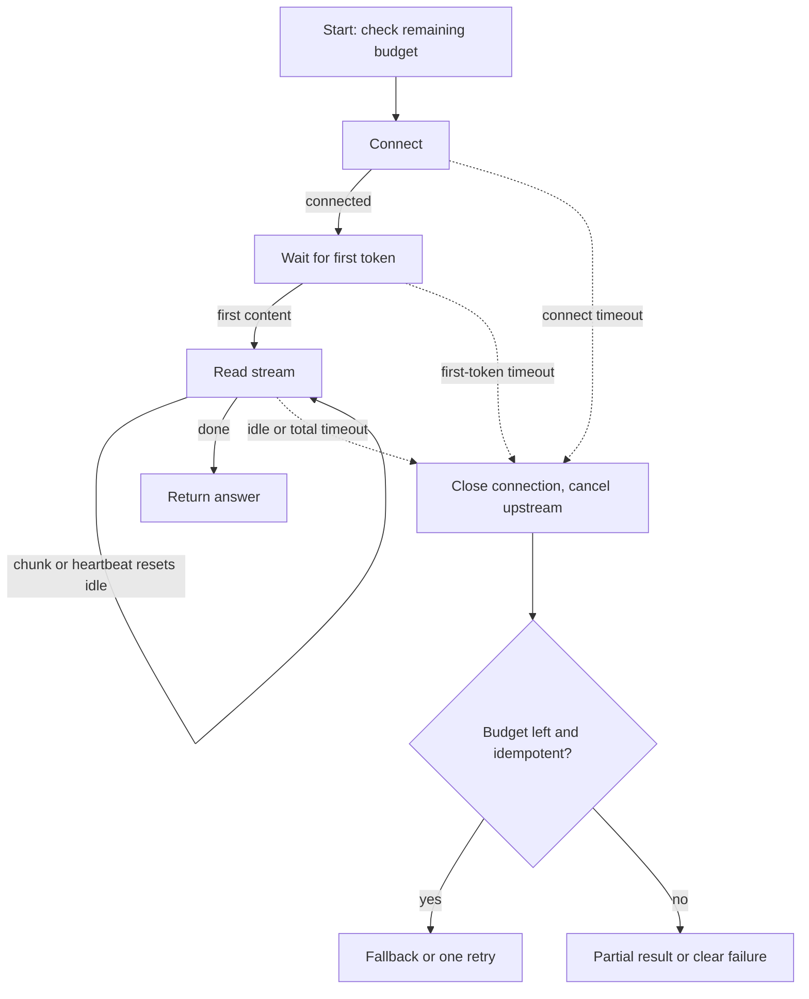

## TL;DR
LLM calls last from under a second to minutes, so one flat timeout kills good work or lets hung calls
hold resources. Layer connect, first-token, idle and total timers, derive the total from
`max_tokens × TPOT`, propagate the remaining budget, and cancel on every expiry.

## Why it exists
- **Legitimate durations vary by 100×.** Ordinary HTTP timeouts assume tens of milliseconds. An LLM
  response at 20 ms per token takes 20 s for 1,000 tokens when healthy; a reasoning model can pause
  before emitting anything; a request queued behind a burst can wait seconds before prefill starts.
- **Both flat choices fail.** "30 seconds and give up" silently fails a large share of long outputs.
  "Ten minutes to be safe" lets a dead upstream pin a worker, a connection-pool slot and a user for ten
  minutes.
- **The damage compounds into an overload spiral.** Hung requests hold slots, so healthy ones queue;
  clients time out and retry, adding load to an already slow upstream; the retries time out too. LLM
  backends are unusually prone to this because each request is expensive and long.
- **Forgotten infrastructure has its own timers.** Reverse proxies and load balancers ship with idle
  timeouts of about a minute, so a non-streaming generation that takes 70 s is cut off with a gateway
  error while the engine keeps generating for nobody.
- **"Stream and never time out" is not enough.** Streaming turns "no bytes for N seconds" into a
  liveness signal, but you still need a total bound so a stuck stream cannot run to `max_tokens`, and
  every downstream call in an agent step must know how much of the user's patience remains.

## How it works
### The timeout stack
A single call crosses several layers, each with its own timer:

| Layer | Default or behaviour |
|---|---|
| SDK | The OpenAI Python client defaults to a 10-minute timeout and two retries |
| HTTP library under it | httpx splits a timeout into connect, read, write and pool phases, each defaulting to five seconds |
| Your server's handler | Whatever you configured |
| Proxy or load balancer | nginx's `proxy_read_timeout` and an AWS ALB's idle timeout both default to 60 s |
| Provider's gateway | The provider's own limits |
| Engine scheduler | May hold a request in its admission queue |

- **The effective timeout is the *shortest* of these**, and the one that fires is rarely the one you
  configured.
- **Retries stack on top.** Because that SDK retries a timed-out request by default, its worst case is
  three full timeouts, half an hour, before your code sees an error, unless you lower `timeout` or
  `max_retries`.

### Which timers, and what each one means
| Timer | Covers | Setting | When it fires |
|---|---|---|---|
| **Connect** | TCP and TLS handshake | Short, a few seconds | Host unreachable; retrying elsewhere is cheap and safe |
| **First byte / first token** | Queueing plus prefill | From TTFT p99 with margin (illustratively 10–30 s for long-prompt workloads) | Little consumed, so a fallback or retry on another replica is reasonable |
| **Idle (read) between chunks** | Liveness of a stream | 15–30 s, since a healthy stream emits a token every few tens of milliseconds | Upstream is stuck, provided the server heartbeats through legitimate pauses such as hidden reasoning |
| **Total deadline** | The whole call | Must cover the longest *legitimate* response | For non-streaming calls, the only timer that tells "slow" from "dead" |

### Budget arithmetic
- **Non-streaming deadline:** `TTFT_p99 + max_tokens × TPOT_p99 + margin`.
- **Example:** with `max_tokens = 4096` and a TPOT of 30 ms that is already over two minutes before
  queueing. That is why non-streaming calls with large `max_tokens` collide with 60-second proxies, and
  why some SDKs refuse very long non-streaming requests and tell you to stream.
- **Derive it per call** from `max_tokens` rather than hard-coding one constant.
- **Cap `max_tokens`** to what the product needs; a smaller cap is the cheapest timeout fix there is.

### Deadline propagation
1. **Set one absolute deadline at entry.** An agent step that must answer within 60 s and makes four
   LLM calls and two tool calls cannot give each of them 60 s.
2. **Pass it down the call chain.** Every downstream call gets `remaining = deadline − now`.
3. **Fail fast near the end.** When `remaining` falls below the minimum useful time for a step, return
   a partial result rather than start work that cannot finish.
4. **Carry it on the wire.** gRPC carries deadlines natively; over HTTP pass it as a header or in your
   own context object.

### What happens when a timer fires
- **Nothing stops upstream unless you make it.** A client-side timeout that merely raises leaves the
  engine decoding, the provider billing, and the connection half-open until the server's own timers
  notice.
- **So every timeout must close the connection or abort the request**, so the signal reaches the engine.
  That is the cancellation lesson's job, and timeouts are its most common trigger.

### Retrying after a timeout
- **It is the most expensive failure to retry.** The first attempt may still be running, timeouts signal
  overload more often than a transient glitch, and the retry needs the same long budget again.
- **Retry only** when the remaining deadline allows it, with jitter, and only for idempotent requests.
- **Prefer falling back:** a smaller or different model, a cached answer, a degraded response.
- **Open a circuit breaker** when timeouts cluster, so a sick upstream is not hammered.

### Server-side timers if you run the engine
- **Bound the admission queue.** A request that has waited longer than its first-token budget should get
  a fast 429 or 503 rather than be served late.
- **Cap per-request generation time and `max_tokens`** at the API boundary.
- **Expose queue wait as a metric**, so you can see the budget being spent before clients time out.

## Diagram
Each phase of a streaming call has its own timer, and every expiry routes through cancellation before
any fallback or retry.



## Examples
### Layered timeouts around a streaming call
Layered timeouts around a streaming call with `httpx`: a short connect timeout, a cumulative first-token
timer, an idle timer that resets on every line (heartbeats included), and a total deadline derived from
`max_tokens` and measured TPOT, capped by the caller's absolute deadline.
- **Why the cap:** an agent can share one budget across several steps.
- **With these numbers** a 512-token call gets `8 + 512 × 0.05 × 1.5 ≈ 46 s`, and the first-token timer
  turns a stuck queue into an error after 15 s instead of 46.

```python
import asyncio, json, time
import httpx

TTFT_P99, TPOT_P99 = 8.0, 0.05            # measured for this model and traffic, in seconds
FIRST_TOKEN, IDLE = 15.0, 20.0

def call_budget(max_tokens: int) -> float:
    return TTFT_P99 + max_tokens * TPOT_P99 * 1.5    # 1.5x margin on decode

async def stream_completion(client: httpx.AsyncClient, payload: dict, deadline: float) -> str:
    budget = min(call_budget(payload["max_tokens"]), deadline - time.monotonic())
    if budget < 2.0:
        raise TimeoutError("not enough budget left to start this call")
    first_by = time.monotonic() + FIRST_TOKEN
    timeout = httpx.Timeout(connect=3.0, read=IDLE + 5, write=10.0, pool=3.0)  # socket backstop
    text = []
    try:
        async with asyncio.timeout(budget):                       # total deadline (Python 3.11+)
            async with client.stream("POST", "/v1/chat/completions",
                                     json={**payload, "stream": True}, timeout=timeout) as r:
                r.raise_for_status()
                lines = r.aiter_lines()
                while True:
                    wait = IDLE if text else min(IDLE, first_by - time.monotonic())
                    try:
                        line = await asyncio.wait_for(anext(lines), max(wait, 0.0))
                    except StopAsyncIteration:
                        break
                    if not line.startswith("data: ") or line == "data: [DONE]":
                        continue                                  # heartbeats reset IDLE only
                    delta = json.loads(line[6:])["choices"][0]["delta"].get("content")
                    if delta: text.append(delta)
    except (TimeoutError, httpx.TimeoutException) as e:
        # leaving `client.stream` closed the connection: the upstream's only signal to stop decoding
        phase = "first-token" if not text else "idle-or-total"
        raise TimeoutError(f"{phase} timeout after {len(text)} chunks") from e
    return "".join(text)
```

### One deadline shared by an agent's steps
Runnable with sleeps standing in for LLM and tool calls: a 1 s budget for four steps. Each step gets at
most what is left, and the last one is skipped because it could not finish usefully.

```python
import asyncio, time

class Deadline:
    def __init__(self, seconds: float):
        self.at = time.monotonic() + seconds          # absolute, so it survives being passed around
    def remaining(self) -> float:
        return self.at - time.monotonic()

async def step(name, duration, deadline, min_useful=0.2):
    left = deadline.remaining()
    if left < min_useful:                             # fail fast instead of starting doomed work
        raise TimeoutError(f"skipped {name}: only {left:.1f}s left")
    await asyncio.wait_for(asyncio.sleep(duration), timeout=left)   # never longer than what is left
    return name

async def agent(budget_s=1.0):
    d, done = Deadline(budget_s), []
    try:
        for name, dur in [("plan", 0.3), ("search", 0.2), ("draft", 0.4), ("review", 0.3)]:
            done.append(await step(name, dur, d))
    except (TimeoutError, asyncio.TimeoutError) as e:
        return done, f"partial ({e})"
    return done, "complete"

print(asyncio.run(agent()))
# (['plan', 'search', 'draft'], 'partial (skipped review: only 0.1s left)')
```

### Worked scenario: the 60-second wall
A non-streaming endpoint behind a load balancer with the default 60 s idle timeout, TTFT p99 8 s, TPOT
30 ms (illustrative).

| `max_tokens` | Needed deadline (8 s + tokens × 30 ms, before margin) | Behind a 60 s idle timeout |
|---|---|---|
| 512 | about 23 s | Fine |
| 1,500 | about 53 s | Fails on queueing spikes |
| 4,096 | about 131 s | Always cut off; engine keeps generating |

Fixes, cheapest first: cap `max_tokens`, stream with heartbeats so the idle timer never fires on a live
call, then raise the idle timeout on hops you own.

## Production patterns
- **Configure SDK timeouts and retries explicitly.** Construct the client with a timeout and retry count
  you chose (the OpenAI Python SDK accepts `timeout`, including an `httpx.Timeout`, and `max_retries`,
  and `client.with_options(...)` overrides them per call). Monitor timeout counts per call site.
- **Audit and raise idle timeouts on streaming routes.** Set nginx `proxy_read_timeout` for the streaming
  location and the ALB `idle_timeout.timeout_seconds` attribute above your longest heartbeat gap. Monitor
  disconnects clustered at exactly the old default.
- **Propagate one deadline.** Put an absolute deadline on the request context at the edge, pass it to
  services in a header of your own (or as a gRPC deadline), and compute each call's timeout as
  `min(derived budget, remaining)`. Monitor which step consumes the budget.
- **Bound the admission queue.** Reject requests that have waited past their first-token budget with 429
  or 503 at the serving layer. Monitor queue wait percentiles next to client timeout rate.
- **Circuit-break on clustered timeouts.** When the timeout rate for an upstream crosses a threshold, open
  a breaker and route to a fallback model for a cool-down period. Monitor breaker state changes and
  fallback share.
- **Label timeouts by cause.** Emit first-token, idle and total timeouts as separate metric labels per
  layer; a rise in first-token timeouts is usually the first visible sign of upstream overload.

## Trade-offs
- **Short first-token timeout vs bursts.** It fails fast and enables cheap fallback, but under a traffic
  burst turns a recoverable queue into a wave of errors; the balance flips when callers can wait and
  nothing else can serve them.
- **Idle timeouts vs heartbeats.** They give a precise liveness signal for streams at the cost of needing
  heartbeats during legitimate pauses; without heartbeats they are worse than a plain total deadline.
- **Derived deadlines vs generous caps.** Deriving from `max_tokens` is accurate but means a generous cap
  buys a long timeout; tighter caps make timeouts tighter at the cost of truncating rare long answers.
- **Retry vs overload.** Retrying can rescue a transient failure and can also double load on an
  overloaded upstream; the decision flips on whether remaining budget exists and whether the timeout
  rate is rising fleet-wide.
- **Long vs short server-side timeouts.** Long ones maximise the chance a slow request completes and let
  hung requests hold capacity; shorter ones protect the pool and shed work that would have finished.

## Pitfalls
- **Inheriting defaults.** A 60-second proxy or load balancer idle timeout in front of a non-streaming
  endpoint shows up as gateway errors at exactly 60 s on long generations while the engine keeps running.
- **Treating the HTTP read timeout as a total timeout.** Symptom: a "timeout" that never fires on a
  slow-but-alive stream, since it resets on every chunk.
- **Timing out without cancelling.** Symptom: provider usage and GPU load that stay high after clients
  have given up, and tokens billed for answers nobody saw.
- **One timeout constant regardless of `max_tokens`.** Symptom: short calls waiting minutes to fail and
  long calls cut off while healthy.
- **Agent steps that each get the full user budget.** Symptom: a 60-second SLO breached by a request
  whose individual calls all "succeeded within timeout".
- **Retrying timeouts immediately, without a budget check.** Symptom: an overload that worsens as clients
  time out, the signature of a retry storm.

## When to use
- **Every call** to a model, a retriever or a tool needs the layered timers above; the question is only
  the values.
- **Derive values** from measured percentiles and `max_tokens`, revisit them when models or prompt
  lengths change, and give agents one propagated deadline rather than per-call constants.
- **Stream whenever `max_tokens` is large**, so liveness comes from the idle timer instead of a
  multi-minute total.
- **Measure** timeout rate by layer and by cause (first-token versus idle versus total), and alert when
  it rises, because it is usually the first visible sign of upstream overload.
- **Interviews:** for "how would you set timeouts for an LLM call", answer with the stack, the
  arithmetic and the cancel-and-fallback behaviour, not a number.

## Role lens
- **Engineer:** Configures connect, first-token, idle and total timers per call from `max_tokens` and
  measured TPOT, and makes every expiry close the upstream connection.
- **Architect:** Sets the end-to-end latency budget per surface, mandates deadline propagation across
  services, and decides where fallback replaces retry.
- **FDE:** Finds the 60-second idle timeout in the customer's load balancer or API gateway that is
  truncating long answers, and gets streaming enabled through it.

## Check yourself
**Q:** An agent makes up to six sequential LLM calls and three tool calls per user request, and the
user-facing SLO is 60 seconds. How do you set the timeouts, and what happens when the budget runs out?
**A:** Give the request one absolute deadline at entry and pass it to every step; each call gets
`min(its own derived budget, remaining)`. Derive each LLM call's budget from its `max_tokens` and
measured TPOT and stream it so the idle timer (with heartbeats) is the liveness check; give tools
budgets from their own latency percentiles. Before starting a step, check that enough budget remains
to be useful; if not, stop and return the best partial result or a clear "could not finish" rather
than start a call that will be cut off. Never retry a timed-out step unless the remaining budget
covers it, and prefer a cheaper fallback model. Every expiry must cancel the in-flight call so the
upstream stops. Measure which step consumes the budget in practice and shrink `max_tokens` or move
work earlier accordingly.

## Interview questions
### Why is a single flat timeout wrong for LLM calls?
- **Legitimate durations span 100×:** queueing, prefill and an unknown output length mean a healthy call
  can take under a second or several minutes.
- **A short constant** fails long outputs; **a long one** lets dead upstreams pin workers and pool slots.
- **Layered timers** separate "unreachable" (connect), "stuck in queue" (first token), "stalled" (idle)
  and "too slow overall" (total), each with its own response.

### What is your effective timeout if the SDK says 10 minutes and nginx sits in front?
- **The shortest timer wins:** nginx `proxy_read_timeout` defaults to 60 s, so a non-streaming call that
  sends nothing for a minute is cut there, whatever the SDK says.
- **Retries multiply the worst case:** the OpenAI SDK's default of two retries means up to three full
  timeouts before your code sees an error.
- **Fix:** stream with heartbeats, set SDK `timeout` and `max_retries` deliberately, and raise idle
  timeouts on hops you own.

### How do you size the total timeout for a non-streaming call with max_tokens 4096?
- **Formula:** TTFT p99 + max_tokens × TPOT p99 + margin.
- **Numbers:** at 30 ms TPOT, 4096 tokens is about 123 s of decode alone, so over two minutes before
  queueing, which no 60-second proxy will allow.
- **Better:** cap max_tokens to what the product needs, or stream so liveness comes from the idle timer.

### A timed-out call is still running upstream. Do you retry?
- **Not by default:** the first attempt may still be consuming capacity, and timeouts usually signal
  overload, so a retry adds load to the cause.
- **Cancel first**, then retry only if the remaining deadline covers a full attempt and the request is
  idempotent, with jitter.
- **Prefer fallback** to a cheaper model or a degraded answer, and open a circuit breaker if timeouts
  cluster.

### Your timeout rate doubled overnight. How do you find the cause?
- **Split by cause and layer:** first-token timeouts point at queueing or longer prompts; idle timeouts
  at stalled streams or missing heartbeats; total timeouts at longer outputs or slower decode.
- **Correlate** with engine queue wait, prompt-length percentiles and any infrastructure change (a new
  proxy or gateway with a 60 s default).

## Quiz
### Q: What is the most useful liveness signal for a streaming LLM response?
- [ ] The connect timeout, since a connected socket means the server is alive
- [ ] A single total timeout set generously to cover the longest answer
- [x] An idle timeout on the gap between chunks, combined with server heartbeats during legitimate pauses
- [ ] The time to first token, after which the stream can be trusted to finish
> A healthy stream delivers data continuously, so a stalled gap is the earliest and most specific
> sign of a dead upstream. A total timeout still bounds the worst case, but it reacts far later; TTFT
> says nothing about what happens after the first token.

### Q: Long non-streaming generations fail at exactly 60 seconds with a gateway error, and the GPU stays busy afterwards. What is the likely cause?
- [ ] The model has a built-in 60-second generation limit
- [x] An intermediary's default idle timeout cut the connection, and the engine was never told to abort
- [ ] The client's connect timeout is too short
- [ ] `max_tokens` is too low for the prompt
> Reverse proxies and load balancers commonly default to about a minute of idle time, which a
> non-streaming response exceeds with nothing sent. The engine keeps decoding because no cancellation
> reached it; streaming with heartbeats or a longer idle setting plus propagated cancellation fixes
> both halves.

### Q: A 90-second generation times out while the upstream is clearly overloaded. What is the safest default behaviour?
- [ ] Retry immediately with the same parameters to recover from the transient failure
- [ ] Extend the timeout and wait, since the answer is probably almost done
- [x] Cancel the in-flight request upstream, then fall back or fail clearly, retrying only if the remaining budget allows
- [ ] Switch to a non-streaming call so the response arrives in one piece
> Retrying a long, timed-out call under overload doubles the load that caused the timeout and may
> duplicate work still running upstream. Cancelling frees capacity, and a cheaper fallback or an
> honest failure respects the user's budget.
