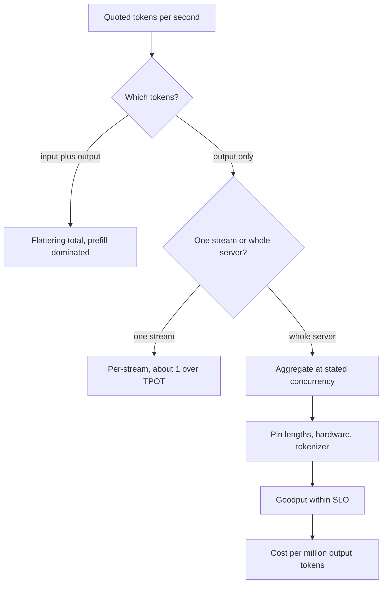

## TL;DR
"Tokens per second" names two numbers that move in opposite directions with concurrency: one stream's
decode speed (what a user sees) and a server's aggregate output (what you pay for). A figure means
nothing without tokens counted, concurrency, lengths, hardware, precision and tokenizer.

## Why it exists
- **Serving is selling tokens per GPU-second.** The business, the capacity plan and the user experience
  all need a rate, and the obvious one is overloaded.
- **Three people, three quantities, same words.** A vendor slide says "1,200 tokens/s"; a user complains
  the assistant "only does 30 tokens/s"; an engineer sizes a cluster from a benchmark at concurrency 1.
- **The mistakes compound.** Sizing from single-stream speed can undershoot capacity by an order of
  magnitude, while judging user experience from aggregate throughput hides that each stream is crawling.
- **One number per deployment does not exist.** It depends on requests in flight, prompt and answer
  lengths, whether prompt tokens count (prefill chews through them tens of times faster than decode
  produces output), and which tokenizer defines a token.
- **Tokenizers alone move it a lot.** Two models given the same English text can differ in token count
  by double-digit percentages, and far more on code or non-Latin scripts. Without pinning these down,
  tokens/s is marketing, not measurement.

## How it works
### The four numbers hiding in one phrase
1. **Per-stream output tokens/s.** One request's decode rate after its first token: about `1 / TPOT`.
   This is what a reader perceives.
2. **Aggregate output tokens/s.** Output tokens produced by the whole replica per second across all
   concurrent requests. In steady state it is roughly `concurrency × per-stream rate`, and it is the
   number that sets cost per token.
3. **Input (prefill) tokens/s.** Prompt tokens processed per second. Prefill is compute-bound and
   batched, so this is typically one to two orders of magnitude higher than output rate on the same
   hardware.
4. **"Total" tokens/s.** Input plus output over wall time. It is dominated by the cheap input term, so it
   makes any system look fast; treat a quote that does not say "output" as this number.

Alongside these:
- **Requests per second.**
- **Goodput:** the rate of requests (or tokens) served *within* the latency SLO. It is the honest
  capacity figure because it refuses to count tokens that arrived too late to matter.

### How they relate
- **Per-stream rate falls slowly with concurrency**, because each decode step streams the weights once
  for all sequences and only KV-cache reads grow with the batch.
- **Aggregate rate climbs almost linearly at first**, then bends as KV reads dominate or the GPU becomes
  compute-bound, and stops when KV memory is full and new requests queue.
- **The sellable capacity is where the curves cross your SLO**, not the plateau, for interactive
  traffic.

### Little's law makes it exact
"Aggregate ≈ concurrency × per-stream rate" is only the decode-phase view. In steady state, requests per
second = concurrency / mean request latency, so

```
aggregate_output_tok/s ≈ concurrency × n_out / (TTFT + (n_out − 1) × TPOT)
```

| 64 in flight, TPOT 25 ms, TTFT 500 ms | Request time | Aggregate output |
|---|---|---|
| 1,000-token answers | about 25.5 s | 64 × 1000 / 25.5 s ≈ 2,500 tokens/s |
| 50-token answers | about 1.7 s | 64 × 50 / 1.7 s ≈ 1,900 tokens/s |

Same engine, fewer tokens per second for short answers, because each slot spends almost a third of its
life in queue and prefill rather than decoding.

### What moves the numbers
| Factor | Effect |
|---|---|
| **Bytes per step** | Model size and weight precision set the floor of per-stream speed |
| **Memory bandwidth** | The hardware term; FLOPs matter only once compute binds at high batch |
| **Concurrency** | Trades per-stream for aggregate, as above |
| **Context length** | More KV bytes per step and fewer sequences that fit, so both per-stream and aggregate fall as conversations grow |
| **Output length distribution** | Many short answers mean more scheduling churn and a larger prefill share; aggregate output falls even though the GPU is busy |
| **Tokenizer** | Changes the denominator. Comparing models by tokens/s rewards the coarser vocabulary; compare characters or words per second for user-facing speed |

### Measuring it without fooling yourself
- **Count tokens from the server's usage report**, not from the number of streamed chunks.
- **Warm up and measure in steady state**, excluding model load and cache fill.
- **Choose the loop deliberately.**
  - *Closed-loop:* fixed concurrency; each client sends the next request when the previous finishes.
    It can never show queue build-up, so its capacity numbers are optimistic.
  - *Open-loop:* requests arrive at a set rate regardless of completion, which exposes queueing.
- **Use realistic prompt and output length distributions**, report failures and timeouts as part of the
  run, and publish TTFT and TPOT percentiles next to the throughput figure.
- **Tools:** vLLM ships a serving benchmark script and NVIDIA's GenAI-Perf exists for the same job; a
  30-line asyncio harness is enough to start.

### From tokens/s to money
Cost per million output tokens on self-hosted hardware is
`gpu_hourly_cost / (aggregate_output_tokens_per_second × 3600) × 1e6`. Illustrative:

| Replica setting | Output tokens/s | Tokens per hour at $3 per GPU-hour (assumed) | Cost per million output tokens |
|---|---|---|---|
| Batched, high concurrency | 3,000 | 10.8 million | about $0.28 |
| Concurrency 1 | 200 | 0.72 million | $4.17 |

- **Before idle time, redundancy and prefill.** Real costs are higher than both rows.
- **That spread is the entire economics of batching**, and why the concurrency you choose is a pricing
  decision.

## Diagram
Before trusting any tokens/s figure, walk it down this path; each question changes the number, and only
the last two predict capacity and cost.



## Examples
### Closed-loop load generator for the concurrency curve
A small closed-loop load generator against any OpenAI-compatible streaming server: *c* workers each
send a request, wait for it to finish, and send the next, so concurrency stays near *c* for the
whole run.
- **It reports** aggregate output tokens/s (total tokens over wall time, not an average of
  per-request rates), median per-stream rate and TTFT percentiles at several concurrency levels.
- **That is the curve** you need before setting a per-replica concurrency limit.

```python
import asyncio, statistics, time
from openai import AsyncOpenAI

client = AsyncOpenAI(base_url="http://localhost:8000/v1", api_key="unused")
MODEL, PROMPT = "my-model", "Explain how a KV cache works in detail."

async def one(max_tokens=256):
    t0 = time.perf_counter(); t_first = None; n = 0
    stream = await client.chat.completions.create(
        model=MODEL, messages=[{"role": "user", "content": PROMPT}], max_tokens=max_tokens,
        stream=True, stream_options={"include_usage": True})
    async for ch in stream:
        if ch.usage:                      # authoritative count, sent in the final chunk
            n = ch.usage.completion_tokens
        if ch.choices and ch.choices[0].delta.content and t_first is None:
            t_first = time.perf_counter()
    return t_first - t0, n, time.perf_counter() - t0

async def level(c: int, per_worker: int = 4):
    res = []
    async def worker():                    # closed loop: send the next request when one finishes
        for _ in range(per_worker):
            res.append(await one())
    t0 = time.perf_counter()
    await asyncio.gather(*(worker() for _ in range(c)))
    wall = time.perf_counter() - t0
    out = sum(n for _, n, _ in res)                                   # total output tokens / wall time
    per_stream = [n / (total - ttft) for ttft, n, total in res if n > 1]
    ttfts = sorted(ttft for ttft, _, _ in res)
    print(f"c={c:3d}  aggregate={out / wall:7.0f} tok/s  per-stream p50={statistics.median(per_stream):5.0f} tok/s"
          f"  TTFT p50={ttfts[len(ttfts)//2]*1e3:5.0f} ms  p95={ttfts[int(len(ttfts)*.95)]*1e3:5.0f} ms")

async def main():
    await one()                                                       # warm-up
    for c in (1, 4, 16, 64):
        await level(c)
asyncio.run(main())
# Typical shape: aggregate climbs steeply then flattens; per-stream falls gently then faster;
# TTFT p95 jumps when the engine starts queueing. Pick the largest c that still meets your SLOs.
# A closed loop never offers more than c requests, so rerun open-loop before trusting the limit.
```

### From a benchmark result to replicas and price
Runnable arithmetic: Little's law for aggregate output, then replicas and cost per million. Inputs are
illustrative; replace them with your measured TTFT, TPOT and traffic.

```python
import math

def aggregate_tok_s(concurrency, n_out, ttft_s, tpot_s):
    return concurrency * n_out / (ttft_s + (n_out - 1) * tpot_s)

def cost_per_million(gpu_hourly, agg_tok_s):
    return gpu_hourly / (agg_tok_s * 3600) * 1e6

agg = aggregate_tok_s(64, 1000, 0.5, 0.025)        # ~2,512 output tok/s per replica
peak_demand = 20_000                                # output tok/s needed at peak (assumed)
print(f"aggregate {agg:,.0f} tok/s, replicas {math.ceil(peak_demand / agg)}")
print(f"${cost_per_million(3.0, agg):.2f} per million at c=64")
print(f"${cost_per_million(3.0, 200):.2f} per million at c=1 (200 tok/s)")
# aggregate 2,512 tok/s, replicas 8
# $0.33 per million at c=64
# $4.17 per million at c=1 (200 tok/s)
```

## Production patterns
- **Benchmark with your length mix, open-loop.** Run the engine's serving benchmark (vLLM's ships with
  it; `vllm bench serve` in recent versions) with your real prompt and output length distribution and
  a fixed request rate, not only fixed concurrency. Record TTFT and TPOT percentiles next to tokens/s.
- **Publish goodput, not peak.** Report capacity as output tokens/s (or requests/s) served within the
  TTFT and TPOT SLO at the concurrency limit you will deploy. Monitor goodput per replica in production
  against that number.
- **Count from usage fields.** Read `usage.completion_tokens` (with the include-usage stream option on
  OpenAI-style APIs) rather than chunk counts. Monitor drift between your token counts and the
  provider's billing.
- **Price from the chosen operating point.** Compute cost per million output tokens from aggregate
  tokens/s at the deployed concurrency, plus idle and redundancy overhead. Monitor GPU-hours per million
  output tokens weekly.
- **Compare models by task time, not tokens/s.** For model selection, measure characters per second or
  seconds to complete a fixed task set, because tokenizers differ. Monitor end-to-end task latency.

## Trade-offs
- **Aggregate vs per-stream.** Raising concurrency raises aggregate tokens/s and lowers cost per token,
  but lowers per-stream speed. The right point flips from "maximise aggregate" to "cap concurrency" the
  moment a per-stream or TTFT SLO exists.
- **Total vs output tokens/s.** Quoting total (input + output) gives a bigger, more flattering number
  that is fair for prefill-heavy jobs like summarisation, and misleading for chat where output
  dominates the cost.
- **Peak vs goodput.** Comparing engines on peak throughput is cheap to run but rewards configurations
  that queue aggressively; goodput at your SLO is harder to measure and the only figure that predicts
  capacity.
- **Speculative decoding by concurrency.** It raises per-stream tokens/s at low concurrency but can lower
  aggregate at high concurrency, so a benchmark at one setting can reverse at the other.
- **Short vs long context.** Long-context workloads cut both numbers because KV reads grow and fewer
  sequences fit; a model that wins at 1k context can lose at 32k.

## Pitfalls
- **Comparing tokens/s across different tokenizers.** Symptom: the "faster" model takes longer to finish
  the same paragraph. Fix: compare characters per second or task time.
- **Benchmarking at concurrency 1 and dividing a fleet by that.** Symptom: capacity wildly under- or
  over-provisioned depending on which number was used. Fix: size from goodput at the deployed
  concurrency.
- **Counting streamed chunks as tokens.** Symptom: tokens/s that disagrees with usage and with the bill,
  since servers coalesce or split tokens per event. Fix: read the usage fields.
- **Closed-loop load tests only.** Symptom: a capacity estimate that collapses in production when
  arrivals burst and queues form. Fix: add an open-loop run at fixed arrival rates.
- **Ignoring prompt tokens in capacity math.** Symptom: a RAG workload saturating prefill compute while
  the output tokens/s dashboard says the GPU has headroom. Fix: track input tokens/s alongside output.
- **Averaging per-request tokens/s.** Symptom: an "aggregate" figure that short requests skew and that
  no capacity model can reproduce. Fix: divide total output tokens by wall time.

## When to use
- **Use for capacity or cost questions:** how many replicas for a launch, what a GPU-hour yields,
  whether a quantised model pays for itself, whether a vendor's claim covers your workload.
- **Always state which of the four numbers** you mean and the conditions behind it.
- **Use TPOT and TTFT instead** when the question is how one request feels.
- **Day to day** it appears in capacity reviews, vendor comparisons and pricing models.
- **Interviews:** refuse to answer "how many tokens/s does it do" until concurrency, lengths, hardware
  and which tokens are specified, then connect the number to cost per million tokens.

## Role lens
- **Engineer:** Builds the load harness, reads usage rather than chunk counts, and produces the
  concurrency-versus-throughput curve for each model and hardware pairing.
- **Architect:** Converts aggregate tokens/s at the SLO into replica counts and cost per token, and
  rejects vendor numbers that omit concurrency and lengths.
- **FDE:** Re-runs the benchmark on the customer's hardware and prompt mix, because their
  tokenizer, context lengths and traffic pattern invalidate the reference numbers.

## Check yourself
**Q:** A vendor claims their endpoint delivers 1,200 tokens per second. What questions do you ask
before deciding whether it will serve your product, and why does each one matter?
**A:** Which tokens: output only, or input plus output, since prefill inflates totals? At what
concurrency: one stream or the whole deployment, and is 1,200 what one user sees or what a GPU
produces? With what prompt and output lengths, because long contexts shrink both numbers and short
outputs raise scheduling overhead? On which hardware and precision, so I can compare to a bandwidth
floor? Closed- or open-loop, and what were TTFT and TPOT percentiles at that rate, since throughput
without an SLO is not capacity? Which tokenizer, since I will compare to my current model by words
or characters, not tokens? Finally, is it sustained or peak, and does it include failures? The answers
turn a slogan into a point on a curve I can place my workload on.

## Interview questions
### What is the difference between per-stream and aggregate tokens per second?
- **Per-stream** is one request's decode rate after its first token, about 1 / TPOT; it is what a user
  perceives.
- **Aggregate** is all output tokens a replica produces per second across concurrent requests, roughly
  concurrency × per-stream rate; it sets cost per token.
- **They diverge with concurrency** because the weight read is shared: aggregate rises while each
  stream slows.

### Why can a replica produce fewer tokens per second on short answers than on long ones?
- **Little's law:** aggregate ≈ concurrency × output length / (TTFT + (n − 1) × TPOT).
- **Short answers** spend a larger share of each slot's life in queue and prefill: with 64 in flight,
  TTFT 500 ms and TPOT 25 ms, 50-token answers give about 1,900 tokens/s versus about 2,500 for
  1,000-token answers.
- **So** output length distribution belongs in every capacity estimate.

### You need to size a fleet for launch. How do you benchmark?
- **Open-loop at realistic lengths:** fixed arrival rates with the production prompt and output mix,
  after warm-up, counting tokens from usage.
- **Find goodput:** the highest rate where TTFT and TPOT percentiles meet the SLO, including failures
  and timeouts.
- **Divide peak demand by goodput per replica**, then add headroom for redundancy and bursts.

### What does batching do to cost per token? Give numbers.
- **Formula:** GPU hourly cost / (aggregate output tokens/s × 3600) × 1e6.
- **Illustrative:** at an assumed $3 per GPU-hour, 3,000 tokens/s is about $0.28 per million; the same
  GPU at concurrency 1 and 200 tokens/s is $4.17 per million.
- **So** the concurrency limit is a pricing decision, constrained by the latency SLO.

### When is a tokens-per-second comparison between two models misleading?
- **Different tokenizers:** a coarser vocabulary emits fewer tokens for the same text, so the slower
  model can post the higher figure.
- **Different conditions:** concurrency, lengths, precision or input-plus-output counting.
- **Use instead** characters or words per second, or task completion time and cost at the SLO.

## Quiz
### Q: A replica produces 4,000 output tokens/s in aggregate at a steady concurrency of 64. Roughly what does each user see?
- [ ] About 4,000 tokens/s, since every stream runs at full speed
- [x] About 60 tokens/s, because the aggregate is shared across the concurrent streams
- [ ] About 256,000 tokens/s, the product of the two numbers
- [ ] It cannot be estimated without the TTFT distribution
> In steady state aggregate ≈ concurrency × per-stream rate, so 4,000 / 64 ≈ 62 tokens/s per
> user. TTFT affects when a stream starts, not its decode rate once running.

### Q: Which comparison between two models is NOT apples-to-apples?
- [ ] Aggregate output tokens/s on the same GPU at the same concurrency and lengths
- [x] Output tokens/s when the two models use different tokenizers
- [ ] Characters of output per second on the same prompts
- [ ] Cost per million output tokens at the SLO on the same hardware
> A tokenizer with a coarser vocabulary emits fewer tokens for the same text, so a slower model can
> post a higher tokens/s figure. Characters or words per second, or cost at the SLO, remove that
> distortion.

### Q: Which single change increases a replica's aggregate output tokens/s while lowering each user's per-stream rate?
- [ ] Weight-only int4 quantisation of the model
- [ ] Moving to a GPU with higher memory bandwidth
- [x] Raising the maximum number of concurrent sequences
- [ ] Enabling speculative decoding at batch size 1
> Higher concurrency shares each weight read among more sequences, raising total output while each
> step takes slightly longer. Quantisation and more bandwidth raise both numbers, and speculative
> decoding at batch 1 raises per-stream speed.
