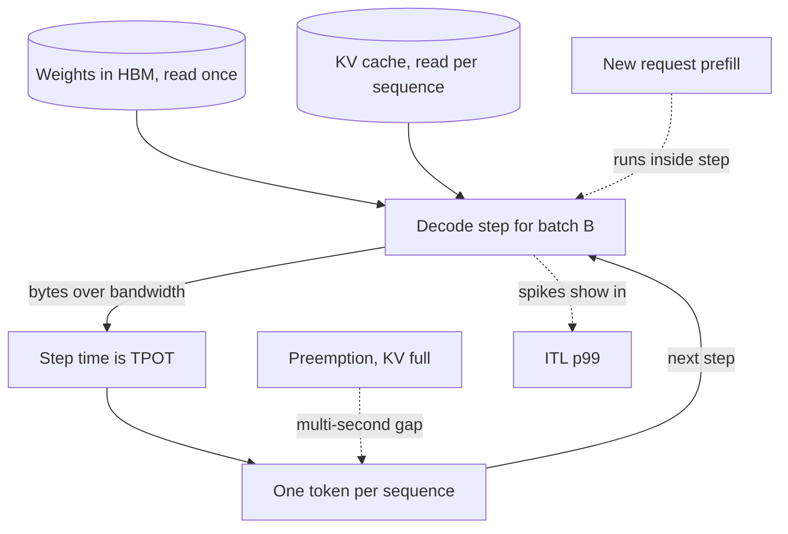

## TL;DR
Time per output token (TPOT) is the average gap between generated tokens. An agent pays it
for every reasoning, tool-call and answer token across many sequential calls; it has a bandwidth floor,
so fewer bytes per step help and extra FLOPs do not.

## For agent builders
- **Why it matters for agents.** Agent run time is a sum over steps, and every output token of every step
  costs TPOT. Verbose reasoning or chatty tool-call preambles multiply it: eight calls of 300 tokens at
  30 ms is over a minute.
- **Where it shows up in your stack.** Output-token counts in provider usage fields, `max_tokens` per
  agent step, model choice (a smaller model for routing steps), and vLLM `--max-num-seqs` and
  `--quantization` when you self-host the agent's model.
- **What you control.** How many tokens each step emits (terse tool calls, a reasoning budget, short
  intermediate outputs), which model handles which step, and concurrency on your own replicas.
- **What you can skip.** Deriving the compute crossover batch or tuning tensor parallelism, unless you
  operate the GPUs. Know that decode is bandwidth-bound and that stalls show in ITL p99.

## Why it exists
- **It dominates total time for real answers.** After the first token, total latency is
  `TTFT + (n_out − 1) × TPOT`. A 600-token answer at 50 ms per token is 30 s; at 15 ms it is 9 s. The
  user's sense of "is this fast" after the first word, and an agent's time across a dozen chained
  calls, both hang on this number.
- **Decode has different physics from prefill.** Prefill is one big matrix multiplication per layer and
  is compute-bound. Decode processes a single new token per sequence, so arithmetic per step is tiny
  while the entire weight set still streams from HBM into the compute units every step.
- **So the levers differ.** Step time is set by bytes moved, not FLOPs. What helps it (fewer bytes per
  step, more bandwidth, more tokens per step) is not what helps TTFT.
- **"Report tokens per second" is not enough.** It is ambiguous between one stream and the whole
  server, and hides stalls: a stream averaging 20 ms per token with a 400 ms freeze every few seconds
  looks fine as a mean and feels broken.
- **TPOT plus its distribution exposes the cause.** Inter-token latency (ITL) makes stalls visible and
  points at the engine behaviour behind them.

## How it works
### Definition and its sibling
| Metric | Formula | Catches |
|---|---|---|
| TPOT | `(t_last − t_first) / (n_out − 1)`: total decode time over the number of gaps, per request | Overall decode speed |
| ITL | The distribution of individual gaps | Stalls the mean hides (look at p99) |
| "Latency per token" | `end_to_end / n_out` | Nothing useful: it silently folds TTFT back in |

- **Both TPOT and ITL exclude TTFT on purpose**, so a long prompt does not pollute the decode measurement.
- **Names are inconsistent.** Some dashboards call the per-request mean "ITL". Check the formula before
  comparing two reports.

### The bandwidth floor
In one decode step for a batch of *B* sequences, the GPU reads every weight matrix once (the same weights
serve all *B* tokens) and reads every sequence's KV cache for attention. Ignoring compute:

```
step_time ≥ (weight_bytes + Σ kv_bytes_per_sequence) / memory_bandwidth
```

- **Illustrative numbers.** An 8B-parameter model in fp16 is about 16 GB of weights. An H100 SXM moves
  roughly 3.35 TB/s from HBM.
- **Batch 1, short context.** The floor is 16 / 3350 ≈ 4.8 ms per token, a ceiling of about 210 tokens
  per second for a single stream.
- **Real systems land below the ceiling** because of kernel launch overhead, imperfect attention
  kernels, sampling and the host loop. But no amount of extra FLOPs lowers it: a GPU with similar
  bandwidth and double the FLOPs gives nearly the same TPOT at low batch.

### Why batching is nearly free
1. **The weight read is paid once per step regardless of *B*.** Going from 1 to 16 sequences multiplies
   the arithmetic by 16 but adds only KV-cache reads to the bytes moved.
2. **So per-request TPOT rises gently while aggregate throughput rises almost linearly.**
3. **It continues until one of two limits:** arithmetic catches up with bandwidth, or the KV cache of
   all sequences no longer fits in memory.
4. **The compute crossover can be estimated.** Counting only weight matmuls, a step does `2 × N × B`
   FLOPs while reading `N × bytes_per_param` bytes, so arithmetic intensity is `2B / bytes_per_param`
   FLOPs per byte.
5. **The GPU turns compute-bound when that intensity reaches its ratio** of peak FLOP/s to bandwidth,
   roughly 1e15 / 3.35e12 ≈ 300 for an H100 in bf16. With fp16 weights (`2B / 2 = B`) the crossover is
   a batch near 300, independent of model size.
6. **Int8 weights halve it**, because each byte read now feeds twice the arithmetic. KV reads add bytes
   without much arithmetic, which pushes the real crossover later still.
7. **Long contexts pull the memory limit in fast**, because KV bytes scale with `B × context_length`;
   at long contexts the KV reads, not the weights, dominate the step.

### Levers that move TPOT
- **Fewer weight bytes.** Weight-only int8 or int4 quantisation cuts the bytes read per step by 2–4×, a
  direct TPOT win at low batch. At high batch, where compute starts to bind, the gain shrinks and
  dequantisation cost shows.
- **Fewer KV bytes.** Grouped-query attention, KV-cache quantisation and shorter contexts reduce the
  per-sequence term, which matters most for long-context, high-concurrency serving.
- **More bandwidth per model.** Tensor parallelism splits the weights across *k* GPUs so each reads `1/k`
  of them per step. The all-reduce after each layer adds a fixed communication cost, so it helps most on
  NVLink-connected GPUs and large models.
- **More tokens per step.** Speculative decoding drafts several tokens cheaply and verifies them in one
  forward pass of the big model, so one weight read can yield two or three accepted tokens.
  - Effective TPOT falls at low batch; at high batch the wasted verification compute can lower
    throughput instead.
  - ITL becomes lumpy: accepted tokens arrive in bursts (near-zero gaps inside a burst, a full step
    between bursts) even when the mean improves.
- **A smaller model.** Halving parameters roughly halves bytes per step; whether quality survives is an
  eval question, not a serving one.

### Where the stalls come from
- **Prefill inside the shared step.** In continuous batching every running stream advances one token per
  engine step. A newly admitted request's prefill runs inside that step; a 10k-token prefill can take
  hundreds of milliseconds, during which every other stream emits nothing.
- **The signature** is a flat 25 ms ITL punctuated by spikes: a scheduling artefact, not a model
  property. Chunked prefill caps prefill work per step to bound the stall.
- **Preemption.** When KV memory runs out the engine evicts a sequence and later recomputes or swaps its
  cache back; that sequence's ITL shows a multi-second gap.

### How fast is fast enough
| Consumer | Rough need |
|---|---|
| Human reading prose | 200–300 words per minute, about 4–5 words per second; at 1.3 tokens per English word, 5–7 tokens per second, so a TPOT near 150–200 ms keeps pace |
| Skimming, scrolling, code in blocks | Much lower TPOT, because users skim and want code to appear in blocks |
| Agentic workloads | As low as you can afford: a planner making eight sequential calls of 300 tokens each turns a 30 ms TPOT into over a minute of waiting before anyone reads a word |

### TPOT in an agent loop
- **Output tokens are the decode bill.** Per step, decode time ≈ `(n_out − 1) × TPOT`; summed over a run,
  it is total output tokens times TPOT, plus one TTFT per call.
- **Steps are sequential.** A planner cannot call the tool until the tool call is fully decoded, so
  decode time sits on the critical path of every step.
- **Hidden reasoning counts.** Reasoning tokens are decoded at the same TPOT even when the user never
  sees them, which is why an agent step with a large thinking budget can be slow with a tiny visible output.
- **The cheapest lever is fewer tokens.** Terse tool-call formats, capped intermediate outputs and
  routing simple steps to a smaller, faster model beat any serving tweak.

## Diagram
One decode step, which every output token of every agent call passes through: the weight read is
shared by the whole batch, KV reads grow per sequence (long agent transcripts make them large), and a
prefill or preemption landing in the same step is what produces stalls.



## Examples
### Mean TPOT hides the stall; ITL p99 shows it
Runnable with synthetic timestamps: a steady 25 ms gap with one 300 ms prefill stall every 40 tokens.

```python
import statistics

gaps_ms = [300 if i % 40 == 39 else 25 for i in range(200)]   # 200 gaps -> 201 tokens
t = [0.0]
for g in gaps_ms:
    t.append(t[-1] + g)

n_out = len(t)
tpot = (t[-1] - t[0]) / (n_out - 1)                            # per-request mean
itl = sorted(gaps_ms)
p50, p99 = itl[len(itl) // 2], itl[int(len(itl) * 0.99)]
print(f"TPOT {tpot:.1f} ms  ITL p50 {p50} ms  p99 {p99} ms")
print(f"stdev {statistics.pstdev(gaps_ms):.0f} ms")
# TPOT 31.9 ms  ITL p50 25 ms  p99 300 ms  -> mean looks healthy, users see freezes
# stdev 43 ms
```

### Worked scenario: predicting TPOT before buying hardware
Take a Llama-3-8B-style model: 8B parameters in fp16 (16 GB of weights), 32 layers, 8 KV heads, head
dimension 128.
- **KV per token** is `2 × 32 × 8 × 128 × 2 bytes = 131,072 bytes`, i.e. 128 KB.
- **Hardware:** an H100 SXM with about 3.35 TB/s of HBM bandwidth.
- **Ignoring compute is safe here.** Even at batch 100 the decode FLOPs per step
  (`2 × 8e9 × 100 = 1.6e12`) take only about 3 ms at half of the roughly 1e15 FLOP/s peak, well under the
  bandwidth time at that batch.

```python
BW, WEIGHTS = 3.35e12, 16e9               # bytes/s, bytes
KV_PER_TOKEN = 2 * 32 * 8 * 128 * 2       # 131,072 bytes

def step_ms(batch: int, ctx: int) -> float:
    return (WEIGHTS + batch * ctx * KV_PER_TOKEN) / BW * 1e3

for b, ctx in [(1, 4_000), (32, 4_000), (32, 32_000)]:
    s = step_ms(b, ctx)
    print(f"B={b:2d} ctx={ctx:6d}  step {s:5.1f} ms  per-user {1e3/s:4.0f} tok/s  server {b*1e3/s:5.0f} tok/s")
```

| Case | Bytes per step | Step (TPOT) | Per user | Server |
|---|---|---|---|---|
| Batch 1, 4k context | 16 GB + 4,000 × 128 KB ≈ 16.5 GB | 16.5 / 3350 ≈ 4.9 ms | about 200 tok/s | about 200 tok/s |
| Batch 32, 4k context | KV = 32 × 4,000 × 131,072 B ≈ 16.8 GB, total ≈ 32.8 GB | about 9.8 ms | roughly 100 tok/s | 32 × 100 ≈ 3,300 tok/s |
| Batch 32, 32k context | KV = 32 × 32,000 × 131,072 B ≈ 134 GB | about 45 ms if it fit | | |

- **Sixteen times the throughput for twice the TPOT** going from batch 1 to batch 32.
- **The 32k case does not even fit** next to the weights in 80 GB. Long context, not model size, is what
  pushes TPOT up at scale.
- **Measured numbers will be worse** than every figure here; the point is the ratios and which term
  dominates.

### Agent scenario: where a planner's minute goes
A planner agent makes eight sequential calls; illustrative TTFT 300 ms per call, no tool time counted.

| Design | Output tokens per call | TPOT | Decode time for 8 calls | Plus 8 × TTFT |
|---|---|---|---|---|
| Verbose reasoning before each tool call | 300 | 30 ms | 8 × 300 × 30 ms ≈ 72 s | ≈ 74 s |
| Same, on a faster replica | 300 | 15 ms | ≈ 36 s | ≈ 38 s |
| Terse tool calls, capped reasoning | 60 | 30 ms | ≈ 14 s | ≈ 17 s |
| Terse calls on the faster replica | 60 | 15 ms | ≈ 7 s | ≈ 10 s |

Halving TPOT halves decode time; cutting output tokens fivefold beats it, and the two multiply.

## Production patterns
- **Budget output tokens per agent step.** Set `max_tokens` per step type (tight for tool calls and
  routing, looser for the final answer) and ask for terse tool-call output. Monitor output tokens per
  step and the share of steps that hit the cap, since truncated tool calls fail to parse.
- **Route cheap steps to a faster model.** Use a smaller model for classification, routing and simple
  tool selection, and the large model for planning and the final answer, gated by your agent eval set.
  Monitor per-step latency and task success per model.
- **Alert on ITL p99, not mean TPOT.** Export per-token latency as a histogram (vLLM exposes a
  time-per-output-token histogram on its metrics endpoint) and alert on p99 per route. Monitor the
  p99/p50 ratio; a jump means stalls, not slower decode.
- **Chunked prefill when stalls appear.** In vLLM enable chunked prefill and size
  `--max-num-batched-tokens` so a long prompt is spread over several steps. Monitor ITL p99 for running
  streams against TTFT of the longest prompts.
- **Set the concurrency ceiling from the TPOT SLO.** Run a load curve and set `--max-num-seqs` at the
  largest batch where per-user TPOT p95 still meets the target. Monitor TPOT p95 against running
  sequences.
- **Keep KV headroom to avoid preemption.** Leave memory for the expected context mix (vLLM
  `--gpu-memory-utilization`, `--max-model-len`) and watch the engine's preemption counter, which should
  stay near zero for interactive pools.
- **Quantise weights behind an eval gate.** Serve an int8 or int4 checkpoint (for example AWQ or GPTQ
  via vLLM `--quantization`) only after it passes your eval set. Monitor TPOT at low batch, where the
  gain is largest, and quality metrics.
- **Speculative decoding on the low-batch pool only.** Enable it where concurrency is low and acceptance
  is high; monitor acceptance rate and aggregate tokens/s at peak, and disable it if throughput falls.

## Trade-offs
- **Concurrency vs per-user latency.** Raising concurrency multiplies throughput for a small TPOT cost
  while weights dominate the step; once KV reads dominate (long contexts) or compute binds, each added
  sequence costs every user real latency.
- **Quantisation vs quality.** Weight quantisation lowers TPOT at low batch and can cut quality on some
  tasks; at high batch the speed gain fades while the quality cost stays, so evaluate both before
  shipping.
- **Tensor parallelism vs communication.** It cuts per-GPU bytes but adds a per-layer all-reduce; on
  PCIe-connected GPUs the communication can eat the gain, so it pays mainly with NVLink and large models.
- **Speculative decoding vs load.** It reduces effective TPOT when acceptance is high and the batch is
  small; with low acceptance or a saturated GPU it burns compute and can reduce throughput.
- **Chunked prefill vs TTFT.** It smooths ITL for running streams at the price of slower TTFT for long
  prompts; for a prefill-heavy, low-concurrency workload you may prefer the stalls.

## Pitfalls
- **Expecting a faster-FLOPs GPU to speed single-stream decode proportionally.** Symptom: a costly
  upgrade that moves TPOT only as much as the bandwidth ratio. Fix: compare GPUs on HBM bandwidth.
- **Reporting TPOT only as a mean.** Symptom: users describe "freezes" while the dashboard shows a
  healthy 25 ms, because prefill stalls and preemptions live in p99 ITL. Fix: chart the ITL histogram.
- **Including TTFT in the TPOT calculation.** Symptom: TPOT that mysteriously grows with prompt length
  even though decode speed has not changed. Fix: start the clock at the first token.
- **Benchmarking at batch 1 and sizing concurrency from it.** Symptom: per-user speed that halves the
  moment real traffic arrives. Fix: run a load curve at realistic concurrency.
- **Ignoring context length in capacity math.** Symptom: TPOT and preemptions climbing as conversations
  get longer during the day. Fix: size KV memory for the real context mix.
- **Counting streamed chunks as tokens.** Servers can coalesce or split tokens per chunk, so a
  chunk-based TPOT disagrees with the provider's usage numbers (coalescing inflates it, splitting
  flatters it). Fix: divide by the usage-reported output token count.

## When to use
- **Track TPOT and p99 ITL** for every surface where output length is non-trivial: chat, code
  generation, long-form drafting, and above all agent loops where total time is a sum of many decode
  phases.
- **Budget agent output first.** Before tuning TPOT, cap output tokens per agent step; the product of
  tokens and TPOT is what the user waits for.
- **Set the target from the consumer.** A human reader is satisfied by a few hundred milliseconds per
  token, a code editor wants tens of milliseconds, and an orchestrator chaining calls wants the lowest
  you can afford.
- **Sanity-check first, then measure.** Use the bandwidth floor to check vendor claims and hardware
  choices before testing, then measure under realistic concurrency and context length.
- **Interviews:** derive the floor from weights, KV size and bandwidth, then explain why batching barely
  changes it; that is the expected depth.

## Role lens
- **Engineer:** Measures TPOT and p99 ITL from the stream, turns on chunked prefill when stalls
  appear, and tests weight quantisation against an eval set before enabling it.
- **Architect:** Picks GPU class by memory bandwidth and capacity rather than FLOPs for decode-heavy
  workloads, and sets the concurrency ceiling where per-user TPOT still meets the SLO.
- **FDE:** Explains to a customer with an on-prem A100 why their chat streams at half the speed of
  the demo on H100s, and which of quantisation, TP or a smaller model is viable for them.

## Check yourself
**Q:** Product wants chat tokens to stream twice as fast. The team proposes moving from A100 to H100
GPUs. Is that enough, what else would you consider, and what are the catches of each option?
**A:** Decode is bandwidth-bound, so the upgrade buys roughly the ratio of memory bandwidth, about
1.6× from A100-80GB to H100 SXM, not 2×, and less if the batch is large enough to be partly
compute-bound. To close the gap: weight-only int8 or int4 quantisation halves or quarters the bytes
per step, with a quality check required; tensor parallelism across two NVLink GPUs halves per-GPU
reads but adds all-reduce latency and doubles hardware per replica; speculative decoding can give
2–3× at low batch if the draft model's acceptance rate is high, but wastes compute at high load;
lowering per-replica concurrency raises per-user speed at a throughput cost. Before any of it, check
p99 ITL: if the complaint is really periodic stalls from prefill or preemption, chunked prefill and
more KV memory headroom fix it with no hardware change.

## Interview questions
### Why is LLM decode memory-bandwidth bound rather than compute bound?
- **One token per sequence per step** means the arithmetic is tiny, roughly 2 FLOPs per parameter per
  token.
- **But every weight is read from HBM each step**, plus the KV cache, so bytes moved set the step time.
- **Consequence:** TPOT tracks bandwidth, and batching shares the weight read across sequences until
  intensity reaches the GPU's FLOP-to-byte ratio, around 300 for an H100 in bf16.

### Estimate the best-case TPOT for an 8B fp16 model on an H100 at batch 1.
- **Bytes per step:** about 16 GB of weights plus a small KV term at short context.
- **Bandwidth:** about 3.35 TB/s, so 16 / 3350 ≈ 4.8 ms per token, a ceiling near 210 tokens per second.
- **Reality check:** measured TPOT will be higher because of kernel launches, attention kernels,
  sampling and the host loop; no extra FLOPs lower the floor.

### Users report the stream "freezes" but the dashboard says TPOT is 25 ms. What do you look at?
- **The ITL distribution:** a flat 25 ms with periodic spikes of hundreds of milliseconds is the
  signature of prefill running inside the shared step, or of preemption.
- **Correlate spikes** with request admissions of long prompts and with the engine's preemption counter.
- **Fix:** chunked prefill for admission stalls, more KV headroom or a lower concurrency cap for
  preemption.

### When would speculative decoding make things worse?
- **At high batch**, where the GPU is near compute-bound, verification of rejected drafts spends compute
  the batch needs, so aggregate throughput can fall.
- **With low acceptance**, the drafts rarely pay for the extra forward work.
- **Also note** it makes ITL lumpy, so gap-based alerts need adjusting.

### Your self-hosted agents decode more slowly as their transcripts grow. Why, and what do you do?
- **KV bytes scale with batch times context length**, while weight bytes are fixed per step; long agent
  transcripts at high concurrency make KV reads, not model size, dominate the step.
- **Example:** an 8B model at batch 32 and 32k context would read about 134 GB of KV per step against
  16 GB of weights, roughly 45 ms per step if it fit at all.
- **Levers:** grouped-query attention, KV-cache quantisation and context caps attack that term directly.

### An agent run takes 70 seconds and the team wants a bigger GPU. What do you check first?
- **Split the run:** per-step TTFT, output tokens times TPOT, and tool time from the trace.
- **If decode dominates,** count output tokens per step first: verbose reasoning or preambles before tool
  calls are usually the biggest term, and cutting them is free.
- **Only then hardware:** a GPU with more bandwidth lowers TPOT roughly by the bandwidth ratio, not the
  FLOPs ratio, and routing simple steps to a smaller model may help more.

## Quiz
### Q: Why does per-request TPOT rise only slightly when the batch grows from 1 to 16 sequences?
- [ ] The GPU has 16 streaming multiprocessors, one per sequence
- [x] The model weights are read from memory once per step and shared by all sequences, so only the KV-cache reads grow
- [ ] Continuous batching pauses other sequences while each one decodes
- [ ] Larger batches switch the engine from fp16 to int8 automatically
> A decode step is dominated by streaming the weights from HBM; that cost is paid once regardless of
> batch size. Each extra sequence adds only its KV reads and a little arithmetic, so throughput scales
> nearly linearly while per-token latency creeps up.

### Q: Which of these does NOT reduce TPOT for a single stream at batch 1?
- [ ] Weight-only int4 quantisation
- [ ] Speculative decoding with a well-matched draft model
- [x] Prefix caching of the system prompt
- [ ] Tensor parallelism across two NVLink-connected GPUs
> Prefix caching avoids prefill work and therefore helps TTFT, but every decode step still reads the
> full weights. Quantisation and tensor parallelism cut bytes per step, and speculative decoding
> yields several tokens per weight read.

### Q: A stream shows a steady 25 ms between tokens with occasional 300 ms gaps. What is the most likely cause?
- [ ] Network jitter between the client and the server
- [ ] The sampling temperature is too high for stable decoding
- [x] Prefill of newly admitted requests, or preemption, running inside the shared engine step
- [ ] The tokenizer is slow on rare words
> In continuous batching, a long prompt entering the batch makes that step expensive and every other
> stream waits for it; preemption when KV memory is exhausted causes the same signature. Chunked
> prefill and more memory headroom are the fixes, not network or sampling changes.
