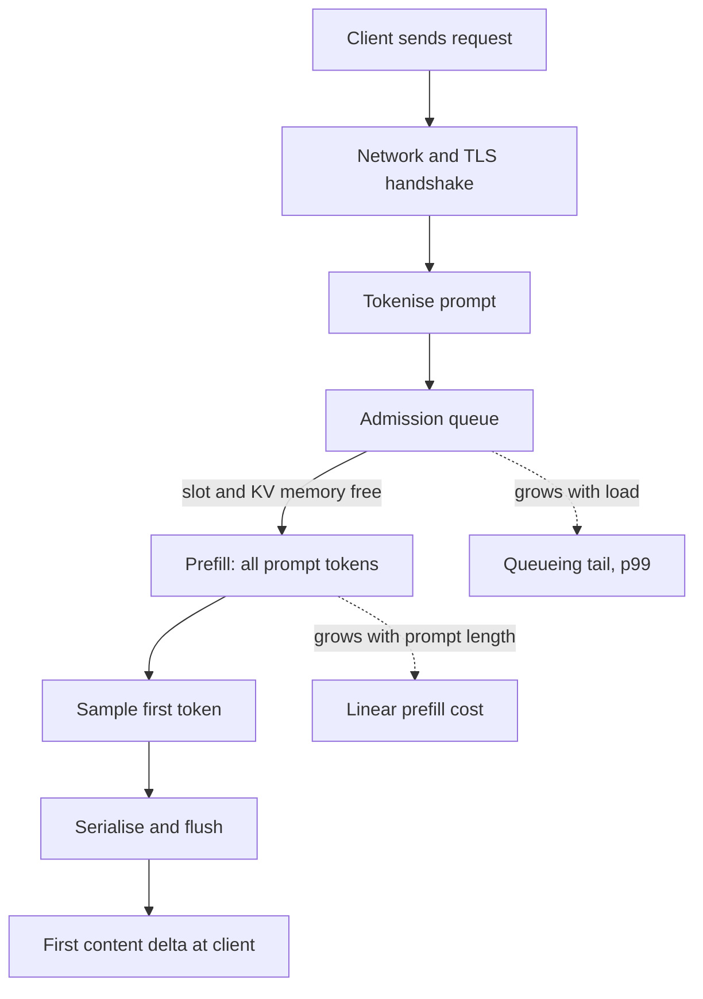

## TL;DR
Time to first token (TTFT) is the delay from sending a request to the first generated token: queueing
wait plus prefill over the whole prompt. It grows with prompt length and load, not answer length, and
is the latency a streaming user feels.

## Why it exists
- **End-to-end latency mixes two phases with different physics.** Prefill processes every prompt token
  in one batched forward pass, dominated by large matrix multiplications and scaling with prompt
  length. Decode produces tokens one at a time, bound by memory bandwidth and scaling with output
  length. A regression in "request latency" could be either, and you cannot tell which lever to pull.
- **TTFT isolates the first phase, which users judge.** Once a stream starts, users have something to
  read and tolerate the rest; before it starts they see nothing and assume the product is broken. A
  request can have an acceptable total time and an unacceptable TTFT if the first second goes to
  queueing or a 20k-token retrieved context.
- **"Just watch mean latency" fails twice.**
  - Means hide the queueing tail, which is where TTFT breaks first under load.
  - A team that measured TTFT with 200-token test prompts ships a RAG feature with 8k tokens of context
    and never understands why it feels slow. The answer is in the prefill arithmetic, which this metric
    forces you to look at.
- **Speculative decoding and other decode tricks do nothing for it.** They target the second phase.

## How it works
### What is inside the number
From the client's clock, TTFT is the sum of:

| Term | Size |
|---|---|
| Network to the server, plus TCP and TLS handshakes (several round trips) unless the client reuses a pooled connection | Small, fixed |
| Tokenisation (before admission, because the scheduler needs the prompt length) | Small |
| Waiting for admission: a free batch slot and free KV-cache memory | **Large, variable** |
| Prefill forward pass over all prompt tokens | **Large, variable** |
| Sampling the first token from the logits of the last prompt position | Small |
| Serialisation and the first flush of the response | Small |
| Network back | Small |

- **The first token falls out of the prefill pass itself.** There is no separate decode step for it.
- **Only two terms are large and variable:** the queue and prefill.

### Prefill cost
- **Rule of thumb.** A dense transformer with *N* parameters costs roughly `2 × N` FLOPs per token for
  the weight matrices. An attention term grows with the square of prompt length but is small until
  contexts get very long. So prefill FLOPs ≈ `2 × N × n_prompt`.
- **Illustrative arithmetic.** An 8-billion-parameter model on a 4,000-token prompt needs about
  2 × 8e9 × 4e3 = 6.4e13 FLOPs. An H100-class GPU has a dense bf16 peak around 1e15 FLOP/s; at a
  realistic 40–50 % utilisation that is roughly 130–160 ms of pure prefill.
- **It scales linearly.** Double the prompt and you double it. A 70B model is nearly nine times more.
- **So the RAG jump is expected.** TTFT tracks prompt length almost linearly in practice, which is why
  "we added RAG and TTFT went from 300 ms to 2 s" is not a bug.

### Queueing under continuous batching
- **Admission needs a slot and KV memory.** A continuous-batching engine admits a request only when it
  has a scheduling slot and enough KV memory for its prompt. When either is exhausted, the request
  waits for others to finish or be preempted, and that wait lands entirely in TTFT.
- **TTFT p99 is a capacity signal.** If it climbs while prompt lengths have not changed, you are
  queueing.
- **Prefill stalls running streams.** A long prompt entering the batch makes that step expensive,
  which delays every other stream's next token.
- **Chunked prefill** splits a long prompt across several steps to protect those streams, at the cost
  of slightly longer TTFT for the long request itself.
- **Disaggregated serving** runs prefill on separate GPUs so decode latency and TTFT stop competing at
  all, paying with a KV-cache transfer between machines.

### Levers, in order of leverage
1. **Send fewer tokens.** Tighter retrieval (fewer, shorter chunks), summarised history, and no
   boilerplate. Linear payoff.
2. **Prefix caching.** If requests share a byte-identical prefix (system prompt, tool schemas, a
   document in a multi-turn chat), the engine reuses its KV cache and only prefills the suffix.
   Dynamic content at the top of the prompt (timestamps, user names) breaks the match.
3. **Admission control and capacity.** Bound concurrency per replica so requests fail fast or queue
   visibly instead of silently inflating TTFT; scale on queue depth, not GPU utilisation.
4. **Scheduling.** Chunked prefill, priority classes for interactive traffic, separate pools for
   long-context jobs.
5. **Hardware and parallelism.** Prefill is compute-bound, so a faster GPU or tensor parallelism
   across GPUs does shorten it, unlike decode. Speculative decoding, KV-cache quantisation and
   weight-only quantisation mostly do not; they target the decode phase.

### Measuring it honestly
- **Stop the clock at the first *non-empty content* delta.** The first SSE frame is often a role-only
  chunk or a `message_start` event and arrives before any prefill has finished.
- **Report percentiles bucketed by prompt length**, so a prompt-size regression is distinguishable from
  a capacity problem.
- **Track "time to first visible token" separately** when a model emits hidden reasoning before its
  answer, because that gap can be many seconds while TTFT looks fine.
- **Use server-side TTFT, measured from arrival,** to compare engine configurations; it strips out
  network.

## Diagram
Follow a request from send to first visible token. The two boxes that move with load and prompt size,
the admission queue and prefill, are where almost all of TTFT goes.



## Examples
### Probe TTFT and TPOT against any OpenAI-compatible server
A short probe against any OpenAI-compatible streaming server (a provider, or vLLM/SGLang locally)
that measures TTFT to the first content delta and TPOT over the rest, then shows how TTFT grows with
prompt length while TPOT stays flat.

```python
import time
from openai import OpenAI

client = OpenAI(base_url="http://localhost:8000/v1", api_key="unused")  # any OpenAI-compatible server
MODEL = "my-model"

def measure(prompt: str, max_tokens: int = 200):
    t0 = time.perf_counter(); t_first = t_last = None; chunks = 0; usage_tokens = None
    stream = client.chat.completions.create(
        model=MODEL, messages=[{"role": "user", "content": prompt}],
        max_tokens=max_tokens, stream=True, stream_options={"include_usage": True})
    for chunk in stream:
        if chunk.usage:                                      # final usage-only chunk, if the server sends one
            usage_tokens = chunk.usage.completion_tokens
        if chunk.choices and chunk.choices[0].delta.content:  # skip the empty role-only first chunk
            now = time.perf_counter()
            t_first = t_first or now
            t_last = now; chunks += 1
    n = usage_tokens or chunks                               # chunks ~ tokens only as a fallback
    ttft = t_first - t0
    tpot = (t_last - t_first) / max(n - 1, 1)
    return ttft, tpot, n

for words in (50, 500, 5000):
    ttft, tpot, n = measure("Summarise this text: " + "word " * words)
    print(f"prompt~{words:5d} words  TTFT={ttft*1000:6.0f} ms  TPOT={tpot*1000:5.1f} ms  ({n} out tokens)")
# Expect TTFT to rise roughly linearly with prompt length (prefill) and TPOT to stay nearly constant.
# Run it again with 20 concurrent copies: TTFT climbs (queueing) long before TPOT does.
```

### Worked scenario: predicting the TTFT cost of adding RAG
Pure arithmetic from the prefill rule, before any load test. Assumes ~1e15 FLOP/s bf16 peak at 45 %
utilisation and no queueing; these are illustrative orders of magnitude, not benchmarks.

```python
def prefill_ms(params: float, prompt_tokens: int, peak=1e15, util=0.45) -> float:
    return 2 * params * prompt_tokens / (peak * util) * 1000

for label, n, toks in [("8B, chat 500", 8e9, 500), ("8B, RAG 8k", 8e9, 8_000),
                       ("8B, RAG 20k", 8e9, 20_000), ("70B, RAG 8k", 70e9, 8_000)]:
    print(f"{label:14s} {prefill_ms(n, toks):7.0f} ms")
```

| Workload | Prompt tokens | Prefill (illustrative) | Takeaway |
|---|---|---|---|
| 8B, plain chat | 500 | ~18 ms | Network and queue dominate |
| 8B, RAG | 8,000 | ~280 ms | Prefill now dominates TTFT |
| 8B, wide RAG | 20,000 | ~710 ms | Trim chunks before buying GPUs |
| 70B, RAG | 8,000 | ~2.5 s | Nearly nine times the 8B cost |

Real numbers will be worse once queueing and attention overhead are added; the ratios are the point.

## Production patterns
- **Stable prefix first, cached.** Put the system prompt, tool schemas and shared documents first and
  byte-identical, with timestamps and user fields after them, and run the engine with automatic prefix
  caching on (vLLM `--enable-prefix-caching`, already the default in the V1 engine). Monitor prefix-cache hit rate and TTFT per route.
- **Cap concurrency and fail fast.** Set the per-replica limit (vLLM `--max-num-seqs`) from a load test
  and return a fast 429 with `Retry-After` beyond it. Monitor the engine's waiting-queue length, which
  vLLM exports as `vllm:num_requests_waiting`.
- **Chunked prefill for mixed traffic.** When long prompts share a replica with live streams, enable
  chunked prefill (vLLM `--enable-chunked-prefill`, always on in V1) and tune the per-step token
  budget (`--max-num-batched-tokens`): smaller protects streams, larger favours TTFT. Monitor p99
  inter-token latency for running streams and TTFT for the longest prompt bucket.
- **Bucketed TTFT SLOs.** Alert on TTFT p95 per prompt-length bucket (for example under 1k, 1k-8k,
  over 8k tokens) and per concurrency band, so you know whether a breach is prompt size or capacity.
- **Separate pool for long context.** Route requests above a token threshold to their own replicas or
  a disaggregated prefill tier, so a few huge prompts cannot queue every short chat. Monitor queue
  depth per pool.
- **Reuse one HTTP client per process.** Create the SDK client once so connections are pooled and
  handshakes leave the TTFT path. Monitor TTFT for tiny prompts from each region as the network floor.

## Trade-offs
- **Prefix caching vs one-off prompts.** It slashes TTFT for repeated prefixes, but only when they are
  byte-identical and still resident; it buys nothing for one-off prompts or when dynamic fields sit
  before the shared part.
- **Chunked prefill vs the long prompt's TTFT.** It protects the inter-token latency of running
  streams but lengthens TTFT for the long prompt being chunked. The balance flips for prefill-heavy
  workloads with few concurrent decodes, such as summarisation batches, where you would rather
  prefill at full speed.
- **Short-prompt priority vs starvation.** Prioritising short prompts improves median TTFT at the risk
  of starving long ones; it only works with ageing or a separate pool for long-context requests.
- **Less context vs quality.** Trimming retrieved context lowers TTFT linearly but can cut answer
  quality, so the cut must be checked against an eval set rather than assumed harmless.
- **Disaggregation vs cost.** Splitting prefill and decode isolates TTFT from decode load, but adds
  machines and a KV-cache transfer whose cost is only worth it at high, steady traffic.

## Pitfalls
- **Measuring to the first SSE frame.** Symptom: a TTFT that looks great and does not move when prompt
  length triples. Fix: stop the clock at the first non-empty content delta.
- **Reporting mean TTFT.** Symptom: a green dashboard while users complain, because queueing shows up
  only in p95 and p99. Fix: report p50, p95 and p99 per prompt-length bucket.
- **Blaming the model when it is queueing.** The tell: TTFT correlates with concurrency, not with
  prompt length, and drops at night. Fix: cap concurrency and scale on queue depth.
- **Load-testing with short prompts, shipping long contexts.** Symptom: a product that "got slow when
  we added RAG" with no change in the serving stack. Fix: load-test with the production prompt-length
  distribution.
- **Ignoring hidden reasoning tokens.** TTFT is fine but the user sees a blank screen for ten seconds,
  so measure time to first visible token separately.
- **A new HTTPS connection per request from a distant region.** Symptom: a TTFT floor of a few hundred
  milliseconds even for tiny prompts, which disappears with a reused client.
- **Counting cold starts inside TTFT.** Model load on a fresh replica or serverless GPU wake-up shows
  up as a p99 dominated by a handful of 30-second outliers after each scale-out. Fix: tag cold-start
  requests and track them separately, and keep warm capacity ahead of scale-out.

## When to use
- **Set a target per surface before launch.** A chat UI usually aims for well under a second at p95,
  inline completion needs a few hundred milliseconds, and a nightly batch job has no TTFT target at all.
- **Budget it as network + queue + prefill** and check which term you can actually control.
- **Watch it bucketed** by prompt length and by concurrency, to tell a prompt-size regression from a
  capacity problem.
- **First number to check** when "the assistant feels slow".
- **Interviews:** the expected answer to "latency doubled after we added retrieval" is a decomposition
  of TTFT into prefill arithmetic plus the levers above.

## Role lens
- **Engineer:** Instruments TTFT to the first content delta, enables prefix caching for the shared
  system prompt, and trims retrieved context when the prefill term dominates.
- **Architect:** Sets per-surface TTFT SLOs, decides concurrency limits and admission policy, and
  chooses whether long-context traffic gets its own pool or disaggregated prefill.
- **FDE:** Explains to a customer why their 200-page-document prompt costs seconds before the first
  word, and offers retrieval or chunking as the fix rather than a bigger GPU alone.

## Check yourself
**Q:** Your service's p50 TTFT is 400 ms but p99 is 9 s. The model, prompts and hardware have not
changed in a month. What is happening, how do you confirm it, and what do you change?
**A:** A gap that large with stable prompts is queueing: requests waiting for a batch slot or KV
memory, which lands entirely in TTFT. Confirm by plotting TTFT against concurrent requests and
engine queue depth; the p99 should rise with load and collapse off-peak, and the engine's
preemption or waiting-queue metrics should spike at the same times. Prompt-length buckets rule out
a few long prompts as the cause. Fixes, cheapest first: cap per-replica concurrency and return a fast
429 or visible queue position instead of a silent 9 s wait; enable prefix caching if prompts share a
system prefix; turn on chunked prefill so long prompts stop stalling admission; autoscale on queue
depth rather than GPU utilisation; and move long-context or batch traffic to a separate pool.

## Interview questions
### What is TTFT made of, and why does speculative decoding not improve it?
- **Definition:** network plus admission wait plus tokenisation plus prefill over the whole prompt,
  then sampling the first token from the last prompt position's logits.
- **Speculative decoding** drafts and verifies several output tokens per decode step, so it shortens the
  decode phase only; the first token still waits for the full prefill.

### Latency doubled after we added retrieval. Walk me through it.
- **Decompose first:** compare TTFT and TPOT before and after. Retrieval adds prompt tokens, so expect
  TTFT to rise and TPOT to stay roughly flat.
- **Check the arithmetic:** prefill FLOPs ≈ 2 × parameters × prompt tokens, so going from hundreds to
  thousands of tokens moves prefill from tens to hundreds of milliseconds.
- **Then the levers:** fewer or shorter chunks (checked on an eval set), the stable prefix first for
  prefix caching, and chunked prefill if long prompts stall other streams.

### When would you not turn on chunked prefill?
- **It costs the long prompt.** Splitting its prefill across steps lengthens that request's own TTFT.
- **So skip it** for prefill-heavy, low-concurrency work such as summarisation batches, where few
  decodes are running and finishing prefill at full speed matters more.
- **Use it** when long prompts share replicas with many live streams, because it bounds their stalls.

### Roughly what TTFT should a 70B model have on an 8k-token prompt with no queue?
- **FLOPs:** 2 × 70e9 × 8e3 ≈ 1.1e15.
- **Throughput:** about 1e15 FLOP/s bf16 peak at 40–50 % utilisation is roughly 4.5e14 FLOP/s, so about
  2.5 s on one GPU (illustrative).
- **Implication:** tensor parallelism across GPUs or a smaller prompt is required for a sub-second
  target, because prefill is compute-bound and does scale with more compute.

### How do you measure TTFT for a reasoning model that thinks before answering?
- **Two clocks:** TTFT to the first generated token, and time to first visible token for the answer
  the user reads; the gap can be many seconds.
- **Client side,** stop at the first non-empty content delta, not the role-only first frame or
  `message_start`.
- **Report percentiles** bucketed by prompt length, with cold starts tracked separately.

## Quiz
### Q: Which change most directly reduces TTFT for requests with a 10k-token prompt?
- [ ] Enabling speculative decoding with a small draft model
- [ ] Quantising the KV cache to 8-bit
- [x] Caching the KV state of the shared prompt prefix so only the suffix is prefilled
- [ ] Raising `max_tokens` so the engine schedules the request sooner
> TTFT is dominated by prefill over the prompt; prefix caching removes most of that work when the
> prefix repeats. Speculative decoding and KV quantisation target the decode phase, and `max_tokens`
> affects output length, not the time to the first token.

### Q: Holding hardware and model fixed, TTFT scales primarily with which two quantities?
- [ ] Output length and sampling temperature
- [x] Prompt length and time spent waiting for admission to the batch
- [ ] Number of KV heads and vocabulary size
- [ ] Batch size of the decode phase and the stop sequence
> Prefill cost is roughly linear in prompt tokens, and any wait for a scheduling slot or KV memory is
> added on top. Output length only affects total time after the first token, and temperature changes
> which token is sampled, not how long it takes.

### Q: Which measurement gives a correct client-side TTFT for a streamed chat completion?
- [ ] Time until the HTTP response headers arrive
- [ ] Time until the first SSE frame of any kind is received
- [x] Time until the first delta containing non-empty content is received
- [ ] Time until the final usage chunk divided by the number of tokens
> Headers and the first frame (often a role-only chunk or `message_start`) are sent before prefill
> completes, so they under-report. The first content delta is the first evidence that generation
> has produced a token.
