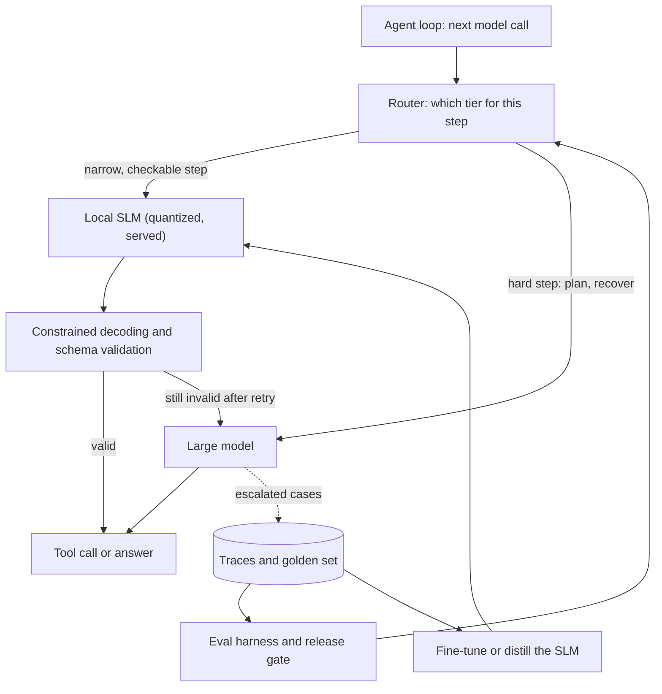

## Overview
This module is about running agent steps on small language models, roughly 0.5B to 14B parameters,
instead of sending every call to a frontier model. An agent makes many model calls per task, and most
are narrow: route, extract, fill tool arguments, summarise a tool result. Those are the calls an SLM can
take over.

The rule that ties the module together: decide per step, never per agent, and let your own eval set
decide rather than a public leaderboard. Every lesson either helps you pick a step for a small model,
run the model, make it reliable, or prove it passes.

What this module gives an agent builder:
- **A per-step decision.** When an SLM is enough, judged on task fit, cost, latency and privacy, with a fallback when validation fails.
- **A model and a file.** A selection checklist (license, hardware fit, context, tool-calling template, engine support) and a quantized build, GGUF for llama.cpp and Ollama or AWQ for vLLM, that fits your hardware.
- **A local endpoint.** Ollama, llama.cpp or vLLM behind an OpenAI-compatible API, so the same agent client works with each.
- **Reliable tool calls.** Constrained decoding, schema validation with retry, small tool sets and escalation to a larger model.
- **Cheaper routing.** Cascades that try the SLM first and routers that pick a tier up front.
- **Proof and improvement.** An eval harness on your own tools and tasks, plus fine-tuning (LoRA, QLoRA) and distillation from a large-model teacher when prompting is not enough.

Core versus useful for agents:
- **Core (you use them directly):** when-an-slm-is-enough, choosing-an-slm, running-slms-locally, tool-calling-and-structured-output-with-slms, evaluating-slms-on-your-agent-tasks, slm-llm-cascades-and-routing.
- **Useful (you meet them when fitting hardware, training or shipping to devices):** quantized-slms, fine-tuning-an-slm-for-an-agent-task, distilling-a-large-model-agent-into-an-slm, on-device-and-edge-agents-with-slms.

What you can build afterwards:
- A per-step SLM audit and scorecard for an existing agent, with a route-small or keep-large decision for each step.
- A two-tier cascade with validated tool calls that cuts cost while staying close to a large-only baseline.
- A fine-tuned or distilled small model for one high-volume agent step, and an offline on-device agent.

## Why it matters
- **Engineer:** You wire a second model entry into your gateway or LiteLLM config, serve an SLM locally behind an OpenAI-compatible `base_url`, harden its tool calls with constrained decoding, Pydantic validation, one retry and escalation, and build the eval harness that scores parse rate, tool and argument accuracy, task success and latency before any model or quantization ships.
- **Architect:** You decide which agent steps go to which tier, choose engines and quantizations for laptops, GPU servers and edge boxes, design the cascade's escalation signal (validation, confidence, verifier, step budget), and keep private data inside the boundary by serving small models locally, so the agent meets its cost, latency and quality targets together.
- **FDE:** You walk into customers whose agent is too slow or too expensive to ship, or whose data cannot leave the building. You audit their traces per step, propose the steps a small model can take over, prove it on their own golden set, and leave them a release gate they can re-run when a new model family appears.

## Mental model
Picture the agent loop with a model switchboard in the middle. Each model call is tagged by step, and
the switchboard sends easy, checkable steps to a small local model and hard steps (planning, error
recovery) to a large model.

| Question | Lesson that answers it |
|---|---|
| Can this step go small? | when-an-slm-is-enough |
| Which small model? | choosing-an-slm |
| Will it fit the hardware? | quantized-slms |
| How do I serve it? | running-slms-locally |
| Will its tool calls parse and validate? | tool-calling-and-structured-output-with-slms |
| Does it pass my tasks? | evaluating-slms-on-your-agent-tasks |
| What if it fails at run time? | slm-llm-cascades-and-routing |
| Prompting is not enough | fine-tuning-an-slm-for-an-agent-task, distilling-a-large-model-agent-into-an-slm |
| It must run offline | on-device-and-edge-agents-with-slms |

- **Validation is the hinge.** A cheap check on every SLM output (does it parse, does it match the schema, does it pass business rules) is what makes escalation trustworthy.
- **Errors compound across steps.** A 3B-8B model that is 95% right per call fails roughly one task in four over six calls, so reliability work is per call.
- **The eval set is the judge.** Selection, quantization, fine-tuning and cascade thresholds are all accepted or rejected by the same golden set.
- **Escalations feed training.** Cases the SLM failed and the large model fixed become fine-tuning or distillation data for the next round.

The router and the validator are the parts you write; the SLM, the large model and the store are
components you configure. The dotted path is how the small model gets better over time.

## Suggested order
1. when-an-slm-is-enough — the per-step decision on task fit, cost, latency and privacy that frames every other lesson.
2. choosing-an-slm — the selection checklist that turns the decision into a shortlist of two or three models from different families.
3. running-slms-locally — gets the shortlisted models running behind an OpenAI-compatible endpoint so one agent client can test each.
4. tool-calling-and-structured-output-with-slms — makes the served model's tool calls parse and validate, the most common way small models fail in agents.
5. evaluating-slms-on-your-agent-tasks — builds the harness and release gate that pick the winner and accept or reject every later change.
6. slm-llm-cascades-and-routing — puts the SLM into production behind a cheap check with escalation to a large model.
7. quantized-slms — fits the chosen model to your hardware and shows how to prove a quantized build still makes valid tool calls.
8. fine-tuning-an-slm-for-an-agent-task — the next step when prompting plateaus: LoRA or QLoRA on a few thousand examples of one agent step.
9. distilling-a-large-model-agent-into-an-slm — gets the training data for fine-tuning from verified large-model trajectories when you have no labelled traces.
10. on-device-and-edge-agents-with-slms — applies everything under the tight memory, battery and quality limits of a phone, laptop or edge box.

## Capstone
### Brief
**Use case:** a support platform's ticket-triage agent sends every call to a large hosted model. It is
too expensive at current volume, and one customer requires that ticket text never leaves their network.
This is the module's major project (about a week): move the agent's narrow steps onto a small local model
without losing quality.

The agent has three steps per ticket: route it to a queue, extract structured fields (product, severity,
customer id), and call one of several tools (create ticket, look up account, escalate to a human). Use a
synthetic or anonymised ticket set.

What you will do:
- Log runs of the large-only agent, tag each model call by step, and build a golden set per step.
- Shortlist three SLMs with the selection checklist, serve them locally, and compare quantizations.
- Harden tool calls with constrained decoding, validation, retry and escalation, and wrap the agent in an SLM-first cascade.
- Fine-tune or distill the chosen SLM for the weakest step, using escalated cases and verified teacher trajectories.
- Optionally run the extraction step fully offline on a laptop as an edge build.

### Deliverables
- A per-step audit table for the large-only baseline: call volume, pass rate, p50 latency and cost per task, with a route-small or keep-large decision and tolerance for each step.
- A model scorecard covering three models from different families and at least two quantizations of the winner, with license, peak memory, parse rate, tool and argument accuracy, task success and latency, each run three times.
- A cascade service behind an OpenAI-compatible endpoint (Ollama, llama.cpp or vLLM), where agent code differs from the baseline only in `BASE_URL` and `MODEL`, with constrained decoding, Pydantic validation, one retry and escalation.
- A LoRA or QLoRA adapter for one step, trained on schema-validated data with a held-out test split, plus a before/after table against the prompted model.
- A re-runnable eval script and release gate that accepts or rejects a new model or quantization with one config change.

### Rubric
- Every routing decision is backed by the golden set: no step goes small without a stated threshold and a measured pass rate at or above it.
- The cascade's cost-quality table shows large-only, SLM-only and at least two cascade policies, and the chosen policy stays within the stated tolerance of large-only after counting escalation cost.
- All tool calls that leave the cascade parse and validate; remaining failures are traced and categorised, not hidden by retries.
- The fine-tuned or distilled model beats the prompted baseline on held-out cases, and the test split was held out by seed request before paraphrases were generated.
- For the private customer, a trace shows ticket text served only by the local endpoint, and the quantized build was re-checked on tool calls before release.
