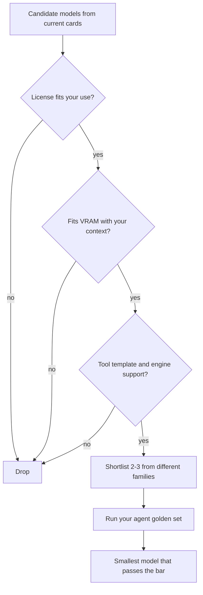

## TL;DR
Choosing an SLM is a checklist, not a leaderboard: filter by license, hardware fit, context, tool-calling
template and engine support, then shortlist two or three models from different families and let your own
agent eval pick the winner.

## For agent builders
- **Why it matters for agents.** The model decides whether tool calls parse, whether JSON validates and
  whether the agent fits your GPU or laptop. Two models with similar benchmark averages can differ sharply on
  your tool-calling step.
- **Where it shows up in your stack.** The model tag in Ollama, the GGUF file for llama.cpp, the Hugging Face
  repo id in `vllm serve`, and the chat template that formats tools for that model.
- **What you control.** The shortlist, the size and quantization that fit your hardware, the license review,
  and the eval that decides.
- **What you can skip.** Exact benchmark numbers in blog posts. Families release new versions every few
  months, so learn the selection criteria and re-run them on the current model cards.

## Why it exists
- **There are hundreds of candidates.** Each family ships several sizes, base and instruct variants, and
  many community quantizations. Without a filter, teams pick whatever trended last week.
- **Hard constraints eliminate most options.** A license that forbids your use, a model that does not fit
  in 8 GB, or a chat template without tool support removes a model regardless of its quality.
- **Benchmarks measure someone else's task.** General averages say little about selecting one of your 6
  tools with the right arguments, or extracting your schema from your documents.
- **The choice is reversible only if you planned it.** An OpenAI-compatible endpoint and a golden set let you
  swap models in an afternoon; hard-coding one model's prompt quirks does not.

## How it works
### Step 1: hard filters (pass or fail)
| Filter | What to check | Why it eliminates |
|---|---|---|
| **License** | Model card license: Apache 2.0, MIT, or a custom community or terms-of-use license | Some custom licenses add usage policies, attribution or scale conditions your legal team must accept |
| **Hardware fit** | Parameters × bits per weight ÷ 8, plus KV cache for your context, under your VRAM or RAM | A model that does not fit runs on CPU or swaps, and latency collapses |
| **Context length** | Supported context versus your prompt (system prompt, tool schemas, history) | Tool schemas and transcripts eat context fast in agents |
| **Tool and chat template** | Whether the chat template defines tool calls and roles you need | Without a tool template, the engine cannot parse tool calls natively |
| **Engine support** | Listed in Ollama's library, convertible to GGUF, supported by vLLM | No runtime means no deployment |
| **Languages and modality** | Languages and images you need | Small models often degrade fastest outside their main languages |

### Step 2: the families, described by traits (verify on current model cards)
| Family | Typical small sizes | Traits worth knowing | License to check |
|---|---|---|---|
| **Llama** (Meta) | 1B, 3B, 8B | Broad ecosystem support, many fine-tunes and quantizations | Custom community license with usage policy |
| **Qwen** (Alibaba) | from under 1B to 14B and up | Wide size ladder, strong multilingual and coding variants | Mostly Apache 2.0, but not all sizes (Qwen2.5-3B shipped under a research license); check each |
| **Phi** (Microsoft) | around 4B mini, 14B | Strong reasoning for the size from synthetic data; narrower world knowledge | MIT for recent releases; check each |
| **Gemma** (Google) | 1B to 27B | Good quality per size, some sizes accept images | Gemma terms of use |
| **Mistral** (Mistral AI) | 7B, 8B, small around 24B | Efficient, function-calling support in recent instruct models | Apache 2.0 for some, other terms for others |

### Step 3: shortlist and test
1. **Pick 2-3 candidates from different families** at the size your hardware allows, instruct variants only.
2. **Run the same golden set** for each agent step you plan to move, with the same prompt, engine and
   quantization you will deploy.
3. **Score what agents need:** task pass rate, valid-JSON rate, correct-tool rate, p50 and p95 latency, and
   peak memory.
4. **Pick the smallest model that meets the bar,** because the smallest passing model leaves room for
   context, concurrency and a cheaper GPU.

## Diagram
Hard filters remove models before any testing; the eval picks among what is left, and the smallest passing
model wins.



## Examples
### Screening a shortlist on your own tool-calling step
Pull the candidates with `ollama pull`, then score each on correct tool, valid arguments and latency through
Ollama's Python client. The model tags are examples; use the current tags from the Ollama library.

```python
import json, time
import ollama

CANDIDATES = ["llama3.2:3b", "qwen2.5:3b", "phi4-mini", "gemma3:4b"]   # check current tags
TOOLS = [{"type": "function", "function": {
    "name": "lookup_order", "description": "Find an order by its ID",
    "parameters": {"type": "object", "required": ["order_id"],
                   "properties": {"order_id": {"type": "string"}}}}}]
cases = [json.loads(l) for l in open("tool_golden.jsonl")]   # {"text": ..., "order_id": ...}

for model in CANDIDATES:
    ok, lat = 0, []
    for c in cases:
        t = time.time()
        try:
            r = ollama.chat(model=model, messages=[{"role": "user", "content": c["text"]}],
                            tools=TOOLS, options={"temperature": 0})
        except ollama.ResponseError as e:          # e.g. "... does not support tools"
            print(f"{model:14} hard-filter fail: {e.error}")
            break
        lat.append(time.time() - t)
        calls = r.message.tool_calls or []
        ok += bool(calls) and calls[0].function.name == "lookup_order" \
              and calls[0].function.arguments.get("order_id") == c["order_id"]
    else:                                          # runs only if no hard-filter break
        lat.sort()
        print(f"{model:14} pass {ok/len(cases):.0%}  p50 {lat[len(lat)//2]:.2f}s")
```

A model whose template lacks tool support either makes Ollama return an error (caught above) or answers in
plain text with no tool call; both are hard-filter failures, not low scores.

### Worked scenario: picking a model for an on-premises document agent
Constraints: one 24 GB GPU, English and German, 16k-token prompts, commercial use, tool calls to 4 tools.

| Check | Result |
|---|---|
| License review | Two candidates cleared quickly; one custom license went to legal and was parked |
| Hardware | 14B at 4-bit fits weights but leaves little KV cache for 16k context at concurrency 4; 7B-8B fits comfortably |
| Shortlist | One 7B-8B model from each of two families, plus a 3B as a cheap baseline |
| Eval on 150 real documents | Both 7B-8B models within 2 points on extraction; one had clearly better German tool-argument filling |
| Decision | The better German model, at a 4-bit or 5-bit quantization that kept the eval within tolerance |

The 3B baseline failed German extraction, which no general benchmark had flagged.

## Production patterns
- **Keep a model registry entry per choice.** Record repo id, exact revision or file hash, quantization,
  license, chat template and eval scores. Re-run the golden set before any upgrade, because a new release of
  the same family can change tool-call formats.
- **Abstract the endpoint.** Serve every candidate behind an OpenAI-compatible API (Ollama, llama.cpp
  server, vLLM) and call it through one client or LiteLLM, so swapping models is a config change.
- **Re-screen on a schedule.** Re-run the shortlist each quarter or when a family ships a new generation, since
  a newer small model often matches an older larger one and frees hardware.
- **Pin the chat template.** Use the template from the model's own repo; community GGUF files sometimes ship
  an older or broken template, which shows up as unparsed tool calls.
- **Log model identity in traces.** Attach model name, revision and quantization to every span so a quality
  regression can be traced to a model change.

## Trade-offs
- **Bigger model vs headroom.** A 14B model may pass more cases, but on fixed hardware it leaves less memory
  for context and concurrent agents. The smallest model that passes usually serves more users.
- **Permissive license vs best quality.** An Apache 2.0 or MIT model is easy to ship; a custom license may
  have the best scores but adds legal review and conditions. This flips when legal has already approved one.
- **One family vs several.** Standardising on one family simplifies templates and tooling, but ties you to
  its release cadence and gaps, such as weak support for one of your languages.
- **Specialist variant vs general instruct.** Coder or math variants win on their domain but can be weaker at
  general instruction following and tool use.

## Pitfalls
- **Choosing from a leaderboard.** Symptom: a top-ranked model fails your tool calls. Fix: shortlist with
  hard filters, then decide on your own golden set.
- **Testing a different build than you deploy.** Symptom: production quality is lower than the eval. Fix:
  evaluate the exact quantization, engine and template you will ship.
- **Using a base model.** Symptom: rambling text and no tool calls. Fix: use the instruct or chat variant.
- **Skipping the license.** Symptom: a late legal block before launch. Fix: put license review first in the
  checklist and record the outcome in the registry.

## When to use
- **Use when** you have decided a step can run small and need a specific model for it, or when a family
  ships a new generation and you want to know if it should replace yours.
- **Avoid when** the step has not been shown to suit an SLM at all; settle that first.
- **Measure** pass rate, valid-JSON and correct-tool rates, p95 latency and peak memory, per candidate, on
  the deployed build.
- **Interviews:** expect "walk me through how you would pick a small model for this agent" and a follow-up
  on license and hardware.

## Role lens
- **Engineer:** Runs the screening harness across candidates, records scores per agent step, and pins the
  chosen model's revision, quantization and template in the registry.
- **Architect:** Sets the hard filters (license classes, hardware envelope, languages) and the acceptance bar,
  and keeps the endpoint abstraction that makes models swappable.
- **FDE:** Runs the shortlist on the customer's own documents and hardware and explains why the smallest
  passing model is the right one for their constraints.

## Check yourself
**Q:** A team must pick a small model for a tool-calling agent on a 16 GB GPU, for commercial use in English
and Spanish, with 8k-token prompts. How should they choose?
**A:** Start with hard filters: license that allows their commercial use, a size and quantization whose
weights plus KV cache for 8k tokens at their concurrency fit in 16 GB (typically 3B-8B at 4-5 bits), a chat
template with tool support, and engine support in their runtime. Then shortlist two or three instruct models
from different families, for example Llama, Qwen, Phi, Gemma or Mistral, checked on current model cards. Run
the same golden set of real tool-calling and Spanish cases on the exact build they will deploy, scoring
correct tool, valid arguments and latency. Pick the smallest model that meets the bar and record its revision
and template.

## Interview questions
### Why not just pick the small model with the highest benchmark score?
- **Benchmarks measure other tasks.** Your step is a specific tool list, schema and language mix that general
  averages do not cover.
- **Hard constraints come first.** License, memory with your context, and tool-template support eliminate
  models regardless of score.
- **The deployed build differs.** Quantization and engine change behaviour, so you must test the exact build.

### What goes into your hardware-fit estimate for a candidate SLM?
- **Weights:** parameters times effective bits per weight divided by 8, for the quantization you will use.
- **KV cache:** bytes per token from the model config times context length times concurrent sequences.
- **Headroom:** around 10% for activations and fragmentation; if it does not fit, step down in size or
  precision and re-run the eval.

### A new version of your model family was released. How do you decide whether to upgrade?
- **Re-run the golden set** for every agent step that uses the model, on the deployed quantization and engine.
- **Check format changes:** tool-call format and chat template can change between generations and break
  parsing.
- **Upgrade only if it wins,** or matches at a smaller size, and roll out behind a flag with traces tagged by
  model revision.

### How would you choose between a 3B and an 8B model for an agent's argument-filling step?
- **Measure both** on the same golden set with validation; record pass rate, invalid-JSON rate and latency.
- **Price the difference:** the 8B needs more memory per replica and serves fewer concurrent agents.
- **Decide by the bar:** take the 3B if it passes with escalation to a larger model on failure, otherwise the 8B.

### What would you record about a model choice so the decision is auditable later?
- **Identity:** repo id, revision or file hash, quantization, chat template source.
- **Evidence:** golden-set scores per step, latency and memory on the target hardware, date of the run.
- **Constraints:** license and legal sign-off, data-handling notes, and the fallback model.

## Quiz
### Q: Which check should eliminate a candidate SLM before any quality testing?
- [ ] It ranks below another model on a public leaderboard
- [x] Its weights plus KV cache for your context do not fit in the target GPU memory
- [ ] It comes from a different family than your current model
- [ ] It has fewer parameters than your current model
> Hardware fit, license and tool-template support are hard filters: a model that does not fit runs slowly
> or not at all. Leaderboard rank and family are not reasons to drop a model before your own eval.

### Q: Why should you evaluate the exact quantization and engine you will deploy?
- [ ] Engines refuse to load models that were evaluated elsewhere
- [x] Quantization, chat templates and engine parsing change tool-call and JSON behaviour, so another build can score differently
- [ ] Quantized models always score higher than full precision
- [ ] Model licenses require it
> A 4-bit GGUF in llama.cpp and a bf16 model in vLLM are different artefacts with possibly different
> templates and parsers. Scores transfer poorly between them, especially for structured output.

### Q: Two candidates both pass your golden set; one is 3B and one is 8B. What is the usual choice and why?
- [ ] The 8B, because larger models are always safer
- [x] The 3B, because the smallest passing model leaves more memory for context and concurrent agents and costs less
- [ ] Neither, because small models should not be used in agents
- [ ] Whichever has the longer context window, regardless of fit
> When both meet the bar on your tasks, the smaller model serves more agents per GPU at lower latency. Keep
> an escalation path for cases it fails.

## Use cases & projects
### Use cases
- **On-premises agents.** Teams pick the best model that fits the customer's single GPU and license policy,
  then lock its revision in a registry.
- **Multilingual assistants.** Screening reveals which family keeps tool calling accurate in the customer's
  languages, which general benchmarks rarely show.
- **Cost reviews.** A quarterly re-screen often finds a newer, smaller model that matches the current one and
  frees hardware.
- **Vendor-exit planning.** A shortlist of open models from different families gives a tested fallback if a
  hosted provider changes terms.

### Mini project
**Build a model-selection scorecard (2-3 hours).**
- **Goal:** choose a small model for one agent step with a documented, repeatable process.
- **Steps:** write the hard filters for your setting (license, memory, context, languages); pick three
  instruct models from different families that pass them, using current model cards; pull them with Ollama;
  build a 50-case golden set for one tool-calling step; run the screening harness and record pass rate, p50
  latency and peak memory.
- **Done when:** you have a scorecard table, the chosen model with its exact tag and quantization, and a short
  note on why the runners-up lost.
