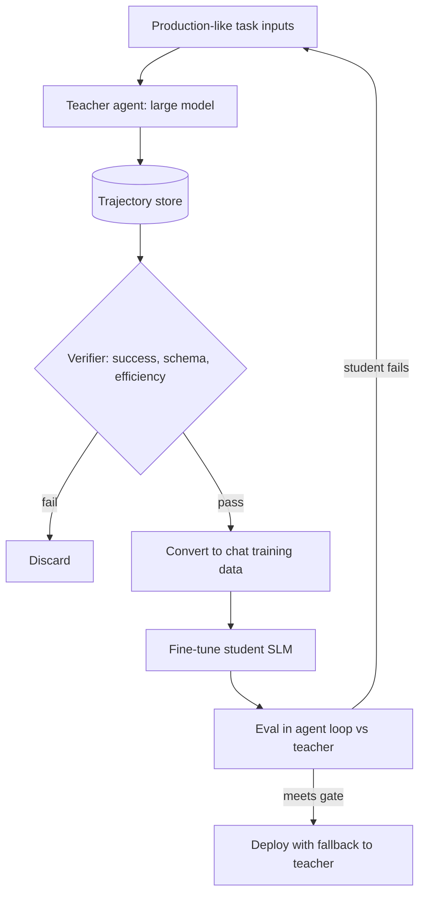

## TL;DR
Agent distillation runs a strong large-model agent as a teacher on many tasks, keeps only the trajectories
that succeeded, and fine-tunes a small model on them, so the SLM imitates the teacher's tool use at a
fraction of cost.

## For agent builders
- **Why it matters for agents.** It is the usual way to get training data for an SLM agent step when you have
  no labelled traces: the expensive model writes them, your verifier filters them, the cheap model learns.
- **Where it shows up in your stack.** Your agent framework runs the teacher; tracing (LangSmith, Langfuse,
  OpenTelemetry) stores trajectories; TRL or a hosted fine-tuning API trains the student.
- **What you control.** The task distribution, the success check that filters trajectories, how traces are
  converted into training turns, and which steps the student takes over.
- **What you can skip.** Logit-matching losses and temperature-softened targets from classic distillation;
  with closed teacher APIs you only see text, so most agent distillation is sequence-level imitation.

## Why it exists
- **Large models run the agent well but cost too much at volume.** A frontier model per step, many steps
  per task, many tasks a day adds up, and latency compounds across the loop.
- **SLMs lack training data for your tools.** There are no public traces of your internal APIs, and
  hand-labelling multi-step trajectories is slow and expensive.
- **The teacher can generate that data on demand.** It already follows your system prompt and tool
  schemas, so its successful runs are demonstrations in exactly the right format.
- **Filtering turns imitation into improvement.** Training only on verified successes removes much of the
  teacher's failure noise, which is why a well-distilled student can approach the teacher on a narrow task.
- **Check the terms.** Some providers' terms restrict using outputs to train competing models; confirm the
  teacher's licence or terms before you start.

## How it works
### 1. Build the task distribution
- **Sample inputs that match production:** real user requests (with consent), plus synthetic variants for
  rare tools and edge cases. Coverage of the input space limits what the student can learn.
- **Freeze the environment:** same tool schemas, same system prompt, tools backed by sandboxes or recorded
  fixtures so runs are repeatable and safe.

### 2. Run the teacher and log full trajectories
- Record every step: messages, tool calls with arguments, tool results, final answer, and metadata (model,
  prompt version, latency, token counts).
- Run several samples per input at moderate temperature when tasks are hard, because more attempts give the
  filter more successes to choose from (rejection sampling).

### 3. Verify and filter
| Check | Example |
|---|---|
| Programmatic success | the ticket was created, tests passed, the SQL returned the expected rows |
| Schema validity | every tool call parses and matches its JSON Schema |
| Efficiency | drop runs with loops, redundant calls or far more steps than the median |
| Judge or human review | an LLM judge or reviewer grades answers that cannot be checked by code |
| Safety | drop runs that touched forbidden tools or leaked data |

### 4. Convert trajectories into training examples
- **Whole trajectory as one conversation:** the student learns every assistant turn (tool calls and final
  answer) with tool results as context; train loss on assistant turns only.
- **Per-step examples:** split long runs so each example is "context so far, next action"; useful when the
  student only takes over some steps.
- **Strip teacher-only content:** hidden reasoning you cannot reproduce, provider-specific fields, or prompts
  the student will not see at inference.

### 5. Train the student, then close the gap
1. Supervised fine-tuning (LoRA or full) on filtered trajectories; see fine-tuning-an-slm-for-an-agent-task.
2. Evaluate the student in the real loop against the teacher on held-out tasks.
3. Iterate on failures: run the teacher on inputs where the student fails, filter, add, retrain.
4. Optional, open-weight teachers only: on-policy distillation where the student generates and the teacher
   scores or supplies token distributions. Token-level matching usually needs teacher and student to share
   a tokenizer, for example two sizes of one model family (TRL has a GKD trainer; check the current docs for
   its API and location).

## Diagram
Only verified teacher runs reach the student; student failures feed back into new teacher runs.



## Examples
### Collect and filter teacher trajectories
This runs a teacher through an OpenAI-compatible chat API with one tool, verifies the outcome, and writes
only successful runs as `{"messages": [...]}` lines for SFT. Point `base_url` at any compatible provider.

```python
# pip install openai   (checked against openai 3.36.1 with a stub OpenAI-compatible server)
import json, os
from openai import OpenAI

client = OpenAI()                       # set OPENAI_API_KEY, or base_url for another compatible provider
TEACHER = os.environ["TEACHER_MODEL"]   # read the current model id from the provider's docs
TOOLS = [{"type": "function", "function": {
    "name": "get_order", "description": "Look up an order by id",
    "parameters": {"type": "object", "properties": {"order_id": {"type": "string"}},
                   "required": ["order_id"]}}}]
ORDERS = {"A17": "shipped", "B22": "refunded"}          # sandboxed fixture, not production

def run_teacher(question, max_steps=4):
    msgs = [{"role": "system", "content": "You are an order-support agent. Use tools."},
            {"role": "user", "content": question}]
    for _ in range(max_steps):
        r = client.chat.completions.create(model=TEACHER, messages=msgs, tools=TOOLS)
        m = r.choices[0].message
        msgs.append(m.model_dump(exclude_none=True))
        if not m.tool_calls:
            return msgs
        for c in m.tool_calls:
            oid = json.loads(c.function.arguments).get("order_id", "")
            msgs.append({"role": "tool", "tool_call_id": c.id, "content": ORDERS.get(oid, "not found")})
    return None                                          # hit the step budget: treat as failure

def verified(msgs, expected):
    return msgs is not None and expected in (msgs[-1].get("content") or "").lower()

cases = [("Where is order A17?", "shipped"), ("What happened to B22?", "refunded")]
with open("distill.jsonl", "w") as f:
    for q, want in cases:
        traj = run_teacher(q)
        if verified(traj, want):
            f.write(json.dumps({"messages": traj, "tools": TOOLS}) + "\n")
```

Feed `distill.jsonl` to the SFT recipe in fine-tuning-an-slm-for-an-agent-task after two format checks:
- **Tool-call arguments:** the OpenAI API returns `arguments` as a JSON string, while many Hugging Face chat
  templates expect a dict; convert with `json.loads` and inspect one rendered example.
- **The `tools` column:** whether your trainer renders it into the chat template depends on its version.

### Worked scenario: distilling an order-support agent
Illustrative numbers for a 3-tool support agent, teacher = large hosted model, student = 3B model.

| Stage | Count or result |
|---|---|
| Task inputs (real + synthetic) | 5,000 |
| Teacher runs (2 samples each) | 10,000 |
| Passed verifier | 7,200 (72%) |
| After dedup and efficiency filter | 4,100 trajectories |
| Student task success, prompted only | ~55% |
| Student after SFT on 4,100 | ~85% |
| After one round on student failures (+900) | ~89% |
| Teacher task success | ~92% |

- **Cost shape:** teacher generation is a one-off cost per data round; inference savings recur on every
  request, so distillation pays off on high-volume agents.
- **Deployment:** the student takes all traffic; runs over the step budget escalate to the teacher and
  become the next round's training data.

## Production patterns
- **Use your tracing store as the data pipeline.** Log teacher runs with prompt version and tool schema
  version in LangSmith, Langfuse or OpenTelemetry spans, tag pass or fail from the verifier, and export only
  passing traces. Monitor pass rate per task type to spot coverage gaps.
- **Prefer programmatic verifiers.** Check side effects in a sandbox (row created, test passed, API state)
  before falling back to an LLM judge, because judge errors become training labels. Spot-check a sample of
  judge-passed traces by hand each round.
- **Distill step by step, not all at once.** Start with the highest-volume, easiest-to-verify step (routing
  or extraction), keep the teacher on planning, and widen the student's scope as evals allow.
- **Run the failure loop.** On a cadence, rerun the teacher on sampled student failures or escalations,
  verify, add and retrain. Track the escalation rate as the headline metric.
- **Record licences and data lineage.** Store the teacher model, its terms and every input's source with
  the dataset version, so legal review and deletion requests can be answered.

## Trade-offs
- **Cheap inference vs upfront data cost.** Distillation trades a one-off bill for teacher runs and
  engineering for lower recurring cost and latency; it flips when traffic is too low to amortise it.
- **Imitation vs ceiling.** The student rarely exceeds the teacher on the task, and it inherits the
  teacher's blind spots wherever the verifier cannot catch them.
- **Whole trajectories vs per-step examples.** Whole runs teach multi-step coherence but need longer
  context and more data; per-step examples are simpler and fit hybrid deployments.
- **Strict vs loose filtering.** A strict verifier yields cleaner but fewer, easier examples, biasing the
  student away from hard cases; sample more teacher attempts on hard inputs.

## Pitfalls
- **Training on unverified teacher output.** Symptom: the student confidently repeats the teacher's
  mistakes. Diagnose: hand-review 50 random training trajectories for failed or wasteful runs.
  Fix: add a programmatic or reviewed success check and drop failures.
- **Environment drift between data and serving.** Symptom: the student calls tools that were renamed.
  Diagnose: diff tool names and argument keys in training data against the served schemas. Fix: version
  tool schemas with the dataset and regenerate when they change.
- **Narrow input coverage.** Symptom: strong offline scores, poor results on rare intents. Diagnose:
  compare training and production intent mix, and escalation rate per intent. Fix:
  generate targeted inputs for the gaps.
- **Ignoring provider terms.** Symptom: legal blocks the launch late. Fix: confirm the teacher's terms allow
  training on outputs before generating data, or use an open-weight teacher.

## When to use
- **Use when** a large-model agent already works, traffic is high enough that per-call cost or latency
  matters, and you can verify success automatically for most tasks.
- **Avoid when** the agent is still changing weekly, success cannot be checked, or volume is low enough that
  paying for the large model is cheaper than a data pipeline.
- **Measure** verifier pass rate, student vs teacher task success on held-out tasks, escalation rate in
  production, and cost per completed task.

## Exercise
**Goal:** build the teacher-to-dataset half of a distillation pipeline for a two-tool agent and measure
what the verifier throws away. No solution is given.
- **Inputs:** two fixture-backed tools, 200 varied requests, any teacher behind an OpenAI-compatible API.
- **Deliver:** a trajectory log with prompt and schema versions, a verifier with success and step-budget
  checks, and a filtered SFT file with pass rate per intent.
- **Acceptance:** every exported tool call validates against its schema; a hand review of 20 kept and 20
  dropped runs agrees with the verifier on at least 36 of 40.

## Role lens
- **Engineer:** Builds the teacher harness, verifiers and trace export, converts trajectories into training
  data, and compares student and teacher on the same agent eval.
- **Architect:** Decides which agent steps are distilled, how the student falls back to the teacher, and how
  dataset versions, tool schemas and model versions stay linked.
- **FDE:** Confirms with the customer that teacher outputs and their data may be used for training, and sets
  cost and accuracy targets that justify the distillation project.

## Check yourself
**Q:** You distilled a large-model agent into a 3B model. Offline success is 88%, but in production the
escalation rate to the teacher is 35%. What do you investigate and change?
**A:** Compare the production input distribution with the training inputs, by intent and tool, because the
most likely cause is coverage: production contains request types the teacher never ran on. Check whether
tool schemas or prompts changed since the data was built. Inspect escalated traces to see whether failures
are format errors, wrong tools or long multi-step tasks beyond the student. Then run the teacher on a
sample of escalated inputs, verify the runs, add them to training and retrain, repeating until the
escalation rate falls. Also confirm the confidence or validation rule that triggers escalation is not too
strict.

## Interview questions
### How is agent distillation different from classic knowledge distillation?
- **Classic distillation** trains the student to match the teacher's softened output distribution (logits)
  on each token, which needs access to the teacher's probabilities.
- **Agent distillation** usually only has the teacher's text: it is supervised fine-tuning on filtered,
  successful trajectories, including tool calls, so the verifier and data coverage matter most.

### How would you design the verifier for distilling a SQL-writing agent?
- **Execute the query in a sandboxed copy** of the database and compare results with a reference or with
  checks on expected properties.
- **Reject** syntax errors, queries touching forbidden tables, and runs with excessive steps.
- **Use an LLM judge only for the natural-language answer**, and spot-check its decisions by hand.

### Your student matches the teacher on simple requests but fails multi-step ones. What would you do?
- **Inspect the data mix:** the filter may keep mostly short successful runs, so hard tasks are
  under-represented.
- **Sample more teacher attempts on hard inputs**, consider per-step examples for long runs, and escalate
  tasks over a step budget to the teacher.

### When is distillation not worth it?
- **Low traffic or volatile scope:** teacher runs, verifiers and retraining are a fixed cost that only pays
  back with volume and a stable tool set.
- **Unverifiable tasks:** without a reliable success signal you are imitating noise, so prompting a capable
  model or a cascade is cheaper and safer.

## Quiz
### Q: Why do agent-distillation pipelines filter teacher trajectories before training?
- [ ] Filtering reduces the student's parameter count
- [x] Training only on verified successes keeps the teacher's mistakes out of the student
- [ ] Unfiltered trajectories cannot be tokenized
- [ ] Filtering is required to match the teacher's logits
> The student imitates whatever it is trained on. A verifier that checks outcomes, schemas and efficiency
> removes failed or wasteful runs, so the student learns from the teacher's best behaviour.

### Q: With a closed teacher available only through an API, what form of distillation is usually possible?
- [ ] Matching the teacher's per-token logits with a KL loss
- [ ] Copying the teacher's weights into the student
- [x] Sequence-level imitation: fine-tuning the student on the teacher's generated trajectories
- [ ] Pruning the teacher into a smaller model
> APIs return text, not full token distributions or weights, so the practical method is supervised
> fine-tuning on filtered teacher outputs. Logit-based methods need an open-weight teacher.

### Q: After deployment, what is the most useful source of new distillation data?
- [ ] Random samples from a public web corpus
- [ ] The student's own successful runs only
- [x] Inputs where the student failed or escalated, rerun through the teacher and verified
- [ ] Repeating the original training set for more epochs
> Failures and escalations show exactly where the student's coverage is weak. Running the teacher on those
> inputs and keeping verified successes targets the gap directly.

## Mastery test
**Problem:** you distill a research agent whose free-text answers are graded by an LLM judge. The student
matches the teacher on the judge (90% vs 91%), yet users rate it far worse and it cites sources that do
not exist. What went wrong, and how do you rebuild?

**A strong answer:**
- sees that judge errors became training labels: fluent but ungrounded answers passed;
- hand-grades judge-passed traces and checks each citation against the retrieved documents;
- adds a programmatic citation check, calibrates the judge on labelled data, re-filters, retrains and
  re-measures against human ratings.

## Use cases & projects
### Use cases
- **High-volume support agents.** A large model's resolved tickets train a small model that handles most
  lookups and status questions.
- **Text-to-SQL and analytics agents.** Execution-verified teacher queries train a student for a company's
  own schema.
- **Coding-agent sub-steps.** Test-verified edits or command choices from a large model train a small model
  for fast, local steps.
- **Privacy-driven migration.** Teams prototype with a hosted model, then distill into an open model they can
  run on their own infrastructure.

### Mini project
**Distill a two-tool agent into a small model (2-3 hours).**
- **Goal:** collect verified teacher trajectories for a two-tool agent and show a small student improves
  after training on them.
- **Steps:** build a sandboxed agent with two fixture-backed tools; generate 300-500 varied requests; run a
  large model as teacher, log trajectories, and keep those that pass a programmatic check; fine-tune a
  0.5-3B model with LoRA; evaluate teacher, prompted student and distilled student on 100 held-out requests.
- **Done when:** you have a table of verifier pass rate and task success for the three models, plus three
  examples of failures you would target in the next data round.
