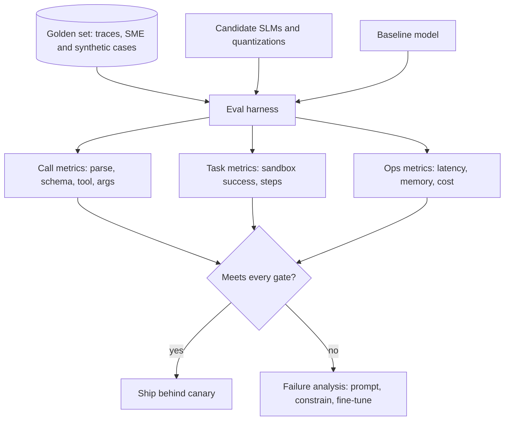

## TL;DR
Public leaderboards cannot tell you whether a small model runs your agent; your own eval set can. Score
candidate SLMs on your tools and tasks for validity, correctness, task success, latency and cost, repeated
across runs.

## For agent builders
- **Why it matters for agents.** Small models vary far more than large ones across tasks, quantization
  levels and prompt formats. A model that tops a general benchmark can still misname your tools or break
  your JSON.
- **Where it shows up in your stack.** An eval harness (your own pytest-style script, or tools covered in
  evals/tooling), OpenAI-compatible endpoints from Ollama, vLLM or llama.cpp so models are swappable, and
  tracing for production samples.
- **What you control.** The test cases, the metrics and pass thresholds, the models and quantizations
  compared, and the release gate.
- **What you can skip.** Running every public benchmark. Use them only to shortlist; the decision comes from
  your own cases.

## Why it exists
- **General benchmarks measure the wrong thing.** Knowledge and reasoning scores say little about following
  your tool schemas, staying in format for many steps, or refusing when a tool is missing.
- **SLM behaviour is fragile.** Quantization level, chat template, sampling settings and prompt wording can
  each move small-model accuracy by several points, so you must test the exact configuration you will
  serve.
- **Agent errors compound.** A per-step success rate of 95% over 10 steps leaves about 60% of tasks fully
  correct (0.95^10 ≈ 0.6, assuming independent steps), so step-level and task-level metrics both matter.
- **Model families change monthly.** New Llama, Qwen, Phi, Gemma and Mistral releases arrive often; a
  reusable eval lets you re-test a new model in an hour instead of guessing from a model card.

## How it works
### 1. Build the eval set from your agent
| Slice | Example cases | Why |
|---|---|---|
| Tool selection | each tool, plus "no tool" | catches over-calling and wrong tools |
| Argument filling | required, optional, typed, enum arguments | catches invented or missing arguments |
| Structured output | extraction into your Pydantic or JSON schema | format compliance |
| Multi-step tasks | 3-10 step runs in a sandbox | compounding errors and loops |
| Robustness | paraphrases, typos, long context, distracting tool results | small-model fragility |
| Safety | prompt injection in tool results, forbidden actions | agents act, so failures have effects |

- **Source cases** from production traces, SME-written cases and synthetic variants; keep 100-300 cases per
  slice for a first pass (illustrative; enough to see differences of a few points).
- **Freeze it** as a versioned golden set and never train on it.

### 2. Define metrics per level
- **Call level:** parse rate (valid JSON or tool call), schema validity, tool-name accuracy, argument exact
  match or field-level match.
- **Task level:** task success checked by code in a sandbox (state changed correctly), steps taken, loops,
  and a judge score only where code cannot check.
- **Operational:** time to first token, tokens per second, p95 latency per step, memory, and cost per
  successful task on your hardware.

### 3. Run it like an experiment
1. **Fix everything except the model:** same prompts, tool schemas, chat template handling, decoding
   settings and hardware.
2. **Test the served configuration:** the exact quantization (for example Q4 vs Q8 GGUF, AWQ) and engine.
3. **Repeat runs** with sampling on (or several seeds), because small models are less stable; report mean and
   spread, or pass@k and pass^k for tasks (see evals/pass-k).
4. **Compare against a baseline:** the current production model or a large model, on the same set.
5. **Read failures**, not only scores: categorise them (wrong tool, bad argument, format, loop) to decide
   between prompting, constrained decoding, fine-tuning or a cascade.

### 4. Gate releases and monitor
- Set thresholds per slice (for example schema validity at least 99%, task success within 2 points of the
  baseline) and block a model swap that misses any of them.
- Sample production traces into the eval set regularly so it tracks real traffic.

## Diagram
Every candidate runs the same frozen cases under the same settings; only the scorecard decides.



## Examples
### A minimal tool-call eval across local models
Compares models served by Ollama (or any OpenAI-compatible server) on tool name, argument match and
latency. Each case lists the expected tool and arguments.

```python
# pip install openai   (checked against openai 3.36.1 with a stub OpenAI-compatible endpoint)
import json, statistics, time
from openai import OpenAI

client = OpenAI(base_url="http://localhost:11434/v1", api_key="ollama")
MODELS = ["qwen2.5:3b", "llama3.2:3b"]       # whatever candidates you pulled; check current tags
TOOLS = [{"type": "function", "function": {"name": "get_weather", "description": "Weather for a city",
          "parameters": {"type": "object", "properties": {"city": {"type": "string"}}, "required": ["city"]}}},
         {"type": "function", "function": {"name": "convert_currency", "description": "Convert money",
          "parameters": {"type": "object", "properties": {"amount": {"type": "number"},
          "to": {"type": "string"}}, "required": ["amount", "to"]}}}]
CASES = [("Is it raining in Lisbon?", "get_weather", {"city": "Lisbon"}),
         ("Turn 40 dollars into euros", "convert_currency", {"amount": 40, "to": "EUR"}),
         ("Tell me a joke", None, None)]

def run(model, text):
    t = time.perf_counter()
    r = client.chat.completions.create(model=model, messages=[{"role": "user", "content": text}],
                                       tools=TOOLS, temperature=0)
    calls = r.choices[0].message.tool_calls or []
    if not calls:
        return None, None, time.perf_counter() - t
    try:
        args = json.loads(calls[0].function.arguments)
    except json.JSONDecodeError:
        args = "INVALID"
    return calls[0].function.name, args, time.perf_counter() - t

for m in MODELS:
    ok, lat = 0, []
    for text, want_tool, want_args in CASES:
        tool, args, s = run(m, text)
        lat.append(s)
        ok += tool == want_tool and (want_args is None or args == want_args)
    print(f"{m}: exact {ok}/{len(CASES)}, median latency {statistics.median(lat):.2f}s")
```

Grow `CASES` to hundreds, add a schema check, repeat with sampling on, and add a multi-step sandbox suite
before trusting the ranking.

### Worked scenario: picking an SLM for an extraction-and-routing agent
Illustrative scorecard on 600 cases, same prompts and hardware, three runs each.

| Candidate | Parse rate | Tool accuracy | Task success | p95 step latency | Verdict |
|---|---|---|---|---|---|
| Large hosted model (baseline) | 100% | 96% | 93% | 1.8 s | reference |
| 7B, 4-bit | 99.5% | 93% | 89% | 0.9 s | strong candidate |
| 3B, 8-bit | 98% | 90% | 84% | 0.5 s | good with a cascade |
| 3B, 4-bit | 95% | 86% | 77% | 0.4 s | quantization hurt; reject |
| 1B, 8-bit | 88% | 74% | 61% | 0.3 s | too weak for this task |

- **Insight:** the 3B model lost 7 task-success points going from 8-bit to 4-bit, so the quantized model,
  not the family, was the real choice to evaluate.
- **Read it against the gate:** no SLM alone is within 2 points of the 93% baseline, so none passes the
  example gate in section 4 by itself; the 7B 4-bit model comes closest at 89%.
- **Decision:** no SLM ships alone. Put the 3B 8-bit model (or the 7B 4-bit if hardware allows) behind a
  cascade that escalates on schema failure or verifier reject, score the cascade as a whole on the same 600
  cases against the gate, and ship only if it passes. Re-run this scorecard when a new model family appears.

## Production patterns
- **Keep the harness model-agnostic.** Call every candidate through an OpenAI-compatible endpoint (Ollama,
  vLLM, llama.cpp server, hosted APIs) so a new model is a config line. Store results per model, quantization
  and prompt version.
- **Run evals in CI on any model or prompt change.** Treat a model swap like a code change: the eval suite
  runs, and a slice below its threshold blocks the merge. Track trends per slice over releases.
- **Refresh the golden set from production.** Sample traces weekly, especially escalations and failures, have
  them labelled, and add them as new cases so the eval tracks real traffic. Version the dataset.
- **Measure cost per successful task.** Combine success rate with tokens, latency and hardware cost, because a
  cheaper model that fails more can cost more per completed task once retries and escalations count.
- **Shadow before switching.** Run the candidate SLM on live traffic in shadow mode, compare its outputs with
  production, and only then canary it. Monitor parse rate and task success by model version.

## Trade-offs
- **Own eval set vs public benchmarks.** Your set predicts your agent's behaviour but costs time to build and
  maintain; public benchmarks are free but only good for shortlisting.
- **Code checks vs LLM judges.** Code checks are precise and cheap but cover only verifiable outputs; judges
  cover free text but add cost, bias and noise that small score differences can hide.
- **Big suite vs fast iteration.** Thousands of cases detect small regressions but slow every experiment;
  keep a fast smoke subset for development and the full suite for release gates.
- **Single run vs repeated runs.** One deterministic run is cheap but hides instability; repeated sampled
  runs show variance at multiplied cost.

## Pitfalls
- **Testing a different configuration than you serve.** Symptom: the model scores well offline and fails in
  production. Diagnose: diff the eval run's model file, quantization, engine version, template and sampling
  settings against the deployed config. Fix: evaluate exactly what you deploy.
- **Only call-level metrics.** Symptom: high tool accuracy but tasks still fail. Diagnose: find the first
  failing step in failed trajectories. Fix: add multi-step sandbox tasks and measure end-to-end success.
- **Too few cases to separate models.** Symptom: rankings flip between runs. Diagnose: compute the spread
  across repeated runs; a gap smaller than it is noise. Fix: grow slices, repeat runs and report spread.
- **Leaking eval cases into fine-tuning data.** Symptom: scores jump after training, production does not.
  Diagnose: search training data for exact and near duplicates of golden cases. Fix: keep the golden set
  separate and deduplicate training data against it.

## When to use
- **Use when** choosing between SLMs or quantizations, before and after fine-tuning or distillation, when
  tuning a cascade, and on every model or prompt change.
- **Avoid** relying on it alone when production traffic differs sharply from the set; shadow and online
  metrics must confirm.
- **Measure** parse rate, schema validity, tool and argument accuracy, task success, steps, latency, memory
  and cost per successful task.

## Exercise
**Goal:** decide whether a 4-bit build of a small model is safe to ship in place of its 8-bit build. No
solution is given.
- **Inputs:** one small instruct model in two quantizations behind an OpenAI-compatible server, 3 tool
  schemas, and 100+ cases across the slices in section 1, including 10 multi-step sandbox tasks.
- **Deliver:** a scorecard over 3 runs per build with parse rate, tool and argument accuracy, task success
  (mean and spread), p95 latency and memory, plus failures by category.
- **Acceptance:** settings other than the quantization are provably identical; the verdict names the gate it
  applies and whether any gap exceeds run-to-run spread.

## Role lens
- **Engineer:** Builds the model-agnostic harness, writes code-checked cases for each tool and runs
  candidates, quantizations and fine-tunes through the same scorecard.
- **Architect:** Defines the metrics, thresholds and release gates that every model change must pass, and
  ties eval results to cost and latency budgets.
- **FDE:** Builds the golden set with the customer's experts from their real requests and uses the scorecard
  to justify the model choice to stakeholders.

## Check yourself
**Q:** A new small model family tops a public leaderboard. Your team wants to swap it into the agent this
week. What do you do before agreeing?
**A:** Run it through your own eval harness with the exact quantization, engine, chat template and decoding
settings you would serve, against the current production model as baseline. Check call-level metrics
(parse rate, schema validity, tool and argument accuracy) and task-level success on multi-step sandbox
tasks, repeated over several runs to see variance. Compare latency, memory and cost per successful task on
your hardware. Read failures by category. If it meets every slice threshold, run it in shadow on live
traffic, then canary it. Check its licence and model card too, since the leaderboard says nothing about
your tools.

## Interview questions
### Why are public benchmarks not enough to choose an SLM for an agent?
- **They measure general knowledge and reasoning**, not your tool schemas, prompt format, multi-step
  stability or refusal behaviour.
- **They rarely test your served configuration**, and small models are sensitive to quantization, chat
  template and decoding settings, so use benchmarks to shortlist and your own set to decide.

### How would you build an eval set for an SLM that will call five internal tools?
- **Cover each tool and "no tool"**, argument variants, ambiguous requests, paraphrases and injected tool
  results, sourced from traces and SME-written cases.
- **Use code checks** for tool names, arguments and sandbox state, add a multi-step task suite, freeze and
  version the set, and keep it out of training data.

### Your 3B model's tool accuracy is fine but end-to-end task success is low. How do you debug it?
- **Errors compound:** 95% per step over many steps gives much lower task success, so inspect trajectories for
  where they derail.
- **Categorise failures** (looping, ignoring tool errors, losing context, wrong stop) and pick fixes: shorter
  context, constrained output, fine-tuning on trajectories, or escalation for long tasks.

### How do you compare quantization levels fairly?
- **Hold everything else fixed** (model, prompts, engine, hardware) and run the full suite at each level
  with repeated runs.
- **Report quality and operational metrics together**, such as task success, latency and memory, because the
  cheapest level that still meets every threshold is the right choice.

### What release gate would you put in front of an SLM swap in production?
- **Per-slice thresholds** on parse rate, schema validity, tool accuracy and task success relative to the
  current model, run in CI on every model or prompt change.
- **Then shadow traffic and a canary** with monitoring of parse rate, escalation rate and task success by
  model version, with automatic rollback.

## Quiz
### Q: An agent's steps each succeed 95% of the time, independently. Roughly what share of 10-step tasks finish with every step correct?
- [ ] About 95%
- [ ] About 85%
- [x] About 60%
- [ ] About 10%
> 0.95 raised to the 10th power is about 0.6, so per-step accuracy that looks high still loses many full
> tasks. This is why agent evals need task-level metrics, not only call-level ones.

### Q: Why must an SLM eval use the exact quantization and chat template you will serve?
- [ ] Evaluation tools cannot load unquantized models
- [x] Small-model accuracy can shift by several points with quantization and template changes
- [ ] Chat templates only matter for large models
- [ ] Quantization affects latency but never accuracy
> Small models are sensitive to how they are served. Testing a different configuration can rank models
> wrongly or hide a regression that appears only in production.

### Q: What is the best use of public leaderboards when picking an SLM for an agent?
- [ ] As the final decision, since they are standardised
- [x] To shortlist candidates before testing them on your own tasks
- [ ] To replace the need for a golden dataset
- [ ] To estimate production latency on your hardware
> Leaderboards are a cheap filter, but they do not cover your tools, formats or hardware. The decision comes
> from your own eval set run on the served configuration.

## Mastery test
**Problem:** candidate A scores 91% task success and B 89% on your 50-case multi-step suite, one run each.
A has a 0.7 s p95 step latency, B 0.4 s. Your agent averages 8 steps per task and every failed task
escalates to a large model. Which do you pick, and what would you check first?

**A strong answer:**
- treats a 2-point gap on 50 cases from one run as noise until repeated runs and more cases show spread;
- converts latency to task terms: about 5.6 s versus 3.2 s per task;
- compares cost per successful task including escalations, not raw success;
- checks both were run on the served quantization and template, then picks under the gate.

## Use cases & projects
### Use cases
- **Model selection.** Teams shortlist a few Llama, Qwen, Phi, Gemma or Mistral small models and pick one
  from a scorecard on their own tasks.
- **Quantization decisions.** Choosing between 4-bit and 8-bit builds for a device or GPU budget based on
  measured task success.
- **Fine-tuning and distillation gates.** Proving a trained adapter beats the prompted baseline before it
  ships.
- **Cascade tuning.** Using the same set to set escalation thresholds between an SLM and a large model.

### Mini project
**Build an SLM scorecard for a three-tool agent (2-3 hours).**
- **Goal:** rank three local models or quantizations on your own agent task with a reusable harness.
- **Steps:** define three tool schemas; write 100 cases (each tool, "no tool", tricky arguments, paraphrases)
  plus 10 multi-step sandbox tasks; pull candidates in Ollama; run each three times; compute parse rate, tool
  and argument accuracy, task success, and median and p95 latency; categorise the top failures.
- **Done when:** you have a scorecard table, a recommendation with a stated release threshold, and a script
  that re-scores a new model with one config change.
