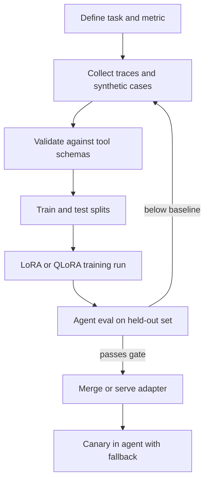

## TL;DR
Fine-tuning a small model with LoRA or QLoRA on a few thousand examples of one agent step (route, extract,
call a tool) can make a 1-8B model reliable at that narrow job. The data, not the trainer, decides success.

## For agent builders
- **Why it matters for agents.** Prompting gets an SLM to maybe-correct tool calls; fine-tuning on your own
  tool schemas and traces makes the format and the tool choice habitual, so you stop paying a large model
  for a narrow, high-volume step.
- **Where it shows up in your stack.** Hugging Face TRL (`SFTTrainer`) with PEFT (`LoraConfig`), bitsandbytes
  for 4-bit QLoRA, and hosted fine-tuning services; the adapter is then served by vLLM, Ollama or llama.cpp.
- **What you control.** The task boundary, the training data (format, coverage, negatives), the chat
  template, LoRA rank and target modules, learning rate and epochs, and the eval gate before release.
- **What you can skip.** The low-rank math and optimizer internals (see training-adaptation/peft). Know what
  rank, alpha and 4-bit loading cost, and how to read a loss curve.

## Why it exists
- **SLMs are fluent but sloppy at agent formats.** Out of the box a 3B model may pick the wrong tool, invent
  arguments or drift from the JSON schema on a few percent of calls, and an agent loop multiplies that
  error across steps.
- **Prompting has a ceiling.** Longer system prompts and few-shot examples help, but they cost context
  on every call and stop improving a small model long before it is reliable enough.
- **Full fine-tuning is too expensive to iterate.** Updating every weight of even a 7B model needs
  multi-GPU memory for weights, gradients and optimizer state.
- **LoRA and QLoRA make it a one-GPU job.** LoRA trains small adapter matrices (roughly 0.1-1% of
  parameters, depending on rank and target modules); QLoRA also loads the frozen base in 4-bit, so a 7-8B model typically fits on one 24 GB card
  (rough order of magnitude; check with your sequence length).

## How it works
### 1. Pick a narrow, measurable task
- **Good targets:** intent routing, tool selection plus argument filling for a fixed tool set, structured
  extraction, query rewriting for RAG, short grounded answers in a fixed format.
- **Poor targets:** open-ended multi-step planning across many tools, or tasks needing knowledge the model
  lacks. Fine-tuning teaches behaviour and format far better than facts; use retrieval for facts.
- **Write the acceptance metric first** (for example exact tool name plus valid arguments), because the
  same metric gates the release.

### 2. Build the dataset
| Ingredient | Why |
|---|---|
| Chat-format examples (`messages`, with `system`, `user`, `assistant`, `tool` roles) | matches how the agent calls the model at inference |
| Your real tool schemas in the prompt, exactly as served | the model learns your names and argument types |
| Coverage of every tool and of "no tool needed" | prevents over-calling a favourite tool |
| Negative and edge cases: missing arguments, ambiguous requests, refusals | teaches asking or declining instead of guessing |
| A held-out test split, never trained on | the eval gate needs unseen cases |

- **Sources:** logged production traces (cleaned and consented), traces from a large-model agent (see
  distilling-a-large-model-agent-into-an-slm), and synthetic variations.
- **Size:** hundreds to a few thousand high-quality examples often beat tens of thousands of noisy ones for
  a narrow format task (illustrative, not a rule; measure with a learning curve).
- **Quality filter:** validate every tool call against its JSON Schema and drop examples that fail.

### 3. Use the model's own chat template
- Render training examples with the tokenizer's chat template (`apply_chat_template`), the same template the
  serving engine uses, because a template mismatch silently breaks tool-call parsing at inference.
- Train on assistant turns only when your trainer supports it, so the model is not trained to produce user
  text or tool results. Recent TRL versions offer `assistant_only_loss=True` in `SFTConfig`, which needs a
  chat template that marks assistant tokens; check the current docs for your version.

### 4. Configure LoRA or QLoRA
| Knob | Typical starting point | Effect |
|---|---|---|
| `r` (rank) | 8-32 | adapter capacity; higher fits more but overfits small data sooner |
| `lora_alpha` | about 2x `r` | scales the adapter update |
| `target_modules` | `"all-linear"` | adapting all linear layers usually beats attention-only for format tasks |
| learning rate | around 1e-4 to 2e-4 | LoRA tolerates higher rates than full fine-tuning |
| epochs | 1-3 | more epochs on small data memorises phrasing |
| 4-bit base (QLoRA) | NF4 with bf16 compute | roughly quarters base-weight memory, small quality cost |

These are common starting points, not tuned values; sweep a few on your eval set.

### 5. Train, evaluate, ship the adapter
1. Watch train and validation loss; validation rising while train falls means overfitting.
2. Run the held-out agent eval (tool accuracy, schema validity, task success), not just loss.
3. Ship the adapter separately (vLLM can serve LoRA adapters on one base) or merge it into the base and
   convert for llama.cpp or Ollama (check each tool's current conversion steps).

## Diagram
Data quality and the eval gate bracket the training run; the run itself is the cheap part.



## Misconceptions
- **"Fine-tuning teaches the model my domain facts."** A LoRA run on a few thousand examples mostly changes
  behaviour and format; facts picked up this way are patchy, slow to update and stated confidently when
  wrong. Fine-tune the call pattern and put the facts in retrieval.
- **"When accuracy stalls, add epochs or rank."** More epochs on small data memorise phrasing, and more rank
  overfits sooner. In the triage scenario below the last 8 points (86% to 94%) came with "no tool" and
  missing-argument cases, not more epochs; that run also had more data, so an equal-size ablation (the
  Exercise) separates coverage from size. Fix coverage first, then check with a learning curve.
- **"QLoRA trains a 4-bit model."** Only the frozen base is stored in 4-bit (NF4); the LoRA adapters train
  in higher precision with bf16 compute, and what you ship is that small adapter.
- **"Low validation loss means the agent is ready."** Loss measures token fit on the training format, not
  whether served calls parse or pick the right tool. A template mismatch, test leakage or missing negatives
  all hide behind a good curve, so gate on the held-out agent eval through the serving engine.
- **"An adapter carries over to a newer base model."** LoRA deltas are learned against one set of base
  weights; a base revision bump silently invalidates them. Version base, data, template and adapter
  together and retrain on any base change.

## Examples
### Worked scenario: a ticket-triage agent step
A support agent's first step picks one of 6 tools (or none) and fills arguments. A large hosted model does
it well but costs too much at high volume. Illustrative figures:

| Run | Data | Tool + args exact match | Schema-valid |
|---|---|---|---|
| 3B instruct, prompted with few-shot | none | ~70% | ~90% |
| 3B + LoRA, 800 examples | real traces only | ~86% | ~99% |
| 3B + LoRA, 2,500 examples | traces + synthetic "no tool" and missing-argument cases | ~94% | ~99% |
| Large hosted model (reference) | prompted | ~95% | ~99% |

- **What moved the number:** adding negatives and "ask a clarifying question" examples, not more epochs.
- **Ship decision:** the fine-tuned SLM takes the step; low-confidence or invalid outputs escalate to the
  large model (see slm-llm-cascades-and-routing).

### QLoRA fine-tune of a small model on tool-call traces
A minimal TRL plus PEFT run. `train.jsonl` holds one `{"messages": [...]}` conversation per line, rendered
with your real system prompt and tool schemas.

```python
# pip install trl peft transformers datasets bitsandbytes accelerate
# API checked against trl 1.16.0, peft 0.21.2, transformers 5.20.2 (CPU smoke run, tiny model, no 4-bit);
# 4-bit loading needs a CUDA GPU for bitsandbytes. Versions move fast; check the docs for yours.
import torch
from datasets import load_dataset
from peft import LoraConfig
from transformers import AutoModelForCausalLM, AutoTokenizer, BitsAndBytesConfig
from trl import SFTConfig, SFTTrainer

BASE = "Qwen/Qwen2.5-1.5B-Instruct"     # any small instruct model; read its model card and license
ds = load_dataset("json", data_files={"train": "train.jsonl", "test": "test.jsonl"})

bnb = BitsAndBytesConfig(load_in_4bit=True, bnb_4bit_quant_type="nf4",
                         bnb_4bit_compute_dtype=torch.bfloat16)        # QLoRA: frozen base in 4-bit
model = AutoModelForCausalLM.from_pretrained(BASE, quantization_config=bnb, device_map="auto")
tok = AutoTokenizer.from_pretrained(BASE)

peft_cfg = LoraConfig(r=16, lora_alpha=32, lora_dropout=0.05,
                      target_modules="all-linear", task_type="CAUSAL_LM")
args = SFTConfig(output_dir="out/router-lora", num_train_epochs=2,
                 per_device_train_batch_size=4, gradient_accumulation_steps=4,
                 learning_rate=2e-4, logging_steps=10, eval_strategy="epoch", bf16=True)

trainer = SFTTrainer(model=model, args=args, train_dataset=ds["train"], eval_dataset=ds["test"],
                     processing_class=tok, peft_config=peft_cfg)   # uses the tokenizer's chat template
trainer.train()
trainer.save_model("out/router-lora")   # adapter weights (a few MB to tens of MB) + tokenizer, no base
```

Drop `quantization_config` for plain bf16 LoRA when memory allows (see Trade-offs).

## Production patterns
- **Version data, base and adapter together.** Record the base model revision, dataset hash, chat template
  and LoRA config with each adapter, because a base-model update silently invalidates the adapter. Store
  them in your model registry and refuse to deploy mismatched pairs.
- **Gate releases on the agent eval, not loss.** Run the held-out set plus a regression suite of past
  failures through the real agent loop; block the release if tool accuracy or task success drops versus
  the current model, and monitor both online per adapter version.
- **Serve many adapters on one base.** With vLLM, start the server with LoRA enabled (`--enable-lora`) and
  register adapters per task or tenant, so one GPU hosts several fine-tuned agent steps. Check the current
  vLLM docs for adapter limits and flags.
- **Refresh from production traces on a schedule.** Sample failed or escalated calls, have humans or a
  large model label the correct action, and retrain, because tool sets and user phrasing drift.
- **Keep a fallback path.** Route schema-invalid or low-confidence outputs to a stronger model, so a
  regression costs money rather than correctness. Monitor the fallback rate as an early alarm.

## Trade-offs
- **LoRA vs full fine-tuning.** LoRA trains a tiny fraction of weights on one GPU and ships as a small
  file; full fine-tuning can edge ahead on large datasets but needs far more memory and a whole new model
  to host.
- **QLoRA vs LoRA in bf16.** QLoRA fits bigger bases on smaller GPUs; it trains slower and adds a small
  quantization error. With enough memory, bf16 LoRA is simpler.
- **Narrow specialist vs general SLM.** Fine-tuning boosts the target step but can degrade other abilities
  (catastrophic forgetting); keep each adapter to one job.
- **Fine-tuning vs better prompting or retrieval.** Fine-tuning fixes format and behaviour; it is the wrong
  tool for fresh facts, which flips the decision toward RAG.

## Pitfalls
- **Chat template mismatch.** Symptom: great eval in the notebook, garbled tool calls when served. Diagnose:
  render one production request with the training template and diff it against the prompt the engine
  logs; note its tool-call parser. Fix: train and serve with the same template and parser.
- **Training on tool results and user turns.** Symptom: the model writes fake tool outputs after a call.
  Diagnose: print the labels or assistant mask for one example; only assistant tokens should count. Fix:
  mask non-assistant tokens from the loss and test that the model stops after a tool call.
- **No "no tool" or ambiguous cases.** Symptom: a tool call on every request, because every example ends in
  one. Diagnose: compare label counts per tool and "none" with a production sample. Fix: add negatives and
  clarifications in proportion to real traffic.
- **Test leakage.** Symptom: offline accuracy far above online. Diagnose: look for session ids shared across
  splits and near-duplicate train/test pairs. Fix: split by user or session before generating synthetic
  variants.

## When to use
- **Use when** one agent step is narrow, high-volume and measurable, a prompted SLM is close but not
  reliable, and you can collect a few hundred to a few thousand good examples.
- **Avoid when** the task changes weekly, needs broad reasoning across many tools, or the gap is missing
  knowledge; prompt a larger model or add retrieval instead.
- **Measure** tool and argument accuracy, schema validity, task success in the full loop, latency and
  fallback rate, before and after.

## Exercise
**Goal:** show, with an ablation, which data ingredient makes a fine-tuned router reliable. No solution is
given.
- **Inputs:** a 0.5-1.5B instruct model, 4 tool schemas, 600+ chat examples with "no tool" and
  missing-argument cases, split by seed request (100+ held out).
- **Deliver:** two identically configured LoRA adapters, with and without the negatives, and a table of
  exact match, schema validity and "no tool" accuracy for them and the prompted baseline.
- **Acceptance:** a script proves zero seed overlap between splits; the full-data adapter beats the
  baseline; one request served through your engine parses as a tool call.

## Role lens
- **Engineer:** Builds the dataset from traces, runs LoRA or QLoRA with TRL and PEFT, and proves the
  adapter beats the prompted baseline on the agent eval before shipping it.
- **Architect:** Decides which agent steps deserve a fine-tuned SLM, how adapters are versioned with their
  base model, and how fallback to a large model keeps correctness when an adapter regresses.
- **FDE:** Scopes with the customer which step to specialise, what traces can legally be used for training,
  and what accuracy and cost targets the fine-tune must hit.

## Check yourself
**Q:** Your fine-tuned 3B router scores 96% on its test set but only 80% in production. List the likely
causes and how you would confirm each.
**A:** First suspect test leakage: synthetic paraphrases of test cases may have landed in training, so
re-split by session or user and re-score. Second, a chat template or tool-call parser mismatch between
training and the serving engine; render a production request through the training template and diff it.
Third, distribution shift: production has more ambiguous or "no tool" requests than the test set; sample
and label production failures and compare category mix. Fourth, schema drift: a tool was renamed or gained
an argument since the data was built. Fix by refreshing data from labelled production traces, adding
negatives, and gating on an eval set sampled from real traffic.

## Interview questions
### How would you build the training set for fine-tuning an SLM to call your agent's tools?
- **Start from real traces** in chat format with the exact served tool schemas, and validate every target
  tool call against its JSON Schema.
- **Cover the space:** every tool, "no tool needed", missing-argument and ambiguous requests, and refusals,
  in proportions close to production.
- **Hold out a test split by session** before any synthetic augmentation, so the eval measures
  generalisation rather than memorised paraphrases.

### When would you choose QLoRA over LoRA, and what does it cost?
- **Choose QLoRA when memory is the constraint:** the frozen base loads in 4-bit, so a 7-8B model fits on a
  single consumer or 24 GB GPU.
- **The cost** is slower steps and a small quantization loss; with enough memory bf16 LoRA is simpler and
  slightly better, so measure both on the agent eval.

### Your fine-tuned model emits perfect tool calls in tests but the agent loop breaks when served. What do you check?
- **Chat template and parser:** the engine may use a different template or tool-call parser than training,
  so the output text does not parse as a tool call.
- **Stop behaviour:** if the model was trained on tool results, it may continue past the call and invent
  output; check loss masking and stop tokens.
- **Serving config:** confirm the adapter actually loaded and the base model revision matches.

### When should you not fine-tune an SLM for an agent?
- **When the gap is knowledge, not behaviour:** use retrieval, because fine-tuning facts is slow to update
  and hallucination-prone.
- **When the task is broad or shifts often:** open-ended planning or weekly-changing tools make the data
  stale, so a prompted larger model or a cascade is cheaper to maintain.

## Quiz
### Q: What does QLoRA change compared with plain LoRA?
- [ ] It trains all weights of the model in 4-bit precision
- [x] It loads the frozen base model in 4-bit while training LoRA adapters in higher precision
- [ ] It removes the need for a chat template
- [ ] It replaces the adapter matrices with a quantized lookup table
> QLoRA quantizes the frozen base weights (typically NF4) to save memory, while the small LoRA adapters are
> still trained in higher precision, so large-ish bases fit on one GPU.

### Q: A fine-tuned router calls a tool on almost every request, including greetings. What is the most likely data fix?
- [ ] Train for more epochs
- [ ] Raise the LoRA rank to 128
- [x] Add "no tool needed" and clarification examples in realistic proportions
- [ ] Remove the system prompt from training examples
> The model only learned that every example ends in a tool call. Including negatives and clarification
> cases teaches when not to call a tool; more epochs or rank would reinforce the bias.

### Q: Why render training examples with the base model's own chat template?
- [ ] It makes training faster on GPUs
- [ ] It is required for LoRA adapters to save correctly
- [x] Serving engines use that template and tool-call parser, so a mismatch breaks tool calls at inference
- [ ] It reduces the number of trainable parameters
> The model learns the exact token layout it sees in training. If serving uses a different template or
> parser, outputs that looked right offline fail to parse as tool calls in the agent loop.

## Mastery test
**Problem:** a 3B triage adapter has run for months at 4% fallback. In one week the base model is bumped to
a new revision and a `cancel_order` tool is added. Fallback hits 15% and cancellations go to
`refund_order`. Diagnose and fix.

**A strong answer:**
- separates two causes: an adapter trained on the old base, and a tool absent from training, so the model
  picks the nearest one it knows;
- confirms each from fallback reasons by tool and base revision, and the cancel/refund confusion;
- pins or retrains the base, adds cancel traces with contrasting refunds, re-runs the gate;
- routes cancels to the large model meanwhile and blocks mismatched base/adapter deploys.

## Use cases & projects
### Use cases
- **Intent and tool routing.** A fine-tuned 1-3B model picks the next tool or sub-agent for a support or
  operations agent at a fraction of large-model cost.
- **Structured extraction steps.** Pulling fields from emails, invoices or tickets into a strict schema
  before an agent acts on them.
- **Query rewriting for RAG.** A small model turns chat turns into search queries tuned to your index.
- **Private on-prem agents.** Teams that cannot send data out fine-tune an open model on internal traces
  and serve it on their own GPUs.

### Mini project
**Fine-tune a tool router and beat the prompted baseline (2-3 hours).**
- **Goal:** make a 0.5-3B instruct model pick the right tool and arguments for a 4-tool agent more often
  than the same model prompted with few-shot examples.
- **Steps:** define 4 tool schemas; generate 600-1,000 chat examples (including "no tool" and
  missing-argument cases) with a large model, validate them against the schemas, hold out the test split by
  seed request before generating paraphrases; train a LoRA adapter with TRL; evaluate both models on 150 held-out cases.
- **Done when:** you have a table of exact tool-plus-arguments match and schema validity for baseline vs
  fine-tuned, and you can name the data change that moved the score most.
