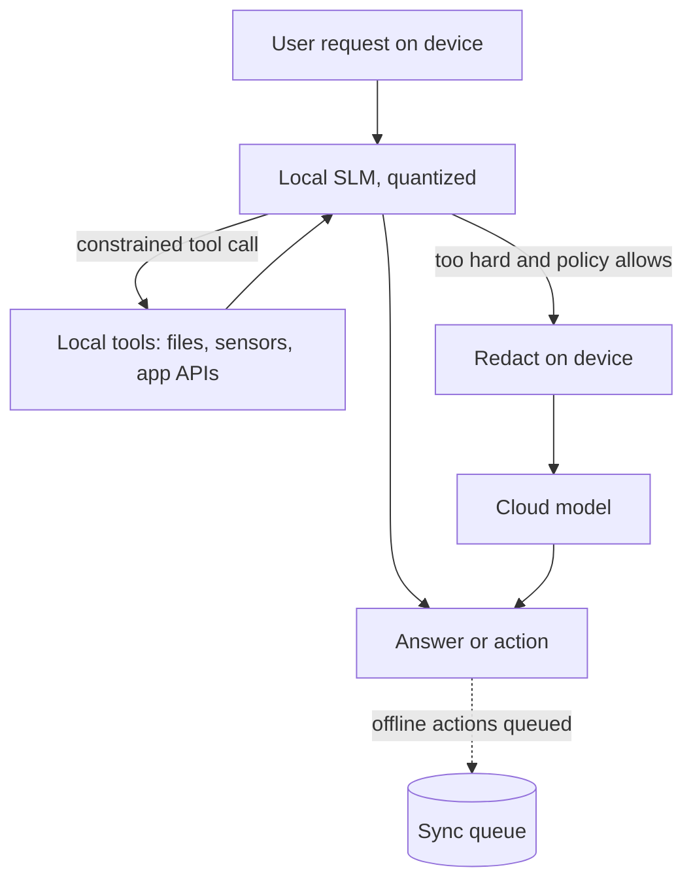

## TL;DR
An on-device agent runs a quantized 0.5-4B model on the phone, laptop or edge box itself, calling local
tools. It buys privacy, offline use and zero per-call cost, within tight memory, battery and quality limits.

## For agent builders
- **Why it matters for agents.** Some agents must work offline, keep data on the device, or respond in
  well under a second: field apps, assistants inside desktop software, kiosks, vehicles, factory gateways.
- **Where it shows up in your stack.** The runtimes tabled below, from llama.cpp (GGUF) and Ollama to
  mobile and browser runtimes, plus OS-level on-device models.
- **What you control.** Model size and quantization, context length, the tool set exposed on the device,
  constrained decoding for tool calls, and when to hand off to a cloud model.
- **What you can skip.** Kernel-level optimisation and NPU compiler details; pick a runtime for your
  hardware and measure on real devices.

## Why it exists
- **Data cannot always leave the device.** Health notes, personal messages, regulated industrial data, or
  customer policy rule out sending prompts to a cloud API.
- **Connectivity is not guaranteed.** Field workers, vehicles and remote sites need an agent that still
  works with no network.
- **Round trips add latency.** A local SLM skips network time on short, frequent steps like intent
  detection, form filling or command parsing.
- **Cloud cost scales with users.** On-device inference costs nothing per call, which matters for
  consumer apps with millions of users.
- **The catch:** a phone may give an app only a few GB of memory, sustained inference drains battery and
  heats the device, and small models are weaker, so the agent must be designed around those limits.

## How it works
### 1. Fit the model to the device
```
weight_memory ≈ parameters × bits_per_weight / 8
e.g. 3B × 4 bits / 8 ≈ 1.5 GB   (plus KV cache, runtime and app memory)
```
| Device class | Typical model size (4-bit) | Notes |
|---|---|---|
| Recent phone | ~0.5-3B | memory per app and thermals are the limits |
| Laptop with 16 GB+ | ~3-8B | GPU or Apple unified memory helps a lot |
| Edge box with a small GPU | ~3-14B | can serve several local users |
| Browser (WebGPU) | ~0.5-3B | first load downloads the weights; cache them |

Rough orders of magnitude; measure on the target device. Real "4-bit" files run larger than the formula:
GGUF types such as Q4_K_M keep some tensors at higher precision, so a 3B file is closer to 2 GB than 1.5 GB.

### 2. Pick a runtime for the platform
| Runtime | Where it fits | Model format |
|---|---|---|
| llama.cpp and bindings (llama-cpp-python, others) | desktop, server, mobile builds, Raspberry Pi class | GGUF |
| Ollama | desktops and edge boxes, simple local API | GGUF-based |
| MLX (mlx-lm) | Apple silicon Macs | MLX weights |
| ONNX Runtime (generate API) | Windows, Android, cross-platform apps | ONNX |
| ExecuTorch | iOS, Android, embedded, from PyTorch | exported PyTorch programs |
| WebGPU runtimes (for example WebLLM) | in-browser agents | runtime-specific builds |

Platform vendors also expose built-in on-device models through OS APIs; capabilities and availability
change often, so check the current platform docs.

### 3. Design the agent for a small model
- **Few, narrow tools.** Expose 3-8 local tools with short schemas; every schema token costs context and
  latency on a slow device.
- **Constrain the output** with llama.cpp grammars or JSON schema mode so tool calls always parse.
- **Short context.** Keep context to a few thousand tokens, summarise or drop old turns, because KV cache
  memory and prefill time grow with length.
- **Specialise.** A LoRA fine-tune for the device's task often matters more than a bigger base model.

### 4. Plan the cloud boundary
- **Local-first:** hard requests escalate to a cloud model only with consent and connectivity (see
  slm-llm-cascades-and-routing), after on-device redaction if policy allows escalation at all.
- **Sync later:** queue offline actions and reconcile when back online.

## Diagram
The device handles the loop locally; the cloud is an optional, policy-gated fallback.



## Examples
### Runnable: will it fit, and at what context length?
Weights are fixed but the KV cache grows with context, which usually breaks the fit. The 3 GB budget
is illustrative.

```python
# Does the model fit the device? Pure Python, no dependencies.
def fit(params_b, bits_per_weight, layers, kv_heads, head_dim, ctx_tokens,
        kv_bytes=2, runtime_gb=0.3, budget_gb=3.0):
    weights = params_b * 1e9 * bits_per_weight / 8
    kv = 2 * layers * kv_heads * head_dim * kv_bytes * ctx_tokens   # keys + values, fp16 cache
    total = (weights + kv) / 1e9 + runtime_gb
    return {"weights_gb": round(weights / 1e9, 2), "kv_gb": round(kv / 1e9, 2),
            "total_gb": round(total, 2), "fits": total <= budget_gb}

# Illustrative 3B config with grouped-query attention: read yours from the model's config.json.
# ~4.8 bits/weight approximates a Q4_K_M-style file (some tensors stay at higher precision).
for ctx in (2048, 8192, 32768):
    print(ctx, fit(3.2, 4.8, layers=28, kv_heads=8, head_dim=128, ctx_tokens=ctx))

# Expected output:
# 2048 {'weights_gb': 1.92, 'kv_gb': 0.23, 'total_gb': 2.45, 'fits': True}
# 8192 {'weights_gb': 1.92, 'kv_gb': 0.94, 'total_gb': 3.16, 'fits': False}
# 32768 {'weights_gb': 1.92, 'kv_gb': 3.76, 'total_gb': 5.98, 'fits': False}
```

### A local tool-calling step with llama-cpp-python and a JSON schema
Offline with a downloaded GGUF; schema mode makes the call parse. API checked against llama-cpp-python LLAMA_VERSION.

```python
# pip install llama-cpp-python   (build options for Metal or CUDA: see its docs)
import json
from llama_cpp import Llama

llm = Llama(model_path="models/small-instruct-q4_k_m.gguf",   # any small instruct GGUF you downloaded
            n_ctx=4096, n_gpu_layers=-1, verbose=False)        # -1 offloads all layers if a GPU exists

SCHEMA = {"type": "object",
          "properties": {"tool": {"type": "string", "enum": ["set_reminder", "search_notes", "none"]},
                         "query": {"type": "string"},
                         "time": {"type": "string"}},
          "required": ["tool"]}

def local_step(text):
    r = llm.create_chat_completion(
        messages=[{"role": "system", "content": "Pick a tool for the request. Reply in JSON."},
                  {"role": "user", "content": text}],
        response_format={"type": "json_object", "schema": SCHEMA}, temperature=0)
    return json.loads(r["choices"][0]["message"]["content"])

NOTES = ["Gate code for site B is in the blue binder", "Pump 3 serviced in March"]
call = local_step("When was pump 3 serviced?")
if call["tool"] == "search_notes":
    hits = [n for n in NOTES if any(w in n.lower() for w in call.get("query", "").lower().split())]
    print(hits)
else:
    print(call)
```

For phones, keep the design and use a mobile runtime from the table.

### Worked scenario: a field-maintenance agent on a rugged tablet
Requirements: works offline, keeps site data on the device, answers within about 2 seconds. Illustrative
numbers.

| Decision | Choice | Reason |
|---|---|---|
| Model | ~3B instruct, 4-bit GGUF, LoRA-tuned on maintenance requests | ~2 GB fits beside the app |
| Context | 2k tokens, last 4 turns plus retrieved notes | keeps prefill short on a mobile chip |
| Tools | search_manuals, log_fault, read_sensor, none | 4 short schemas, JSON-constrained |
| Retrieval | small on-device embedding model plus local vector index | manuals searchable offline |
| Cloud | escalate only when online and the technician taps "ask expert" | privacy and cost |
| Sync | fault logs queued and uploaded when connected | offline-first |

- **Measured on device (illustrative):** first token well under a second, a few to tens of tokens per
  second by chip, and acceptable battery per shift because calls are short.
- **Biggest win:** constraining output and cutting tool schemas fixed most failures, more than switching to a
  larger model.

## Production patterns
- **Test on the slowest supported device.** Benchmark time to first token, tokens per second, peak memory and
  battery drain on the oldest target hardware, because a model fine on a developer laptop may be killed by
  the OS on a phone. Gate releases on those numbers.
- **Download models separately from the app.** Ship the app small, fetch the model on first run over Wi-Fi,
  verify a checksum, and version models so you can roll back. Monitor download failures and storage errors.
- **Always constrain tool calls.** Use grammars or JSON-schema decoding and still validate in code: offline,
  a malformed call cannot be retried against a stronger model.
- **Treat local tools as privileged.** On-device agents reach files, contacts or sensors; give each tool
  least privilege and confirm destructive actions with the user (see agents/sandboxing).
- **Collect evals, not data.** Where users consent, report anonymous outcome signals (tool-call parse rate,
  escalation taps, latency) instead of raw prompts, to choose what to fine-tune next.

## Trade-offs
- **Privacy and offline vs capability.** Keeping everything local rules out frontier-model quality; the
  balance flips when a task needs broad reasoning and data policy allows a cloud call.
- **Zero per-call cost vs engineering cost.** No inference bill, but you maintain packaging, per-platform
  runtimes and device testing across hardware generations.
- **Smaller model vs better quantization.** A 4-bit 3B model may beat an 8-bit 1B in the same memory, or
  not; measure on your task.
- **Latency vs battery.** Running the GPU or NPU flat out gives fast answers but drains battery and throttles
  under heat; short prompts and few calls per task keep both acceptable.

## Pitfalls
- **Benchmarking only on a desktop.** Symptom: crashes or 10-second responses on real phones. Diagnose: log
  peak memory, OS kill reasons and tokens per second per device, again after 10 minutes of use (thermal
  throttling). Fix: test on target devices with realistic background apps.
- **Large tool schemas and long history.** Symptom: slow first token and context overflow. Diagnose: log
  prompt tokens per step split into schemas, history and retrieved text. Fix: fewer, shorter tools and aggressive context trimming.
- **Unconstrained output from a small model.** Symptom: occasional malformed tool calls that break the loop
  offline. Diagnose: track parse rate, keep failing raw outputs, and confirm the
  runtime received the schema. Fix: grammar or schema-constrained decoding plus code validation.
- **Silent cloud fallback.** Symptom: privacy review finds data leaving the device. Diagnose: capture network
  traffic in a test run and match each request to a logged escalation. Fix: make escalation explicit, consented, redacted and logged.

## When to use
- **Use when** data must stay on the device, the agent must work offline, per-user cloud cost is
  prohibitive, or local latency matters, and the task is narrow enough for a small model.
- **Avoid when** the agent needs broad reasoning, many tools or long contexts, or target devices are too
  constrained; use a cloud model or a hybrid design.
- **Measure** task success, tool-call parse rate, time to first token, tokens per second, peak memory and
  battery per task on target devices.
- **Interviews:** link memory arithmetic, runtime choice and the cloud boundary.

## Exercise
**Goal:** predict, then measure, whether an offline three-tool agent fits a 3 GB budget. No solution is
given.
- **Inputs:** two GGUF quantizations of one small model, its config.json, the fit calculator, and 30
  requests at 2k and 8k context.
- **Deliver:** per quantization and context: predicted and measured peak memory, time to first token,
  tokens per second, parse rate and tool accuracy, and which limit binds first.
- **Acceptance:** network off; every call parses; measured memory within about 20% of prediction, or the
  gap explained.

## Role lens
- **Engineer:** Packages a quantized model for the target runtime, builds constrained local tool calls, and
  benchmarks latency, memory and battery on real devices.
- **Architect:** Defines the device-cloud boundary, model update and rollback strategy, and the privacy
  rules for when anything may leave the device.
- **FDE:** Captures the customer's hardware, connectivity and data-residency constraints and turns them into
  a model-size and runtime choice they can sign off.

## Check yourself
**Q:** A customer wants an assistant on their field technicians' mid-range Android phones that works
offline and never sends site data off the device. Sketch your design and the main risks.
**A:** Use a roughly 1-3B instruct model quantized to 4-bit, run with an Android-capable runtime such as
llama.cpp, ONNX Runtime or ExecuTorch, downloaded on first launch with checksum and version. Keep the tool
set small (search manuals, log fault, read checklist) with JSON-schema-constrained calls and code
validation. Use an on-device embedding model and local index for manuals, a short context window, and a
LoRA fine-tune on technician requests. Queue logs for sync. Main risks: memory limits and thermal
throttling on older phones, weaker reasoning on unusual faults, and model updates; mitigate with on-device
benchmarks, an explicit "contact expert" path, and staged rollouts.

## Interview questions
### How do you decide which model size fits an on-device agent?
- **Start from memory:** parameters times bits per weight over 8 gives weight size, then add KV cache for
  your context length, runtime overhead and the app itself, and compare with what the OS allows the app.
- **Then measure** time to first token, tokens per second and battery on the slowest target device, and pick
  the largest model that meets the latency and memory budget.

### How would you design the boundary between an on-device agent and a cloud model?
- **Local by default**, with escalation only when the request needs it, the user or policy allows it, and
  the device is online.
- **Redact on the device** before any cloud call, log escalations, and make the behaviour visible to users so
  privacy guarantees are testable.

### When would you not put an agent on the device?
- **When the task needs broad reasoning, long contexts or many tools**, because small quantized models
  degrade fast there.
- **When target hardware is too varied or old**, since device testing and per-platform runtimes may cost more
  than a cloud deployment with good privacy controls.

### What would you monitor for an on-device agent you cannot log prompts from?
- **Consented, anonymous outcome metrics:** tool-call parse rate, escalation or "ask expert" taps, task
  completion signals, latency percentiles, crashes and out-of-memory kills by device model.
- **Use them to target fine-tuning** and to choose minimum supported hardware.

## Quiz
### Q: Roughly how much memory do the weights of a 3B-parameter model take at 4-bit quantization?
- [ ] About 0.4 GB
- [x] About 1.5 GB
- [ ] About 6 GB
- [ ] About 12 GB
> Weight memory is parameters times bits per weight divided by 8: 3B × 4 / 8 ≈ 1.5 GB. KV cache, runtime and
> app memory come on top, which is why phones usually run models of a few billion parameters at most.

### Q: Why should an on-device agent use grammar or JSON-schema constrained decoding for tool calls?
- [ ] It makes the model larger and more accurate
- [x] Small models misformat calls more often and offline there is no stronger model to fall back to
- [ ] It is required by every mobile operating system
- [ ] It removes the need to validate arguments in code
> Constraining decoding guarantees the output parses, which is the most common small-model failure.
> Arguments can still be semantically wrong, so code validation remains necessary.

### Q: What is the safest default for cloud escalation in a privacy-sensitive on-device agent?
- [ ] Escalate automatically whenever the device is online
- [ ] Never allow any network access for the app
- [x] Escalate only when policy and the user allow it, after on-device redaction, and log it
- [ ] Send all requests to the cloud and cache answers locally
> Explicit, consented, redacted escalation keeps privacy guarantees testable while still offering a path for
> hard requests. Silent fallback is the classic privacy failure.

## Mastery test
**Problem:** a kiosk edge box has 8 GB of RAM, 2 GB used by the app. The team wants a 7B model at 4-bit
with the product catalog in a 16k context, escalating to the cloud "whenever the model is unsure". What
breaks, and what do you change?

**A strong answer:**
- adds it up: about 4 GB of weights, up to about 2 GB of KV cache at 16k for a GQA 7B, plus runtime and
  app, so the box is at or past its limit;
- retrieves catalog entries into a 2-4k context, or drops to a 3B model;
- replaces "unsure" with checkable triggers (schema failure, verifier reject, user tap), redacted and logged.

## Use cases & projects
### Use cases
- **Field and industrial assistants.** Offline agents on tablets or gateways that search manuals, read
  sensors and log faults at remote sites.
- **Private personal assistants.** Note, email or health assistants that summarise and act on personal data
  without it leaving the device.
- **In-app copilots.** Desktop software that parses natural-language commands into local actions with no
  per-user API bill.
- **Vehicles, kiosks and retail devices.** Agents that must answer instantly on unreliable networks.

### Mini project
**Build an offline note agent on your laptop (1-2 hours).**
- **Goal:** a local agent that answers questions over your notes and creates reminders with no network.
- **Steps:** extend the llama-cpp-python example with tools over a local folder and a JSON file;
  disconnect; run 30 requests recording tool-call accuracy, time to first token and peak memory; repeat
  at a second quantization level.
- **Done when:** it works offline, every call parses, and a table compares both levels on accuracy,
  latency and memory.
