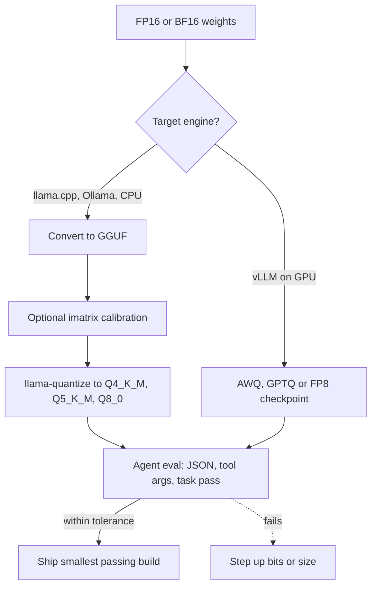

## TL;DR
Quantization stores an SLM's weights in 4-8 bits instead of 16, cutting memory roughly 2-4x to fit a
laptop, edge box or smaller GPU. GGUF suits llama.cpp and Ollama, AWQ suits vLLM; always re-check tool calls.

## For agent builders
- **Why it matters for agents.** Quantization decides whether your agent's model fits the hardware at all,
  and how many agent sessions share one GPU. It can also quietly break JSON and tool arguments first.
- **Where it shows up in your stack.** File names like `Q4_K_M` or `Q8_0` in GGUF downloads and Ollama tags,
  AWQ or GPTQ repos loaded by vLLM, and the memory line in your capacity plan.
- **What you control.** The format for your engine, the bit width, whether to use an importance matrix, and
  the eval gate that accepts or rejects a quantized build.
- **What you can skip.** Quantizer maths (GPTQ, AWQ, the granularity ladder: see
  `training-adaptation/quantization`); here you choose a file and prove it works.

## Why it exists
- **Weights dominate small-model memory.** A 7B model in 16-bit is about 14 GB of weights before any KV
  cache, too much for a 16 GB laptop or an 8 GB GPU.
- **Decode is memory-bandwidth-bound.** Fewer bytes per weight means fewer bytes read per token, so 4-bit
  models often decode faster than 16-bit ones on the same hardware, not just smaller.
- **Agents need headroom.** Long tool schemas and transcripts need KV cache, and several concurrent sessions
  multiply it. Shrinking weights frees memory for that.
- **Naive rounding hurts.** Rounding every weight to 4 bits with one scale loses quality; block-wise scales,
  k-quants and activation-aware methods keep most of it.

## How it works
### Memory arithmetic
```
weight_bytes ≈ parameters × effective_bits_per_weight ÷ 8
total ≈ weight_bytes + KV cache (bytes_per_token × context × sessions) + ~10% overhead
```
Effective bits include the per-block scales, so a "4-bit" file is really around 4.5-5 bits per weight.

### GGUF: the file format for llama.cpp and Ollama
- **A container, not a method.** One file holds the weights, tokenizer, chat template and metadata, so a
  model runs from a single download.
- **Quant types are named in the file.** `Q8_0` (about 8.5 bits per weight) is near-lossless; `Q6_K` and
  `Q5_K_M` are close; `Q4_K_M` is the common default; `Q3_K` and `Q2_K` save more and lose more.
- **K-quants and IQ quants.** K-quants use blocks with nested scales; IQ types (for example `IQ4_XS`) reach
  lower sizes at similar quality. Both benefit from an importance matrix.
- **Importance matrix (imatrix).** A calibration pass records which weights matter on sample text, so the
  quantizer spends precision there. Calibrating on text like your agent prompts is a cheap quality win.

### AWQ: 4-bit weights for GPU serving
- **Activation-aware.** It finds the small share of weight channels that see large activations and scales
  them to protect them before quantizing the rest to 4 bits.
- **Served by GPU engines.** vLLM loads AWQ checkpoints (published as Hugging Face repos with an "AWQ"
  suffix) and runs them with fast 4-bit kernels, keeping continuous batching.
- **Alternatives on GPU:** GPTQ (also 4-bit, error-compensating) and FP8 weights and activations on GPUs that
  support it. Check the vLLM quantization docs for what your GPU supports.

### Quality vs memory: the pattern to expect
| Precision | Memory vs 16-bit | Typical effect on an SLM (illustrative; measure yours) |
|---|---|---|
| 8-bit (`Q8_0`, INT8, FP8) | about half | Usually indistinguishable on agent evals |
| 5-6 bit (`Q5_K_M`, `Q6_K`) | about a third to two fifths | Small losses, rarely visible on narrow tasks |
| 4-bit (`Q4_K_M`, AWQ, GPTQ) | about a quarter to a third | Small but measurable; structured output is the first to show it |
| 3-bit and below | about a quarter or less | Often breaks JSON, arguments and multi-step reasoning in small models |

Small models tend to lose more from aggressive quantization than large ones, because each weight carries
more of the model's capacity. So a 4-bit 7B is often a better buy than a 2-bit 14B of similar size.

At a fixed memory budget, compare both on your eval: a 4-bit larger model often wins, but below about 3 bits
a smaller 8-bit model is usually safer.

## Diagram
Follow one model from full precision to a deployable file: the engine picks the format, and the agent eval,
not perplexity alone, decides which bit width ships.



## Misconceptions
- **"A 4-bit model needs a quarter of the 16-bit memory."** Only the weights shrink, and a "4-bit" file
  stores scales too, so it is about 4.5-5 bits per weight. KV cache and overhead stay the same, so total
  memory for an agent with long contexts and several sessions falls by much less than 4x.
- **"If perplexity barely moves, the agent is fine."** Perplexity averages over free text, while an agent
  depends on a few exact tokens: braces, enum values, IDs in tool arguments. Those break first, so the
  gate is your agent eval (valid JSON, correct tool and arguments, task pass rate).
- **"Quantized models are slower because weights must be dequantized."** Decode is memory-bandwidth-bound,
  so reading fewer bytes per token usually outweighs the unpacking work. A 4-bit build often decodes faster
  than 16-bit on the same hardware.
- **"GGUF and AWQ are rival quantization algorithms."** GGUF is a file format for llama.cpp and Ollama that
  holds many quant types plus tokenizer and chat template; AWQ is a 4-bit method served by GPU engines such
  as vLLM. You pick by engine first, then by bit width.
- **"At equal memory, the bigger model at fewer bits always wins."** Around 4 bits it often does, but small
  models lose more per bit removed, and below about 3 bits a smaller model at 8 bits is usually safer.
  Run both builds on your eval.
- **"Constrained decoding makes quantization damage irrelevant."** A grammar or JSON schema guarantees
  valid structure, not correct values. A degraded build still emits wrong IDs and actions inside valid
  JSON, so measure field accuracy, not only validity.

## Examples
### Sizing calculator: which builds fit your hardware
Effective bits are approximate; read the exact file size from the model repo.

```python
BITS = {"F16": 16, "Q8_0": 8.5, "Q6_K": 6.6, "Q5_K_M": 5.7, "Q4_K_M": 4.8, "AWQ-4bit": 4.6}

def kv_gb(layers, kv_heads, head_dim, context, sessions, bytes_el=2):
    return 2 * layers * kv_heads * head_dim * bytes_el * context * sessions / 1e9

def total_gb(params_b, quant, **kv):
    weights = params_b * BITS[quant] / 8                 # params in billions -> GB
    return (weights + kv_gb(**kv)) * 1.1                 # ~10% overhead

# A 7B-class model with GQA: 28 layers, 4 KV heads, head_dim 128 (read yours from config.json)
cfg = dict(layers=28, kv_heads=4, head_dim=128, context=8192, sessions=4)
for q in BITS:
    print(f"{q:9} {total_gb(7.6, q, **cfg):5.1f} GB")
# F16 ~18.8 GB exceeds a 16 GB laptop; Q8_0 ~10.9 GB is tight next to the OS;
# Q4_K_M ~7.1 GB and AWQ ~6.9 GB fit with room for four 8k sessions (KV cache ~1.9 GB).
```

### Agent eval gate across quantization levels
Run the same tool-calling golden set on each build. Ollama publishes several quantizations of many models as
separate tags; check the model's tag list for exact names.

```python
# Run with the ollama Python client 0.6.3 against a mock server (attribute access needs 0.4+).
import json, ollama

BUILDS = ["qwen2.5:7b-instruct-q8_0", "qwen2.5:7b-instruct-q4_K_M", "qwen2.5:7b-instruct-q3_K_M"]
FMT = {"type": "object", "required": ["order_id", "action"],
       "properties": {"order_id": {"type": "string"},
                      "action": {"type": "string", "enum": ["refund", "replace", "escalate"]}}}
SYSTEM = "Extract the order. Reply with JSON only, matching this schema: " + json.dumps(FMT)
cases = [json.loads(l) for l in open("extract_golden.jsonl")]   # {"text", "order_id", "action"}

for build in BUILDS:
    ok = 0
    for c in cases:
        r = ollama.chat(model=build, options={"temperature": 0}, messages=[
            {"role": "system", "content": SYSTEM}, {"role": "user", "content": c["text"]}])
        try:
            out = json.loads(r.message.content)
            ok += out.get("order_id") == c["order_id"] and out.get("action") == c["action"]
        except (json.JSONDecodeError, AttributeError):
            pass                                        # invalid JSON counts as a failure
    print(f"{build:30} {ok/len(cases):.0%}")
# Decoding is left unconstrained on purpose, to expose how JSON validity degrades as bits drop.
# In production, add format=FMT (constrained output) and measure field accuracy instead.
```

### Worked scenario: fitting an extraction agent on 8 GB GPUs
A team had to run an invoice-extraction agent on existing 8 GB GPUs (numbers illustrative).

| Build | Fits 8 GB with 4k context? | Field accuracy | Valid JSON (unconstrained) | Decision |
|---|---|---|---|---|
| 7B `Q8_0` | No | baseline | 99% | Rejected on memory |
| 7B `Q4_K_M` with imatrix | Yes | 1 point below baseline | 98% | Shipped |
| 7B `Q3_K_M` | Yes, more headroom | 6 points below | 91% | Rejected on quality |
| 3B `Q8_0` | Yes | 5 points below | 97% | Kept as fallback candidate |

With constrained JSON decoding added, valid JSON reached 100% for the shipped build, and field accuracy
became the only metric that mattered.

## Production patterns
- **Default to 4-5 bit, prove it, then go lower only with evidence.** Start with `Q4_K_M` or `Q5_K_M` GGUF,
  or AWQ on GPU; accept it if golden-set pass and valid-JSON rates stay within tolerance of an 8-bit or
  16-bit reference.
- **Calibrate with your own prompts.** When producing GGUF yourself, build an importance matrix with
  `llama-imatrix` on text resembling your agent's inputs, then pass it to `llama-quantize --imatrix`.
  Compare with the non-imatrix build on the golden set.
- **Pin the exact file.** Record the repo, file name and hash of the GGUF or the revision of the AWQ repo,
  because community re-uploads with the same name can differ in template or quantization recipe.
- **Spend saved memory on context and sessions.** After quantizing weights, re-run KV-cache sizing and raise
  context or concurrency deliberately. An FP8 or 8-bit KV cache (vLLM `--kv-cache-dtype fp8`, Ollama
  `OLLAMA_KV_CACHE_TYPE=q8_0` with flash attention on) roughly halves KV memory; re-run the eval after it.
- **Monitor structured-output failure rate.** Track invalid JSON and rejected tool arguments per model build
  in traces; a rise after a quantization change is the earliest signal of damage.

## Trade-offs
- **Memory and speed vs quality.** Fewer bits fit smaller hardware and decode faster, but each step down
  costs some accuracy, and structured output degrades first. The flip point is your eval tolerance.
- **GGUF portability vs GPU throughput.** GGUF runs everywhere from one file but serves fewer concurrent
  requests than AWQ or FP8 in vLLM on a big GPU.
- **Using a community quant vs producing your own.** Downloads are instant, but you inherit someone else's
  calibration data and template; producing your own costs an hour and gives control.

## Pitfalls
- **Judging a quant by perplexity alone.** Symptom: perplexity barely moves but tool arguments break.
  Diagnose: put valid-JSON and argument accuracy per build next to perplexity, against an 8-bit reference.
  Fix: gate on the agent's golden set.
- **Comparing file sizes, not total memory.** Symptom: the model loads but crashes or swaps with long
  context. Diagnose: read peak memory (`ollama ps`, `nvidia-smi`) at full context and sessions against your
  estimate. Fix: add KV cache for your context and sessions.
- **Mismatched format and engine.** Symptom: vLLM cannot load a GGUF efficiently, or Ollama cannot use an AWQ
  repo. Diagnose: check the repo's files and the engine's load log. Fix: GGUF for llama.cpp and Ollama;
  AWQ, GPTQ or FP8 for GPU engines.
- **Going to 2-3 bits on a small model.** Symptom: loops, malformed JSON and wrong tools. Diagnose: invalid
  JSON and repeated-call rates per build jump at the low-bit step. Fix: step up to 4-5 bits or choose a
  smaller model at higher precision.

## When to use
- **Use when** the model does not fit the target hardware at 16-bit, when you need more concurrent agent
  sessions per GPU, or when decode speed matters on bandwidth-limited devices.
- **Avoid when** memory is plentiful and the step is quality-critical, or below about 4 bits on small
  models without a strong eval result.
- **Measure** task pass rate, valid-JSON rate, tool-argument accuracy, peak memory and tokens per second for
  each build.

## Exercise
**Goal:** make your own GGUF quants of one small model and test whether an imatrix from your agent's
prompts helps. No solution is given.
- **Inputs:** a 0.5B-3B instruct model, llama.cpp (`convert_hf_to_gguf.py`, `llama-imatrix`,
  `llama-quantize`, `llama-perplexity`), 200 prompts resembling your agent's inputs, and a 50-case JSON golden set.
- **Deliver:** `Q4_K_M` with and without imatrix plus `Q3_K_M`, each with file size, valid-JSON rate, field
  accuracy and tokens per second against a `Q8_0` reference.
- **Acceptance:** you can explain each file size's gap from parameters × effective bits ÷ 8; one script
  reproduces the table; you can say whether perplexity would have picked the same build.

## Role lens
- **Engineer:** Picks the GGUF or AWQ build for the engine, produces imatrix quants when needed, and runs the
  agent eval gate across bit widths before shipping.
- **Architect:** Sets the memory budget per deployment, decides between larger-lower-bit and
  smaller-higher-bit options, and pins quantized artefacts in the model registry.
- **FDE:** Explains to a customer why their 8 GB devices can run a 4-bit 7B model but not a 14B one, and
  shows the eval numbers that make the 4-bit choice safe.

## Check yourself
**Q:** You must run a tool-calling agent's 7B model on laptops with 16 GB of unified memory, with 8k-token
contexts. Which quantization would you start with and how would you validate it?
**A:** At 16-bit the weights alone are about 14 GB, leaving nothing for the KV cache or the OS, so it does
not fit. Start with a `Q4_K_M` or `Q5_K_M` GGUF in Ollama or llama.cpp, which brings weights to about 4-5 GB
and leaves room for 8k context. Validate by running the agent's golden set on that exact build and on an
8-bit reference, comparing task pass rate, valid-JSON rate and tool-argument accuracy within a set
tolerance. If it fails, try an imatrix build or `Q5_K_M`, and only drop to 3 bits with strong eval evidence.
Pin the file hash once accepted.

## Interview questions
### What is the difference between GGUF and AWQ?
- **GGUF is a file format** for llama.cpp and Ollama that bundles quantized weights, tokenizer, template and
  metadata, with many quant types from 2 to 8 bits.
- **AWQ is a quantization method** that protects activation-salient channels and stores 4-bit weights,
  typically served on GPUs by engines such as vLLM.
- **Pick by engine:** GGUF for CPU, Apple silicon and edge; AWQ, GPTQ or FP8 for GPU serving at scale.

### How do you decide between a 14B model at 3 bits and a 7B model at 6 bits for the same memory?
- **Do not guess:** both fit the budget, so run the agent's golden set on both builds.
- **Expect** structured output to suffer more at 3 bits, because small and heavily compressed models break
  JSON and arguments first.
- **Choose** the one that passes with lower latency; often the higher-bit smaller model is more reliable.

### After switching to a 4-bit build, your agent's tool calls fail more often. What do you do?
- **Measure:** compare invalid-JSON and wrong-argument rates against the previous build on the golden set.
- **Mitigate:** add constrained decoding or schema validation with retry, try an imatrix or 5-bit build, or
  route failures to a larger model.
- **Prevent:** gate every quantization change on the golden set.

### Why is a quantized model often faster as well as smaller?
- **Decode reads all weights every token,** so it is limited by memory bandwidth, not arithmetic.
- **Fewer bytes per weight** means fewer bytes moved per token, so tokens per second rise on bandwidth-bound
  hardware, up to the point where dequantization overhead dominates.

## Quiz
### Q: Roughly how much memory do the weights of a 7B model need at `Q4_K_M` compared with 16-bit?
- [ ] About the same, because quantization only affects speed
- [ ] About half
- [x] Roughly a quarter to a third, around 4-5 GB instead of about 14 GB
- [ ] About a tenth
> `Q4_K_M` stores around 4.5-5 effective bits per weight including block scales, versus 16 bits, so a 7B
> model drops from about 14 GB to about 4-5 GB of weights. The KV cache still needs memory on top.

### Q: Which agent metric usually reveals quantization damage first?
- [ ] Time to first token
- [x] Valid-JSON and tool-argument accuracy on the golden set
- [ ] Number of tools defined
- [ ] Length of the system prompt
> Structured output is brittle: a slightly shifted token distribution produces a missing brace or a wrong
> field before broad answer quality visibly drops, so it is the canary to monitor.

### Q: You need to serve many concurrent agent sessions on a large GPU with vLLM. Which quantized format fits best?
- [ ] A `Q2_K` GGUF file
- [x] An AWQ (or GPTQ or FP8) checkpoint that vLLM loads with its GPU kernels
- [ ] Any GGUF file, since all engines prefer it
- [ ] An unquantized FP32 checkpoint
> GPU engines are built around formats such as AWQ, GPTQ and FP8 with fast kernels and continuous batching.
> GGUF is designed for llama.cpp and Ollama, and 2-bit is too aggressive for agent reliability.

## Mastery test
**Problem:** an edge device has 6 GB usable and must hold two concurrent 16k-token agent sessions. Options:
a 4B model at `Q8_0`, an 8B at `Q3_K_M` (about 4 GB of weights), or the 4B at `Q4_K_M`. Both models have
36 layers, 8 KV heads and head dim 128. Which fits, and what do you test?

**A strong answer:**
- computes about 0.15 MB of fp16 KV per token, so about 4.8 GB for two 16k sessions: the cache, not the
  weights, decides;
- finds only the 4B at `Q4_K_M` (about 2.4 GB) with an 8-bit KV cache fits, near 5.3 GB with overhead;
- re-runs the golden set after the KV change, and offers shorter context or one session as fallbacks.

## Use cases & projects
### Use cases
- **Laptop and desktop agents.** A 4-bit GGUF lets a 7B-8B model run next to the user's files.
- **Edge devices.** Stores, vehicles and factory boxes run 1B-4B models at 4-5 bits.
- **Denser GPU serving.** AWQ or FP8 weights free memory for KV cache: roughly double the sessions where
  16-bit weights filled most of the card (a 7B on a 24 GB GPU), much less on an 80 GB GPU.

### Mini project
**Find the smallest safe quantization for one agent step (1-2 hours).**
- **Goal:** pick the lowest-memory build of one model that keeps an extraction or tool-calling step within
  tolerance.
- **Steps:** pull 3-4 quantizations of one model in Ollama (for example 8-bit, 5-bit, 4-bit,
  3-bit); build a 50-case golden set with expected JSON; run the eval gate script and record pass rate,
  valid-JSON rate, peak memory and tokens per second for each.
- **Done when:** you have a table per build, the chosen build's exact tag, and where quality fell off.
