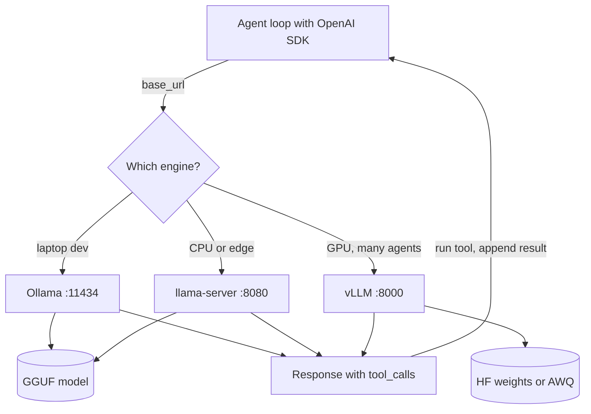

## TL;DR
Ollama, llama.cpp and vLLM all run open small models behind an OpenAI-compatible API, so one agent client
works with each. Pick Ollama for developer laptops, llama.cpp for CPU, edge and fine control, vLLM for
GPU servers with many concurrent agents.

## For agent builders
- **Why it matters for agents.** A local endpoint lets you develop agents offline, keep private data in your
  boundary, and serve high-volume SLM steps without per-token bills.
- **Where it shows up in your stack.** A `base_url` such as `http://localhost:11434/v1` (Ollama),
  `http://localhost:8080/v1` (llama.cpp server) or `http://localhost:8000/v1` (vLLM) in your OpenAI SDK,
  LiteLLM or framework config.
- **What you control.** The model and quantization, context length, how many requests run in parallel, and
  whether native tool-call parsing is turned on.
- **What you can skip.** Kernels and schedulers (see `serving-inference/engines`); you need the commands,
  agent-relevant flags, and when to switch.

## Lab
### Task
Build the preflight check an agent runs against a local engine before its first step, so a misconfigured
server fails loudly instead of degrading the agent. Time box: 45-60 minutes. Prerequisites: the tool-calling
lesson (`agents/tool-calling`) and this lesson's Settings that matter to agents.
- The starter ships a fake OpenAI-compatible engine with four modes that reproduce real local failures:
  `ok`, `text_tools` (template without tool support), `truncating` (an Ollama model left at a 2048
  context) and `loading` (port open, model not ready).
- You implement three checks and `preflight()`: a real completion, structured `tool_calls`, and an
  untruncated long prompt judged by `usage.prompt_tokens`.
- No GPU, model download or network is needed; checked on Python 3.12 with the standard library and pytest 9.

### Starter code
```python
# preflight.py -- Python 3.12, standard library only. Run: python preflight.py
import json, threading, urllib.request, urllib.error
from http.server import BaseHTTPRequestHandler, ThreadingHTTPServer

# ---- Fake OpenAI-compatible engine (stands in for Ollama, llama-server or vLLM) ----
def count_tokens(messages):
    """The fake engine's tokenizer: one token per whitespace-separated word."""
    return sum(len(str(m.get("content") or "").split()) for m in messages)

def make_handler(mode):
    class Handler(BaseHTTPRequestHandler):
        def log_message(self, *args):
            pass
        def do_POST(self):
            body = json.loads(self.rfile.read(int(self.headers["Content-Length"])))
            if mode == "loading":                      # port open, model not ready yet
                return self._send(503, {"error": {"message": "model is loading"}})
            prompt = count_tokens(body["messages"])
            if mode == "truncating":                   # like an Ollama model left at num_ctx 2048
                prompt = min(prompt, 2048)
            msg = {"role": "assistant", "content": "ok"}
            if body.get("tools"):
                call = {"name": "get_stock", "arguments": json.dumps({"sku": "A-17"})}
                if mode == "text_tools":               # template without tool support
                    msg["content"] = json.dumps(call)
                else:
                    msg["content"] = None
                    msg["tool_calls"] = [{"id": "call_1", "type": "function", "function": call}]
            self._send(200, {"choices": [{"index": 0, "message": msg, "finish_reason": "stop"}],
                             "usage": {"prompt_tokens": prompt, "completion_tokens": 1}})
        def _send(self, code, obj):
            data = json.dumps(obj).encode()
            self.send_response(code)
            self.send_header("Content-Type", "application/json")
            self.send_header("Content-Length", str(len(data)))
            self.end_headers()
            self.wfile.write(data)
    return Handler

def start_fake(mode):
    """Start a fake engine in a thread; mode is ok, text_tools, truncating or loading."""
    srv = ThreadingHTTPServer(("127.0.0.1", 0), make_handler(mode))
    threading.Thread(target=srv.serve_forever, daemon=True).start()
    return f"http://127.0.0.1:{srv.server_port}/v1"

def post_chat(base_url, payload):
    """POST payload to {base_url}/chat/completions. Returns (HTTP status, parsed JSON body)."""
    req = urllib.request.Request(f"{base_url}/chat/completions", json.dumps(payload).encode(),
                                 {"Content-Type": "application/json"})
    try:
        with urllib.request.urlopen(req, timeout=10) as r:
            return r.status, json.load(r)
    except urllib.error.HTTPError as e:
        return e.code, json.load(e)

# ---- Your preflight checks ----
TOOLS = [{"type": "function", "function": {
    "name": "get_stock", "description": "Units in stock for a product SKU",
    "parameters": {"type": "object", "properties": {"sku": {"type": "string"}}, "required": ["sku"]}}}]
LONG_PROMPT = "stock " * 6000          # 6000 tokens on the fake tokenizer

def check_completion(base_url, model):
    """None if a real completion returns non-empty content, else 'completion: <reason>'."""
    raise NotImplementedError  # LAB: send one short message; report HTTP status and error text

def check_tool_calls(base_url, model):
    """None if the reply has structured tool_calls naming get_stock, else 'tool_calls: <reason>'.
    When content holds the call as JSON text instead, the reason must say 'returned as text'."""
    raise NotImplementedError  # LAB: send TOOLS with a stock question; inspect message fields

def check_context(base_url, model, min_ratio=0.95):
    """None if usage.prompt_tokens >= min_ratio * count_tokens(messages), else 'context: <reason>'
    naming both numbers."""
    raise NotImplementedError  # LAB: send LONG_PROMPT and compare the server's count with yours

def preflight(base_url, model):
    """Run the three checks in order and return the list of failure strings ([] means ready).
    If the completion check fails, return just that failure."""
    raise NotImplementedError  # LAB: combine the checks

if __name__ == "__main__":
    for mode in ["ok", "text_tools", "truncating", "loading"]:
        try:
            fails = preflight(start_fake(mode), "qwen2.5:7b")
            print(f"{mode:11} {'PASS' if not fails else 'FAIL ' + '; '.join(fails)}")
        except NotImplementedError:
            print(f"{mode:11} not implemented")
```

### Expected output
The starter prints `not implemented` for every mode. A correct solution prints these lines; the text after each
check name may be worded differently, but the check name, the numbers and the PASS or FAIL must match.
```text
ok          PASS
text_tools  FAIL tool_calls: returned as text in content
truncating  FAIL context: prompt_tokens 2048 < 5700 (truncated)
loading     FAIL completion: HTTP 503 model is loading
```

### Tests
```python
# test_preflight.py -- run: python -m pytest -q test_preflight.py
from preflight import start_fake, preflight, check_context, check_tool_calls

def test_healthy_engine_passes():
    assert preflight(start_fake("ok"), "m") == []

def test_tool_calls_as_text_is_detected():
    fails = preflight(start_fake("text_tools"), "m")
    assert len(fails) == 1
    assert fails[0].startswith("tool_calls:") and "returned as text" in fails[0]

def test_structured_tool_call_passes():
    assert check_tool_calls(start_fake("ok"), "m") is None

def test_truncation_is_detected_with_numbers():
    fails = preflight(start_fake("truncating"), "m")
    assert len(fails) == 1
    assert fails[0].startswith("context:") and "2048" in fails[0] and "5700" in fails[0]

def test_ratio_is_respected():
    assert check_context(start_fake("truncating"), "m", min_ratio=0.3) is None   # 2048 >= 1800

def test_loading_model_stops_after_completion_check():
    fails = preflight(start_fake("loading"), "m")
    assert len(fails) == 1
    assert fails[0].startswith("completion:") and "503" in fails[0]
```
On the starter all 6 tests fail with `NotImplementedError`.

### Failure scenarios
- **Check only that the port answers.** Replace `check_completion` with a TCP connect: `loading` now
  passes the first check, and the failure surfaces later as a 503 on a tool or context request, or on
  the agent's first real step. Debug by printing the status and body of the first request; a health
  check must be a real completion.
- **Trust `content` when `tool_calls` is empty.** The `text_tools` engine then passes, and a real agent
  would print JSON to the user. Log both message fields for one request, then fix the engine (`--jinja`,
  a vLLM tool parser, or a model whose template supports tools).
- **Compare against a hard-coded 6000.** `test_ratio_is_respected` fails, and the check breaks the
  moment the prompt changes. Compute the expected count from the messages you sent.
- **Point it at a real engine.** Run `preflight("http://localhost:11434/v1", "qwen2.5:7b")` against
  Ollama with a 2048 context: the real tokenizer differs from the fake, so set `min_ratio` from one
  measured run, not from the fake's word count.

### Submission
- `preflight.py` with the four functions implemented and the fake engine unchanged.
- The output of `python preflight.py`, matching Expected output line for line.
- The pytest run showing 6 passed.
- A note of 3-5 sentences on how you would wire `preflight()` into agent startup and which failure should
  block start versus only warn.
- Optional: the same script's output against one real local engine, with the engine and version named.

## Why it exists
- **Hosted APIs are not always allowed or affordable.** Regulated data, air-gapped sites and high call volume
  push SLM steps onto hardware you run.
- **Raw model weights are not a service.** You need tokenisation, chat templates, batching, a KV cache and an
  HTTP API; these three engines package all of that.
- **Agents need tool calls parsed, not just text.** Each engine can turn tool-call tokens into structured
  `tool_calls`, if you enable the right template or parser.
- **One size does not fit all.** A laptop, a CPU-only edge box and an 80 GB GPU serving 50 agents need
  different engines; the shared API keeps agent code identical.

## How it works
### The three engines at a glance
| | Ollama | llama.cpp (`llama-server`) | vLLM |
|---|---|---|---|
| **Built for** | Easy local use, model management | Portable C/C++ inference, CPU and GPU, edge | High-throughput GPU serving |
| **Model format** | GGUF, pulled from its library or imported | GGUF | Hugging Face weights, plus AWQ, GPTQ, FP8 and others |
| **Core abstraction** | Model tag plus Modelfile (`FROM`, `PARAMETER`, `SYSTEM`) | A GGUF file plus command-line flags | A model repo id plus engine arguments |
| **Concurrency** | A few parallel requests per model | Fixed number of slots | Continuous batching, PagedAttention, prefix caching |
| **Default port** | 11434 | 8080 | 8000 |
| **Tool calls** | `tools` in its native and OpenAI-compatible APIs for models whose template supports them | Pass `--jinja` to use the model's chat template (explicitly, whatever your build's default) | `--enable-auto-tool-choice` plus a `--tool-call-parser` for the model family |

### Starting each one
```bash
# Ollama: the server (desktop app or `ollama serve`) listens on :11434; pull a model into it
ollama pull qwen2.5:7b
ollama run qwen2.5:7b "Say hi"          # quick test; ollama ps shows loaded models

# llama.cpp: serve a GGUF file on :8080, offload all layers to GPU, 8k context
llama-server -m ./qwen2.5-7b-instruct-q4_k_m.gguf -c 8192 -ngl 99 --port 8080 --jinja

# vLLM: serve Hugging Face weights on :8000 with native tool-call parsing
vllm serve Qwen/Qwen2.5-7B-Instruct --max-model-len 8192 \
  --enable-auto-tool-choice --tool-call-parser hermes
```

### Settings that matter to agents
- **Context length.** Ollama's default context is small and can silently truncate long tool schemas and
  transcripts; set `num_ctx` (Modelfile `PARAMETER num_ctx 8192` or request `options` on the native API).
- **Ollama's OpenAI-compatible endpoint has no per-request context setting,** so agents that use the OpenAI
  SDK need the Modelfile or the server-wide `OLLAMA_CONTEXT_LENGTH`. In llama.cpp use `-c`, in vLLM
  `--max-model-len`.
- **Keep-alive.** Ollama unloads idle models after a few minutes; `OLLAMA_KEEP_ALIVE` or the request's
  `keep_alive` avoids a cold load on the next agent step.
- **Parallelism.** `OLLAMA_NUM_PARALLEL`, llama.cpp `--parallel` slots, and vLLM `--max-num-seqs` cap
  concurrent requests; each one needs its own KV cache.
- **Tool parser match.** The vLLM parser must match the model's tool format (for example `hermes`,
  `llama3_json`, `mistral`); check the vLLM tool-calling docs for the current list.

## Diagram
The agent code stays the same; only the base URL changes, and each engine maps a model file or repo to an
OpenAI-style chat endpoint that returns parsed tool calls.



## Examples
### A minimal tool-calling agent against any local engine
The same loop works with Ollama, llama.cpp (`--jinja`) or vLLM (tool parser on); change `BASE_URL` and
`MODEL` only.

```python
# Run with openai 3.37 (Python SDK) on Python 3.12 against a mock OpenAI-compatible server.
import json
from openai import OpenAI

BASE_URL, MODEL = "http://localhost:11434/v1", "qwen2.5:7b"   # or :8080/v1, :8000/v1
client = OpenAI(base_url=BASE_URL, api_key="local")           # local servers ignore the key

def get_stock(sku: str) -> dict:
    return {"sku": sku, "in_stock": 12}                         # stand-in for a real API

TOOLS = [{"type": "function", "function": {
    "name": "get_stock", "description": "Units in stock for a product SKU",
    "parameters": {"type": "object", "properties": {"sku": {"type": "string"}},
                   "required": ["sku"]}}}]

messages = [{"role": "user", "content": "How many units of SKU A-17 are in stock?"}]
for step in range(5):                                           # hard cap on agent steps
    msg = client.chat.completions.create(model=MODEL, messages=messages,
                                         tools=TOOLS, temperature=0).choices[0].message
    if not msg.tool_calls:
        print(msg.content); break
    messages.append(msg)
    for call in msg.tool_calls:
        try:
            result = get_stock(**json.loads(call.function.arguments))
        except (json.JSONDecodeError, TypeError) as e:          # small models do emit bad args
            result = {"error": f"invalid arguments: {e}"}
        messages.append({"role": "tool", "tool_call_id": call.id, "content": json.dumps(result)})
```

### Production setup: which engine where
A team runs the same agent in three places. The comparison is qualitative; measure throughput on your own
hardware and model.

| Setting | Engine | Configuration that mattered |
|---|---|---|
| Developer laptops (16-32 GB unified memory) | Ollama | Pinned model tags, Modelfile with `num_ctx 8192`, one shared Modelfile in the repo |
| Branch-office edge box, CPU only | llama.cpp `llama-server` | Q4_K_M GGUF, `-c 4096`, `--parallel 2`, started as a system service |
| Central GPU server, 40 concurrent agents | vLLM | AWQ 4-bit 7B model, `--max-model-len 8192`, `--enable-prefix-caching`, tool parser matched to the model |

All three expose `/v1/chat/completions`, so the agent and its eval suite run unchanged in each place.

## Production patterns
- **One client, many backends.** Route through LiteLLM or a thin gateway with each local engine and a hosted
  fallback. Monitor per-backend errors and latency so a failing server shifts traffic, not fails runs.
- **Containerise with the model pinned.** Official Ollama or vLLM images, or a llama.cpp build, with engine
  version pinned and the model file or revision baked in or mounted read-only.
- **Health check with a real completion.** Probe with a short chat request, not just an open port, because a
  server can be up while the model is still loading. Alert on time to first token and on queue length.
- **Size concurrency from memory.** Set `--max-num-seqs` or `--parallel` from KV-cache arithmetic, then
  load-test at your agents' concurrency. Watch preemptions in vLLM metrics.
- **Trace local calls like hosted ones.** Send spans with model, engine, quantization, tokens and latency to
  Langfuse or your tracing backend, so SLM steps are visible in the same agent trace.

## Trade-offs
- **Ollama convenience vs control.** The fastest path to a working local agent, but fewer serving knobs and
  lower concurrency than vLLM; it flips once you serve many concurrent users.
- **llama.cpp portability vs throughput.** It runs on CPU, Apple silicon and modest GPUs from one GGUF file,
  but does not batch as aggressively as vLLM on a large GPU.
- **vLLM throughput vs footprint.** Continuous batching and prefix caching give the most agents per GPU, but
  it targets GPU servers, pre-allocates most GPU memory, and has heavier dependencies.
- **Local vs hosted.** Local keeps data in and per-token cost out; you own uptime, upgrades, capacity.

## Pitfalls
- **Truncated context in Ollama.** Symptom: the agent ignores tools or the system prompt on longer runs.
  Diagnose: log `usage.prompt_tokens` per step; a flat ceiling while the transcript grows, or a "truncating
  input prompt" warning in the Ollama server log, means truncation.
  Fix: raise `num_ctx` (Modelfile, or `OLLAMA_CONTEXT_LENGTH` for the OpenAI-compatible endpoint).
- **Tool calls returned as plain text.** Symptom: JSON-looking text in `content` and no `tool_calls`.
  Diagnose: log both fields for one request and check the engine's start flags. Fix: llama.cpp `--jinja`,
  vLLM auto tool choice with the right parser, or a model whose Ollama template supports tools.
- **Cold starts between steps.** Symptom: some agent steps take seconds longer. Diagnose: `ollama ps` or the
  server log shows a load before the slow step. Fix: set keep-alive, and avoid loading several large models
  on one small GPU.
- **Benchmarking at batch 1.** Symptom: fine in testing, slow under load. Diagnose: plot time to first token
  against concurrency. Fix: load-test with the real number of concurrent agents and long prompts.

## When to use
- **Use Ollama when** you want a local model for development, demos or a single user in minutes.
- **Use llama.cpp when** you need CPU or edge deployment, a single binary, or fine control over GGUF and
  offloading.
- **Use vLLM when** a GPU server must serve many concurrent agent sessions with high throughput.
- **Measure** time to first token, tokens per second, valid tool-call rate and memory at your real
  concurrency.

## Exercise
**Goal:** write a preflight check your agent runs against any local engine before its first step. No
solution is given.
- **Inputs:** one small instruct model with tool support, served by at least two of the three engines.
- **Deliver:** a script taking `BASE_URL` and `MODEL` that checks a real completion, that tools come back as
  `tool_calls`, that a long prompt is not truncated (`usage.prompt_tokens` against your count), and time to
  first token at concurrency 1, 4 and 8.
- **Acceptance:** it passes on a correct setup; it fails with a clear message for a model whose template
  lacks tools and for a 6k-token prompt sent to an Ollama model at a 2048 context.

## Role lens
- **Engineer:** Starts the right engine with the right flags, points the agent's client at its base URL,
  and fixes context truncation and tool-parsing issues.
- **Architect:** Chooses engines per environment, sizes GPU servers from KV-cache math and concurrency, and
  keeps all of them behind one OpenAI-compatible interface with a hosted fallback.
- **FDE:** Installs a local model on a customer's machine or server, proves the agent works offline on their
  data, and explains when they will need to move from Ollama to vLLM.

## Check yourself
**Q:** Your agent works with a hosted model but, pointed at a local 7B model in Ollama, it ignores its tools
after a few steps and sometimes prints JSON as text. What do you check?
**A:** First the context: Ollama's default context is small, so a long system prompt, tool schemas and a
growing transcript get truncated; raise `num_ctx` and confirm prompt token counts in usage. Second, tool
support: the model's template must support tools, otherwise tool calls come back as text in `content`; pick
a model whose template does, or move to llama.cpp with `--jinja` or vLLM with the matching tool parser.
Third, robustness: validate arguments, return errors as tool results, cap steps, and run the agent's eval on
the local model before trusting it.

## Interview questions
### When would you choose vLLM over Ollama for serving an agent's small model?
- **Concurrency:** vLLM's continuous batching and PagedAttention serve many simultaneous agent sessions per
  GPU; Ollama targets a few local users.
- **Serving features:** prefix caching for shared system prompts and tool schemas, metrics, and fine control
  over sequence and memory limits.
- **Cost:** it needs a GPU server and more operational work, so it pays off only at real traffic.

### Your local model returns tool calls as raw text. How do you debug it?
- **Template, parser, model:** `llama-server` with `--jinja`, vLLM auto tool choice with the right parser,
  and an instruct model whose card documents tool support, at the deployed quantization.
- **A fallback parser** is only a stopgap; add the case to your eval set.

### How would you size a vLLM server for 40 concurrent agent sessions with 8k-token contexts?
- **Weights first:** model size at its precision, for example a 7B at 4-bit.
- **KV cache next:** bytes per token from the config times 8k times 40, plus about 10% headroom; set
  `--max-model-len` and `--max-num-seqs` to match.
- **Load-test:** measure time to first token and preemptions at 40 sessions before launch.

### What is the risk of upgrading the engine version under a running agent?
- **Behaviour changes:** templates, tool parsers, defaults such as context or sampling, and quantization
  kernels can change outputs.
- **Mitigation:** pin engine and model versions, run the agent's golden set on the new build, and roll out
  gradually with traces tagged by engine version.

## Quiz
### Q: What lets one agent client talk to Ollama, llama.cpp and vLLM without code changes?
- [ ] They all use the same model file format
- [x] Each exposes an OpenAI-compatible chat completions endpoint, so only the base URL and model name change
- [ ] They all run on the same default port
- [ ] They share one model registry
> Ollama, llama-server and vLLM all serve `/v1/chat/completions`. Formats and ports differ: Ollama and
> llama.cpp use GGUF, vLLM uses Hugging Face weights, and the defaults are 11434, 8080 and 8000.

### Q: An agent on a local Ollama model starts ignoring its tools once the transcript grows. What is the most likely cause?
- [ ] The model has been unloaded and reloaded
- [x] The context window is set too small, so the tool schemas or system prompt are truncated
- [ ] Ollama does not support tool calls at all
- [ ] Temperature was set to 0
> Ollama's default context is small. When the prompt exceeds it, earlier content is cut, including tool
> definitions. Raising `num_ctx` and checking prompt token counts fixes it.

### Q: Which setting is needed for vLLM to return parsed tool calls from a model?
- [ ] `--enable-prefix-caching`
- [ ] `--max-model-len`
- [x] `--enable-auto-tool-choice` with a `--tool-call-parser` that matches the model's tool format
- [ ] `--gpu-memory-utilization`
> vLLM parses tool calls only when auto tool choice is on and a parser matching the model family is chosen.
> Prefix caching, context length and memory utilisation are performance and capacity settings.

## Mastery test
**Problem:** an agent that works on Ollama laptops moves, same model, to a vLLM server for 30 concurrent
users. Long runs now fail with a context-length error, tool calls arrive as text, and time to first token
hits 6 seconds at peak. Explain each and fix it.

**A strong answer:**
- sees the laptops silently truncated, while vLLM rejects prompts over `--max-model-len`: set it from
  measured prompt tokens and compact the transcript;
- enables `--enable-auto-tool-choice` with that family's parser;
- checks queue and preemptions against `--max-num-seqs` and KV-cache size, and enables prefix caching for
  the shared system prompt and tool schemas.

## Use cases & projects
### Use cases
- **Offline development.** Agents built on laptops against Ollama, with no keys or per-token cost.
- **Air-gapped and on-premises agents.** llama.cpp or vLLM serve the model inside the customer's
  network.
- **High-volume SLM steps.** A vLLM server handles classification and extraction for many agents; a hosted
  large model plans.
- **Edge sites.** A CPU-only `llama-server` runs a small model in a store, factory or vehicle.

### Mini project
**Run one agent on three engines (2-3 hours).**
- **Goal:** prove your tool-calling agent runs unchanged on Ollama, llama.cpp and vLLM (two without a GPU).
- **Steps:** pick one small instruct model with tool support; serve it with Ollama, then as a GGUF with
  `llama-server --jinja`, then with vLLM and its tool parser if a GPU is available; run the example agent and
  a 30-case tool-calling eval against each; record valid tool-call rate, time to first token and tokens per
  second.
- **Done when:** a table shows the three engines side by side, the agent code differs only in `BASE_URL` and
  `MODEL`, and you can explain which engine you would deploy where.
