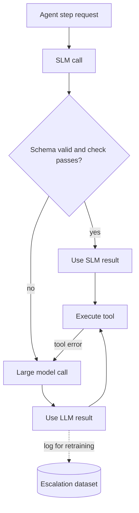

## TL;DR
A cascade sends each agent call to a small model first and escalates to a large model only when a cheap
check fails; a router picks the model up front. Both cut cost and latency if the escalation signal is
trustworthy.

## For agent builders
- **Why it matters for agents.** Most agent calls are easy (route, extract, format, summarise a tool
  result) and a few are hard (plan, recover from an error). Paying large-model prices for every step wastes
  most of the budget.
- **Where it shows up in your stack.** A thin wrapper around your model client, a gateway or LiteLLM router,
  per-step model settings in your agent framework, and Ollama or vLLM serving the SLM behind an
  OpenAI-compatible API.
- **What you control.** Which steps go to which tier, the escalation signal (validation, confidence,
  verifier, step budget), and the cost, latency and quality targets.
- **What you can skip.** Learned-router research details; system-design/model-routing-cascading covers the
  general design. Here the focus is SLM-first agent loops.

## Why it exists
- **Agent steps vary wildly in difficulty.** A tool-routing call and a multi-step recovery plan sit in the
  same loop, but only the second needs a frontier model.
- **One model for everything is a bad average.** Large-only overpays and adds latency per step; SLM-only
  fails the hard tail and the whole task fails with it.
- **Agents give you cheap checks.** Tool calls have JSON Schemas, many outputs can be validated by code,
  and tool results reveal errors, so you can often tell when the small model got it wrong.
- **What it buys.** If most calls stay on the SLM, cost per task falls roughly in proportion and latency
  drops, while the escalated tail keeps large-model quality (actual savings depend on your escalation rate).

## How it works
### Three shapes
| Shape | How it decides | Good for | Cost |
|---|---|---|---|
| Static per-step assignment | config: router step on SLM, planner on LLM | stable agents with known step types | no extra calls |
| Router (predict first) | classifier or rules pick a model before calling | when escalation after the fact is expensive | one router decision plus one model call |
| Cascade (try, check, escalate) | SLM answers, a check accepts or escalates | when correctness is checkable | escalated calls pay for both models |

### Escalation signals, strongest first
1. **Hard validation:** the tool call fails JSON Schema, names an unknown tool, or misses required
   arguments. Cheap and reliable.
2. **Execution feedback:** the tool returns an error, the SQL fails, a test fails; escalate the retry.
3. **Verifier or judge:** a separate check (rules, a small classifier, an LLM judge) scores the output.
4. **Model confidence:** token log-probabilities or self-reported confidence. Cheap but often poorly
   calibrated for small models; calibrate on your eval set before trusting a threshold.
5. **Budgets:** the SLM exceeded a step or retry budget in the loop; hand the task to the large model.

### Where to cascade in an agent loop
- **Per call:** each model call cascades independently. Simple, but a long trajectory built by the SLM may
  confuse the large model when it takes over mid-run.
- **Per task:** the SLM runs the whole task; on failure, rerun from the start with the large model. Costs
  more on failure but keeps trajectories coherent.
- **Per role:** the large model plans, SLMs execute well-specified sub-steps (extraction, tool calls).

### Setting the threshold
- Build an eval set with labels, run both tiers, and plot quality and cost against the escalation
  threshold. Pick the point that meets the quality target at the lowest cost.
- Re-tune when either model or the traffic mix changes, because the curve moves.
- **Know the break-even.** With escalation rate `e`, a cascade costs about `c_small + e × c_large` per call
  versus `c_large` for large-only, so it saves money while `e < 1 − c_small / c_large`:

```
c_small = 1, c_large = 20   ->  break-even at e = 95%  (20% escalation costs 5 units, a quarter of 20)
c_small = 1, c_large = 2    ->  break-even at e = 50%  (small tier barely cheaper: cascade rarely pays)
```

- **Count the whole small tier.** `c_small` includes any verifier or judge call, retries, and the real cost
  of a dedicated GPU at your utilisation, which is how cascades end up costing more than large-only.

## Diagram
The SLM answers first; only calls that fail a check pay for the large model.



## Examples
### A validate-then-escalate cascade for one tool-calling step
The SLM runs locally through Ollama's OpenAI-compatible endpoint; the large model through any compatible
provider. Pydantic validation is the escalation signal.

```python
import json, os
from openai import OpenAI
from pydantic import BaseModel, ValidationError

small = OpenAI(base_url="http://localhost:11434/v1", api_key="ollama")   # Ollama OpenAI-compatible API
large = OpenAI()                                                       # hosted, uses OPENAI_API_KEY
SMALL_MODEL, LARGE_MODEL = "qwen2.5:3b", os.environ["LARGE_MODEL"]     # check current model ids

class Route(BaseModel):
    tool: str
    order_id: str | None = None

TOOLS = {"get_order", "refund_order", "handoff_human"}
PROMPT = ("Pick one tool from get_order, refund_order, handoff_human for the request. "
          'Reply with JSON only: {"tool": ..., "order_id": ...}')

def ask(client, model, text):
    r = client.chat.completions.create(model=model, temperature=0,
        response_format={"type": "json_object"},
        messages=[{"role": "system", "content": PROMPT}, {"role": "user", "content": text}])
    return r.choices[0].message.content

def route(text):
    try:
        out = Route.model_validate(json.loads(ask(small, SMALL_MODEL, text)))
        if out.tool in TOOLS and (out.tool == "handoff_human" or out.order_id):
            return out, "slm"
    except (json.JSONDecodeError, ValidationError):
        pass                                        # invalid output is the escalation signal
    return Route.model_validate(json.loads(ask(large, LARGE_MODEL, text))), "llm"

for q in ["Where is order A17?", "I want my money back for B22", "Your app is awful, get me a person"]:
    print(route(q))
```

Log the tier and the reason for every escalation; those rows are your best data for fine-tuning the SLM
later.

### Worked scenario: choosing the threshold for an agent's routing step
Illustrative eval on 1,000 labelled requests, cost in relative units (SLM call = 1, large call = 20,
verifier cost left out for simplicity).

| Policy | Escalation rate | Routing accuracy | Cost per 1,000 |
|---|---|---|---|
| Large model only | 100% | 96% | 20,000 |
| SLM only | 0% | 84% | 1,000 |
| Cascade on schema failure only | 6% | 88% | 2,200 |
| Cascade on schema failure or verifier reject | 18% | 95% | 4,600 |
| Same, plus escalate on any tool error | 21% | 96% | 5,200 |

- **Read the table:** schema checks alone miss wrong-but-valid tool choices; a verifier catches most of them
  at about a quarter of the large-only cost.
- **Decision:** ship the last row, alert if escalation rate drifts above 30%, and use escalated cases to
  fine-tune the SLM so the rate falls over time.

## Production patterns
- **Put routing in one place.** Implement tiers in a gateway or a LiteLLM Router with fallbacks, not in
  every agent, so model swaps and thresholds change in config. Monitor requests and spend per tier.
- **Escalate on validation first.** Use JSON Schema or Pydantic validation and unknown-tool checks as the
  default signal because they are free and precise; add judges only where valid-but-wrong outputs matter.
- **Track escalation rate as a health metric.** Alert on sudden rises, which usually mean a prompt change,
  a new intent or an SLM serving problem, and break it down by step and reason.
- **Feed escalations into training.** Store the input, the SLM output and the large-model output for each
  escalation, label a sample, and fine-tune or distill the SLM on it; the cascade becomes cheaper each round.
- **Bound latency for the worst case.** A cascaded call pays SLM latency plus large-model latency, so set
  timeouts on the SLM, run the SLM locally or nearby, and consider racing both tiers for latency-critical
  steps. Monitor p95 latency for escalated calls separately.

## Trade-offs
- **Cost vs tail latency.** Cascades save money on the common case but make escalated calls slower than a
  direct large-model call; routers avoid that at the price of an up-front prediction that can be wrong.
- **Simple checks vs coverage.** Schema validation is cheap but misses valid-but-wrong answers; verifiers
  catch more but add their own cost, latency and errors.
- **Per-call vs per-task escalation.** Per-call is cheaper but mixes two models in one trajectory; per-task
  is coherent but wastes the SLM's partial work when it fails.
- **More tiers vs operability.** Three or more tiers can save more, but each adds models to evaluate,
  serve and monitor; the gain flips when traffic is low.

## Pitfalls
- **Trusting raw confidence.** Symptom: the SLM is confidently wrong and never escalates. Fix: calibrate
  confidence against labelled data, or use validation and verifiers instead.
- **No check for valid-but-wrong outputs.** Symptom: good escalation stats, bad task success. Fix: measure
  end-to-end task success, not just schema validity, and add a verifier where wrong tools are costly.
- **Hidden double cost.** Symptom: the cascade costs more than large-only. Fix: recompute the break-even with
  the true small-tier cost (verifier calls, retries, idle GPU); if escalation rate is high, route those
  request types straight to the large model and fine-tune the SLM before retrying.
- **Stale thresholds.** Symptom: quality drops after a model upgrade. Fix: rerun the threshold eval on every
  model, prompt or traffic-mix change.

## When to use
- **Use when** most agent calls are easy and checkable, traffic is high enough that cost or latency
  matters, and you have an eval set to tune escalation.
- **Avoid when** nearly every step is hard (escalation rate would be high), outputs cannot be checked, or
  the added tail latency breaks a user-facing budget.
- **Measure** escalation rate by step and reason, end-to-end task success, cost per task and p95 latency
  per tier.
- **Interviews:** name the escalation signal and how you calibrated it.

## Role lens
- **Engineer:** Implements the cascade wrapper with schema validation and escalation logging, and tunes the
  threshold on a labelled eval set.
- **Architect:** Chooses static assignment, router or cascade per agent step, and owns the gateway, budgets
  and escalation metrics across agents.
- **FDE:** Shows a customer the cost-quality curve from their own data and agrees the escalation threshold
  that meets their accuracy target within budget.

## Check yourself
**Q:** Your SLM-first cascade for an agent's tool-selection step escalates 45% of calls and costs more than
using the large model alone. What happened, and what do you do?
**A:** At 45% escalation, nearly half the calls pay for both models, so the cascade adds cost and latency.
It only costs more than large-only when the small tier is not much cheaper per call (break-even is
1 − small cost / large cost), so first recount the small tier: verifier or judge calls, retries, or a
dedicated GPU at low utilisation. Break escalations down by reason and request type: if a few intents dominate, route them straight to the
large model with a router or rule. Check whether the escalation signal is too strict or badly calibrated,
for example a confidence threshold set without data. Check for an SLM serving or prompt problem causing
schema failures. Then fine-tune or distill the SLM on the logged escalations so it handles those cases, and
rerun the cost-quality curve to pick a new threshold.

## Interview questions
### What is the difference between a router and a cascade, and when would you pick each?
- **A router predicts the right model before calling**, so each request pays for one model; it fits when
  wrong-model calls are expensive or outputs are hard to check.
- **A cascade tries the small model and escalates on a failed check**, which fits agents because tool calls
  and structured outputs are easy to validate.

### Which escalation signals would you use for an SLM that calls tools, and why?
- **Schema and tool-name validation first:** free, precise, and catches the most common SLM failure.
- **Execution feedback next:** tool errors or failed tests trigger a retry on the large model.
- **Verifiers or calibrated confidence** only where valid-but-wrong outputs matter, after measuring them on
  labelled data.

### How would you choose the escalation threshold?
- **Run both tiers on a labelled eval set** of real agent calls and compute task success and cost at each
  threshold.
- **Pick the cheapest point that meets the quality target**, set an alert on escalation rate, and rerun the
  sweep when models, prompts or traffic change.

### When would you not use an SLM-first cascade?
- **When most steps are hard:** high escalation means paying twice; use a large model or route hard step
  types directly.
- **When outputs are not checkable or tail latency is tight:** without a reliable signal the cascade is
  guessing, and escalated calls add the SLM's latency to the large model's.

### How do you make a cascade cheaper over time?
- **Log every escalation** with input, SLM output and large-model output.
- **Label a sample, fine-tune or distill the SLM on it**, re-evaluate, and watch the escalation rate fall
  release by release.

## Quiz
### Q: In an SLM-first cascade for a tool-calling agent, what is usually the cheapest reliable escalation signal?
- [ ] The SLM's self-reported confidence score
- [x] Failing JSON Schema validation or naming an unknown tool
- [ ] A second call to the large model to compare answers
- [ ] The length of the SLM's output
> Schema and tool-name checks cost nothing extra and precisely catch the most common SLM failures.
> Self-reported confidence is often poorly calibrated, and comparing with the large model removes the savings.

### Q: Why can a cascade end up costing more than using only the large model?
- [ ] SLMs use more tokens per request than large models
- [x] Escalated calls pay for both models, so a high escalation rate erases the savings
- [ ] Cascades disable prompt caching on the large model
- [ ] Validation code is more expensive than model calls
> Every escalated request runs the small model and then the large one. If too many requests escalate, total
> cost and latency exceed a direct large-model call.

### Q: What is a drawback of escalating per call in the middle of an agent trajectory?
- [ ] The large model cannot call tools
- [ ] Per-call escalation requires a learned router
- [x] The large model inherits a trajectory partly built by the SLM, which may contain its mistakes
- [ ] It prevents logging escalations for retraining
> Mid-run handoffs keep earlier SLM steps in context, including any wrong tool calls. Per-task escalation
> restarts cleanly at higher cost; teams choose based on how coherent trajectories must be.

## Use cases & projects
### Use cases
- **Support and operations agents.** An SLM handles routing and lookups; refunds, complaints and ambiguous
  requests escalate to a large model.
- **Coding agents.** Small models do file search, summaries and simple edits; planning and failed-test
  recovery go to a large model.
- **Document-processing pipelines.** Extraction runs on an SLM with schema checks; documents that fail
  validation are re-extracted by a large model.
- **Cost-capped multi-tenant platforms.** A gateway routes per tenant tier and per step to keep spend within
  budget.

### Mini project
**Build and tune a two-tier cascade (2 hours).**
- **Goal:** cut the cost of an agent's routing step while keeping accuracy within one point of a large-only
  baseline.
- **Steps:** serve a small model with Ollama; write a cascade wrapper with Pydantic validation and an
  optional verifier; label 200 routing requests; run large-only, SLM-only and two cascade policies; record
  escalation rate, accuracy, and relative cost per policy.
- **Done when:** you have a cost-quality table, a chosen policy with its threshold, and a log of escalated
  cases ready to use as fine-tuning data.
