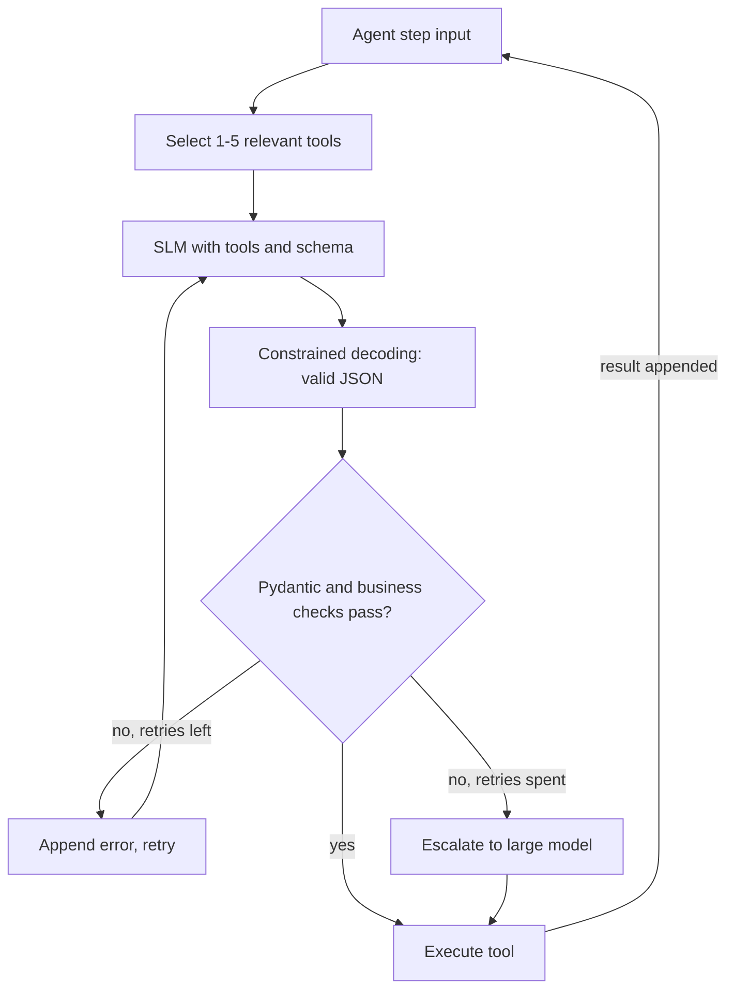

## TL;DR
Small models pick the wrong tool and break JSON more often than large ones. Make them reliable with
constrained decoding for syntax, schema validation with retry for meaning, small tool sets with flat
schemas, and escalation to a larger model when validation still fails.

## For agent builders
- **Why it matters for agents.** Every tool call is structured output: a tool name plus arguments that must
  parse and validate, so per-call errors of a 3B-8B model compound across a task.
- **Where it shows up in your stack.** Ollama's `tools` and `format`, llama.cpp's `--jinja` and JSON-schema
  grammars, vLLM's tool parsers and structured outputs, and Pydantic or Instructor on the client side.
- **What you control.** How many tools the model sees, the schema shape, whether decoding is constrained,
  the validator, the retry budget and the fallback model.
- **What you can skip.** How grammars compile into token masks
  (`serving-inference/structured-constrained-generation`); here you apply them.

## Why it exists
- **SLMs drift from formats.** Missing braces, extra prose around JSON, or tool calls written as text in
  `content` appear far more often at 1B-8B than with frontier models, and more after aggressive quantization.
- **Errors compound across steps.** At 95% per call, six calls succeed together only about 74% of the time
  (0.95 to the 6th power), so per-call reliability decides task success.
- **Prompting alone is not enough.** "Reply only with JSON" lowers the error rate but cannot guarantee it;
  constrained decoding can guarantee syntax.
- **Syntax is not correctness.** A perfectly valid call can still name the wrong tool or invent an ID, so
  validation and checks against real data remain necessary.

## How it works
### Layer 1: native tool calling through the chat template
1. You pass tool definitions as JSON Schema (`tools=[...]`).
2. The engine renders them into the prompt with the model's chat template, the format the model was trained on.
3. The model emits its tool-call tokens; the engine's parser turns them into `tool_calls` with a name and
   arguments. In llama.cpp this needs `--jinja`; in vLLM, `--enable-auto-tool-choice` and a matching
   `--tool-call-parser`.

### Layer 2: constrained decoding for guaranteed syntax
- **How:** the engine masks tokens at every step so only output matching a JSON schema or grammar can be
  produced.
- **Where:** Ollama's `format` parameter accepts a JSON schema; llama.cpp server accepts a JSON schema or a
  GBNF grammar; vLLM supports JSON-schema `response_format` and further structured-output options (check the
  current docs for names, which have changed between versions).
- **What it guarantees:** parseable output with required fields, types and enum values. Not that values are
  true.

### Layer 3: validate, retry, escalate
1. **Validate** with Pydantic: types, enums, ranges, and business checks such as "order ID exists".
2. **Retry once or twice** with the validation error appended, because SLMs often fix a specific, named error.
3. **Escalate** to a larger model when retries fail, and log the case for the eval set.

### Designing tools for small models
| Choice | For SLMs, prefer | Because |
|---|---|---|
| Tool count per step | 1-5 relevant tools, chosen by a router or retrieval | Selection accuracy drops as the list grows |
| Schema shape | Flat objects, few required fields | Nested objects and arrays are where small models slip |
| Value types | Enums and constrained strings | Free text invites invented values |
| Descriptions | One short, specific sentence per tool and field | Long descriptions consume context and blur choices |
| Hard steps | Two stages: choose the tool, then fill its arguments | Each stage is a smaller decision |
| Examples | One or two worked calls in the system prompt | Small models imitate examples closely |

## Diagram
One tool-call step: the schema constrains syntax, the validator checks meaning, the fallback catches what the
SLM cannot fix.



## Misconceptions
- **"Constrained decoding makes small-model tool calls reliable."** It guarantees output that parses and
  matches the schema, not the right tool or true values. In the worked scenario it took syntax to 100%
  but correct calls only from 78% to 81%; narrowing tools and validating against real data did the rest.
- **"95% per call is good enough."** Per-call errors multiply across a task: six calls at 0.95 succeed
  together about 74% of the time. Reliability targets belong per call, sized from the number of calls.
- **"Richer tool descriptions help a small model choose."** Long descriptions eat context and blur the
  choice, and accuracy falls as the tool list grows. Show 1-5 relevant tools per step, with one short
  sentence each.
- **"Tool calls arriving as text mean the model cannot call tools."** Usually the engine is not using the
  model's tool format: llama.cpp without `--jinja`, or vLLM without auto tool choice and a matching
  `--tool-call-parser`. Fix the configuration before switching models.
- **"Just retry until it validates."** At temperature 0 the same prompt usually gives the same output, so a retry
  only helps when the validation error is appended. Each retry is a full call; after one or two, escalate.
- **"Forcing JSON from the first token costs nothing."** It can lower quality on steps that need
  reasoning. Add a short reasoning field before the answer fields, or reason in a separate call.

## Examples
### Worked scenario: making a 3B agent reliable
A field-service agent on a 3B model calls 12 tools. Rates per tool call on 200 golden cases (illustrative).

| Change | Valid syntax | Correct tool and args | Task success (5 calls) |
|---|---|---|---|
| Prompt "reply with JSON", all 12 tools | 90% | 78% | about 29% |
| + constrained decoding | 100% | 81% | about 35% |
| + router narrows to 3 tools, flat enum schemas | 100% | 91% | about 62% |
| + Pydantic checks, 1 retry, escalation on failure | 100% | 98% (2% escalated) | about 90% |

Constrained decoding alone fixed syntax but barely moved task success; tool narrowing and validation did
most of the work.

### Structured output from a local SLM with Ollama and Pydantic
Ollama's `format` takes a JSON schema and constrains decoding to it; Pydantic then checks meaning.

```python
# Run with ollama client 0.6.3 and Pydantic 2.14 against a mock server (`X | None` needs Python 3.10+).
from typing import Literal
from pydantic import BaseModel, Field, ValidationError
import ollama

class RefundRequest(BaseModel):
    order_id: str = Field(pattern=r"^ORD-\d{6}$")
    reason: Literal["damaged", "late", "wrong_item", "other"]
    amount_eur: float = Field(gt=0, le=500)

def extract(text: str, model: str = "qwen2.5:7b", retries: int = 2) -> RefundRequest | None:
    messages = [{"role": "system", "content": "Extract the refund request as JSON."},
                {"role": "user", "content": text}]
    for _ in range(retries + 1):
        r = ollama.chat(model=model, messages=messages,
                        format=RefundRequest.model_json_schema(), options={"temperature": 0})
        try:
            return RefundRequest.model_validate_json(r.message.content)
        except ValidationError as e:                  # bad JSON or a failed constraint
            messages += [{"role": "assistant", "content": r.message.content},
                         {"role": "user", "content": f"Fix these errors and reply again: {e}"}]
    return None                                       # caller escalates to a larger model

print(extract("Order ORD-123456 arrived smashed, please refund the 89.90 EUR."))
```

### Two-stage tool calling with escalation
With 20 tools, an SLM first picks the tool from an enum, then fills only that tool's schema. Both calls use
JSON-schema `response_format` on an OpenAI-compatible server; support varies by engine and version.

```python
# Run with openai 3.37 (Python SDK) against a mock OpenAI-compatible server.
import json, re
from openai import OpenAI

slm, big = OpenAI(base_url="http://localhost:8000/v1", api_key="x"), OpenAI()
ORDER = {"type": "string", "pattern": r"^ORD-\d{6}$"}
TOOLS = {   # name -> flat JSON schema for its arguments
    "lookup_order": {"type": "object", "required": ["order_id"], "properties": {"order_id": ORDER}},
    "cancel_order": {"type": "object", "required": ["order_id", "reason"], "properties": {
        "order_id": ORDER, "reason": {"type": "string", "enum": ["changed_mind", "late", "other"]}}},
    "update_address": {"type": "object", "required": ["order_id", "postcode"], "properties": {
        "order_id": ORDER, "postcode": {"type": "string"}}},
}
KNOWN_ORDERS = {"ORD-123456"}                        # stand-in for your order database

def validate_against_backend(tool, args):            # raise if IDs are unknown or not permitted
    if not re.fullmatch(r"ORD-\d{6}", args.get("order_id", "")) or args["order_id"] not in KNOWN_ORDERS:
        raise ValueError(f"unknown order for {tool}: {args.get('order_id')}")

def ask(client, model, prompt, schema):
    r = client.chat.completions.create(model=model, temperature=0,
        messages=[{"role": "user", "content": prompt}],
        response_format={"type": "json_schema", "json_schema": {"name": "out", "schema": schema}})
    return json.loads(r.choices[0].message.content)

def plan_call(request, model="Qwen/Qwen2.5-7B-Instruct"):
    pick = {"type": "object", "required": ["tool"],
            "properties": {"tool": {"type": "string", "enum": list(TOOLS)}}}
    tool = ask(slm, model, f"Which tool handles: {request}", pick)["tool"]
    prompt = f"Arguments for {tool} given: {request}"
    try:
        args = ask(slm, model, prompt, TOOLS[tool])
        validate_against_backend(tool, args)         # your checks: IDs exist, permissions
    except Exception:                                # bad JSON or failed checks: escalate
        args = ask(big, "YOUR_LARGE_MODEL", prompt, TOOLS[tool])
        validate_against_backend(tool, args)         # escalated output is checked too
    return tool, args

print(plan_call("Where is my order ORD-123456?"))
```

## Production patterns
- **Constrain everything the code parses.** Use Ollama `format`, llama.cpp JSON schema or vLLM structured
  outputs on every parsed SLM call. Invalid-output rate should be near zero; a rise means a config
  regression.
- **Validate against reality, not just the schema.** After Pydantic, check IDs exist, amounts are within
  limits and the user may act, before executing. Log rejected calls with the input for the eval set.
- **Budget retries and escalate.** Allow one or two retries with the validation error, then call a larger
  model. Alert when the escalation rate per tool passes the level priced into the cost model.
- **Narrow tools per step.** A router or embedding retrieval shows the SLM only the relevant few; track
  correct-tool rate per step in traces.
- **Gate changes on a tool-call golden set.** Re-run valid-call, correct-tool and argument-accuracy metrics
  when changing model, quantization, template, engine version or tool schemas.

## Trade-offs
- **Constrained decoding vs reasoning quality.** It guarantees syntax, but forcing JSON from the first token can
  reduce answer quality on harder steps. Add a short reasoning field first, or reason in a separate call.
- **Retries vs latency.** Each retry is a full SLM call; one usually fixes most errors, more rarely pay.
- **Two-stage calling vs call count.** Splitting tool choice and arguments improves accuracy but doubles calls
  for that step; it pays off with many tools, not with two.
- **Escalation vs privacy.** Falling back to a hosted large model rescues hard cases but sends that data out;
  for private data, escalate to a larger self-hosted model or to a human instead.

## Pitfalls
- **Trusting syntax as correctness.** Symptom: perfectly formatted calls with invented order IDs. Diagnose:
  check each argument of failed calls against the backend and count valid-but-wrong calls. Fix: business
  validation against real data before execution.
- **Exposing every tool every step.** Symptom: the SLM calls plausible but wrong tools. Diagnose: build an
  expected-versus-chosen tool table on the golden set. Fix: route or retrieve a small tool subset per step.
- **Mismatched template or parser.** Symptom: tool calls arrive as text in `content`. Diagnose: log raw
  `content` and `tool_calls` with the engine flags. Fix: `--jinja` in llama.cpp, the matching vLLM parser, a
  model whose template supports tools, or meanwhile constrained JSON with your own tool-call schema.
- **Deeply nested schemas.** Symptom: missing inner fields and wrong array shapes. Diagnose: group
  validation errors by field path. Fix: flatten, split into several calls, or let code assemble the nested
  structure.

## When to use
- **Use when** an SLM produces anything code consumes: tool calls, extraction results, routing labels,
  structured plans.
- **Avoid when** the output is free text for a human; constraining it adds nothing and may hurt quality.
- **Measure** valid-output rate, correct-tool rate, argument accuracy, retry rate and escalation rate per
  step.

## Exercise
**Goal:** build a validate, retry and escalate wrapper for one SLM tool step that never executes a bad
call. No solution is given.
- **Inputs:** a local 1B-4B instruct model, three tools with flat schemas, and 40 golden requests, 10 of
  them adversarial: unknown IDs, missing values, requests no tool handles.
- **Deliver:** a function returning the tool, its arguments and the path taken (first try, retry, escalated,
  rejected), logging every validation error.
- **Acceptance:** no unknown ID is ever executed; a request missing a required value ends in escalation or a
  clarifying question, never an invented value; you report the rate of each path and the retry fix rate.

## Role lens
- **Engineer:** Turns on constrained decoding, writes Pydantic models and business validators, and wires the
  retry and escalation path around each SLM tool call.
- **Architect:** Designs tool sets and schemas small models can handle, chooses where escalation goes under
  privacy constraints, and sets the reliability targets per step.
- **FDE:** Shows a customer that a local small model can call their APIs safely, with validation logs and
  golden-set numbers as proof.

## Check yourself
**Q:** A 4B model in your agent emits valid JSON every time thanks to constrained decoding, yet 1 in 8
tasks still fails at a tool call. What is going on and what do you change?
**A:** Constrained decoding guarantees syntax, not correctness: the model is likely choosing a wrong tool or
inventing or misreading argument values. Check failed traces to see which. Then narrow the tools shown per
step with a router, flatten schemas and use enums, add Pydantic and business validation against real data
(IDs exist, limits hold), retry once with the validation error, and escalate to a larger model when retries
fail. Measure correct-tool rate, argument accuracy and escalation rate on a golden set before and after, and
consider fine-tuning on logged tool calls if the gap persists.

## Interview questions
### What does constrained decoding guarantee for a small model, and what does it not?
- **Guarantees:** output that parses and matches the schema or grammar: required fields, types, enum values.
- **Does not guarantee:** the right tool, true values or a sensible plan; those need validation against real
  data and evals.
- **Watch:** forcing structure too early can hurt reasoning, so give hard steps a reasoning field or a
  separate call.

### How would you design tools for an agent that runs on a 3B model?
- **Few tools, simple schemas:** a router shows 1-5 relevant tools; flat objects, enums, short
  descriptions and one or two examples.
- **Safety net:** constrained decoding, Pydantic and business checks, one retry, then escalation.

### How do you decide between retrying the SLM and escalating to a large model?
- **Retry when** the error is specific and fixable, such as a wrong enum or a missing field; one retry with
  the error message usually works.
- **Escalate when** retries fail, the step needs reasoning the SLM lacks, or the input is out of
  distribution.
- **Measure both rates** per step; a high escalation rate means the step does not belong on the SLM yet.

### How would you measure tool-calling reliability before shipping an SLM agent?
- **Golden set of real requests** with the expected tool and arguments per step.
- **Metrics:** valid-call rate, correct-tool rate, argument accuracy, retry and escalation rates, and
  end-to-end task success, because per-call errors compound.
- **Re-run** on every model, quantization, template, engine or schema change.

## Quiz
### Q: What does constrained (grammar or JSON-schema) decoding guarantee for an SLM's tool calls?
- [ ] That the chosen tool is correct for the request
- [x] That the output parses and matches the schema's structure, types and enum values
- [ ] That argument values exist in your database
- [ ] That the model will never need a retry
> Token masking only allows outputs the schema permits, so syntax is guaranteed. Whether the tool and values
> are right still needs validation against real data and evals.

### Q: A 3B agent sees 25 tools and often calls plausible but wrong ones. Which change helps most?
- [ ] Raising the temperature
- [ ] Adding longer descriptions to every tool
- [x] Showing only the few tools relevant to the current step, chosen by a router or retrieval
- [ ] Removing the JSON schema from the tools
> Small models' tool-selection accuracy drops as the list grows. Narrowing the candidate set per step makes
> each choice smaller and is usually the biggest single gain.

### Q: Why can per-call reliability of 95% be too low for an agent?
- [ ] Because 95% means the model is too large
- [x] Because errors compound: over six calls the task succeeds only about 74% of the time
- [ ] Because tool calls are always retried six times
- [ ] Because constrained decoding lowers it further
> Independent per-call success multiplies across the steps of a task, so 0.95 to the 6th power is about
> 0.74. Validation, retries and escalation raise per-call reliability to make long tasks viable.

## Mastery test
**Problem:** an offline phone assistant uses a 1.5B model to fill `create_event` with nested attendees
(name, email), start, end and a recurrence object. Constrained decoding gives 100% valid JSON, yet 20% of
events have wrong times or missing attendees, and there is no network to escalate. What do you change?

**A strong answer:**
- names it as meaning, not syntax: add checks such as end after start, a timezone, attendees in contacts;
- flattens: attendees chosen from an enum of contacts, times as separate fields, code builds the nested
  object and resolves the timezone;
- retries once with the error, then asks the user to confirm, and tracks per-field accuracy.

## Use cases & projects
### Use cases
- **Local assistants calling internal APIs.** A small on-premises model fills arguments for ticketing, CRM
  or inventory tools with schema-constrained output.
- **Extraction pipelines.** SLMs turn emails, forms and invoices into validated records at high volume.
- **Routers and dispatchers.** An SLM chooses the next tool or sub-agent from an enum, with a large model
  handling escalations.
- **On-device actions.** Mobile or desktop agents map user requests to app functions with a small model and
  strict schemas.

### Mini project
**Harden a small-model tool caller (2-3 hours).**
- **Goal:** take a 3B-8B local model from naive tool calling to a validated, escalating tool caller and
  measure each step's gain.
- **Steps:** define 8-10 tools for a toy domain and a 50-case golden set of requests with expected tool and
  arguments; run the baseline with all tools and prompt-only JSON; add constrained decoding; add tool
  narrowing; add Pydantic and business checks with one retry and escalation to a larger model.
- **Done when:** a table like the worked scenario shows valid-call, correct-tool, argument-accuracy and
  escalation rates after each layer, with traces for the remaining failures.
