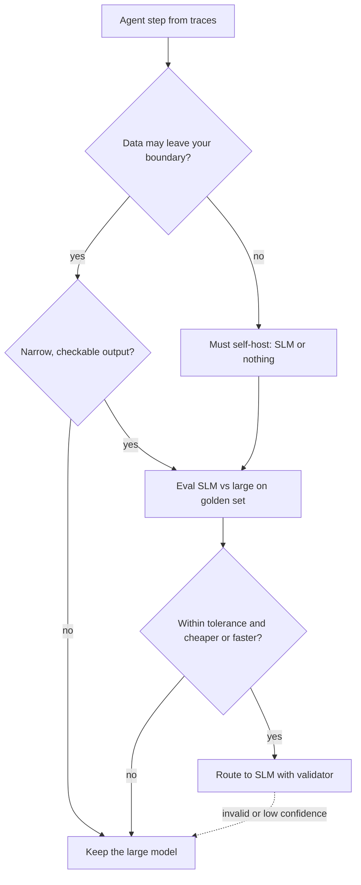

## TL;DR
A small language model (roughly 0.5B to 14B parameters) is enough for an agent step when the step is narrow,
its output is checkable, and your own eval shows it passes. Decide per step on task fit, cost, latency and
privacy, never per agent.

## For agent builders
- **Why it matters for agents.** An agent makes many model calls per task: routing, extraction, tool-argument
  filling, summarising tool output, final answer. Most of them are narrow, and paying frontier prices for all
  of them is the usual reason an agent is too slow or too expensive to ship.
- **Where it shows up in your stack.** A second model entry in your gateway or LiteLLM config, a local
  endpoint (Ollama, llama.cpp, vLLM) for private data, and a router that sends easy steps small and hard
  steps large.
- **What you control.** Which steps go small, the acceptance threshold per step, the fallback when the SLM
  fails validation, and the eval set that proves it.
- **What you can skip.** Leaderboard debates; your traces and golden set decide.

## Why it exists
- **Agents multiply calls.** A 10-step agent with a planner, tool calls and a summariser can make 15-30 model
  calls per task. A per-call price gap of 10x or more between a small self-hosted or budget model and a
  frontier model becomes the whole margin (illustrative orders of magnitude; check current pricing).
- **Latency compounds.** Sequential steps add up. A small model decodes faster and can run next to the tools,
  so a chain of five classification or extraction calls stops dominating time to answer.
- **Some data cannot leave.** Health records, source code under contract, or on-premises customer data rule
  out a hosted API. A model you run yourself is the only option, and only small ones fit the hardware.
- **"Always use the biggest model" fails quietly.** It works in the demo; then cost per task and p95
  latency block rollout, and teams downgrade blindly, not per step with evidence.

## How it works
### The four questions, per step
| Question | SLM is a good fit when | SLM is a poor fit when |
|---|---|---|
| **Task fit** | Output is a label, a short extraction, a fixed JSON shape, or a choice among few tools | Open-ended planning, multi-hop reasoning, long-horizon recovery from errors |
| **Cost** | High volume of similar calls; you can amortise a GPU or use a cheap endpoint | Low volume, where a hosted large model costs less than running any server |
| **Latency** | The step is on the critical path and needs fast, local responses | Latency is dominated by tools or humans anyway |
| **Privacy** | Data must stay on device, on premises or in a region you control | The data is already allowed to go to a vetted hosted provider |

### What makes a step "narrow"
1. **Bounded output.** An enum, a schema, or a span copied from the input, so a validator can check it.
2. **Knowledge comes from context.** The answer is in the prompt or the retrieved chunk, not in the model's
   memory, because small models store far fewer facts and hallucinate them confidently.
3. **Few choices.** A router over 3-8 intents or a step with 1-5 tools, because tool-selection accuracy of
   small models drops faster than large ones as the tool list grows.
4. **Short reasoning.** One or two inferential hops, not a plan with backtracking.

### The decision procedure
1. **Log real traces** and group the calls by step type (router, extractor, tool filler, summariser, planner).
2. **Build a golden set per step**: 50-200 real inputs with expected outputs or a checker.
3. **Run a small candidate and the current large model** on the same set, with the same prompt and
   validation.
4. **Accept the SLM for a step** when its pass rate is within your tolerance of the large model (say within
   2-3 points) and cost or latency improves enough to matter.
5. **Keep a fallback**: on schema failure or low confidence, escalate that call to the large model.

## Diagram
Read it top to bottom for one agent step: hard constraints first, then evidence from your own eval, then a
fallback so a wrong "yes" is cheap.



## Examples
### Per-step eval: is the SLM good enough for the router step?
Both models sit behind OpenAI-compatible endpoints (here Ollama locally and any hosted model), so one
harness compares them. Replace the model names with your candidates.

```python
# Run with openai 3.37 (Python SDK) on Python 3.12 against a mock server; any OpenAI-compatible server works.
import json
from openai import OpenAI

slm = OpenAI(base_url="http://localhost:11434/v1", api_key="ollama")  # Ollama's OpenAI-compatible API
big = OpenAI()                                                          # hosted model, key from env
INTENTS = ["billing", "bug_report", "account_access", "other"]
PROMPT = f"Classify the ticket into one of {INTENTS}. Reply with the label only."

def label(client, model, text):
    r = client.chat.completions.create(model=model, temperature=0, messages=[
        {"role": "system", "content": PROMPT}, {"role": "user", "content": text}])
    return r.choices[0].message.content.strip().strip(".").lower()   # tolerate "Billing."

def pass_rate(client, model, cases):
    ok = sum(label(client, model, c["text"]) == c["expected"] for c in cases)
    return ok / len(cases)

cases = [json.loads(l) for l in open("router_golden.jsonl")]   # {"text": ..., "expected": ...}
small, large = pass_rate(slm, "qwen2.5:3b", cases), pass_rate(big, "YOUR_LARGE_MODEL", cases)
print(f"SLM {small:.1%}  large {large:.1%}")
print("route to SLM" if large - small <= 0.03 else "keep large model for this step")
```

### Worked scenario: a support agent, step by step
A support agent makes five kinds of calls per ticket. The team ran each step's golden set on a 3B-8B model
and on their frontier model (figures are illustrative of the shape, not benchmarks).

| Step | Calls per ticket | SLM pass vs large | Decision |
|---|---|---|---|
| Intent router (4 labels) | 1 | 97% vs 98% | SLM |
| Extract order ID and email | 1 | 99% vs 99% | SLM, schema-validated |
| Fill `lookup_order` arguments | 2 | 95% vs 98% | SLM with fallback on invalid JSON |
| Summarise tool output for the user | 1 | 90% vs 96% (judge-rated) | Keep large |
| Multi-step refund policy reasoning | 1 | 71% vs 93% | Keep large |

Four of six calls move small. If small calls cost a tenth of large ones, model spend per ticket falls by
roughly 60%, while the two hardest calls keep frontier quality.

## Production patterns
- **Split by step, not by agent.** Tag every model call in traces with a step name, then make the SLM decision
  per tag. Monitor pass rate and escalation rate per step on a dashboard, because one agent usually has both
  SLM-friendly and SLM-hostile steps.
- **Validate, then escalate.** Wrap SLM steps in a schema or enum check; on failure, retry once and then call
  the large model. Alert when the escalation rate for a step rises above the rate you priced in.
- **Gate with a golden set in CI.** Re-run each step's golden set when the prompt, model or quantization
  changes; block the change if the pass rate drops beyond tolerance.
- **Price the server, not the token.** For self-hosting, compute cost per task from GPU hours at real
  utilisation. Below some volume, a mostly idle dedicated GPU costs more per task than a hosted small or
  large model.
- **Keep private steps local by policy.** Mark steps that touch regulated fields and route them only to
  self-hosted models, enforced in the gateway rather than by convention.

## Trade-offs
- **Cost and latency vs headroom.** An SLM is cheaper and faster on the steps it passes, but has less
  margin for unexpected inputs. This flips when input distribution drifts, so monitor escalation rate.
- **Privacy vs operations.** Self-hosting keeps data in your boundary, but you now own GPUs, upgrades,
  scaling and on-call. For low volume a hosted provider with the right data agreement may be the better call.
- **More models vs simpler system.** Per-step routing saves money but adds a second model to evaluate,
  version and monitor. With only a few hundred tasks a day, one large model may cost less in engineering time.
- **Fine-tuned SLM vs prompted SLM.** Fine-tuning can close the gap on a narrow step but adds a training
  pipeline and retraining on every schema change.

## Pitfalls
- **Deciding from a public benchmark.** Symptom: the SLM looks strong on paper and fails on your tickets.
  Diagnose: run both models on a golden set from your traces and group failures by input type. Fix: decide
  only from that set.
- **Asking the SLM to recall facts.** Symptom: confident wrong answers about policies or products. Diagnose:
  for each failure, check whether the fact was in the prompt. Fix: put facts in context through retrieval,
  or keep that step large.
- **Moving the planner first.** Symptom: loops, wrong tool order and giving up early. Diagnose: compare
  steps per task, repeated tool calls and early stops before and after the swap. Fix: move leaf steps
  (classify, extract, fill arguments) first; the planner goes small last.
- **Ignoring the fallback cost.** Symptom: savings vanish because 30% of calls escalate. Diagnose: log
  escalations per step and price each escalated call as small plus large. Fix: route only steps where the
  rate stays low.

## When to use
- **Use when** a step has a bounded, checkable output, high volume, a latency budget, or data that must stay
  in your boundary.
- **Avoid when** the step needs open-ended planning, broad world knowledge, or long tool lists, or when volume
  is too low to justify any extra model.
- **Measure** pass rate per step against the large model, escalation rate, cost per task and p95 latency.

## Exercise
**Goal:** estimate, before building, which steps of one agent should move to an SLM and the saving. No
solution is given.
- **Inputs:** 100+ traced runs (yours or synthetic) with calls tagged by step and tokens; prices for a large
  and a small model; an assumed escalation rate per step.
- **Deliver:** a script printing cost per task for all-large and for your routing, counting escalated calls
  twice, plus GPU cost at realistic utilisation and the break-even daily volume if you self-host.
- **Acceptance:** one step's cost reproduced by hand; you can state the escalation rate at which each
  step's saving reaches zero; break-even volume rises when GPU cost doubles.

## Role lens
- **Engineer:** Tags model calls by step, builds the per-step golden sets, and wires the validator and
  escalation path that makes an SLM safe to use.
- **Architect:** Decides which steps may leave the data boundary, sets the acceptance tolerance per step, and
  owns the cost model that compares self-hosted SLMs with hosted models at real volume.
- **FDE:** Explains to a customer with on-premises data which agent steps can run locally on a small model
  and which need a vetted hosted model, with eval numbers as evidence.

## Check yourself
**Q:** Your agent spends most of its budget on a frontier model. Its calls are: an intent router, an
entity extractor, tool-argument filling, and a planner that chooses among 25 tools. Which would you move to an
SLM first, and how would you prove it is safe?
**A:** Move the router and the extractor first, then tool-argument filling, because they have bounded outputs
that a validator can check and they usually dominate call volume. Keep the planner on the large model: 25
tools and multi-step choices are where small models degrade most. Prove it per step: build a golden set from
real traces, run the SLM and the large model on it with the same prompt, and accept the SLM only within a set
tolerance. Ship with schema validation and escalation to the large model, then monitor escalation rate and
cost per task, because a high escalation rate erases the savings.

## Interview questions
### How do you decide whether a small model is good enough for an agent step?
- **Characterise the step first.** Bounded output, knowledge in context, few choices and short reasoning
  make it a candidate; open planning and fact recall do not.
- **Then measure on your data.** Run the SLM and the incumbent on a golden set built from production traces
  and accept within a stated tolerance.
- **Ship it with a fallback** so a wrong decision costs an escalation, not a user-facing error.

### A customer cannot send data to a hosted API. How does that change your agent design?
- **Every model call must run in their boundary,** so model size is capped by the hardware they provide,
  which usually means 3B-14B models, quantized.
- **Narrow the steps** to suit small models: retrieval for facts, fewer tools per step, schema-constrained
  output, and deterministic code wherever a model is not needed.
- **Eval on their data on site** before promising quality, since the gap to a frontier model varies by task.

### When would you not use an SLM even though it is cheaper per token?
- **Low volume or high escalation.** An idle GPU, or 30% of calls retried on the large model, erases the
  saving.
- **Hard steps.** Planning over many tools or long-horizon recovery fails tasks, costing more than tokens.

### Your SLM router passed the eval but production escalations doubled after a month. What happened?
- **Likely drift:** new products, intents or phrasing absent from the golden set; check the escalated inputs.
- **Fix the loop:** sample escalated and low-confidence cases into the golden set, relabel, re-evaluate, and
  either update the prompt or fine-tune.
- **Guard it:** alert on escalation rate per step so the next drift is caught in days, not a month.

## Quiz
### Q: Which agent step is the best first candidate for a small language model?
- [ ] A planner that chooses among 30 tools and recovers from failed calls
- [x] An intent classifier that maps a ticket to one of five labels
- [ ] A step that answers product questions from the model's own knowledge
- [ ] A final answer that must combine results from six different tools
> A five-label classifier has a bounded, checkable output, needs no recalled facts, and is usually high
> volume. Planning over many tools, fact recall and multi-source synthesis are where small models fall
> furthest behind.

### Q: What should decide whether an SLM replaces the large model for one step?
- [ ] Its average score on a public leaderboard
- [ ] Its parameter count relative to the large model
- [x] Its pass rate on a golden set from your own traces compared with the large model, within a set tolerance
- [ ] Whether it supports the same context window length
> Public benchmarks do not reflect your inputs, labels or tools. A per-step golden set run on both models
> with the same prompt and validator is the evidence that the swap is safe.

### Q: Why can moving steps to a self-hosted SLM fail to save money?
- [ ] Small models always use more tokens per answer
- [x] Low volume leaves the GPU idle and a high escalation rate means many calls are paid for twice
- [ ] Quantized models cannot run on GPUs
- [ ] Self-hosted models cannot use prompt caching
> Self-hosting has a fixed cost that only pays off at enough volume, and every call that fails validation
> and escalates to the large model costs both the small and the large call.

## Mastery test
**Problem:** a law firm's contract-review agent may not send documents outside its network; volume is about
300 contracts a day. Steps: a 12-label clause classifier, party and date extraction, case-law answers from
model memory, and a summary for the partner. Which steps go small, and what do you change?

**A strong answer:**
- sees privacy forces every step self-hosted, so volume no longer decides; the question is size and design
  per step;
- moves classifier and extraction small with validators, evals the 12 labels one by one (above the 3-8 sweet
  spot), and replaces memory recall with retrieval over the firm's sources;
- keeps the summary on the largest self-hosted model, judge-rated; escalation stays inside the boundary
  (bigger model or human).

## Use cases & projects
### Use cases
- **Support and triage agents.** Routing, entity extraction and tool-argument filling run on an SLM, while
  policy reasoning and customer-facing replies stay on a large model.
- **Regulated data.** Hospitals, banks and legal teams run every agent step on a self-hosted small model
  because records cannot leave their network.
- **High-volume back-office extraction.** Invoice, form and email extraction agents process thousands of
  documents a day where per-call cost decides feasibility.
- **Latency-critical steps.** Voice and in-product assistants use a local SLM for intent and slot filling to
  answer fast.

### Mini project
**Per-step SLM audit of an existing agent (2-3 hours).**
- **Goal:** decide, with evidence, which steps of one of your agents can run on a small model.
- **Steps:** log 100 runs of an agent and tag each model call by step; build a 50-case golden set for the two
  highest-volume steps; run a local 3B-8B model via Ollama and your current large model on both sets with the
  same prompt and validator; compute pass rate, p50 latency and cost per task for each.
- **Done when:** you have a table per step with pass rates, the tolerance you chose, a route-small or
  keep-large decision, and an estimate of savings including escalation cost.
