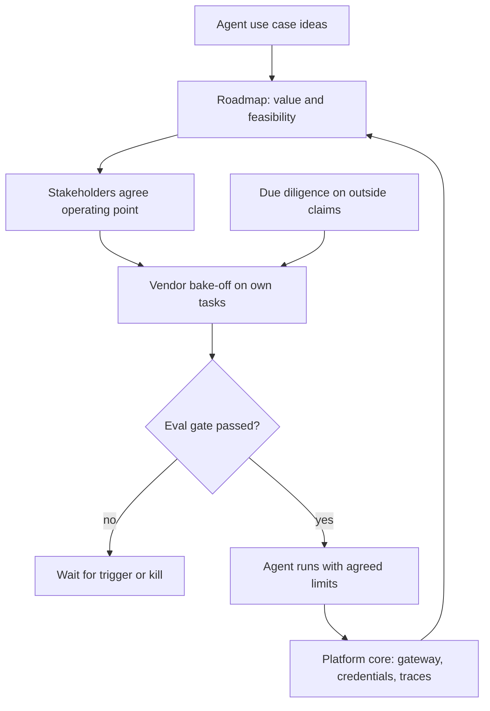

## Overview
This module covers the decisions that sit above any single agent. Which use cases do you pursue, and
in what order? Who has to agree before building starts? Which vendors do you depend on? What should
be provided once as a shared platform? Do the AI claims behind a deal hold up?

The thread through all five lessons is that AI feasibility is an empirical question. Every strategic
commitment should be gated on an eval, not on a demo or a slide. For an agent builder, that means
your agent eval is the evidence each decision rests on.

- **AI roadmap:** a sequenced portfolio of use cases treated as hypotheses. Each is scored separately on value and on feasibility (data readiness, evaluability, error tolerance, risk class, integration effort), then moved through evidence gates from feasibility eval to pilot to production.
- **Stakeholder alignment:** turns the conflicting goals of operations, compliance, finance and security into one agreed operating point on a measured trade-off curve. It is set against a human baseline and written on one page.
- **Vendor evaluation:** the comparative method. Hard gates come first, then a bake-off on your own labelled data measuring quality, latency under load and cost per successful task, then exit terms.
- **Platform strategy:** decides which recurring capabilities to centralise, using breadth of demand, variance between teams and externalities. It also decides when: after demand appears, as a thin mandatory core plus an optional paved road.
- **Technical due diligence:** applies the same habit of turning claims into tests to an acquisition, investment or critical partner.

**Core versus background for agent builders:**

- **Core:** none of these lessons is marked core. Nothing here sits inside the agent loop itself.
- **Useful (3 lessons):** ai-roadmap, vendor-evaluation and platform-strategy. You meet them when choosing which agent to build first, which model sits behind its loop, and whether its gateway, tool credentials and traces come from a shared core.
- **Background (2 lessons):** stakeholder-alignment and technical-due-diligence. Recognise what goes on the one-pager and the three finding classes, and you can build exactly what they ask for.

**What you can build afterwards:**

- **A defensible roadmap:** build and defend one, with an autonomy level and eval gate per row.
- **A launch decision without a late veto:** run one from an agreed operating point.
- **A vendor choice on evidence:** select a vendor from a re-runnable bake-off.
- **A platform boundary argued with numbers:** draw it and justify it.
- **A diligence findings list:** write one for an agent company.

It matters most for Architects and FDEs, and for Engineers moving into technical leadership.

## Why it matters
- **Engineer:** You build the feasibility evals, bake-off harnesses and cost-per-item models that the roadmap gates, vendor choice and launch decision actually rest on, report agent results as completion rate, cost per task and tool-error rate, and can say plainly when an agent use case should be killed or parked until a new model ships.
- **Architect:** You draw the platform boundary for agents (gateway, identity, budgets, audit, telemetry in the mandatory core; prompts, corpora and agents left with teams), sequence the portfolio so early agents build reusable assets such as the tool layer and eval harness, and keep vendor seams so decisions stay reversible as the model market moves.
- **FDE:** You get the customer's business owner, compliance, security and finance to agree an operating point, the approval-gated actions and decision rights before building the agent, run the vendor bake-off on their own data, and present results against the one-pager at each gate so sign-off does not stall in pilot purgatory.

## Mental model
Hold one picture: AI strategy is portfolio management under uncertainty. Every bet is bought with
information before it is bought with engineering.

| Idea | What it means for your agent |
|---|---|
| Use case as hypothesis | Each has a value range and a weakest feasibility axis; an eval on real data is the cheap experiment that resolves it |
| Gates set in advance | They decide whether a bet advances, waits for a capability trigger, or is killed |
| Stakeholder alignment | Fixes what "advance" means: an operating point on a trade-off curve, measured against today's human baseline, with named decision owners |
| Vendor evaluation and due diligence | The same experiment pointed outward: do not trust the claim, test it on your data and price the exit |
| Platform strategy | What the portfolio leaves behind: shared parts several bets needed, with little variance and organisation-wide risk, pulled into a thin core once demand exists |

- **The rule:** if a commitment does not have an evidence gate and an owner, it is not yet strategy.
- **The agent twist:** agreed limits become config your agent enforces, and vendor properties are multiplied by step count.

Ideas enter the roadmap and only reach production through an eval gate. Agreed limits become the
running agent's config, and the shared parts it needed feed the platform core for the next agents.

## Suggested order
1. ai-roadmap — useful for agents; sets the portfolio frame, value-versus-feasibility scoring and stage gates that every other lesson plugs into.
2. vendor-evaluation — useful for agents; teaches the gates-then-bake-off method on your own data, the core skill for each build, buy or wait decision on the roadmap and for picking the model behind your agent loop.
3. platform-strategy — useful for agents; builds on roadmap sequencing and vendor sourcing to decide what to centralise, when, and how to fund it.
4. stakeholder-alignment — background; defines the agreed operating point, baseline and decision rights that a roadmap gate needs before anyone can say yes.
5. technical-due-diligence — background and advanced; extends vendor evaluation's claim-to-test discipline to deals, data rights and margin models.

## Capstone
### Brief
**Use case:** a mid-sized insurer (fictional, with synthetic or public data) wants its first
production claims-triage agent. This is the module's major project, planned for several days.

The insurer has collected fifteen AI ideas from workshops. Two teams already call a model provider
with their own keys. A small claims-automation startup is being pitched as an acquisition. You are
the AI lead, and you produce a working, eval-gated agent component plus the strategy pack the
leadership team could decide from in one meeting.

- **Portfolio:** turn the ideas into workflow-level candidates. Score each on the value formula (volume, value per unit, capture rate, automation share, run and review cost) and on each feasibility axis separately. Sequence the next three quarters so early items build shared assets.
- **Alignment:** for the top item, write the stakeholder one-pager: baseline human error rate and cycle time, hard constraints kept apart from outcome goals, a trade-off curve from a small offline eval, the chosen operating point and the launch and pause owners.
- **Agent and bake-off:** build the triage agent behind a thin gateway. Run a light vendor bake-off for it between at least two model providers on 100 or more labelled synthetic cases.
- **Platform and diligence:** propose the platform core with a break-even estimate, and write a diligence plan and mock findings list for the acquisition target.

### Deliverables
- A portfolio sheet with one row per candidate: owner, value range, per-axis feasibility scores, build/buy/wait decision with a trigger for each "wait", current stage, autonomy level, gate criterion, kill condition and next decision date, plus a three-horizon sequence.
- A one-page stakeholder alignment document for the top use case, including the measured baseline on the same items the AI will handle, a confidence-threshold trade-off curve, the chosen operating point, failure handling and a RACI or DACI table.
- A working triage agent that calls models through a gateway with a model alias and per-team key, with the agreed escalation threshold, approval-gated actions and kill switch held in config, not code.
- A re-runnable vendor bake-off (script or notebook) and a short report: gate results, quality with confidence intervals, p95 latency at expected concurrency, cost per successful task, and priced exit terms.
- A platform proposal naming the mandatory core and the optional paved road, with the centralisation break-even worked through for at least three capabilities and a funding model.
- A diligence plan that turns each of the target's headline claims into a test, with a classified findings list (deal-breaker, price adjustment, post-close fix) and a usage-sensitive margin model.

### Rubric
- Feasibility is scored per axis and the weakest axis is named for every candidate; the top-value item is not first in the sequence unless its foundations already exist, and the reason is stated.
- Every roadmap stage, the launch decision and each "wait" item has a pre-agreed numeric criterion or trigger, and at least one candidate is killed or parked on evidence.
- The alignment one-pager compares the AI's error on its automated slice with the human error on that same slice, and a reviewer can make the launch call from the one-pager and the eval without new negotiation.
- Changing the escalation threshold or the model alias in config changes the agent's behaviour with no code edit, and the trace shows team and feature tags on every request.
- Vendors are compared on cost per successful task (retries and review included), not list price, and the bake-off re-runs from one command when a new model is added.
- The platform core is justified by externalities or the break-even inequality, at least one capability is deliberately left with teams, and each diligence claim maps to a concrete test with a named finding class.
