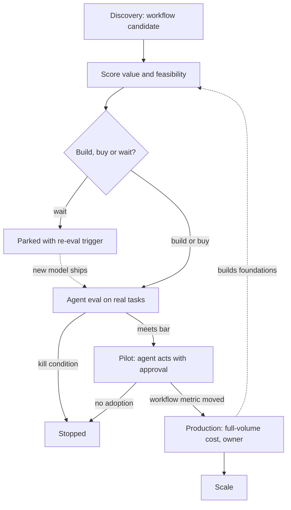

## TL;DR
An AI roadmap for agents sequences agent use cases, each a hypothesis with an eval gate, plus the shared
capabilities early agents build for later ones. It commits to outcomes, milestones and earned autonomy,
not to named models or dates for everything.

## For agent builders
- **Why it matters for agents.** The roadmap decides which agent you build first, how much autonomy it
  starts with, and which shared pieces (model gateway, tool layer, eval harness, approval UI) it must
  leave behind. A badly sequenced roadmap means every agent team rebuilds its own tool wrappers and evals.
- **Where it shows up in your stack.** As gate criteria you must meet: a task-completion bar on an
  offline agent eval, a cost per task at production volume, and an autonomy level (draft, act with
  approval, act alone) written into the roadmap row.
- **What you control.** How fast you turn a roadmap row into a re-runnable agent eval on real tasks, and
  reporting results in the gate's terms (completion rate, cost per task, tool-error rate) so go or stop is
  obvious.
- **What you can skip.** Portfolio-finance detail and long-horizon theme planning; know the value formula,
  the feasibility axes and the gate idea well enough to argue for or against an agent project.

## Decision case
### Scenario
A B2B software company's operations group wants its first agents in production within two quarters. All
figures are illustrative planning numbers, not benchmarks.
- **Team:** 4 engineers for 26 weeks, so 4 × 26 = 104 engineer-weeks (ew), or 52 per quarter.
- **Candidates, valued with the roadmap formula** (volume × value per unit × capture × automation share −
  run and review cost):
  - **Ticket triage agent:** tags and routes 50,000 tickets a year through an existing ticket API;
    50,000 × $1.50 × 0.6 × 0.7 − ($2,000 run + $5,000 review) = $24,500 a year. Every action is reversible.
  - **Invoice-dispute agent:** 6,000 disputes a year, $30 handling saved each, automation share 0.5;
    180,000 × 0.6 × 0.5 − ($1,800 + $12,000) = $40,200. It issues credits, which are irreversible, and no
    credit API exists yet. Finance experts often disagree on the right credit, so evaluability is low.
  - **Call-summary agent:** writes CRM notes; 20,000 × $1.00 × 0.5 × 0.8 − ($400 + $2,000) = $5,600.
- **Effort estimates:** gateway 6 ew, eval harness 8, tool layer 6, approval UI 8, credit API 16; agents:
  triage 12, disputes 20, summaries 8; a 300-case dispute feasibility eval 6.
- **Constraints:** compliance forbids credits without a human approval; the board wants one agent live
  by month 6; nobody can be hired this half.

### Options
| Option | How it works | Effort vs 104 ew | Live by month 6 | Compliance |
|---|---|---|---|---|
| Flagship first | Build everything the dispute agent needs (gateway, harness, tool layer, approval UI, credit API) and ship it | 6 + 8 + 6 + 8 + 16 + 20 = 64 | Only if the feasibility eval passes; nothing else ships | Fits only with approval on every credit |
| All three in parallel | Three streams, each building its own plumbing | (20 + 12) + (20 + 8) + (20 + 8 + 16 + 20) = 124 | No: over capacity by 20 ew | Same as flagship |
| Sequenced with gates | Q1: shared foundations + triage (38 ew, including the dispute feasibility eval); Q2: approval UI, credit API and dispute agent in act-with-approval mode (44 ew); summaries parked | 38 + 44 = 82 | Yes: triage live in Q1 | Credits always approved by a human |

### Decision
**Sequenced with gates.** It is the only option that fits 104 ew with headroom (22 ew), ships an agent
before month 6 whatever the dispute eval says, and leaves the gateway, harness and tool layer the dispute
agent reuses.

The higher-value dispute agent goes second because two of its blockers, low evaluability and
a missing credit API, are exactly what the feasibility eval and Q2 work are meant to resolve.
- **The dispute row's gate is written now:** proceed to build in Q2 if the 300-case eval meets the agreed
  credit-accuracy bar; stop after two iterations below it.
- **Summaries are "wait" with a trigger:** re-score when triage's tool layer covers the CRM.

**What would change it.**
- **The dispute eval fails twice:** park disputes and spend Q2 on summaries (8 ew) plus hardening triage.
- **A credit API already existed:** 16 ew disappear, and the dispute agent could start in Q1 beside triage.
- **Triage's cost per task at full volume rose from $0.04 to $0.14:** run cost becomes $7,000 and its value
  falls to $19,500, still positive, so the order holds.

### Trade-offs accepted
- **Headline value arrives later.** The $40,200 item waits a quarter; watch the dispute eval's result date
  so the delay buys information, not drift.
- **Credits stay human-approved in Q2.** Expect a queue; track approvals per day and reviewer edit rate as
  evidence for the next autonomy rung.
- **Summaries may never ship.** Accept it while their value is $5,600; check the re-score trigger quarterly.

### Review rubric
- **Value computed, not asserted:** each candidate's annual value is derived from the formula with stated
  inputs, and the arithmetic checks.
- **Capacity checked per option:** engineer-weeks are summed against the team's real capacity.
- **Foundations counted once:** the plan shows which shared pieces each agent reuses.
- **Autonomy tied to reversibility:** irreversible actions start at draft or act-with-approval.
- **Gates pre-registered:** each row has a pass bar, eval size and kill condition before work starts.
- **Reversal triggers named:** the write-up says which result or estimate would reorder the plan.

## Why it exists
- **AI projects fail on data, evaluation and adoption, not models.** The roadmap schedules those
  constraints explicitly, because they are what actually stalls a use case. Agents add two more: whether
  the tools (APIs with the right scopes) exist, and what a wrong action costs.
- **The naive plan is a list.** Twenty workshop ideas, each championed by someone, none compared on the
  same terms; the most exciting ones are staffed in parallel with promised dates.
- **Three things then go wrong.**
  - The exciting ideas often have the least ready data or the highest risk (customer-facing, regulated
    decisions), so they stall in pilot.
  - Every team rebuilds the same plumbing (model access, document ingestion, an eval set, logging), so
    the fifth project costs as much as the first.
  - The plan is pinned to one model or vendor; when capability or pricing moves a few months later, half
    the plan is obsolete and the other half solved problems a new model now handles out of the box.
- **A feature roadmap does not transfer.** In normal software, built to spec means it works. In AI you
  can build exactly as designed and still be right only some of the time, which is not enough for the
  workflow. Feasibility is an empirical question answered by an eval on real data.
- **So schedule *finding out* before *scaling*.** Otherwise the organisation discovers in month nine that
  a flagship use case cannot clear the accuracy bar, and the credibility loss poisons the next proposal.

## How it works
### 1. Build the candidate list from workflows, not technology
- **Each candidate is a workflow step** with an owner, a volume, a current cost or cycle time, and a user
  who would act on the output.
- **Example framing:** "triage inbound claims emails into twelve queues", not "use GenAI in claims".
- **Why:** value, baseline and adoption can only be measured on a workflow.
- **Source:** use-case discovery (see the scoping module) produces the list; the roadmap is what you do
  with it.

### 2. Score on value and on feasibility separately
Value is a small formula, not an adjective:

```
annual value ≈ volume × value per unit × capture rate × automation share − (run cost + review cost)
```

- **Capture rate is the part people skip.** Hours "freed" are worth nothing unless someone redeploys
  them or a cost line actually moves.
- **Automation share is unknown until the feasibility eval.** It is how much volume the system handles at
  an acceptable error rate, so early value scores are ranges.
- **Run cost is at production volume, not pilot volume.** A use case valuable at $0.02 per item can be
  uneconomic at $0.50.

Feasibility has independent axes, scored separately *because* a single gut-feel number hides which one
will kill the project:

| Axis | Question |
|---|---|
| **Data readiness** | Does the input data exist, can you legally use it, can you get access this quarter? |
| **Evaluability** | Can you build a labelled set and define "correct"? If experts disagree on the answer, you cannot prove the system works. |
| **Error tolerance** | What does a wrong output cost, and is there a human checkpoint? Drafting with review tolerates errors that autonomous decisions do not. |
| **Risk class** | Regulatory, privacy and reputational exposure (feeds the AI inventory and risk tiering). |
| **Integration effort** | Read-only assistance is cheap; writing back into systems of record is not. |
| **Tool readiness (agents)** | Do APIs exist for every action the agent needs, with scoped credentials, or must someone build them first? |
| **Action reversibility (agents)** | Can a wrong tool call be undone (a draft, a ticket comment) or not (a refund, an email sent)? |

- **For an agent, the weakest axis is often tool readiness.** A great model with no write API to the
  claims system is a chatbot, not an agent, so the missing API becomes a foundation on the roadmap.

### 3. Sequence for capability, not just for score
- **Early projects:** high-feasibility, moderate-value, and they *build reusable assets*: an access path
  to the document store, an evaluation harness, a gateway with logging, a review UI.
- **Later projects:** higher-value but riskier, starting with those assets in place.
- **So the top-scoring idea is not always first.** If it needs four foundations nobody has built, it goes
  second or third, behind a project that builds two of them.

### 4. Decide build, buy or wait for each item
| Decision | When |
|---|---|
| **Buy** | A vendor product already does it acceptably. |
| **Build** | It needs your data and workflow integration. |
| **Wait** | The blocker is raw model capability that the market is improving quickly. |

- **"Wait" is legitimate** *because* elaborate workarounds for a capability gap are often wasted when the
  next model release closes it.
- **A waiting item needs a trigger**, such as "re-run the feasibility eval whenever a new model in our
  approved set ships", or it is just a polite way of dropping it.

### 5. Attach a gate to every stage
1. Stages: discovery → feasibility eval → pilot → production → scale.
2. Each transition has a pre-agreed criterion and a kill condition. Example: "proceed to pilot if the
   offline eval on 300 labelled cases meets the agreed accuracy bar at the agreed cost per item; stop if
   after two iterations it is still far below."
3. **Gates make cancelling cheap and normal**, *because* the decision rule was set before anyone was
   invested in the answer.
4. **The economics favour this:** a feasibility eval costs weeks and a production build costs months, so
   the early gate buys information cheaply before the expensive commitment.

What each gate measures changes as the item matures:

| Gate | Checks |
|---|---|
| Feasibility | Offline accuracy and cost per item |
| Pilot | Whether users actually act on the output, and whether the workflow metric moved |
| Production | Cost at full volume, latency, monitoring, and an owner on call |

### 6. Plan in horizons and re-plan on a cadence
- **Near term (this quarter):** committed scope and dates.
- **Mid term:** ranked candidates with the foundations they need.
- **Long term:** themes and bets, explicitly unscheduled.
- **Review quarterly, and re-score whenever the model landscape moves.** A capability jump can promote a
  parked use case; a price drop can flip one from uneconomic to obvious.
- **Commit to *capabilities required*** ("extract fields from scanned forms at this accuracy"), not to a
  named model, so the roadmap survives model churn.

### 7. Make the portfolio visible
- **A living artefact:** each row has owner, stage, gate criterion, latest eval result, cost per item, and
  next decision date.
- **Governance reuses it:** this is also what the AI inventory needs.
- **For agents, add an autonomy column** so reviewers see at a glance which agents act without a human.

### 8. Gate autonomy, not just accuracy (agents)
An agent's roadmap row climbs an autonomy ladder, and each rung is its own gate:

| Rung | The agent | Gate evidence |
|---|---|---|
| Draft | Proposes actions; a human executes them | Offline task-completion rate on real tasks, cost per task |
| Act with approval | Executes after a human approves each consequential tool call | Approval rate, how often reviewers edit or reject the proposed call |
| Act alone (low-risk actions) | Executes reversible actions without review | Production error rate on those actions, rollback path, an owner on call |

- **Why a ladder:** the cost of a wrong action changes per rung, so the evidence bar must too.
- **Reversible actions climb first**, because a mistake there costs a correction, not an incident.

## Diagram
Follow one agent use case through its stages: every arrow forward is a gate with a pre-agreed
criterion, every stage has an exit to stop or wait, and the pilot is where the agent first acts.



## Examples
### Sequencing a portfolio by score and foundations
A scoring pass over a small portfolio. Scores are 1–5 judgements from workshops; the numbers are
illustrative, the mechanics are the point.

```python
cands = {  # value, data, evaluability, error_tolerance, needs (foundations)
    "claims_email_triage": (3, 5, 5, 4, {"gateway", "eval_harness"}),
    "contract_clause_qa":  (4, 4, 3, 3, {"gateway", "eval_harness", "doc_ingest"}),
    "auto_claim_decision": (5, 2, 2, 1, {"gateway", "eval_harness", "doc_ingest", "review_ui"}),
    "agent_reply_drafts":  (3, 4, 3, 4, {"gateway", "review_ui"}),
}
def feasibility(d, e, t):
    return min(d, e, t)          # the weakest axis is what kills a project, so use min, not mean

built, plan = set(), []
remaining = dict(cands)
while remaining:
    def priority(item):
        v, d, e, t, needs = item[1]
        new_work = len(needs - built)            # foundations this project would have to build
        return v * feasibility(d, e, t) - 2 * new_work
    name, (v, d, e, t, needs) = max(remaining.items(), key=priority)
    plan.append((name, v * feasibility(d, e, t), sorted(needs - built)))
    built |= needs
    del remaining[name]

for step, (name, score, builds) in enumerate(plan, 1):
    print(step, name, "score", score, "builds", builds)
# 1 claims_email_triage score 12 builds ['eval_harness', 'gateway']
# 2 contract_clause_qa score 12 builds ['doc_ingest']
# 3 agent_reply_drafts score 9 builds ['review_ui']
# 4 auto_claim_decision score 5 builds []
```

- **The highest-value item comes last.** Automated claim decisions have error tolerance 1, which caps
  feasibility; by the time it starts, every foundation it needs already exists.
- **Contract Q&A beats reply drafting for second place.** Once the gateway and harness exist, each needs
  exactly one new foundation (doc ingestion vs. review UI), so the tie-break is the base score: 12
  against 9.
- **`min` rather than an average is deliberate.** Excellent data does not rescue a use case nobody can
  evaluate.
- **Check the plan is not an artefact of the weights.** The penalty of 2 points per new foundation is a
  judgement call; here any weight from 1 to 4 gives the same order, which makes the sequence defensible
  in the meeting.
- **If a small weight change reshuffles the plan**, the scores are too close to decide on, and the honest
  move is a quick feasibility eval on the tied items.

### Worked value range: why run cost at production volume matters
Applying the value formula to the claims-email triage item. All inputs are illustrative.

| Input | Value |
|---|---|
| Volume | 120,000 emails per year |
| Value per unit (handling time saved) | $2.00 |
| Capture rate (time actually redeployed) | 0.6 |
| Review cost | $15,000 per year |

| Scenario | Automation share | Run cost | Annual value |
|---|---|---|---|
| Pessimistic | 0.5 | $0.02 × 120,000 = $2,400 | 120,000 × 2 × 0.6 × 0.5 − 17,400 = $54,600 |
| Expected | 0.7 | $2,400 | 100,800 − 17,400 = $83,400 |
| Optimistic | 0.8 | $2,400 | 115,200 − 17,400 = $97,800 |
| Expected, at $0.50 per item | 0.7 | $60,000 | 100,800 − 75,000 = $25,800 |

- **The score is a range** (roughly $55k to $98k) until the feasibility eval pins automation share.
- **Price per item moves the answer more than accuracy here:** the same use case loses about 70% of its
  value at $0.50 per item, which is why run cost is priced at production volume.

### Worked scenario: single call or agent at the feasibility gate
The same triage item, evaluated on 300 labelled tasks two ways: one model call per email, or an agent
that looks up the policy and claim history with tools before routing. Same volume, value per unit,
capture rate and review cost as above; all numbers are illustrative.

| Variant | Completion (automation share) | Cost per task | Run cost per year | Annual value |
|---|---|---|---|---|
| Single call | 0.72 | $0.01 | $1,200 | 103,680 − 16,200 = $87,480 |
| Agent, ~6 tool steps | 0.88 | $0.06 | $7,200 | 126,720 − 22,200 = $104,520 |
| Agent that loops to ~20 steps | 0.88 | $0.20 | $24,000 | 126,720 − 39,000 = $87,720 |

- **The agent earns its place only with a step budget.** Better completion is worth about $17k a year
  here, and an unbounded loop spends all of it on tokens.
- **So the gate records cost per task, not cost per call**, and the roadmap row carries the step budget.

## Production patterns
- **Portfolio register as one table** — for any organisation with more than a handful of candidates, keep
  one sheet or tracker with owner, stage, gate criterion, latest eval result, cost per item and next
  decision date. Monitor items with no eval result in the last quarter; they are drifting, not progressing.
- **Pre-registered gates** — before a feasibility eval runs, write the pass bar, the eval set size (for
  example 300 labelled cases) and the kill condition into the item's record. Monitor the kill rate per
  quarter; zero means the gates are not being applied.
- **Model-release re-score trigger** — for every "wait" item, store the feasibility eval as a re-runnable
  job and re-run it when a model joins the approved set. Monitor how many parked items get promoted or
  formally dropped.
- **Weight sensitivity check** — before presenting a ranking, re-run it across a plausible range of weights
  (as with the 1 to 4 foundation penalty above). If the order changes, flag the tied items for a quick eval
  rather than a debate.
- **Baseline before pilot** — measure the current workflow's cycle time, cost per item and error rate
  before the pilot starts, so the pilot gate can say by how much the system beats the old process.
- **Autonomy level per agent row** — record the agent's current rung (draft, act with approval, act
  alone) and the evidence needed for the next one. Monitor reviewer edit and reject rates on proposed tool
  calls; promote only when they stay low over an agreed window.
- **Agent eval suite as the gate artefact** — each agent row links to a re-runnable trajectory eval on
  real tasks that reports completion rate, tool-error rate and cost per task. Monitor that every gate
  decision cites a run of it, not a demo.

## Trade-offs
- **Feasible first vs headline value first.** Starting with modest, feasible use cases builds foundations
  and credibility, but delays the headline value; it flips when one high-value case is so dominant that
  funding depends on attacking it first.
- **Capabilities vs named models.** Committing to capabilities keeps the plan durable, but makes
  budgeting vaguer; once a use case is in production, pin the model and price it precisely.
- **Many parallel pilots vs few sequential ones.** Parallel pilots surface feasibility fast, but spread
  scarce expert labellers and platform engineers thin; with a small team, run two or three sequentially
  with hard gates.
- **Early foundations vs unused platform.** Shared foundations lower marginal cost later, but risk a
  platform with no users; build each foundation only when a scheduled use case needs it.
- **Agent vs single model call.** An agent with tools lifts completion on messy tasks but multiplies cost
  and failure points per task; if a single call already clears the gate, the agent is not worth it yet.

## Pitfalls
- **Ranking by excitement or executive sponsorship alone.** Symptom: a pilot graveyard where several
  projects sit for months at "almost good enough". Fix: score value and feasibility separately.
- **No kill criteria at gates.** Projects never stop, they quietly lose staff, and the portfolio shows many
  items "in progress" with no recent eval result. Fix: pre-agreed kill conditions.
- **Counting freed hours as value without a plan to redeploy them.** Finance later finds no cost moved and
  the next roadmap gets less funding. Fix: include capture rate.
- **Pinning the plan to one model's capabilities.** When a new release changes what is easy, the team
  keeps building workarounds the new model makes unnecessary. Fix: commit to capabilities.
- **Skipping baseline measurement before deployment.** The launch review looks good but nobody can say by
  how much it beats the old process, so the next item gets no funding.
- **Treating a pilot pass as production readiness.** Costs and error rates jump at full volume or on input
  types the hand-picked pilot users never sent, and the item slides back to "almost done".
- **Scheduling full autonomy as a date.** The roadmap says "agent auto-approves refunds in Q3" and the
  team ships it without approval-rate evidence; the first wrong refunds end the programme. Fix: gate each
  autonomy rung on measured evidence, reversible actions first.

## When to use
- **Use when:** there are more candidate use cases than people to build them, which is almost immediately.
- **Keep it short-horizon and evidence-driven:** the quarter's commitments in detail, the rest as ranked
  hypotheses; review quarterly or when the model market moves.
- **Measure each item** with its gate metric: offline eval score, cost per item, adoption in pilot. For
  agents: task-completion rate, cost per task and the reviewer reject rate at the current autonomy rung.
- **Measure the portfolio:** time from idea to feasibility verdict, the share of items with a gate decision
  in the last quarter, and the kill rate. A kill rate of zero is not a sign of good ideas; it means the
  gates are not being applied.
- **Avoid:** a three-year plan of dated AI features; it will be wrong within months and will make every
  later change look like failure.
- **Interviews:** a strong answer separates value from feasibility, names evaluability and data access as
  the real constraints, and explains how sequencing builds reusable capability.

## Role lens
- **Engineer:** Turns a roadmap item into a feasibility eval on real data quickly, and reports results in
  the gate's terms so the go/stop call is obvious.
- **Architect:** Owns sequencing and the foundation list: which shared capabilities each stage builds, and
  which risk tier each use case sits in.
- **FDE:** Runs discovery inside the customer, scores their candidates honestly, and steers them away
  from the flagship-but-infeasible use case toward a first win that unlocks the rest.

## Check yourself
**Q:** An executive wants the roadmap to lead with fully automated loan decisions because it has the
largest projected savings. How do you respond?
**A:** I would not refuse it, I would sequence it. Automated credit decisions score high on value but low
on error tolerance and high on regulatory risk, and they need foundations we lack: document ingestion, an
eval set agreed by credit experts, an audit trail and a review UI. I would propose a first stage that
builds those through a lower-risk adjacent use case, such as extracting and summarising applications for
underwriters, with a gate: if extraction accuracy on a few hundred labelled files meets the bar, proceed
to decision support with a human approving, and only consider autonomy once the error profile is measured
in production. The savings case stays on the roadmap, with evidence gates instead of a date.

## Interview questions
### How is an AI roadmap different from an ordinary software feature roadmap?
- **Feasibility is empirical.** A system built exactly to spec can still be right only some of the time,
  so the roadmap schedules a feasibility eval on real data before it schedules scaling.
- **Items are hypotheses with gates.** Each stage has a pre-agreed pass criterion and kill condition,
  and the plan commits to capabilities rather than named models because the model market moves faster
  than the planning cycle.

### Your portfolio has eight items "in progress" and none has an eval result from the last quarter. What do you do?
- **Diagnose it as missing gates.** Items that never stop and only lose staff mean kill criteria were
  never agreed or never applied.
- **Force a decision per item:** write the gate criterion now, run the cheapest feasibility eval on real
  data within weeks, and stop or park items that miss the bar.
- **Then track the portfolio:** time to feasibility verdict, share of items with a recent gate decision,
  and the kill rate.

### When would you put the highest-value use case first, against the usual sequencing advice?
- **When funding depends on it.** If one case is so dominant that the programme only gets funded by
  attacking it, delaying it can kill the whole roadmap.
- **Even then, gate it.** Start with a feasibility eval and a human-in-the-loop variant, and build the
  foundations it needs as part of the project rather than assuming they exist.
- **The cost** is a higher chance of a visible stall, so set expectations with explicit evidence gates.

### How do you estimate an agent use case's value before you know its task-completion rate?
- **Use the formula:** volume × value per unit × capture rate × automation share − (run cost + review
  cost). For an agent, automation share is the completion rate on real tasks and run cost is cost per
  task (all steps and retries), not per call.
- **Report a range.** Automation share is unknown until the feasibility eval, so give pessimistic and
  expected values, and price run cost at production volume, since $0.02 versus $0.50 per item can flip
  the answer.
- **Discount freed hours** by a capture rate unless someone will actually redeploy them.

### What does "wait" mean on a roadmap, and how do you stop it becoming a silent drop?
- **Wait is for capability gaps** the market is closing quickly, because workarounds built now are often
  wasted when the next model release ships.
- **Attach a trigger:** keep the feasibility eval re-runnable and re-run it whenever a new model joins
  the approved set, with an owner and a review date on the item.

### A sponsor wants the support agent to issue refunds on its own next quarter. How do you put that on the roadmap?
- **As an autonomy ladder, not a date.** Start with the agent drafting refunds for a human, then acting
  with per-call approval, then acting alone only below a refund amount where mistakes are cheap.
- **Each rung has a gate:** offline completion on real tickets, then reviewer approve and edit rates,
  then a production error rate with a rollback path and an owner on call.
- **Foundations first:** a scoped refund API, an approval UI and audit logging are roadmap items too.

## Quiz
### Q: Why score feasibility as the minimum of its axes rather than their average?
- [ ] Averages are harder to compute consistently across workshops
- [x] A single blocking constraint, such as no way to evaluate correctness, stops a project regardless of strengths elsewhere
- [ ] The minimum always produces a higher priority for high-value projects
- [ ] Averaging would double-count the value score
> Feasibility constraints are conjunctive: excellent data cannot compensate for an output nobody can
> verify. An average lets one strong axis mask the one that will actually stall the project in pilot.

### Q: What is the main reason an AI roadmap should commit to required capabilities rather than named models?
- [ ] Named models are not allowed in governance documents
- [ ] Capabilities are easier to explain to executives
- [x] Model capability and pricing change faster than the planning cycle, so model-pinned plans go stale
- [ ] Vendors do not allow customers to plan around specific model versions
> Over a planning horizon, new releases change what is easy and what it costs. Stating the capability and
> its bar lets any model that clears it be used, while production items still pin a specific model.

### Q: A use case has the highest value score but needs four foundations nobody has built. What does good sequencing usually do?
- [ ] Start it first because value dominates every other factor
- [ ] Drop it from the roadmap as infeasible
- [x] Schedule it after projects that build those foundations, so it starts with them in place
- [ ] Build all four foundations as a standalone platform project before any use case
> Sequencing for capability lets cheaper, feasible projects build the shared assets while producing value.
> Building foundations with no consuming use case risks an unused platform; dropping it discards the value.

## Use cases & projects
### Use cases
- **Choosing the first agent.** A team with ten agent ideas picks the one with ready tools and reversible
  actions, so its eval harness and tool layer carry the next three.
- **Promoting an agent's autonomy.** A support agent moves from drafting replies to sending low-risk ones
  only after reviewer reject rates stay low for the agreed window.
- **Parking an agent on a capability gap.** A document-heavy agent that misses the bar waits with a
  trigger to re-run its eval when a new model joins the approved set.
- **Defending an agent budget.** Cost per task at production volume, not a demo, decides whether an agent
  beats a single model call.

### Mini project
**Score and gate three agent ideas (2-3 hours).**
- **Goal:** turn three agent ideas into roadmap rows with a feasibility verdict backed by a small eval.
- **Steps:** write each idea as a workflow step with volume and value per unit; score every feasibility
  axis, including tool readiness and action reversibility; for the top one, build a 30-task eval and a tiny
  tool-calling agent with two mock tools; log completion rate, steps and cost per task; apply the value
  formula with a pessimistic and an expected automation share.
- **Done when:** you have a portfolio table with a build, buy or wait call per idea, the agent eval result
  in the gate's terms, a step budget, and a stated autonomy rung with the evidence needed for the next.
