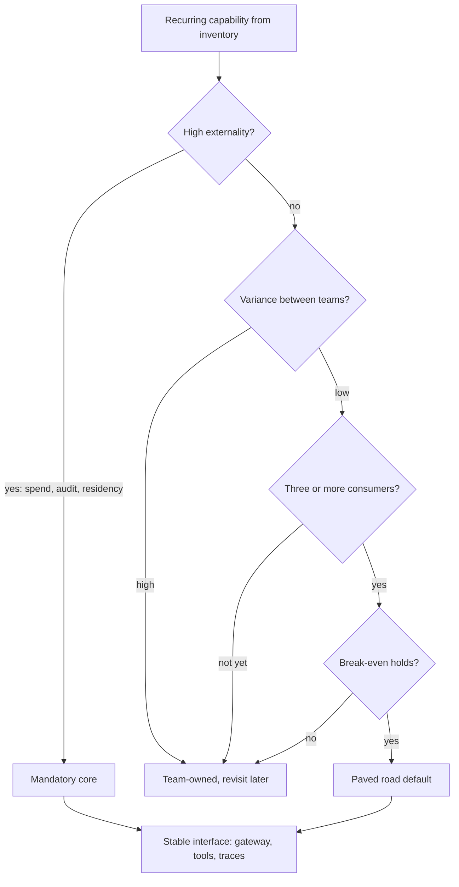

## TL;DR
Platform strategy decides which agent capabilities are shared internal products and which stay with
teams. Platformise what is widely needed, low-variance or risky organisation-wide (gateway, tool
credentials, traces); leave agent logic with teams; build after demand appears.

## For agent builders
- **Why it matters for agents.** Every agent team needs model access, tool credentials, trace logging,
  per-run budgets and an approval step. The platform boundary decides whether you get those from a
  shared core or build them yourself, and whether your agent can be audited and its model swapped.
- **Where it shows up in your stack.** The gateway endpoint and per-team key your agent calls, the model
  alias it requests, the trace schema its steps are logged in, and shared tool servers (for example MCP
  servers in front of internal systems) with scoped credentials.
- **What you control.** Calling the platform's stable interfaces instead of a vendor SDK, tagging every
  request with team and feature, and keeping your agent loop, prompts and tool selection team-owned.
- **What you can skip.** Funding-model politics and org design detail; know the three scoring questions
  and the break-even inequality well enough to argue where your agent's needs belong.

## Why it exists
- **The same needs recur.** Past a couple of AI projects, every team needs an API key to a model
  provider, prompt and cost logging, document ingestion, an eval set and harness, PII redaction and a
  review UI. Agent teams add tool wrappers with credentials and an approval step. Left alone, each team
  builds its own.
- **Duplication has visible costs:** duplicated engineering, and several contracts with the same provider
  at worse prices.
- **And invisible ones:** no single inventory of where models are used, no consistent data-retention
  policy, no way to rotate a key or swap a deprecated model everywhere, no organisation-wide view of
  spend.
- **The opposite extreme also fails.** A central team designs a comprehensive "AI platform" up front and
  mandates it. It is designed from guesses, so it fits nobody exactly; built before anyone uses it, so
  there is no feedback; and as the only sanctioned path, every missing feature becomes a ticket while
  teams wait. Teams route around it, and you have both a platform and shadow stacks.
- **Platform strategy sits between them.** It decides the boundary, timing, operating model and funding
  so the shared layer is pulled by demand, not pushed by architecture. Build-vs-buy decides how each layer
  is sourced; centralised-vs-federated decides ownership; this lesson covers the sequencing and economics
  that tie them together.

## How it works
### 1. Inventory the recurring capabilities
- **List what each current and roadmapped use case needs, layer by layer:** model access, routing and
  fallback, secrets, prompt and model registry, retrieval and ingestion, evaluation, observability and
  cost attribution, guardrails, human review.
- **For agents, add the agent-specific layers:** tool access to internal systems, tool credentials and
  scopes, trajectory tracing, per-run step and spend budgets, approval gates, and sandboxes for code tools.
- **The inventory is the demand signal.** Without it, the platform is designed from imagination.

### 2. Score each capability on three questions
| Question | What to ask | Implication |
|---|---|---|
| **Breadth of demand** | How many teams need it now or in the next two quarters? | Common heuristic: wait until the third consumer, *because* by then you have seen enough variation to generalise correctly. |
| **Variance between teams** | Roughly the same thing (a gateway, audit logging) or genuinely different (retrieval tuned to legal contracts vs. support tickets)? | Low-variance capabilities centralise well; high-variance ones become a lowest-common-denominator abstraction every team fights. |
| **Externalities** | Does getting it wrong in one team create risk or cost for everyone (leaked keys, data in an unapproved region, uncapped spend, no audit trail)? | These belong in the shared layer even with low demand, *because* the cost of inconsistency is organisational. |

### 3. Check the economics before you centralise
With *n* teams each spending *c_team* to build and run their own version, and a platform costing
*C_platform* to build and run plus *c_adopt* per team to integrate and adapt:

```
centralise when  n × c_team  >  C_platform + n × c_adopt + coordination cost
                 (+ the expected cost of an inconsistency incident, for high-externality items)
```

- **Variance is what breaks it.** When needs differ, *c_adopt* rises toward *c_team* (every team still does
  most of the work, now fighting an abstraction), and the inequality never holds however large *n* gets.
- **Externalities enter as the last term.** That is why a gateway or audit log can justify itself at
  *n* = 2 while a shared chunking library cannot at *n* = 6.
- **The same arithmetic covers sourcing.** If a commercial or open-source gateway gives you most of
  *C_platform* for less, the platform team's job is to operate and integrate it, not to write one.

### 4. Draw a thin mandatory core and an optional paved road
- **Mandatory core:** what every AI workload must go through: identity, approved model access through a
  gateway, budgets and rate limits, logging to a common trace store, data-classification rules. Mandatory
  *because* its value comes from being universal (one inventory, one place to swap a model).
- **Paved road:** everything else offered as defaults (an eval harness, an ingestion template, a review
  UI). Optional, but easier than building your own.
- **Off-road teams own what they build.**

### 5. Treat the platform as a product
- **It has users** (internal teams), a roadmap driven by their needs, documentation and SLOs.
- **Adoption metrics:** number of teams onboarded, time from idea to first production call, share of
  spend flowing through the gateway.
- **Measure outcomes, not output.** A platform team measured on features shipped drifts toward the
  over-built monolith described above.

### 6. Choose a funding model
| Model | Effect |
|---|---|
| **Central funding** | Makes adoption easy but hides cost. |
| **Showback** (reporting each team's usage) | Creates awareness without friction. |
| **Chargeback** (billing teams) | Aligns incentives, but can push teams to route around the platform to save money. |

Many organisations start with central funding plus showback, and move to chargeback for variable costs
such as tokens once usage is significant.

### 7. Keep seams so decisions are reversible
- **Expose stable internal interfaces:** an OpenAI-compatible endpoint, a trace schema, an eval-result
  format.
- **Do not leak a vendor's SDK into every service**, *because* the model and tooling market changes
  quickly and you will swap components under the interface.

### 8. Engineer the core as shared infrastructure
- **A mandatory gateway is on every AI request path**, so its failure is everyone's outage.
- **Run it at the availability target of the most demanding consumer**, stateless and horizontally
  scaled.
- **Decide the down-mode up front:** fail closed for high-risk traffic, fail open to a direct route only
  where policy allows.
- **Why:** the centralisation that gives you one place to swap a model also gives you one place to break
  all of them.

### 9. Where agent capabilities usually land
| Agent capability | Variance | Externality | Usual home |
|---|---|---|---|
| Tool credentials and scopes for internal systems | low | high (over-scoped access, leaked secrets) | mandatory core |
| Trajectory traces in one schema | low | high (audit, incident replay) | mandatory core |
| Per-run step and spend budgets | low | high (runaway loops burn shared spend) | mandatory core |
| Shared tool servers for common systems (CRM, tickets) | medium | medium | paved road |
| Approval-gate service and review UI | medium | medium | paved road |
| Agent loop, planning, prompts, tool selection | high | low | team-owned |

- **The pattern:** what an agent is *allowed* to touch and spend is central; how it *decides* stays local.

## Diagram
Run each capability, agent tool credentials included, through this decision path: externalities pull it
into the core even at low demand, while high variance (agent loops) keeps it with teams.



## Examples
### Break-even calculator for centralising a capability
The inequality from step 3 as code. Costs are $k per year and illustrative; the point is how variance
and externalities move the answer.

```python
def teams_cost(n, c_team, incident=0):
    return n * c_team + incident          # every team builds and runs its own, plus expected incident cost

def platform_cost(n, C_platform, c_adopt, coord):
    return C_platform + n * c_adopt + coord

items = {  # c_team, C_platform, c_adopt, coord, incident   ($k per year, illustrative)
    "gateway+budgets":  (60, 150, 10, 20, 200),
    "gateway, no risk": (60, 150, 10, 20, 0),
    "chunking library": (40, 120, 35, 20, 0),
}
for name, (c_team, C, c_adopt, coord, inc) in items.items():
    for n in (2, 6):
        t, p = teams_cost(n, c_team, inc), platform_cost(n, C, c_adopt, coord)
        print(f"{name:16} n={n}: teams {t:>3} vs platform {p:>3} ->",
              "centralise" if t > p else "leave with teams")
# gateway+budgets  n=2: teams 320 vs platform 190 -> centralise
# gateway+budgets  n=6: teams 560 vs platform 230 -> centralise
# gateway, no risk n=2: teams 120 vs platform 190 -> leave with teams
# gateway, no risk n=6: teams 360 vs platform 230 -> centralise
# chunking library n=2: teams  80 vs platform 210 -> leave with teams
# chunking library n=6: teams 240 vs platform 350 -> leave with teams
```

- **The gateway clears break-even at n = 2 only because of the incident term**; without it, it needs more
  consumers.
- **The chunking library never clears it**, because `c_adopt` (35) is close to `c_team` (40): high
  variance means each team still does most of the work.

### Worked scenario: an insurer with six product teams
The platform lead tabulates the capabilities (team counts come from the inventory; the scenario is
illustrative):

| Capability | Teams needing it | Variance | Externality | Decision |
|---|---|---|---|---|
| Model access + keys + budgets | 6 | low | high (spend, data region) | mandatory core |
| Prompt/response logging, cost attribution | 6 | low | high (audit) | mandatory core |
| PII redaction before the model | 4 | low | high (privacy) | mandatory core |
| Eval harness + result store | 5 | medium | medium | paved road |
| Document ingestion pipeline | 3 | medium | low | paved road, template |
| Retrieval strategy / chunking | 3 | high | low | team-owned |
| Agent framework | 2 | high | low | team-owned, revisit |

1. **Before:** each team had its own provider account; finance saw six invoices and no per-feature
   breakdown; security found two teams sending claim documents to a model region the data policy did not
   allow.
2. **First release, deliberately small:** a gateway in front of approved models, with per-team budgets,
   common logging and redaction.
3. **Cheap migration:** the gateway speaks the same API shape teams already call.
4. **Within a quarter:** all spend is attributable per feature; one team's model deprecation is handled by
   changing a routing rule once that team's evals pass on the replacement model.
5. **Next:** the eval harness, because five teams asked for it.
6. **Agent frameworks stay team-owned:** only two teams use them and their needs differ, so a shared
   abstraction now would freeze the wrong design.

### Worked scenario: shared tool access for agent teams
Two, then four, agent teams each wrap the CRM API as a tool with their own service account. Plug the
break-even inequality in ($k per year, illustrative); the incident term is the expected cost of an
over-scoped credential letting an agent write where it should only read.

| Case | Teams cost (n × c_team + incident) | Platform cost (C + n × c_adopt + coord) | Decision |
|---|---|---|---|
| n=2, c_team 30, incident 50 | 60 + 50 = 110 | 60 + 10 + 10 = 80 | centralise |
| n=2, no incident term | 60 | 80 | leave with teams |
| n=4, incident 50 | 120 + 50 = 170 | 60 + 20 + 10 = 90 | centralise |

- **Same shape as the gateway:** least-privilege tool credentials justify a shared tool server early,
  because one agent's mis-scoped key is everyone's audit finding.
- **What each team keeps:** which tools its agent sees, the tool descriptions in its prompt, and its loop.

## Production patterns
- **Gateway with per-team keys and budgets** — as the first core release, put an OpenAI-compatible proxy
  (open-source such as LiteLLM's proxy, or a commercial gateway) in front of approved models, issue one key
  per team or workload with a spend limit, and block direct provider keys. Monitor share of spend through
  the gateway and provider invoices that map to no registered workload.
- **Showback from request metadata** — require team and feature tags on every gateway request, write them
  into the common trace store, and publish a monthly per-feature cost report before considering
  chargeback. Monitor the share of untagged spend.
- **Model aliases as the swap seam** — services call a stable alias (for example "extraction-default")
  that the gateway maps to a concrete model version; change the mapping only after the consuming team's
  evals pass. Monitor error rate and cost per alias after each remap.
- **Tier-one gateway operations** — run the gateway stateless with multiple replicas across zones, with a
  documented fail-closed or fail-open rule per traffic class. Monitor availability, added p99 latency and
  how often teams request bypass routes.
- **Exception register for off-road teams** — any team leaving the paved road records owner, reason and a
  review date. Monitor the count; a rising number means the paved road no longer fits.
- **Per-run budgets for agents in the gateway** — tag each request with an agent run ID and cap steps or
  spend per run, so one looping agent cannot exhaust a team's budget. Monitor runs that hit the cap and
  spend per completed task.
- **Scoped tool credentials from the core** — agents get short-lived, least-privilege credentials for
  each internal system through a shared tool layer instead of team-held service accounts. Monitor tool
  calls denied by scope and any credential used outside its registered agent.

## Trade-offs
- **Mandatory core vs latency and autonomy.** One inventory, one audit trail and one place to swap models,
  but an extra hop and a dependency; it flips toward federation when latency budgets are tight or teams
  are in separate regulatory domains.
- **Wait for the third consumer vs early consistency.** Generalising from real needs tolerates some early
  duplication; it flips when an externality (data residency, spend) makes even two divergent stacks
  unacceptable.
- **Provider abstraction vs provider features.** Abstracting over providers enables switching and routing,
  but hides provider-specific features (caching modes, tool formats); allow pass-through for teams that
  need them.
- **Chargeback vs adoption.** Chargeback aligns usage with cost but taxes adoption; prefer showback until
  the platform is the default path and token spend is material.
- **Shared tool servers vs agent-specific tools.** One tool server per internal system removes duplicate
  wrappers and centralises scopes, but its generic tool descriptions may suit no agent well; let teams
  wrap or rename tools on top when their eval shows tool-selection errors.

## Pitfalls
- **Building a comprehensive platform before any consumer exists.** Symptom: a polished system with low
  adoption and teams quietly keeping their own API keys. Fix: build from the first projects' shared parts.
- **Centralising high-variance capabilities like retrieval strategy.** Teams file endless feature requests
  or fork the shared component, and its configuration surface balloons.
- **A platform team measured on output, not adoption.** It ships features nobody asked for while the top
  consumer request ages in the backlog.
- **Leaking one vendor's SDK through the platform interface.** The first provider migration turns into a
  change in every consuming service.
- **No exit path for teams off the paved road.** Exceptions accumulate as unreviewed shadow stacks that
  show up as provider invoices finance cannot map to any registered workload.
- **Running the gateway like an internal tool rather than tier-one infrastructure.** A single gateway
  incident takes down every AI feature at once, followed by teams asking for bypass routes.
- **Leaving agent tool credentials with each team.** Symptom: service accounts with write scopes nobody
  remembers granting, and no way to say which agent made a change. Fix: issue scoped credentials from the
  core and log every tool call against an agent run ID.

## When to use
- **Use when:** two or three teams are building on models, or earlier if a compliance or spend externality
  already exists.
- **Start with the thin core:** gateway, identity, budgets, logging. Add paved-road components when demand
  is proven and variance is low. For agents, add scoped tool credentials and trajectory traces to the core
  as soon as the first agent can write to a system of record.
- **Measure:** adoption, time to first production call, share of traffic and spend through the core, lead
  time on the platform's top consumer requests, and the number of approved exceptions (a rising count
  means the paved road no longer fits).
- **Avoid:** building a platform as the first AI project; build it out of the first projects' shared parts.
- **Interviews:** show you can name what to centralise and why, and when you would deliberately leave
  duplication in place.

## Role lens
- **Engineer:** Consumes the platform through its stable interface and contributes back components that a
  second team clearly needs, rather than forking or bypassing it.
- **Architect:** Owns the boundary between mandatory core, paved road and team-owned layers, and the
  interfaces that keep vendor choices reversible.
- **FDE:** Notices which customer solutions repeat across accounts and argues, with the evidence, for
  turning them into platform or product capabilities.

## Check yourself
**Q:** Two teams want a shared agent framework built by the platform team; four other teams use plain
model calls. Should the platform build it now?
**A:** Probably not yet. Two consumers is thin demand, and agent frameworks are high-variance: tool
contracts, state handling and orchestration differ a lot between use cases and the ecosystem is still
moving. A shared abstraction now would likely encode one team's design and become a constraint for the
other. What the platform should provide now are the low-variance parts both teams need anyway: model
access through the gateway, tracing, budgets, sandboxed tool credentials. Revisit when a third team needs
agents and the common shape is visible, and keep a light standard (trace format, approval-gate pattern)
so convergence later is cheap.

## Interview questions
### What belongs in a mandatory AI platform core, and why make it mandatory at all?
- **The core:** identity, approved model access through a gateway, budgets and rate limits, common
  logging and data-classification rules.
- **Mandatory because its value is universality.** One inventory, one audit trail and one place to swap a
  deprecated model only work if every workload goes through it; everything else can be an optional paved
  road.

### Teams keep bypassing your gateway with their own provider keys. How do you investigate and fix it?
- **Find the reason first:** check the backlog for the top consumer requests, the added latency, missing
  provider features, and whether chargeback made bypassing cheaper locally.
- **Fix the cause:** allow pass-through for provider-specific features, cut lead time on top requests,
  switch to showback if billing drives the bypass.
- **Then close the door:** block direct provider keys and reconcile invoices against registered workloads.

### When would you deliberately leave duplication in place?
- **High-variance capabilities** such as retrieval strategy or agent frameworks, because a shared
  abstraction pushes adoption cost close to each team's own build cost and freezes the wrong design.
- **Early, low-externality needs** with fewer than three consumers, since the real variation is not yet
  visible; keep a light standard (trace format) so convergence later is cheap.

### How do you decide between central funding, showback and chargeback?
- **Start with central funding plus showback**, because adoption matters most while the platform is not
  yet the default path, and showback builds cost awareness without friction.
- **Move to chargeback for variable costs** such as tokens once usage is significant and the core is
  unavoidable; earlier, billing pushes teams to route around the platform.

### The gateway is on every AI request path. What do you put in its design review?
- **Availability** set by the most demanding consumer, stateless replicas and horizontal scaling.
- **Failure mode per traffic class:** fail closed for high-risk traffic, fail open to a direct route only
  where policy allows, decided before the first incident.
- **Numbers to watch:** added p99 latency, error rate per upstream model, and share of traffic through it.

### Three agent teams each built their own CRM tool wrapper. What, if anything, do you centralise?
- **Centralise access, not behaviour.** Move credentials, scopes and audit logging of CRM calls into a
  shared tool server or tool layer, because over-scoped write access is an organisation-wide risk.
- **Leave the agent side with teams:** which tools each agent sees, how they are described in its prompt,
  and its loop and planning, since those vary by use case.
- **Check the economics:** run the break-even with the incident term, and track tool-call errors per team
  after migration so the shared wrapper does not hurt tool selection.

## Quiz
### Q: Which capability is the strongest candidate for the mandatory platform core?
- [ ] A chunking strategy tuned for one team's contracts
- [ ] An agent framework used by two teams
- [x] Approved model access with per-team budgets and audit logging
- [ ] A shared prompt library for marketing copy
> Model access, budgets and audit are needed by every team, vary little, and create organisation-wide
> risk when done inconsistently. The chunking strategy and agent framework are high-variance and fit poorly.

### Q: Why is "wait for the third consumer" a common heuristic before platformising a capability?
- [ ] Platform teams are usually staffed only after three projects exist
- [x] By then the real variation in needs is visible, so the shared design generalises from evidence
- [ ] Licensing for shared tools typically requires three internal customers
- [ ] Two teams can always share code without a platform
> One or two consumers give too little signal to separate essential needs from incidental ones. The
> heuristic is overridden when an externality such as data residency makes divergence unacceptable early.

### Q: What is the usual effect of switching to chargeback before the platform is the default path?
- [ ] Adoption rises because teams can see their costs
- [ ] Platform costs fall because usage becomes more efficient
- [x] Some teams route around the platform to avoid the bill, recreating shadow stacks
- [ ] It has no effect, because the costs are the same either way
> Billing teams for a platform they could bypass makes bypassing look cheaper locally. Showback first
> builds cost awareness without that incentive, and chargeback works once the core is unavoidable.

## Use cases & projects
### Use cases
- **Onboarding the second agent team.** The platform gives them a gateway key, a model alias, a trace
  schema and scoped tool credentials on day one, so they build only their agent loop.
- **Swapping a model under every agent.** A deprecated model is replaced by remapping an alias once each
  agent team's evals pass on the replacement.
- **Containing a runaway agent.** Per-run budgets in the gateway stop one looping agent before it
  exhausts its team's monthly spend.
- **Auditing what an agent did.** One trace store answers which agent run made a CRM change, with which
  credential, after which tool result.

### Mini project
**A thin agent platform core (2-3 hours).**
- **Goal:** put a small gateway in front of a tool-calling agent that enforces per-run budgets and logs
  every step in one trace schema.
- **Steps:** write a proxy function that every model call goes through, adding team, feature and run-ID
  tags; cap steps and spend per run; route tool calls through a wrapper that checks a per-agent scope list;
  write each model call and tool call as one trace record; run a mock agent with two tools, including one
  forced loop.
- **Done when:** the looping run is stopped at the cap, an out-of-scope tool call is denied and logged, and
  a per-feature cost report and a single run's full trajectory can both be printed from the trace store.
