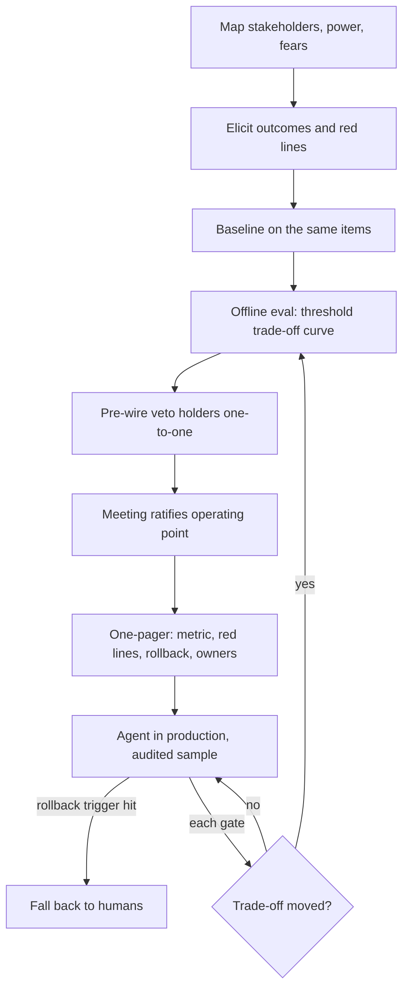

## TL;DR
Stakeholder alignment gets everyone who can fund, approve or veto an agent to agree, before building, on
its goal, success metric, acceptable error rate, which actions need approval, and who can pause it. An
agent's "does it work?" needs an agreed operating point.

## For agent builders
- **Why it matters for agents.** An agent takes actions, so the late veto is sharper: compliance, security
  and finance each care which tool calls it may make alone. Without agreement up front, a working agent
  sits in pilot because nobody agreed what it may do.
- **Where it shows up in your stack.** The agreement becomes configuration you implement: the escalation
  threshold, the approval gate per tool or action class, refund or spend limits, the audit sample and the
  kill switch with a named owner.
- **What you control.** Producing the evidence (a threshold trade-off table from your agent eval, a
  same-slice human baseline) and putting every agreed limit in config, not code.
- **What you can skip.** Running the stakeholder meetings and change-management detail; know what goes on
  the one-pager so you can build exactly what it says.

## Why it exists
- **More parties than a typical feature.** A business owner who wants a cost or speed gain, operators whose
  workflow changes, legal and compliance (regulatory risk), security (data exposure), IT or the platform
  team (must run it), finance (funds the inference bill), and sometimes works councils or unions. Each
  defines success differently, and several have an effective veto.
- **The naive approach aligns on the vision** ("AI-assisted claims triage") and starts building, expecting
  details to settle later.
- **The disagreements are about the numbers, not the vision.** Operations wants most claims handled
  automatically; compliance wants zero wrongful denials; finance wants cost per claim below today's. With
  a probabilistic system these trade off directly; unsettled up front, they get settled at launch, usually
  by a late veto.
- **The result is "pilot purgatory".** The demo impressed and the eval looks good to engineering, but there
  was never an agreed bar, so nobody can say yes.
- **The implicit standard of perfection.** Without an agreed baseline, any visible AI error is judged
  against an imagined error-free human process rather than the real one.
- **Scope:** this lesson is the up-front agreement; the ongoing relationship work is covered under
  stakeholder management.

## How it works
### Background
Steps 1-7 are the general alignment method for any AI system: map the people, separate goals from red
lines, measure the human baseline, choose an operating point on a measured curve, pre-wire, write one page
and re-align at gates. Step 8 is what an agent adds.

### 1. Map who matters and what each can do
| Column | What to record |
|---|---|
| Stake | What they gain or lose |
| Power | Fund, approve, veto, adopt, block quietly |
| Main fear | What would make them say no |

- **Pay most attention to those who can veto late:** legal, security, data protection, and frontline users
  whose non-adoption is a silent veto.
- **Engage them first**, *because* objections raised before design change a requirement; raised after
  build, they change a plan.

### 2. Elicit success criteria and red lines separately
- **Ask each stakeholder two questions:** what outcome they need (a metric), and what they cannot accept
  (a constraint).
- **Constraints are hard limits:** "no customer data leaves the EU", "no automated denial without human
  review".
- **Outcomes are things to optimise.**
- **Keep them separate** so a constraint is not traded away in a negotiation over an outcome.

### 3. Measure the baseline
- **Measure the current process on the same metrics:** human error rate, cycle time, cost per item.
- **This replaces "AI must never be wrong"** with "AI plus review must beat today's process by an agreed
  margin", a standard a system can actually meet.
- **Measure on the *same items* the AI will handle**, *because* a system that automates only its confident
  cases takes the easier slice of the work. Humans are usually more accurate on that slice than their
  overall rate suggests, so comparing the AI's error on its slice with humans' error on everything flatters
  the AI.
- **Historical decisions on the labelled eval set** usually give you this for free.

### 4. Agree the operating point with evidence
- **Run an offline eval on representative data** and show the trade-off curve: as the confidence threshold
  for automation rises, fewer items are automated and fewer are wrong.
- **Stakeholders choose a point on a real curve** instead of arguing in the abstract. This is the
  AI-specific heart of alignment.

### 5. Pre-wire before the decision meeting
- **Walk each veto holder through the evidence one-to-one first**, *because* an objection raised privately
  can be met with a design change, while one raised first in front of peers tends to harden into a
  position.
- **The group meeting ratifies** a choice everyone has already seen.
- **Remaining disagreement is named and escalated** to the agreed decision owner rather than re-argued.

### 6. Write it down in one page
| Section | Content |
|---|---|
| Goal | The outcome in one line |
| Primary metric | Baseline and target |
| Hard constraints | The red lines |
| Operating point | The chosen threshold and why |
| Failure handling | Fallback to humans, escalation path, rollback trigger |
| Decision rights | Who approves launch, who can pause it (a RACI or DACI model works) |
| Review cadence | When the agreement is revisited |

A written artefact matters *because* memories of verbal agreements diverge within weeks.

### 7. Re-align at each gate
- **Present results against the one-pager** at each roadmap gate.
- **If results move the trade-off** (accuracy lower than hoped, costs higher), re-open the decision
  explicitly rather than drifting.

### 8. What an agent adds to the one-pager
| Section | What to agree for an agent |
|---|---|
| Action classes | Which tool calls are read-only, reversible or irreversible, and which run without approval |
| Approval gates | Who approves consequential actions, and the limit (amount, scope) above which approval is required |
| Escalation threshold | When the agent hands off to a human: low confidence, step budget hit, or a red-line topic |
| Budgets | Steps and spend per task, so a looping agent stops before it costs real money |
| Kill switch | Who can pause the agent, how fast, and what happens to tasks in flight |

- **Why each needs an owner:** these are the decisions a veto holder would otherwise make at launch.

## Diagram
Alignment is a sequence: constraints and a fair baseline come before the trade-off curve, and veto holders
see the evidence privately before the meeting that ratifies the agent's operating point and limits.



## Examples
### Worked scenario: claims triage with three conflicting goals
Figures are illustrative.

- **Operations VP:** wants at least 50% of claims routed automatically.
- **Compliance:** red line, wrong-queue errors on auto-routed claims must be no worse than today's manual
  error rate, which is 4% across all claims.
- **Finance:** cost per claim below today's $3.10.

The team runs the classifier on 1,000 labelled historical claims and tabulates by confidence threshold:

| Threshold | Share auto-routed | Error rate on auto-routed | Blended cost per claim |
|---|---|---|---|
| 0.70 | 78% | 6.5% | $1.20 |
| 0.85 | 61% | 3.2% | $1.75 |
| 0.95 | 38% | 1.1% | $2.30 |

- **At 0.70** ops gets its volume but the compliance red line is breached.
- **At 0.95** compliance is comfortable but ops is well short of 50%.
- **At 0.85** all three look satisfied: 61% automated, 3.2% error, cost well under $3.10.

Two checks make the margin thinner than it looks:
1. **The fair baseline.** The labelled claims carry their original human routing. On the same 610 claims
   the model would automate, humans erred 3.5% of the time, not 4%; on the 390 harder claims they erred
   about 4.8% (0.61 × 3.5% + 0.39 × 4.8% ≈ 4.0%).
   - So the model is roughly at parity on its slice, and the whole process improves only from about 4.0%
     to 0.61 × 3.2% + 0.39 × 4.8% ≈ 3.8%.
2. **Noise.** 3.2% of 610 is roughly 20 errors, and its 95% interval runs to about 4.6%.

The outcome:
- **Compliance agrees parity is acceptable**, since the red line was "no worse".
- **The one-pager records 0.85 as a provisional operating point**, with a rollback trigger if the
  production error rate over a rolling audited sample (large enough, a few hundred claims or more, that
  noise alone does not trip it) exceeds 4%, compliance as the owner of that trigger, and a review after a
  month of production data.
- **The argument that would have happened at launch** happened in a one-hour meeting with a table on the
  screen.

### Checking the operating point and the rollback trigger in code
The table, the fair baseline and the noise check as one script, plus a question the one-pager should
answer: how often would the 4% trigger fire from noise alone if the true error stayed at 3.2%?

```python
from math import comb, sqrt

rows = [  # threshold, share auto-routed, error on auto-routed, blended cost per claim
    (0.70, 0.78, 0.065, 1.20),
    (0.85, 0.61, 0.032, 1.75),
    (0.95, 0.38, 0.011, 2.30),
]
MIN_AUTO, MAX_ERR, MAX_COST = 0.50, 0.04, 3.10      # ops goal, compliance red line, finance goal
for t, share, err, cost in rows:
    ok = share >= MIN_AUTO and err <= MAX_ERR and cost < MAX_COST
    print(f"threshold {t:.2f}: auto {share:.0%} err {err:.1%} ${cost:.2f} ->", "candidate" if ok else "fails")

share, err, n_auto = 0.61, 0.032, 610
human_easy, human_hard = 0.035, 0.048                # humans on the same 610 claims, and on the other 390
print(f"fair baseline {share * human_easy + (1 - share) * human_hard:.1%}, "
      f"with model {share * err + (1 - share) * human_hard:.1%}")
print(f"~{err * n_auto:.0f} errors, upper 95% bound {err + 1.96 * sqrt(err * (1 - err) / n_auto):.1%}")

def false_alarm(n, p_true=0.032, trigger=0.04):      # P(observed rate > trigger) from noise alone
    k = int(trigger * n)
    return 1 - sum(comb(n, i) * p_true**i * (1 - p_true)**(n - i) for i in range(k + 1))

for n in (50, 300, 1000):
    print(f"audit sample {n:>4}: false rollback chance {false_alarm(n):.0%}")
# threshold 0.70: auto 78% err 6.5% $1.20 -> fails
# threshold 0.85: auto 61% err 3.2% $1.75 -> candidate
# threshold 0.95: auto 38% err 1.1% $2.30 -> fails
# fair baseline 4.0%, with model 3.8%
# ~20 errors, upper 95% bound 4.6%
# audit sample   50: false rollback chance 21%
# audit sample  300: false rollback chance 17%
# audit sample 1000: false rollback chance 7%
```

- **The trigger sits close to the operating error** (4% vs 3.2%), so even a few hundred audited claims
  leave a meaningful chance of a false rollback; larger windows cut it.
- **Agree the window size and the response** (pause and re-audit, or immediate fallback) in the one-pager,
  so a noisy reading does not restart the negotiation.

### Worked scenario: agreeing a refund agent's approval limit
A support agent can issue refunds through a tool. Operations wants a short approval queue; finance's red
line is wrong-refund cost under $1,000 per month. The team replays a month of tickets through the agent
offline and projects each limit. All figures are illustrative.

| Auto-approve limit | Refunds the agent issues alone | Projected wrong-refund cost per month | Approvals queued per day |
|---|---|---|---|
| $25 | 45% | $300 | 120 |
| $50 | 70% | $900 | 66 |
| $200 | 92% | $4,800 | 18 |

- **$200 breaches finance's red line; $25 swamps the approvers.** $50 meets both with little margin.
- **The one-pager records** $50 as provisional, finance as owner of the wrong-refund trigger, a rolling
  audit of auto-issued refunds, and operations holding the kill switch.
- **The engineer implements exactly that:** the limit in config, an approval gate on the refund tool above
  it, and an audit sample of the rest.

## Production patterns
- **One-page decision record in version control** — store the one-pager (goal, metric with baseline and
  target, red lines, operating point, rollback trigger, owners, review date) next to the system's eval
  config, and link it from the launch approval. Monitor whether each gate decision cites it.
- **Threshold as configuration, owned by the decision owner** — keep the confidence threshold (0.85 here)
  in config rather than code, so moving the operating point is a recorded change approved by whoever the
  one-pager names. Monitor automation share and error rate per threshold change.
- **Rolling audited sample with a sized window** — route a random sample of auto-routed items to human
  audit continuously, and size the window from the false-alarm calculation above. Monitor the audited error
  rate against the trigger, and audit backlog age.
- **Same-slice baseline from historical labels** — compute the human error rate on exactly the items the
  model would automate, using the original human decisions in the labelled set. Report it beside the model's
  error at every gate.
- **Pre-wire log** — before each decision meeting, record which veto holders saw the evidence one-to-one and
  what they raised. Monitor objections that first appear in the group meeting; each one is a missed pre-wire.
- **Agreed limits as agent config** — put approval limits, escalation thresholds, step and spend budgets
  per task in versioned config that names its owner from the one-pager. Monitor actions taken above each
  limit (should be zero) and the approval-queue length.
- **Owned kill switch** — give the named owner a tested way to pause the agent or drop it to draft-only
  mode without a deploy. Monitor time to pause in drills and tasks left in flight when it fires.

## Trade-offs
- **Up-front alignment vs speed.** It prevents late vetoes but delays the start; for a reversible internal
  experiment, a lighter agreement on the stop condition is enough.
- **Many stakeholders vs fast decisions.** Involving many surfaces constraints early but slows decisions;
  give advisory voice broadly and decision rights narrowly.
- **Explicit numeric bars vs flexibility.** They make go/no-go clear but commit you before the data is
  fully understood; set them as provisional and re-open at each gate with evidence.
- **Showing the full error trade-off vs sponsor comfort.** It builds trust with risk owners but exposes
  failure rates some sponsors would rather not see; hiding them only moves the discovery to launch, where it
  costs more.
- **Tight approval gates vs agent usefulness.** Approving every action keeps risk owners comfortable but
  turns the agent into a drafting tool with a queue; loosen gates per action class as audited evidence
  accumulates.

## Pitfalls
- **Aligning on vision instead of numbers.** Symptom: a successful pilot that nobody can approve because
  nobody agreed what "good enough" meant. Fix: an agreed operating point.
- **Engaging legal, security or data protection only before launch.** Symptom: a late veto or a redesign
  around a constraint that was knowable on day one.
- **No baseline for the human process.** Any visible AI error is compared with perfection and the project
  stalls on anecdotes.
- **Treating frontline users as recipients rather than stakeholders.** Adoption stays low while every
  dashboard looks green, a silent veto.
- **Comparing the AI's error on the cases it chose to automate with humans' error on all cases.** The
  launch clears the bar, and a later audit shows the automated slice is worse than humans were on those
  same, easier claims.
- **Decision rights left implicit.** When production metrics wobble, two executives give contradictory
  instructions and the team freezes.
- **Agreeing the agent's goal but not its actions.** Symptom: security blocks launch on discovering the
  agent can send email or issue refunds alone. Fix: put action classes, approval limits and the kill-switch
  owner on the one-pager before build.

## When to use
- **Use before significant build work** on any AI system that changes a workflow, touches regulated data,
  or needs sign-off from people outside the building team, which is most of them.
- **Revisit** at each roadmap gate and whenever evidence moves the trade-off.
- **Skip the heavy version** for internal experiments that are cheap to stop.
- **Never skip it for agents that write** to systems of record, move money or message customers; agree
  action classes and approval limits first.
- **Measure alignment** by whether a launch decision can be made from the one-pager and the latest eval
  without a new negotiation.
- **Interviews:** describe turning conflicting goals into a choice on a measured trade-off curve.

## Role lens
- **Engineer:** Produces the threshold trade-off table and the baseline measurement that let stakeholders
  choose an operating point with evidence.
- **Architect:** Translates stakeholders' red lines into hard design constraints (residency, human review
  gates, audit trails) and owns the decision-rights section.
- **FDE:** Runs the alignment meetings inside the customer, identifies the quiet vetoes early, and keeps
  the one-pager current as the deployment evolves.

## Check yourself
**Q:** The business sponsor says the AI must be "100% accurate" before launch. How do you move the
conversation forward?
**A:** I would not argue with the goal; I would make the comparison concrete. First measure the current
process: how often human handlers make the same kind of error, and what that costs. Then show the eval
results as a trade-off: at a given confidence threshold, what share of items the system handles, its error
rate on those, and what happens to the rest (human review). The question becomes "which operating point
beats today's process, with which safeguards", plus a rollback trigger if production errors exceed the
baseline. Most sponsors accept a measured improvement with a safety net once they see the human error
rate.

## Interview questions
### Why is stakeholder alignment harder for AI systems than for deterministic features?
- **The goals trade off on one curve.** Automation rate, error rate and cost all move with the confidence
  threshold, so stakeholders must agree on an operating point rather than on a feature spec.
- **Without that agreement,** a pilot can look good to engineering and still be unapprovable, because
  nobody agreed what "good enough" meant.

### Your pilot met every target, but a compliance lead blocks launch in the final review. What went wrong and what do you do now?
- **Diagnosis:** the veto holder was engaged late or not pre-wired, so the objection surfaced in front of
  peers and hardened into a position.
- **Now:** meet one-to-one, turn the objection into a red line or a design change (a human review gate, a
  lower threshold), and re-run the eval at the new operating point.
- **Next time:** map veto holders first and walk them through evidence before any group decision.

### How do you set a fair human baseline when the model only automates its confident cases?
- **Measure humans on the same items** the model would automate, using historical decisions in the
  labelled set, because confident cases are usually easier and humans do better on them too.
- **In the claims example,** humans erred 3.5% on the automated slice versus 4% overall, turning an
  apparent win into rough parity and a whole-process gain from about 4.0% to 3.8%.

### When would you skip a formal alignment process?
- **For internal experiments that are cheap to stop,** a lighter agreement on the stop condition is enough,
  because the cost of a late objection is small.
- **Never skip it** when the system changes a workflow, touches regulated data, or needs sign-off from
  people outside the building team, because those are exactly the late vetoes.

### How would you design the rollback trigger for an agent or automated decision system?
- **Tie it to the red line:** for example, audited production error on auto-routed items above 4%, with a
  named owner (compliance in the claims case) and a defined response.
- **Size the audit window** so noise alone rarely trips it; with true error at 3.2% and a 4% trigger, even
  300 audited claims give a false rollback about 17% of the time.
- **For an agent, define the fallback mode:** drop to draft-only or approval-on-every-action rather than
  switching off, so work continues while the owner re-audits.

### Your agent can issue refunds and update accounts. What must stakeholders agree before you build it?
- **Action classes:** which tool calls are read-only, reversible or irreversible, and which may run
  without a human.
- **Limits and owners:** the approval limit per action class from an offline replay, the escalation
  threshold, step and spend budgets per task, and who owns each trigger.
- **The kill switch:** who can pause the agent or drop it to draft-only, and how in-flight tasks are
  handled; then implement all of it as config.

## Quiz
### Q: Why separate stakeholders' hard constraints from their outcome goals?
- [ ] Constraints are only relevant to legal teams
- [x] So a red line cannot be traded away during negotiation over metrics that are meant to be optimised
- [ ] Outcomes are always less important than constraints
- [ ] Constraints are easier to measure than outcomes
> Outcomes such as automation rate are legitimately traded against each other; constraints such as data
> residency are not. Mixing them invites treating a red line as one more weight in the balance.

### Q: What makes alignment on AI systems harder than on deterministic features?
- [ ] AI systems need more stakeholders by regulation
- [ ] Stakeholders cannot understand model architectures
- [x] Goals like automation rate and error rate trade off directly, so an operating point must be chosen
- [ ] AI systems cannot be measured before deployment
> A probabilistic system is right only part of the time, so "does it work" depends on the chosen
> threshold. Stakeholders with different goals must agree on a point on that trade-off curve.

### Q: What is the main purpose of measuring the human baseline before deployment?
- [ ] To show that the human team should be reduced
- [ ] To train the model on human mistakes
- [x] To replace an implicit perfection standard with a realistic bar the system can be judged against
- [ ] To satisfy a requirement of most model providers
> Without a baseline, every AI error is compared with an imagined error-free process. Measuring today's
> error rate and cost gives an agreed, achievable bar for the go/no-go decision.

## Use cases & projects
### Use cases
- **Launching a customer-facing agent.** Support, compliance and finance agree which replies and refunds
  the agent sends alone before the first line of agent code.
- **Unblocking an agent stuck in pilot.** A one-pager with a replay-based trade-off table turns "is it good
  enough?" into choosing a limit everyone has seen.
- **Raising an agent's autonomy.** Audited evidence at the current limit is presented against the
  one-pager to justify a higher approval limit.
- **Handling an agent incident.** The named kill-switch owner drops the agent to draft-only mode without a
  meeting, because the response was agreed in advance.

### Mini project
**Alignment one-pager and config for a refund agent (1-2 hours).**
- **Goal:** turn three stakeholders' goals into an agreed agent limit and the config that enforces it.
- **Steps:** write each stakeholder's outcome and red line; simulate 200 refund requests with amounts and
  a mock agent correctness rate; tabulate share auto-issued, projected wrong-refund cost and queue length
  for three limits; pick the operating point; write the one-pager with action classes, owners and kill
  switch; express the limits as a config file and a gate function the refund tool calls.
- **Done when:** the table, the one-pager and a test showing a refund above the limit is routed to approval
  all agree, and pausing the agent switches it to draft-only.
