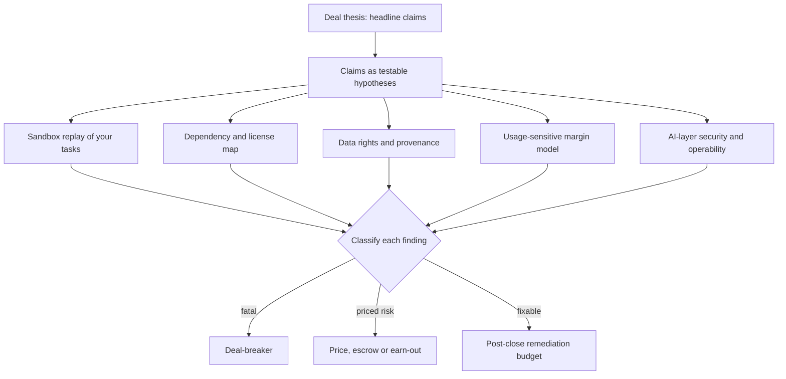

## TL;DR
Technical due diligence on an AI or agent company (acquisition, investment or strategic partnership)
tests whether claims like "our agent resolves 80% of tickets" hold on your data, and what keeping them
true will cost, before the price is fixed.

## For agent builders
- **Why it matters for agents.** Agent products are sold on completion rates, autonomy and margins that
  are easy to overstate: "resolved" may mean the agent replied, not that the task was done, and agent
  steps multiply inference cost. You may be the engineer asked to test such a claim, or the team whose
  agent is being tested.
- **Where it shows up in your stack.** Your traces, eval sets, tool credentials and billing data are the
  evidence diligence asks for; a sandbox replay of real tasks is the core test.
- **What you control.** Keeping agent evals on held-out data, end-state checks, scoped tool credentials
  and trace-to-invoice reconciliation, so your own agent would pass the same scrutiny.
- **What you can skip.** Deal instruments (escrow, warranties, earn-out mechanics) and legal process;
  recognise the three finding classes and leave the rest to the deal team.

## Why it exists
- **Deals are priced on claims:** "proprietary model", "95% accuracy", "data moat", "70% gross margin",
  "enterprise-ready".
- **AI adds failure modes a code review cannot see.** Conventional diligence (code quality, architecture,
  security, team) still matters, but:
  - accuracy can be an artefact of a test set the target curated or trained on;
  - a "proprietary model" may be prompts around a third-party API whose terms or prices can change;
  - training data may lack the rights the business model assumes;
  - inference costs scale with usage, so margins healthy at current volume can compress as customers use
    the product more, or as it adds longer context or agentic loops.
- **The naive approach checks presentation, not reality.** Slides, a demo, the architecture diagram and
  founder answers: a demo runs on chosen inputs, a diagram shows intent rather than what is deployed, and
  the people answering have every reason to be optimistic.
- **The cost of a miss is asymmetric.** Discovering after closing that accuracy does not hold on the
  acquirer's customers, or that a key dataset cannot be used commercially, can erase the deal's value.
  Diligence turns claims into evidence first.

## How it works
### Background
For AI, diligence centres on six questions; steps 1-8 below work through them, and the agent-specific
checks follow:

| # | Question |
|---|---|
| 1 | Does the AI work on data the target did not choose? |
| 2 | Who owns its data and models? |
| 3 | What happens to margins as usage grows? |
| 4 | How exposed is it to upstream model providers? |
| 5 | Is the AI layer secure? |
| 6 | Can the system and team be operated by someone else? |

### 1. Start from the thesis, not a checklist
- **Write down the claims the deal depends on:** "their extraction is materially better than what we could
  build in a year", "margins hold at 10× volume", "we can deploy it in our regulated customers' VPCs".
- **Each claim becomes a hypothesis** with the evidence that would confirm or refute it.
- **Why:** it focuses limited time, *because* a generic checklist spends equal effort on things that do not
  affect value.

### 2. Verify the AI actually works, independently
1. **Request** their eval methodology, datasets and recent results.
2. **Run the system on a held-out sample *you* provide**, from your own or your customers' data, scored by
   your criteria.
3. **Ask how the eval set was built** and whether any of it was used in training or prompt tuning
   (contamination).
4. **Treat the gap** between their number and yours as the most informative finding in AI diligence.
5. **Explain the gap**, *because* its cause decides the remedy: break both results down by input segment
   (document type, language, scan quality, customer).

| Pattern in the segments | Meaning |
|---|---|
| Equally good per segment, only the mix differs | The overall number reflects the target's own customer base; predict yours by re-weighting per-segment accuracy by your mix. |
| Worse on the same segments | The reported number was inflated by curation or tuning on the eval set. |

- **Plan the data mechanics early**, because deals rarely allow free data flow: the target runs its system
  on your sample under NDA while you hold the labels and do the scoring, or the test runs in a clean room
  with a small "clean team" who do not share raw data with the wider deal team.

### 3. Map dependencies and their terms
- **List every model, API, dataset and open-source component** in the production path, with license and
  contract terms.
- **Ask:** is a third-party model's output allowed in this use; can the provider change pricing or
  deprecate the model; do open-weight model licenses permit the intended commercial scale; is data
  processed in regions customers accept?
- **Stress question:** what share of the product would survive the main provider doubling prices or
  withdrawing a model?

### 4. Establish data rights and provenance
- **For training, fine-tuning and retrieval data:** where it came from, under what consent or license,
  whether customer data is used across customers, and whether deletion requests can be honoured, including
  in trained weights.
- **Missing provenance** is a legal and reputational liability that transfers with the deal.

### 5. Rebuild the unit economics
- **From billing data and traces,** compute cost per request and per customer.
- **Project at higher usage:** token growth per task, retries, agent steps, human review.
- **Check pass-through:** does the target's pricing model pass those costs on?
- **Margins that depend on a provider's current discount are a risk, not a fact.**

### 6. Check security of the AI layer
Beyond the usual application review, ask the AI-specific questions:
- **Tenant scoping:** is retrieval scoped per tenant, so one customer's documents can never appear in
  another's context, including through shared caches or indexes?
- **Agent blast radius:** what can an agentic feature do with its tool credentials if a document contains
  a prompt injection?
- **Logging:** where do prompts and outputs get logged, and for how long?
- **Supply chain:** where do model weights and datasets come from, and are third-party checkpoints loaded in
  formats that can execute code?
- **Why:** a cross-tenant leak in an acquired product becomes the acquirer's incident.

### 7. Check operability and the team
- **Operations:** monitoring, incident history, an eval-gated release process, reproducible training.
- **Rebuildability:** can the system be rebuilt from the repository?
- **Key-person risk:** how concentrated is knowledge?
- **Interview engineers separately from leadership**, *because* the most useful information is often the
  mismatch.

### 8. Classify findings by consequence
| Class | Response |
|---|---|
| **Deal-breaker** | Walk away. |
| **Price or terms adjustment** | Escrow, warranty, earn-out tied to a metric. |
| **Post-close remediation** | Budgeted item with an estimated cost. |

This converts technical findings into decisions the deal team can act on.

### 9. Agent-specific checks
When the product is an agent, add these tests to steps 2, 5 and 6:

| Claim to test | Test | Why |
|---|---|---|
| Completion or "resolution" rate | Replay your real tasks in a sandbox and check the end state, not the final message | An agent can reply confidently and leave the task undone |
| Autonomy level | Read traces for how often a human approved, edited or redid the agent's actions | "Autonomous" may hide a human review queue in the cost base |
| Cost per task | Steps and tokens per completed task on your tasks versus the target's traces | Harder inputs mean more steps, and cost scales with them |
| Blast radius | List each tool credential's scopes and what one injected instruction could do with them | Over-scoped write access transfers with the deal |
| Reproducibility | Re-run a sample of logged trajectories and compare outcomes | Unpinned models or prompts make reported results unrepeatable |

## Diagram
Each headline claim becomes a hypothesis tested by its own evidence workstream (for an agent, a sandbox
replay of your tasks); every finding ends in one of three classes the deal team can act on.



## Examples
### Worked scenario: acquiring an AI contract-review startup
Claims: "94% clause-extraction accuracy" and "68% gross margin". All figures are illustrative.

**Accuracy**

| Step | Finding |
|---|---|
| Target's eval set | 1,000 contracts it selected; 300 of them were also used to iterate on prompts |
| Acquirer's sample | 200 contracts from its own customers |
| Result on acquirer's sample | 86%; the 95% interval at 200 contracts is about ±5 points, so the gap to 94% is real, not sampling noise |
| Clean, digital English contracts (128) | about 95% |
| Scanned or non-English contracts (72) | about 70%, with an interval of roughly ±10 points at that size |
| Acquirer's mix 64/36 | 0.64 × 95% + 0.36 × 70% ≈ 86% |
| Startup's set, about 95% clean | 0.95 × 95% + 0.05 × 70% ≈ 94% |

- **The headline is mostly a mix effect.** The product is genuinely strong on clean contracts and weak on
  the inputs the acquirer's customers send more often.
- **The 94% is still optimistic**, because of the prompt tuning on 300 eval contracts.
- **The actionable finding** is the OCR and multilingual gap, which has a cost to fix that can be
  estimated.

**Economics**
- **Today:** revenue per customer averages $4,000 per month; inference costs $900 per month per customer,
  plus $400 of hosting and support, giving (4,000 − 1,300) / 4,000 ≈ 68%.
- **Roadmap:** a multi-step agent review that the startup's own traces show uses roughly 3× the tokens per
  contract. At the same price and token rates, inference becomes $2,700 and margin falls to
  (4,000 − 3,100) / 4,000 = 22.5%.
- **Discount risk:** margin also depends on a discounted rate with one provider that expires next year.

**Dependencies:** everything runs on one external model API; no abstraction layer; prompts tuned
specifically to that model.

**Classification:** not a deal-breaker.
- Price adjustment for the margin risk.
- An earn-out tied to accuracy on the acquirer's own held-out set.
- Post-close remediation budget for OCR improvements and a gateway abstraction, sized from the 70% segment.
- Without independent testing, the deal would have been priced on 94% and 68%.

### Reproducing the numbers: mix re-weighting and margin sensitivity
The same arithmetic as code, so the deal team can change the mix or token multiplier themselves. The
+25% rate rise after the discount lapses is an illustrative assumption, not a figure from the scenario.

```python
from math import sqrt

def ci95(p, n):
    return 1.96 * sqrt(p * (1 - p) / n)              # normal approximation

seg_acc = {"clean": 0.95, "scanned_or_non_english": 0.70}   # measured on the acquirer's 200
mixes = {
    "startup eval set":   {"clean": 0.95, "scanned_or_non_english": 0.05},
    "acquirer customers": {"clean": 0.64, "scanned_or_non_english": 0.36},
}
for name, mix in mixes.items():
    print(f"{name:18} expected accuracy {sum(mix[s] * seg_acc[s] for s in mix):.1%}")
print(f"interval: +/-{ci95(0.86, 200):.3f} on 200, +/-{ci95(0.70, 72):.3f} on 72")

def gross_margin(revenue, inference, other):
    return (revenue - inference - other) / revenue

print(f"today          {gross_margin(4000, 900, 400):.1%}")
print(f"3x tokens      {gross_margin(4000, 900 * 3, 400):.1%}")
print(f"3x, +25% rates {gross_margin(4000, 900 * 3 * 1.25, 400):.1%}")   # illustrative discount lapse
# startup eval set   expected accuracy 93.8%
# acquirer customers expected accuracy 86.0%
# interval: +/-0.048 on 200, +/-0.106 on 72
# today          67.5%
# 3x tokens      22.5%
# 3x, +25% rates 5.6%
```

- **The re-weighted 93.8% matches the claimed 94%,** which supports the mix explanation over pure
  inflation.
- **Two compounding risks** (more tokens per task, a lapsed discount) take margin from about 68% to single
  digits unless pricing passes costs through.

### Worked scenario: testing a support agent's "80% resolved" claim
A partner sells a ticket-resolution agent. The acquirer replays 150 of its own tickets in a sandbox with
mock CRM and email tools. All figures are illustrative.

| Step | Finding |
|---|---|
| Target's definition of resolved | The agent sent a final reply; no check that the ticket's end state was correct |
| End state checked on 150 tickets | 62% completed; the interval at 150 is about ±8 points, so the gap to 80% is real |
| Steps per ticket | about 9 on the acquirer's tickets versus about 5 in the target's traces, so cost per ticket is roughly 1.8× |
| Human involvement | traces show a review queue where staff edit a share of replies before sending |
| Tool scopes | the CRM credential can write to every customer account, not only the ticket's |

- **Classification:** not a deal-breaker; a price adjustment for the completion and cost gap, and a
  remediation item to scope tool credentials per ticket.
- **The definition was the finding.** Agree "completed" as a checked end state before comparing numbers.

## Production patterns
- **Clean-room independent eval** — when data cannot flow freely, have the target run its system on your
  sample under NDA while you hold labels and score, or use a clean team. Report accuracy per segment with
  its interval, not just the headline.
- **Trace and billing reconciliation** — to verify architecture claims such as "proprietary model", match
  provider invoices against production traces: which models are called, by which features, at what cost
  per request. Unexplained provider spend or calls contradict the diagram.
- **Usage-sensitive margin model** — build the margin from tokens per task, retries, agent steps, human
  review and discount expiry dates, then run scenarios such as 10× volume and the roadmap's agentic
  features. Flag any margin that holds only at today's discounted rates.
- **Dependency and license register** — list every model, dataset and open-source component with license,
  permitted use and region. For third-party checkpoints, check the format: pickle-based files can execute
  code on load, while safetensors files store tensors only.
- **Findings mapped to deal instruments** — each finding carries a class and a remedy: walk away, a price
  change, escrow or warranty, an earn-out tied to accuracy on your own held-out set, or a costed
  remediation item. Monitor that every finding has an owner on the deal team.
- **Sandbox trajectory replay for agent claims** — run the target's agent on your tasks against mock or
  sandboxed tools, check end states, and compare steps and tokens per task with its production traces.
  Report completion with its interval and the share of runs that needed a human.
- **Tool-scope audit** — export every credential the agent uses and its scopes, and walk through what a
  prompt-injected document could make it do. Record each over-scoped credential as a costed remediation.

## Trade-offs
- **Independent re-testing vs time.** Re-testing on your own data gives the most reliable evidence, but
  requires data-sharing agreements and time; when the timeline is short, a smaller sample still beats
  taking the claim on trust.
- **Deep code and infrastructure review vs cost.** It finds operability risk but is expensive; scale it to
  how much of the deal value depends on running the system yourself rather than on its customers or team.
- **Provider dependency as a red flag vs fair value.** Treating heavy reliance on a third-party model as a
  red flag protects against provider risk, but can undervalue a target whose real asset is workflow, data
  and distribution; judge the cost of switching, not the dependency itself.
- **Strict findings vs reasonable deals.** Strict findings protect the buyer but can kill reasonable deals;
  classifying into deal-breaker, adjustment and remediation keeps the response proportionate.
- **Sandbox replay vs realism.** Replaying agent tasks against mock tools is safe and repeatable, but mocks
  hide real API latency, errors and data quirks; where risk is high, add a small supervised run on real
  read-only systems.

## Pitfalls
- **Accepting the target's accuracy number on its own eval set.** Symptom: after closing, quality drops on
  the acquirer's customers and nobody can explain why. Fix: your own held-out sample, by segment.
- **Ignoring train/test overlap or prompt tuning on the eval set.** Scores look remarkably stable and high
  but fall sharply on any genuinely new sample.
- **Computing gross margin at today's usage and today's discounted prices.** Margin erodes as features add
  tokens and the discount lapses.
- **Skipping data-provenance questions.** A later customer audit or deletion request reveals the target
  cannot show the rights to its training data.
- **Leaving the AI layer out of the security review.** A post-close penetration test finds one customer's
  documents retrievable by another through a shared index or response cache.
- **Interviewing only founders.** Key-person risk and undocumented systems surface only when that person
  leaves after the earn-out period.
- **Accepting an agent's "resolution rate" without its definition.** Symptom: after closing, customers
  reopen tickets the agent marked done. Fix: define completion as a checked end state and replay your own
  tasks before pricing.

## When to use
- **Use for** any acquisition, investment or strategic partnership where AI is part of the value.
- **Use a lighter form** for a critical vendor whose failure would hurt you (see vendor evaluation, which
  covers the comparative selection process).
- **Scale depth** to deal size and to how much value depends on the AI claims.
- **For agent products, always include** a sandbox replay of your tasks, a tool-scope audit and cost per
  completed task from traces.
- **Outputs to aim for:** an independent accuracy number on your data broken down by segment, a dependency
  and license map, an AI-layer security summary, a data-rights summary, a usage-sensitive margin model,
  and a classified findings list.
- **Interviews:** the strong signal is turning each headline claim into a test you would run.

## Role lens
- **Engineer:** Runs the independent eval on held-out data, reads traces to rebuild cost per request, and
  checks whether the system can actually be rebuilt and deployed from the repository.
- **Architect:** Owns the dependency map, provider-exposure analysis and integration risk, and estimates
  the remediation needed to make the target fit the acquirer's platform and controls.
- **FDE:** Brings real customer data and environments to the test, and judges whether the product will
  survive deployment in regulated or air-gapped customer settings.

## Check yourself
**Q:** A target claims a "proprietary model". How would you test that claim and why does the answer matter
to the deal?
**A:** I would ask for the production architecture and then verify it in traces and billing: which
model calls are made, to which providers, with what weights or adapters. "Proprietary" might mean a model
trained from scratch, a fine-tune of an open-weight base, or prompts and retrieval around a third-party
API. Each has different value and risk: a fine-tune needs data rights and license checks on the base
model; a wrapper depends on provider pricing and terms, so its moat is workflow, data and distribution. I
would then measure how much better it is than a strong off-the-shelf baseline on our own held-out data.
The answer changes the valuation, not necessarily the decision.

## Interview questions
### What makes technical due diligence on an AI company different from ordinary software diligence?
- **The claims are statistical and economic,** not just structural: accuracy can be an artefact of a
  curated or contaminated eval set, and inference cost scales with usage, so margins move as the product
  grows.
- **So you test, not read:** an independent eval on data the target did not choose, a dependency and
  data-rights map, and a usage-sensitive margin model, on top of the usual code and security review.

### The target reports 94% accuracy and you measure 86% on your sample. How do you explain the gap?
- **Check noise first:** at 200 items the interval on 86% is about ±5 points, so an 8-point gap is real.
- **Segment both results** by document type, language and scan quality. If per-segment accuracy matches
  and only the mix differs, re-weight by your mix to predict your number.
- **If it is worse on the same segments,** the reported number was inflated by curation or tuning on the
  eval set, which is a different and more serious finding.

### The target's product depends entirely on one third-party model API. Is that a red flag?
- **Not by itself.** Judge the cost of switching, not the dependency: a target whose real asset is
  workflow, data and distribution can still be valuable.
- **Measure exposure:** what share of the product survives the provider doubling prices or withdrawing the
  model, whether there is an abstraction layer, and how tightly prompts are tuned to one model.
- **Price it in** as a remediation item, such as a gateway abstraction, rather than walking away.

### How would you stress-test a claimed 68% gross margin?
- **Rebuild it from billing and traces:** cost per request and per customer, then project tokens per task,
  retries, agent steps and human review at higher usage.
- **Apply the roadmap:** a feature using 3× the tokens takes margin from about 68% to 22.5% at the same
  price, before any discount lapses.
- **Check pass-through:** whether pricing passes those costs on decides if this is a price adjustment.

### What AI-specific security questions do you add to the diligence review?
- **Tenant isolation in retrieval,** including shared caches and indexes, because a cross-tenant leak in
  an acquired product becomes the acquirer's incident.
- **Agent blast radius** under prompt injection, prompt and output logging retention, and whether
  third-party checkpoints are loaded in formats that can execute code.

### A target says its agent "resolves 80% of tickets autonomously". How do you test it?
- **Pin the definition:** resolved must mean a checked end state, and autonomous must mean no human edited
  or approved the action; read traces for review queues.
- **Replay your tasks** in a sandbox with mock or read-only tools, report completion with its interval,
  and compare steps and tokens per task against the target's own traces.
- **Audit tool scopes** for blast radius under prompt injection, and price each gap as an adjustment or a
  remediation item.

## Quiz
### Q: What is the single most informative test in AI technical due diligence?
- [ ] Reviewing the target's architecture diagram
- [x] Running the system on a held-out sample the acquirer provides, scored by the acquirer's criteria
- [ ] Counting the number of models the target has trained
- [ ] Reading the target's published benchmark results
> Independent testing on data the target did not choose removes curation and contamination effects. A
> gap between their number and yours directly measures how far the headline claim transfers.

### Q: Why can a healthy gross margin at current usage be misleading for an AI product?
- [ ] Gross margin excludes all infrastructure costs by definition
- [ ] AI products always have negative margins at scale
- [x] Inference cost grows with tokens per task and usage, and may rest on temporary provider discounts
- [ ] Revenue is always recognised later for AI products
> Features like longer context or multi-step agents multiply tokens per task, and discounts can lapse.
> Unless pricing passes those costs through, margin falls as usage grows.

### Q: A target's eval set was partly used to tune its prompts. What symptom would you expect on fresh data?
- [ ] Higher accuracy than reported, because prompts generalise
- [x] Lower accuracy than reported, since the reported score partly reflects fitting to those examples
- [ ] Identical accuracy, because prompt tuning does not affect evaluation
- [ ] Random accuracy, because prompts are model-specific
> Iterating on prompts against an eval set fits the system to those examples, just like training on test
> data. The reported score overstates performance on genuinely new inputs.

## Use cases & projects
### Use cases
- **Acquiring an agent startup.** The acquirer replays its own tasks through the target's agent and
  prices the gap between claimed and checked completion.
- **Choosing a critical agent partner.** A lighter diligence pass tests the partner's tool scopes, trace
  retention and cost per task before its agent touches your systems.
- **Preparing your own agent for scrutiny.** An agent team keeps held-out evals, end-state checks and
  trace-to-invoice reconciliation ready for an investor or enterprise buyer.
- **Stress-testing an agentic roadmap's margin.** Finance asks what a multi-step agent feature does to
  gross margin, and traces supply tokens per task.

### Mini project
**Diligence pack for a small agent (2-3 hours).**
- **Goal:** test a tool-calling agent's headline claim the way an acquirer would.
- **Steps:** take any small agent (your own or an open-source example) and write its claim as a number;
  build 30 held-out tasks with checkable end states and mock tools; replay them and log completion, steps,
  tokens and human-needed runs; list every tool credential and its scope; compute cost per completed task
  and a margin at 3× tokens.
- **Done when:** you have the claim versus your measured number with its interval, a scope table with any
  over-scoped tool flagged, and a findings list where each item is a deal-breaker, adjustment or
  remediation.
