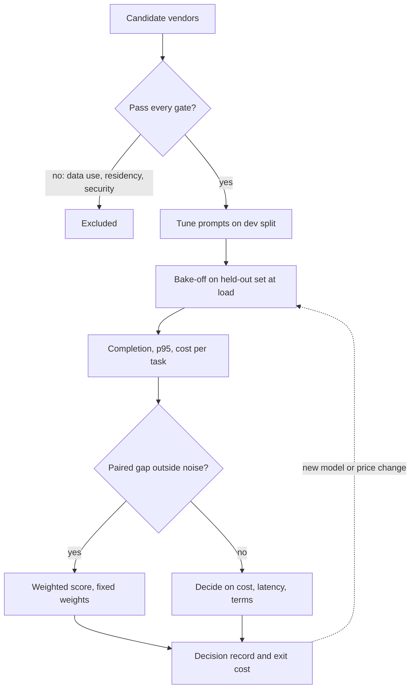

## TL;DR
Vendor evaluation picks the model provider, vector database or tooling your agent depends on by testing
candidates on your own agent tasks: hard gates first, then a bake-off (completion, latency under load,
cost per completed task), then exit terms.

## For agent builders
- **Why it matters for agents.** An agent multiplies every vendor property by its step count: a model
  that is slightly worse at tool calls fails more runs, latency adds up across steps, and a cheap per-call
  price can become an expensive completed task once extra steps and retries are counted.
- **Where it shows up in your stack.** Choosing the model behind your agent loop, the vector store behind
  its retrieval tool, and eval or tracing tools; each choice sits behind your gateway or tool interface.
- **What you control.** The agent eval set (real tasks with checkable outcomes), an equal prompt and
  tool-description budget per candidate, measuring at production concurrency, and the cost-per-completed-
  task formula.
- **What you can skip.** Procurement mechanics and contract negotiation detail; know the gates, the noise
  interval on your eval size and the exit-cost questions.

## Decision case
### Scenario
A manufacturer is choosing the model behind a procurement agent that reads purchase requests, checks the
supplier catalogue and budget through tools, and drafts a purchase order in the ERP.

A run that does not
reach a correct end state goes to a buyer, at about $1.00 of buyer time per failed run. All figures are
illustrative, and the candidates are hypothetical.
- **Volume:** about 20,000 requests a month.
- **Gates:** EU processing, no training on customer data, a pinnable model version.
- **Latency:** p95 for a whole run under 20 s, because the requester waits in a form.
- **Budget:** at most $0.25 per request, including buyer fixes of failed runs.
- **Exit:** the model must sit behind the company's gateway alias; no multi-year commitment.
- **Bake-off:** 300 held-out tasks, tool descriptions tuned per model on a separate 60-task dev split,
  same loop and sandboxed tools for every candidate.

### Options
| Measure | X: frontier API | Y: cheaper API | Z: self-hosted open-weight |
|---|---|---|---|
| Gates | Pass | Pass | Pass (runs in own EU data centre) |
| Price per step | $0.015 | $0.005 | Fixed GPU cost of $6,000 a month, so $0.30 per request at 20,000 |
| Steps per run, completion | 6, 0.90 | 9, 0.86 | 10, 0.80 |
| Cost per request incl. fixes | 0.09 + 0.10 × 1.00 = $0.190 | 0.045 + 0.14 × 1.00 = $0.185 | 0.30 + 0.20 × 1.00 = $0.50 |
| Run p95 (p95 per step × steps) | 2.0 × 6 = 12 s | 1.5 × 9 = 13.5 s | 2.5 × 10 = 25 s |
| Fits budget and latency | Yes | Yes | No on both |

### Decision
**Y as the primary model behind the alias, with X configured as the tested fallback.** Z fails the latency
and cost constraints. X and Y both pass, and the evidence does not separate them.
- **Completion is a statistical tie.** The 4-point gap (0.90 vs 0.86) comes from 30 tasks only X completed
  and 18 only Y completed; an exact sign test on those 48 disagreements gives p ≈ 0.11, so the gap is
  inside the noise.
- **Cost is a near tie:** $0.185 against $0.190 per request, about $3,700 against $3,800 a month.
- **So the tie-breaks are headroom and exit.** Y leaves more room under the $0.25 budget if steps grow,
  and keeping X warm behind the same alias keeps exit cost low.

**What would change it.**
- **Fix cost per failed run above $1.125.** The cost lines cross where 0.09 + 0.10f = 0.045 + 0.14f, so
  f = $1.125. At $2.00, X costs $0.29 and Y $0.325, both over budget, and X would be preferred while
  failure rates are cut.
- **A larger paired sample separates them:** re-run on 600 tasks if the buyers report more failures than
  the bake-off predicted.
- **Volume triples to 60,000:** Z's fixed cost falls to $0.10 per request, but with 20% of runs failing it
  still costs 0.10 + 0.20 × 1.00 = $0.30, over budget. Re-test Z only if its latency fits and its completion
  reaches at least 0.85 (0.10 + 0.15 × 1.00 = $0.25).

### Trade-offs accepted
- **Y takes 50% more steps than X.** More steps mean more places to fail; watch steps per completed task
  and invalid tool calls per model version in production traces.
- **Maintaining a fallback costs prompt work.** Two models' tool descriptions must stay tuned; re-run the
  bake-off job whenever either vendor ships a version.
- **The decision rests on an assumed $1.00 fix cost.** Measure real buyer time on failed runs in the first
  month and recompute the crossover.

### Review rubric
- **Gates applied before scores:** any candidate failing data use, residency or pinning is excluded first.
- **Cost per completed task derived:** steps, step price and the cost of handling failed runs are combined,
  and the arithmetic checks.
- **Latency measured per run, at load:** per-step p95 times steps, compared with the user-facing budget.
- **Noise checked with a paired test:** the write-up reports disagreements and says whether the gap is real.
- **Crossover stated:** the input value at which the choice flips is computed, not guessed.
- **Exit kept cheap:** the choice sits behind an interface, with a fallback or a re-run trigger named.

## Why it exists
- **AI vendors differ most on what a demo never shows.** The decisive properties are often
  non-functional: whether your data is retained or used for training, which regions process it, what rate
  limits you get, how much notice before a model is deprecated, and how hard it is to leave.
- **Public benchmarks do not transfer reliably.** They measure tasks that may look nothing like yours, and
  some benchmark data has leaked into training sets, so a leaderboard gap may not transfer.
- **Demos and prices are not comparable.** Demos run on the vendor's chosen examples; pricing is per token,
  per query, per seat or per "credit", incomparable until converted to cost per unit of your work.
- **The naive process fails predictably.** A feature checklist rewards breadth over fit; a demo hides
  failure modes on your messy inputs; the list price ignores that a cheaper model needing two retries,
  longer prompts or more human review can cost more per correct outcome. Teams discover the gaps after
  integration, when switching is expensive, and live with a vendor that fails a security review or
  throttles them at peak.
- **Evaluation recurs.** Model vendors ship new versions frequently, so the harness should be re-runnable
  when a new candidate appears, not a one-off procurement exercise. For an agent, a new model version can
  change tool-calling behaviour even when single-answer quality looks the same.

## How it works
### 1. Write requirements as gates and weighted criteria
- **Must-haves are pass/fail gates:** data use (no training on your data, retention period, zero-retention
  options), data residency, security attestations and the answers your security questionnaire needs,
  required deployment mode (API, VPC, self-hosted), and compliance obligations.
- **A vendor that fails a gate is out regardless of score**, *because* a weighted average lets a high
  quality score compensate for a disqualifying flaw.
- **Differentiators are scored**, with weights fixed **before** seeing results, so the scoring is not
  reverse-engineered to justify a favourite.

### 2. Build a task-specific evaluation set
- **A few hundred real, representative, labelled examples** from your workflow, including the hard and ugly
  cases (scanned PDFs, long threads, other languages).
- **Keep it private.** Never send it to vendors for "tuning" before the test, *because* then you are
  measuring their preparation, not their product.
- **Size it for the differences you need to detect.** The 95% interval on accuracy *p* measured on *n*
  items is roughly ±1.96 × √(p(1−p)/n): at p = 0.95 and n = 400 that is about ±2 points. Two vendors 1
  point apart on 400 items are tied, and the decision must rest on cost, latency or terms.
- **Compare *paired*.** Every vendor runs on the same items, so count items A gets right and B gets wrong,
  and vice versa. Only the disagreements carry information, which makes paired comparison more sensitive
  than comparing two headline percentages; reading them tells you *what kind* of input each vendor fails
  on.

### 3. Run a controlled bake-off
1. **Same harness, same scoring, and an equal prompt-engineering budget per vendor**, tuned on a separate
   development split and scored once on the held-out test split.
2. **Do not reuse prompts tuned for the incumbent**, *because* they encode that model's quirks and quietly
   favour it.
3. **If outputs are sampled**, run each item more than once or fix the decoding settings, and report the
   spread.
4. **Measure for each candidate:**

| Metric | How |
|---|---|
| **Quality** | Your metric: accuracy, faithfulness, pass rate on acceptance criteria. |
| **Latency** | p50 and p95 at your expected concurrency, not single requests, *because* rate limits and queueing appear only under load. |
| **Cost per successful task** | Total cost (tokens, retries, fixed fees, human review of failures) divided by tasks completed correctly. The number that makes different pricing models comparable. |
| **Operational fit** | Quotas in your region, SLA terms, observability hooks, SDK quality, support. |

- **Count each cost once.** If a human fixes a failure, that task is delivered and its review cost is in
  the numerator. If failures are simply discarded, there is no review cost but they drop out of the
  denominator.
- **Non-model vendors use the same structure with different metrics.** A vector database is measured on
  recall@k and p95 query latency at your corpus size and with your metadata filters, plus ingestion and
  update throughput, *because* index behaviour changes with scale and filter selectivity in ways a small
  demo corpus never shows.

### Agent-specific bake-off metrics
When the model drives an agent loop, score the whole run, not one call:

| Metric | Why it matters for an agent |
|---|---|
| **Task-completion rate** | The end state is checked (ticket routed, record updated), because a run can make plausible calls and still fail. |
| **Tool-call validity** | Share of tool calls with valid arguments for the schema; invalid calls cost a retry step each. |
| **Steps per completed task** | More steps mean more tokens, more latency and more chances to go wrong. |
| **End-to-end latency** | Per-step latency times steps, measured at load, because users wait for the whole run. |
| **Cost per completed task** | All steps, retries and review of failed runs, divided by runs that completed correctly. |

- **Run each task more than once** when the loop samples, because one lucky trajectory hides a flaky
  agent; report the spread.

### 4. Assess the vendor, not just the product
- **Stability:** financial and roadmap stability.
- **Change management:** model deprecation policy and notice period, how changes are communicated, and
  whether a model version can be pinned.
- **Small vendors:** ask what happens to your data and service if they are acquired or shut down.

### 5. Price the exit before you enter
- **Estimate the cost of leaving:** proprietary formats, embeddings that must be regenerated, prompts tuned
  to one model, contractual minimums.
- **Prefer vendors that fit behind your own interface** (gateway, standard APIs), *because* a low exit
  cost is what keeps the next negotiation honest.

### 6. Decide, document, and schedule re-evaluation
- **Decision record:** the scores, the gates and the reasoning.
- **Re-run the harness** when a material new option or price change appears.

## Diagram
Gates remove candidates before any scoring; only survivors run your agent tasks in the bake-off, and a
gap inside the noise sends the decision to cost, latency and terms.



## Examples
### Scoring three providers for invoice field extraction
Quality and latency come from a bake-off on 400 labelled invoices; prices and figures are illustrative.

```python
vendors = {
    #       gates_ok, accuracy, p95_s, cost_per_call, review_cost_per_failure
    "A": (True,  0.96, 2.8, 0.010, 0.50),
    "B": (True,  0.91, 1.2, 0.002, 0.50),
    "C": (False, 0.97, 1.9, 0.006, 0.50),   # fails residency gate: data leaves the region
}
weights = {"cost": 0.5, "latency": 0.2, "accuracy": 0.3}   # fixed before the bake-off
P95_BUDGET = 3.0

def cost_per_success(acc, call, review):
    # every invoice ends correct: the model's output, or a human fix of a flagged failure
    return call + (1 - acc) * review   # each pays one call; failures also pay a review

rows = {}
for v, (ok, acc, p95, call, review) in vendors.items():
    if not ok or p95 > P95_BUDGET:
        print(v, "excluded by gate"); continue
    rows[v] = (acc, p95, cost_per_success(acc, call, review))

best_cost = min(r[2] for r in rows.values()); best_p95 = min(r[1] for r in rows.values())
for v, (acc, p95, cps) in rows.items():
    score = (weights["cost"] * best_cost / cps + weights["latency"] * best_p95 / p95
             + weights["accuracy"] * acc)
    print(f"{v}: acc={acc:.2f} p95={p95}s cost/success=${cps:.4f} score={score:.3f}")
# C excluded by gate
# A: acc=0.96 p95=2.8s cost/success=$0.0300 score=0.874
# B: acc=0.91 p95=1.2s cost/success=$0.0470 score=0.792
```

- **The cheap call is the expensive outcome.** B's call price is five times lower, but its extra 5 points
  of errors each need a 50-cent human fix, so its cost per successful extraction is higher than A's
  ($0.047 vs $0.030).
- **C is out anyway.** It has the best accuracy, but its one-point lead over A is inside the ±2-point noise
  on 400 items, so it was not a clear winner even before the gate. A's 5-point lead over B is outside it.
- **The model assumes failures are caught** (by validation rules or review). If they slip through
  undetected, their downstream cost belongs in the review term and usually dwarfs the call price.
- **Accuracy enters twice**, inside cost per success and as its own weighted term. That is defensible only
  if the accuracy weight stands for something cost does not capture (undetected errors, user trust);
  otherwise drop it, or the scoring double-counts.

### Is the gap real? A paired comparison on the same 400 items
Counts of items only one vendor got right are illustrative but consistent with the accuracies above.

```python
from math import comb, sqrt

def ci95(p, n):
    return 1.96 * sqrt(p * (1 - p) / n)        # normal approximation to the 95% interval

def paired_p(only_a, only_b):
    # exact two-sided sign test on the disagreements (McNemar's exact test)
    k, m = min(only_a, only_b), only_a + only_b
    tail = sum(comb(m, i) for i in range(k + 1)) / 2 ** m
    return min(1.0, 2 * tail)

n = 400
print(f"+/- {ci95(0.95, n):.3f} at p=0.95, n={n}")
for name, only_x, only_y in [("A vs B", 26, 6), ("C vs A", 10, 6)]:
    gap = (only_x - only_y) / n
    print(f"{name}: gap {gap:+.3f}, disagreements {only_x + only_y}, p = {paired_p(only_x, only_y):.4f}")
# +/- 0.021 at p=0.95, n=400
# A vs B: gap +0.050, disagreements 32, p = 0.0005
# C vs A: gap +0.010, disagreements 16, p = 0.4545
```

| Pair | Only first right | Only second right | Gap | Verdict |
|---|---|---|---|---|
| A vs B | 26 | 6 | 5 points | Real: decide on it |
| C vs A | 10 | 6 | 1 point | Tied: decide on cost, latency, terms |

- **Read the 32 and 16 disagreeing items by hand**; they show which input types (scans, other languages)
  each vendor fails on.

### Worked scenario: two models behind a support-ticket agent
Each candidate runs the same agent loop (same tools, tool descriptions tuned per model on a dev split) on
200 held-out tickets. A failed run goes to a human at $0.50 per ticket. All figures are illustrative.

| Measure | Model A | Model B |
|---|---|---|
| Price per step (tokens in and out) | $0.012 | $0.004 |
| Average steps per run | 7 | 11 |
| Cost per run | 7 × 0.012 = $0.084 | 11 × 0.004 = $0.044 |
| Task-completion rate | 0.86 | 0.74 |
| Cost per ticket incl. human fix of failures | 0.084 + 0.14 × 0.50 = $0.154 | 0.044 + 0.26 × 0.50 = $0.174 |
| p95 per step at load | 1.4 s | 0.9 s |
| Rough run time (p95 per step × average steps) | ~9.8 s | ~9.9 s |

- **B is three times cheaper per step and still loses.** It needs more steps (weaker tool selection) and
  fails more runs, so the human fixes dominate.
- **Faster steps did not buy a faster agent**, because B takes more of them.
- **Check the gap against noise:** on 200 runs the interval on 0.86 alone is about ±5 points, and on the
  difference of two independent rates about ±8, so the 12-point completion gap is real (a paired count on
  the same tickets is tighter still); read the failed trajectories to see where B goes wrong.

## Production patterns
- **Re-runnable bake-off harness** — keep the held-out set, each vendor's prompts (tuned on the dev split)
  and the scorer in one versioned job that emits the quality, p95 and cost-per-success table. Re-run it
  when a vendor ships a model or changes price; monitor deltas against the current choice.
- **Load test at production concurrency** — drive each candidate with a load tool such as Locust or k6 at
  expected peak concurrency, within the quota you will actually be granted in your region. Record p50, p95
  and the rate of HTTP 429 (rate-limited) responses, not just averages.
- **Weights and gates in the decision record before results** — commit the gates, weights and latency
  budget (like `P95_BUDGET` above) to the record before the bake-off runs. Monitor whether later audits or
  new stakeholders can reproduce the decision from it.
- **Pinned versions and a deprecation calendar** — configure a dated model version rather than a floating
  alias in the gateway, and log each vendor's deprecation notices with a re-validation date well before
  retirement. Monitor days of notice remaining per pinned model.
- **Exit-cost line in every contract review** — record proprietary formats, embedding regeneration cost and
  contractual minimums alongside price, and prefer short terms in fast-moving categories. Monitor the
  estimate at each renewal.
- **Trajectory-level agent bake-off** — replay the same held-out agent tasks against each candidate model
  through your own loop and mock or sandboxed tools, scoring the end state of each run. Monitor completion
  rate, invalid tool calls, steps per completed task and cost per completed task per model version.
- **Shadow runs before switching an agent's model** — send a sample of live agent tasks to the challenger
  in read-only mode, with tool writes disabled, and compare its proposed actions with the incumbent's.
  Monitor the action-disagreement rate before any cutover.

## Trade-offs
- **Rigorous bake-off vs speed.** Decisions transfer to production, but cost weeks of labelling and
  engineering; for low-risk, easily reversible choices a lighter pilot is enough.
- **Multi-vendor vs simplicity.** Several vendors behind a gateway reduce lock-in and outage risk, but
  multiply security reviews, contracts and prompt maintenance; they pay off when volume or criticality is
  high.
- **Top quality vs price.** The top-quality vendor maximises accuracy but may cost more per call; it flips
  when error costs are low and a cheaper model's failures are cheap to catch.
- **Commitment discounts vs exit cost.** Long-term commitments buy discounts, but raise exit cost in a
  market where prices often fall and better models appear; keep terms short when the category is moving
  fast.
- **Agent framework or platform vendor vs your own loop.** A hosted agent platform ships tools, memory and
  tracing quickly, but owns your loop and traces and raises exit cost; it flips toward your own thin loop
  once the agent is core to the product.

## Pitfalls
- **Trusting public leaderboards for a domain task.** Symptom: a vendor that ranked first loses on your
  own invoices or tickets. Fix: your own labelled set.
- **Comparing list prices instead of cost per successful task.** The cheap option turns out expensive once
  retries and human correction are counted.
- **Testing latency with single requests.** Production hits rate limits or queueing at peak and p95
  latency breaks the user-facing budget.
- **Setting weights after seeing results.** The decision record reads like a justification, and the next
  audit or new stakeholder challenges it.
- **Ignoring deprecation policy.** A pinned model is retired with short notice and the team must
  re-validate prompts and evals in a hurry.
- **Running challengers on prompts tuned for the incumbent.** The incumbent wins every bake-off, and the
  gap shrinks or vanishes once someone spends a few days prompting the challenger properly.
- **Declaring a winner on a one- or two-point gap from a few hundred items.** The "better" vendor's lead
  evaporates on the next re-run or the production sample.
- **Comparing agent models on single-turn accuracy.** The winner on one-shot answers loops, calls tools
  with bad arguments or stops early inside the agent. Fix: score full trajectories on real tasks and
  count cost per completed task.

## When to use
- **Use the full process when** the choice is expensive to reverse or touches sensitive data: primary
  model provider, vector store, platform vendors, anything inside the customer's data boundary.
- **Use a light version** (gates plus a small bake-off) for tools that are cheap to swap.
- **For agents, always run the bake-off through the loop:** completion rate, steps and cost per completed
  task on real tasks, before switching the model behind a production agent.
- **Measure:** quality on your own set with its confidence interval, p95 latency at load, cost per
  successful task, and exit cost. Re-run when new models ship or prices change.
- **Interviews:** the signal is separating gates from scores, insisting on your own data, and converting
  pricing to cost per correct outcome.

## Role lens
- **Engineer:** Builds the reusable bake-off harness, runs candidates on the same labelled set, and
  reports quality, p95 latency and cost per success in one table.
- **Architect:** Defines the gates and weights, owns the decision record, and makes sure the chosen
  vendor sits behind an interface that keeps exit cost low.
- **FDE:** Evaluates vendors against the customer's own constraints (their region, procurement rules,
  security questionnaire) and data, not the vendor's demo set.

## Check yourself
**Q:** Vendor X's model is cheaper per token than Vendor Y's and scores slightly lower on your eval.
Procurement wants X. What do you check before agreeing?
**A:** First, that X passes every gate: data use and retention terms, residency, security answers,
deployment mode. Next, whether "slightly lower" is real: on a few hundred items a one- or two-point gap
may be noise, so I would look at the paired disagreements and what kind of inputs X gets wrong. Then convert both to cost per successful task: X may need longer prompts, more retries or
more human correction, and if failures cost real review time, a small accuracy gap can outweigh a
large token discount. I would also check p95 latency and rate limits at our concurrency, the deprecation
policy and version pinning, and the exit cost. If X still wins on cost per success within the latency
budget, X is the right call; if not, the table makes the case to procurement in their own terms.

## Interview questions
### Why not just pick the model that tops the public leaderboard?
- **Leaderboards measure someone else's task.** Benchmarks may look nothing like your inputs, and some
  benchmark data has leaked into training sets, so a leaderboard gap may not transfer.
- **The decisive properties are elsewhere:** data terms, residency, rate limits, deprecation notice and
  exit cost, plus quality on your own messy inputs, which only your own labelled set measures.

### How large does your evaluation set need to be to choose between two vendors?
- **Work from the interval:** ±1.96 × √(p(1−p)/n) is about ±2 points at 95% accuracy on 400 items, so a
  1-point gap at that size is a tie.
- **Use paired comparison** on the same items: only the disagreements carry information, so a sign test on
  them is more sensitive than comparing two headline percentages.
- **If you need to detect smaller gaps,** label more items or let cost, latency and terms decide.

### The incumbent vendor wins every bake-off you run. What might be wrong?
- **Prompt bias:** challengers are run on prompts tuned for the incumbent, which encode its quirks.
- **Fix the protocol:** an equal prompt-engineering budget per vendor on a development split, a single
  scoring run on the held-out split, and fixed decoding settings or repeated runs for sampled outputs.
- **Check the set** too: if it was built from cases the incumbent already handles, it is biased toward it.

### When is a cheaper, less accurate model the right choice for an agent step?
- **When errors are cheap to catch.** If validation rules flag failures and a fix costs little, cost per
  successful task can favour the cheaper model despite lower accuracy.
- **Not when failures slip through undetected,** because their downstream cost belongs in the review term
  and usually dwarfs the call price; compute cost per success both ways before deciding.
- **In an agent, count steps too:** a cheaper model that needs more steps or fails more runs can cost more
  per completed task, so it often fits narrow sub-steps (routing, extraction) better than the main loop.

### How would you evaluate vector database vendors differently from model providers?
- **Same structure, different metrics:** gates first, then a bake-off on recall@k and p95 query latency at
  your corpus size and with your metadata filters, plus ingestion and update throughput.
- **Test at real scale and filter selectivity,** because index behaviour changes with both in ways a small
  demo corpus never shows; then price exit, since embeddings may need regenerating.

### How would you choose the model behind a production tool-calling agent?
- **Gates first,** then run each candidate through your own agent loop on held-out real tasks with the same
  tools, tuning prompts and tool descriptions per model on a dev split.
- **Score the run, not the call:** task-completion rate, invalid tool calls, steps per completed task,
  end-to-end latency at load and cost per completed task including human fixes of failed runs.
- **Before cutover,** shadow the challenger on live tasks with writes disabled and compare its proposed
  actions with the incumbent's.

## Quiz
### Q: Why are must-have requirements handled as gates instead of heavily weighted criteria?
- [ ] Gates are faster to evaluate than weighted scores
- [x] A weighted average lets strong scores elsewhere compensate for a disqualifying flaw
- [ ] Vendors prefer pass/fail requirements in procurement
- [ ] Weighted scoring cannot handle more than five criteria
> A vendor that violates residency or trains on your data is unacceptable whatever its accuracy. Any
> finite weight lets enough quality offset the violation, so the requirement must be a hard filter.

### Q: Which metric best compares vendors that use different pricing models?
- [ ] Price per million input tokens
- [ ] Monthly platform fee
- [x] Total cost divided by the number of tasks completed correctly
- [ ] Rank on a public benchmark divided by price
> Cost per successful task folds in token prices, retries, fixed fees and the cost of handling failures,
> so a per-token discount and a per-seat plan become directly comparable on the outcome you pay for.

### Q: Why should latency in a bake-off be measured at expected concurrency?
- [ ] Single-request latency is always higher than under load
- [ ] Vendors charge less for concurrent requests
- [x] Rate limits and queueing only appear under load, and they drive p95 latency
- [ ] Concurrency improves accuracy through batching
> One request at a time hides throttling and queueing delays. The user-facing latency budget is usually a
> tail percentile, so it must be measured under production-like concurrency.

## Use cases & projects
### Use cases
- **Picking the model for a new agent.** Two or three providers run the same agent loop on real tasks,
  and cost per completed task decides between those that pass the gates.
- **Re-validating after a model release.** The bake-off job re-runs the agent eval when a provider ships a
  new version, catching tool-calling regressions before the alias is remapped.
- **Choosing the vector store behind a retrieval tool.** Recall@k and p95 at your corpus size and filters
  decide, not a demo corpus.
- **Deciding on a hosted agent platform.** Gates on data use and trace ownership, then exit cost, before
  any feature comparison.

### Mini project
**Agent model bake-off (2-3 hours).**
- **Goal:** compare two models as the brain of the same small tool-calling agent on your own tasks.
- **Steps:** write 40 tasks with checkable end states and two mock tools; split 10 for prompt tuning and 30
  held out; run each model three times per held-out task through the same loop; log completion, invalid tool
  calls, steps, tokens, latency per step and cost; compute cost per completed task with a review cost for
  failed runs; compute the noise interval on completion.
- **Done when:** you have one table per model, a paired count of tasks only one model completed, and a
  written recommendation that says whether the gap is outside the noise and what drove the cost.
