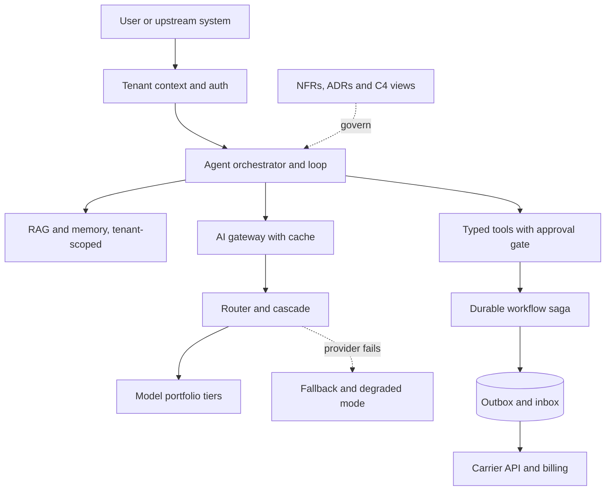

## Overview
This module covers designing the whole system around a model call, from the first requirement to the
deployment boundary. For an agent builder, that system is your agent: the loop, its tools, its models,
its memory and the services it changes. The model is rented, probabilistic and stateless, so every
guarantee your agent needs comes from the design around it.

It starts with the architect's working method. AI solution architecture says what belongs to the model
and what belongs to deterministic code. NFRs turn adjectives like "fast" and "accurate" into measurable
scenarios. Trade-off analysis, ADRs and C4 diagrams then let you choose between options, record the
choice and show the result.

How the topics connect, layer by layer:

- **Blueprints and sourcing:** reference architectures give you starting blueprints, and build versus buy gives a per-layer sourcing decision.
- **Model layer:** selecting a model on your own evals, SLMs against LLMs, open-weight against proprietary, self-host against API, and how to govern a small portfolio.
- **Control plane:** route and cascade requests, put an AI gateway in front of every call, and plan fallbacks, degradation and caching.
- **Application shapes:** RAG, memory, agentic and multi-agent systems, and orchestration.
- **Distributed-systems foundations:** partial failure, sync against async execution, consistency, events, outbox and inbox, sagas, and the limits of exactly-once.
- **Structure and ownership:** the module closes with DDD, modular monolith against microservices, and multi-tenancy with real tenant isolation.

Which lessons matter most for agents:

- **Core (you use them directly):** ai-solution-architecture, reference-architectures, build-vs-buy, agentic-architecture, agent-orchestration, multi-agent-systems, model-selection, multi-model-architecture, model-routing-cascading, model-fallback-strategies, graceful-degradation, caching-strategy-and-cache-invalidation, rag-architecture, memory-architecture, synchronous-vs-asynchronous-execution, data-consistency, exactly-once-processing-limitations, saga-pattern-and-distributed-transactions and tenant-isolation.
- **Useful (you meet them when sourcing models, operating agents or splitting services):** ai-gateway, distributed-systems, outbox-inbox-patterns, multi-tenancy, nfrs, trade-off-analysis, adrs, slm-vs-llm-trade-offs, open-weight-vs-proprietary, self-host-vs-api, model-portfolio, event-driven-architecture, workflow-orchestration, domain-driven-design-and-bounded-contexts and modular-monolith-vs-microservices.
- **Background:** c4-diagrams, the notation you use to show the design to reviewers.

Afterwards you can:

- Take a vague AI product brief and produce a defensible architecture for the agent behind it.
- Write measurable NFRs, a costed model plan and a failure-aware runtime design for an agent.
- Draw tenant boundaries that hold through retrieval, caches, memory and the prompt.
- Leave ADRs and diagrams that let other people review and challenge the design.

It matters most for Architects. Senior Engineers who own a service end to end and FDEs who design
deployments for customers need it too.

## Why it matters
- **Engineer:** You implement the seams this module defines for your agent: the gateway client, the outbox relay, idempotent saga steps for side-effecting tools, tenant-scoped cache keys and retrieval filters, the async job API with streaming for long agent runs, and the router's quality check. If any of them is wrong, a duplicate charge or a cross-tenant leak follows.
- **Architect:** You own the agent decisions that are expensive to reverse: model tiers and sourcing, gateway and orchestration runtime, monolith or service split, pool, bridge or silo tenancy, and consistency guarantees per store. You have to defend each one with NFR scenarios, a trade-off matrix, an ADR and a C4 view that reviewers can check.
- **FDE:** Customers arrive with residency rules, an existing identity provider, a budget and a hard deadline for the agent you deploy. You have to fit a reference architecture to those constraints, explain self-host versus API and build versus buy in their terms, and leave behind diagrams and ADRs their own team can maintain after you leave.

## Mental model
Picture the system as concentric layers around a rented, probabilistic, stateless model, each layer
adding a guarantee the model cannot give. A design nobody can review or reverse is not finished.

| Layer | What it adds to your agent | Lessons |
|---|---|---|
| Model plan (innermost) | Which models, chosen on your data, sourced by deliberate build, buy, host and licence decisions, and governed as a portfolio | model-selection, slm-vs-llm-trade-offs, open-weight-vs-proprietary, self-host-vs-api, model-portfolio, build-vs-buy |
| Control plane | A gateway, routing and cascades, fallbacks, a degradation ladder and caches, so quality, cost and availability are managed in one place | ai-gateway, model-routing-cascading, model-fallback-strategies, graceful-degradation, caching-strategy-and-cache-invalidation, multi-model-architecture |
| Application shapes | Feed the model context and let it act | rag-architecture, memory-architecture, workflow-orchestration, agentic-architecture, agent-orchestration, multi-agent-systems |
| Distributed system (underneath) | Timeouts, idempotency, an explicit consistency choice, and outbox, inbox or saga handling where state crosses services | distributed-systems, synchronous-vs-asynchronous-execution, data-consistency, event-driven-architecture, exactly-once-processing-limitations, outbox-inbox-patterns, saga-pattern-and-distributed-transactions |
| Structure and ownership (outer) | Bounded contexts, deployment units and tenant isolation | domain-driven-design-and-bounded-contexts, modular-monolith-vs-microservices, multi-tenancy, tenant-isolation |
| Decision discipline (wrapping all) | Measurable NFRs drive trade-off analysis, the result is recorded in ADRs, and C4 diagrams show it | ai-solution-architecture, nfrs, trade-off-analysis, adrs, c4-diagrams, reference-architectures |

The flow below shows one agent request crossing those layers.

## Suggested order
1. ai-solution-architecture — agent core: frames the job, what the model does, what deterministic code must guarantee, and the components around every call.
2. reference-architectures — agent core: introduces the recurring AI system shapes, agents among them, that you start from and deviate from on purpose.
3. build-vs-buy — agent core: decides per layer of the agent stack what to own and what to rent, and where to keep a seam so the choice can be reversed.
4. agentic-architecture — agent core: wraps a model-driven loop in typed tools, budgets, approval gates and externalised state.
5. agent-orchestration — agent core: decides how much control flow is code and how much is the model, and where checkpoints and interrupts go.
6. multi-agent-systems — agent core: splits work across several agents only when isolation, parallelism or specialisation pays for the coordination cost.
7. model-selection — agent core: the eval-driven funnel for picking the cheapest model that clears a measured quality bar.
8. multi-model-architecture — agent core: breaks one system into stages with a different model per stage, joined by typed contracts.
9. model-routing-cascading — agent core: sends each request to the right portfolio tier before or after a cheap first attempt.
10. ai-gateway — useful, but a prerequisite here: centralises keys, budgets, routing, caching and logging, which makes routing and fallbacks operable.
11. model-fallback-strategies — agent core: decides in advance what the gateway calls when a provider throttles or fails.
12. graceful-degradation — agent core: goes beyond fallbacks to a labelled ladder of reduced functions for when the AI path cannot be saved.
13. caching-strategy-and-cache-invalidation — agent core: cuts cost and latency at the prefix, response, embedding and retrieval layers without serving stale or wrong answers.
14. rag-architecture — agent core: the most common application shape, an offline indexing pipeline and an online retrieval path joined by an index.
15. memory-architecture — agent core: extends retrieval to state the system writes itself, scoped per user and tenant, with forgetting policies.
16. distributed-systems — useful, but a prerequisite here: sets out partial failure and the core toolkit every multi-service AI product relies on.
17. synchronous-vs-asynchronous-execution — agent core: picks request, stream or job-and-callback shapes for calls that take seconds to minutes.
18. data-consistency — agent core: chooses which invariants must be strong and which copies, such as indexes, caches and memory, may lag.
19. exactly-once-processing-limitations — agent core: explains why delivery cannot be exactly once and how to get exactly-once effect instead.
20. outbox-inbox-patterns — useful, but a prerequisite here: the concrete mechanism for publishing events atomically and processing redeliveries idempotently.
21. saga-pattern-and-distributed-transactions — agent core: coordinates multi-step operations across services with compensations around an irreversible pivot.
22. multi-tenancy — useful, but a prerequisite here: carries tenant identity through every layer and picks pool, bridge or silo per resource.
23. tenant-isolation — agent core: layers independent controls so one bug cannot leak data or capacity across tenants, including through the prompt.
24. nfrs — useful: turns quality, latency, cost and safety goals into measurable scenarios, so the choices above have something to be judged against.
25. trade-off-analysis — useful: gives a repeatable method for choosing between options using those NFRs, sensitivity points and reversibility.
26. adrs — useful: records each decision with its evidence and revisit trigger, so your agent design produces durable records.
27. c4-diagrams — background: supplies the notation for showing where models, data and trust boundaries sit in every design.
28. slm-vs-llm-trade-offs — useful: applies selection to model size and shows when a narrow small model beats a frontier one.
29. open-weight-vs-proprietary — useful: separates the control and licensing axis from the deployment decision.
30. self-host-vs-api — useful: works through the utilisation and constraint arithmetic that decides whether GPUs pay for themselves.
31. model-portfolio — useful: turns individual choices into a small, governed set of models with owners, baselines and retirement plans.
32. event-driven-architecture — useful: decouples producers from consumers such as billing, evals and audit, at the cost of eventual consistency.
33. workflow-orchestration — useful: runs long, stateful processes durably with Airflow, Prefect or Temporal instead of hand-rolled sagas.
34. domain-driven-design-and-bounded-contexts — useful: draws boundaries by business meaning, which then define tool, data and service ownership.
35. modular-monolith-vs-microservices — useful: turns those boundaries into deployment units only where scaling, team or blast radius demands it.

## Capstone
### Brief
**Use case:** a B2B insurance-software vendor will sell "Policy Desk", a multi-tenant AI assistant, to
its broker customers. Brokers upload policy documents and ask questions with cited answers.

An agent drafts endorsement change requests, which a human must approve before the agent submits them
to the carrier's API and records the fee in billing. Tenants range from ten-seat agencies to one
enterprise that requires EU data residency and refuses to have its data in a shared vector index.

This is the module's major project: design, and partly build, the architecture over one week. The
work, in order:

- **NFRs:** write measurable NFRs for answer quality, latency, cost per question, availability and isolation.
- **Model plan:** run model selection on a small labelled set and define a three-tier portfolio with routing and a fallback chain behind a gateway.
- **Context layers:** design the RAG and memory layers with tenant-scoped indexes and caches.
- **Agent actions:** specify the approval-and-submit flow as a durable workflow saga with an outbox for the billing event.
- **Structure:** decide the bounded contexts, the deployment units and the pool, bridge or silo tier for each tenant class.
- **Decisions:** record each major choice as an ADR.

Finally, build a thin vertical slice that proves the riskiest parts: tenant-scoped retrieval, gateway
routing with fallback, and an idempotent submit step.

### Deliverables
- An architecture document with C4 context and container diagrams, plus a component diagram for the agent runtime, each showing the trust and tenant boundaries and where every model call sits.
- An NFR catalogue of at least ten measurable scenarios, each with stimulus, condition and numeric response measure, mapped to an SLO, a test or an eval gate.
- A model-selection report: candidates filtered by hard constraints, eval scores and cost per 1,000 requests on the labelled set, the chosen portfolio tiers, the routing or cascade rule, and the ordered fallback chain with the error classes that trigger it.
- At least six ADRs, covering at minimum self-host versus API, gateway choice, tenancy tier per customer class, sync versus async for agent runs, monolith versus service split, and cache keying. Each has options, a trade-off matrix and a revisit trigger.
- A sequence diagram and failure table for the approve-and-submit saga, listing each step's compensation, the irreversible pivot, idempotency keys, and the outbox and inbox records.
- A runnable slice with tests: a gateway config with two providers and fallback, tenant-filtered retrieval and tenant-keyed response cache, and a workflow step that submits to a mocked carrier API exactly once under retries.

### Rubric
- Every NFR has a number and a measurement method, and at least three ADRs cite a specific NFR or eval result as the deciding evidence instead of preference.
- The model plan shows measured cost and quality per tier on the labelled set, and the router's chosen mix is within a stated quality tolerance of always using the top tier at a lower stated cost.
- A test that queries as tenant A, with tenant B's documents indexed and cached on the same key text, returns no B content. The isolation test suite fails if the tenant filter or cache key prefix is removed.
- Killing the provider in the gateway config makes requests succeed on the secondary with a labelled fallback flag in logs. Killing both makes the UI show the designed degraded state, not an error page.
- Replaying the carrier submit step three times produces one carrier call and one billing event, shown by idempotency-key and outbox logs. A forced failure after the pivot runs the documented forward-recovery path, not a compensation.
- The C4 diagrams pass a reviewer check: every box has a name, type, technology and purpose, every arrow has intent, and the EU enterprise tenant's data path stays inside its silo and region.
