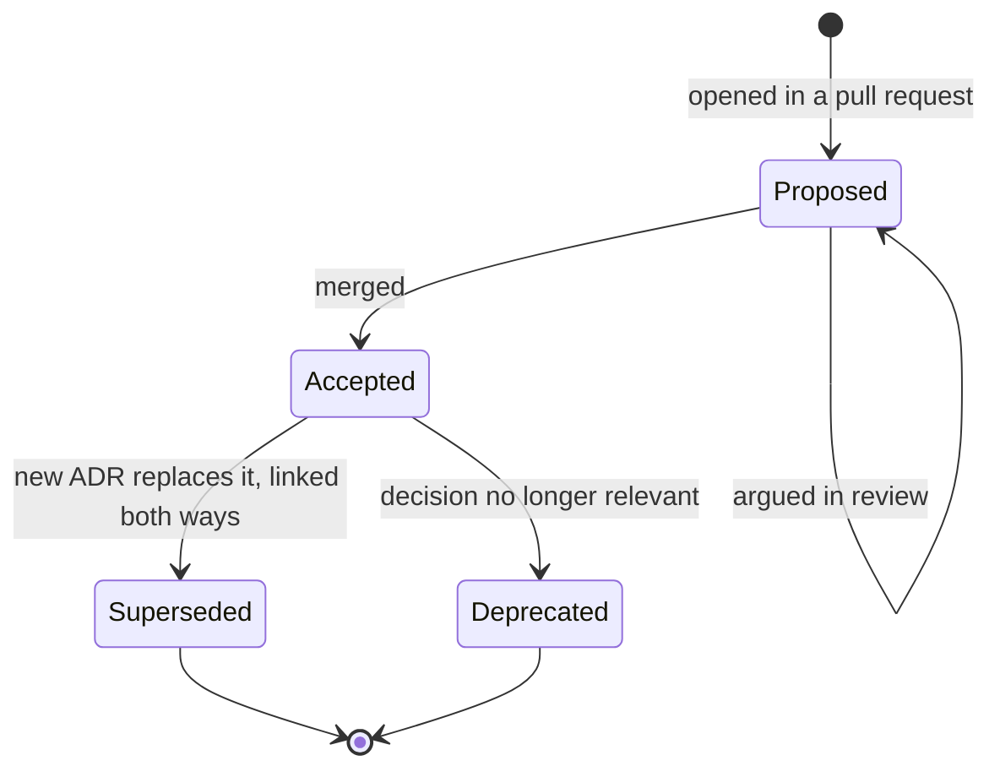

## TL;DR
An ADR is a short, numbered, immutable record of one significant decision: context, options, choice and
consequences. Decisions outlive the people who made them; in AI systems an ADR also captures the evidence
at decision time and the trigger for revisiting.

## Why it exists
- **Decisions are rarely written down.** Six months on, a new engineer finds the vector store is
  PostgreSQL with pgvector rather than a dedicated database, the context window is capped at 32k tokens,
  and every LLM call goes through a gateway. Nobody knows why.
- **Two bad outcomes follow.**
  - **Blind acceptance:** nobody dares change the choice because nobody knows what it protects, so the
    system calcifies around constraints that may no longer exist.
  - **Blind reversal:** someone "fixes" it and the original incident recurs, because the reason lived in
    the head of someone who left.
- **Existing artefacts do not record decisions.** Wiki pages describe current state and are edited in
  place, so reasoning and alternatives vanish. Design documents are long proposals written before the
  decision. Commit messages record *what* changed, not what was weighed.
- **AI systems move faster than the system.** "We chose model X because it scored best on our eval" is
  true on the day and unknowable a year later unless eval version, scores, prices and assumptions were
  captured. Without them the team cannot tell whether a decision is still right or merely old.
- **What the ADR buys.** The cheapest artefact that makes decisions inspectable, reversible on purpose,
  and reviewable like code.

## How it works
### What deserves one
- **The test is architectural significance:** would reversing it be expensive, or would someone later
  need to know why it was made?
- **Yes:** the vector store, tenancy model, gateway, retrieval strategy, model tier for a workload,
  evaluation gate for releases, data-residency approach.
- **No:** a logging library's formatter.
- **Calibration:** an ADR a week is probably recording tasks; three ADRs after a year is probably not
  recording decisions.

### Anatomy: Nygard's five parts
| Part | What it holds | Why |
|---|---|---|
| **Title and number** | `ADR-0007: Serve v1 through a hosted model API behind our gateway` | Numbers give a stable reference; the title states the decision, not the topic |
| **Status** | Proposed, Accepted, Deprecated, or Superseded by ADR-NNNN | The only field that changes after acceptance, *because* the record must stay an honest snapshot |
| **Context** | Forces stated neutrally: NFRs, constraints, team size, deadlines, costs, risks, uncertainties | Lets a future reader judge whether the decision still applies, so it describes conditions, not advocacy |
| **Decision** | "We will …" in full sentences, including what is explicitly *not* being done | Removes ambiguity about scope |
| **Consequences** | What gets easier, what gets harder, new risks, follow-up work | Every real decision has downsides; a record without them was written to justify, not to decide |

### MADR extensions
- **Decision drivers**, **considered options** with pros and cons, a **decision outcome** with its
  justification, and a **confirmation** section describing how compliance will be checked.
- **Worth it when there were real alternatives**, which for architecture is nearly always.
- **A one-line Y-statement summary** at the top: "In the context of …, facing …, we decided for … to
  achieve …, accepting …".

### Lifecycle and mechanics
1. **Lives in the repository**, typically `docs/adr/NNNN-title.md`, next to the code it governs,
   *because* that is where engineers look and where pull-request review already happens.
2. **Opened as *Proposed* in a pull request**, argued in review, and *Accepted* when merged.
3. **Never edited after that except for status.** Changing a decision means a new ADR that supersedes the
   old one, linked both ways. Immutability is the feature: the chain of records is the history of why the
   system looks the way it does.
4. **One or two pages, written at decision time.** An ADR reconstructed months later is a story, not a
   record.
5. **Linked from the C4 diagrams and README**, so the "why" is one click from the "what".

- **Design doc vs ADR.** A longer design doc or RFC often comes first: it explores the space and may run
  to ten pages. The ADR is the one-page outcome that links back to it.
- **Tooling is optional.** A numbered Markdown file is enough; adr-tools or log4brains only script the
  numbering, linking and index.

### Who decides, and how a decision stays true
- **Decision rights are recorded.** The Deciders line says who could accept it.
- **Two workable models.** Route every significant decision through an architect, or use an advice
  process: anyone may decide after consulting those affected and those with expertise, and the ADR is the
  evidence that advice was sought. Either works if it is written down; what fails is an unstated rule that
  surfaces as a veto after merge.
- **Unchecked decisions decay quietly.** Six months later someone imports the provider SDK directly "just
  for this one feature", and the gateway decision is void without anyone deciding so.
- **MADR's confirmation section exists for this.** Prefer an automated check, what *Building Evolutionary
  Architectures* calls a fitness function: an import-lint rule, a CI test, a policy-as-code rule or a
  dashboard alert. With automated confirmation a decision is enforced; without, it is a suggestion.

### What AI systems add to the template
- **Evidence snapshot.** Eval set version, scores, latency percentiles and cost per request for each option
  at decision time, so the decision can be re-run, not just re-argued.
- **Assumptions with expiry.** Provider pricing, rate limits, context limits, licence terms and expected
  traffic, each labelled with the date it was checked.
- **Revisit triggers.** Concrete conditions that force re-evaluation: a volume threshold, an open-weight
  model reaching eval parity, a residency requirement, a price change. Without one, an ADR becomes a
  reason never to look again.
- **Reversibility.** A two-way door (swap a model behind the gateway) or a one-way door (train on customer
  data, choose an embedding model that fixes the index).
- **Compliance and data flow implications.** Where customer data goes under this decision, and which
  approvals it needed.

### How it fits with the rest of the design toolkit
| Artefact | Role |
|---|---|
| Non-functional requirements | Define what matters |
| Trade-off analysis | Scores the options against them |
| ADR | Records the outcome and the reasoning |
| C4 diagrams | Show the resulting structure |

When one is missing the others degrade: an ADR with no NFRs behind it is an opinion, and a diagram with
no ADRs behind it is a snapshot nobody can question.

## Diagram
An ADR's content is frozen at acceptance; only its status moves, and a changed decision is a new record
that supersedes the old one.



## Examples
### A MADR-style record for an early AI decision
The figures are illustrative scenario values, not benchmarks. The point is the structure: neutral
context, real options, named drivers, honest negative consequences, an evidence snapshot, an automated
confirmation and explicit revisit triggers.

```markdown
# ADR-0007: Serve v1 through a hosted model API behind our own gateway

**Status:** Accepted (2026-03-12)  **Supersedes:** none  **Deciders:** platform lead, security, CTO

**Context.** Six engineers, launch in ten weeks. Expected launch volume ~20M tokens/month, highly
uncertain (illustrative). NFRs: p95 time-to-first-token <= 1.5 s, cost <= $0.04 per conversation,
EU data residency, provider must be swappable without client changes.

**Decision drivers.** Time to launch; engineering capacity; residency; cost at uncertain volume;
ability to switch models as quality and prices change.

**Considered options.**
1. Hosted model API (EU region) behind an internal gateway.
2. Self-hosted open-weight model on two GPUs with vLLM.
3. Hybrid: hosted for chat, self-hosted for embeddings.

**Decision.** Option 1. All model calls go through the gateway, which owns routing, quotas, prompt
caching and per-tenant metering. We will not self-host any generation model in v1.

**Consequences.**
- Easier: launch on time; model swaps are a gateway config change; no GPU operations.
- Harder: per-token cost grows linearly with usage; dependence on provider rate limits and uptime;
  residency relies on the provider's EU endpoint and DPA.
- Follow-up: contract tests against the gateway interface; monthly cost and quality review.

**Confirmation.** CI import rule: only `gateway/` may import a provider SDK; provider keys exist only in
the gateway's secret scope.

**Evidence at decision time.** Golden set v3 (312 cases): hosted model faithfulness 0.91 vs best
open-weight candidate 0.84; p95 TTFT 0.9 s vs 1.3 s on a single GPU under load test. Illustrative.

**Revisit when:** sustained volume > 2B tokens/month for three months; an open-weight model reaches
>= 0.90 on golden set v3 or later; the provider cannot meet a customer's residency requirement; or
provider price changes by more than 30%.
```

### Runnable: a CI check that supersede links go both ways
Immutability only works if the chain is navigable. This check fails the build when a new record
supersedes an old one that was never marked *Superseded*.

```python
import re, tempfile
from pathlib import Path

STATUS = re.compile(r"\*\*Status:\*\*\s*(Proposed|Accepted|Deprecated|Superseded by ADR-(\d{4}))")
SUPERSEDES = re.compile(r"\*\*Supersedes:\*\*\s*(none|ADR-(\d{4}))")

def lint(adr_dir):
    recs, errors = {}, []
    for p in sorted(Path(adr_dir).glob("[0-9][0-9][0-9][0-9]-*.md")):
        text = p.read_text()
        st, sup = STATUS.search(text), SUPERSEDES.search(text)
        if not st:
            errors.append(f"{p.name}: missing or unknown Status")
        recs[p.name[:4]] = (st.group(2) if st else None, sup.group(2) if sup else None)
    for num, (superseded_by, supersedes) in recs.items():
        if supersedes and recs.get(supersedes, (None,))[0] != num:
            errors.append(f"ADR-{num} supersedes ADR-{supersedes}, which is not marked Superseded by ADR-{num}")
        if superseded_by and recs.get(superseded_by, (None, None))[1] != num:
            errors.append(f"ADR-{num} says Superseded by ADR-{superseded_by}, which does not link back")
    return errors

with tempfile.TemporaryDirectory() as d:
    Path(d, "0007-hosted-model-api.md").write_text(
        "# ADR-0007\n**Status:** Accepted (2026-03-12)  **Supersedes:** none\n")
    Path(d, "0019-self-host-chat-model.md").write_text(
        "# ADR-0019\n**Status:** Accepted (2026-09-30)  **Supersedes:** ADR-0007\n")
    print(lint(d))
# ['ADR-0019 supersedes ADR-0007, which is not marked Superseded by ADR-0019']
```

### Worked scenario: a quarterly revisit of ADR-0007
The triggers make the review a checklist instead of a debate. Observed values are illustrative.

| Trigger in ADR-0007 | Observed this quarter | Fired? |
|---|---|---|
| Volume > 2B tokens/month for three months | 2.4B, 2.6B, 2.9B | Yes |
| Open-weight model >= 0.90 on golden set v3 or later | Best candidate 0.88 on v4 | No |
| Provider cannot meet a residency requirement | All customers served from the EU endpoint | No |
| Provider price change > 30% | List price down 12% | No |

- **Outcome:** one trigger fired, so the team re-runs the cost comparison for option 3 (hybrid) at the new
  volume, with fresh evidence.
- **If it wins:** write a new ADR that supersedes ADR-0007 and records the new evidence; ADR-0007's status
  becomes *Superseded*, its text untouched.

## Production patterns
- **ADR in the same pull request as the change.** Use for every architecturally significant change. Add a
  pull-request template question ("Does this need an ADR?") and a code-owner rule on `docs/adr/` so the
  architect or deciders review it. Monitor significant PRs (new datastore, new provider, new deployable)
  merged without a linked ADR.
- **Confirmation as a fitness function.** Use whenever a decision can be checked by a machine. For the
  gateway decision, an `import-linter` `forbidden` contract stops any module outside `gateway/` from
  importing a provider SDK, run as a required CI check. Monitor contract exceptions; each one is an
  undocumented reversal.
- **Generated index with current status.** Use once the log passes a dozen records. Generate an index
  page (number, title, status, superseded-by) from the files in CI, as adr-tools or log4brains can, and
  publish it where non-engineers can read it. Monitor records stuck in *Proposed* for weeks.
- **Revisit triggers wired to dashboards.** Use for AI decisions with expiring assumptions. Turn each
  numeric trigger (monthly token volume, eval score of the best alternative, price) into a dashboard alert
  whose description names the ADR number. Monitor fired triggers that have no follow-up record.
- **Quarterly review of AI decisions.** Use for model, vendor and retrieval ADRs. Walk each record's
  dated assumptions and triggers, re-run the golden set where needed, and either note "still holds" in
  the review log or open a superseding ADR.

## Trade-offs
- **An hour or two of writing vs repeated re-litigation.** The ADR saves debating the same choice again;
  not worth it for decisions that are cheap to reverse and nobody will ask about.
- **Immutability: honest history vs chains to follow.** Superseding records form chains a reader must
  follow; an index page with current status keeps this navigable.
- **Rich template (MADR): real alternatives vs writing friction.** It forces alternatives and evidence
  into the open, but discourages writing anything for medium-sized decisions. Many teams use the full
  template for one-way doors and the short Nygard form otherwise.
- **In the repository: under review vs invisible to non-engineers.** ADRs sit where engineers look, but
  other stakeholders never see them unless they are also published or summarised.

## Pitfalls
- **Writing the ADR after the decision to justify it.** Symptom: one option, no negative consequences, and
  a context section that reads like a sales pitch. Fix: open the ADR as *Proposed* in the pull request
  while options are still live, and require at least two considered options and one negative consequence.
- **Editing an accepted ADR when the decision changes.** Symptom: `git blame` shows the decision text
  rewritten with no superseding record and no explanation of what changed. Fix: a code-owner rule on
  `docs/adr/` and a review norm that only the status line of an accepted record may change.
- **Recording decisions about trivia.** Symptom: eighty ADRs in a year and no one able to find the five
  that matter. Fix: apply the significance test (expensive to reverse, or someone will ask why) and log
  smaller choices in the PR description instead.
- **Omitting evidence and assumptions in AI decisions.** Symptom: a team still on a model two generations
  old because "there is an ADR", with no way to tell whether its reasons still hold. Fix: an evidence
  section with eval version, scores, cost and latency, and every assumption dated.
- **No revisit trigger.** Same symptom, discovered only when a competitor's cost per conversation is a
  third of yours. Fix: write numeric revisit triggers and wire them to dashboard alerts.
- **Accepting a decision with no confirmation mechanism.** Symptom: code contradicting an accepted ADR (a
  direct provider call, a second vector store) discovered months later during an incident. Fix: a
  confirmation section backed by an automated check (import rule, CI test, policy-as-code).
- **Storing ADRs in a wiki away from the code.** Symptom: nobody updates status, and engineers learn about
  a decision from the code rather than the record. Fix: keep them in `docs/adr/` in the repository and
  publish a generated index for non-engineers.

## When to use
- **Write one whenever a choice shapes structure, cost, risk or data flow** and would be expensive to
  reverse: tenancy model, vector store, gateway, retrieval strategy, model tier per workload, evaluation
  gates, residency approach, build versus buy.
- **Write it as the decision is made**, in the pull request where it is argued, and link it from the
  diagram and the README.
- **Measure the practice:** do new engineers cite ADR numbers in design discussions, and do superseding
  records exist for the decisions that changed?
- **Interviews:** describing a past decision in ADR shape (context, options, choice, consequences, and
  what would have made you choose differently) is one of the clearest signals of architectural maturity.

## Role lens
- **Engineer:** Opens an ADR in the same pull request as a significant change, keeps the evidence
  section honest with real eval and latency numbers, and reads the existing chain before proposing a
  reversal.
- **Architect:** Owns the ADR log, decides what is architecturally significant, enforces supersede-not-edit,
  and makes sure every ADR traces to the NFRs and trade-off analysis behind it.
- **FDE:** Writes customer-specific ADRs for deviations from the reference architecture (residency,
  SSO, on-prem model serving) so the next engineer on the account inherits the reasoning, not just the
  config.

## Check yourself
**Q:** An ADR from fourteen months ago says "use provider X's model Y because it scored best on our
evaluation set". A new engineer wants to switch to a cheaper model this sprint. How should the team
handle it, and what does the answer reveal about how the original ADR should have been written?
**A:** Do not edit the old record and do not switch on a hunch. Read its context and evidence: which
eval set version, what scores, what cost and latency targets, which assumptions. Re-run the current
golden set against both models, measure cost per conversation and p95 latency under the same NFRs, and
check whether any assumption (price, rate limits, residency) has changed. If the cheaper model meets the
drivers, write a new ADR that supersedes ADR-N, records the new evidence, and marks the old one
*Superseded*. The exercise shows what the original should have contained: an evidence snapshot with the
eval version, dated assumptions, and a revisit trigger such as "re-evaluate when a model within 10% of
the cost achieves parity", which would have made this review routine rather than a debate.

## Interview questions
### What is an ADR, and how is it different from a design doc?
- **Definition:** a one- or two-page, numbered, immutable record of one significant decision: context,
  options, decision, consequences, status.
- **Versus a design doc:** a design doc or RFC explores the space before the decision and can run to ten
  pages; the ADR records what was finally chosen and why the alternatives lost, and links back to the doc.

### Which decisions in an AI product would you write ADRs for, and which not?
- **Yes:** anything expensive to reverse or likely to be questioned: vector store, tenancy model, gateway,
  retrieval strategy, model tier per workload, eval release gate, residency approach.
- **No:** cheap, reversible, local choices such as a log formatter.
- **Calibrate:** an ADR a week probably means you are logging tasks; three after a year probably means you
  are missing decisions.

### Code in production contradicts an accepted ADR. What happened and what do you change?
- **Likely cause:** the decision had no confirmation mechanism, so a "just this once" shortcut, such as a
  direct provider SDK import, voided it silently.
- **Immediate:** decide whether the code or the decision is wrong; if the decision, write a superseding
  ADR rather than editing the old one.
- **Lasting:** add an automated fitness function (import rule, CI test, policy-as-code) so the next
  violation fails the build.

### What does an ADR for choosing an LLM need that a database ADR usually does not?
- **An evidence snapshot:** eval set version, scores, latency percentiles and cost per request per option.
- **Dated assumptions:** pricing, rate limits, context limits, licence terms, expected traffic.
- **Revisit triggers with numbers:** for example volume over 2B tokens a month for three months, or an
  open-weight model reaching parity on the golden set, because the model landscape moves monthly.

### Why supersede rather than edit, and what does that cost?
- **Gain:** the original context and reasoning survive, so a future reader can see what changed and why.
- **Cost:** chains of records to follow. Keep a generated index with current status and links both ways so
  the latest decision is always one click away.

## Quiz
### Q: Why are accepted ADRs treated as immutable, with changes made by superseding records?
- [ ] Because version control cannot track edits to Markdown files reliably
- [x] So the record stays an honest snapshot of what was decided and why, and the history of changes is preserved as a chain
- [ ] Because only architects are permitted to edit them
- [ ] To keep the number of files in the repository stable
> Editing in place destroys the context and reasoning of the original decision, which is exactly what a
> future reader needs to judge whether it still applies. Superseding keeps both the old and the new
> reasoning.

### Q: Which element of an ADR is most often missing when the record was written to justify a decision after the fact?
- [ ] A number and title
- [ ] The names of the deciders
- [x] Genuine alternative options and negative consequences of the chosen one
- [ ] A link to the related C4 diagram
> A real decision weighs options and accepts costs. A record with a single option and "no downsides" is
> advocacy, and it gives a future team nothing to re-evaluate when conditions change.

### Q: What should an ADR about choosing an LLM provider include that a classic database-choice ADR usually would not need?
- [ ] A sequence diagram of the request path
- [x] An evidence snapshot (eval set version, scores, cost, latency), dated assumptions and explicit revisit triggers
- [ ] The names of all competing vendors in the market
- [ ] A rollback script
> Model quality, pricing and limits change far faster than database characteristics, so the decision must
> carry the data to be re-run and the conditions under which it should be. Without them the ADR becomes a
> reason never to re-evaluate.
