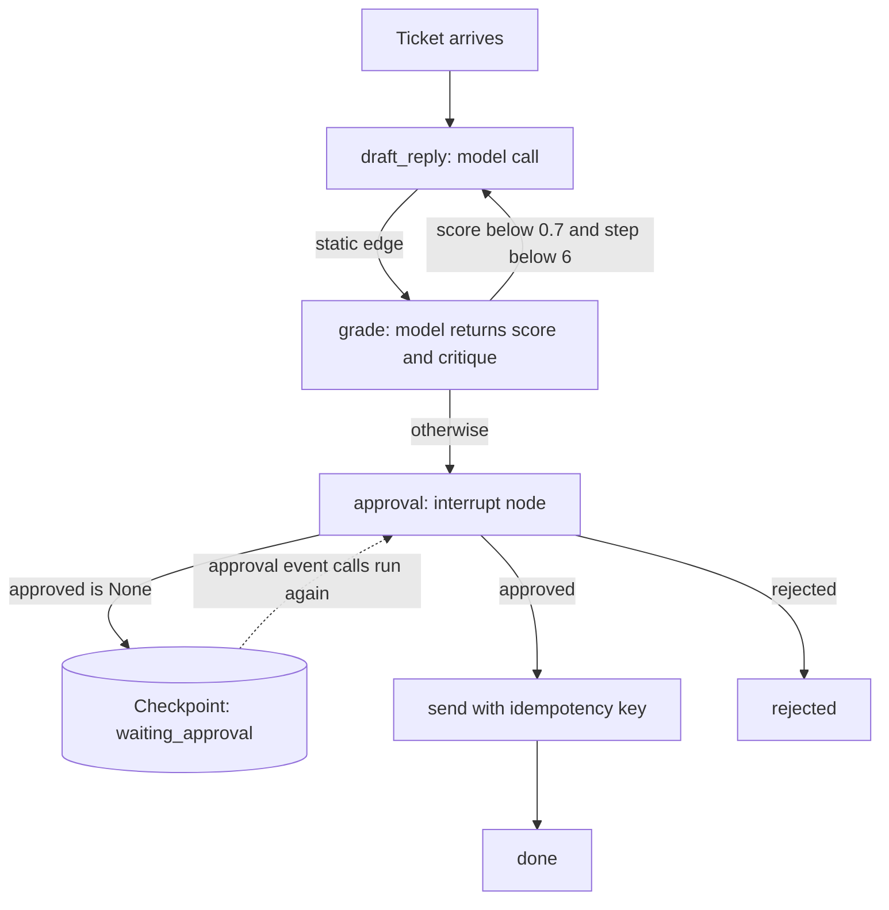

## TL;DR
Agent orchestration is the control layer of your agent: it decides what runs next (model call, tool,
sub-agent or human step), with what state, and what happens on failure. The core choice is how much
control flow is code versus left to the model.

## For agent builders
- **Why it matters for agents.** Once an agent has two dependent calls, a side-effecting tool or a human
  approval, something must own ordering, state, retries and interrupts. Making that explicit is the
  difference between an agent you can resume, test and debug and one you can only re-run.
- **Where it shows up in your stack.** LangGraph (`StateGraph`, conditional edges, reducers, a
  checkpointer, `interrupt()`), vendor agent SDKs (the run loop and hand-offs), durable engines such as
  Temporal for long waits, and run traces in LangSmith or Langfuse.
- **What you control.** Which steps are nodes, which edges are code routers and which are model choices,
  the state schema and its reducers, where checkpoints go, idempotency keys on side effects, and the
  event stream clients see.
- **What you can skip.** Workflow-engine theory and graph formalisms. The pattern ladder, at-least-once
  execution and the interrupt-and-resume mechanics are what you need.

## Why it exists
- **Two dependent calls already make a program.** Add a second call that depends on the first, a tool
  whose result feeds a third, and a user who may approve something midway: the steps are spread across
  model outputs, and something must own ordering, state, retries, concurrency and interruption.
- **A plain Python function becomes an accidental orchestrator.** A tool times out at step four: redo
  steps one to three, with their side effects? The user closes the tab during approval: where is the run?
  Traffic triples: which steps can run concurrently? What did the agent do for last Tuesday's ticket:
  which log line was that? Each answer bolts on another ad-hoc mechanism, untested and undocumented.
- **Letting the model orchestrate everything is wrong for fixed steps.** Right for genuinely open-ended
  steps; wrong for steps that must happen (validation, logging, a compliance check), must not happen
  twice (payments), or must happen in a fixed order. Model-chosen paths are also the hardest to evaluate.
- **A deliberate layer makes control flow explicit.** State is a typed object, steps are nodes,
  transitions are fixed edges or router decisions, and a runtime adds persistence, events and policies.
  As with any explicit state machine, you can inspect, resume, test and reason about what is written down,
  and you can do none of that with control flow buried in prompts.

## How it works
### State, nodes, edges
- **State:** one object per run (the task, messages, intermediate results, counters).
- **Node:** a function from state to updated state: call the model, call a tool, run a sub-agent, ask a
  human.
- **Edges:** static (A always leads to B) or conditional, decided by a router. Routers can be pure code
  (`if state.score < 0.7`), a classifier, or the main model's tool choice.
- **Why this shape:** it makes the possible paths enumerable, *because* you can draw it, test each node
  in isolation, and know where loops can occur.

### The orchestration patterns, from most to least deterministic
| # | Pattern | How | Use when |
|---|---|---|---|
| 1 | Prompt chaining | fixed sequence, each step checks the previous output | the task decomposes cleanly and predictably |
| 2 | Routing | classify, then dispatch to a specialized path (prompt, model or tool set) | inputs fall into distinct categories |
| 3 | Parallelization | run independent nodes and join (sectioning), or run one node several times and vote (ensembling) | latency matters and branches are independent |
| 4 | Orchestrator–workers | a model decides sub-tasks at runtime; code runs the fan-out and join | sub-tasks cannot be known in advance |
| 5 | Evaluator–optimizer | generate, evaluate against explicit criteria, revise, bounded by a budget | quality is checkable |
| 6 | Autonomous agent loop | the model picks the next node every step until done | the path is unknown and feedback is trustworthy |

- **Each step down trades predictability and cost for flexibility,** so the right system usually mixes
  them: a routed, chained outer workflow with an autonomous loop for the one step that needs it.

### Runtime responsibilities
The orchestrator owns cross-cutting concerns *because* putting them in nodes means every node
reimplements them differently.
- **Persistence.** Checkpoint state after each node so a run resumes at the node where it stopped. An
  interrupt is a checkpoint plus a status; resumption is loading it and continuing, which is what makes
  human-in-the-loop possible.
- **At-least-once, never exactly-once.** A crash *after* a node finishes but *before* its checkpoint is
  written re-runs that node on resume. That single fact is why side-effecting nodes need idempotency
  keys and model-calling nodes should be safe to repeat.
- **Policies.** Step and cost budgets, per-node timeouts, retry with backoff for transient failures, and
  idempotency keys for nodes with side effects so a retry does not repeat them.
- **Concurrency.** Fan-out and join primitives with limits, so parallel branches do not exhaust rate
  limits. Parallel writes to one state field need an explicit merge rule (append to a list, take the
  max, last-writer-wins); LangGraph calls these reducers. Without one, the branch that finishes last
  silently overwrites the others.
- **Events.** A structured stream per run (node started, model called, tool result, waiting for
  approval, done) that clients subscribe to, *because* long runs need progress and operators need traces.
- **Cancellation.** A cooperative stop signal checked between nodes, with in-flight tool calls either
  finished or compensated.

### Request-driven versus event-driven orchestration
| | Request-driven | Event-driven |
|---|---|---|
| Fits | short runs | runs that wait (approvals, slow tools, scheduled follow-ups) |
| How a run advances | inside one request | when an event arrives |
| Workers | hold the run | stateless; durable state is in the store |

- This is where agent orchestration meets workflow engines such as Temporal: the graph is the same, the
  executor is a durable one.

### Orchestration versus choreography
- **Orchestration:** one component holds the graph and tells each step when to run (everything above).
- **Choreography:** no central owner; each agent or service reacts to events on a bus and emits its own.
  It couples components less and scales organisationally, but the flow exists only implicitly in the sum
  of subscriptions, so "where is run 42 and why did it stop?" has no single answer.
- **For LLM applications** steps are non-deterministic and budgets and approvals are enforced per run, so
  a central orchestrator per run is the usual choice. Choreography fits the boundaries *between* runs and
  systems (a finished run emits an event another team's pipeline consumes).

### Frameworks
- **Graph libraries** such as LangGraph: the state graph, checkpointing and interrupts.
- **Vendor agent SDKs:** the autonomous loop with hand-offs.
- **Durable execution engines:** the event-driven executor.
- **What matters more than the abstraction:** making state explicit and keeping runtime concerns out of
  the nodes.

| Concept | LangGraph | Vendor agent SDK | Durable engine (Temporal) |
|---|---|---|---|
| State | a typed state (TypedDict or Pydantic) | the conversation plus context object | workflow variables |
| Node | a function added with `add_node` | the model loop, a tool, or a hand-off target | an activity |
| Router | `add_conditional_edges` | the model's tool or hand-off choice | ordinary workflow code |
| Persistence | a checkpointer keyed by `thread_id` | usually yours to add | event history, replayed |
| Human wait | `interrupt()` then `Command(resume=...)` | usually yours to add | a signal the workflow awaits |

- **LangChain is not the orchestrator.** It supplies model, retriever and tool integrations that nodes
  call; LangGraph (or your own loop) owns the control flow, and LangSmith traces it.

## Diagram
The graph from the example below. Static edges are fixed in code, the router after `grade` is a code
decision on the score, and every node writes a checkpoint so the approval wait holds no worker.



## Examples
### A small graph executor with an approval interrupt
Typed state, nodes as functions, a static edge, a code router, a model-driven node, a checkpoint after
every node, and an interrupt resumed by calling `run` again with the same id. `call_model`, `mail` and
`store` are stand-ins.

```python
from dataclasses import dataclass, field, asdict

@dataclass
class State:
    ticket: str
    draft: str = ""
    score: float = 0.0
    critique: str = ""
    approved: bool | None = None
    step: int = 0
    status: str = "running"
    history: list = field(default_factory=list)

def draft_reply(s):
    s.draft = call_model(f"Draft a reply to: {s.ticket}\nFix these issues if any: {s.critique}").text; return s
def grade(s):        # evaluator: structured output, so the router can branch on a number
    g = call_model(f"Policy compliance of this draft as JSON {{score: 0-1, critique}}:\n{s.draft}").json
    s.score, s.critique = float(g["score"]), g["critique"]; return s
def approval(s):     # interrupt node: nothing to compute until a human acts
    if s.approved is None: s.status = "waiting_approval"
    elif not s.approved:   s.status = "rejected"
    return s
def send(s):         mail.send_idempotent(key=f"{s.ticket}:send", body=s.draft); s.status = "done"; return s

NODES = {"draft_reply": draft_reply, "grade": grade, "approval": approval, "send": send}
EDGES = {"draft_reply": "grade",                                                          # static edge
         "grade": lambda s: "draft_reply" if s.score < 0.7 and s.step < 6 else "approval",  # code router
         "approval": lambda s: "send" if s.approved else None,
         "send": None}

def run(run_id, store, max_steps=10):
    s = store.load(run_id) or State(ticket=store.task(run_id))
    node = store.cursor(run_id) or "draft_reply"
    while node and s.step < max_steps:
        s = NODES[node](s); s.step += 1; s.history.append(node)
        if s.status != "running":                                   # interrupted, rejected or done
            store.save(run_id, asdict(s), cursor=node); break
        edge = EDGES[node]; node = edge(s) if callable(edge) else edge
        store.save(run_id, asdict(s), cursor=node)                  # checkpoint after every node
        emit(run_id, node=s.history[-1], score=s.score)
    return s
```

### Tracing one ticket through it
| Step | Node | What happens |
|---|---|---|
| 1 | `draft_reply` | first draft |
| 2 | `grade` | returns 0.55 with the critique "promises a refund date"; router loops back |
| 3 | `draft_reply` | redrafts using the critique |
| 4 | `grade` | returns 0.82; router goes to `approval` |
| 5 | `approval` | finds `approved is None`, sets `waiting_approval`; run returns with cursor on `approval`, no worker held |
| — | (hours later) | approval service writes `approved=True, status="running"` and calls `run` again |
| 6–7 | `approval` → `send` | loads the checkpoint, re-enters `approval`, routes to `send`, finishes |

- **Crash after `send` sends but before its checkpoint:** resume re-runs `send`, and the idempotency key
  `ticket:send` turns the second send into a no-op.
- **Key choice in the sketch:** `f"{s.ticket}:send"` is built from the ticket text, so two tickets with
  identical text would collide. In production derive it from the run id (`f"{run_id}:send"`).
- **Two independent bounds on the revise cycle, one per level:** the `s.step < 6` guard in the router and
  `max_steps` in the loop.

### The same graph in LangGraph
The hand-rolled executor above, expressed with LangGraph's primitives. `call_model` and `mail` are still
stand-ins. Check names against the LangGraph version you install: older releases call the in-memory
checkpointer `MemorySaver`.

```python
from typing import TypedDict
from langgraph.graph import StateGraph, START, END
from langgraph.types import interrupt, Command
from langgraph.checkpoint.memory import InMemorySaver   # tutorials only; use a Postgres checkpointer in production

class S(TypedDict, total=False):
    ticket: str
    draft: str
    score: float
    step: int
    approved: bool

def draft_reply(s): return {"draft": call_model(f"Draft a reply to: {s['ticket']}").text, "step": s.get("step", 0) + 1}
def grade(s):       return {"score": float(call_model(f"Score 0-1 as JSON: {s['draft']}").json["score"])}
def approval(s):    return {"approved": interrupt({"draft": s["draft"]})}   # pauses; resume value lands here
def send(s):        mail.send_idempotent(key=f"{s['ticket']}:send", body=s["draft"]); return {}

g = StateGraph(S)
for name, fn in [("draft_reply", draft_reply), ("grade", grade), ("approval", approval), ("send", send)]:
    g.add_node(name, fn)
g.add_edge(START, "draft_reply")
g.add_edge("draft_reply", "grade")
g.add_conditional_edges("grade", lambda s: "draft_reply" if s["score"] < 0.7 and s["step"] < 6 else "approval",
                        ["draft_reply", "approval"])
g.add_conditional_edges("approval", lambda s: "send" if s["approved"] else END, ["send", END])
g.add_edge("send", END)
app = g.compile(checkpointer=InMemorySaver())

cfg = {"configurable": {"thread_id": "run-42"}}
app.invoke({"ticket": "Where is my refund?"}, cfg)   # runs until the interrupt, then returns
app.invoke(Command(resume=True), cfg)                 # hours later: approval node re-runs and gets True
```

- **The interrupted node re-runs from its start on resume,** with `interrupt()` returning the resume
  value, so keep side effects out of code before the `interrupt()` call.

### Runnable: why parallel branches need a reducer
Pure Python. Three branches finish in random order and merge into one state field.

```python
import asyncio, random

async def branch(name):
    await asyncio.sleep(random.random() / 100)        # branches finish in any order
    return {"findings": [f"{name}: result"]}

def last_writer_wins(state, update):
    return {**state, **update}

def append_reducer(state, update):
    return {**state, "findings": state["findings"] + update["findings"]}

async def fan_out(merge):
    state = {"findings": []}
    for coro in asyncio.as_completed([branch(n) for n in ("web", "docs", "tickets")]):
        state = merge(state, await coro)
    return state

print(len(asyncio.run(fan_out(last_writer_wins))["findings"]))  # 1, and which one varies run to run
print(len(asyncio.run(fan_out(append_reducer))["findings"]))    # 3
```

## Production patterns
- **Database-backed checkpointer keyed by thread.** When runs must survive restarts or wait on humans,
  compile the graph with a persistent checkpointer (in LangGraph, a Postgres checkpointer) and pass a
  stable `thread_id` per run in the config. Monitor run counts by status and runs with no checkpoint
  write for longer than their expected duration.
- **Approval as an interrupt, resumed by event.** Pause in the approval node (LangGraph offers an
  `interrupt()` call, resumed later by invoking the graph with `Command(resume=...)` on the same thread), return immediately, and resume from the
  approval service's event. Monitor time spent waiting, approval and rejection rates, and expired
  approvals.
- **Declared reducers for every fan-out field.** Any state key written by parallel branches gets an
  explicit merge rule, for example `Annotated[list, operator.add]` in a LangGraph state type. Monitor in
  tests: assert the joined result contains one entry per branch.
- **Idempotency keys on every side-effecting node.** Derive the key from run id and node (for
  example `f"{run_id}:send"`) and pass it to the downstream API, because node execution is at-least-once. Monitor
  duplicate side effects detected by the downstream system.
- **Per-run event stream to clients and traces.** Stream node started, tool result, waiting and done
  events to the UI (for example over server-sent events) and to tracing under the run id. Alert on
  running runs whose last event is older than a threshold you set: they are stuck.

## Trade-offs
- **Explicit graphs vs adaptability.** Graphs make paths enumerable and testable, but every new
  behaviour is a code change; a model-driven loop adapts without redeploys at the price of
  unpredictable paths.
- **Per-node checkpoints vs latency.** Checkpointing enables resume and human interrupts but adds a store
  round-trip per node; for sub-second, side-effect-free chains, in-memory execution is fine.
- **Parallel branches vs rate limits and cost.** They cut latency but multiply concurrent model calls, so
  rate limits and cost spikes arrive sooner. Cap fan-out and reserve it for genuinely independent work.
- **Policies in the runtime vs a critical dependency.** Budgets, retries and idempotency in the runtime
  keep nodes simple, but the runtime must itself be reliable and well understood.
- **Framework speed vs lock-in.** A framework accelerates the first version while shaping your state and
  persistence model; migrating a framework-specific graph to a durable, event-driven executor later can
  be a rewrite.

## Pitfalls
- **Hiding control flow in prompts** ("after you search, always validate, then..."). Symptom: runs that
  skip required steps and no way to assert they happened. Fix: make required steps nodes.
- **Retrying a side-effecting node without an idempotency key.** Symptom: duplicate emails, tickets or
  payments after a transient failure. Fix: a key from run id and node, passed to the downstream API.
- **Unbounded evaluator–optimizer or self-correction loops.** Symptom: a run that revises forever at
  increasing cost with no termination. Fix: bound at the router and the loop.
- **Human approval as a blocking call in a worker.** Symptom: held connections, worker exhaustion and
  runs lost when the process restarts. Fix: checkpoint, return, resume on event.
- **Parallel branches writing one state key without a reducer.** Symptom: a fan-out of three searches
  whose joined result contains only one branch's findings, varying run to run. Fix: declare a reducer.
- **No per-run event stream.** Symptom: users see a spinner for minutes and operators cannot say which
  node a stuck run is in. Fix: emit structured events per node under the run id.

## When to use
- **Use when:** a feature has more than one model call with dependencies, any tool with side effects, or
  any step that waits on a human or an external system.
- **Choose:** the most deterministic pattern that handles the task, and confine model-driven control flow
  to steps that need judgment.
- **Measure:** per-node latency and failure rates, run completion versus interruption versus budget
  exhaustion, and retries per run.
- **Day to day:** deciding what is a node, where checkpoints go, and what is idempotent.
- **Interviews:** describe the pattern ladder from chaining to autonomous loop, say which runtime concerns
  the orchestrator owns, and explain how an approval interrupt works without blocking a worker.

## Role lens
- **Engineer:** Defines nodes, routers and state types, adds checkpoints and idempotency keys, and emits
  the event stream that clients and traces consume.
- **Architect:** Chooses where control flow is code versus model, whether execution is request- or
  event-driven, and which engine or framework owns persistence and policies.
- **FDE:** Adapts the graph to a customer's approval chains and systems, and explains why a human step
  pauses the run rather than holding a connection open.

## Check yourself
**Q:** A team built an agent that handles refund requests end to end. Compliance now requires that every
refund above a threshold is approved by a person, sometimes hours later. How would you change the
orchestration, and what would break if you simply added a blocking approval call?
**A:** A blocking call holds a worker and a connection for hours, exhausts the worker pool under load,
and loses the run entirely if the process restarts, so it is not an option. I would make the run's state
explicit and persisted, add an approval node that checkpoints the state with status "waiting_approval"
and returns, and make the run event-driven: the approval decision arrives as an event that loads the
checkpoint and resumes at the next node. The refund-executing node gets an idempotency key so a resumed
or retried run cannot pay twice, the threshold check is code in the router rather than a prompt
instruction, and the event stream shows the run as waiting so support can see why it is pending. If runs
can wait days, a durable workflow engine is the natural executor.

## Interview questions
### What is agent orchestration, and why not let the model drive every step?

- **Definition:** the control layer that decides what runs next (model call, tool, sub-agent or human
  step), with what state, and what happens on failure.
- **Why not the model everywhere:** steps that must happen, must not happen twice or must run in a
  fixed order belong in code, and model-chosen paths are the hardest to evaluate.

### Walk me through the pattern ladder. Which would you pick for a support inbox with three ticket types?

- **The ladder:** prompt chaining, routing, parallelization, orchestrator–workers, evaluator–optimizer,
  then the autonomous agent loop; each step down trades predictability and cost for flexibility.
- **For distinct ticket types, routing:** classify, then dispatch to a specialized prompt, model or tool
  set, and confine an autonomous loop to the one path that genuinely needs it.

### A fan-out of three searches sometimes returns only one branch's findings. What is wrong?

- **Missing reducer.** Parallel branches write the same state key with no merge rule, so the branch that
  finishes last silently overwrites the others, varying run to run.
- **Fix:** declare an explicit merge rule that keeps every branch (append to a list, or take the max for
  a score), for example `Annotated[list, operator.add]` in a LangGraph state type, rather than the
  implicit last-writer-wins, and assert one entry per branch in tests.

### Why must side-effecting nodes be idempotent even with checkpoints after every node?

- **Execution is at-least-once, never exactly-once.** A crash after a node finishes but before its
  checkpoint is written re-runs that node on resume.
- **So** derive a key from run id and node, as in `ticket:send`, and pass it downstream so the second
  execution is a no-op; model-calling nodes should simply be safe to repeat.

### When would you choose choreography over a central orchestrator?

- **Orchestrator per run** for LLM applications, because budgets and approvals are enforced per run and
  "where is run 42 and why did it stop?" needs one answer.
- **Choreography between runs and systems:** a finished run emits an event another team's pipeline
  consumes, which couples components less and scales organisationally.

### What would you monitor to catch stuck or misbehaving runs in production?

- **Status mix:** run completion versus interruption versus budget exhaustion, plus retries per run.
- **Per-node latency and failure rates,** so a regression points at one node rather than the whole run.
- **Staleness alert:** running runs whose last event or checkpoint is older than their expected
  duration are stuck, and the event stream says which node they are in.

## Quiz
### Q: What is the main reason to represent an agent application as explicit state plus nodes and edges?
- [ ] Models produce better answers when the prompt describes a graph
- [x] It makes the possible paths enumerable, so you can test nodes, resume runs and know where loops can occur
- [ ] Graphs execute faster than sequential function calls
- [ ] It removes the need for a model to make any decisions
> Control flow buried in prompts or local variables cannot be inspected, tested or resumed. An explicit
> graph can be drawn, checkpointed and reasoned about, while still leaving judgment calls to the model
> at router nodes.

### Q: How should a human approval step be implemented in an orchestrated run?
- [ ] Block the worker thread until the human responds
- [ ] Ask the model to wait and poll for the decision
- [x] Checkpoint the state with a waiting status, return, and resume from the checkpoint when the approval event arrives
- [ ] Restart the run from the beginning once approved
> Approvals can take hours. Holding a worker wastes capacity and loses the run on restart; a checkpoint
> plus event-driven resumption costs nothing while waiting and survives deploys.

### Q: Which pattern fits when sub-tasks cannot be known until the task is inspected, but you still want predictable fan-out and join behaviour?
- [ ] Prompt chaining
- [x] Orchestrator–workers, with a model deciding the sub-tasks and code running the fan-out and join
- [ ] Routing to a fixed set of specialists
- [ ] A single autonomous agent loop
> Orchestrator–workers places model judgment exactly where it is needed, deciding the decomposition,
> while the concurrency, limits and aggregation stay deterministic in code.

## Use cases & projects
### Use cases
- **Ticket triage and routing.** A cheap classification step routes each request to a specialist prompt
  or a human queue, keeping the expensive path for the cases that need it.
- **Document processing chains.** Extract, validate and summarize as a prompt chain with a code check
  between steps, so a bad extraction stops before it reaches the summary.
- **Orchestrator-workers for open research.** A model decides the sub-tasks; code runs the fan-out with a
  concurrency cap and joins the results.
- **Evaluator-optimizer loops.** A writer drafts, a grader scores against a rubric, and code stops the loop
  at a pass or a round limit.

### Mini project
**Build one task with three orchestration patterns (2-3 hours).**
- **Goal:** see how routing, chaining and orchestrator-workers differ in cost, latency and failure modes.
- **Steps:** pick a task such as answering a support email; implement a router to two specialist prompts,
  a three-step chain with a schema check between steps, and an orchestrator that plans sub-tasks run
  concurrently by code with a cap and a timeout; run each on the same 15 inputs.
- **Done when:** a table shows tokens, latency and pass rate per pattern, and each failure is traced to
  the step that caused it.
