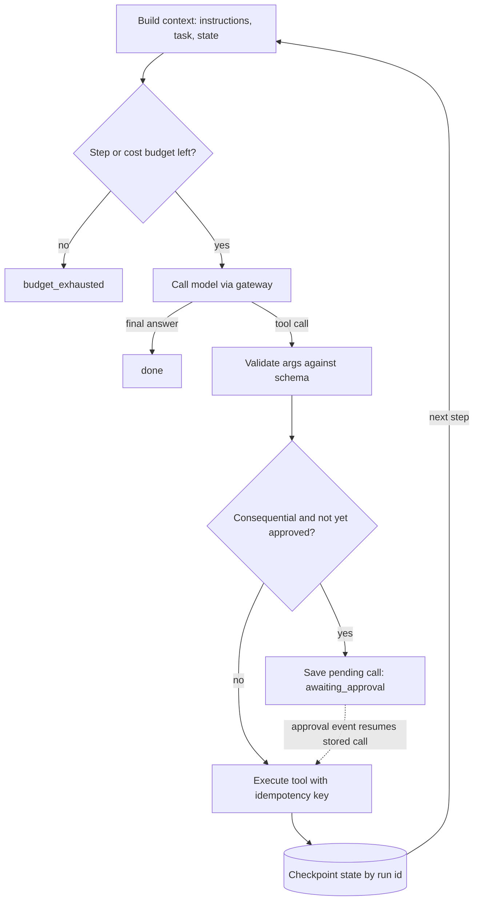

## TL;DR
An agentic architecture lets the model choose the next tool call at runtime, observe, and repeat, while
code you own wraps the loop: least-privilege typed tools, external state, budgets, approval gates and
tracing. The model owns judgment; the architecture owns guarantees.

## For agent builders
- **Why it matters for agents.** This is the blueprint of every production agent you will ship. The loop
  is twenty lines; the layers around it (runtime, gateway, tool layer, state, events) are where resumes,
  refunds that do not double, and debuggable incidents come from.
- **Where it shows up in your stack.** LangGraph (graph nodes, a checkpointer per thread, interrupts for
  approvals), vendor agent SDKs (OpenAI Agents SDK, Claude Agent SDK), durable engines such as Temporal,
  an LLM gateway such as LiteLLM, MCP servers for tools, and tracing in LangSmith, Langfuse or
  OpenTelemetry.
- **What you control.** The tool list and each tool's side-effect class, the step, cost and time
  budgets, where state is checkpointed, which calls need approval, and the terminal states you alert on.
- **What you can skip.** Framework-specific syntax until you need it. Every framework maps onto the six
  layers below, so learn the layers and read any framework's docs as answers to them.

## Decision case
### Scenario
An online retailer is moving its refund support agent from demo to production and must pick the
orchestration runtime. All figures are illustrative.
- **Volume:** 20,000 tickets a day, about 6 steps per run, so 120,000 checkpoint writes a day, about
  1.4 writes per second on average.
- **Approvals:** refunds above 500 need a human; 8% of runs pause, 1,600 a day, and an approver may take
  up to 48 hours, so up to 3,200 runs can be waiting at once.
- **Constraints:** zero duplicate refunds; workers are redeployed several times a day; auditors want a
  per-step record; a team of 4 Python engineers with no Temporal experience; 8 weeks to launch; the
  existing Postgres must hold the state.

### Options
| Option | How it works | Resume and approvals | Fit with team and deadline | New infrastructure |
|---|---|---|---|---|
| A. Hand-rolled loop | A `while` loop plus a checkpoint table keyed by run id, as in the example below | You build resume, interrupts and replay yourself | Familiar code, but the 8 weeks go on plumbing | None |
| B. LangGraph with a Postgres checkpointer | Graph nodes for model and tool calls, a checkpoint per step, interrupts for approval | Built in: a paused run is a saved thread resumed by an event | Python, learnable within weeks | None beyond the existing Postgres |
| C. Temporal workflow | One activity per model or tool call, durable timers for approval waits | Strongest: retries, timers and replay are the engine's job | Steep: workflow code must be deterministic | A Temporal cluster or a managed service |

### Decision
Choose **B, LangGraph on the existing Postgres**, because:
- **Load is small:** about 1.4 checkpoint writes per second and 3,200 parked threads are routine for the
  Postgres the team already runs.
- **Approval-as-interrupt is native:** a paused run holds no worker, survives the daily redeploys and
  resumes from the approval event.
- **The deadline rules out the extremes:** A spends the 8 weeks rebuilding what B ships with, and C adds
  an engine and a programming model the team has not used.
- **Zero duplicates still comes from the tool layer:** every refund carries the key `run_id:step`,
  whatever runtime is chosen.

**What would change it:** runs that span several services with compensation steps (refund, restock,
reship) and multi-day timers at much higher volume would favour Temporal; a short, read-only agent
would make the hand-rolled in-memory loop enough.

### Trade-offs accepted
- **Framework version churn.** Pin the version and replay recorded trajectories as regression tests
  before each upgrade. Watch: completion rate per task type after upgrades.
- **Checkpoints per step, not per side effect.** A crash between the refund call and the checkpoint
  re-runs the step. Watch: duplicate refunds per thousand runs, which must stay at zero.
- **Approvals can stall.** Runs parked 48 hours need an expiry path. Watch: runs that expire in
  `awaiting_approval` and approval latency per tool.
- **Abstraction lock-in.** Business predicates stay in plain tool-layer functions so they move with you
  if the runtime changes.

### Review rubric
- **Load is derived:** runs, steps and pause rates turn into checkpoint writes per second and parked
  runs, with the arithmetic shown.
- **Durability is argued per failure:** the write-up says what happens on a redeploy mid-step and why no
  side effect repeats.
- **Approvals are interrupts:** a paused run holds no worker, and the approved call executes as stored.
- **Team and deadline constraints decide between options**, not feature lists alone.
- **Reversal conditions are concrete:** at least one change in workload that would flip the choice.
- **Each accepted trade-off names a metric** someone can alert on.

## Why it exists
- **Some tasks have no fixed path.** "Resolve this support ticket", "find out why this deploy failed",
  "reconcile these two ledgers" take a different number of steps each time, the next step depends on
  what the previous one revealed, and the space of paths is too large to enumerate as branches.
- **A fixed prompt chain ossifies.** Classify, extract, look up, draft is predictable and testable, and
  often right (see workflows vs agents). It fails on unanticipated branches: two lookup candidates, a
  document in an unexpected language, a ticket that is really three. Each becomes another hard-coded
  branch.
- **"Give the model every tool and let it run" fails the other way.** Demos come quickly and incidents
  shortly after: nothing bounds steps or cost, a crash loses everything because state lived in a Python
  list, a production write tool is one bad call from damage, and nobody can reconstruct what happened.
- **The discipline in between.** Let the model decide *what* to do next; build a system that decides
  what it is *allowed* to do, how long it may keep going, what happens when it fails, and how every step
  is recorded.

## How it works
### The core loop
1. **Build the context:** instructions, task, state, recent observations.
2. **Call the model** with a set of tool definitions.
3. **Branch.** A tool call: validate the arguments, execute the tool, append the result as an
   observation, repeat. A final answer: stop.

- **ReAct underneath.** ReAct-style interleaving of reasoning and acting is the pattern; every agent
  framework wraps this loop plus the boundaries below.
- **Plan-and-execute variant.** The model writes an explicit plan first, runs steps against it, and
  re-plans when an observation contradicts it. It costs an extra call but gives the runtime something to
  checkpoint, show a human and measure progress against, which a pure ReAct loop does not.

### The cost shape of the loop
Each step re-sends the accumulated context, so input tokens grow with the *sum* of context sizes, not
the final size.

```
total_input = Σ(3k + i·1k) for i = 0…11 ≈ 102k input tokens over 12 steps   (final context only 14k)
```

That near-quadratic growth (illustrative numbers) is why the architecture:
- **caps steps;**
- **stores large tool outputs as references** instead of pasting them;
- **keeps the stable prefix byte-identical** (instructions, tool definitions) so provider prompt caching
  can discount it.

### The layers around the loop
| Layer | Owns | Because |
|---|---|---|
| 1. Interface | where tasks enter and events leave | runs are long; HTTP requests held open are fragile |
| 2. Orchestration / runtime | loop, budgets, retries, checkpoints | runs must resume after restarts |
| 3. Model gateway | routing, rate limits, caching, cost | steps multiply model calls |
| 4. Tool layer | typed contracts, credentials, approvals | confidence is not permission |
| 5. State and memory | task state, artifacts | context is the scarcest resource |
| 6. Observability and audit | one event per step | evaluation and incident review |

1. **Interface layer.** Tasks enter via chat UI, API, event or schedule. For anything over a few seconds
   it is asynchronous: accept the task, return a run id, stream events, deliver the result later. Agents
   are long-running *because* each step is a model call plus a tool call and the step count is unknown.
2. **Orchestration and runtime layer.** Enforces step budget, token and cost budget, wall-clock timeout,
   loop detection (same tool, same arguments, repeatedly), retries with backoff for transient tool
   failures, and cancellation.
   - It persists state after every step *because* a run that cannot resume after a worker restart will,
     at scale, fail constantly for reasons unrelated to the task.
   - Durable execution engines are one way to get this; a checkpoint store plus idempotent steps is
     another.
3. **Model gateway.** One place that calls models: routing, rate limiting, caching, cost accounting,
   fallbacks. Agents multiply model calls by the number of steps, so cost control lives here, not in
   prompts.
4. **Tool layer.** Each tool is a typed contract: schema-validated inputs, structured outputs, an
   explicit side-effect class (read-only versus consequential), and credentials scoped to that tool.
   - **The agent never holds credentials;** the tool adapter does.
   - **Consequential tools route through an approval gate,** human or policy, *because* the model's
     confidence is not a permission.
   - **Code-executing and browsing tools run in a sandbox** *because* their inputs may come from untrusted
     content, which makes prompt injection a system-level threat rather than a prompt-level one.
5. **State and memory.** Task state (plan, completed steps, artifacts) is separate from conversation
   history and long-term memory, external and addressable by run id. Large tool outputs are stored as
   artifacts and referenced *because* raw tool results are the fastest way to exhaust context.
6. **Observability and audit.** Every step emits a structured event: model input hash, tool name,
   arguments, result size, latency, cost, under a run id and tenant id. This makes trajectory evaluation
   and incident review possible.

### Where the layers land in a typical stack
| Layer | Hand-rolled | Typical framework or tool |
|---|---|---|
| Orchestration / runtime | a `while` loop plus a checkpoint table | LangGraph graph with a checkpointer, Temporal workflow, vendor agent SDK runner |
| Model gateway | one client module | LiteLLM or a provider gateway |
| Tool layer | adapters with JSON Schema | framework tool decorators, MCP servers |
| State and memory | Postgres rows keyed by run id | LangGraph checkpointer and store, Redis, an object store for artifacts |
| Observability | structured logs | LangSmith, Langfuse, Arize Phoenix, OpenTelemetry |

- **Frameworks give you the plumbing, not the policy.** None of them knows your refund threshold or which
  tools are consequential; you still write those predicates in the tool layer.

### Where control flow should be code, and where model
- **Model for judgment about content:** "which document is relevant".
- **Code for guarantees:** "may this user issue refunds above 500" is enforced in the tool layer
  regardless of what the model asks.
- **Mixed systems are the production norm:** a deterministic workflow calls an agent for one open-ended
  step, or an agent calls a deterministic sub-workflow as a tool.

### Stopping
Every agent needs four explicit terminators; without all four the failure mode is not a wrong answer
but an unbounded one.
1. **A final-answer action.**
2. **A maximum number of steps.**
3. **A budget.**
4. **A stuck detector.**

Record each terminal state distinctly (`done`, `budget_exhausted`, `stuck`, `awaiting_approval`,
`cancelled`) *because* they demand different follow-ups: a retry, a human, or a bug report.

## Diagram
One step of the runtime loop. Follow the tool-call branch: validation, the approval gate and the
checkpoint all sit in code around the model, and every exit lands in a distinct terminal state.



## Examples
### A minimal runtime that shows the boundaries
A budget, schema-validated tools with a side-effect flag, an approval gate that interrupts rather than
blocks, and a checkpoint after every step. `call_model` is whatever model API you use and returns either
a tool call or a final answer; `validate` is a JSON Schema check.

```python
import json

TOOLS = {   # name -> (input schema, needs_approval(args), implementation(args, idem_key))
    "search_tickets": ({"type": "object", "properties": {"q": {"type": "string"}}, "required": ["q"]},
                       lambda a: False, lambda a, key: tickets.search(a["q"])),
    "issue_refund":   ({"type": "object", "properties": {"ticket": {"type": "string"},
                        "amount": {"type": "number", "exclusiveMinimum": 0, "maximum": 5000}},
                        "required": ["ticket", "amount"]},
                       lambda a: a["amount"] > 500,          # policy threshold, enforced in code
                       lambda a, key: payments.refund(a["ticket"], a["amount"], idempotency_key=key)),
}

def execute(run_id, state, name, args):
    if name not in TOOLS:
        return {"error": f"unknown tool {name}"}               # an observation, not a crash
    schema, needs_approval, fn = TOOLS[name]
    validate(args, schema)                                     # rejects amount > 5000 outright
    if needs_approval(args) and not approvals.granted(run_id, name, args):
        return "PAUSE"
    try:
        return fn(args, f"{run_id}:{state['step']}")         # same key on retry -> no double refund
    except TransientError as e:
        return {"error": str(e), "retryable": True}           # the model decides: retry or give up

def run(run_id, task, store, max_steps=12, budget_usd=0.50):
    state = store.load(run_id) or {"messages": [{"role": "user", "content": task}], "step": 0, "cost": 0.0}
    while state["step"] < max_steps and state["cost"] < budget_usd:
        if state.get("pending"):                              # resuming after a pause: no new model call
            msg, name, args = state["pending"]
        else:
            reply = call_model(state["messages"], tools=[{"name": n, "schema": t[0]} for n, t in TOOLS.items()])
            state["cost"] += reply.cost_usd
            if reply.final is not None:
                store.save(run_id, {**state, "status": "done", "answer": reply.final}); return reply.final
            msg, name, args = reply.as_message(), reply.tool_name, reply.tool_args
        result = execute(run_id, state, name, args)
        if result == "PAUSE":
            store.save(run_id, {**state, "status": "awaiting_approval", "pending": [msg, name, args]})
            return None                                        # interrupt; an approval event re-invokes run()
        state.pop("pending", None)
        state["messages"] += [msg, {"role": "tool", "name": name, "content": json.dumps(result)[:4000]}]
        state["step"] += 1
        store.save(run_id, state)                              # checkpoint: a crash here loses nothing
    store.save(run_id, {**state, "status": "budget_exhausted"})
```

Three boundaries are visible:
- **Hard cap in the schema.** `maximum: 5000` rejects a larger refund however persuasively the model
  argued for it.
- **Policy threshold in code, gate as interrupt.** Above 500 needs approval. The gate saves the exact
  pending call instead of holding a thread while a human decides; on resume the approved call runs
  without asking the model again, so the human approved precisely what executes.
- **Idempotency key from run id and step.** A worker that crashes after the refund but before the
  checkpoint re-executes the step without paying twice.

What the sketch leaves out, so you do not copy it as-is:
- **Validation errors should be observations.** Here `validate` raises and ends the run; in production
  catch the error and return it like the unknown-tool case, so the model can fix its arguments.
- **One status covers two caps.** Hitting `max_steps` and hitting `budget_usd` both record
  `budget_exhausted`; record them separately if you alert on them separately.
- **Resume leaves a stale status.** The loaded state still says `awaiting_approval` while the resumed run
  executes; set it back to running when you pop `pending`, and add a rejection path that records the
  denial as an observation instead of leaving the run paused forever.

### Walking one run through the runtime
| Step | What happens | Status after |
|---|---|---|
| 0 | `search_tickets` (read-only) runs | running |
| 1 | model proposes a 750 refund; the predicate fires | `awaiting_approval`, zero further cost |
| — | approver accepts; `run()` is re-invoked | running |
| 1 (resume) | refund executes with key `run_id:1`, no new model call | running |
| 2 | model writes the final answer | `done` |

### Runnable: what offloading tool output saves
Pure Python, illustrative numbers. Same 12-step run, with raw tool output pasted (1k per step) versus
artifacts stored by reference with a short summary (0.2k per step).

```python
def loop_input_tokens(start_k, growth_k, steps):
    sent = [start_k + i * growth_k for i in range(steps)]
    return sum(sent), sent[-1]

for label, growth in [("raw output in context", 1.0), ("artifacts by reference", 0.2)]:
    total, last = loop_input_tokens(3, growth, 12)
    print(f"{label:24s} total={total:6.1f}k  last step={last:4.1f}k")
# raw output in context    total= 102.0k  last step=14.0k
# artifacts by reference   total=  49.2k  last step= 5.2k
```

## Production patterns
- **Durable execution for the loop.** When runs last minutes to hours or touch money, run each model and
  tool call as a recorded step in a durable engine (for example a Temporal workflow with one activity per
  call) or a checkpoint store keyed by run id. Monitor runs resumed after restarts and runs stuck in a
  non-terminal state.
- **Idempotency keys derived from run and step.** Pass `f"{run_id}:{step}"` to every consequential API
  that accepts one (payment providers such as Stripe take an `Idempotency-Key` header). Monitor
  duplicate side effects per thousand runs; it should be zero.
- **Approval as interrupt, not wait.** Persist the pending call, notify the approver, end the worker, and
  resume from an approval event that executes the stored call verbatim. Monitor approval latency, the
  approval rate per tool, and runs that expire in `awaiting_approval`.
- **Budgets enforced in the runtime and gateway.** Set max steps, max cost and a wall-clock timeout per
  run, plus a repeated-call stuck detector. Alert on the fraction of runs ending `budget_exhausted` or
  `stuck` per task type, because a rise usually means a tool or prompt regression.
- **Cache-friendly stable prefix.** Put instructions and tool definitions first and keep them
  byte-identical across steps, so provider prompt caching can discount them. Monitor the cached-token
  share of input tokens that the provider reports in usage data.
- **Trajectory traces as the eval dataset.** Export every run's step events (tool, arguments, result
  size, terminal state) to a tracing tool such as LangSmith or Langfuse, label failed runs, and replay
  them as regression cases on each prompt, tool or model change. Monitor completion rate per task type.

## Trade-offs
- **Flexibility vs predictability.** Flexibility on unknown task paths costs predictability and
  testability. When the path is known in advance, a deterministic workflow is cheaper, faster and far
  easier to evaluate.
- **Checkpointed state vs a write per step.** Externalized state makes runs resumable and auditable but
  adds a store write per step; for sub-second, read-only agents an in-memory loop is acceptable.
- **Approval gates vs latency and human load.** Gates stop damage from bad tool calls but add delay and
  reviewer work; what counts as consequential is a product decision, not a technical one.
- **Many tools vs selection accuracy.** More tools broaden what the agent can do while lowering
  tool-selection accuracy and inflating context. Narrow tool sets per task, or sub-agents, win once the
  list grows large (the threshold is model-dependent, so measure tool-selection accuracy rather than
  assume a number).
- **Framework vs hand-rolled runtime.** A framework such as LangGraph gives checkpointing, interrupts
  and streaming on day one, but adds abstractions and version churn you must debug through. A small
  hand-rolled loop is easier to read until you need resume, approval and replay, which is when it flips.
- **Async with streamed events vs client complexity.** Fits long runs and survives restarts, but clients
  must handle partial results, resumption and cancellation.

## Pitfalls
- **Keeping run state in process memory.** Symptom: runs vanish on deploys or autoscale events, and
  users who retry double the side effects. The same happens with a framework's in-memory checkpointer
  left on from the tutorial. Fix: checkpoint by run id after every step to a durable store.
- **No budget or step cap.** Symptom: a single stuck run consumes a day's token budget while repeating
  the same failing tool call. Fix: all four terminators plus distinct terminal states.
- **Trusting the model to enforce permissions** ("only refund if the policy allows"). Symptom: a
  prompt-injected document convinces the agent to call a write tool, which then succeeds. Fix: enforce in
  the tool layer.
- **Letting the model re-propose an action after approval.** Symptom: an approved 750 refund executes as
  800, because the second model call differed. Fix: execute the stored pending call.
- **Pasting full tool outputs into context.** Symptom: cost grows step over step and quality falls as
  the window fills with raw JSON. Fix: store artifacts and reference them.
- **Treating a demo loop as the architecture.** Symptom: the first production requirement (resume,
  audit, cancel, approve) requires a rewrite. Fix: build the runtime boundaries (external state, budgets,
  gates, events) before adding tools.

## When to use
- **Use when:** the number and order of steps genuinely depend on intermediate results, tools exist to
  act on those results, and you can define "done" well enough to evaluate it.
- **Prefer a workflow when:** steps are known, latency must be tight, or the cost of a wrong action is
  high and you cannot gate it.
- **Measure:** task completion rate, steps and cost per task, tool-call success rate, and the fraction of
  runs that hit budgets or require approval.
- **Day to day:** decisions about which tools are read-only, what the step budget is, and where state
  lives.
- **Interviews:** draw the layers, explain why state must be external, and argue where model judgment
  ends and code-enforced guarantees begin.

## Role lens
- **Engineer:** Implements the loop with budgets and checkpoints, writes tool adapters with schemas and
  scoped credentials, and instruments every step for tracing and cost accounting.
- **Architect:** Defines the runtime boundary, the tool permission model, the sync-versus-async contract
  with clients, and which decisions are code-enforced rather than model-made.
- **FDE:** Fits the agent into a customer's identity, approval and audit requirements, and negotiates
  which actions may run autonomously versus with a human in the loop.

## Check yourself
**Q:** A team's agent works well in demos, but in production about 5% of runs disappear without a
result and some customers report duplicate actions. What architectural gaps would you suspect, and how
would you fix them?
**A:** Both symptoms point at in-process state and non-idempotent side effects. Runs that disappear are
most likely killed by deploys, autoscaling or worker crashes while the loop's state lived in memory; with
no checkpoint there is nothing to resume, and no event stream shows where it stopped. Duplicates come
from the obvious reaction: the client or a retry wrapper re-submits the task, and consequential tools
execute again. The fix is to externalize state by run id and checkpoint after every step so a worker can
resume rather than restart, make tool execution idempotent with a key derived from run id and step,
route consequential tools through an approval or at least a dedupe layer, and emit structured events so
disappearing runs become visible as "interrupted at step n" instead of silence.

## Interview questions
### What is an agentic architecture, and how does it differ from a prompt chain?

- **Definition:** the model chooses the next action at runtime, observes the result and repeats, while
  the system around it owns tools, state, budgets, approvals and tracing.
- **Versus a chain:** a chain fixes the path in code, which is predictable and testable but ossifies on
  unanticipated branches; an agent handles paths you cannot enumerate, at the cost of predictability.

### How would you stop an agent from issuing a refund it should not?

- **Enforce in the tool layer, not the prompt.** A schema cap such as `maximum: 5000` rejects the call
  outright, and a code predicate (amount above 500) routes it to approval.
- **Gate as an interrupt.** Save the exact pending call, end the worker, and on approval execute that
  stored call without asking the model again, so the human approves precisely what runs.
- **Scope credentials to the adapter** so the agent never holds them, and a prompt-injected document
  cannot borrow broader permissions.

### Why does agent cost grow faster than the context size suggests, and what do you do about it?

- **Each step re-sends the accumulated context,** so input tokens follow the sum of context sizes: 12
  steps starting at 3k and growing 1k per step send about 102k input tokens for a 14k final context.
- **Levers:** cap steps, store large tool outputs as artifacts by reference (about 49.2k in the same
  illustrative run at 0.2k growth), and keep the stable prefix byte-identical for prompt caching.

### When would you not build an agent?

- **Known steps:** if the path is known in advance, a deterministic workflow is cheaper, faster and far
  easier to evaluate.
- **Tight latency or ungateable risk:** when a wrong action is costly and you cannot put an approval
  gate in front of it, keep control flow in code and call a model only for one bounded judgment.

### Which terminal states do you record, and why keep them distinct?

- **The four terminators** are a final-answer action, a step cap, a budget and a stuck detector;
  without all four the failure is an unbounded run, not a wrong answer.
- **Distinct states** (`done`, `budget_exhausted`, `stuck`, `awaiting_approval`, `cancelled`) map to
  different follow-ups: a retry, a human, or a bug report, and their rates are what you alert on.

### After a release, more runs end `budget_exhausted`. How do you debug it?
- **Slice first.** Compare the terminal-state rate per task type and per tool before and after the
  release; a jump in one task type points at one tool or prompt change.
- **Read trajectories.** Pull a sample of failed runs from the traces and look for repeated identical
  tool calls (a stuck loop), validation errors the model keeps retrying, or tool outputs that grew large.
- **Fix at the right layer:** a broken tool contract, a missing stuck detector, or a prompt regression,
  then add the failed runs to the regression set.

## Quiz
### Q: Why should agent run state be persisted outside the process after every step?
- [ ] Because model APIs require state to be stored before each call
- [x] So a worker crash, deploy or autoscale event interrupts a run instead of losing it, and the run can resume
- [ ] To reduce the number of tokens sent to the model
- [ ] Because tool results cannot be held in memory
> Agent runs span many model and tool calls over seconds to hours. Anything that lives only in process
> memory is lost on restart; a checkpoint per step turns that loss into a resumable interruption.

### Q: Where should the rule "refunds above 500 require approval" be enforced?
- [ ] In the system prompt, so the model knows the policy
- [ ] In the model's reasoning, by asking it to double-check amounts
- [x] In the tool layer, by schema validation and an approval gate that runs regardless of what the model requested
- [ ] In the client, by warning the user after the refund
> The model may be wrong or manipulated through its inputs. Guarantees belong in code the model cannot
> bypass; the prompt can mention the policy, but the tool layer must enforce it.

### Q: When is a deterministic workflow a better choice than an agent?
- [ ] Whenever more than one tool is involved
- [x] When the sequence of steps is known in advance and predictability matters more than handling unanticipated paths
- [ ] When the task involves reading documents
- [ ] Never, because agents can emulate any workflow
> Agents trade predictability and cost for flexibility on unknown paths. If the path is known, that
> flexibility buys nothing and you pay for it in latency, cost and harder evaluation.

## Use cases & projects
### Use cases
- **Support agents that take actions.** The agent looks up orders, drafts refunds and pauses for human
  approval before any money moves, with every step traced.
- **Operations and on-call agents.** The agent reads dashboards and logs through read-only tools and
  proposes a remediation that a human approves, keeping write tools behind a gate.
- **Coding agents.** A loop of read, edit and test tools runs inside a sandbox with a step budget, so a
  stuck run ends instead of burning tokens.
- **Back-office automation with unknown paths.** Exception handling in invoices or claims, where the next
  step depends on what the documents say, suits a loop better than a fixed workflow.

### Mini project
**Wrap a bare agent loop in production guardrails (2-3 hours).**
- **Goal:** turn a minimal tool-calling loop into one with typed tools, a budget, an approval gate and a
  trace.
- **Steps:** build a loop with three tools (one read, one search, one write such as `issue_refund`);
  validate tool arguments against a schema; cap steps and tokens per run; store state outside the
  process so a run can resume; pause the write tool for an explicit approval; log every model call and
  tool call with a run id.
- **Done when:** a run that hits the step cap stops cleanly, a killed run resumes from saved state without
  repeating the write, and you can replay one run's full trace step by step.
