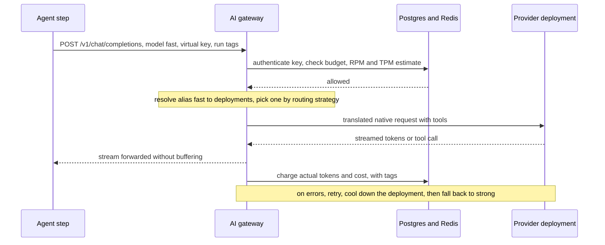

## TL;DR
An AI gateway is the proxy every agent's model calls pass through: one OpenAI-style API over many
providers, handling keys, budgets, limits, routing, fallbacks, caching and logging once. It buys control
for an extra hop and a new single point of failure.

## For agent builders
- **Why it matters for agents.** An agent makes many calls per task, often in parallel, so it is the first
  thing to hit shared rate limits and blow a budget when it loops. The gateway is where you see cost per
  agent and per step, and where a runaway agent's key gets cut off without touching anything else.
- **Where it shows up in your stack.** You point your OpenAI SDK, LangChain `ChatOpenAI` (via its
  `base_url`) or LlamaIndex client at the LiteLLM proxy or Portkey, call aliases like `fast` and `strong`,
  and attach run and step tags as metadata so traces and spend line up.
- **What you control.** A virtual key per agent or feature with its own budget and limits, aliases per
  agent role, which retries happen in the gateway versus your agent loop, and verifying tool calls and
  streaming pass through intact.
- **What you can skip.** Operating the gateway itself if a platform team owns it. You still need per-run
  step and cost caps in the agent, because gateway budgets are per key, not per task.

## Why it exists
- **Without one, every team re-implements the same plumbing.** The second team copies the first team's
  retry loop, pastes the same provider key into its own secret store, and spends against the same
  organisation quota with no coordination.
- **By the fifth team nobody can answer basic questions:** what feature X costs per month, which models are
  in production, what data goes to which vendor, how to switch everything off if a key leaks or a provider
  has an incident. Rate limits hit unpredictably because five services share one quota, and a provider
  migration touches every codebase.
- **A shared client library cannot *enforce* anything.** Teams pin old versions, polyglot stacks need one
  library per language, keys still live in every service, and org-wide rate-limit and budget coordination
  needs shared state a library does not have.
- **It is the API gateway idea with model concerns added:** token accounting, model aliasing, provider
  translation, streaming passthrough, prompt logging and guardrails.
- **Policy moves to a network boundary,** where it applies to every caller (every agent, every step)
  whether or not they remembered.

## How it works
### The request path
1. A client (an agent step) sends an OpenAI-compatible request (`/v1/chat/completions`, embeddings and so
   on) with a *virtual* key.
2. The gateway authenticates the key.
3. It resolves the requested model alias to one or more deployments.
4. It applies policy: budget remaining, requests and tokens per minute, guardrails.
5. It picks a deployment by its routing strategy.
6. It translates to the provider's native API (including tool definitions and tool calls) and streams the
   response back.
7. It records usage (tokens, computed cost, latency, key, tags) for logging and export.

The API is OpenAI-shaped *because* most SDKs and agent frameworks already speak it, so adoption is changing
a base URL and a key.

### LiteLLM proxy vs Portkey
| | LiteLLM proxy | Portkey |
|---|---|---|
| What | Open-source Python server (`litellm --config config.yaml`) plus a matching in-process `Router` class | Hosted gateway; the core gateway is also open source, written in TypeScript |
| Behaviour defined in | YAML config file you run yourself | Declarative JSON configs: a `strategy` (fallback or load-balance) over `targets` |
| Credentials | Keys referenced as `os.environ/VAR`; virtual keys per key, team or user | Provider credentials in Portkey's vault; clients reference them by an id (virtual keys, in Portkey's terms) |
| State | Postgres for virtual keys, budgets and rate limits; Redis for rate-limit counters, cache entries and cooldowns across replicas | Managed by Portkey |
| Per-target options | Retries, fallbacks, cooldowns in `router_settings` | Each target has its own virtual key and optional retry, cache (exact or semantic) and timeout settings |
| Client side | OpenAI SDK pointed at the proxy | Config id or inline config in request headers |
| Observability | Logging callbacks to tracing backends | Traces, cost and metadata tags in its dashboards; guardrails attach to configs |
| Compliance | Prompts stay in your network | A third-party processor in your data path, unless you deploy the gateway in your own environment |

**LiteLLM config sections:**
- `model_list`: deployments, each an alias name plus `litellm_params` with provider and model.
- `router_settings`: routing strategy, retries, fallbacks, cooldowns for failing deployments.
- `litellm_settings`: caching, logging callbacks to tracing backends.
- `general_settings`: the master key, the database.
- **The same alias can point at several deployments,** which is how load-balancing and same-model failover
  work.

### Enforcing budgets and rate limits
Budgets and limits are counters in shared state. LLM traffic makes them awkward because a request's cost is
not known until it finishes: the model decides the output length.

1. **Check *before* the call:** requests per minute, and tokens per minute from the prompt's token count
   plus `max_tokens` or an estimate.
2. **Charge actual usage *after*** the response completes.

Two consequences:
- **Budgets overshoot by whatever is in flight** when they run out, so a hard cap needs headroom or a
  per-request ceiling enforced through `max_tokens`. Parallel agent steps put more in flight.
- **Counters must live in Redis or similar** with several replicas, not in each process. Otherwise every
  replica enforces the full limit on its own and the effective limit is multiplied by the replica count.

### What the gateway cannot see about agents
- **It sees calls, not tasks.** A key budget cannot stop one agent run from taking 200 steps; only a
  per-run step and cost cap in the agent loop can.
- **Retries stack.** Gateway retries plus SDK retries plus the agent's own retry-on-error can multiply
  attempts; choose one layer per failure type.
- **Tool-call fidelity is a passthrough question.** Translating tool definitions and parallel tool calls
  between providers is where unified APIs most often differ; test your tools through the gateway.

### Routing among deployments
- **Strategies:** LiteLLM offers simple shuffle, least-busy, latency-based and usage-based routing, among
  others.
- **Cooldowns:** a deployment that fails repeatedly is skipped for a period: a circuit breaker under another
  name.
- **Blind to quality:** these strategies only see what the gateway sees, latency and errors, never answer
  quality or whether the agent's task succeeded.

### Alternatives
- **API-gateway vendors with AI plugins** (Kong AI Gateway).
- **CDN-hosted gateways** (Cloudflare AI Gateway).
- **Envoy AI Gateway,** built on Envoy, for teams already running it on Kubernetes.
- **The choice axes** are the same as LiteLLM versus Portkey: where prompts flow, who operates it, which
  providers and provider-specific features pass through intact, and fit with traffic infrastructure you
  already run.
- **The light end:** an in-process library such as the LiteLLM SDK's `Router` gives the same routing and
  fallbacks with no extra hop, but no central enforcement: every service holds keys again and budgets are
  per process.

### What it centralises
- Key custody.
- Budgets and quotas per team, agent or customer.
- Rate-limit coordination.
- Retries and fallbacks.
- Caching.
- PII redaction and guardrails.
- Logging and cost attribution via tags.
- **Model aliases:** agents call `fast` or `strong` while the platform team decides what those resolve to,
  so migrations and deprecations become configuration changes rather than code changes.

### Sharp edges
- **Lowest-common-denominator API.** Provider-specific features (prompt-cache controls, extended reasoning
  parameters, tool-call nuances, vision input formats) lag or are dropped unless passthrough is verified.
- **A new single point of failure and a new hop.** Run several replicas per region and keep it close to
  callers; an agent pays the hop on every step.
- **Decide the database failure mode.** When its Postgres or Redis is unavailable: fail open on budget
  checks, or fail closed and take every AI feature down with the database.
- **Streaming must be forwarded without buffering,** or time-to-first-token suffers.
- **Token counts across tokenisers are approximations.**
- **Gateway logs contain prompts** (and every tool result the agent saw), so they need a retention policy.
- **Someone must own the config,** or aliases rot and fallbacks go untested.

## Diagram
Follow one agent step: policy checks happen before the provider call using an estimate, and actual usage is
charged only after the response completes, which is why budgets can overshoot by what is in flight.



## Examples
### Agent steps through the gateway with run tags and a per-run cap
The gateway enforces the key's budget; the agent enforces the per-run cap the gateway cannot see. Tags
carry run id and step name so spend and traces join up. The `metadata` tags field follows LiteLLM's
convention; check your gateway's docs for the exact shape.

```python
from openai import OpenAI

client = OpenAI(base_url="http://litellm.internal:4000/v1", api_key="sk-<research-agent-virtual-key>")
MAX_STEPS, MAX_RUN_TOKENS = 25, 400_000          # per-run guards, owned by the agent

def run_agent(run_id, messages, tools, execute_tool):
    used = 0
    for step in range(MAX_STEPS):
        r = client.chat.completions.create(
            model="strong", messages=messages, tools=tools,
            extra_body={"metadata": {"tags": ["research-agent", f"run:{run_id}", f"step:{step}"]}})
        used += r.usage.total_tokens
        if used > MAX_RUN_TOKENS:
            return {"status": "stopped", "reason": "run token cap", "tokens": used}
        msg = r.choices[0].message
        messages.append(msg)
        if not msg.tool_calls:
            return {"status": "done", "answer": msg.content, "tokens": used}
        for tc in msg.tool_calls:
            messages.append({"role": "tool", "tool_call_id": tc.id, "content": execute_tool(tc)})
    return {"status": "stopped", "reason": "step cap", "tokens": used}
```

- **The same pattern in LangChain:** construct `ChatOpenAI` with the gateway's `base_url`, a virtual key and
  an alias as the model name; the gateway sees an ordinary OpenAI client.

### Worked scenario: a looping agent drains a shared key
Illustrative: a bug makes 20 concurrent agent runs loop; each step sends ~30k input tokens at $3 per 1M,
about $0.09 per step, roughly 6 steps a minute per run.

| Setup | Arithmetic | Effect |
|---|---|---|
| All features share one key with a $100 daily budget | 20 × 6 × $0.09 ≈ $10.80 per minute | Budget gone in about 9 minutes; every feature on that key is blocked |
| One virtual key per agent, $100 budget | Same burn, isolated | Only the research agent stops; support and search keep working |
| Plus per-run caps of 25 steps | 20 runs × 25 × $0.09 = $45 worst case | The loop never reaches the key budget at all |

### LiteLLM config and the application call
Two deployments behind one alias, a stronger fallback, caching and logging. The application only needs the
OpenAI SDK pointed at the proxy. Replace the model ids with current ones for your providers.

```yaml
# config.yaml: applications call "fast" or "strong"; the platform team decides what those mean
model_list:
  - model_name: fast
    litellm_params:
      model: openai/gpt-4o-mini
      api_key: os.environ/OPENAI_API_KEY
  - model_name: fast                          # second deployment of the same alias shares the traffic
    litellm_params:
      model: azure/gpt-4o-mini-eu             # azure/<your-deployment-name>
      api_base: os.environ/AZURE_EU_BASE
      api_key: os.environ/AZURE_EU_KEY
  - model_name: strong
    litellm_params:
      model: anthropic/claude-sonnet-4-20250514
      api_key: os.environ/ANTHROPIC_API_KEY
router_settings:
  routing_strategy: simple-shuffle
  num_retries: 2
  fallbacks: [{"fast": ["strong"]}]           # when every "fast" deployment fails, try "strong"
litellm_settings:
  cache: true                                 # exact-match response cache (Redis when configured)
  success_callback: ["langfuse"]              # usage and cost per request to your tracing backend
general_settings:
  master_key: os.environ/LITELLM_MASTER_KEY
  database_url: os.environ/DATABASE_URL       # virtual keys, teams and budgets live here
```

```python
from openai import OpenAI
client = OpenAI(base_url="http://litellm.internal:4000/v1", api_key="sk-<support-team-virtual-key>")
r = client.chat.completions.create(
    model="fast", messages=[{"role": "user", "content": "Summarise ticket #4821 in two lines."}],
    extra_body={"metadata": {"tags": ["support-bot", "tenant:acme"]}})   # tags drive cost attribution
print(r.choices[0].message.content)
```

- **The application never sees a provider key.**
- **Moving `fast` to a different model** is a config change and a canary, not a deploy of every service.

### Portkey config: fallback with retries
The same idea declared as a Portkey config. Check field names against the current Portkey docs; the shape
is a `strategy` over `targets`.

```json
{
  "strategy": { "mode": "fallback" },
  "retry": { "attempts": 2 },
  "targets": [
    { "virtual_key": "openai-prod", "override_params": { "model": "gpt-4o-mini" } },
    { "virtual_key": "anthropic-prod", "override_params": { "model": "claude-sonnet-4-20250514" } }
  ]
}
```

- **Fallback mode** tries targets in order; a load-balance strategy spreads traffic across targets instead.
- **The client** sends this config (or its saved id) in a request header; provider keys stay in the vault.

### Worked scenario: why counters overshoot
Illustrative numbers for one team key.

| Situation | Arithmetic | Effect |
|---|---|---|
| Daily budget $100, 40 requests in flight when it runs out, `max_tokens` 4,000 at $15 per 1M output tokens | 40 × 4,000 × $15 / 1M = $2.40 | Overshoot of up to $2.40 in output tokens (plus those requests' input cost), bounded only because `max_tokens` caps each request |
| Same, but no `max_tokens` ceiling | Unbounded per request | The "hard" cap is not hard |
| 600 requests/min limit, 3 replicas with in-process counters | 3 × 600 | Effective limit 1,800 per minute; provider 429s while the gateway never trips |
| Same, counters in Redis | One shared counter | Effective limit 600, as configured |

## Production patterns
- **A virtual key per agent or feature.** When more than one team or agent calls models, issue each its own
  key through the gateway's key API with a budget, a budget period and RPM/TPM limits (LiteLLM's key
  generation accepts `max_budget`, `budget_duration`, `rpm_limit` and `tpm_limit`). Monitor spend and 429s
  per key; a looping agent or a leaked key is cut off alone.
- **Run and step tags on every call.** Attach agent name, run id and step name as request metadata so the
  gateway's spend joins your traces (LangSmith, Langfuse or OpenTelemetry). Monitor cost per successful run
  and the step count distribution; a long tail of steps is the early sign of loops.
- **Shared state for every replica.** Before running more than one LiteLLM replica, point the router at
  Redis (`redis_host`, `redis_port`, `redis_password` in `router_settings`) so limits, cooldowns and cache
  are shared. Monitor gateway-side limit hits against provider 429s; a gap means counters are not shared.
- **Cooldowns tuned to the provider, one retry layer.** Set how many failures put a deployment into
  cooldown and for how long (`allowed_fails` and `cooldown_time` in LiteLLM's `router_settings`), and turn
  off duplicate retries in the SDK or agent loop for the same errors. Monitor deployments in cooldown and
  attempts per agent step.
- **Fail open on soft budgets.** Decide explicitly what happens when Postgres is down; for internal
  traffic, let requests through and reconcile spend later (LiteLLM documents a general setting for
  allowing requests when the database is unavailable). Monitor database health and unreconciled spend.
- **Streaming, tool calls and health in CI.** After every gateway upgrade, compare time-to-first-token
  through the gateway with a direct call, replay a tool-calling eval through it, and wire the proxy's
  liveness and readiness endpoints into the load balancer. Monitor added latency at p50 and p99, tool-call
  parse failures and availability.
- **Prompt-log retention.** Treat gateway logs as sensitive data: set a retention period, redact or omit
  message content where policy requires, and scope cache keys per tenant. Monitor log volume, retention
  jobs and cache hit rate per tenant.

## Trade-offs
- **Central control vs an extra hop.** One place for keys, budgets and logs, against one more network hop
  and a shared failure point; the balance tips badly with a single replica or a different region from
  callers, and an agent pays the hop on every step.
- **Cheap migrations vs lagging features.** Aliases make provider migrations cheap, but the unified API
  lags provider features; it flips when a provider-specific capability such as cache controls or a tool
  feature is core to your agent and is not passed through.
- **Hosted vs self-hosted.** A hosted gateway removes operations and gives dashboards on day one; a
  self-hosted LiteLLM keeps prompts in your VPC but makes you run Postgres, Redis and upgrades. Compliance
  usually decides.
- **Central policy vs app control.** A platform team can move traffic without touching applications, at
  the cost of application teams losing fine control; a single app with unusual needs may be better served
  in-process.
- **One-line caching vs context blindness.** Gateway-level caching is a one-line win but context-blind; its
  safety depends entirely on keys and tags scoping entries per tenant.

## Pitfalls
- **A fail-closed dependency on the gateway's database.** Symptom: every AI feature in the company goes down
  when Postgres restarts for maintenance.
- **Relying on key budgets to stop a looping agent.** Symptom: one buggy agent drains a shared key and
  blocks unrelated features. Fix: per-agent keys plus per-run step and token caps in the loop.
- **Buffering streamed responses in the proxy.** Symptom: time-to-first-token jumps from hundreds of
  milliseconds to seconds right after adoption.
- **A shared cache without tenant scoping.** Symptom: a cached answer containing one customer's data served
  to another, which is an incident, not a bug.
- **Assuming feature parity across providers.** Symptom: provider-specific parameters silently dropped, or
  tool calls translated differently, and cost or quality regressing after a migration that "worked".
- **One master key shared by all applications.** Symptom: zero cost attribution and an unbounded blast
  radius when the key leaks.
- **Nobody owning the configuration.** Symptom: dozens of aliases, half pointing at deprecated models, with
  fallbacks that have never been exercised.
- **Rate-limit counters per replica instead of in shared state.** Symptom: provider 429s and budget
  overruns while the gateway's own limits never trip, worsening each time a replica is added.

## When to use
- **Adopt a gateway** once more than one team, agent or provider is involved, or as soon as finance or
  compliance asks for spend by team and a list of what is sent where.
- **Skip it for a single agent or application:** an in-process router (LiteLLM's SDK or a thin client) is
  lighter.
- **Choose the LiteLLM proxy** when you want an open-source component inside your own network and can
  operate a small Python service with Postgres and Redis.
- **Choose Portkey** when hosted observability and declarative configs matter more and your data rules
  allow a processor.
- **Measure:** added latency at p50 and p99, gateway availability, cache hit rate and spend per key and per
  agent run.
- **Interviews:** say what a gateway centralises and what it cannot do, which is make outputs correct or
  stop an agent from looping.

## Role lens
- **Engineer:** Points the SDK at the gateway, calls aliases rather than model ids, tags requests for
  attribution, and debugs with gateway logs instead of five provider dashboards.
- **Architect:** Decides placement per region, fail-open versus fail-closed policy, config ownership, and
  the boundary between what belongs in the gateway (routing, keys) and in the application (prompt logic).
- **FDE:** Deploys a gateway inside the customer's cloud to satisfy key-custody and egress policies, and
  uses its per-key reports to show each business unit its own spend.

## Check yourself
**Q:** A platform team proposes routing all LLM traffic through a single LiteLLM proxy in one region,
backed by one Postgres instance, and failing requests whenever the budget check cannot run "so budgets
are never exceeded". Critique the design.
**A:** Three problems. A single replica in one region is a company-wide single point of failure and adds
cross-region latency for every service elsewhere; run at least two replicas per region behind a load
balancer, with Redis for shared counters. Failing closed on the budget check couples every AI feature to a
database's uptime for a soft financial control; budgets should fail open with asynchronous
reconciliation and alerts, reserving fail-closed for hard compliance limits on untrusted keys. Finally,
the proposal says nothing about operations: verify streaming passthrough, test the fallback chains, set a
retention policy for logged prompts, assign an owner for aliases, and document an emergency bypass. The
gateway is the right idea; the single-instance, fail-closed shape is what needs to change.

## Interview questions
### Why use an AI gateway instead of a shared client library?
- **A library cannot enforce anything:** teams pin old versions, polyglot stacks need one library per
  language, and keys still live in every service.
- **Org-wide limits need shared state** that a library does not have, so five services sharing one quota
  hit rate limits unpredictably.
- **A network boundary applies policy to every caller,** whether or not they remembered: key custody,
  budgets, logging and model aliases in one place.

### How do you stop one runaway agent from taking down every AI feature that shares a gateway?
- **Isolate keys:** one virtual key per agent or feature with its own budget and RPM/TPM limits, so a loop
  only exhausts its own key.
- **Cap in the loop:** per-run step and token caps in the agent, because the gateway sees calls, not tasks.
- **Detect early:** tag calls with run id and step, and alert on step-count tails and spend per run.

### Provider 429s keep appearing but the gateway's own rate limits never trip. What is wrong?
- **Most likely per-replica counters:** with 3 replicas each enforcing 600 requests per minute in process,
  the effective limit is 1,800.
- **Fix:** move counters, cooldowns and cache to Redis so every replica shares one counter, and the
  configured limit becomes the real one.
- **Verify:** gateway-side limit hits should now rise as provider 429s fall; the gap between them is the
  signal.

### Your agent works against the provider directly but its tool calls break through the gateway. How do you debug it?
- **Compare raw requests and responses:** tool definitions, parallel tool calls and argument encoding are
  where provider translation most often differs.
- **Check passthrough settings** for provider-specific parameters, and pin the gateway version that passed
  your tool-calling eval.
- **Add the eval to CI** so every gateway upgrade replays real agent tool calls before it ships.

### How do you make a budget cap actually hard when cost is unknown until the response ends?
- **Check before, charge after:** pre-check using prompt tokens plus `max_tokens`, then charge actual usage
  when the response completes.
- **Bound the overshoot with `max_tokens`:** 40 in-flight requests at 4,000 tokens and $15 per 1M output
  tokens can overshoot by at most $2.40; without a ceiling the cap is not hard.
- **Leave headroom** below the true limit, and reserve fail-closed for hard compliance limits on untrusted
  keys.

### How would you choose between the LiteLLM proxy and Portkey for a regulated customer?
- **Where prompts flow decides first:** a self-hosted LiteLLM proxy keeps prompts in your network, while hosted
  Portkey is a third-party processor unless you deploy its gateway in your own environment.
- **Who operates it:** LiteLLM means running Postgres, Redis and upgrades yourself; Portkey gives dashboards
  and declarative configs on day one.
- **Check passthrough** of the provider features the product depends on before committing to either. An
  in-process `Router` is the lighter choice for a single application.

## Quiz
### Q: Which concern is an AI gateway least able to solve?
- [ ] Attributing spend to teams and features
- [ ] Failing over to another provider during an outage
- [x] Making a feature's outputs correct for its task
- [ ] Keeping provider keys out of application code
> A gateway controls where requests go and what is recorded about them. Output quality depends on
> prompts, retrieval, models and evaluation, which live in the application and its eval harness, not at
> the network boundary.

### Q: What most distinguishes the LiteLLM proxy from Portkey?
- [ ] Portkey only supports OpenAI models
- [x] LiteLLM is an open-source Python proxy you run with a YAML config; Portkey is primarily a hosted gateway driven by declarative configs, with an open-source core
- [ ] LiteLLM cannot do fallbacks or load balancing
- [ ] Portkey requires you to operate your own Postgres
> Both offer routing, fallbacks, caching and observability across many providers. The real difference is
> operating model and where your data flows: self-hosted Python with your own database versus a hosted
> service with dashboards.

### Q: Why do applications call model aliases such as "fast" and "strong" instead of concrete model ids?
- [ ] Aliases reduce the number of tokens billed
- [ ] Aliases make model outputs deterministic
- [x] Aliases let the platform team remap, load-balance and migrate models by configuration without changing application code
- [ ] The OpenAI API specification requires aliases
> Indirection is what makes deprecations and migrations cheap: the mapping from alias to deployments
> changes in one place and can be canaried, while the application code stays untouched.

## Use cases & projects
### Use cases
- **Budget per agent.** A virtual key per agent or feature caps spend, so a looping agent is cut off without
  touching other traffic.
- **Role aliases.** Agents call `fast` and `strong`; the platform team remaps them during a model migration
  with no agent code change.
- **Spend attribution.** Run and step tags sent as metadata line up gateway spend with agent traces, so you
  can see which step costs most.
- **Shared rate limits.** Many parallel agents share provider quotas through one egress point that queues
  and load-balances across deployments.

### Mini project
**Put an agent behind a LiteLLM proxy (1-2 hours).**
- **Goal:** route an agent's calls through a gateway with aliases, a budgeted key and per-step tags.
- **Steps:** run the LiteLLM proxy locally with two aliases mapped to two models; point an OpenAI-compatible
  agent client at it via `base_url`; create a virtual key with a small budget; tag each call with run and
  step metadata; run tasks until the budget trips.
- **Done when:** tool calls and streaming work through the proxy, spend is visible per tag, and the agent
  receives a clear error once the key's budget is exhausted, which your loop handles by stopping cleanly.
