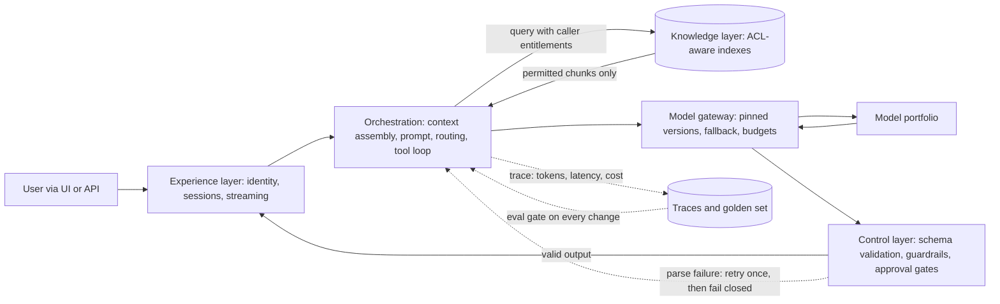

## TL;DR
AI solution architecture designs everything around the model call: context, model choice, output
validation, logging and measurement. A model is a probabilistic, expensive, stateless, rented
dependency, so deterministic engineering must surround the narrow part only the model can do.

## Why it exists
- **The prototype is one function, and its failures are not in the model.** Build a prompt, call the
  API, show the answer: it demos and ships. Then answers vary between runs (regression or noise?), cost
  scales with every user and retry, the prompt swells to 3,000 tokens of rules for lack of retrieval and
  tools, a pasted contract gets an invented clause, security asks who sees whose documents, and a
  provider deprecation breaks the tuned prompt.
- **A model breaks three classical assumptions.** Classical components are deterministic, unit-testable
  and cheap per call. A model is specified by data (prompts, examples, retrieved context) rather than
  code, its quality is measurable only statistically over a dataset, and latency and per-call cost are
  first-order design constraints.
- **The model is the small box.** Sculley et al. called the classical version hidden technical debt:
  the model is a small box and plumbing is the rest of the diagram. With rented, general-purpose LLMs
  the ratio is more extreme, because your competitor rents the same model. Differentiation lives in
  context assembly, output constraints and the evaluation loop.
- **"Better prompts will fix it" fails.** A prompt is a configuration surface, not an architecture. It
  cannot give you access control, retrieval freshness, caching, retries, fallbacks, schema guarantees,
  evaluation or cost accounting.

## How it works
### The layers and why each is separate
1. **Experience and integration layer.** UI, public API, chat channels, IDE plugins; owns identity,
   sessions and streaming to the client. It never holds a prompt or a model key, *because* otherwise
   every surface couples to one model's behaviour and cannot be changed centrally.
2. **Orchestration layer.** Turns a request into one or more model calls: context assembly (retrieval,
   memory, tool results), prompt rendering, routing, the tool-execution loop, output parsing. Most
   application code lives here *because* this is the deterministic part you can test.
3. **Model layer.** A portfolio of models behind a gateway: pinned versions, fallbacks, rate limits,
   cost metering, provider credentials. Separate *because* models change on the provider's schedule,
   not yours, and the gateway is the one place to enforce budgets and policy.
4. **Knowledge and data layer.** Ingestion, chunking, indexes, memory stores, attribute lookups, each
   carrying access-control metadata. Separate *because* freshness, permissions and provenance are data
   engineering problems; a prompt cannot know a document was revoked an hour ago.
5. **Control layer.** Input and output guardrails, schema validation, policy checks, approval gates
   before consequential actions. Exists *because* model output is untrusted input: a retrieved document
   can carry an injected instruction, and the model will sometimes follow it.
6. **Evaluation and observability.** Traces of every call (prompt, context, output, tokens, latency,
   cost), golden datasets, offline eval gates in CI, online metrics, feedback capture. Exists *because*
   quality is statistical: a test case tells you nothing, a dataset tells you a distribution.

### Design moves specific to AI systems
- **Push determinism out of the model.** Lookups, arithmetic, routing on known fields, formatting and
  validation belong in code: cheaper, faster, testable, no hallucination. Reserve the model for language
  understanding and generation.
- **Treat context assembly as the primary data flow.** Quality is bounded by what is in the context
  window. The architecture decides what is retrieved, in what order, under what token budget and with
  which permissions; most quality bugs originate here.
- **Make budgets non-functional requirements.** A latency budget (say p95 ≤ 3 s, split across
  retrieval, prefill and decode), a token budget per request, a cost per successful task. These drive
  model choice, streaming and caching.
- **Use typed output contracts.** Schema-validated structured outputs give downstream code a real
  boundary; a parse failure is an error you can count, not silent corruption.
- **Place humans deliberately.** Where a wrong output is expensive, add review or approval. The
  architecture decides where that risk boundary sits, not the prompt.
- **Keep the feedback loop cheap.** Traces → labelled failures → golden set → eval → change in prompt,
  model or retrieval → release gate. If the loop takes a week, the system will not improve.

### The two budgets as formulas
Latency and cost are the two NFRs the model call dominates; both decompose into terms the architecture
controls:

```
p95_latency  ≈ t_auth + t_retrieval + t_prefill(input_tokens) + output_tokens / decode_rate
               + t_validation + P(retry) × t_retry
cost_per_successful_task = Σ over calls (in_tokens × price_in + out_tokens × price_out)
                           ÷ fraction of tasks that succeed
```

- **Output length is usually the biggest latency lever, not model choice.** Decode time is linear in
  tokens generated, so an answer-length cap, or streaming (which moves perceived cost to
  time-to-first-token), beats shaving milliseconds off retrieval.
- **Trap 1: input tokens multiply.** They are paid again on every call in an agent loop or retry.
- **Trap 2: the denominator.** A cheaper model with a lower success rate can cost *more* per useful
  outcome once retries, escalations and human rework are counted.

### Solution architecture versus AI architecture
| Half | Covers |
|---|---|
| *Solution* (enterprise integration) | single sign-on, systems of record the context comes from, deployment constraints such as VPC or data residency, compliance evidence, operations and support boundaries |
| *AI* (model-facing decisions) | retrieval versus fine-tuning, model tiers, agent versus workflow, guardrails |

A working architecture needs both; the FDE usually lives exactly at their seam.

### Artefacts a reviewer expects
- **C4 diagrams** for structure.
- **ADRs** for hard-to-reverse decisions: model family, RAG versus fine-tune, agentic versus workflow.
- **An NFR table** with the budgets.
- **A data-flow diagram** showing every path by which data reaches a model and where it is stored.
- **A threat model** covering prompt injection and cross-tenant leakage.
- **A cost model** tied to expected traffic.

## Diagram
Follow one request through the six layers: only the gateway talks to models, retrieval enforces
permissions before context is built, and every call feeds the trace and eval loop.



## Examples
### Worked scenario: claims-handling assistant for an insurer
All figures illustrative. Requirements: answer adjusters' questions over policy documents and the claim
file, draft customer letters, never expose another customer's data, p95 under 4 s. Load: 2,000
adjusters at about 20 requests each per day, roughly 40k requests per day.

**Request path:**
1. SSO token → orchestration service.
2. ACL-aware retrieval scoped to the claim and the adjuster's entitlements: top 8 chunks ≈ 2,500 tokens.
3. Prompt = 600-token system prompt + context + 100-token question ≈ 3,200 input tokens.
4. Gateway routes Q&A to a mid-tier model and letter drafting to a frontier model.
5. Output parsed into `{answer, citations[]}`; a citation checker verifies every citation points at a
   retrieved chunk.
6. Output guardrail scans for identifiers belonging to other claims.
7. Streamed to the UI; trace written with tokens, latency and cost.

**Latency budget:**

| Term | Value |
|---|---|
| Retrieval | 300 ms |
| Prefill | ≈ 500 ms |
| Decode, 300-token answer at ≈ 50 tokens/s | 6 s, which blows the 4 s target |
| Fix 1: stream | user perceives time to first token (≈ 1 s) |
| Fix 2: cap Q&A answers at 200 tokens | with a "show more" follow-up |

**Cost and where to optimise:**
- **Volume.** 40k × 3.2k ≈ 128M input tokens per day, plus 40k × 200 ≈ 8M output tokens.
- **Tiering.** That volume justifies the mid-tier model for Q&A: at an illustrative 10× price ratio
  between tiers, sending Q&A to the frontier model multiplies the daily bill by ten for answers the eval
  shows are no better.
- **Input breakdown.** Caching the fixed 600-token prefix touches only about 19% of input. Retrieved
  context is 2,500 tokens, about 78%, so cutting top-k from 8 to 5 chunks (≈ 940 fewer tokens, about 29%
  of input) is the larger saving, *if* the eval shows citation recall does not drop.
- **Evaluation.** 150 real adjuster questions with reviewed answers, faithfulness measured by citation
  match, run on every prompt or model change and weekly in production.

### Budget calculator for the two formulas
Runnable Python; prices are illustrative placeholders, not any provider's list price.

```python
def p95_latency_s(t_auth, t_retrieval, t_prefill, output_tokens, decode_rate,
                  t_validation=0.0, p_retry=0.0, t_retry=0.0):
    return (t_auth + t_retrieval + t_prefill + output_tokens / decode_rate
            + t_validation + p_retry * t_retry)

def cost_per_successful_task(calls, price_in, price_out, success_rate):
    """calls: list of (in_tokens, out_tokens); prices in $ per token."""
    spend = sum(i * price_in + o * price_out for i, o in calls)
    return spend / success_rate

# Claims assistant, illustrative figures
print(p95_latency_s(0.0, 0.3, 0.5, 300, 50))   # 6.8 s: blows the 4 s target
print(p95_latency_s(0.0, 0.3, 0.5, 200, 50))   # 4.8 s total, but streamed TTFT is ~1 s

M = 1e-6                                       # $ per million tokens -> $ per token
mid = cost_per_successful_task([(3200, 200)], 0.5 * M, 2 * M, 0.9)
cheap = cost_per_successful_task([(3200, 200)], 0.15 * M, 0.6 * M, 0.25)
print(f"mid ${mid:.5f}  cheap ${cheap:.5f} per successful task")
# mid $0.00222  cheap $0.00240: the model with a 70% lower price costs more per useful outcome
```

## Production patterns
- **Gateway with pinned versions and fallback.** When more than one surface calls a model. Route a
  logical model name through a gateway (for example LiteLLM proxy or Portkey) to a dated, pinned model
  version with a configured fallback list. Monitor fallback rate, error rate and p95 per provider.
- **Eval gate in CI.** On every prompt, model or retrieval change. Run the golden set in the pipeline
  and fail the build when faithfulness or task success drops below the agreed bar. Monitor the eval
  score trend and the weekly production re-run.
- **Trace every call with cost attribution.** From day one in production. Emit one span per model call
  with prompt and context references, input and output tokens, latency, cost and tenant, using
  OpenTelemetry's GenAI attributes where your stack supports them. Monitor cost per successful task and
  token growth per route.
- **Typed outputs with a counted failure path.** Whenever code consumes model output. Validate against
  a schema (for example a Pydantic model), retry once on parse failure, then fail closed. Monitor parse
  failure rate per model version; a jump usually signals a silent model change.
- **Permissions enforced at retrieval, not in the prompt.** For any multi-user corpus. Pass the
  caller's entitlements as a metadata filter in the index query so unauthorised chunks never reach the
  context. Monitor with cross-tenant canary queries that must return nothing.
- **Stream and cap output per route.** For interactive answers. Set a maximum output-token limit per
  route and stream tokens to the UI. Monitor time to first token and total p95 separately.

## Trade-offs
- **Layering vs latency and operations.** Layers give testability and swappable models, but each hop
  adds latency and another service to run. A single internal tool with one model is better served by a
  modular monolith that keeps the same boundaries as modules rather than services.
- **Logic in code vs iteration speed.** Code gives determinism and tests but iterates more slowly. While
  the problem is still being discovered a prompt-heavy prototype is right; the architecture hardens as
  behaviour stabilises.
- **Guardrails vs friction.** Guardrails and approval gates reduce risk but add latency and user
  friction. The flip point is the cost of a wrong action: low-stakes drafting needs far fewer gates than
  money movement.
- **Full tracing vs data exposure.** Tracing prompts and outputs makes evaluation possible but creates a
  store of sensitive data; retention, redaction and access policies are designed with it, not after.
- **Where tracing flips.** The flip is data class: for regulated data, keep redacted traces by default
  and a small sampled full-fidelity set under tighter access, accepting slower debugging for a smaller
  breach surface.

## Pitfalls
- **Prompt-as-architecture.** A 4,000-token system prompt holding business rules, data and formatting.
  Symptom: every edit breaks something else and nobody can say what the system does. Fix: move rules
  to code and data to retrieval.
- **No evaluation set before launch.** Symptom: whether a new model or prompt is better is argued from
  anecdotes, and users discover regressions. Fix: a golden set and a release gate.
- **Trusting model output.** Feeding it to SQL, a shell, or an email-send without validation. Symptom: a
  retrieved document containing an instruction causes an unintended action. Fix: validate and gate.
- **Designing for average latency.** Symptom: the demo is snappy; production p95 is 15 s because of
  long contexts, retries and queueing on the provider. Fix: budget p95 per layer.
- **Forgetting the model is rented.** No version pinning, no fallback. Symptom: a provider deprecation
  or regional outage becomes a product incident with no runbook.
- **No cost model.** Symptom: usage grows, the bill grows faster, and the feature is throttled or
  quietly removed.

## When to use
This is less a pattern you choose than the way to think about any system with a model in it, applied
at the right weight.
- **First question:** is a model needed at all? If a rule or a lookup solves it, that is the better
  architecture.
- **Prototype:** sketch the layers and implement them as modules in one process.
- **Moving to production, add in this order:** tracing; an evaluation set and gate; a gateway with
  pinned versions and fallback; retrieval with access control; output contracts; then guardrails sized
  to the risk.
- **Measure:** p95 latency per layer, cost per successful task, eval score, and failure rate by category.
- **Interviews:** "design a document assistant for X" expects the layers above, explicit budgets, the
  eval loop and the trust boundary around model output.

## Role lens
- **Engineer:** Builds the orchestration layer: context assembly, schema-validated outputs, tracing,
  and a single model interface so the model can be swapped without touching business logic.
- **Architect:** Owns the layer boundaries, the NFR budgets for latency, cost and quality, the
  RAG-versus-fine-tune and agent-versus-workflow decisions as ADRs, and the evaluation gate.
- **FDE:** Maps the reference shape onto the customer's identity provider, data sources and deployment
  constraints, and explains to stakeholders why the model call is the smallest box on the diagram.

## Check yourself
**Q:** A team has a working prototype: a web form sends the user's question plus a pasted document to
a frontier model and shows the answer. They want to ship it to 5,000 enterprise users next quarter.
What do you change in the architecture, and in what order, and why that order?
**A:** First move the model call behind an orchestration service and a gateway so the UI holds no
prompts or keys, pin the model version and add a fallback; that is the cheapest change and removes the
single biggest operational risk. Second, build the evaluation loop before touching quality: capture
traces, collect one to two hundred real questions with reviewed answers, define the bar. Without it
every later change is a guess. Third, replace pasted documents with ingestion and ACL-aware retrieval,
which bounds context size, enforces permissions and enables caching, fixing cost and the data-leakage
exposure at once. Fourth, add typed outputs with citations and input and output guardrails, with human
review wherever an answer drives a decision. Then set budgets, p95 with streaming and cost per task,
and choose the cheapest model that clears the eval bar. Record each decision as an ADR.

## Interview questions
### What makes architecting around an LLM different from architecting around a normal service dependency?
- **It breaks three classical assumptions.** A model is specified by data rather than code, its quality
  is measurable only statistically over a dataset, and latency and per-call cost are first-order
  constraints.
- **So the design surrounds it with deterministic code.** Lookups, arithmetic, routing and validation
  move into code, and an evaluation set replaces unit tests as the measure of quality.
- **And it is rented.** Versions change on the provider's schedule, so pinning and fallback live in a
  gateway rather than in every caller.

### Design a document Q&A assistant for 2,000 users with a p95 budget of 4 seconds. Where does the time go?
- **Decompose the budget:** auth, retrieval (about 300 ms), prefill (about 500 ms), then decode, which
  is output tokens divided by decode rate.
- **Decode dominates.** At about 50 tokens/s, a 300-token answer alone takes 6 s, so the levers are an
  output cap per route and streaming, which moves perceived latency to time to first token.
- **Then add the rest of the shape:** ACL-aware retrieval, a gateway with a pinned model, typed output
  with citations, and traces feeding a golden set.

### A cheaper model cut the per-call price by 70%, but the monthly bill went up. How is that possible?
- **The denominator moved.** Cost per successful task divides spend by the success rate, so a model
  that succeeds far less often costs more per useful outcome.
- **Retries and escalations add calls.** Every failure is paid again as a retry, a fallback to a larger
  model or human rework.
- **The fix is to measure cost per successful task** on the eval set before switching, not price per
  token.

### When would you not split the system into separate layer services?
- **For a single internal tool with one model.** Each hop adds latency and another service to operate,
  which is not worth it at that size.
- **Keep the boundaries as modules instead.** A modular monolith keeps orchestration, gateway, retrieval
  and control code separate, so they can be split into services later without a rewrite.
- **The flip is multiple surfaces or teams** sharing models, where a central gateway and shared
  retrieval start to pay for themselves.

### Why do permissions belong in retrieval rather than in the system prompt?
- **A prompt cannot enforce anything.** The model applies instructions probabilistically, and a
  retrieved document can carry an injected instruction it may follow.
- **Filtering at query time means unauthorised chunks never reach the context,** so the model cannot
  leak what it never saw.
- **Monitor it with canary queries** across tenants that must always return nothing, plus an output
  guardrail scanning for identifiers that belong to other customers.

## Quiz
### Q: Why does an AI solution architecture keep the orchestration layer separate from the model layer?
- [ ] Because models cannot execute code, so tools must run in a different process
- [x] Because models change on the provider's schedule and the deterministic logic must stay testable and model-independent
- [ ] Because provider APIs do not allow direct calls from application servers
- [ ] Because orchestration frameworks require their own deployment unit
> The boundary exists so that pinning, fallback, routing and cost policy live in one place while the
> application logic can be unit-tested against a stable interface. Tool execution location and framework
> packaging are implementation details, not the reason for the boundary.

### Q: A team keeps adding business rules to the system prompt because it is faster than writing code. What breaks first?
- [ ] Token cost rises, and that is the only consequence
- [ ] The model stops reading instructions past a fixed length
- [x] Behaviour becomes untestable configuration: rule changes interact unpredictably and regressions cannot be caught
- [ ] Provider rate limits are exceeded by the longer prompt
> Rules in a prompt are applied probabilistically and cannot be unit-tested, so each edit can silently
> change unrelated behaviour. Cost does rise, but the architectural failure is losing the ability to
> reason about and verify what the system does.

### Q: Which component most determines whether an AI system improves after launch?
- [ ] A larger model behind the same prompt
- [ ] A vector database with more documents
- [x] Tracing plus a golden evaluation set wired into the release process
- [ ] A streaming interface that lowers perceived latency
> Improvement requires seeing failures, turning them into labelled examples, and measuring each change
> against them before release. A bigger model or more data may raise quality once, but without the loop
> nobody can tell whether the next change helped or hurt.
