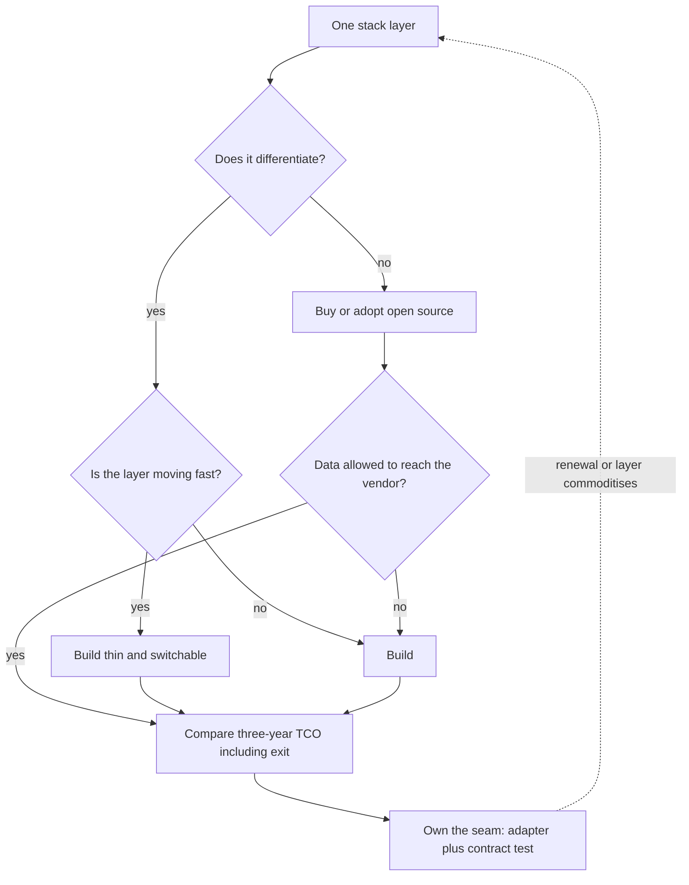

## TL;DR
For an agent, build versus buy is one decision per stack layer: model, gateway, agent framework,
retrieval, tracing and evals, guardrails, product. Buy or adopt commodity plumbing, build tools, context
assembly and eval sets, and own a thin seam everywhere.

## For agent builders
- **Why it matters for agents.** The agent stack is young and crowded: frameworks, tracing platforms,
  managed agent services and vector stores all overlap. Choosing badly means either months on plumbing
  or an agent whose prompts, traces and test set live inside someone else's platform.
- **Where it shows up in your stack.** Orchestration: a hand-written loop, an open-source framework
  such as LangGraph, LangChain or LlamaIndex, or a vendor's managed agent service. Tracing and evals:
  LangSmith, Langfuse, Arize Phoenix or your own spans. Gateway: LiteLLM proxy or Portkey.
- **What you control.** The layer map, the seams (a tool interface, an agent runner interface, a
  retriever interface), and the golden set of agent tasks that every option is measured against.
- **What you can skip.** Feature-by-feature framework comparisons. Ask the four questions per layer,
  keep the seam, and measure time-to-swap instead of debating.

## Why it exists
- **The boundaries are not settled yet.** In mature domains nobody writes their own database. The AI
  stack is young: is an AI gateway a product or three hundred lines? Is an agent framework worth its
  abstractions, or is the loop forty lines? Is eval tooling a vendor or a script and a spreadsheet? Is a
  retrieval pipeline a managed service or core IP? Unclear answers push teams into one of two mistakes.
- **Mistake 1: build everything, because AI is strategic.** Six months later there is a home-grown
  vector store, gateway, tracing system and prompt manager, the product is behind schedule, and the
  platform competes with open-source projects that improved faster. The error conflates strategic
  importance with differentiation: the model is the most strategic component and almost nobody should
  train one.
- **Mistake 2: buy end-to-end, because speed matters.** Fast start, then limits: the vendor's workflow
  is not yours, your most sensitive source cannot be sent to them, per-seat pricing scales with adoption
  rather than value, and the quality loop is a black box you cannot evaluate. At renewal, prompts,
  analytics and the test set all live inside their platform.
- **What mistake 2 gets wrong.** It treats the application layer as commodity when it is precisely where
  your domain knowledge, tools and data live.
- **Each default is wrong at specific layers,** not everywhere. That is why the decision must be
  decomposed before it can be made.

## How it works
### Decompose the stack into layers
| # | Layer | Default | Why |
|---|---|---|---|
| 1 | **Foundation model** | rent through an API or run open weights | training from scratch is for a handful of organisations |
| 2 | **Serving** | buy (the API) or build on open-source engines if self-hosting | rarely write your own |
| 3 | **Gateway and routing** | buy, adopt open source, or a thin build | commodity, but you must own the configuration because it encodes your portfolio and budgets |
| 4 | **Orchestration and agent logic** | usually built, in plain code or on an open-source framework | this is where your workflow, tools and state live and most testing happens |
| 5 | **Retrieval and knowledge** | buy the vector store or search engine; build ingestion, chunking, access-control mapping and ranking tuned to your corpus | that is where quality is decided |
| 6 | **Evaluation and observability** | buy or adopt the tracing and eval platform; always build golden sets and task metrics | nobody can sell you your own test set |
| 7 | **Guardrails** | buy generic detectors (PII, toxicity, injection); build domain policies and the evals that prove they hold | generic is commodity, policy is yours |
| 8 | **Application and experience** | build if it is your product; buy if internal productivity with no differentiation | differentiation lives here |

- **The model-layer "build" open to most teams is *adaptation*:** fine-tuning or distilling a rented
  or open base for a narrow task.
- **The other real model-layer choices** are self-host versus API and open-weight versus proprietary,
  each with its own lesson.

### The agent framework layer, specifically
| Option | You get | You pay |
|---|---|---|
| Hand-written loop | full control, few dependencies, easy to debug | you build state persistence, retries, human-in-the-loop pauses yourself |
| Open-source framework (LangGraph, LangChain, LlamaIndex) | graph or chain abstractions, checkpointed state, integrations | its abstractions, upgrade churn, debugging through framework code |
| Managed agent service from a model or cloud vendor | hosted runtime, built-in tools, fast start | lock-in to that vendor's models and runtime, less control of the loop |

- **Tools and their contracts are always yours,** whatever runs the loop, because they encode your
  systems of record and permissions.
- **Tracing platforms are a separate decision.** A framework's companion tracing product (LangSmith for
  LangChain and LangGraph) is convenient; an open-source option such as Langfuse can be self-hosted when
  traces cannot leave your environment.

### Four questions per layer
1. **Does it differentiate?** Would a customer choose you or pay more because of your version of this
   layer? Differentiation usually lives in data, domain workflows, tools, evaluation sets and
   integrations, rarely in plumbing. If no, buy.
2. **How fast is the layer moving?** Buy or adopt a fast-moving commodity layer, *because* a build
   will be obsolete before it is finished. Build a fast-moving core layer thin and keep it switchable;
   agent orchestration is the textbook case.
3. **What do data and compliance require?** A source that cannot leave your environment, retention
   rules or audit requirements narrow buy options to vendors that deploy where you are, and sometimes
   force a build. Agent traces contain tool results, so they inherit the data's class.
4. **What is the total cost including exit?** Compare over three years, not year one:
   - **Build:** engineering time to a first version, plus ongoing maintenance (a material fraction of
     build cost every year), plus the opportunity cost of what those engineers did not ship.
   - **Buy:** licence, plus integration (routinely underestimated), plus the lock-in premium at renewal,
     plus exit cost: data migration, prompt re-tuning, user retraining.

```
TCO_build = build effort + 3 × annual maintenance + infrastructure + usage + opportunity cost
TCO_buy   = licence over 3 years (at projected seats or usage) + integration
            + P(switch) × exit cost
```

- **Writing it out exposes dropped terms:** maintenance and opportunity cost on the build side;
  integration and exit on the buy side.
- **The scale asymmetry.** The licence term grows with adoption while most of the build side is fixed,
  which is why the answer often flips with scale.

### Patterns that come out of the questions
- **Buy then build.** Adopt a vendor to learn real requirements, then replace the differentiating part
  once usage shows what it is. Justified when requirement uncertainty is high, *because* you cannot know
  what differentiates before users use it.
- **Build on open source.** The middle path for gateways, serving, agent frameworks, eval frameworks:
  you own deployment and configuration but not development. It trades licence fees for operational
  expertise.
- **Buy the platform, build the product.** The common enterprise shape: a managed model platform with
  governance, in-house agents and applications on top.
- **Build the eval whatever else you buy.** The evaluation set is the one asset always yours, *because*
  it is the only instrument that holds a vendor accountable and makes switching measurable.
- **Own the seams.** Wrap every bought component in an interface you control. The test of a seam is
  "how long would it take to swap this", and that number should be known, not guessed.

### Procurement realities
- **Calendar time is fixed.** Security review, data-processing agreement, residency, subprocessor lists
  and certifications take calendar time regardless of technical merit.
- **Pricing model matters as much as price.** Per-seat pricing punishes successful adoption; usage
  pricing without caps punishes success differently, and agents consume many calls per task.
- **Leverage.** A credible build alternative is the strongest negotiating position.
- **For FDEs the roles reverse.** The customer is making this decision about *your* product; your job is
  to make "buy" credible by showing the integration path, the exit path and a transparent quality loop.

## Diagram
Run this path once per stack layer, not once per project: compliance (may this data or these traces
reach the vendor?) can force a build before cost is compared, and every outcome ends behind a seam you
own.



## Examples
### Worked scenario: an internal knowledge assistant
2,000 employees over wikis, tickets and documents; one source is restricted and cannot be sent to third
parties. Three options over three years, all figures **illustrative** and in abstract units.

| Option | Three-year cost | Notes |
|---|---|---|
| **A. Buy a vertical SaaS product** | 20 per seat per month × 2,000 seats × 36 months = 1,440,000, plus integration | no differentiation, restricted source excluded, evaluation loop is the vendor's |
| **B. Build on managed components** | build 120,000 + maintenance 90,000 + infrastructure 72,000 + usage 50,400 ≈ 332,000 | team owns the eval set, the access-control filter that lets the restricted source in, and the model seam |
| **C. Fully self-host open weights** | 332,000 − 50,400 + 288,000 + 180,000 ≈ 750,000 | GPUs cost almost six times the tokens they replace |

- **A's integration.** About two engineer-months of connector and SSO integration.
- **B's components.** Rented model API, managed vector database, open-source gateway and tracing.
- **B's build and running costs.** Two engineers for four months, 8 engineer-months at 15,000 each =
  120,000; maintenance at roughly 25% of build per year ≈ 90,000 over three years; infrastructure
  ≈ 2,000 per month = 72,000.
- **B's usage line.** 2,000 users × 10 queries per day × 20 workdays × 36 months = 14.4M queries at
  about 3,500 tokens each ≈ 50 billion tokens, at 1 unit per million ≈ 50,400.
- **C's extra costs.** B without the API usage, plus a 24/7 GPU footprint at 8,000 per month = 288,000,
  plus extra operations effort of perhaps 180,000 over three years.
- **C is justified only if residency rules forbid the API,** which they do not here.
- **Decision: B.**

**The flip point is the useful insight:**
1. Option A costs 720 units per seat over three years plus about 30,000 of integration (two
   engineer-months).
2. B is dominated by about 282,000 of fixed cost plus roughly 25 units per seat of usage.
3. Setting 720s + 30,000 = 282,000 + 25s gives s ≈ 360 seats. Below that, buy; above it, build on
   managed components.
4. The order of magnitude matters more than the exact number; it moves if B's infrastructure grows
   with seats or the vendor discounts at volume.
5. The restricted data source would have forced B regardless: the compliance question overrides the
   cost question.

### Worked scenario: the same assistant becomes an agent
A year later the team adds tools: create a ticket, look up an order, draft a reply for approval. The
per-layer walk, with no new numbers needed:

| Layer | Decision | Reason |
|---|---|---|
| Agent loop | adopt an open-source framework (for example LangGraph) behind an `AgentRunner` seam | checkpointed state and approval pauses would take weeks to build; the seam keeps a hand-written loop possible |
| Tools | build | they wrap the ticketing system, the order database and its access controls |
| Tracing | self-hosted open-source tracing | tool results contain data from the restricted source, so traces cannot leave |
| Agent eval set | build | 100 real tasks with expected end states, run against every framework or model change |
| Managed agent service | rejected | the restricted source rules out sending tool results to the vendor's runtime |

### Three-year TCO and flip point as code
Runnable; defaults are the scenario's illustrative figures. Add `p_switch × exit_cost` and opportunity
cost for your own case, because those are the terms people drop.

```python
def tco_buy(seats, per_seat_month=20, months=36, integration=30_000, p_switch=0.0, exit_cost=0):
    return seats * per_seat_month * months + integration + p_switch * exit_cost

def tco_build(seats, build=120_000, maint_rate=0.25, years=3, infra_month=2_000,
              usage_per_seat=25.2, opportunity=0):
    return build + years * maint_rate * build + infra_month * 12 * years + seats * usage_per_seat + opportunity

for s in (100, 363, 2_000):
    print(f"{s:5d} seats  buy {tco_buy(s):>11,.0f}  build {tco_build(s):>9,.0f}")
#   100 seats  buy     102,000  build   284,520
#   363 seats  buy     291,360  build   291,148
#  2000 seats  buy   1,470,000  build   332,400

flip = next(s for s in range(1, 10_000) if tco_buy(s) > tco_build(s))
print("flip at", flip, "seats")   # 363: the "s ≈ 360" of the worked scenario
```

### Owned seams with contract tests: retriever and agent runner
The seam is an interface you own plus one test suite every implementation must pass; running it
against a candidate is how "time to swap" becomes a measured number. The `AgentRunner` adapter wraps
whichever framework or hand-written loop you use.

```python
from dataclasses import dataclass
from typing import Protocol

@dataclass
class Chunk:
    doc_id: str
    text: str

class Retriever(Protocol):
    def search(self, query: str, user_id: str, k: int) -> list[Chunk]: ...

def contract_test(r: Retriever, golden: list[dict]) -> float:
    """Same golden set for the vendor adapter and any replacement."""
    hits = 0
    for case in golden:
        got = r.search(case["query"], case["user_id"], k=5)
        assert all(c.doc_id not in case["forbidden_docs"] for c in got), "ACL leak"
        hits += any(c.doc_id in case["relevant_docs"] for c in got)
    return hits / len(golden)          # recall@5 to compare implementations

@dataclass
class RunResult:
    final_state: dict          # what the agent changed, read back from the sandboxed tools
    tool_calls: list[str]      # names of tools called, in order

class AgentRunner(Protocol):   # adapter over LangGraph, another framework, or your own loop
    def run(self, task: str, user_id: str, max_steps: int) -> RunResult: ...

def agent_contract_test(a: AgentRunner, tasks: list[dict]) -> float:
    ok = 0
    for t in tasks:
        res = a.run(t["task"], t["user_id"], max_steps=10)
        assert not set(res.tool_calls) & set(t["forbidden_tools"]), "unapproved tool used"
        ok += all(res.final_state.get(k) == v for k, v in t["expected_state"].items())
    return ok / len(tasks)     # task success rate to compare implementations
```

## Production patterns
- **Layer map in the architecture record.** At the start of any AI initiative and at each renewal. Keep
  a table with one row per layer, agent framework and tracing included: build, buy or adopt, the vendor,
  the three-year cost including exit, and the measured time-to-swap. Monitor spend by layer and the
  integration-to-licence cost ratio.
- **Vendor-neutral golden set from day one.** Whatever you buy. Store the evaluation set of agent tasks
  and task metrics in your own repository or bucket, and run every vendor, framework and home-built
  option against it. Monitor score per vendor release, so last month's update is visibly better or worse.
- **Adapter plus contract test per bought component.** For every vendor or framework in the request
  path. Wrap it in an interface you own (retriever, tool, agent runner) and keep a contract test suite
  that any replacement must pass. Monitor how long a trial swap takes in a staging environment; rehearse
  it once a year.
- **Traces in a format you can export.** For any hosted tracing or eval platform. Emit spans with
  OpenTelemetry where your stack supports it, or export traces on a schedule into storage you control,
  so the trace history survives a switch. Monitor export completeness.
- **Export clause and periodic export.** For any SaaS that stores prompts, analytics or labels. Make data
  export part of the contract and run the export on a schedule into storage you control. Monitor that the
  export job succeeds and is complete.
- **Spend caps on usage-priced vendors.** For any usage-priced component, especially managed agent
  runtimes that bill per step. Set budget alerts and hard caps in the vendor console or your gateway, per
  environment. Monitor spend against forecast weekly.

## Trade-offs
- **Buying: speed vs control.** Time-to-value and someone else's roadmap, but you pay lock-in and lose
  control of the quality loop; it flips the moment the capability is the product rather than a utility.
- **Building: differentiation vs maintenance.** Control and differentiation, but you pay the build,
  permanent maintenance and the opportunity cost, while open-source alternatives keep improving; it
  flips when the layer commoditises.
- **Agent framework vs hand-written loop.** A framework gives state persistence, pauses and integrations
  quickly, but its abstractions and upgrades become your problem; a plain loop is easier to debug and
  wins when the agent is simple and the team must understand every step.
- **Open source: no licence vs ownership.** It avoids licence fees and vendor lock-in, but you own
  upgrades, security patches and the expertise to run it; with a small team that often exceeds a licence.
- **Buy-then-build: de-risked vs paying twice.** It de-risks requirements, but you pay twice plus a
  migration; worth it when uncertainty about user needs is high and the vendor's exit path is clean.
- **Seams: bounded switching vs abstraction.** Adapters bound switching cost but add abstraction and leak
  when a vendor-specific feature is the reason you bought; invest in proportion to switching probability ×
  switching cost.

## Pitfalls
- **Reading "AI is strategic" as "build every layer".** Symptom: a platform team six months in with an
  in-house vector database and no shipped product.
- **Coupling agent logic to a framework's internals.** Symptom: a framework upgrade breaks tools, state
  and prompts at once, and nobody can run the agent without it. Fix: tools and prompts in your own
  modules, the framework behind an `AgentRunner` seam.
- **Underestimating integration for a bought product.** Symptom: the licence was a third of the project
  cost; SSO, connectors and access-control mapping were the rest.
- **Buying a product with an opaque quality loop.** Symptom: nobody can explain a wrong answer, run the
  internal eval set against it, or tell whether last month's update made it worse.
- **Mismatched pricing model.** Symptom: per-seat pricing that doubled when adoption succeeded, or usage
  pricing with no cap that produced a surprise invoice.
- **No exit plan.** Symptom: at renewal the price rises and the prompts, analytics and evaluation data
  all turn out to live inside the vendor's platform.
- **Building the evaluation set only inside the vendor's tooling.** Symptom: switching vendors means
  starting the test set from zero.

## When to use
- **Run the per-layer decision:** at the start of any AI initiative, again at each renewal, and whenever
  a layer visibly commoditises (a capability that needed a vendor last year ships in an open-source
  project this year).
- **Buy by default:** models, serving, gateways, tracing, vector stores and generic guardrails; adopt an
  agent framework when you need its state and pause features.
- **Build by default:** evaluation sets, tools, domain workflows, context assembly, integrations with
  your systems of record, and the experience if it is your product.
- **Measure:** time-to-swap per bought component, spend by layer, the integration-to-licence cost ratio,
  and whether a new engineer can point to which parts are yours.
- **Interviews:** "would you build or buy X" is answered with the layer decomposition and the four
  questions, never with one word.

## Role lens
- **Engineer:** Implements the adapter seams, evaluates a vendor component and a home-built option
  against the same golden set, and measures how long a swap actually takes.
- **Architect:** Owns the layer map and each layer's decision with a three-year cost that includes
  exit, and negotiates with a credible build alternative in hand.
- **FDE:** Sits on the vendor side of the customer's decision, proving integration path, exit path and
  evaluation transparency, and recognising honestly when the customer should build instead.

## Check yourself
**Q:** A fintech wants a customer-facing assistant that answers questions about a user's own
transactions and explains fees. The CTO asks, "build or buy?" Walk through your answer.
**A:** Decompose it. Model: rent, through an API or a private endpoint if the regulator requires it;
never train. Gateway, tracing and eval tooling: buy or adopt open source, they are commodity. Retrieval
over fee documents: a managed vector store, but build the ingestion and, above all, the per-user
transaction tool, because that integration with the ledger and its access controls is both the most
sensitive and the most differentiating piece. Guardrails: buy PII and toxicity detection, build the
"no financial advice" policy and the evaluation that proves it holds. Evaluation set: always build,
from real support conversations with compliance-reviewed answers. The experience: build, it is the
product. A vertical banking-chatbot SaaS fails three tests at once: transaction data would flow to a
vendor, fee explanations are the product, and compliance cannot review a black box. So buy the
platform layers, build the data, workflow and evaluation layers, keep seams at the model and the
vector store, and revisit at renewal.

## Interview questions
### Why is build versus buy in AI a per-layer decision rather than one decision for the project?
- **Each default is wrong at specific layers.** Building everything conflates strategic importance with
  differentiation; buying end-to-end treats the application layer as commodity when your domain
  knowledge and data live there.
- **Layers differ in differentiation, rate of change and data sensitivity,** so models, serving and
  gateways usually lean buy while evaluation sets, tools, workflows and context assembly lean build.
- **Decomposing first** makes the four questions answerable for each layer.

### Would you build your agent on LangGraph, write the loop yourself, or use a vendor's managed agent service?
- **Start from what the agent needs.** Long-running runs with checkpointed state and human approval
  pauses favour a framework; a short tool loop with three tools is often clearer as plain code.
- **A managed service is fastest but couples you** to that vendor's models, runtime and trace storage,
  and fails if tool results cannot leave your environment.
- **Whatever you pick, own the tools, prompts and eval set,** and put the runner behind an interface
  with a contract test so a later switch is measured, not a rewrite.

### Walk me through a three-year TCO comparison. Which terms do people usually drop?
- **Build:** effort plus about three years of maintenance, infrastructure, usage and opportunity cost.
  Maintenance and opportunity cost are the ones left out.
- **Buy:** licence at projected seats or usage, integration, and the probability of switching times
  exit cost. Integration and exit are the ones left out.
- **Look for the flip point,** because licence grows with adoption while most build cost is fixed; in
  the scenario it was about 360 seats.

### Your agent traces go to a hosted tracing platform, and legal now says tool results contain regulated data. What do you do?
- **Treat traces as data of the highest class they contain,** because tool results and retrieved chunks
  are copied into every span.
- **Move to a self-hostable option or redact before export,** for example an open-source tracing stack
  inside your environment, keeping a small sampled full-fidelity set under tighter access.
- **Keep the seam:** emit spans in a portable format and export history, so the switch does not lose
  the trace data your evals were built from.

### A vendor's assistant scores well in the demo. What would make you reject it anyway?
- **The data cannot go to the vendor.** A restricted source that cannot leave your environment overrides
  the cost question.
- **The quality loop is opaque:** you cannot run your own golden set against it or explain a wrong
  answer.
- **No exit path:** prompts, analytics and labels live only inside their platform, with no export clause
  or scheduled export.

### How do you make "time to swap a vendor" a measured number rather than a guess?
- **Wrap the component in an interface you own,** such as a retriever or agent runner protocol, and keep
  one contract test suite every implementation must pass.
- **Run the suite against a candidate replacement in staging,** checking both quality (for example
  recall at 5 on the golden set, or task success for agents) and safety properties such as no ACL leaks.
- **Rehearse a trial swap about once a year** and record the time in the layer map.

## Quiz
### Q: Which layer should an organisation build regardless of what else it buys?
- [ ] The foundation model, to avoid vendor dependence
- [ ] The vector database, because retrieval quality depends on it
- [x] The evaluation set and task metrics, because they are the only instrument that holds any vendor or model accountable
- [ ] The AI gateway, because it handles credentials
> Models, vector stores and gateways are commodity layers with mature options. The golden set encodes
> your task and your quality bar; without it you cannot compare vendors, detect regressions or switch
> with confidence.

### Q: A vendor's end-to-end product costs less than building in year one. What most often reverses that over three years?
- [ ] Open-source alternatives become free, eliminating the build cost
- [x] Per-seat or usage pricing scales with adoption, integration costs more than the licence, and exit costs appear at renewal
- [ ] Models become cheaper, so the vendor's margins shrink
- [ ] Engineers become more productive, so builds get faster
> Year-one comparisons ignore how licence cost grows with success, how much integration work the
> purchase still requires, and the lock-in premium a vendor can charge once your prompts, data and
> analytics live inside their platform.

### Q: What is the purpose of an adapter seam around a purchased component?
- [ ] To reduce the component's latency by caching its responses
- [ ] To satisfy the vendor's API contract requirements
- [x] To bound the cost of switching so the build-versus-buy decision stays reversible
- [ ] To hide the component's cost from the finance team
> A seam you own turns a vendor swap into a known amount of work rather than a rewrite. Its value is
> proportional to how likely and how expensive a switch would otherwise be.

## Use cases & projects
### Use cases
- **Choosing an agent framework.** Deciding between a hand-written loop, an open-source framework and a
  managed agent service, layer by layer, with a seam you own.
- **Picking a tracing and eval platform.** Buying the platform while keeping the golden task set and
  span format portable, so renewal is not a hostage negotiation.
- **Evaluating an end-to-end agent vendor.** The four questions per layer show where their workflow
  replaces your domain logic and where your sensitive data would flow.
- **Planning a migration off a platform.** Time-to-swap through each seam turns "can we leave?" into an
  estimate in days.

### Mini project
**Measure time-to-swap behind a seam (2-3 hours).**
- **Goal:** show that an owned seam makes a build-versus-buy choice reversible.
- **Steps:** define a small agent runner interface and a tool interface; implement the agent once as a
  hand-written loop and once on an open-source framework behind the same interface; run the same 10
  golden tasks through both; time how long the second implementation took.
- **Done when:** both implementations pass the same task suite with comparable success rates, a layer
  map records build, buy or adopt per layer with one line of reasoning each, and you have a measured
  time-to-swap figure.
