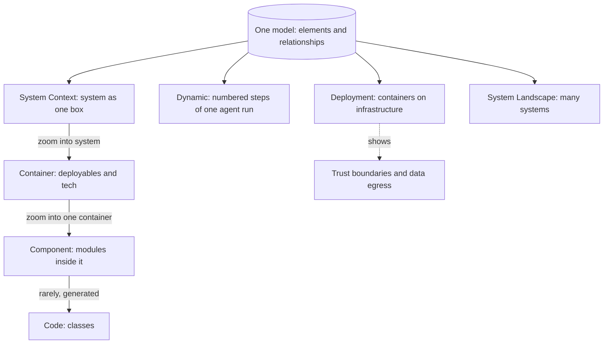

## TL;DR
C4 draws architecture at four zoom levels with every box and arrow labelled. For an agent system it is how
you show reviewers where the model provider, tools, sandbox and customer data sit, and what one agent run
actually touches.

## For agent builders
- **Why it matters for agents.** The first review question for any agent is "what can it reach, and where
  does our data go?" A Context view with every tool's external system and the model provider, plus a
  Dynamic view of one run, answers that in one meeting.
- **Where it shows up in your stack.** Design reviews, security and procurement reviews for customer
  pilots, onboarding docs, and an `architecture/` folder of Structurizr DSL or C4-PlantUML next to the
  agent code.
- **What you control.** Which tools and MCP servers appear as external systems, which arrows carry
  prompts or customer documents, where the trust boundary sits, and keeping the files updated in the same
  pull request that adds a tool.
- **What you can skip.** Component and Code diagrams of the agent's internals, and formal notations such
  as UML or ArchiMate. Context, Container, Deployment and one Dynamic view cover nearly every agent review.

## Why it exists
- **Ad-hoc diagrams mix abstraction levels.** One picture shows a Kubernetes cluster, a "Users" stick
  figure, a PostgreSQL cylinder, an `AuthService` class and a team name, joined by unlabelled lines that
  may mean "calls", "deploys to" or "is owned by". Every review spends its first twenty minutes working
  out what the boxes are.
- **UML was too heavy.** Its rigorous notation was learned by almost nobody, so teams fell back to
  free-form whiteboards and the ambiguity returned.
- **C4 borrows the idea of a map.** Country, city and street maps use different symbols and detail, and
  you know which one you hold. C4 fixes four zoom levels and a tiny notation, so a Container box is a
  deployable unit and a Component box is part of one. Tooling, layout and colours stay free.
- **AI systems raise the stakes.** Security, legal and customer architects first ask "where does our data
  go, and which parts talk to the model provider?" Agents add "and which systems can it act on?" A
  diagram that cannot answer at a glance costs a review cycle; C4's labelled technology and flow
  direction answer it.

## How it works
### Background: the four levels
| Level | What a box is | Audience | Why it exists |
|---|---|---|---|
| **1. System Context** | Your system as one box, plus the people who use it and the external systems it depends on (identity provider, the CRM it reads tickets from, the hosted model provider). No technology inside the box | Executives, customers | Every audience first needs the system's place in the world |
| **2. Container** | A separately runnable or deployable unit: web app, API, ingestion worker, database, vector store, queue, model server, LLM gateway, each with its technology ("FastAPI", "PostgreSQL + pgvector", "vLLM") | Engineers, operators | Where day-to-day design and operations live |
| **3. Component** | Major structural parts of one container, e.g. inside the API: authentication middleware, tenancy resolver, orchestration, retrieval client, guardrail layer, usage meter | Those who depend on that container's internals | Maps to modules or packages, not classes |
| **4. Code** | Class or entity diagrams for one component | Rarely anyone | Generate from code if needed at all; hand-maintained code diagrams rot first |

- **"Software system" means what one team builds and owns.** Anything owned by someone else, including
  another team's platform, is drawn as external.
- **"Container" predates Docker and is wider than it.** A database is a container; a Docker image is not
  necessarily one container.
- **Draw Component diagrams only** for containers whose internals matter to someone other than their
  authors.
- **Supplementary diagrams reuse the same elements.** System Landscape shows several systems side by
  side. Dynamic uses numbered arrows for one use case. Deployment places containers onto infrastructure
  (region, VPC, cluster, GPU node pool, the customer's network versus yours); forward-deployed engineers
  draw it most, *because* it is where trust boundaries and data residency become visible.

### The notation rules that do the work
Each rule removes one specific ambiguity:
- **Every element has name, type, technology and a one-line description**, so a reader never guesses
  whether "Gateway" is an API gateway, an LLM gateway or a network device.
- **Every relationship is a single-direction arrow labelled with intent** and, where useful, protocol
  ("sends completion requests to, HTTPS/JSON"), so data-flow direction is never inferred. For a tool,
  say what it does: "reads tickets from" versus "updates tickets in".
- **Every diagram has a title stating level and scope**, and a **legend** if colours or shapes carry
  meaning.
- **Roughly twenty elements per diagram.** Past that, draw a new diagram one level down, not a smaller
  font.
- **Consistent colour and shape across diagrams:** people, your containers, external systems and data
  stores each look the same everywhere.

### Diagrams as code
- **Structurizr separates model from views.** Elements and relationships are defined once; views choose
  which subset to draw at which level.
- **Why:** consistency is the hard part. With one source of truth, renaming a container updates every
  diagram, and a relationship cannot appear on the Container view but be missing from the Context view.
- **Lighter options:** C4-PlantUML and Mermaid's C4 syntax give the same notation in text, with less model
  discipline.
- **Text in the repository is the cure for diagram rot.** It changes in pull requests next to the code it
  describes and can be regenerated in CI.

### What to make visible in an agent system
- **Model provider as an external system on the Context diagram**, *because* that arrow is a data egress a
  reviewer must see.
- **Every system a tool reaches as an external system**, with arrows that say read or write, *because* the
  reviewer is really asking what the agent can change.
- **Gateway, vector store, memory store, sandbox and evaluation pipeline as containers**, *because* each
  enforces a decision: routing, isolation, code execution limits, release gating.
- **On the Deployment view**, draw the boundary between the customer's environment and yours and mark
  which flows carry customer documents or prompts.
- **Prefer a Dynamic diagram of one agent run** over a Component diagram of everything. A RAG request:
  resolve tenant, embed query, search, assemble prompt, call gateway, stream, meter. An agent run adds the
  loop: model proposes a tool call, the tool runs, the result returns, repeat.

### Trust boundaries and threat models
- **C4 has no first-class trust-boundary element** and does not pretend to be a threat model.
- **Draw boundaries with deployment nodes** (the customer's VPC, your cloud account, the provider's
  region) or named groups, and state in the legend what crossing one means.
- **A STRIDE-style review still wants a data-flow diagram**; a good Deployment view gives most of it.
  For agents, add where untrusted content (retrieved pages, tool output) enters the prompt.

## Diagram
Each level zooms into one box of the level above; the supplementary views reuse the same elements to
answer behaviour and placement questions, such as one agent run or where data leaves a VPC.



## Examples
### Structurizr DSL: an agent with tools, a sandbox and a Dynamic view of one run
The Context view shows four arrows leaving the system: model provider, CRM (read and write), email and
the sandbox's package mirror. The Dynamic view numbers one run; Structurizr checks each step against the
model, so deleting a relationship breaks the build instead of leaving a stale story.

```
workspace "Refund Agent" "Investigates and resolves refund tickets" {
    model {
        rep     = person "Support Rep" "Approves refunds the agent proposes"
        crm     = softwareSystem "CRM" "Tickets and orders" "External"
        email   = softwareSystem "Email Service" "Sends customer emails" "External"
        llm     = softwareSystem "Model Provider" "Hosted LLM API" "External"
        agentSys = softwareSystem "Refund Agent" "Tool-calling agent" {
            api     = container "Agent API" "Starts runs, streams progress, approval step" "FastAPI"
            runner  = container "Run Worker" "Agent loop, step budget, tool dispatch" "Python"
            sandbox = container "Code Sandbox" "Runs agent-written analysis code" "Isolated container"
            gateway = container "LLM Gateway" "Routing, quotas, token metering" "Python"
            store   = container "Run and Memory Store" "Transcripts, checkpoints, memory" "PostgreSQL" "Database"
        }
        rep     -> api     "Starts runs and approves actions in" "HTTPS"
        api     -> store   "Creates runs and reads progress from" "SQL"
        runner  -> store   "Checkpoints each step to" "SQL"
        runner  -> gateway "Requests next action from" "HTTPS"
        gateway -> llm     "Sends transcripts containing ticket text to" "HTTPS"
        runner  -> crm     "Reads orders from and updates tickets in" "REST, tenant token"
        runner  -> sandbox "Executes analysis code in" "gRPC"
        runner  -> email   "Sends approved customer emails via" "REST"
    }
    views {
        systemContext agentSys "Context"    { include * autolayout lr }
        container     agentSys "Containers" { include * autolayout lr }
        dynamic agentSys "OneRun" "One refund run" {
            rep -> api "Starts a run for ticket 4812"
            runner -> gateway "Asks for the next action"
            runner -> crm "Reads the order (tool call)"
            runner -> sandbox "Runs refund eligibility check (tool call)"
            runner -> store "Checkpoints step and pauses for approval"
            runner -> email "Sends the approved reply"
            autolayout lr
        }
        styles {
            element "External" { background #999999 color #ffffff }
            element "Database" { shape Cylinder }
        }
    }
}
```

### Structurizr DSL: one model, three views
- **Three views, one model:** the Context diagram for stakeholders, the Container diagram for engineers and
  the Dynamic view of one request cannot disagree.
- **Labelling:** the model provider is external, the vector-capable database is tagged to render as a
  cylinder, and every relationship states intent and protocol.
- **Self-checking story:** the dynamic view numbers the steps of one reply, and Structurizr checks each
  step against the model's relationships. Delete the `api -> gateway` arrow and the workspace fails to
  build, instead of the request story silently going stale.
- **What the rendered Context view reveals:** two arrows leave the system, to the CRM and to the model
  provider. The second is the data egress a privacy review asks about first.

```
workspace "Support Copilot" "Drafts ticket replies grounded in the knowledge base" {
    model {
        agent   = person "Support Agent" "Answers customer tickets"
        crm     = softwareSystem "CRM" "System of record for tickets and articles" "External"
        llm     = softwareSystem "Model Provider" "Hosted LLM API" "External"
        copilot = softwareSystem "Support Copilot" "Suggests grounded replies" {
            web     = container "Web App" "Agent-facing UI" "React"
            api     = container "API" "Auth, tenancy, orchestration, guardrails" "FastAPI"
            worker  = container "Ingestion Worker" "Chunks and embeds articles" "Python"
            gateway = container "LLM Gateway" "Routing, quotas, prompt cache" "Python"
            db      = container "Database" "Tenants, chunks, embeddings, feedback" "PostgreSQL + pgvector" "Database"
        }
        agent   -> web     "Uses"
        web     -> api     "Sends chat requests to" "HTTPS/JSON"
        api     -> db      "Reads and writes" "SQL"
        api     -> gateway "Requests completions from" "HTTPS"
        gateway -> llm     "Sends prompts and receives completions" "HTTPS"
        worker  -> crm     "Pulls articles from" "REST"
        worker  -> db      "Writes chunks and embeddings to" "SQL"
    }
    views {
        systemContext copilot "Context"    { include * autolayout lr }
        container     copilot "Containers" { include * autolayout lr }
        dynamic copilot "DraftReply" "One grounded reply" {
            agent -> web "Opens a ticket and asks for a draft"
            web -> api "Sends ticket text"
            api -> db "Fetches top-8 chunks for this tenant"
            api -> gateway "Requests a draft grounded in the chunks"
            gateway -> llm "Forwards prompt; streams completion"
            autolayout lr
        }
        styles {
            element "External" { background #999999 color #ffffff }
            element "Database" { shape Cylinder }
        }
    }
}
```

### C4-PlantUML: a deployment view with the trust boundary drawn
For a pilot in a customer's VPC, deployment nodes act as the trust boundary, and the one arrow that leaves
the customer's environment is labelled with what it carries.

```
@startuml
!include https://raw.githubusercontent.com/plantuml-stdlib/C4-PlantUML/master/C4_Deployment.puml
title Deployment: Support Copilot pilot in customer VPC

Deployment_Node(cust, "Customer VPC", "Customer cloud account") {
    Deployment_Node(k8s, "Kubernetes cluster", "Customer-managed") {
        Container(api, "API", "FastAPI", "Auth, tenancy, orchestration")
        Container(worker, "Ingestion Worker", "Python", "Chunks and embeds articles")
        ContainerDb(db, "Database", "PostgreSQL + pgvector", "Chunks, embeddings")
    }
}
Deployment_Node(vendor, "Vendor cloud", "Vendor account") {
    Container(gateway, "LLM Gateway", "Python", "Routing, quotas")
}
System_Ext(llm, "Model Provider", "Hosted LLM API")

Rel(api, db, "Reads and writes", "SQL")
Rel(worker, db, "Writes chunks and embeddings to", "SQL")
Rel(api, gateway, "Sends prompts containing ticket text", "HTTPS")
Rel(gateway, llm, "Forwards prompts", "HTTPS")
SHOW_LEGEND()
@enduml
```

### Worked scenario: which view answers which reviewer
A customer's security review for that pilot, mapped to the view that answers each first question.

| Reviewer | First question | View to send | Must make explicit |
|---|---|---|---|
| Privacy and legal | Which third parties touch our data? | System Context | Model provider and CRM as external systems |
| Customer architects | What runs, on what technology? | Container | Every deployable with technology and labelled arrows |
| Security | Where does data leave our VPC? | Deployment | Trust boundary and flows carrying prompts or documents |
| Security, for an agent | What can it change, and who approves? | Dynamic of one run | Every write-capable tool call and the approval step |
| New engineer | What happens on one request? | Dynamic | Numbered steps of a chat request and the ingestion flow |

## Production patterns
- **Diagrams as code, rendered in CI.** Use for every system more than one team touches. Keep the
  Structurizr DSL or C4-PlantUML files next to the code, and have a CI job render them (for example with
  the Structurizr CLI's export command or PlantUML) so a broken model fails the build. Monitor time since
  each diagram file last changed relative to the services it describes.
- **New tool, same-PR diagram update.** Use whenever an agent gains a tool, MCP server, queue, model server
  or external dependency. Add a pull-request template checkbox and a code-owner rule on the architecture
  folder so the architect reviews diagram changes. Monitor tools registered in code that are missing from
  the model.
- **Per-customer deployment views.** Use for every forward-deployed or VPC install. Keep one deployment
  environment per customer topology in the same workspace, reusing the shared model, so the Container
  view stays common while placement differs. Monitor open review questions per customer.
- **Tag flows that carry customer data and write actions.** Use when privacy and security reviews are
  routine. Tag relationships that carry prompts or documents, and those where a tool writes to an external
  system, with distinct styles and legend entries, so egress and blast radius are visible without reading
  every label. Monitor untagged arrows that cross a deployment boundary.
- **Element budget per view.** Use in design reviews. Treat roughly twenty elements as the ceiling and
  split into a level-down view or a Dynamic view instead. Monitor views that exceed the budget.

## Trade-offs
- **Fixed levels: instant readability vs constraint.** Anyone who knows C4 reads the diagrams at once, but
  a system that does not decompose neatly feels constrained. The fix is usually a Dynamic or Deployment
  view, not a bespoke notation.
- **Diagrams as code: in sync vs uglier layout.** They stay in sync with the repository and survive
  reviews, but auto-layout rarely matches a hand-arranged picture. Hand layout wins only for a diagram
  shown far more often than it changes.
- **One model, many views: consistency vs an owner.** Consistency is guaranteed only if someone owns the
  model; without that owner, C4-PlantUML files per diagram are easier to keep alive.
- **Lighter than UML or ArchiMate: learnable vs limited.** C4 is learnable in an afternoon, but says
  nothing about behaviour beyond numbered arrows or about formal semantics. A looping agent run is
  awkward as numbered arrows, so show one representative run and put the loop in a sequence diagram.
- **Component diagrams: explain internals vs rot.** They rot fastest and are read least; draw them for the
  containers whose structure others depend on and skip the rest.

## Pitfalls
- **Mixing levels in one diagram.** Symptom: a picture shows "Kubernetes" and "the retry helper class" at
  once, and the review is spent asking what the boxes are. Fix: one level per diagram, titled with its
  level and scope.
- **Unlabelled or double-headed arrows.** Symptom: a security reviewer asks "which direction does
  customer data flow here?" and nobody is sure. Fix: one direction per arrow, labelled with intent and
  protocol.
- **Drawing the agent's tools as one "Tools" box.** Symptom: a reviewer cannot tell that the agent can
  send email or update orders. Fix: one external system per tool target, with read or write in the label.
- **Reading *container* as Docker container.** Symptom: a managed database and a hosted model provider
  are missing because "they are not containers". Fix: draw every runnable unit and data store, and
  every dependency you do not own as an external system.
- **Leaving the model provider off the Context diagram** because it is "just an API". Symptom: a
  procurement or privacy review discovers the data egress late. Fix: show it as an external system with
  a labelled arrow.
- **Diagrams in a slide deck disconnected from the code.** Symptom: a Container view still shows a
  service deleted two quarters ago. Fix: diagrams as code in the repository, rendered in CI.
- **Drawing everything.** Symptom: a forty-box Container diagram nobody can read, instead of a Container
  view plus two Dynamic views of the requests that matter. Fix: keep to about twenty elements per view.

## When to use
- **Always:** a Context and a Container diagram for every system that more than one team or organisation
  needs to understand, kept in the repository as text.
- **Add a Deployment view** the moment the system crosses a trust boundary, which for an AI product is
  usually immediately (a hosted model provider, a customer VPC).
- **Add Dynamic views** for the two or three request paths reviewers and new engineers ask about most,
  typically a chat request, the ingestion flow and one representative agent run.
- **Skip Component and Code diagrams** unless a specific audience needs them.
- **Test:** can a new engineer, a security reviewer and a customer architect each find the diagram meant
  for them and answer their first question without you in the room?
- **Interviews:** sketching a Context then a Container diagram structures any system-design answer;
  naming technologies and flow directions as you go signals the discipline.

## Role lens
- **Engineer:** Keeps the Container and Dynamic diagrams in the repo as code, updates them in the same
  pull request that adds a queue or a model server, and uses them to onboard teammates.
- **Architect:** Owns the model behind the views, decides which containers and boundaries exist, and
  uses the Context and Deployment diagrams as the shared picture in design and security reviews.
- **FDE:** Produces the Deployment and Context views for each customer environment, marking where
  customer data crosses into the vendor's systems, which is often the document that unblocks procurement.

## Check yourself
**Q:** A customer's security team asks for "an architecture diagram" of your RAG product before approving
a pilot in their VPC. Which C4 views do you send, what must each make explicit, and why not just one
picture?
**A:** Three views, each for a different question. A System Context diagram showing their users, your
system as one box, and every external system including the hosted model provider, because their first
question is which third parties touch their data. A Container diagram naming each deployable with its
technology, API, worker, gateway, database with vector extension, model server if self-hosted, with
arrows labelled by intent and protocol, so they can see where prompts and documents are stored and
processed. And a Deployment diagram placing those containers inside their VPC versus your environment,
with the trust boundary drawn and the flows that cross it marked. One picture would have to mix the
three levels, which is exactly what makes reviewers unsure what each box is and which way data flows.

## Interview questions
### What are the four C4 levels, and why separate them?
- **Levels:** System Context (the system as one box among people and external systems), Container
  (deployables with technology), Component (modules inside one container), Code (classes, usually
  generated).
- **Why:** each level has one audience and one density of detail, so a reader always knows what a box
  means; mixing levels is what makes ad-hoc diagrams unreadable.

### Sketch the architecture of a tool-calling agent using C4. Where do you start?
- **Start with Context:** users, the agent system as one box, the model provider, and one external system
  per tool target (CRM, email, ticketing), each arrow saying read or write.
- **Then Container:** agent API, run worker with the loop, LLM gateway, sandbox, run and memory store, with
  technology and labelled arrows.
- **Then one Dynamic view** of a representative run: start, model proposes a tool call, tool executes,
  checkpoint, approval, final action.

### A security reviewer asks what your agent can change in their systems. Which diagram do you show?
- **The Context view with write arrows tagged**, because every system a tool can modify is an external
  system with a labelled relationship.
- **Plus a Dynamic view of one run** showing where the human approval step sits before a write action.
- **And the Deployment view** if credentials or the sandbox live in their VPC rather than yours.

### Your diagrams are always out of date. How do you fix that?
- **Move them to text in the repository** (Structurizr DSL or C4-PlantUML) so they change in the same
  pull requests as the code.
- **Use one model with several views** so a rename or deletion propagates and inconsistent views fail to
  build.
- **Render in CI and require diagram updates** in PRs that add or remove containers or tools.

### When would C4 not be enough?
- **Threat modelling:** C4 has no trust-boundary element; a STRIDE-style review still wants a data-flow
  diagram, though a good Deployment view covers most of it.
- **Behaviour and protocols:** beyond numbered arrows, use sequence diagrams, including for an agent loop.
- **Enterprise capability mapping:** heavier notations such as ArchiMate earn their cost there.

### A diagram has forty boxes. What do you do?
- **Split it:** about twenty elements is the practical ceiling, so move detail one level down into a
  Component view of the container that matters.
- **Replace breadth with stories:** a Container view plus two Dynamic views of the important requests
  usually answers more questions than one dense picture.

## Quiz
### Q: In the C4 model, what does "container" mean?
- [ ] A Docker or OCI container image
- [x] A separately runnable or deployable unit such as an application, database, queue or model server
- [ ] A bounded context from domain-driven design
- [ ] A cloud account or Kubernetes namespace
> C4's container predates Docker and is broader: anything that runs or is deployed on its own, including
> managed databases and queues. Bounded contexts and namespaces are different concepts that may or may
> not align with containers.

### Q: Why does the C4 model insist on labelling each relationship with its intent and direction?
- [ ] So that diagram tools can auto-layout more efficiently
- [ ] Because UML requires it for sequence diagrams
- [x] So readers never have to infer which way data flows or what one element does to another
- [ ] To make diagrams compatible with Structurizr's licensing model
> An unlabelled line can mean calls, deploys to, reads from or owns, and a two-headed arrow hides who
> initiates. In security and data-flow reviews that ambiguity is precisely the question being asked.

### Q: Which view best shows a customer where its data crosses from its environment into the vendor's?
- [ ] A Component diagram of the API
- [ ] A Code diagram generated from the data model
- [x] A Deployment diagram placing containers on infrastructure with the trust boundary drawn
- [ ] A System Landscape diagram of all the vendor's products
> Only the deployment view maps containers onto environments, so it is the one where "inside your VPC"
> versus "in our cloud" and the flows between them become visible. Component and code views are below
> that level of concern.

## Use cases & projects
### Use cases
- **Security review of an agent pilot.** A Context view showing the model provider, every tool's external
  system and the customer's data answers "what can it reach, and where does our data go?" in one meeting.
- **Procurement and deployment questions.** A Deployment view makes "inside your VPC" versus "in our
  cloud" explicit for the agent API, vector store, model server and sandbox.
- **Explaining one agent run.** A Dynamic view numbers the steps of one run (retrieve, call model, call
  tool, write memory), so reviewers see which arrows carry prompts or customer documents.
- **Onboarding to an agent codebase.** A Container view next to the code shows new engineers the loop,
  tool layer, retriever, worker and stores before they open a file.

### Mini project
**Diagram your agent as code (1-2 hours).**
- **Goal:** produce the views a reviewer needs for a small tool-calling agent, kept next to its code.
- **Steps:** pick an agent you have built or a sample with at least two tools and a retriever; write a
  Context, Container and Deployment view in Structurizr DSL or C4-PlantUML in an `architecture/` folder;
  add a Dynamic view of one run; label every arrow with what it carries and mark the trust boundary.
- **Done when:** someone unfamiliar with the agent can say from the diagrams alone which external systems
  receive customer data, and adding a new tool requires updating the diagram in the same pull request.
