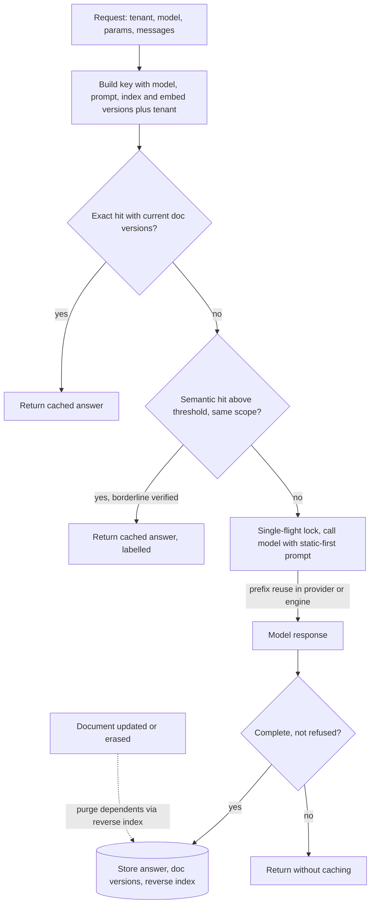

## TL;DR
Agents re-send the same prefix and repeat tool calls every step. Cache at several layers (prefix, exact,
semantic, embedding, tool results), each with its own key and staleness. The key is the design: what must
match for a result to stay correct.

## For agent builders
- **Why it matters for agents.** Every step re-sends system prompt, tool schemas and a growing transcript,
  so prefix caching decides whether a 20-step run costs a few prefixes or twenty. Tool results (a lookup,
  a search) repeat within and across runs, and caching them cuts latency per step.
- **Where it shows up in your stack.** Provider prompt caching (`cache_control` on Anthropic, automatic on
  OpenAI) and vLLM prefix caching for the transcript; Redis for exact and tool-result caches; LangChain's
  global LLM cache (`set_llm_cache`) for simple exact caching; your vector store for semantic caches.
- **What you control.** A static-first, append-only prompt layout, which tools are safe to cache (reads,
  never writes) and their TTLs, what goes in every key (tool schema version, tenant), and whether
  semantic caching is allowed at all for context-dependent agent turns.
- **What you can skip.** Semantic caching of agent steps in most designs: a step's correct output depends on
  the whole transcript, so near-duplicate queries are rarely safe hits. Spend the effort on prefix and
  tool-result caching first.

## Why it exists
- **Hits are nearly free; misses are not.** A hit returns in milliseconds and costs almost nothing; a miss
  takes seconds and bills every token.
- **Prompts are mostly repeated content.** A system prompt, tool definitions, few-shot examples and
  retrieved documents can be thousands of tokens identical for every user of a feature, and for every step
  of an agent run. Caching is the biggest lever on cost and latency after model choice.
- **"Hash the prompt and cache the response" fails in AI-specific ways:**
  - Outputs are sampled, so caching only makes sense when you want the same answer, and the key must
    include the sampling parameters.
  - Prompts embed context: an identical question from two tenants, or from one tenant a week apart, can
    need different correct answers.
  - Semantic near-duplicates look like hits but differ in one decisive detail: a negation, a date, an
    account number.
  - Staleness is numerous and silent: the provider updates the model, someone edits the prompt template, a
    document is re-ingested, the embedding model changes, an external tool's data moves.
- **Without a strategy you land in one of two bad places:** caching nothing and paying for every repeated
  token, or caching eagerly and serving stale or wrong answers that cost more trust than the tokens saved.
- **Both famous hard problems are one problem here.** Naming things and invalidating caches merge: the name
  of the cache entry is the list of everything the answer depends on.

## How it works
### The layers at a glance
| Layer | Caches | Key | Goes stale when |
|---|---|---|---|
| 1. Prefix / prompt | Computation (KV cache of a shared prefix) | Exact token prefix | Anything before or within the span changes |
| 2. Exact response | Whole responses | Model, params, messages, tools, format, scope | Any key input changes |
| 3. Semantic | Answers to similar queries | Query embedding within a scope | Sources change, or a paraphrase is a different question |
| 4. Embedding | Vectors | Embedding model id + normalised text | Embedding model changes |
| 5. Retrieval and tool | Doc ids, tool results, agent steps | Index version; tool name + args | Index changes; TTL expires |

### Layer 1: prefix and prompt caching (caching computation)
- **What:** a provider or self-hosted engine reuses the KV cache for a byte-identical token prefix across
  requests, so the shared part's prefill is not recomputed.
- **Key = the exact prefix.** Any change *before or within* the cached span invalidates everything after
  it, because each cached key and value depends on all earlier positions.
- **Layout rule:** static content first (system prompt, tools, few-shot, long documents), dynamic content
  last, stable ordering, and never a timestamp or the user's name near the top.
- **Agent rule:** keep the transcript append-only. Rewriting or trimming earlier turns, or reordering tool
  schemas between steps, breaks the prefix from that point; compact deliberately at a boundary instead.
- **Pricing (vendor- and model-specific, and it changes):** cached input tokens bill at a lower rate with
  short time-to-live windows; some providers charge a premium for the cache *write*; most enforce a
  minimum cacheable prefix of roughly a thousand tokens or more, so a short system prompt alone may never
  cache.
- **Engines** such as vLLM offer automatic prefix caching across requests that share a prefix.
- **Metric:** cached-token share in usage reports, checked after every change to prompt assembly, because a
  regression is silent: requests keep succeeding and only the bill moves.

### Layer 2: exact response cache
- **Key** = hash of model id and version, sampling parameters, the full normalised message list, tool
  schemas, response format, and the tenant or user scope whenever the prompt contains private context.
- **Value** = the response plus its usage.
- **Only for deterministic intent:** temperature 0, or a product that accepts identical answers to
  identical requests.
- **Hit rates:** low in open-ended chat and mid-run agent steps; high in form-like, classification and
  extraction features (and agent sub-steps like those), where identical inputs recur.

### Layer 3: semantic cache
1. Embed the query.
2. Search cached queries within the same scope (tenant, prompt version, index version).
3. Return the cached answer when similarity exceeds a threshold.

- **Gain:** a hit rate exact matching cannot reach. **Risk:** a paraphrase that is actually a different
  question.
- **Mitigations:** a high threshold; scope keys; excluding or entity-keying queries with numbers, dates,
  names or negations; a cheap verifier on borderline hits ("does this cached answer address this
  query?"); a sampled false-hit audit.
- **Agents:** use it, if at all, on the first user turn of FAQ-like traffic, never on a mid-run step whose
  correct output depends on earlier tool results.
- **Economics:**

```
savings = hit_rate × (cost_miss − cost_hit) − false_hit_rate × cost_of_a_wrong_answer − embedding cost per lookup
```

The last two terms are what people forget.

### Layer 4: embedding cache
- **Key** = hash of embedding model id plus normalised text.
- **Cheap and high-value** in ingestion (unchanged chunks are not re-embedded on re-index) and for repeated
  queries, including an agent's repeated retrieval and memory lookups.
- **A new embedding model invalidates everything,** which is fine *because* you must re-embed the whole
  index anyway; version the index.

### Layer 5: retrieval and tool caches
- **Query → document ids,** keyed by index version.
- **External tool results** with a TTL set by data volatility (exchange rates seconds, a product catalogue
  hours).
- **Memoised agent steps** keyed by tool name and arguments.
- **Only read-only tools.** A cached `send_email` or `create_ticket` is a skipped side effect, not a
  saving; writes need idempotency keys instead, which is a different mechanism.
- **Include the tool's schema or implementation version and the caller's scope** in the key, because the
  same arguments under a new tool version, or for another tenant, can mean a different result.

### Read and write patterns
| Pattern | How | Trade-off |
|---|---|---|
| **Cache-aside** (most AI response caches) | App looks up the key, calls the model on a miss, writes the result | Cache stays optional (an outage means slower, not broken), at the price of stampedes |
| **Read-through** (a gateway cache, effectively) | Callers do not know it exists | Convenient, and why it cannot see tenants or document versions nobody put in the request |
| **Precomputation** | Batch job answers the few hundred most frequent questions; summaries written at ingestion | Moves model cost off the request path; suits predictable question sets |
| **Stale-while-revalidate** | Serve an expired entry while one background call refreshes it | A bounded extra window of staleness for never making a user wait on a hot key; wrong where stale means incorrect, such as prices or permissions |

- **Eviction under a memory cap** is usually LRU or LFU. Both ignore that entries differ greatly in what
  they cost to recompute, so a long-context answer is worth more cache space than a short classification.

### Invalidation strategies
1. **Versioned keys.** Include model id, prompt template version, index version and embedding model id in
   every key. Changing any yields a cold cache with no purge logic at all. Simplest and most robust; the
   cost is cold misses after each deploy, which a replay of recent queries can pre-warm.
2. **TTL.** Bounds staleness per data class; refresh ahead of expiry for hot keys; jitter expiries so they
   do not align.
3. **Event-driven purge.** When a document changes, purge the answers that used it.
   - Needs a reverse index from document id to cache keys, which the generation step must write.
   - Precise, more complex, and required when a deleted document must stop appearing in answers (erasure
     requests).
   - **Race:** a generation that read the old document can finish *after* the purge and write a stale
     answer back. Close it by storing the version (a content hash) of each document an answer used, and
     treating a hit as a miss when any of those versions is no longer current.
4. **Scope isolation.** Tenant and user in the key wherever the prompt carries private context; a shared
   cache across trust boundaries is a leak, not an optimisation.
5. **Do not cache failures.** Errors, refusals, truncated streams and low-judge-score answers are not
   cached, or an outage gets remembered after it ends. The same goes for failed tool calls.
6. **Stampede control.** Single-flight locking or request coalescing on popular keys, so a thousand
   simultaneous misses produce one model call.

### Where each layer lives
- **Prefix caching:** in the provider or engine.
- **Exact and semantic caches:** in a gateway (convenient but context-blind) or in the application (knows
  tenants and document versions; usually the better place).
- **Tool-result caches:** in the tool layer of the agent, where read/write and TTL are known.
- **Observe per layer:** hit rate, cost saved and latency saved, sampled false-hit rate, and the age of
  served entries.

## Diagram
The request path through the response caches, cheapest check first, and the two invalidation routes:
versions in the key make old entries unreachable, while document events purge through the reverse index.



## Examples
### Worked scenario: prompt caching across a 10-step agent run
Illustrative: a 10k-token static prefix (system prompt plus tool schemas), ~2k tokens appended per step,
$3 per 1M input tokens. Cache multipliers follow Anthropic's published pricing for its short-lived cache
at the time of writing (write 1.25×, read 0.1× the base input price); check current docs. Assumes every
step lands inside the cache TTL.

| Strategy | Input billed (base-price equivalent) | Cost per run |
|---|---|---|
| No caching | 10 × 10k + 2k × (0 + 1 + … + 9) = 190k | ~$0.57 |
| Cache only the static prefix | 12.5k write + 9 × 1k reads + 90k uncached transcript = 111.5k | ~$0.33 |
| Cache breakpoint at the end of each step (append-only) | 12.5k + 16.2k reads + 9 × 2.5k writes = 51.2k | ~$0.15 |

- **Lesson:** an append-only transcript with a moving cache point cuts this run's input cost about 3.7×;
  any edit to earlier turns throws that away from the edit onward.

### Tool-result cache for read-only agent tools
Read-only tools declare a TTL; write tools are never cached. The key carries tool name, tool version,
tenant and canonical arguments; failures are not stored.

```python
import functools, hashlib, json, redis
r = redis.Redis()

def cached_tool(name, version, ttl_s, read_only=True):
    def wrap(fn):
        if not read_only:
            return fn                                   # writes are never cached: use idempotency keys
        @functools.wraps(fn)
        def inner(tenant, **args):
            raw = json.dumps({"t": name, "v": version, "tenant": tenant, "a": args},
                             sort_keys=True, separators=(",", ":"))
            k = "tool:" + hashlib.sha256(raw.encode()).hexdigest()
            if (hit := r.get(k)) is not None:
                return json.loads(hit) | {"_cache": "hit"}
            out = fn(tenant, **args)
            if out.get("ok"):                           # never cache a failed tool call
                r.set(k, json.dumps(out), ex=ttl_s)
            return out
        return inner
    return wrap

@cached_tool("get_exchange_rate", version="v2", ttl_s=30)        # volatile data: seconds
def get_exchange_rate(tenant, base, quote): ...

@cached_tool("search_catalogue", version="v5", ttl_s=4 * 3600)   # catalogue: hours
def search_catalogue(tenant, query, limit=10): ...
```

### Exact-match cache in Redis
Versioned, tenant-scoped keys, single-flight on misses, a rule against caching partial or refused answers,
and a reverse index so the ingestion pipeline can purge every cached answer that used a changed document.

```python
import hashlib, json, time, redis
r = redis.Redis()
VERSIONS = {"prompt": "support-v14", "index": "kb-2026-10-19", "embed": "text-embed-v2"}

def exact_key(tenant, model, params, messages):
    body = json.dumps({"v": VERSIONS, "t": tenant, "m": model, "p": params, "msgs": messages},
                      sort_keys=True, separators=(",", ":"))      # canonical form: same input, same hash
    return "resp:" + hashlib.sha256(body.encode()).hexdigest()

def cached_complete(tenant, model, messages, params={"temperature": 0}, ttl=6 * 3600, tries=10):
    k = exact_key(tenant, model, messages=messages, params=params)
    if (hit := r.get(k)):
        return json.loads(hit) | {"cache": "exact"}
    if not r.set(k + ":lock", "1", nx=True, ex=30):              # single-flight: one caller fills the key
        if tries == 0:
            return call_model(model, messages, **params) | {"cache": "bypass"}
        time.sleep(0.2)
        return cached_complete(tenant, model, messages, params, ttl, tries - 1)
    try:
        out = call_model(model, messages, **params)
        if out["finish_reason"] == "stop" and not out.get("refusal"):   # never cache partial or refused
            r.set(k, json.dumps(out), ex=ttl)
            for doc_id in out.get("source_doc_ids", []):             # reverse index for event-driven purge
                r.sadd(f"deps:{tenant}:{doc_id}", k)
                r.expire(f"deps:{tenant}:{doc_id}", ttl)
        return out | {"cache": "miss"}
    finally:
        r.delete(k + ":lock")

def on_document_updated(tenant, doc_id):                         # called by the ingestion pipeline
    keys = r.smembers(f"deps:{tenant}:{doc_id}")
    if keys:
        r.delete(*keys)
    r.delete(f"deps:{tenant}:{doc_id}")
```

- **Bumping `VERSIONS["prompt"]` at deploy time** cold-starts the cache without any purge code.
- **The reverse index handles what versioning cannot:** a single document changing under an unchanged
  prompt.
- **Simplification 1, the lock:** it is released unconditionally, so a model call that outlives the lock's
  30 s expiry deletes a lock another caller now holds. Store a random token and delete only if it still
  matches (a small Lua compare-and-delete).
- **Simplification 2, the purge race:** described above; it needs the document versions stored with each
  answer and checked on read. Both fixes follow.

### Hardening: token lock and version-checked reads
The two fixes, as drop-in helpers. Capture document versions at *retrieval* time, before generating, so an
answer built from an old document carries the old version.

```python
import json, uuid, redis
r = redis.Redis()

RELEASE = r.register_script("""
if redis.call('get', KEYS[1]) == ARGV[1] then return redis.call('del', KEYS[1]) end
return 0
""")                                                          # compare-and-delete, atomic in Redis

def acquire(k, ttl=30):
    token = uuid.uuid4().hex                                  # unique per caller
    return token if r.set(k + ":lock", token, nx=True, ex=ttl) else None

def release(k, token):
    RELEASE(keys=[k + ":lock"], args=[token])                 # deletes the lock only if it is still ours

def read_versions(tenant, doc_ids):                           # call at RETRIEVAL time, before generating
    vals = r.mget([f"docver:{tenant}:{d}" for d in doc_ids])  # ingestion writes a content hash per doc
    return {d: (v.decode() if v else None) for d, v in zip(doc_ids, vals)}

def store(k, out, versions, ttl):
    r.set(k, json.dumps(out | {"doc_versions": versions}), ex=ttl)

def get_if_current(tenant, k):
    hit = r.get(k)
    if not hit:
        return None
    entry = json.loads(hit)
    used = entry.get("doc_versions", {})
    if used and read_versions(tenant, list(used)) != used:    # a source changed since generation: a miss
        return None
    return entry
```

### Worked economics: is the semantic cache paying?
Illustrative numbers plugged into the savings formula; similarity thresholds are examples, not
recommendations.

```python
def semantic_savings(hit_rate, false_hit_rate, cost_miss, cost_hit, cost_wrong, embed_cost):
    """Expected $ saved per request (rates are fractions of all requests)."""
    return hit_rate * (cost_miss - cost_hit) - false_hit_rate * cost_wrong - embed_cost

# Illustrative: $0.01 per model call, $0.0001 per cache hit, $0.00002 to embed the query,
# $0.50 for a wrong answer (a support escalation). Thresholds trade hit rate for false hits.
for threshold, hit, false_hit in ((0.97, 0.30, 0.003), (0.92, 0.45, 0.012)):
    s = semantic_savings(hit, false_hit, 0.01, 0.0001, 0.50, 0.00002)
    print(f"threshold {threshold}: hit {hit:.0%}, false hits {false_hit:.1%} -> "
          f"net {s * 100_000:+,.0f} USD per 100k requests")
# threshold 0.97: hit 30%, false hits 0.3% -> net +145 USD per 100k requests
# threshold 0.92: hit 45%, false hits 1.2% -> net -156 USD per 100k requests
```

| Threshold | Hit rate | False-hit rate | Net per 100k requests |
|---|---|---|---|
| 0.97 (strict) | 30% | 0.3% | +$145 |
| 0.92 (loose) | 45% | 1.2% | −$156: more hits, but wrong answers cost more than the tokens saved |

## Production patterns
- **Static-first, append-only agent prompts with explicit cache points.** Put system prompt, tools and long
  documents first and only append tool calls and results; on Anthropic mark the end of the static part
  (and optionally the latest turn) with `cache_control: {"type": "ephemeral"}`, while OpenAI caches long
  shared prefixes automatically. Monitor `cache_read_input_tokens` (Anthropic) or
  `prompt_tokens_details.cached_tokens` (OpenAI) as a share of input per agent step.
- **Prefix caching on self-hosted engines.** Turn on vLLM's automatic prefix caching (the
  `enable_prefix_caching` engine option; recent releases enable it by default) and keep shared prefixes
  byte-identical across requests and steps. Monitor the engine's prefix-cache hit rate and time to first
  token.
- **TTL-tagged read-only tool cache.** Declare per tool whether it is read-only and how volatile its data
  is, cache only reads, and include tool version and tenant in the key. Monitor tool-cache hit rate, the
  age of served results and any incident traced to a stale tool result.
- **Version bump plus warm-up replay.** Put every dependency version in the key, and after a deploy replay
  the most frequent recent queries against the new version before shifting traffic. Monitor hit rate in
  the first hour after deploy and p95 latency during the cold window.
- **Erasure-safe purge.** Write the reverse index and document versions at generation time, call the purge
  from the same ingestion hook that deletes from the vector index, and check versions on read. Monitor
  purge counts per erasure request and any hit whose source document no longer exists.
- **Sampled false-hit audit.** Send a small share of semantic hits (say 1%) to a judge or reviewer that
  asks whether the cached answer addresses the new query. Monitor false-hit rate per threshold and per
  feature, and tighten the threshold when it rises. Jitter TTLs (for example up to 10% of the TTL) so
  popular keys do not expire together.

## Trade-offs
- **Hit rate vs false hits.** Looser keys and lower similarity thresholds raise both together; the right
  point depends on what a wrong answer costs, which differs between an FAQ bot and a billing assistant.
- **Savings vs staleness.** Longer TTLs save more and serve staler data; acceptable with event-driven purge
  for the content that matters, dangerous when TTL is the only invalidation you have. For agent tools, a
  stale result can drive a wrong action, not just a wrong sentence.
- **Simple versioning vs cold starts.** Versioned keys are simple and safe but every deploy cold-starts the
  cache; when the cache is what meets the latency SLO, add a warm-up replay or a brief dual-version window.
- **Prefix hits vs layout freedom.** Prefix caching needs a static-first, append-only layout, which
  constrains where personalisation can go and how you compact history; it flips only in the rare design
  where per-user content must precede the shared instructions.
- **Global vs per-tenant cache.** A global cache maximises hits and is a leak surface; a per-tenant cache is
  safer with a lower hit rate. The trust boundary, not the hit rate, decides.
- **Precise purge vs cheap TTL.** Event-driven purge is precise but requires dependency tracking storage and
  hooks in ingestion; TTL is cheap but can only bound staleness, never eliminate it.

## Pitfalls
- **Caching across tenants or users.** Symptom: a user sees another customer's data inside an answer, a
  security incident rather than a bug.
- **Dynamic content at the top of the prompt.** Symptom: cached-token share near zero while prompt caching
  is "enabled" and the bill is unchanged.
- **Editing agent history every step.** Symptom: cached-token share collapses after step 1 because a
  summariser rewrites earlier turns or tool schemas are re-sorted. Fix: append-only, compact at a boundary.
- **Caching a write tool.** Symptom: the agent reports "refund issued" from cache while nothing happened.
  Fix: cache reads only; give writes idempotency keys.
- **Semantic false hits.** Symptom: confident wrong answers whose logs show a high-similarity hit on a
  question that differed by a negation or a number.
- **Model or prompt version missing from the key.** Symptom: half of users see the old behaviour for hours
  after a prompt change, and A/B results are contaminated.
- **Caching errors, refusals or partial streams.** Symptom: users still receive an error message long after
  the provider recovered.
- **Stampedes on expiry.** Symptom: periodic latency and cost spikes aligned with TTL multiples.
- **Purging without guarding against in-flight generations.** Symptom: a stale answer reappears minutes
  after a purge that logged success, typically when a document is edited during busy hours.
- **A deleted document still answered from cache.** Symptom: a compliance finding after an erasure request
  that the index honoured and the cache did not.

## When to use
- **Prefix caching:** always worth having, and the first lever for any agent; mostly a matter of prompt
  layout.
- **Exact response cache:** pays off for form-like, classification and extraction traffic with
  deterministic settings.
- **Tool-result cache:** for read-only tools whose data volatility you can state as a TTL.
- **Semantic cache:** suits high-volume FAQ-like traffic where a measured false-hit rate is tolerable;
  avoid it for personalised or transactional queries and mid-run agent steps.
- **Embedding cache:** belongs in every ingestion pipeline.
- **Measure:** hit rate per layer, cost and latency saved, sampled false-hit rate and the age of served
  entries; treat erasure requests as a cache concern.
- **Interviews:** lead with the key. List what the answer depends on, show how versions make invalidation
  trivial, and explain when you still need event-driven purge.

## Role lens
- **Engineer:** Builds the versioned key function, scoping, single-flight and metrics, and lays prompts
  out static-first so provider prefix caching actually hits.
- **Architect:** Decides which layers exist and where they live, the staleness budget per data class,
  the cross-tenant policy and the purge obligations that compliance imposes.
- **FDE:** Tunes thresholds and TTLs to the customer's data volatility, demonstrates the cost saving with
  before-and-after usage, and verifies that erasure requests purge cached answers.

## Check yourself
**Q:** You added a semantic cache and cost fell by 30%. Two weeks later a customer reports that the
assistant stated a policy that changed last week. Diagnose and redesign.
**A:** The cache served a stale answer, and there are several candidate causes to check in the logs: a
TTL longer than the policy document's change cycle, no event-driven purge when the document was
re-ingested, an index version missing from the cache scope so the old answer survived the re-index, or a
semantic hit on a paraphrase of a question about the updated section. The redesign: put the index
version in the scope key so re-indexing cold-starts the relevant entries; have generation record the
document ids it used and purge dependents on document update; set TTLs per content class, short for
policy; verify borderline semantic hits with a cheap check or exclude queries mentioning dates and policy
names; sample hits for a false-hit rate; and show the source freshness on cached answers so users can
see what the answer was based on.

## Interview questions
### What goes into the cache key for an LLM response, and why each part?
- **Model id and version, and sampling parameters,** because outputs are sampled and a provider update or
  temperature change means a different correct response.
- **The full normalised messages, tool schemas and response format,** because any of them changes the
  answer.
- **Prompt template, index and embedding versions, plus tenant or user scope** whenever the prompt carries
  private context, so a deploy cold-starts the cache and no answer crosses a trust boundary.

### Your agent's cost per run grows with every step. Which caches do you reach for, in what order?
- **Prefix caching first:** static system prompt and tool schemas at the top, an append-only transcript and
  a moving cache point; in the illustrative 10-step run that cuts input cost about 3.7×.
- **Then read-only tool results** with TTLs set by volatility, keyed by tool, version, tenant and arguments.
- **Not semantic caching of steps,** because a step's correct output depends on the whole transcript; and
  never cache write tools.

### Prompt caching is enabled for your agent but the bill did not change. How do you debug it?
- **Read the cached-token share** in usage reports per step, such as `cache_read_input_tokens` on Anthropic
  or `prompt_tokens_details.cached_tokens` on OpenAI.
- **If it is near zero, look at the top of the prompt and the history:** a timestamp, the user's name,
  unstable tool ordering or a summariser rewriting earlier turns changes the prefix, invalidating
  everything after it.
- **Check the minimum cacheable prefix:** most providers need roughly a thousand tokens or more, so a short
  system prompt alone may never cache.

### When would you not use a semantic cache?
- **For personalised or transactional queries,** where an answer depends on the user, an account or a live
  value.
- **When a wrong answer is expensive:** at $0.50 per wrong answer, loosening the threshold from 0.97 to 0.92
  turns +$145 into −$156 per 100k requests in the illustrative example.
- **For queries with numbers, dates, names or negations,** unless they are excluded or entity-keyed, since a
  one-detail paraphrase is a different question.

### A user must be erased. How do you make sure the cache stops answering from their document?
- **Event-driven purge:** generation writes a reverse index from document id to cache keys, and the same
  ingestion hook that deletes from the vector index purges those keys.
- **Close the in-flight race:** store each answer's document versions and treat a hit as a miss when any
  version is no longer current, because a generation that read the old document can finish after the
  purge.
- **TTL alone is not enough,** because it bounds staleness but never eliminates it.

### Popular keys cause periodic latency and cost spikes. What is happening and what do you change?
- **A stampede on expiry:** many simultaneous misses on one hot key each call the model.
- **Single-flight locking or request coalescing** turns a thousand misses into one call; use a token lock with
  compare-and-delete so a slow call cannot release another caller's lock.
- **Jitter TTLs** so popular keys do not expire together, or use stale-while-revalidate where staleness is
  not incorrectness.

## Quiz
### Q: What is the simplest robust way to invalidate every cached response when the prompt template changes?
- [ ] Flush the whole cache by hand after each deploy
- [ ] Reduce the TTL to one minute
- [x] Include the prompt template version in every cache key
- [ ] Rely on semantic similarity to notice that the prompt changed
> Versioned keys make the old entries unreachable the moment the version changes, with no purge code and
> no risk of forgetting. A short TTL still serves stale answers for a minute and destroys the hit rate;
> manual flushes get skipped.

### Q: Why does placing a timestamp at the top of the system prompt hurt?
- [ ] It increases the token count significantly
- [x] It changes the prefix on every request, so provider or engine prefix caching never matches
- [ ] Models ignore timestamps and it is wasted space
- [ ] Providers reject prompts that contain dates
> Prefix caching requires a byte-identical prefix from the first token. A changing value near the top
> invalidates the entire shared span after it, which shows up as a cached-token share near zero.

### Q: Which query pair is the biggest false-hit risk for a semantic cache?
- [ ] "How do I cancel my subscription?" and "how do i cancel my subcription" (typo)
- [x] "How do I cancel my subscription?" and "How do I stop my subscription being cancelled?"
- [ ] "What is your refund policy?" and "Tell me about refunds"
- [ ] "Reset my password" and "I forgot my password"
> The second pair is nearly identical in surface form and embedding space but opposite in intent, so a
> cached answer to one is harmful for the other. The other pairs are genuine paraphrases, which is exactly
> what a semantic cache is meant to match.
