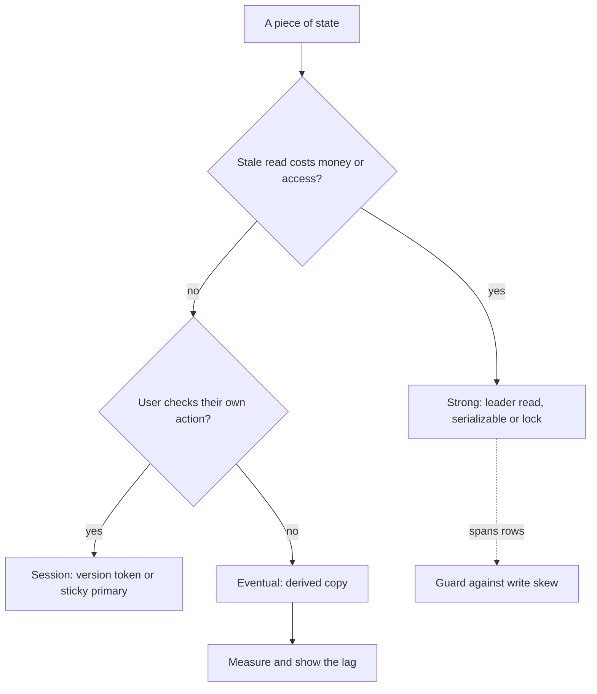

## TL;DR
Consistency means invariants inside one database (ACID's C) and what reads of copies (a RAG index, agent
memory, a cache, a replica) may return, from linearizable to eventual. Keep permissions, token quotas and
idempotency keys strong; let index, cache and memory lag visibly.

## For agent builders
- **Why it matters for agents.** An agent acts on what it reads. A stale memory read makes it repeat a
  tool call, a stale index makes it deny a document the user just uploaded, and a stale ACL makes it quote
  a folder the user lost access to.
- **Where it shows up in your stack.** The vector store's refresh or indexing delay, the replica your
  memory and checkpoint reads hit, framework memory stores (LangGraph's store, a Postgres or Redis
  backend), permission metadata copied into chunk filters, and the counter that enforces a per-tenant
  token budget across concurrent runs.
- **What you control.** Which reads go to the primary within a run, version tokens after memory writes,
  query-time ACL checks after retrieval, tombstones on deletion, atomic quota debits, and whether the UI
  shows "indexing" instead of pretending the index is current.
- **What you can skip.** Formal definitions of sequential consistency and CRDT proofs. Know the ladder,
  write skew, read-your-writes and the derived-copy permission problem.

## Decision case
### Scenario
A multi-tenant research-assistant platform runs agents whose checkpoints, memory, ACL mirror and usage
dashboards all live in one Postgres primary, now at 85% CPU. The team adds two asynchronous read
replicas and must decide which reads may use them. All figures are illustrative.
- **Read mix (6,000 reads/s):** run checkpoints and step results 15%, in-run memory 20%, ACL lookups for
  retrieval 10%, dashboards and run history 55%.
- **Replica lag:** p50 50 ms, p99 2 s under load; agents read memory about 300 ms after writing it.
- **Constraints:** move at least half of reads off the primary; a revoked user must never retrieve a
  document; an agent must never repeat a side effect because of a stale read; dashboards may lag
  seconds; 3 engineers, 4 weeks. Token budgets already debit with one conditional `UPDATE` on the primary.

### Options
| Option | How it works | Reads off the primary | Stale checkpoints or memory | Revoked access | Complexity |
|---|---|---|---|---|---|
| A. All reads to replicas | Repository layer points every read at a replica | 100% | Yes, at p99 lag a resumed run misses its last step and repeats it | Leaks for the lag window | Lowest |
| B. All reads to primary | Replicas only as standbys | 0% | No | No | None, but CPU stays at 85% |
| C. Route per invariant | Checkpoints and ACL lookups on the primary; in-run memory on a replica only when it has replayed past the write's LSN token; dashboards on replicas | About 74% (below) | No | No | Routing rules in the repository layer plus one token check |
| D. Sticky primary window | Any session that wrote in the last 5 s reads from the primary | 55%: agents write every step, so all agent reads stay on the primary | No while lag stays under 5 s | No, while ACL reads stay on the primary | Simple, but the guarantee breaks when lag exceeds the window |

### Decision
Choose **C**, because:
- **Strong reads go only where a stale read costs money or access.** Checkpoints (15%) and ACL lookups
  (10%) stay on the primary, so a resumed run never re-executes a step and revocation takes effect at the
  next query.
- **Read-your-writes is bought per session, not globally.** Memory reads carry the LSN token from the
  write; with a 300 ms gap and a 50 ms median lag, say 5% fall back to the primary, so 20% × 5% = 1%.
  The primary serves 15% + 10% + 1% = 26%, and 74% moves off, beating the 50% target.
- **D meets the target only narrowly,** with no headroom, and its correctness rests on lag staying under
  5 s, exactly when the system is under stress.
- **A violates two hard constraints;** B fails the capacity goal.

**What would change it:** if token fallbacks rose above about a third of memory reads, keeping in-run
memory in the run state the loop already holds is simpler; ACLs mirrored from an external source (such as
SharePoint) need the query-time check against that source; a dashboard cache that cut primary load enough
would make B viable.

### Trade-offs accepted
- **An extra replica round trip** for every token read. Watch: memory-read latency p95 and the token
  fallback fraction.
- **Replica outages shift load back.** With both replicas down the primary takes 100% of reads again.
  Watch: per-replica lag in `pg_stat_replication`; shed dashboard reads first when lag or CPU crosses the
  alert line.
- **Dashboards show stale numbers.** Show "as of" timestamps. Watch: replica lag against the few seconds
  the product promises.
- **Routing rules can be bypassed.** A new query may default to a replica. Watch: share of runtime-table
  reads served by replicas (target near zero), enforced by a repository test.

### Review rubric
- **Every piece of state has a named level** (strong, session, eventual) and the cost of a stale read.
- **The read mix is quantified,** and the offload share recomputes from the routing rules.
- **Permissions are enforced against the authoritative copy** at query time, not by a lagging mirror.
- **Read-your-writes has a mechanism** (version token or window) and a stated failure condition.
- **Multi-row invariants such as quotas** use an atomic update, a lock or serializable isolation, named
  explicitly.
- **Lag and fallback are measured** with thresholds and a degradation order.

## Why it exists
- **One serializable database lets you forget this topic.** Every read sees every committed write, and
  constraints keep invariants true.
- **A second copy forces a decision** about what a reader may see, *because* copies cannot be updated at
  the same instant. AI products are full of copies: a read replica behind the API, a Redis cache in front of
  the database, a vector index built from documents, an agent memory store summarised from conversations,
  a permissions service mirrored into index metadata, a data warehouse fed by nightly jobs.
- **"It will catch up in a second, nobody will notice" fails visibly:**
  - a user uploads a contract, asks about it, and hears "I don't have that document" because the index
    refresh had not run;
  - an admin revokes a contractor's folder access and the contractor still retrieves its chunks for thirty
    seconds;
  - an agent reads its memory on a replica, misses the note it just wrote, and repeats a tool call.
- **Each is a named anomaly with a precise fix,** but only if you know which guarantee you need.
- **"Make everything strongly consistent" fails on physics and economics.** A write must be acknowledged by
  a quorum, or reads must go to the leader. Round trips cost roughly a millisecond within a region and
  tens to over a hundred milliseconds across continents, and under a partition the system must refuse
  requests. Paying that on every catalogue or chunk-embedding read is waste.
- **The skill is choosing per invariant,** which requires knowing the ladder of guarantees and what each
  one rules out.

## How it works
### Consistency inside one database: isolation
Concurrent transactions are isolated to a configurable degree:

| Level | Prevents | Still allows |
|---|---|---|
| **Read committed** | dirty reads (seeing uncommitted data) | a row changing between two reads in the same transaction |
| **Snapshot isolation** (Postgres's `REPEATABLE READ`) | non-repeatable reads and phantoms, via a frozen view as of transaction start | **write skew** |
| **Serializable** | everything: the outcome equals some serial order | aborts under contention |

- **Write skew:** two transactions each read a condition, both find it true, and both write, leaving the
  invariant violated (two on-call doctors each see "at least one other doctor on call" and both go off duty).
- **The decisive question:** does the invariant span rows that one transaction reads and another writes? If
  so, you need serializable isolation or an explicit lock. Covered in depth in the backend-fundamentals
  module.

### Consistency across copies: the ladder
Ordered strongest to weakest; each level is defined by the anomaly it forbids.

| Level | Guarantee | Needed for | Cost |
|---|---|---|---|
| **Linearizable** | behaves as one copy; each operation takes effect at a single instant between start and end; once any client sees a write, every later read sees it | locks, leader election, unique-name registration, quota debits | quorum or leader round trip per operation; unavailable to the minority side of a partition |
| **Sequential** | every client sees the same total order of writes, consistent with each client's program order, not necessarily real time | | cheaper than linearizable |
| **Causal** | only causally related writes must be seen in order (a reply never appears before the message it answers); concurrent writes may be seen in different orders | most collaborative and conversational data | cheaper still |
| **Session guarantees** | promises scoped to one client's session (below) | what users actually notice | cheap |
| **Eventual** | if writes stop, all copies converge; no bound on *when*, no promise about reads meanwhile | analytics, recommendations, derived indexes, caches with TTLs | cheapest |

Session guarantees, and how to provide them cheaply:
- **Read-your-writes:** you see your own updates.
- **Monotonic reads:** you never see time go backwards.
- **Monotonic writes:** your writes apply in order.
- **Writes-follow-reads.**
- **Implementation:** route a session's reads to the leader for a short period after a write, or carry a
  version token the replica must have caught up to before serving.

### Converging needs a merge rule
"All copies converge" hides a decision: when two copies accepted different writes to the same item
(multi-leader replication, offline clients, two regions), something must pick the merged value.

| Rule | How it converges | Cost |
|---|---|---|
| **Last-writer-wins** | keeps the highest timestamp; always converges *because* every replica applies the same rule | silently discards the other write; with wall-clock timestamps, can discard the genuinely later one |
| **Version vectors** | detect that two writes were concurrent rather than ordered and keep both as siblings | the application must merge (two edits to a shared prompt template surface as a conflict) |
| **CRDTs** | the merge is defined so any order of applying updates gives the same result | only for operations the type defines |

- **CRDT examples:** a grow-only counter sums per-node counts; an observed-remove set keeps an add unless
  the remove saw it; collaborative text editors use sequence CRDTs.
- **What merging cannot do:** an invariant such as "balance never below zero" cannot be kept by merging
  after the fact and needs coordination before the write.

### Where lag comes from and how it is bounded
Replication lag is the time between a commit on the leader and its visibility on a copy.

| Copy | Typical lag |
|---|---|
| Asynchronous database replica | milliseconds to seconds, more under load |
| Search and vector indexes | until the next periodic refresh (Elasticsearch's default refresh interval is one second) |
| Caches | until invalidation or TTL |
| Event-driven projections | queue depth |

- **Bounding lag means measuring it** (leader LSN minus replica LSN, event timestamp minus processing time)
  and routing sensitive reads around it.

### Derived data and the permission problem
A vector index is a *derived* copy of documents plus access metadata, which raises two questions:
- **Freshness:** how long after a document changes or is deleted do stale chunks stay retrievable?
  Deletion must propagate as an explicit tombstone event, and retaining embeddings of deleted documents is
  a compliance issue, not only a quality issue.
- **Authorisation:** if access control lists are copied into the index as filter metadata, a revocation is
  eventually consistent, and the window is a leak.
- **Robust design:** check permissions at query time against the authoritative store (a strongly
  consistent read of a small set), or filter by document id against a fresh ACL lookup after retrieval.
  Use index metadata only as a pre-filter for efficiency.

### Choosing per invariant
List each piece of state, name the invariant, and ask what a stale read costs.

| State | Level | Where |
|---|---|---|
| Money, permissions, uniqueness, quotas, idempotency records | strong | in one place, read from the leader |
| User-visible "did my action take" state | session guarantees | token or sticky routing |
| Everything derived | eventual | with a measured and displayed lag ("index updated 4 s ago") |

- **Domain-driven design says the same:** strong consistency inside an aggregate, eventual between
  aggregates.

### The agent's state, classified
| Agent state | Level it needs | Why |
|---|---|---|
| Run checkpoint, idempotency and step-result records | strong, primary only | a stale read re-executes a step or repeats a side effect |
| Per-tenant token or spend budget | strong, atomic debit | concurrent runs otherwise overspend (write skew) |
| Permissions behind retrieval | strong at query time | a lag window is a data leak |
| Memory the agent wrote in this run or session | read-your-writes | the agent must not miss its own note and redo work |
| Long-term memory summaries, user profile facts | eventual, with a merge rule | written by background jobs; concurrent runs may disagree |
| RAG index of documents | eventual, measured and shown | refreshes take seconds to minutes |

- **Concurrent runs share memory.** Two runs for the same user can each update a profile fact; decide the
  merge (append facts with timestamps and sources, not overwrite one blob) before it happens.

## Diagram
The per-invariant decision: ask what a stale read costs, then buy only the guarantee that cost justifies.



## Examples
### Read-your-writes with a Postgres LSN token
Read-your-writes across a Postgres primary and an asynchronous replica. After a write commits, the API
returns a version token (the primary's write-ahead-log position at or after the commit record); later reads
carry it, and the replica is used only if it has replayed past that position, otherwise the read is routed
to the primary.

```python
import psycopg

def save_memory(primary, run_id, note):
    with primary.transaction():
        primary.execute("INSERT INTO agent_memory (run_id, note) VALUES (%s, %s)", (run_id, note))
    # read the LSN AFTER commit: the commit record is what makes the row visible on the replica,
    # and it is written after any LSN observed inside the transaction
    (token,) = primary.execute("SELECT pg_current_wal_lsn()::text").fetchone()
    return token                       # hand this back to the client as a 'consistency token'

def replica_is_fresh(replica, token):
    (ok,) = replica.execute(
        "SELECT pg_last_wal_replay_lsn() >= %s::pg_lsn", (token,)).fetchone()
    return bool(ok)

def read_memory(primary, replica, run_id, token=None):
    conn = replica if (token is None or replica_is_fresh(replica, token)) else primary
    return conn.execute("SELECT note FROM agent_memory WHERE run_id = %s ORDER BY id",
                        (run_id,)).fetchall()

# Usage inside an agent step:
#   token = save_memory(primary, run_id, "user prefers formal tone")
#   notes = read_memory(primary, replica, run_id, token)   # never misses its own write
# Reads with no token (another user's dashboard) go to the replica and accept lag.
```

- **Cost:** one extra round trip to the replica when the token is present, and a primary read only when the
  replica is behind, which is exactly the small fraction of reads that would otherwise have been wrong.
- **Cheaper variant:** route all reads of a session to the primary for a fixed window (a few seconds) after
  any write. The price is some unnecessary primary load, and a guarantee that breaks if replica lag ever
  exceeds the window.
- **Monotonic reads for free:** with several replicas, if the client keeps the highest LSN it has *read* as
  well as written and sends that, a request load-balanced to a more-lagged replica is redirected instead of
  showing older data than the previous page did.

### Runnable: last-writer-wins, a CRDT merge, and write skew
Three anomalies in a few lines of pure Python: a skewed clock makes LWW drop the later write, a grow-only
counter converges in any merge order, and two snapshot-isolated quota checks both pass.

```python
# Last-writer-wins with a skewed clock. Real order: A writes at 9.0 s, then B at 10.0 s,
# but A's clock runs 2 s fast, so A's write is stamped 11.0.
writes = [("A", 9.0 + 2.0, "tone=casual"), ("B", 10.0, "tone=formal")]   # (node, stamp, value)
print(max(writes, key=lambda w: w[1])[2])     # tone=casual: the genuinely later write is lost

# Grow-only counter CRDT: each node counts only its own increments.
def merge(x, y):                              # per-node max: commutative, associative, idempotent
    return {k: max(x.get(k, 0), y.get(k, 0)) for k in x.keys() | y.keys()}

a, b = {"A": 3}, {"B": 2}                     # increments accepted on each side of a partition
ab, ba = merge(a, b), merge(b, a)
print(sum(ab.values()), ab == ba)             # 5 True: same value in either merge order
print(merge(ab, ab) == ab)                    # True: re-merging (a redelivery) changes nothing

# Write skew under snapshot isolation: quota 100, usage 90, two requests add 8 each.
usage_rows, quota = [90], 100
snapshot_t1, snapshot_t2 = sum(usage_rows), sum(usage_rows)    # both read before either commits
if snapshot_t1 + 8 <= quota: usage_rows.append(8)               # T1 passes its check
if snapshot_t2 + 8 <= quota: usage_rows.append(8)               # T2 passes its check too
print(sum(usage_rows))                        # 106: both committed, invariant broken
```

### Agent scenario: a memory read on a lagging replica
An agent saves "refund issued for order 881" to memory at step 6 and reads memory at step 7, 300 ms later,
to decide what to do next. Illustrative lag figures; measure your own.

| Replica lag at that moment | Read with no token | Read with LSN token (example above) |
|---|---|---|
| 50 ms (normal) | sees the note | replica fresh, sees the note |
| 2 s (replica under load) | misses the note; the model decides the refund is still pending and calls the tool again | replica behind, routed to primary, sees the note |
| Replica down | read fails | primary serves it |

- **The second row is the incident.** Unless the refund tool is keyed, the customer is refunded twice; the
  idempotency key and read-your-writes are two independent defences, and you want both.
- **Cheaper alternative inside one run:** keep the run's own notes in the run state the loop already holds,
  and only read the shared store for memory written by other sessions.

### Worked scenario: fixing the quota write skew
Quota 100, current usage 90, two concurrent requests of 8 each (the last block above).

| Approach | What happens | Final usage |
|---|---|---|
| Snapshot isolation, insert a usage row each | both snapshots show 90, both insert different rows, no write-write conflict | 106 (broken) |
| Serializable isolation | one transaction aborts with a serialization failure and retries, then sees 98 and is rejected | 98 |
| `SELECT ... FOR UPDATE` on the tenant row before the check | the second request waits, then sees 98 and is rejected | 98 |
| One counter, single atomic conditional `UPDATE` | the second update matches no row because 98 + 8 > 100 | 98 |

## Production patterns
- **Consistency tokens from the WAL position.** Return `pg_current_wal_lsn()` after a write and compare
  with `pg_last_wal_replay_lsn()` on the replica before serving that client's reads, as in the example.
  Monitor the fraction of token reads that fall back to the primary; a rising fraction means replicas are
  lagging.
- **Replication lag as a first-class metric.** On the Postgres primary, `pg_stat_replication` reports
  per-replica lag (`replay_lag`); alert when it exceeds the product's promise, and take a replica out of
  read rotation when it does.
- **Atomic conditional updates for quotas.** Keep usage as one counter and debit with
  `UPDATE quotas SET used = used + $1 WHERE tenant_id = $2 AND used + $1 <= quota_limit RETURNING used`;
  zero rows returned means over quota. Monitor rejected debits per tenant.
- **Serializable with retry for multi-row invariants.** Run the transaction at `SERIALIZABLE` and retry on
  SQLSTATE `40001` (serialization failure) with a small bounded loop. Monitor the abort rate; a high rate
  is the cue to switch that path to an explicit lock or a single counter.
- **Wait for index refresh on user-facing writes.** When the user will search right after uploading, index
  with Elasticsearch's `refresh=wait_for` on that request (or show "indexing" until the document's indexed
  event arrives) instead of shortening the refresh interval for everyone. Monitor indexing latency.
- **Query-time ACL check after retrieval.** Pre-filter by index metadata, then drop candidates whose current
  permission, read from the authoritative store, denies the user. Measure revocation-to-enforcement time
  and report it.
- **Atomic token-budget debits across concurrent runs.** Before each model call, debit the estimated tokens
  with the conditional `UPDATE` above and reconcile with actual usage after the response, so ten parallel
  runs cannot each see headroom and overspend. Monitor rejected debits and the gap between estimated and
  actual tokens.
- **Primary reads for run state.** Route checkpoint, step-result and in-run memory reads to the primary (or
  require a version token), and leave replicas for analytics and other users' dashboards. Monitor the
  share of agent-runtime reads served by replicas; it should be near zero for these tables.

## Trade-offs
- **Linearizable reads vs latency and availability.** They make correctness trivial to reason about, but each
  costs a leader or quorum round trip and disappears on the minority side of a partition. Once an
  operation's error cost is lower than its latency cost, drop to a weaker level.
- **Session guarantees vs stateless routing.** They give users almost everything they notice at a fraction
  of the cost of global strong consistency, yet they require sticky routing or version tokens, which
  complicates stateless load balancing.
- **Copied permissions vs query-time checks.** ACLs in index metadata make retrieval filters fast and
  self-contained, but turn every revocation into an eventually consistent leak window; query-time checks
  against the source are slower per request but close the window entirely.
- **Serializable vs explicit locks.** Serializable isolation catches write skew automatically, but aborts rise
  with contention; for a hot counter or quota, an explicit row lock or an atomic single-statement update is
  both faster and simpler.
- **Displaying lag vs hiding it.** Showing "updated 4 s ago" or "indexing…" costs UI work and admits
  imperfection, but converts a bug report into an understood state and lets you keep the cheap eventual path.

## Pitfalls
- **Reading from a replica right after writing to the primary.** Users see their new document, setting or
  memory vanish and reappear, and the bug cannot be reproduced on a single-node dev setup.
- **Treating snapshot isolation as serializable.** Two concurrent requests both pass a "seat is free" or
  "usage is under quota" check, each inserts its own row, both commit, and the invariant is found broken
  days later (a conflicting update to the *same* row would have been caught; disjoint writes are not).
- **Enforcing authorisation only through copied index metadata.** A revoked user still retrieves content for
  the lag window, which audit logs reveal as access after revocation.
- **Deleting source documents without a tombstone to derived stores.** Embeddings of deleted or redacted
  content keep surfacing in answers, sometimes months later.
- **Assuming the cache is coherent with the database.** After a write, one request path reads the fresh row
  and another the stale cache entry, producing responses that contradict each other within one page load.
- **Wall-clock last-writer-wins to merge concurrent updates across replicas.** An edit silently disappears and
  no error is ever logged.
- **Concurrent agent runs overwriting one memory blob.** Two sessions each load the user profile, add a
  fact and write the whole blob back; one fact disappears. Fix: append facts as rows, or use a version
  check and re-read on conflict.

## When to use
You are always choosing a consistency level, whether you name it or not; the default of "whatever the
replica returns" is a choice.
- **Make it explicit per invariant:** write down which state is strong, which has session guarantees, and
  which is eventual with what bound.
- **Encode the routing:** primary versus replica, query-time ACL versus metadata filter, synchronous versus
  asynchronous indexing.
- **Measure:** replication lag, index freshness lag and cache hit-on-stale rates, and alert when lag exceeds
  what the product promises.
- **Day to day:** the `read_from_primary=True` flag on a repository call, the tombstone event on document
  deletion, and the ACL check after retrieval.
- **Interviews:** place linearizable, causal, read-your-writes and eventual on one ladder with the anomaly
  each forbids, explain write skew, and apply the ladder to a RAG index that mirrors permissions.

## Role lens
- **Engineer:** Routes post-write reads to the primary or carries version tokens, emits tombstones for
  deletions, and chooses isolation levels or locks for invariants that span rows.
- **Architect:** Classifies every data store as source of truth or derived copy, assigns a consistency
  level and lag budget to each, and decides where permissions are enforced.
- **FDE:** Explains to a customer why a document is searchable seconds after upload rather than
  instantly, and verifies that their access revocations propagate to the index within the agreed window.

## Check yourself
**Q:** A customer's security team asks for a guarantee that when a user loses access to a SharePoint
folder, the assistant can never surface content from it. Your index stores ACLs as chunk metadata and
syncs them hourly. What do you tell them, and how do you redesign?
**A:** The current design is eventually consistent with an hour-long leak window, which cannot meet
"never". Redesign in layers. First, keep the metadata filter as a cheap pre-filter but add a query-time
authorisation check: after retrieval, look up the candidate documents' current permissions against the
authoritative source (SharePoint's API or a near-real-time mirror with a measured lag) and drop anything
the user cannot access now. That makes the guarantee as strong as the permission source, which is where
the customer already trusts it. Second, replace the hourly sync with change events or incremental
synchronisation so the pre-filter is seconds behind rather than an hour, and emit tombstones on document
deletion so chunks are removed, not merely hidden. Third, state the residual: the query-time check is
only as fresh as the permission source's own consistency, and a strongly consistent read there costs
latency per query, which you can bound by caching allow decisions for a few seconds at most. Measure
revocation-to-enforcement time and report it.

## Interview questions
### What is the difference between the C in ACID and consistency in a replicated system?
- **ACID's C is about invariants** inside one database: constraints and isolation keep rules such as
  "balance not negative" true across transactions.
- **Replication consistency is about which value a read returns** when several copies exist, from
  linearizable (one-copy behaviour) down to eventual (copies converge sometime).
- **Why the distinction matters:** a perfectly ACID primary can still serve stale reads from its replicas, so
  you must pick a level for both.

### A user uploads a document, immediately asks about it, and the assistant says it has no such document. Diagnose and fix.
- **Diagnosis:** the read hit a derived copy that had not caught up, typically the vector or search index
  before its refresh, or a replica behind the primary.
- **Fix for the user who wrote:** read-your-writes, by waiting for the document's indexed event (or a
  wait-for-refresh write) before enabling questions, or by carrying a version token.
- **Fix the UX too:** show "indexing" until it is searchable, rather than making all indexing synchronous.

### When would you not use serializable isolation?
- **On hot contended rows,** where aborts and retries climb; a quota or counter is faster as one atomic
  conditional `UPDATE` or behind a row lock.
- **When the invariant lives in one row,** since snapshot isolation already catches write-write conflicts on
  the same row.
- **Use it** when an invariant spans rows that one transaction reads and another writes, the write-skew
  shape, and you cannot restructure it into a single row.

### Your RAG index copies ACLs and syncs them every hour. What is the leak window, and how do you shrink it to near zero?
- **The window is up to an hour plus sync time:** a revoked user can retrieve chunks until the next sync.
- **Close it at query time:** after retrieval, check each candidate's current permission against the
  authoritative store and drop denials; keep metadata as a pre-filter.
- **Shrink the pre-filter lag** with change events, emit tombstones on deletion, and report
  revocation-to-enforcement time as a metric.

### Two regions accept writes to the same prompt template while partitioned. How should the merge work?
- **Not wall-clock last-writer-wins,** which silently drops one edit and may drop the genuinely later one if
  clocks are skewed.
- **Version vectors** detect that the edits were concurrent and keep both as siblings for an explicit merge
  or a human choice.
- **CRDTs** suit data whose merge can be defined up front (counters, sets, collaborative text), but cannot
  protect invariants that need coordination before the write.

### Ten agent runs for one tenant execute in parallel against a shared monthly token budget. How do you stop them overspending?
- **Name the anomaly.** Each run reads remaining budget, sees headroom and proceeds, which is write skew;
  checking in application code before the call does not help.
- **Debit atomically before each model call.** One conditional `UPDATE ... WHERE used + $1 <= quota_limit`
  on a single counter row; zero rows means stop or degrade, then reconcile with actual usage afterwards.
- **Decide the overshoot policy.** Estimates can be wrong by a call's worth of tokens, so state the
  tolerance and alert on rejected debits per tenant.

## Quiz
### Q: Which guarantee ensures a user always sees the memory note their agent wrote a moment ago, without requiring every read in the system to go to the leader?
- [ ] Linearizability for all reads
- [x] Read-your-writes, implemented by routing that session's reads to the primary or carrying a version token
- [ ] Eventual consistency with a short TTL
- [ ] Serializable isolation on the replica
> Read-your-writes is a session guarantee scoped to the writer, so only the writer's post-write reads pay
> for freshness. Global linearizability would solve it at far higher cost; eventual consistency gives no
> promise; isolation levels govern concurrent transactions, not replica staleness.

### Q: Two concurrent requests each sum a tenant's usage rows, find the total below the quota, and each insert a new usage row, under snapshot isolation. What anomaly can occur?
- [ ] Dirty read
- [ ] Non-repeatable read
- [x] Write skew: both see headroom in their snapshots and both insert, pushing the total over the quota
- [ ] Lost update, because the second insert overwrites the first
> Each transaction reads a consistent snapshot in which the quota has headroom and then writes a *different*
> row; snapshot isolation only detects write-write conflicts on the same row, so both commit. The fix is
> serializable isolation, locking the tenant row (`SELECT ... FOR UPDATE`) before the check, or keeping the
> usage as one counter updated by a single atomic conditional statement.

### Q: Why is a query-time permission check more robust than relying on ACL metadata copied into a vector index?
- [ ] Metadata filters are too slow for vector search
- [ ] Vector indexes cannot store string metadata
- [x] Copied ACLs are eventually consistent, so a revocation leaves a window in which content is still retrievable
- [ ] Query-time checks make the index linearizable
> The index is a derived copy, so its ACL metadata lags the source by the sync interval. Checking current
> permissions against the authoritative store at query time closes that window; the metadata filter stays
> useful as a pre-filter for efficiency, not as the enforcement point.

## Use cases & projects
### Use cases
- **Agent memory that reads its own writes.** Reads within a run go to the primary after a memory write,
  so the agent does not repeat a tool call it just recorded.
- **Permission-safe RAG.** Index metadata pre-filters chunks, then a query-time check against the source
  of truth removes anything the user lost access to since the last sync.
- **Freshly uploaded documents.** The UI shows "indexing" until the index catches up, instead of the
  agent confidently saying the document does not exist.
- **Per-tenant token budgets.** Concurrent runs debit an atomic counter, so two runs cannot both spend
  the last of a tenant's budget.

### Mini project
**Find and fix stale reads in a RAG agent (2-3 hours).**
- **Goal:** demonstrate three staleness bugs and close each with the matching consistency fix.
- **Steps:** build a toy primary store and a replica that applies writes after a delay; put documents
  and their ACLs in a toy index synced on an interval; have a stub agent write memory then read it back,
  answer about a just-uploaded document, and answer for a user whose access was revoked; then add
  primary reads after writes, an "indexing" status and a query-time ACL check.
- **Done when:** before the fixes a test shows all three bugs, and after them the same test passes with
  the replica delay and sync interval unchanged.
