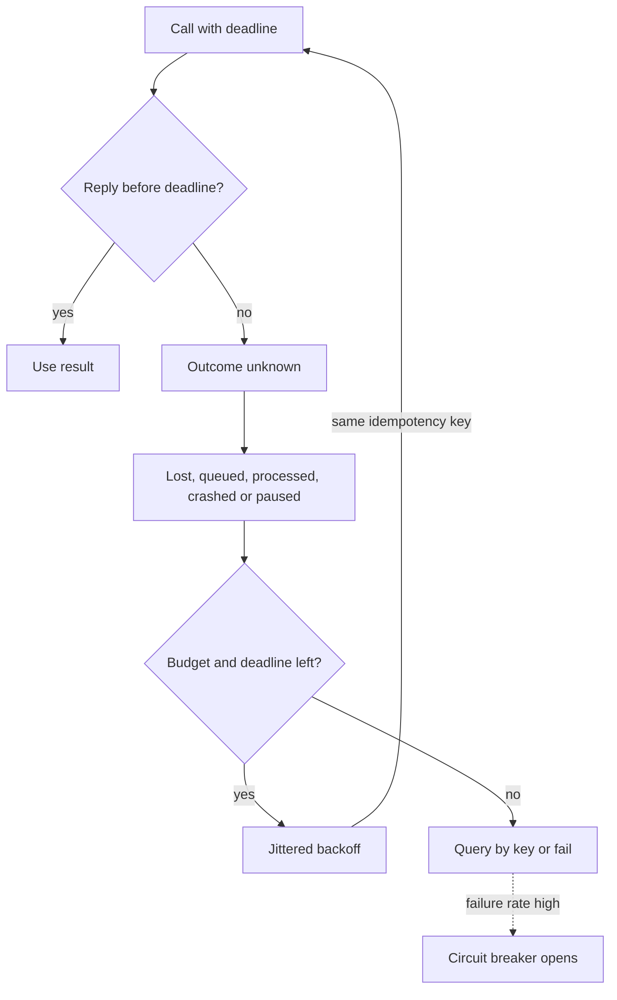

## TL;DR
Machines cooperating over a network, defined by **partial failure**: any node or link can fail or stall
while the rest continue, and "slow" looks like "dead". Every AI product is one. The discipline: deadlines,
idempotent retries, quorums, fenced leases, consensus, tracing.

## Why it exists
- **One machine is predictable.** A function call returns or the process is dead; a write happens or the
  program crashes; the operating system gives you a consistent clock and shared memory.
- **Systems leave that world for three reasons.** Capacity (one box cannot hold the model, the index and the
  traffic), availability (one box is one failure domain), and geography (users and data live in many
  places, and the model provider is on someone else's network anyway). Model API, vector store, queue,
  agent workers and customer tools are all separate machines.
- **"It worked or it crashed" disappears.** Send a request to a model endpoint and get no reply within 30
  seconds. The request was lost; it arrived and is queued; it was processed and the response was lost; the
  server crashed mid-way; or your own process paused for garbage collection and the response sits in a
  buffer. Each demands a different reaction, and the only evidence is the absence of a reply.
- **Single-machine assumptions become outages.** Peter Deutsch's "fallacies of distributed computing": the
  network is reliable, latency is zero, bandwidth is infinite, topology does not change, there is one
  administrator.
- **Both naive poles fail.** "Add retries and bigger timeouts" turns invisible failures into duplicate
  effects and overload: five layers retrying three times each fan one failure into up to 4⁵ ≈ 1,000
  attempts. "Make everything strongly consistent" costs round trips, and with even one crashed process no
  deterministic protocol can guarantee agreement terminates in an asynchronous network (the FLP result).

## How it works
### System models: what you assume can go wrong
Every protocol is correct only under a stated model, so name it before trusting a design.

| Axis | Model | Meaning |
|---|---|---|
| Faults | **Crash-stop** | a node halts and never returns |
| Faults | **Crash-recovery** | it halts and comes back, possibly losing in-memory state but keeping its disk; the realistic case for a restarted pod |
| Faults | **Byzantine** | nodes may lie; relevant to blockchains and adversarial settings, almost never inside one company's backend |
| Timing | **Synchronous** | known bounds on delay and pauses, which real networks do not give you |
| Timing | **Asynchronous** | no bounds at all; the setting of the FLP result |
| Timing | **Partially synchronous** | bounds hold most of the time but can be violated for unknown periods |

- **Practical systems assume crash-recovery and partial synchrony,** and split their guarantees:
  - **Safety** (nothing bad ever happens, such as two leaders committing conflicting entries) must hold
    under any timing.
  - **Liveness** (something good eventually happens, such as a leader being elected) is promised only while
    the network behaves.
- **This is how Raft coexists with FLP:** timeouts drive elections and can stall progress, but never make two
  nodes commit different values.

### Failure detection is a timeout
- **Machines do not announce their deaths.** A heartbeat or request with no answer within *T* is the only
  signal, and it conflates a dead node, a partitioned network, an overloaded node and a paused process.
- **Choose *T* from measured latency** (p99 plus margin), not a default.
- **Propagate a deadline** down the call chain, so a request with 2 seconds left does not launch a 10-second
  sub-call.
- **A timeout means "outcome unknown",** never "did not happen". Retries therefore need idempotency keys,
  jittered backoff and a budget.
- **Callers need circuit breakers** so a dead dependency fails fast instead of tying up every thread.

### Clocks lie
- **Wall clocks drift and NTP corrects them with jumps,** so timestamps from two nodes cannot order events
  reliably at millisecond granularity.
- **Use monotonic clocks for durations.**
- **Use causality for ordering:** Lamport's logical clocks (and vector clocks, version numbers, log offsets)
  order events by what they could have influenced, not by when a clock said they happened.
- **Last-writer-wins by wall clock silently discards writes** when the "earlier" writer had the faster clock.

### Replication
Copying data to several nodes buys availability and read throughput.

| Style | How writes flow | Cost |
|---|---|---|
| **Leader-based**, synchronous followers | one leader ships writes to followers and waits | slower writes, durable across nodes |
| **Leader-based**, asynchronous followers | leader ships without waiting | **replication lag**: a follower read can return stale data |
| **Multi-leader** and **leaderless** | writes accepted in many places | must resolve conflicts |

- **Quorums (leaderless, Dynamo-style):** with *N* replicas, writing to *W* and reading from *R* such that
  *W + R > N* guarantees at least one replica in every read saw the latest write. That is how availability
  is traded against quorum size.
- **Example:** *N = 3, W = 2, R = 2* tolerates one replica down for both reads and writes.
- **Overlap is necessary but not sufficient** for "always read the latest":
  - concurrent writes still need a rule to pick a winner;
  - a write that reached fewer than *W* replicas is reported as failed yet is not rolled back on the
    replicas it did reach;
  - "sloppy" quorums that accept writes on fallback nodes during outages break the overlap.
- **Quorum reads give probably-fresh data,** not linearizability, unless the system adds more machinery.

### Partitioning
- **When data outgrows one node it is split by key.** The partition key decides which operations stay local
  (cheap, atomic) and which span partitions (expensive, no atomicity without extra protocol).
- **Hot keys** (one tenant, one viral document) overload a single partition no matter how many exist, which
  is why tenant id is often a poor sole key for an AI platform.

### Consensus and leases
- **Some decisions need agreement:** who is the leader, what is the next log entry, who holds a lock. Raft
  solves this with terms, leader election and majority-replicated logs.
- **2f + 1 nodes tolerate f failures,** *because* any two majorities overlap in at least one node. The
  majority that elects a new leader always contains a node holding every committed entry, and Raft's voting
  rule refuses any candidate whose log is behind the voter's, so committed entries survive leader changes.

| Cluster size | Failures tolerated |
|---|---|
| 3 | 1 |
| 4 | 1 (adds cost without adding tolerance) |
| 5 | 2 |

- **Packaged consensus:** etcd and Consul (Raft) and ZooKeeper (its own Zab protocol, same majority
  principle) let applications store small, critical state (configuration, leadership, locks) and keep bulk
  data elsewhere, *because* each consensus write costs a majority round trip.
- **Locks and leadership are leases** with an expiry, since a holder that dies must not hold the lock forever.
- **The subtle part:** a holder may *believe* it still has the lease after it expired (it paused, or its clock
  lagged). A **fencing token**, a number that increases with each grant and that the protected resource
  checks, rejects writes from the stale holder.

### The CAP and PACELC framing
- **During a partition** a replicated system must choose: refuse some requests to stay consistent, or serve
  them and diverge (CAP).
- **Outside partitions** it trades latency against consistency (PACELC): every coordinated write costs a
  round trip to a quorum.
- **Practical reading:** strong consistency is bought per operation, so systems make a few operations strongly
  consistent (allocating an id, taking a lock, debiting a quota) and the rest eventually consistent.

### Seeing it
- **No single stack trace exists,** so correlation ids and distributed tracing are not optional; they are how
  a "request" is reconstituted from spans that ran on different machines.

## Diagram
What a caller can and cannot conclude: no reply means "outcome unknown", so every retry carries the same
idempotency key and stays inside the deadline and retry budget, and repeated failure opens a breaker.



## Examples
### Lease lock with fencing tokens
The canonical illustration of why "the lock holder" is not a reliable concept. A worker takes the lease to
re-index a document, pauses longer than the lease, and a second worker takes over; the storage layer
rejects the first worker's late write because its token is stale.

```python
import time, threading

class LeaseLock:                       # stand-in for etcd/ZooKeeper/Redis-with-care
    def __init__(self, ttl): self.ttl, self.token, self.holder, self.expires = ttl, 0, None, 0.0
    def acquire(self, who):
        if self.holder is None or time.monotonic() > self.expires:
            self.token += 1; self.holder, self.expires = who, time.monotonic() + self.ttl
            return self.token         # strictly increasing fencing token
        return None

class IndexStore:                      # the protected resource checks the token
    def __init__(self): self.max_token, self.data = 0, {}
    def write(self, token, doc_id, chunks):
        if token < self.max_token:
            raise PermissionError(f"stale token {token} < {self.max_token}")
        self.max_token = token; self.data[doc_id] = chunks

lock, store = LeaseLock(ttl=0.5), IndexStore()

def worker(name, pause):
    tok = lock.acquire(name)
    if tok is None: return
    time.sleep(pause)                  # simulates a GC pause or a slow embedding call
    try:
        store.write(tok, "doc-42", f"chunks by {name} (token {tok})")
        print(f"{name}: wrote with token {tok}")
    except PermissionError as e:
        print(f"{name}: rejected ({e})")

a = threading.Thread(target=worker, args=("A", 1.0)); a.start()   # holds lease, then stalls
time.sleep(0.7)                                                   # lease has expired by now
b = threading.Thread(target=worker, args=("B", 0.0)); b.start()   # takes token 2, writes
a.join(); b.join()
print(store.data["doc-42"])            # B's chunks survive; A's late write was fenced off
```

- **Without the token check,** worker A's write would land after B's and silently overwrite a newer index
  with older chunks.
- **Nothing in the logs would show a lock violation,** because A really did hold the lock when it started.

### Runnable: retry amplification and quorum overlap
Two numbers interviewers ask for: how retries multiply across layers, and which quorums are guaranteed to
overlap (checked by brute force over every write set and read set).

```python
from itertools import combinations

def attempts(retries_per_layer, layers):
    return (retries_per_layer + 1) ** layers      # each layer multiplies the attempts below it

def always_overlap(n, w, r):                      # does every read set meet every write set?
    nodes = range(n)
    return all(set(ws) & set(rs)
               for ws in combinations(nodes, w) for rs in combinations(nodes, r))

print(attempts(3, 5), attempts(3, 1), attempts(1, 5))      # 1024 4 32
for n, w, r in [(3, 2, 2), (5, 3, 3), (5, 2, 2), (5, 1, 4)]:
    print(f"N={n} W={w} R={r}  W+R>N={w + r > n}  overlap={always_overlap(n, w, r)}")
# N=3 W=2 R=2  W+R>N=True  overlap=True
# N=5 W=3 R=3  W+R>N=True  overlap=True
# N=5 W=2 R=2  W+R>N=False  overlap=False
# N=5 W=1 R=4  W+R>N=False  overlap=False
```

- **Retrying at one layer only** (3 retries, 1 layer) caps the fan-out at 4 attempts instead of 1,024.

### Worked scenario: propagating a deadline through an agent request
A chat request arrives with a 10-second budget (illustrative numbers). Each hop passes on what is left
rather than its own default timeout.

| Hop | Spent | Remaining | Decision |
|---|---|---|---|
| Gateway and auth | 0.2 s | 9.8 s | continue |
| Retrieval (vector store) | 0.8 s | 9.0 s | continue |
| First model call times out at its 6 s share | 6.0 s | 3.0 s | outcome unknown; do not start another 6 s call |
| Fallback: smaller model with a 2.5 s cap | 2.0 s | 1.0 s | answer returned |
| Without deadline propagation | 6 s + a fresh 6 s retry | negative | client already gave up; the retry's tokens are wasted |

## Production patterns
- **Deadline propagation on every hop.** Carry the remaining budget with the request (gRPC deadlines do this
  natively; over HTTP pass it in a header or context) and set each client's timeout to the smaller of its
  own cap and what is left. Monitor timeout rate per dependency and requests that start with under a
  minimum budget.
- **One retry layer with a budget.** Retry at a single layer, with jittered exponential backoff (for example
  `tenacity` with `wait_random_exponential` and `stop_after_attempt`), the same idempotency key on every
  attempt, and a cap on the fraction of traffic that is retries. Monitor the retry ratio; a rising ratio
  during an incident is the storm forming.
- **Circuit breakers on slow dependencies.** Open on a failure or timeout rate over a window, not on one
  timeout, and fail fast or fall back while open. Track the fraction of requests that hit an open breaker.
- **Leadership in etcd or ZooKeeper, with fencing.** Run singleton jobs behind a consensus-backed lease
  and use a monotonically increasing value from the store (for example the lock key's creation revision in
  etcd) as the fencing token the protected resource checks. Alert on lock hold time approaching the lease TTL.
- **Read-your-writes routing.** Send a user's reads to the primary for a short window after they write, or
  check replica lag (in Postgres, `pg_last_xact_replay_timestamp()` on the replica) before serving
  freshness-sensitive reads from it. Monitor replication lag per replica.
- **Odd-sized consensus across three failure domains.** Deploy 3 or 5 voters spread across three zones, so
  losing one zone leaves a majority. Monitor leader elections per hour; frequent elections mean timeouts
  are tighter than the network.

## Trade-offs
- **Replicas vs write latency or staleness.** Replicating raises availability and read capacity, but every
  extra replica either slows writes (synchronous) or widens the stale-read window (asynchronous). The choice
  flips toward synchronous when a stale read has a business cost, such as permissions.
- **Consensus vs round trips.** Safe leadership and locks cost a majority round trip per write and a minimum
  of three nodes; worth it for metadata and coordination, wasteful for bulk data.
- **Short vs long timeouts.** Short timeouts detect failures fast but misclassify slow nodes as dead and
  trigger needless retries; long ones waste capacity holding connections. The right value comes from the
  latency distribution, not from a default.
- **Retries vs amplification.** Retries raise success probability for transient faults, yet without jitter,
  budgets and idempotency they amplify outages into retry storms and duplicate effects.
- **Tenant partitioning vs hot spots.** Partitioning by tenant keeps each tenant's operations local and
  simplifies isolation, but concentrates a large tenant on one partition; compound keys spread load at the
  cost of cross-partition queries.

## Pitfalls
- **Treating a timeout as "the request did not happen".** Symptom: duplicate side effects (two tickets, two
  charges, two emails) that cluster around latency spikes.
- **Retrying at every layer** (client, gateway, service, SDK), so one failure fans out multiplicatively.
  Symptom: a dependency that stays overloaded long after its original fault cleared.
- **Ordering events by wall-clock timestamps from different hosts.** Records appear to go backwards in time
  and last-writer-wins drops updates that users swear they made.
- **Holding a distributed lock without a fencing token.** Rare corruption after GC pauses or network blips,
  impossible to reproduce and blamed on "a race".
- **Reading from a replica immediately after writing to the leader.** Users report that their upload or
  setting "disappeared" and then reappears seconds later.
- **Treating a quorum store with *W + R > N* as linearizable.** During a slow or partially failed write, one
  client reads the new value and a moment later another reads the old one, an anomaly that only appears
  under load or replica failure.
- **Consensus-backed stores with an even number of nodes or across two data centres.** A clean split leaves
  neither side with a majority and the whole cluster unavailable.

## When to use
You do not choose to build a distributed system; any product that calls a model API, keeps state in a
database and runs more than one process already is one. What you choose is how much coordination each
operation gets.
- **Default to:** local, idempotent, eventually consistent operations.
- **Spend coordination on** the few invariants that must hold: quota debits, permission checks, idempotency
  keys, leader election for singleton jobs.
- **Measure:** timeout and retry rates per dependency, replication lag, lock hold times versus lease length,
  and the fraction of requests that hit a circuit breaker.
- **Day to day:** the deadline you pass to the model client, the idempotency key on every tool call, and the
  choice of Postgres primary versus replica for a given read.
- **Go deeper:** the reliability module covers the mitigation patterns (circuit breakers, bulkheads,
  multi-region) in depth; the consistency lesson covers what reads may return.
- **Interviews:** reason from partial failure: what a timeout can and cannot tell you, why retries need
  idempotency, and why a lock needs a token.

## Role lens
- **Engineer:** Sets per-call deadlines, jittered retry budgets and idempotency keys on model and tool
  calls, and propagates trace context so a failed agent run can be reconstructed across services.
- **Architect:** Decides which state needs consensus or strong consistency, how data is partitioned by
  tenant, and how many failure domains the system must survive, then budgets latency accordingly.
- **FDE:** Diagnoses customer-side symptoms (duplicate records, stale reads, "random" timeouts) as
  partial-failure effects and adjusts timeouts, keys and read routing in their integration.

## Check yourself
**Q:** An agent platform runs one "scheduler" process that must be the only instance assigning jobs to
workers. The team uses a Redis key with a 30-second expiry as the lock and renews it every 10 seconds.
Twice last month two schedulers ran at once for a few seconds. Explain how that happened and what to
change.
**A:** The lock is a lease, and a lease holder cannot know it still holds the lease when it acts. If the
scheduler paused for more than 30 seconds (a GC pause, a stalled Redis renewal, a VM migration, or a
clock-related expiry on the Redis side), the key expired, a standby acquired it and started scheduling,
and the original resumed believing it was still the leader until its next renewal failed. That window is
exactly the overlap observed. Two changes close it. First, issue a strictly increasing fencing token with
every acquisition and make the job-assignment write (the protected resource) reject any token lower than
the highest it has seen, so the stale leader's assignments are refused rather than applied. Second, move
leadership to a consensus-backed store (etcd, ZooKeeper) whose lease and token semantics are designed for
this, and alert on lock hold time approaching the TTL. Renewing more often helps only until the next pause
longer than the TTL.

## Interview questions
### What makes a distributed system fundamentally harder than a single-machine program?
- **Partial failure.** Some nodes or links fail or stall while others keep running, and there is no shared
  view of which.
- **Indistinguishable symptoms.** A missing reply could be a lost request, a queued one, a lost response, a
  crash or a pause, so the caller must act without knowing the outcome.
- **No shared clock or memory.** Ordering needs logical clocks or version numbers, and agreement needs a
  protocol with round trips.

### One slow dependency at the bottom of a call chain took the whole platform down. Walk me through why.
- **Retry amplification.** If five layers each retry three times, one failing call becomes up to 4⁵ ≈ 1,000
  attempts against the dependency that is already slow.
- **Thread and connection exhaustion.** Callers without short deadlines hold resources while waiting, so
  upstream services run out of capacity too.
- **Fix:** retry at one layer with a budget and jitter, propagate deadlines, and put a circuit breaker in
  front of the dependency so callers fail fast.

### Why do consensus clusters use 3 or 5 nodes and not 4 or 6?
- **Tolerance comes from majorities.** 2f + 1 nodes tolerate f failures, because any two majorities overlap.
- **An even node adds cost, not tolerance.** Four nodes need three for a majority, so they still tolerate
  only one failure, and a clean 2-2 split leaves no majority at all.
- **Placement matters too:** spread voters over three failure domains so losing one keeps a majority.

### You use a quorum store with N = 3, W = 2, R = 2. Is every read guaranteed to see the latest write?
- **Overlap yes, linearizability no.** W + R > N means every read set meets every write set in at least one
  replica.
- **But:** concurrent writes still need a winner rule, a failed write may persist on the replicas it reached,
  and sloppy quorums on fallback nodes break the overlap.
- **For a strict guarantee** route the operation through a consensus-backed or single-leader path.

### How would you stop two copies of a singleton scheduler from both acting?
- **Leases alone cannot,** because a paused holder can act after its lease expired without knowing it.
- **Add fencing:** each grant returns a strictly increasing token, and the resource the scheduler writes to
  rejects tokens lower than the highest it has seen.
- **Operate it:** keep the lease in etcd or ZooKeeper, and alert when hold time approaches the TTL.

## Quiz
### Q: A call to the embedding service times out after 10 seconds. Which statement is correct?
- [ ] The embedding was not computed, so a retry is always safe
- [ ] The embedding was computed, so the client should look it up instead of retrying
- [x] The outcome is unknown; a retry must carry an idempotency key or the client must query by key first
- [ ] The service is down and the circuit breaker should open immediately
> A timeout only says that no reply arrived in time. The request may have been lost, queued, processed
> with a lost reply, or delayed by a pause on either side. Safe retries therefore need idempotency, and
> breakers open on a rate of failures, not on one timeout.

### Q: With N = 5 replicas, which read/write quorum sizes guarantee a read sees the latest acknowledged write?
- [ ] W = 2, R = 2
- [x] W = 3, R = 3
- [ ] W = 1, R = 4
- [ ] W = 5, R = 0
> Overlap requires W + R > N. With 3 and 3 the sets must share at least one replica, so a read sees the
> newest write. 2 + 2 = 4 does not exceed 5, 1 + 4 = 5 does not either, and a read of zero replicas
> returns nothing.

### Q: Why is a monotonically increasing fencing token needed in addition to a lease-based lock?
- [ ] To make lock acquisition faster under contention
- [ ] To replace the need for a lease expiry
- [x] Because a holder may act after its lease expired, and the resource must be able to reject that stale action
- [ ] To order events across data centres by wall-clock time
> A paused or partitioned holder cannot know its lease lapsed. The token lets the protected resource
> compare the acting holder's grant against the newest grant it has seen and refuse the stale one; the
> lease still handles dead holders, and tokens have nothing to do with wall clocks.
