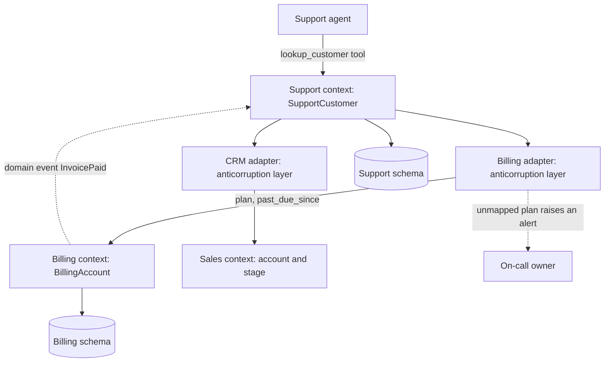

## TL;DR
Domain-driven design splits a system along the meanings of its business language: each bounded context
owns one consistent model behind explicit contracts. For agents, contexts decide the tool boundaries,
data ownership and the adapters that translate meaning so the model never has to.

## For agent builders
- **Why it matters for agents.** An enterprise agent reaches into billing, CRM and support at once. If
  "customer", "active" or "account" means three things in its tool results, the model resolves the
  ambiguity by guessing, and no prompt fixes that reliably.
- **Where it shows up in your stack.** Tool groups or MCP servers per system, the adapter code behind each
  tool, tool descriptions and system prompts written in one vocabulary, retrieval indexes tagged by
  context, and per-context eval sets.
- **What you control.** Which tools exist and in whose language they speak, where translation lives
  (adapters, never the prompt), how unmapped upstream values fail, and how a multi-system action becomes
  a saga instead of one transaction.
- **What you can skip.** Tactical DDD ceremony (repositories, factories, layered patterns) unless you own
  the upstream services. For agent work, bounded contexts, anticorruption layers and published languages
  carry most of the value.

## Decision case
### Scenario
A SaaS vendor wants its support agent to answer "can this customer upgrade?" from a CRM, a vendor
billing system and the support desk, each with its own "customer" and "status". All figures are
illustrative.
- **Volume:** about 5,000 eligibility questions a month.
- **Upstream surface:** the three APIs expose about 285 endpoints between them, and billing ships new
  plans roughly monthly.
- **Hard rule:** never tell a customer more than 14 days past due that they can upgrade.
- **Constraints:** three different teams own the upstream systems; the agent team has 6 weeks; tool
  definitions cost about 150 tokens each in every model call.

### Options
| Option | How it works | Tool definitions per call | Who reconciles "customer" | Upstream change |
|---|---|---|---|---|
| A. Conform: generate tools from the API specs | One tool per endpoint, vendor field names exposed | 285 × 150 = 42,750 tokens | The model, at runtime | Leaks straight into answers ("ent", `past_due_since`) |
| B. One tool group per upstream context | About 3 tools per system behind adapters, each in its own system's language | 9 × 150 = 1,350 tokens | Still the model, across three vocabularies | Contained per system |
| C. An Eligibility context owned by the agent team | One published tool, `check_upgrade_eligibility`, plus `lookup_customer`, with three anticorruption adapters behind them | 2 × 150 = 300 tokens | Adapter code, unit-tested | An unmapped value raises and alerts |

### Decision
Choose **C**, because:
- **The hard rule becomes code:** the 14-day past-due rule lives in the billing adapter of the
  Eligibility context, tested and versioned, instead of being re-derived by the model per request.
- **Monthly plan launches fail loudly:** explicit maps raise on an unmapped plan, so a new plan is an
  alert on day one, not customers silently treated as free tier.
- **The agent sees one vocabulary:** tier, payment standing and open escalations, which keeps tool
  definitions to about 300 tokens instead of 42,750 (A) and removes runtime reconciliation (B).
- **No upstream team must change anything,** which fits three owners and a 6-week deadline.

**What would change it:** if the agent must answer open-ended account questions beyond eligibility,
add B-style context tools for those; if one upstream is tiny and stable, conform to it rather than
maintain a translation.

### Trade-offs accepted
- **The agent team maintains three adapters** that change when either side changes. Watch: contract
  tests against each upstream sandbox in CI.
- **Unmapped values fail the call,** so some questions get "cannot determine, escalating" during an
  upstream launch. Watch: unmapped-value errors per adapter and time to add each mapping.
- **New questions need new tools,** because the published language is narrow. Watch: questions the agent
  declines for lack of a tool, reviewed monthly.
- **Upstream changes arrive late through events.** Watch: event consumer lag, since eligibility read from
  a stale model gives a wrong answer.

### Review rubric
- **The meanings are mapped:** the write-up lists which term means what in each system before choosing
  tools.
- **Translation has a named home** in adapters, with the prompt free of upstream vocabulary.
- **Unknown upstream values have a defined failure** (raise, alert, escalate), not a default.
- **Tool-surface cost is computed** from the number of tools and tokens per definition.
- **Ownership is explicit:** who owns each adapter and the published language, and what upstream teams
  must or need not change.
- **Reversal conditions are stated,** such as broader question scope or a stable upstream.

## Why it exists
- **One word, three meanings.** Ask billing, support and sales what a "customer" is. Billing: a legal
  entity with a payment method and invoices. Support: a person with a login and a ticket history. Sales:
  an account with an owner, a pipeline stage and a renewal date. Each is right inside its own work and
  wrong inside the others'.
- **One Customer table for everyone fails.** Nobody fully understands it, a change for billing breaks
  support, and every team must coordinate with every other team to ship anything.
- **The enterprise canonical model fails too.** A committee defines the single true schema and everyone
  conforms, but meaning is local: the model becomes a lowest common denominator with dozens of optional
  fields, and the committee becomes the bottleneck.
- **Splitting by technical layer or table recreates the coupling.** A "customer service" that owns the
  Customer table for everyone just moves the same coupling behind an API.
- **DDD models the inconsistency instead of fixing it.** Each area uses its own language consistently
  inside a boundary; between boundaries, translation is explicit. Conway's observation (systems mirror
  their builders' communication structures) is why it works: a boundary matching a team's responsibility
  is one that team can own and change alone.
- **AI raises the stakes.** An agent reaches across many contexts at once through tools, and retrieval
  indexes mix documents written in several vocabularies; without drawn boundaries the agent inherits
  every ambiguity and resolves it by guessing.

## How it works
### What bounded contexts decide in an agent
- **One tool, or tool group, per bounded context,** speaking that context's published language; the
  agent's tool list then mirrors the context map. An MCP server per context is a natural packaging.
- **Translation lives in tool adapters (the ACL), never in the prompt.** Asking the model to reconcile
  three meanings of "customer" at runtime is asking it to redo your architecture per request.
- **Do not expose raw upstream APIs as tools.** Auto-generating tools from a vendor's API spec hands the
  model the vendor's vocabulary and every field it does not need.
- **Scope retrieval indexes and memory per context** when vocabularies conflict, or tag them with the
  context so the prompt can say which "account" a passage refers to.
- **Consequential actions respect aggregate boundaries:** an agent step that must update two contexts is
  a saga with compensation, not one transaction.
- **Evals are per context,** written in that context's language by that context's experts.

The subsections below are the DDD vocabulary behind those rules.

### Ubiquitous language
- **One vocabulary, everywhere in the area.** Developers and domain experts use the same terms, and so
  does the code: class names, tool names, event names, prompts.
- **The boundary test.** If a term means two things, you have found a boundary; if two terms mean one
  thing, pick one.
- **For AI products** this language also goes into system prompts, tool descriptions and evaluation
  rubrics, so inconsistency there shows up directly as model errors.

### Bounded contexts
- **Definition.** The boundary inside which a model and its language are consistent. It owns its data,
  its invariants and its storage; nothing outside writes to that storage directly.
- **Draw by language and responsibility,** not by data volume or technology. Billing, Support and Sales
  are three contexts, each with its own Customer, and that is correct.
- **Deployment is a separate decision.** A context may be a service, a module in a modular monolith, or a
  schema in one database; the boundary is about ownership and meaning.

### Finding the boundaries
Boundaries are discovered, not decreed. Map the business process with domain experts as a timeline of
domain events (event storming), then look for seams. Four signals mark one:

| Signal | Example |
|---|---|
| A term changes meaning | "customer", "active", "account" |
| Who decides changes | finance owns the dunning rule, support owns the escalation rule |
| Rate of change differs | pricing rules change weekly, ledger rules almost never |
| A set of rules must hold together at the same instant | order total and credit limit: that set belongs inside one context, so the seam runs around it |

- **Wrong seam test:** when two candidate contexts must constantly ask each other questions to make any
  decision, the seam is in the wrong place.

### Subdomain classification
| Subdomain | What it is | Investment |
|---|---|---|
| *Core* | where the business differentiates | most careful modelling, your best people |
| *Supporting* | necessary but not differentiating | adequate, build simply |
| *Generic* | authentication, invoicing | buy or borrow |

- **For most AI products the core is the domain logic and the data, not the model call.** This
  classification tells you where custom work belongs and where a vendor is fine.

### Context mapping: how boundaries relate
- **Shared kernel:** two contexts share a small model and change it together. Cheap and dangerous; keep
  it tiny.
- **Customer–supplier:** the downstream team's needs feed the upstream team's roadmap.
- **Conformist:** downstream adopts the upstream model wholesale because it has no leverage, typical with
  a vendor API.
- **Anticorruption layer (ACL):** downstream translates the upstream model into its own at the boundary,
  *because* a leaking foreign model corrupts your language one field at a time. The most important
  pattern for AI integrations: the agent's context sees its own concepts, with adapters translating each
  external system.
- **Open host service with a published language:** upstream exposes a stable, documented interface in a
  well-defined language for many consumers. A tool schema an agent calls is exactly a published language.
- **Separate ways:** the contexts do not integrate at all. Sometimes correct.

### Inside a context: aggregates, entities, value objects, domain events
- **Aggregate.** A cluster of objects changed together under one transaction through one entry point (the
  root), with invariants that hold at the end of every transaction. Example: an `Order` with its lines and
  the invariant "total must not exceed the approved credit of 10,000".
- **One entry point.** Lines change only through `order.add_line(...)`, *because* if code could insert a
  line row directly, nothing would recheck the total.
- **Keep aggregates small** as the true invariants allow, *because* the aggregate is the unit of locking
  and a large one serializes unrelated edits.
- **Reference other aggregates by id,** not by object, so loading an order does not drag in the customer.
- **One aggregate per transaction;** the others catch up through *domain events* ("OrderPlaced",
  "InvoicePaid"). Cross-context changes are always eventually consistent, *because* a single transaction
  spanning contexts would couple their storage and their uptime. Here DDD hands over to event-driven
  architecture and sagas.
- **Entities vs value objects.** *Entities* have identity over time (the order is the same order after its
  lines change). *Value objects* are defined by their attributes and are immutable (`Money(120, "EUR")`),
  which makes them safe to share and pass across boundaries.
- **Repository.** Loads and saves whole aggregates, one per aggregate type, which keeps the invariant check
  from being bypassed by partial writes.

## Diagram
A context map for the support agent in the examples. The agent only speaks its own published language;
each upstream model is translated in an adapter, and contexts change each other only through events.



## Examples
### Two contexts, one anticorruption layer, one published tool
Each context has its own Customer; the support agent sees only its own concept. The translation from
billing's model happens in the adapter, not in the prompt. `billing_api`, `mapping_repo` and `tickets`
stand in for the real clients.

```python
from dataclasses import dataclass
from datetime import date

# Billing context: its own language and storage, owned by the billing team
@dataclass(frozen=True)
class BillingAccount:
    account_id: str
    legal_name: str
    plan: str                      # billing's codes: "ent", "pro", "free"
    past_due_since: date | None

# Support context: a different "customer", shaped for support work
@dataclass(frozen=True)
class SupportCustomer:
    customer_id: str
    display_name: str
    tier: str                      # support's words: "enterprise", "pro", "free"
    payment_blocked: bool
    open_tickets: int

PLAN_TO_TIER = {"ent": "enterprise", "pro": "pro", "free": "free"}

class BillingAdapter:              # anticorruption layer: billing model -> support language
    def __init__(self, billing_api, mapping_repo):
        self.api, self.map = billing_api, mapping_repo
    def payment_status(self, customer_id: str) -> dict:
        acct: BillingAccount = self.api.get_account(self.map.billing_id_for(customer_id))
        blocked = acct.past_due_since is not None and (date.today() - acct.past_due_since).days > 14
        if acct.plan not in PLAN_TO_TIER:            # fail loudly: a silent default corrupts meaning
            raise UnmappedUpstreamValue(f"billing plan {acct.plan!r}")
        return {"payment_blocked": blocked, "tier": PLAN_TO_TIER[acct.plan]}

def lookup_customer(customer_id: str, tickets, billing: BillingAdapter) -> SupportCustomer:
    """Published language for the agent: no billing field names leak into its context."""
    b = billing.payment_status(customer_id)
    return SupportCustomer(customer_id=customer_id, display_name=tickets.name(customer_id),
                           tier=b["tier"], payment_blocked=b["payment_blocked"],
                           open_tickets=tickets.count_open(customer_id))

TOOLS = [{"name": "lookup_customer", "description": "Fetch the support view of a customer.",
          "input_schema": {"type": "object", "properties": {"customer_id": {"type": "string"}},
                           "required": ["customer_id"]}}]
```

### Running one lookup, then an upstream change
| Moment | What happens |
|---|---|
| Lookup | billing returns `BillingAccount("B-881", "Acme GmbH", "ent", 2026-09-30)` |
| On 2026-10-20 | 20 days past due, more than 14, so the agent sees `SupportCustomer(tier="enterprise", payment_blocked=True, open_tickets=3)` and never the words "ent" or `past_due_since` |
| Billing launches a "team" plan, with a `.get(plan, "free")` default | every team-plan customer is silently treated as free tier: a wrong answer with no error anywhere |
| Same launch, with the explicit map | the upstream change becomes a failing call and an alert on day one |

- **The 14-day rule is a support-context rule,** so it lives in the support side's adapter, versioned and
  tested there; neither billing nor the prompt needs to know it.
- **The point of an ACL:** translation is a contract, and an unmapped value is a contract break.

### Runnable: an aggregate that protects its invariant
Pure Python. `Money` is a value object; `Order` is the aggregate root and the only way to add lines.

```python
from dataclasses import dataclass, field
from decimal import Decimal

@dataclass(frozen=True)
class Money:                                   # value object: immutable, equal by value
    amount: Decimal
    currency: str
    def __add__(self, other):
        if other.currency != self.currency:
            raise ValueError("currency mismatch")
        return Money(self.amount + other.amount, self.currency)

class CreditLimitExceeded(Exception):
    pass

@dataclass
class Order:                                   # aggregate root: the only way to change lines
    order_id: str
    customer_id: str                           # another aggregate, referenced by id
    credit: Money
    lines: list = field(default_factory=list)
    events: list = field(default_factory=list)

    def total(self) -> Money:
        t = Money(Decimal(0), self.credit.currency)
        for _, price in self.lines:
            t = t + price
        return t

    def add_line(self, sku: str, price: Money) -> None:
        if (self.total() + price).amount > self.credit.amount:   # invariant checked on every change
            raise CreditLimitExceeded(f"{self.order_id} would exceed {self.credit.amount}")
        self.lines.append((sku, price))
        self.events.append(("OrderLineAdded", self.order_id, sku))  # other contexts react later

order = Order("O-1", "C-7", Money(Decimal(10000), "EUR"))
order.add_line("seats", Money(Decimal(9880), "EUR"))
order.add_line("support", Money(Decimal(120), "EUR"))
print(order.total().amount)                    # 10000: equal to the credit is allowed
try:
    order.add_line("extra", Money(Decimal(1), "EUR"))
except CreditLimitExceeded as e:
    print("rejected:", e)                      # rejected: O-1 would exceed 10000
```

## Production patterns
- **Storage ownership enforced by the database.** When contexts share one database, give each its own
  schema and database role, and grant no role write access to another context's schema. Other contexts
  read through an API or events. Monitor permission-denied errors from cross-schema access attempts.
- **Strict ACL mappings with contract tests.** Translate every upstream enum through an explicit map that
  raises on unknown values, and run contract tests against the upstream sandbox in CI. Alert on unmapped
  value errors in production, because each one is an upstream change you have not modelled yet.
- **Domain events through a transactional outbox.** Write the aggregate change and an outbox row in the
  same transaction; a relay publishes the row to the broker. Other contexts consume and update their own
  models. Monitor outbox lag and consumer lag per context.
- **Tool groups that mirror the context map.** Register agent tools per context with that context's
  published language and owners, and run per-context evals written by its experts. Monitor tool-selection
  errors and eval scores by context, so a regression points at one owner.
- **Tool results in the agent's language, checked by schema.** Validate every tool result against the
  published schema (the `SupportCustomer` shape, as a Pydantic model or JSON Schema) before it reaches
  the model, and reject results that carry upstream field names. Monitor schema-validation failures per
  tool, since each one is an adapter that drifted.
- **Coupling metrics on change.** Tag pull requests and releases by the contexts they touch, and track how
  many contexts a typical change spans and how often releases must be coordinated. A rising number means a
  seam is in the wrong place.

## Trade-offs
- **Separate models vs reconciliation.** Separate models per context remove cross-team coupling and keep
  each model small, but the same real-world thing exists in several places and must be reconciled
  through events or adapters.
- **ACL vs maintenance.** An anticorruption layer protects your language from upstream churn, at the cost
  of a translation that changes whenever either side changes; for a tiny, stable upstream, conforming is
  cheaper.
- **Eventual consistency vs disagreement windows.** Independent deployability and uptime come with
  windows where contexts disagree; when the business cannot tolerate that window, the boundary is
  probably drawn in the wrong place.
- **Rich core model vs wasted rigor.** A rich core-domain model repays deep investment, while the same
  rigor on generic subdomains wastes it; misclassifying the core is the expensive mistake.
- **One tool per context vs tool count.** Meanings stay clean and privileges scoped, but tools multiply;
  when contexts are many, a facade context that speaks the agent's language may be justified.

## Pitfalls
- **One shared database schema behind several "services".** Symptom: a migration in one team's context
  breaks another team's deployment. Fix: one schema and role per context, with no cross-context writes.
- **Contexts drawn by technical layer or by noun** ("the customer service"). Symptom: every feature
  touches every service and release trains must be coordinated. Fix: redraw by language and
  responsibility.
- **An upstream model leaking through without an ACL.** Symptom: vendor field names and enums appear in
  your prompts, your UI and your tests. Fix: translate in an adapter at the boundary.
- **Asking the model to reconcile conflicting vocabularies at runtime.** Symptom: answers mix the billing
  and support meanings of a term, and evals cannot agree on correctness. Fix: move translation into tool
  adapters.
- **Wrapping every upstream endpoint as an agent tool.** Symptom: dozens of near-duplicate tools with
  vendor field names, falling tool-selection accuracy, and answers that quote internal codes such as
  "ent". Fix: a few context tools in the agent's published language, with adapters behind them.
- **Translation tables with catch-all defaults.** Symptom: a new upstream enum value (a new plan, a new
  status) is quietly mapped to the wrong meaning and found weeks later through customer complaints
  rather than errors. Fix: raise on unmapped values and alert.
- **Transactions that span contexts.** Symptom: distributed locks, timeouts under load, and partial
  updates nobody can compensate. Fix: one aggregate per transaction, with events or a saga across
  contexts.

## When to use
- **Use when:** more than one team or vocabulary touches the system, an agent must integrate several
  enterprise systems, or a shared schema has become the bottleneck for change.
- **Avoid when:** it is a small product with one team and one language; one context is correct, so do
  not fragment prematurely.
- **Measure coupling:** how many contexts a typical change touches, how often cross-context releases must
  be coordinated, and how many tool adapters contain translation versus pass-through.
- **Day to day:** naming decisions, where a rule lives, and whether a new field belongs to you.
- **Interviews:** draw a context map for a given business, place an agent and its tools on it, and explain
  why an anticorruption layer belongs in the adapter rather than the prompt.

## Role lens
- **Engineer:** Keeps each context's language consistent in code, tools and prompts, writes adapters that
  translate at the boundary, and publishes events instead of writing to another context's tables.
- **Architect:** Draws the context map, classifies core versus supporting versus generic subdomains,
  chooses the relationship pattern per boundary, and decides where the agent sits on the map.
- **FDE:** Discovers the customer's real vocabularies and system owners, maps each to a context and an
  adapter, and resolves "which system is the source of truth" before the agent is built.

## Check yourself
**Q:** You are building an agent that answers "can this customer upgrade?" using a CRM, a billing system
and a support desk, each with its own notion of customer and status. Where do you put the logic that
reconciles them, and why not in the prompt?
**A:** I would treat the agent's own domain as a bounded context with its own small model, say an
Eligibility view with fields like tier, payment standing and open escalations, and build one adapter per
upstream system acting as an anticorruption layer: the CRM adapter maps account stages to the agent's
tier, the billing adapter maps past-due rules to payment standing, the support adapter counts
escalations. The agent gets one tool in its own published language. Putting the reconciliation in the
prompt would make the model re-derive the business rules on every request, from three vocabularies it
only partly understands, with no tests and no owner; a mapping change would be a prompt edit with
unpredictable effects. In adapters the rules are code, owned by the team that owns each boundary,
unit-tested, and versioned independently of the model.

## Interview questions
### What is a bounded context, and why not agree on one canonical customer schema?

- **Definition:** the boundary inside which one model and its language are consistent; it owns its
  data, invariants and storage, and nothing outside writes to that storage directly.
- **Why not canonical:** meaning is local, so a single schema becomes a lowest common denominator with
  dozens of optional fields, owned by a committee that becomes the bottleneck for every change.

### How would you find the context boundaries in a business you do not know yet?

- **Event storming:** map the process with domain experts as a timeline of domain events, then look for
  seams.
- **Seam signals:** a term changes meaning, a different person decides changes, the rate of change
  differs; rules that must hold together at the same instant belong inside one context.
- **Wrong seam test:** if two candidate contexts must constantly ask each other questions to decide
  anything, move the boundary.

### How big should an aggregate be, and what crosses aggregate boundaries?

- **As small as the true invariants allow,** because the aggregate is the unit of locking; an `Order`
  with its lines and a credit-limit invariant is one aggregate, the customer is another, referenced by id.
- **One aggregate per transaction:** other aggregates and other contexts catch up through domain events
  such as "OrderPlaced", published reliably with a transactional outbox.

### After billing launched a new plan, the agent started treating some customers as free tier. What went wrong?

- **A catch-all default in the translation map:** `.get(plan, "free")` turned an unknown upstream value
  into a wrong meaning with no error anywhere.
- **Fix:** an explicit map that raises on unmapped values, contract tests against the upstream sandbox in
  CI, and an alert on unmapped-value errors so the change surfaces on day one.

### When would you conform to an upstream model instead of building an anticorruption layer?

- **Conform** when the upstream is tiny and stable or you have no leverage, as with many vendor APIs,
  because translation code changes whenever either side changes.
- **Build the ACL** when the foreign model would leak into your prompts, UI and tests, or when its
  churn would otherwise become your churn.
- **Skip DDD's ceremony** for a small product with one team and one language; one context is correct.

### An agent step must update records in two contexts. How do you make it safe?

- **Not one transaction:** spanning contexts couples their storage and uptime, and leads to distributed
  locks, timeouts under load and partial updates.
- **Use a saga with compensation:** each context commits its own change and emits an event; if a later
  step fails, a compensating action undoes the earlier one, and the agent sees eventual consistency.

## Quiz
### Q: Billing, Support and Sales each define "customer" differently. What does domain-driven design recommend?
- [ ] Define one canonical Customer schema with every field and make all three conform
- [x] Keep a separate model per bounded context and translate explicitly at the boundaries
- [ ] Store all customer data in one service that the other three call
- [ ] Let the agent reconcile the differences at runtime
> Meaning is local to each area of the business. A single model becomes a lowest common denominator
> owned by a committee; separate models with explicit translation let each team change independently.

### Q: What is the role of an anticorruption layer when an agent integrates a vendor system?
- [ ] To scan vendor responses for malicious content
- [x] To translate the vendor's model into the agent's own language so foreign fields and semantics do not leak into prompts and code
- [ ] To cache vendor responses for performance
- [ ] To enforce rate limits on vendor calls
> An ACL protects a context's language. Without it, upstream names and enums spread through prompts,
> tests and UI, and every upstream change becomes your change.

### Q: Why are changes that span two bounded contexts usually made eventually consistent via events rather than one transaction?
- [ ] Databases cannot run transactions across more than one table
- [ ] Events are faster than transactions
- [x] A single transaction would couple the contexts' storage and availability, defeating the point of separate ownership
- [ ] Domain-driven design forbids transactions
> Aggregates are the unit of transactional consistency; across contexts, independent deployability and
> uptime matter more than instantaneous agreement, so domain events and sagas carry the change.

## Use cases & projects
### Use cases
- **Enterprise agents across many systems.** Tools grouped per bounded context (billing, CRM, support)
  each speak one vocabulary, so the model never has to reconcile three meanings of "customer".
- **MCP servers per domain.** Each team publishes a server for its context with adapters that translate
  upstream data, and unmapped values fail loudly instead of reaching the model.
- **Multi-system actions as sagas.** A plan change that touches billing and provisioning runs as steps with
  compensations, not as one cross-system transaction.
- **Context-tagged retrieval and evals.** Indexes and eval sets are split by context, so a regression in
  one domain is visible and owned by one team.

### Mini project
**Put an anticorruption layer between an agent and two systems (2-3 hours).**
- **Goal:** give an agent tools over two mock systems that disagree on what a "customer" is, with
  translation in code rather than the prompt.
- **Steps:** create two fake APIs, one billing and one support, with conflicting fields and status values;
  write an adapter per system that maps them into one published language; expose tools that return only
  the translated shape; make an unmapped status raise a clear error; run 10 questions through an agent.
- **Done when:** the agent answers all 10 without the prompt explaining either system's quirks, and a
  test shows an unknown upstream status fails at the adapter instead of reaching the model.
