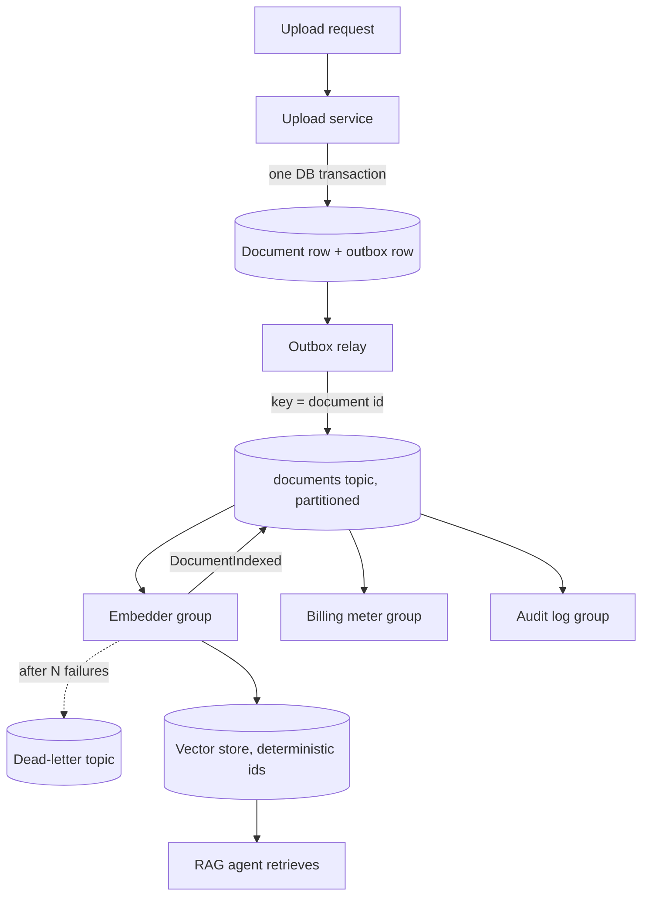

## TL;DR
Services and agents record immutable facts ("DocumentUploaded", "RunCompleted") on a broker; any number
of consumers react on their own schedule. Agents get triggered and RAG indexes refreshed without coupling,
at the price of eventual consistency, at-least-once delivery and no single stack trace.

## For agent builders
- **Why it matters for agents.** The pipeline that keeps your RAG index fresh is event-driven, and so is
  any agent that wakes up on a ticket, an email or a webhook. At-least-once delivery means the same event
  can start your agent twice, and an agent that sends a refund twice is an incident.
- **Where it shows up in your stack.** Kafka, SQS or RabbitMQ behind ingestion and agent triggers; run
  events (run started, tool called, run completed) feeding billing, eval sampling and audit; tracing
  tools such as LangSmith or an OpenTelemetry backend receive a parallel stream of spans, not your
  business events.
- **What you control.** The event envelope and partition key (usually the document, ticket or
  conversation id), idempotency keys derived from `event_id` for every side-effecting tool call, retry
  limits and the dead-letter policy, and how many agent runs a consumer group may start at once.
- **What you can skip.** Broker internals such as replication protocols and log compaction tuning. Know
  per-partition ordering, at-least-once delivery, the outbox and consumer lag.

## Decision case
### Scenario
A support-software company runs a document assistant and a ticket-triage agent. Today the upload request
calls parser, chunker, embedder, indexer, billing and audit in sequence, and large PDFs time out. All
figures are illustrative.
- **Scale:** 30,000 uploads a day, peaking at 2,000 an hour; 20,000 tickets a day, each starting one
  triage run; after an upstream outage, bursts of 5,000 tickets arrive within 10 minutes.
- **Consumers:** embedder, billing meter and audit on documents; billing, an eval sampler and audit on
  run events. The eval team will add new samplers and wants to backfill them from history.
- **Constraints:** upload p95 under 1 s; documents searchable within 5 minutes; run events replayable for
  90 days; the model provider allows 60 concurrent runs; first triage within 2 hours; a team of 4 who know
  Postgres and AWS; 8 weeks to ship.

### Options
| Option | How it works | Upload path availability (99.9% each) | 90-day replay | Duplicates and bursts | Team and ops fit |
|---|---|---|---|---|---|
| A. Keep the synchronous chain | Upload request calls all six services | 0.999⁷ ≈ 99.3%, latency is the sum of 7 | None: calls are ephemeral | No bus duplicates, but a burst hits the model directly | Nothing new to run; fails the 1 s p95 |
| B. Outbox plus a queue per consumer | Outbox relay publishes to a fan-out topic with one queue per consumer (for example SNS to SQS) | 0.999² ≈ 99.8% | No: a consumed message is deleted, and SQS keeps unconsumed ones at most 14 days | Inbox per consumer; queue depth absorbs the burst | Fully managed, familiar to the team |
| C. Outbox plus a partitioned log | Outbox relay publishes to a managed Kafka-compatible log keyed by document or ticket id; one consumer group per consumer | 0.999² ≈ 99.8% | Yes: set retention to 90 days and start a new group at the oldest offset | Inbox per consumer; lag absorbs the burst | New system to learn: partitions, offsets, a schema registry |

### Decision
Choose **C**, because:
- **Replay is a hard requirement that only the log meets.** A new eval sampler must read 90 days of
  `RunCompleted` facts; in B those messages are gone once the existing consumers acknowledge them.
- **The upload path drops to two dependencies.** The handler writes the document row and outbox row in
  one transaction and returns, so p95 stays near one database write; availability rises from about 99.3%
  to 99.8%.
- **Keys give the ordering the index needs.** Keying by document id keeps `DocumentDeleted` behind
  `DocumentUploaded` for the same document.
- **The burst fits the deadline.** With a cap of 50 concurrent runs (under the provider's 60) and runs
  averaging 40 s, the group drains 1.25 runs/s, so 5,000 tickets take 4,000 s, about 67 minutes, inside
  the 2-hour first-triage target.
- **Ops risk is bought down, not ignored:** a managed service, not a self-run cluster, plus a schema
  registry from day one.

**What would change it:** if backfills can read the Postgres run table instead of the log, B wins on
simplicity; if one consumer remained and the user needed the result in the same interaction, A plus a
stream would do; bursts above the 2-hour budget mean asking for a higher provider limit, not more
consumers.

### Trade-offs accepted
- **Eventual freshness.** Documents become searchable after the embedder catches up. Watch: lag per
  consumer group against the 5-minute budget, and the age of the oldest outbox row.
- **Duplicates are normal.** Every consumer dedupes on `event_id`, and the refund and reply tools take
  keys derived from it. Watch: runs started per ticket event (should be 1.0) and duplicate-key hits.
- **Partition count is fixed early.** 12 partitions cap the embedder at 12 consumers; at 1.5 s per
  document that is 8 documents/s (28,800 an hour), 14 times the peak. A 90-day re-index of 2.7 million
  uploads takes about 94 hours. Watch: per-partition lag, and plan a separate replay group.
- **Poison messages cost ordering or flow.** Documents park the key; telemetry goes to a retry topic.
  Watch: DLQ depth and one partition lagging while the others sit at zero.

### Review rubric
- **Constraints come first and are numeric:** volumes, burst size, latency, freshness, retention, rate
  limit, team and deadline are stated before options.
- **Each option is scored on the same constraints,** including replay and burst handling, not only
  coupling.
- **Burst arithmetic recomputes:** concurrency cap, run time and drain time are shown and compared with
  the response target.
- **Partition keys and ordering are named** per topic, with the poison-message strategy chosen per topic.
- **Idempotence covers trigger and effects:** an inbox for runs and idempotency keys for side-effecting
  tools, each with a signal to watch.
- **Reversal conditions are concrete:** at least two changes in requirements that would flip the choice.

## Why it exists
The naive design: the ingestion endpoint receives a PDF and, in the same request, calls the parser,
chunker, embedder, index writer, notification service and analytics API. Three things go wrong as it grows.
- **Temporal coupling.** The upload succeeds only if all six downstream services are up at that instant.
  At 99.9% each, the chain is roughly 0.999⁶ ≈ 99.4% available, and its latency is the sum of six
  latencies. The slowest or flakiest consumer sets the user's experience.
- **Knowledge coupling.** Every new consumer (compliance wants a copy of every upload) means a producer
  code change and redeploy, plus a new failure mode in its request path. The producer accumulates
  reasons to change that have nothing to do with uploading.
- **Lost history.** Once the request returns, the upload exists only as a row the producer chose to keep.
  You cannot replay last Tuesday's uploads through a fixed chunker, because the calls were ephemeral.
- **Events invert the dependency.** The producer only durably records the fact; consumers depend on the
  event contract, the producer on nothing. Availability becomes "can I write to the broker" and history
  becomes the log. That inversion, not the broker technology, is the idea.
- **What it buys in AI systems.** You can add a billing meter, an eval sampler and an audit log to an
  agent pipeline without touching the agent.
- **Why agents make it sharper.** An agent run is slow (seconds to minutes) and expensive (tokens per
  step), so it cannot sit inside a webhook's request, and duplicate triggers cost real money as well as
  duplicate side effects.

## How it works
### Events versus commands
| | Event | Command |
|---|---|---|
| Grammar | past tense: `OrderPlaced`, `EmbeddingGenerated` | imperative: `ChargeCard` |
| Mutability | immutable statement of fact, owned by the producer | a request that may be refused |
| Addressee | none, no expected reply | exactly one handler |
| Coupling | producer stays ignorant of consumers | re-introduces the coupling you were escaping |

- **Why it matters:** an event implies no outcome the sender cares about; a command does.
- **Smell:** publishing `SendWelcomeEmail` as an event is a remote procedure call with extra steps.

### The envelope
Every event carries metadata separate from its payload:
- **`event_id`** — globally unique, so consumers can deduplicate.
- **`type` and `schema_version`** — so consumers can evolve independently.
- **`occurred_at`** — when the fact happened.
- **`aggregate_id`** — the entity it belongs to; this is the partition key (see below).
- **`trace_id`** — for observability across hops.

Payload styles (Fowler's names):
- **Event notification** — thin: "document 42 changed, fetch it". Always fresh, but consumers call back.
- **Event-carried state transfer** — a snapshot: "document 42 now has these fields". Removes the callback,
  at the cost of larger messages and consumers holding copies of data that can go stale.

### The broker and its guarantees
| | Log-style (Kafka, Pulsar, Redpanda) | Queue-style (RabbitMQ, SQS) |
|---|---|---|
| Storage | appends to **partitions**, retained | message deleted once a consumer acknowledges it |
| Consumers | each consumer group keeps its own **offset** | each message goes to one competing consumer |
| Replay | yes: a new consumer starts from offset 0 and rebuilds state | no |
| Best for | fan-out, history, rebuilds | simple work distribution |

- **Ordering is per partition only.** Choose the partition key to be the thing whose order matters,
  usually the aggregate id: all events for document 42 land in one partition in order, while documents 42
  and 43 may interleave arbitrarily.
- **Delivery is at least once in both styles.** A consumer that crashes after processing but before
  acknowledging sees the message again, so consumers must be idempotent: record processed `event_id`s or
  make the effect naturally repeatable.
- **Exactly-once is built at the consumer, not given end to end.** Kafka's transactional producers cover
  only Kafka-to-Kafka read-process-write loops; any effect outside the log (a database write, an HTTP
  call) still needs idempotence.
- **Partitions are the unit of parallelism.** Within one consumer group each partition is read by at most
  one consumer at a time, so a topic with 12 partitions keeps at most 12 consumers of a group busy.
- **Pick partition count up front.** It is a capacity decision, because adding partitions later changes
  which partition a key hashes to and breaks per-key ordering across the change.

### When a consumer cannot process an event
A message that fails every time (malformed payload, a PDF that crashes the parser) is a **poison
message**. How you retry it decides what you lose:

| Strategy | Keeps per-key order? | Keeps partition flowing? | Cost |
|---|---|---|---|
| Retry in place | yes | no | every later event on that partition, for every document hashed there, waits |
| Retry topic or dead-letter queue (DLQ) | no | yes | a later event for the *same* key can overtake it (an `Updated` before its `Created`) |
| Park the key | yes | yes | mark the key blocked, divert its later events aside too, release them in order once the head event is fixed or discarded |

Choose by whether per-key order or partition throughput matters more for that event type, and decide it
per topic, not by discovery in an incident.

### Producing reliably
1. The producer writes its own database row and publishes the event.
2. Doing those as two separate operations is the **dual-write problem**: a crash between them loses the
   event or emits one for a rolled-back transaction.
3. The **transactional outbox** fixes it: write the event into the same database transaction, relay it
   afterwards.

### Choreography versus orchestration
- **Choreography:** each service reacts to events and emits new ones; the workflow is emergent. Lighter
  for two or three steps.
- **Orchestration:** a dedicated component listens for events and issues commands to drive the steps.
- **The switch point:** beyond a few steps nobody can answer "where is order 42 right now" without an
  orchestrator or a very good trace. Multi-step agent workflows with compensation needs usually end up
  orchestrated.

### Agents on the bus
An agent plays both roles, and each role has its own rule:

| Role | Example | Rule |
|---|---|---|
| Consumer (trigger) | `TicketCreated` starts a triage agent | dedupe on `event_id` before starting a run, because a redelivery would start a second paid run |
| Side-effecting tool | the agent issues a refund or posts a reply | pass an idempotency key derived from `event_id` plus the tool and its target (the order id), so a retried run does not repeat the effect |
| Producer (telemetry) | `RunCompleted` with tokens, cost, outcome | emit facts, not commands; billing, eval sampling and audit subscribe on their own |
| Producer (handoff) | `DraftReady` for a human reviewer | key by conversation id so a later `DraftRevised` cannot overtake it |

- **Cap concurrency at the consumer.** A burst of 5,000 events must not become 5,000 simultaneous model
  calls; the consumer group size and a per-consumer run limit act as the throttle in front of the model
  provider's rate limits.
- **Keep the run itself out of the event.** Put ids and pointers in the payload and keep transcripts in
  a store, because transcripts are large and may hold personal data you do not want retained in a log.

### Flavours worth naming
- **Event sourcing** makes the event log the system of record and rebuilds current state by folding events.
- **CQRS** separates the write model from read models built from events.
- Both are separate commitments with their own costs; "event-driven" does not require either.

## Diagram
The producer's only dependency is the outbox and the broker; each consumer group, including the agent
that answers over the index, reads the same partitioned log at its own offset, and failures divert to a
dead-letter topic instead of blocking it.



## Examples
### Document ingestion as events
`publish` and `consume` stand in for any broker client; what matters is the envelope, the partition key
and the idempotent consumer.

```python
import uuid, json, datetime as dt

def make_event(type_, aggregate_id, payload, trace_id, version=1):
    return {
        "event_id": str(uuid.uuid4()),      # dedupe key for consumers
        "type": type_, "schema_version": version,
        "aggregate_id": aggregate_id,       # partition key: per-document ordering
        "occurred_at": dt.datetime.now(dt.timezone.utc).isoformat(),
        "trace_id": trace_id, "payload": payload,
    }

# producer: the upload service knows nothing about who listens
def on_upload(doc_id, storage_uri, tenant_id, trace_id, publish):
    ev = make_event("DocumentUploaded", doc_id,
                    {"uri": storage_uri, "tenant_id": tenant_id}, trace_id)
    publish(topic="documents", key=doc_id, value=json.dumps(ev))

# consumer: embedder reacts, and tolerates redelivery. The vector store is not in the same
# transaction as any dedupe table, so idempotence comes from the effect itself: chunk ids are
# deterministic (doc_id:chunk_no), and re-indexing the same document upserts the same rows.
def on_document_uploaded(raw, chunk_and_embed, vector_upsert, publish):
    ev = json.loads(raw)
    doc_id = ev["aggregate_id"]
    chunks = chunk_and_embed(ev["payload"]["uri"])          # list of (text, vector)
    vector_upsert([{"id": f"{doc_id}:{i}", "vector": v, "text": t,
                    "tenant_id": ev["payload"]["tenant_id"]} for i, (t, v) in enumerate(chunks)])
    chunk_count = len(chunks)
    # crash here => redelivery re-embeds and overwrites identical ids (wasted work, no duplicates)
    publish(topic="documents", key=doc_id, value=json.dumps(
        make_event("DocumentIndexed", ev["aggregate_id"],
                   {"chunks": chunk_count}, ev["trace_id"])))
```

What this design buys and where it is thin:
- **New consumers are free.** A billing meter is one more consumer of `DocumentIndexed`; the upload service
  and embedder do not change.
- **Outages become lag.** If the embedder is down for an hour, events wait on the topic and are processed
  in per-document order when it returns.
- **Deterministic ids carry idempotence.** A random chunk id would add a second copy of the document on
  every redelivery; the deterministic id turns redelivery into an overwrite.
- **The downstream publish can be lost or duplicated.** That is acceptable only because the next consumer
  is idempotent too; otherwise the embedder would need its own outbox.
- **Gap:** if a re-upload produces *fewer* chunks, old high-numbered chunks survive. A real indexer deletes
  `doc_id:*` ids beyond the new count or versions chunks by document revision.

### Runnable: redelivery with and without an idempotent consumer
Simulates a broker that redelivers after a crash, and shows why the dedupe key matters.

```python
deliveries = [("e1", "doc42", 5), ("e2", "doc43", 3), ("e1", "doc42", 5)]  # e1 redelivered

def naive(events):
    billed = 0
    for _eid, _doc, chunks in events:
        billed += chunks                  # counts the redelivery twice
    return billed

def idempotent(events):
    seen, billed = set(), 0
    for eid, _doc, chunks in events:
        if eid in seen:                   # inbox check on event_id
            continue
        seen.add(eid)
        billed += chunks
    return billed

print(naive(deliveries), idempotent(deliveries))   # 13 8
```

### Agent scenario: a ticket-triage agent triggered by events
A support system publishes `TicketCreated`. The triage agent must start once per ticket, even when the
broker redelivers, and its refund tool must not run twice. `run_agent` stands in for any agent loop
(a LangGraph graph, an SDK tool-calling loop).

```python
import json

def on_ticket_created(raw, db, run_agent, refund_api, publish):
    ev = json.loads(raw)
    # 1. inbox: one run per event, recorded in the same DB as the run row
    with db.transaction() as tx:
        if tx.exists("inbox", event_id=ev["event_id"]):
            return                                    # redelivery: skip, no second paid run
        tx.insert("inbox", event_id=ev["event_id"])
        run_id = tx.insert("agent_runs", ticket_id=ev["aggregate_id"], status="running")

    def refund_tool(order_id, amount_cents):
        # 2. key from the event and the target, not a random uuid or a model-chosen step number,
        #    so a restarted run that reaches the refund at a different step reuses the same key
        key = f'{ev["event_id"]}:refund:{order_id}'
        return refund_api.create(order_id=order_id, amount=amount_cents, idempotency_key=key)

    result = run_agent(ticket=ev["payload"], tools={"refund": refund_tool})
    db.update("agent_runs", run_id, status="done", tokens=result.tokens)
    # 3. telemetry is a fact; billing, eval sampling and audit subscribe on their own
    publish(topic="agent-runs", key=ev["aggregate_id"], value=json.dumps(
        {"type": "RunCompleted", "run_id": run_id, "tokens": result.tokens}))
```

- **Caveat.** If the process dies mid-run, the inbox row already exists, so the redelivery is skipped
  and the run is stuck in `running`. A sweeper that resumes or restarts stale runs (or a durable
  executor with checkpoints) closes that gap; the refund key keeps a restart from paying twice.

| Burst of tickets | Naive consumer (no inbox) | With inbox and run cap of 50 |
|---|---|---|
| 2,000 events, 3% redelivered after a rebalance | 2,060 runs, 60 duplicate replies | 2,000 runs, 0 duplicates |
| Peak concurrent model calls | up to 2,060 | 50 per consumer |

Numbers are illustrative; the point is that duplicates and bursts are normal on a bus, so both the
dedupe and the throttle belong in the agent's consumer.

### Worked numbers: synchronous chain vs events
| Design | What must be up for an upload to succeed | Availability (99.9% each) | Upload latency |
|---|---|---|---|
| Six synchronous calls | producer + 6 services | 0.999⁷ ≈ 99.3% | sum of 7 latencies |
| Event on a broker | producer + broker | 0.999² ≈ 99.8% | producer write + one broker append |

The six consumers still do the same work, but their outages show up as consumer lag instead of failed
uploads (illustrative arithmetic, assuming independent failures). The 99.4% in "Why it exists" counts
only the six downstream services; counting the producer too gives the 99.3% here.

## Production patterns
- **Outbox relay instead of dual writes.** When a service changes its database and must emit an event,
  write the event row in the same transaction and relay it with a poller or change-data capture (for
  example Debezium reading the outbox table). The relay can publish twice after a crash, so consumers
  still dedupe on `event_id`. Monitor outbox backlog age; alert when the oldest unpublished row exceeds
  your freshness budget.
- **Idempotent producer settings on Kafka.** Set `acks=all` and `enable.idempotence=true` (the default
  since Kafka 3.0, but set it explicitly) so the producer's own send retries do not duplicate or reorder
  within a partition. This does not make consumers exactly-once;
  monitor producer retry and error rates.
- **Schema registry with compatibility checks.** Register every event schema and enforce a compatibility
  mode (for example backward compatibility in Confluent Schema Registry) in CI, so a breaking payload
  change fails the build instead of a consumer. Monitor schema versions in use per consumer.
- **Lag-based alerting per consumer group.** Track lag per partition (Kafka's
  `kafka-consumer-groups.sh --describe` prints it; managed services export it as a metric). Alert on lag
  that grows over minutes, and on one partition lagging while others are at zero, the poison-message shape.
- **Bounded retries then DLQ.** On SQS set a redrive policy with `maxReceiveCount` (for example 5) to a
  dead-letter queue; on Kafka route to a retry topic after N attempts. Page on DLQ depth above zero for
  topics where order or completeness matters, and keep a replay tool.
- **Event-triggered agents behind an inbox and a run cap.** When tickets, emails or webhooks start agent
  runs, dedupe on `event_id` in the same transaction that creates the run row, and cap concurrent runs per
  consumer so a burst cannot exhaust the model provider's rate limit. Monitor runs started per event
  (should be 1.0), queue wait time and provider 429s.
- **Run events as the telemetry spine.** Emit `RunStarted`, `ToolCalled` and `RunCompleted` facts with
  run id, tokens and cost, and let billing, eval sampling and audit subscribe. Keep detailed traces in
  your tracing tool (LangSmith, an OpenTelemetry backend) joined by `trace_id`, rather than pushing whole
  transcripts through the broker.

## Trade-offs
- **Producer independence vs the synchronous answer.** The uploader cannot tell the user "indexed, ask
  away" unless something waits for `DocumentIndexed`. This flips back toward a synchronous call when the
  user needs the result in the same interaction.
- **Replay vs long-lived contracts.** Replayable logs rebuild indexes and backfill new consumers, but every
  event schema becomes a public contract. Once events are retained for months, a breaking payload change
  needs versioning and dual-reading consumers.
- **Choreography vs visibility.** Small decoupled services, yet end-to-end visibility degrades with each
  hop. Past roughly four or five steps, or whenever compensation is needed, orchestration pays for itself.
- **Event-carried state vs freshness.** Snapshots remove callbacks and survive producer outages, at the cost
  of duplicated data that drifts; thin notifications stay fresh but create a thundering herd of reads on
  the producer when a hot event fans out.
- **At-least-once vs exactly-once.** At-least-once with idempotent consumers is robust and cheap but pushes
  deduplication state into every consumer; exactly-once brokers trade throughput and operational
  complexity for it.

## Pitfalls
- **Commands disguised as events.** `SendEmailRequested` with exactly one intended handler. Symptom:
  producers break when "their" consumer changes, so the coupling never left. Fix: send a command, or
  publish the underlying fact.
- **Dual writes without an outbox.** Rows exist with no corresponding event, usually noticed as "the index
  is missing documents that are in the database" after a deploy or crash. Fix: transactional outbox.
- **Assuming global ordering.** A consumer that processes `DocumentDeleted` before `DocumentUploaded`,
  because the two were keyed differently, resurrects deleted content in the index. Fix: key by aggregate id.
- **Non-idempotent consumers.** Duplicate embeddings, double-counted billing and repeated notifications
  appear after any consumer restart or broker rebalance. Fix: inbox table or deterministic ids.
- **Event soup.** Dozens of topics with no owner, no schema registry and no documented consumers. Symptom:
  nobody dares delete or change anything, and behaviour is discovered by reading consumer code. Fix: one
  owning team per topic, every schema in a registry, and a catalogue of known consumers.
- **Treating the broker as infinitely fast.** A slow consumer accumulates lag silently until a dashboard
  shows events processed hours after they occurred. Fix: consumer lag as a first-class alert.
- **Retrying a poison message in place forever.** Symptom: lag climbing on one partition while every other
  partition of the group sits at zero, and the same offset looping in the error log. Fix: bounded retries,
  then a DLQ or a parked key, chosen per topic.
- **One event, two agent runs.** Symptom: customers get two replies or two refunds after a consumer
  restart or rebalance. Fix: inbox check before starting a run, and idempotency keys derived from
  `event_id` on every side-effecting tool.
- **Transcripts in the payload.** Symptom: messages hit the broker's size limit, and personal data sits
  in a log retained for weeks. Fix: carry ids and pointers; keep transcripts in a store with its own
  retention policy.

## When to use
- **Use when:** more than one party cares about a fact, consumers may be down while producers are up, you
  need to replay history, or the producer's latency budget cannot absorb the consumers' work.
- **Typical AI uses:** ingestion pipelines (upload, parse, chunk, embed, index); agent run telemetry fanned
  out to billing, evaluation sampling and audit; model-output moderation that must not block the response;
  background agents woken by tickets, emails or webhooks.
- **Avoid when:** the caller needs the result now, there is exactly one consumer and the workflow is short,
  or the team has no way to trace a flow across services yet.
- **Measure:** consumer lag, redelivery rate and dead-letter volume; those three numbers tell you whether
  the architecture is healthy.
- **Interviews:** state the dual-write problem unprompted, explain per-partition ordering, and say
  "at-least-once plus idempotent consumers" before anyone asks about exactly-once.

## Role lens
- **Engineer:** Designs event envelopes, chooses partition keys, writes idempotent consumers with an
  inbox table, and wires dead-letter queues and lag alerts for every consumer group.
- **Architect:** Decides which facts become published contracts, who owns each event's schema, where
  choreography ends and orchestration begins, and which flows must remain synchronous.
- **FDE:** Integrates with a customer's existing bus (often Kafka or SQS), maps their events onto the
  product's ingestion, and explains why the index trails the source system by seconds.

## Check yourself
**Q:** A customer wants uploaded contracts to be parsed, chunked, embedded and indexed, with an audit
record per stage and a Slack notification when indexing completes. The current implementation does all
of this inside the upload request and times out on large files. Redesign it with events and explain
what guarantees each stage has.
**A:** The upload handler stores the file, writes the document row and, in the same transaction, an
outbox row for `DocumentUploaded` keyed by document id; a relay publishes it, so the user gets a fast
"received" response and the event cannot be lost. Parser, chunker, embedder and indexer are consumer
groups on the same topic chain, each emitting its own completion event; keying every event by document
id keeps per-document order. Audit and Slack are additional consumers of those events, so they add no
latency and no failure modes to the pipeline. Every consumer is idempotent because the broker delivers
at least once: stages whose effect is a database write record the event id in an inbox table in the same
transaction, and the indexer, whose effect lands in a vector store outside that transaction, upserts
chunks under deterministic ids so a redelivery overwrites rather than duplicates. The
notification consumer in particular must be idempotent, or every restart re-pings Slack. Failures go to
a dead-letter topic with alerts; lag per consumer group is the health metric. If the customer also needs
"ask questions immediately after upload", the UI waits for `DocumentIndexed` via a push channel rather
than making indexing synchronous.

## Interview questions
### What is the difference between an event and a command, and why does it matter for coupling?
- **An event is a past-tense fact with no addressee.** `DocumentUploaded` is owned by the producer, and
  any number of consumers may react or ignore it, so the producer never changes when a consumer is added.
- **A command is an instruction to one handler.** `ChargeCard` expects an outcome and may be refused, so
  the sender depends on that handler existing and behaving.
- **Why it matters:** publishing a command dressed as an event keeps all the coupling of a remote call and
  adds broker latency and at-least-once duplicates on top.

### Users report that deleted documents reappear in search results. The pipeline is event-driven. How do you debug it?
- **Suspect ordering first.** Ordering holds only within a partition; if `DocumentDeleted` and
  `DocumentUploaded` were keyed differently, the indexer can apply the delete before the upload.
- **Check the keys and offsets.** Confirm both event types use the document id as the partition key, and
  look for redeliveries of an old upload after the delete (a rebalance or a retry topic can replay it).
- **Fix:** key every event by aggregate id, and make the indexer reject events older than the version it
  already holds, so a late upload cannot resurrect a deleted document.

### When would you not use an event-driven design?
- **When the caller needs the result now.** If the user must see the answer in the same interaction, a
  synchronous call (or a stream) is simpler than waiting on a downstream completion event.
- **When there is one consumer and a short workflow.** A broker adds schemas, lag, idempotency and DLQs
  for no decoupling benefit.
- **When you cannot trace across services yet.** Without propagated trace ids, an emergent multi-hop flow
  becomes undebuggable; build tracing first or keep the flow orchestrated.

### A topic has 12 partitions and one consumer group is falling behind. You add 20 more consumers. What happens?
- **At most 12 consumers in the group do work.** Each partition is read by at most one consumer of a group
  at a time, so the other 20 sit idle.
- **Real levers:** speed up per-event processing, batch work inside the consumer, or plan a larger
  partition count, accepting that adding partitions remaps keys and breaks per-key order across the change.
- **Check for a poison message too.** One partition lagging while the rest are at zero means a retry loop,
  not a capacity problem.

### A webhook-triggered agent occasionally replies to the same customer twice. Walk through the fix.
- **Name the cause.** The bus or webhook sender delivers at least once, so a retry or rebalance starts a
  second run of the agent for the same event.
- **Dedupe the trigger.** Record `event_id` in an inbox table in the same transaction that creates the
  run row, and skip if it already exists.
- **Dedupe the effects.** Give the reply and refund tools idempotency keys built from `event_id`, the tool
  and its target (ticket or order id), not from a step counter that a re-planned run may number
  differently, so even a restarted run cannot repeat them; monitor runs per event and duplicate-key hits.

### How would you fan out agent run data to billing, evals and audit without slowing the agent?
- **Publish facts, not calls.** The agent emits `RunCompleted` with run id, tokens, cost and outcome;
  billing, an eval sampler and an audit consumer each subscribe as their own consumer group.
- **Keep it off the hot path.** Use an outbox or an async publish after the run, so a broker hiccup
  becomes lag for those consumers rather than latency or errors for users.
- **Separate traces from events.** Detailed spans go to the tracing tool keyed by `trace_id`; the bus
  carries small, schema-registered facts that downstream teams can depend on.

## Quiz
### Q: What most clearly distinguishes an event from a command in a message-driven system?
- [ ] Events are JSON while commands use a binary encoding
- [x] An event states an immutable fact with no addressee; a command instructs one handler and implies an expected outcome
- [ ] Events are always delivered exactly once and commands at least once
- [ ] Commands can be replayed from the log but events cannot
> The difference is semantic, not technical. A fact ("OrderPlaced") lets the producer ignore consumers; an
> instruction ("ChargeCard") binds sender and handler and reintroduces coupling. Encoding and delivery
> guarantees are independent of which one you publish.

### Q: You need every event about the same document processed in order. What is the correct mechanism on a partitioned log?
- [ ] Enable "global ordering" on the topic
- [ ] Use a single consumer for the whole topic
- [x] Partition by document id so all events for one document share a partition
- [ ] Add a sequence number and have consumers sort incoming events by it
> Partitioned logs guarantee order only within a partition, so the partition key must be the entity whose
> order matters. A single consumer sacrifices throughput and still breaks if the producer spread the events
> across partitions; client-side sorting cannot know when the sequence is complete.

### Q: After a deploy, some rows exist in the orders table with no corresponding event on the bus. What is the likely cause?
- [ ] The broker's retention period expired
- [ ] Consumers were not idempotent and dropped duplicates
- [x] The service wrote the row and published the event as two separate operations and crashed in between
- [ ] The partition key was wrong, so events landed on an unread partition
> This is the dual-write problem: a database commit and a broker publish cannot be made atomic. A crash
> between them loses the event. The transactional outbox writes the event in the same database transaction
> and relays it afterwards, so an event exists if and only if the row does.

## Use cases & projects
### Use cases
- **Keeping a RAG index fresh.** Document-changed events feed an embedding consumer keyed by document id,
  so edits re-index in order and a replay can rebuild the index after a chunking change.
- **Agents triggered by tickets, emails or webhooks.** Each inbound event starts at most one run, because
  the consumer dedupes on `event_id` before it launches the agent loop.
- **Run telemetry for billing and evals.** Run-started, tool-called and run-completed events let billing,
  eval sampling and audit consume the same stream without touching the agent's hot path.
- **Fan-out to specialist agents.** One "ticket classified" event can wake a triage agent and a
  summariser independently, so adding a third consumer needs no change to the producer.

### Mini project
**Build an event-triggered ticket agent that never runs twice (2-3 hours).**
- **Goal:** a consumer that starts one agent run per ticket event, even under duplicate delivery.
- **Steps:** run a local broker or a Postgres-backed queue; publish ticket events with an `event_id` and
  a ticket id as partition key; write a consumer that records processed ids, calls a stub agent and
  passes `event_id` as the idempotency key to a fake "post reply" tool; add a retry limit and a
  dead-letter table; deliberately publish each event twice.
- **Done when:** every ticket has exactly one posted reply despite the duplicates, a poison event lands
  in the dead-letter table after the retry limit, and a replay from the start produces no new replies.
