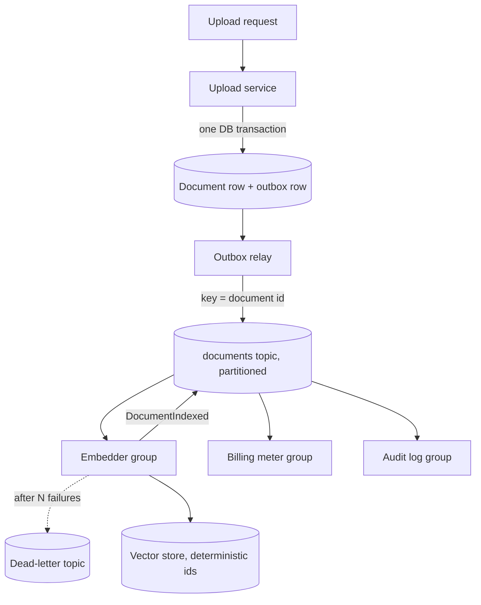

## TL;DR
A service records an immutable fact ("DocumentUploaded", "RunCompleted") on a broker and any number of
consumers react on their own schedule. Producers stop knowing about consumers; the price is eventual
consistency, at-least-once delivery and no single stack trace.

## Why it exists
The naive design: the ingestion endpoint receives a PDF and, in the same request, calls the parser,
chunker, embedder, index writer, notification service and analytics API. Three things go wrong as it grows.
- **Temporal coupling.** The upload succeeds only if all six downstream services are up at that instant.
  At 99.9% each, the chain is roughly 0.999⁶ ≈ 99.4% available, and its latency is the sum of six
  latencies. The slowest or flakiest consumer sets the user's experience.
- **Knowledge coupling.** Every new consumer (compliance wants a copy of every upload) means a producer
  code change and redeploy, plus a new failure mode in its request path. The producer accumulates
  reasons to change that have nothing to do with uploading.
- **Lost history.** Once the request returns, the upload exists only as a row the producer chose to keep.
  You cannot replay last Tuesday's uploads through a fixed chunker, because the calls were ephemeral.
- **Events invert the dependency.** The producer only durably records the fact; consumers depend on the
  event contract, the producer on nothing. Availability becomes "can I write to the broker" and history
  becomes the log. That inversion, not the broker technology, is the idea.
- **What it buys in AI systems.** You can add a billing meter, an eval sampler and an audit log to an
  agent pipeline without touching the agent.

## How it works
### Events versus commands
| | Event | Command |
|---|---|---|
| Grammar | past tense: `OrderPlaced`, `EmbeddingGenerated` | imperative: `ChargeCard` |
| Mutability | immutable statement of fact, owned by the producer | a request that may be refused |
| Addressee | none, no expected reply | exactly one handler |
| Coupling | producer stays ignorant of consumers | re-introduces the coupling you were escaping |

- **Why it matters:** an event implies no outcome the sender cares about; a command does.
- **Smell:** publishing `SendWelcomeEmail` as an event is a remote procedure call with extra steps.

### The envelope
Every event carries metadata separate from its payload:
- **`event_id`** — globally unique, so consumers can deduplicate.
- **`type` and `schema_version`** — so consumers can evolve independently.
- **`occurred_at`** — when the fact happened.
- **`aggregate_id`** — the entity it belongs to; this is the partition key (see below).
- **`trace_id`** — for observability across hops.

Payload styles (Fowler's names):
- **Event notification** — thin: "document 42 changed, fetch it". Always fresh, but consumers call back.
- **Event-carried state transfer** — a snapshot: "document 42 now has these fields". Removes the callback,
  at the cost of larger messages and consumers holding copies of data that can go stale.

### The broker and its guarantees
| | Log-style (Kafka, Pulsar, Redpanda) | Queue-style (RabbitMQ, SQS) |
|---|---|---|
| Storage | appends to **partitions**, retained | message deleted once a consumer acknowledges it |
| Consumers | each consumer group keeps its own **offset** | each message goes to one competing consumer |
| Replay | yes: a new consumer starts from offset 0 and rebuilds state | no |
| Best for | fan-out, history, rebuilds | simple work distribution |

- **Ordering is per partition only.** Choose the partition key to be the thing whose order matters,
  usually the aggregate id: all events for document 42 land in one partition in order, while documents 42
  and 43 may interleave arbitrarily.
- **Delivery is at least once in both styles.** A consumer that crashes after processing but before
  acknowledging sees the message again, so consumers must be idempotent: record processed `event_id`s or
  make the effect naturally repeatable.
- **Exactly-once is built at the consumer, not given end to end.** Kafka's transactional producers cover
  only Kafka-to-Kafka read-process-write loops; any effect outside the log (a database write, an HTTP
  call) still needs idempotence.
- **Partitions are the unit of parallelism.** Within one consumer group each partition is read by at most
  one consumer at a time, so a topic with 12 partitions keeps at most 12 consumers of a group busy.
- **Pick partition count up front.** It is a capacity decision, because adding partitions later changes
  which partition a key hashes to and breaks per-key ordering across the change.

### When a consumer cannot process an event
A message that fails every time (malformed payload, a PDF that crashes the parser) is a **poison
message**. How you retry it decides what you lose:

| Strategy | Keeps per-key order? | Keeps partition flowing? | Cost |
|---|---|---|---|
| Retry in place | yes | no | every later event on that partition, for every document hashed there, waits |
| Retry topic or dead-letter queue (DLQ) | no | yes | a later event for the *same* key can overtake it (an `Updated` before its `Created`) |
| Park the key | yes | yes | mark the key blocked, divert its later events aside too, release them in order once the head event is fixed or discarded |

Choose by whether per-key order or partition throughput matters more for that event type, and decide it
per topic, not by discovery in an incident.

### Producing reliably
1. The producer writes its own database row and publishes the event.
2. Doing those as two separate operations is the **dual-write problem**: a crash between them loses the
   event or emits one for a rolled-back transaction.
3. The **transactional outbox** fixes it: write the event into the same database transaction, relay it
   afterwards.

### Choreography versus orchestration
- **Choreography:** each service reacts to events and emits new ones; the workflow is emergent. Lighter
  for two or three steps.
- **Orchestration:** a dedicated component listens for events and issues commands to drive the steps.
- **The switch point:** beyond a few steps nobody can answer "where is order 42 right now" without an
  orchestrator or a very good trace. Multi-step agent workflows with compensation needs usually end up
  orchestrated.

### Flavours worth naming
- **Event sourcing** makes the event log the system of record and rebuilds current state by folding events.
- **CQRS** separates the write model from read models built from events.
- Both are separate commitments with their own costs; "event-driven" does not require either.

## Diagram
The producer's only dependency is the outbox and the broker; each consumer group reads the same
partitioned log at its own offset, and failures divert to a dead-letter topic instead of blocking it.



## Examples
### Document ingestion as events
`publish` and `consume` stand in for any broker client; what matters is the envelope, the partition key
and the idempotent consumer.

```python
import uuid, json, datetime as dt

def make_event(type_, aggregate_id, payload, trace_id, version=1):
    return {
        "event_id": str(uuid.uuid4()),      # dedupe key for consumers
        "type": type_, "schema_version": version,
        "aggregate_id": aggregate_id,       # partition key: per-document ordering
        "occurred_at": dt.datetime.now(dt.timezone.utc).isoformat(),
        "trace_id": trace_id, "payload": payload,
    }

# producer: the upload service knows nothing about who listens
def on_upload(doc_id, storage_uri, tenant_id, trace_id, publish):
    ev = make_event("DocumentUploaded", doc_id,
                    {"uri": storage_uri, "tenant_id": tenant_id}, trace_id)
    publish(topic="documents", key=doc_id, value=json.dumps(ev))

# consumer: embedder reacts, and tolerates redelivery. The vector store is not in the same
# transaction as any dedupe table, so idempotence comes from the effect itself: chunk ids are
# deterministic (doc_id:chunk_no), and re-indexing the same document upserts the same rows.
def on_document_uploaded(raw, chunk_and_embed, vector_upsert, publish):
    ev = json.loads(raw)
    doc_id = ev["aggregate_id"]
    chunks = chunk_and_embed(ev["payload"]["uri"])          # list of (text, vector)
    vector_upsert([{"id": f"{doc_id}:{i}", "vector": v, "text": t,
                    "tenant_id": ev["payload"]["tenant_id"]} for i, (t, v) in enumerate(chunks)])
    chunk_count = len(chunks)
    # crash here => redelivery re-embeds and overwrites identical ids (wasted work, no duplicates)
    publish(topic="documents", key=doc_id, value=json.dumps(
        make_event("DocumentIndexed", ev["aggregate_id"],
                   {"chunks": chunk_count}, ev["trace_id"])))
```

What this design buys and where it is thin:
- **New consumers are free.** A billing meter is one more consumer of `DocumentIndexed`; the upload service
  and embedder do not change.
- **Outages become lag.** If the embedder is down for an hour, events wait on the topic and are processed
  in per-document order when it returns.
- **Deterministic ids carry idempotence.** A random chunk id would add a second copy of the document on
  every redelivery; the deterministic id turns redelivery into an overwrite.
- **The downstream publish can be lost or duplicated.** That is acceptable only because the next consumer
  is idempotent too; otherwise the embedder would need its own outbox.
- **Gap:** if a re-upload produces *fewer* chunks, old high-numbered chunks survive. A real indexer deletes
  `doc_id:*` ids beyond the new count or versions chunks by document revision.

### Runnable: redelivery with and without an idempotent consumer
Simulates a broker that redelivers after a crash, and shows why the dedupe key matters.

```python
deliveries = [("e1", "doc42", 5), ("e2", "doc43", 3), ("e1", "doc42", 5)]  # e1 redelivered

def naive(events):
    billed = 0
    for _eid, _doc, chunks in events:
        billed += chunks                  # counts the redelivery twice
    return billed

def idempotent(events):
    seen, billed = set(), 0
    for eid, _doc, chunks in events:
        if eid in seen:                   # inbox check on event_id
            continue
        seen.add(eid)
        billed += chunks
    return billed

print(naive(deliveries), idempotent(deliveries))   # 13 8
```

### Worked numbers: synchronous chain vs events
| Design | What must be up for an upload to succeed | Availability (99.9% each) | Upload latency |
|---|---|---|---|
| Six synchronous calls | producer + 6 services | 0.999⁷ ≈ 99.3% | sum of 7 latencies |
| Event on a broker | producer + broker | 0.999² ≈ 99.8% | producer write + one broker append |

The six consumers still do the same work, but their outages show up as consumer lag instead of failed
uploads (illustrative arithmetic, assuming independent failures). The 99.4% in "Why it exists" counts
only the six downstream services; counting the producer too gives the 99.3% here.

## Production patterns
- **Outbox relay instead of dual writes.** When a service changes its database and must emit an event,
  write the event row in the same transaction and relay it with a poller or change-data capture (for
  example Debezium reading the outbox table). Monitor outbox backlog age; alert when the oldest
  unpublished row exceeds your freshness budget.
- **Idempotent producer settings on Kafka.** Set `acks=all` and `enable.idempotence=true` (the default
  since Kafka 3.0, but set it explicitly) so the producer's own send retries do not duplicate or reorder
  within a partition. This does not make consumers exactly-once;
  monitor producer retry and error rates.
- **Schema registry with compatibility checks.** Register every event schema and enforce a compatibility
  mode (for example backward compatibility in Confluent Schema Registry) in CI, so a breaking payload
  change fails the build instead of a consumer. Monitor schema versions in use per consumer.
- **Lag-based alerting per consumer group.** Track lag per partition (Kafka's
  `kafka-consumer-groups.sh --describe` prints it; managed services export it as a metric). Alert on lag
  that grows over minutes, and on one partition lagging while others are at zero, the poison-message shape.
- **Bounded retries then DLQ.** On SQS set a redrive policy with `maxReceiveCount` (for example 5) to a
  dead-letter queue; on Kafka route to a retry topic after N attempts. Page on DLQ depth above zero for
  topics where order or completeness matters, and keep a replay tool.

## Trade-offs
- **Producer independence vs the synchronous answer.** The uploader cannot tell the user "indexed, ask
  away" unless something waits for `DocumentIndexed`. This flips back toward a synchronous call when the
  user needs the result in the same interaction.
- **Replay vs long-lived contracts.** Replayable logs rebuild indexes and backfill new consumers, but every
  event schema becomes a public contract. Once events are retained for months, a breaking payload change
  needs versioning and dual-reading consumers.
- **Choreography vs visibility.** Small decoupled services, yet end-to-end visibility degrades with each
  hop. Past roughly four or five steps, or whenever compensation is needed, orchestration pays for itself.
- **Event-carried state vs freshness.** Snapshots remove callbacks and survive producer outages, at the cost
  of duplicated data that drifts; thin notifications stay fresh but create a thundering herd of reads on
  the producer when a hot event fans out.
- **At-least-once vs exactly-once.** At-least-once with idempotent consumers is robust and cheap but pushes
  deduplication state into every consumer; exactly-once brokers trade throughput and operational
  complexity for it.

## Pitfalls
- **Commands disguised as events.** `SendEmailRequested` with exactly one intended handler. Symptom:
  producers break when "their" consumer changes, so the coupling never left. Fix: send a command, or
  publish the underlying fact.
- **Dual writes without an outbox.** Rows exist with no corresponding event, usually noticed as "the index
  is missing documents that are in the database" after a deploy or crash. Fix: transactional outbox.
- **Assuming global ordering.** A consumer that processes `DocumentDeleted` before `DocumentUploaded`,
  because the two were keyed differently, resurrects deleted content in the index. Fix: key by aggregate id.
- **Non-idempotent consumers.** Duplicate embeddings, double-counted billing and repeated notifications
  appear after any consumer restart or broker rebalance. Fix: inbox table or deterministic ids.
- **Event soup.** Dozens of topics with no owner, no schema registry and no documented consumers. Symptom:
  nobody dares delete or change anything, and behaviour is discovered by reading consumer code. Fix: one
  owning team per topic, every schema in a registry, and a catalogue of known consumers.
- **Treating the broker as infinitely fast.** A slow consumer accumulates lag silently until a dashboard
  shows events processed hours after they occurred. Fix: consumer lag as a first-class alert.
- **Retrying a poison message in place forever.** Symptom: lag climbing on one partition while every other
  partition of the group sits at zero, and the same offset looping in the error log. Fix: bounded retries,
  then a DLQ or a parked key, chosen per topic.

## When to use
- **Use when:** more than one party cares about a fact, consumers may be down while producers are up, you
  need to replay history, or the producer's latency budget cannot absorb the consumers' work.
- **Typical AI uses:** ingestion pipelines (upload, parse, chunk, embed, index); agent run telemetry fanned
  out to billing, evaluation sampling and audit; model-output moderation that must not block the response.
- **Avoid when:** the caller needs the result now, there is exactly one consumer and the workflow is short,
  or the team has no way to trace a flow across services yet.
- **Measure:** consumer lag, redelivery rate and dead-letter volume; those three numbers tell you whether
  the architecture is healthy.
- **Interviews:** state the dual-write problem unprompted, explain per-partition ordering, and say
  "at-least-once plus idempotent consumers" before anyone asks about exactly-once.

## Role lens
- **Engineer:** Designs event envelopes, chooses partition keys, writes idempotent consumers with an
  inbox table, and wires dead-letter queues and lag alerts for every consumer group.
- **Architect:** Decides which facts become published contracts, who owns each event's schema, where
  choreography ends and orchestration begins, and which flows must remain synchronous.
- **FDE:** Integrates with a customer's existing bus (often Kafka or SQS), maps their events onto the
  product's ingestion, and explains why the index trails the source system by seconds.

## Check yourself
**Q:** A customer wants uploaded contracts to be parsed, chunked, embedded and indexed, with an audit
record per stage and a Slack notification when indexing completes. The current implementation does all
of this inside the upload request and times out on large files. Redesign it with events and explain
what guarantees each stage has.
**A:** The upload handler stores the file, writes the document row and, in the same transaction, an
outbox row for `DocumentUploaded` keyed by document id; a relay publishes it, so the user gets a fast
"received" response and the event cannot be lost. Parser, chunker, embedder and indexer are consumer
groups on the same topic chain, each emitting its own completion event; keying every event by document
id keeps per-document order. Audit and Slack are additional consumers of those events, so they add no
latency and no failure modes to the pipeline. Every consumer is idempotent because the broker delivers
at least once: stages whose effect is a database write record the event id in an inbox table in the same
transaction, and the indexer, whose effect lands in a vector store outside that transaction, upserts
chunks under deterministic ids so a redelivery overwrites rather than duplicates. The
notification consumer in particular must be idempotent, or every restart re-pings Slack. Failures go to
a dead-letter topic with alerts; lag per consumer group is the health metric. If the customer also needs
"ask questions immediately after upload", the UI waits for `DocumentIndexed` via a push channel rather
than making indexing synchronous.

## Interview questions
### What is the difference between an event and a command, and why does it matter for coupling?
- **An event is a past-tense fact with no addressee.** `DocumentUploaded` is owned by the producer, and
  any number of consumers may react or ignore it, so the producer never changes when a consumer is added.
- **A command is an instruction to one handler.** `ChargeCard` expects an outcome and may be refused, so
  the sender depends on that handler existing and behaving.
- **Why it matters:** publishing a command dressed as an event keeps all the coupling of a remote call and
  adds broker latency and at-least-once duplicates on top.

### Users report that deleted documents reappear in search results. The pipeline is event-driven. How do you debug it?
- **Suspect ordering first.** Ordering holds only within a partition; if `DocumentDeleted` and
  `DocumentUploaded` were keyed differently, the indexer can apply the delete before the upload.
- **Check the keys and offsets.** Confirm both event types use the document id as the partition key, and
  look for redeliveries of an old upload after the delete (a rebalance or a retry topic can replay it).
- **Fix:** key every event by aggregate id, and make the indexer reject events older than the version it
  already holds, so a late upload cannot resurrect a deleted document.

### When would you not use an event-driven design?
- **When the caller needs the result now.** If the user must see the answer in the same interaction, a
  synchronous call (or a stream) is simpler than waiting on a downstream completion event.
- **When there is one consumer and a short workflow.** A broker adds schemas, lag, idempotency and DLQs
  for no decoupling benefit.
- **When you cannot trace across services yet.** Without propagated trace ids, an emergent multi-hop flow
  becomes undebuggable; build tracing first or keep the flow orchestrated.

### A topic has 12 partitions and one consumer group is falling behind. You add 20 more consumers. What happens?
- **At most 12 consumers in the group do work.** Each partition is read by at most one consumer of a group
  at a time, so the other 20 sit idle.
- **Real levers:** speed up per-event processing, batch work inside the consumer, or plan a larger
  partition count, accepting that adding partitions remaps keys and breaks per-key order across the change.
- **Check for a poison message too.** One partition lagging while the rest are at zero means a retry loop,
  not a capacity problem.

### How do you get an event published reliably when the service also writes to its database?
- **Name the dual-write problem.** Writing the row and publishing separately can lose the event or publish
  one for a rolled-back transaction if the process crashes between them.
- **Use a transactional outbox.** Insert the event into an outbox table in the same transaction as the
  row, then relay it with a poller or change-data capture.
- **Expect duplicates downstream.** The relay can publish twice after a crash, so consumers still
  deduplicate on `event_id`; monitor the age of the oldest unpublished outbox row.

## Quiz
### Q: What most clearly distinguishes an event from a command in a message-driven system?
- [ ] Events are JSON while commands use a binary encoding
- [x] An event states an immutable fact with no addressee; a command instructs one handler and implies an expected outcome
- [ ] Events are always delivered exactly once and commands at least once
- [ ] Commands can be replayed from the log but events cannot
> The difference is semantic, not technical. A fact ("OrderPlaced") lets the producer ignore consumers; an
> instruction ("ChargeCard") binds sender and handler and reintroduces coupling. Encoding and delivery
> guarantees are independent of which one you publish.

### Q: You need every event about the same document processed in order. What is the correct mechanism on a partitioned log?
- [ ] Enable "global ordering" on the topic
- [ ] Use a single consumer for the whole topic
- [x] Partition by document id so all events for one document share a partition
- [ ] Add a sequence number and have consumers sort incoming events by it
> Partitioned logs guarantee order only within a partition, so the partition key must be the entity whose
> order matters. A single consumer sacrifices throughput and still breaks if the producer spread the events
> across partitions; client-side sorting cannot know when the sequence is complete.

### Q: After a deploy, some rows exist in the orders table with no corresponding event on the bus. What is the likely cause?
- [ ] The broker's retention period expired
- [ ] Consumers were not idempotent and dropped duplicates
- [x] The service wrote the row and published the event as two separate operations and crashed in between
- [ ] The partition key was wrong, so events landed on an unread partition
> This is the dual-write problem: a database commit and a broker publish cannot be made atomic. A crash
> between them loses the event. The transactional outbox writes the event in the same database transaction
> and relays it afterwards, so an event exists if and only if the row does.
