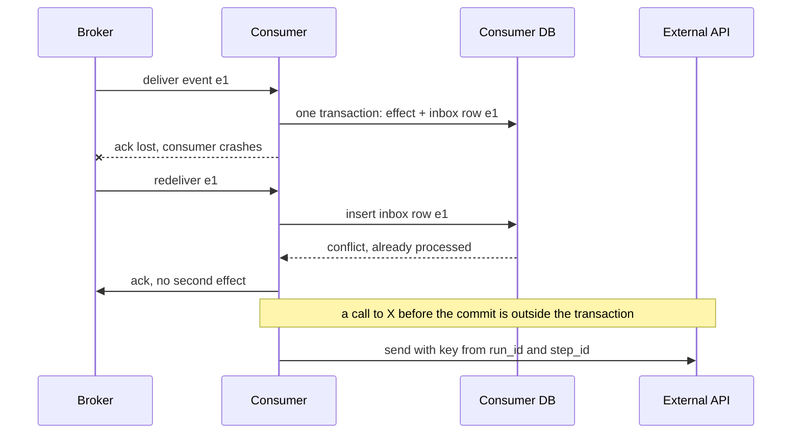

## TL;DR
Exactly-once *delivery* over a lossy network is impossible; exactly-once *effect* is buildable from
at-least-once delivery plus deduplication committed with the effect. Every "exactly-once" feature, Kafka
transactions included, stops there; your agent's external APIs and LLM calls are outside.

## For agent builders
- **Why it matters for agents.** Every agent retries: the model call times out, the worker is preempted,
  the run resumes from a checkpoint. Each retry is a chance to send the email twice, charge twice, or ask
  the model again and get different tool arguments.
- **Where it shows up in your stack.** The `idempotency_key` parameter on tool adapters, a `step_results`
  table or a durable engine's history, and framework resume behaviour: a run that resumes from its last
  checkpoint re-runs the step that was in flight, so anything inside that step must be safe to repeat.
- **What you control.** Keys derived from `(run_id, step_id)`, memoising model outputs before acting on
  them, splitting a step into generate, act and mark phases, dedupe windows, and which tools you accept
  duplicates from.
- **What you can skip.** Kafka transaction internals and Flink checkpoint barriers. Know the two generals
  argument, the boundary test and the memoisation rule.

## Decision case
### Scenario
A marketplace runs a refund agent. It consumes `RefundRequested` events from Kafka, asks a model to
decide the amount within policy, calls the payment provider's refund API, writes a ledger row to
Postgres and emits `RefundIssued`. After a double-refund incident, the product manager asks the team to
"turn on exactly-once". All figures are illustrative.
- **Scale:** 50,000 refund events a day, average refund $40.
- **Failure rate:** about 0.1% of deliveries crash between effect and offset commit (deploys,
  rebalances), so plain at-least-once means about 50 duplicates a day.
- **Constraints:** refunds within 15 minutes; no customer refunded twice and none silently dropped;
  dead-lettered events may be replayed up to 3 days later; in this contract the provider retains
  idempotency keys for 24 hours; 4 engineers, 3 weeks.

### Options
| Option | How it works | Payment API call | Model decision on retry | Lost or duplicated per day | Effort |
|---|---|---|---|---|---|
| A. Kafka transactions end to end | `exactly_once_v2` on the processing job | Outside the transaction: still at-least-once | Re-asked, may pick a different amount | About 50 duplicates, about $2,000 refunded twice | A config change, solves nothing that hurts |
| B. At-least-once plus per-effect idempotence | Memoise the model's decision in `step_results` under `{event_id}:refund`; send that key to the provider; ledger row and stored offset in one Postgres transaction; a `sent` marker right after the call | Deduped by the provider within 24 hours, by our marker and reconciliation after that | Replayed from the stored row | Duplicates only when a crash before the marker meets a replay after 24 hours and reconciliation misses it | About 3 weeks |
| C. At-most-once plus manual repair | Commit the offset before processing; support fixes gaps by hand | Never repeated | Never re-asked | About 50 refunds lost a day, found by complaints | Small, but breaks "none dropped" |

### Decision
Choose **B**, because:
- **The effects that hurt are outside Kafka.** Transactions cover offsets and output records only; the
  refund call and the ledger write sit outside, so A leaves the $2,000 a day of double refunds untouched.
- **The amount must not change on retry.** The model is non-deterministic, so the decided amount is
  memoised before the refund is sent; a replay reads it back.
- **Each effect gets the cheapest mechanism that holds.** The ledger uses offset-in-sink (atomic with the
  effect); the refund uses the provider's key; `RefundIssued` consumers dedupe on `event_id`.
- **The dedupe window is the binding constraint.** A 3-day DLQ replay outlives the 24-hour provider
  window, so before any call the worker checks the `sent` marker and, for steps left `decided`, queries the
  provider by correlation id.
- **C violates "none dropped"** outright.

**What would change it:** a stage whose input and output are both Kafka topics (say, enrichment) should
use transactions there; a provider without keys would put refunds behind reconciliation-first or a human
gate; a DLQ replay limit under 24 hours would make the provider key alone sufficient.

### Trade-offs accepted
- **A residual duplicate window.** Watch: refunds whose correlation id appears twice at the provider
  (target zero), and `decided` rows older than 15 minutes.
- **More state per event.** One `step_results` row and one offset row per partition. Watch: table growth,
  and keep rows longer than the 3-day replay limit.
- **Frozen decisions.** A poor memoised amount is not regenerated; a deliberate re-decision uses a new key.
  Watch: support overrides per week.
- **Reconciliation adds latency to stale steps.** Watch: refunds completed past the 15-minute target.

### Review rubric
- **Each effect is classified** (ledger write, external refund, model call, downstream event) with the
  mechanism that makes it effectively-once.
- **The broker guarantee's boundary is stated:** what Kafka transactions cover and what they do not.
- **Keys are stable:** derived from the event or step id, never per attempt, with the model output
  memoised before any effect.
- **Dedupe windows are compared** with the longest redelivery or replay delay, and the gap is handled.
- **The residual risk is stated honestly** with its conditions, not promised away.
- **Duplicate and loss counts recompute** from the stated volume and failure rate.

## Why it exists
- **Everyone eventually asks "can you guarantee this runs exactly once?"** The honest answer needs the
  reasoning, *because* the marketing answer ("our broker supports exactly-once") hides where the guarantee
  ends.
- **A consumer has three failure points.** It reads, applies the effect, then acks:

| Crash point | Result on redelivery |
|---|---|
| Before the effect | safe to redeliver |
| After the effect, before the ack | redelivery duplicates the effect |
| After the ack | fine |

- **The middle case is unavoidable** because "apply effect" and "send ack" are two operations on two
  systems. Acking *before* the effect just moves the crash window and loses the message instead. A
  protocol can only choose **at-most-once** (ack first, may lose) or **at-least-once** (ack last, may
  duplicate).
- **The two generals problem makes it exact.** Jim Gray's framing: two parties exchanging messages over a
  channel that can drop them can never be certain both know the outcome, no matter how many confirmations
  they send, *because* the last confirmation could always be the one that was lost. A sender without an
  ack cannot tell whether the message or the ack was lost.
- **"Make the network reliable" does not escape it.** TCP gives exactly-once *within a connection*; once a
  connection breaks and the client retries on a new one, the server sees the request twice. A request
  that timed out may have been processed, and the client does not know. An LLM-calling service is in this
  state several times an hour.
- **So reframe:** nobody needs the *message* exactly once; they need the *effect* exactly once. That is
  achievable with conditions, and the conditions are this lesson.

## How it works
### Effectively-once: the recipe
Take at-least-once delivery and make processing idempotent:
1. **Deduplication.** The receiver records each processed message id (an inbox table, a Redis set with
   TTL; on the broker side, Kafka dedupes producer retries by per-partition sequence number) and skips
   repeats.
   - Works for any effect, but only if the record and the effect commit atomically, which is why the inbox
     row lives in the same database transaction as the business write.
2. **Natural idempotency.** The effect is defined so applying it twice equals applying it once:
   `SET status='paid'`, an upsert keyed by order id, `PUT` rather than `POST`.
   - No dedupe state is needed, but the effect must be an absolute state rather than a delta:
     `balance += 10` is not idempotent; `balance = 110 WHERE version = 7` is.
3. **Store the input position with the effect.** A consumer writing to a database saves the source offset
   (topic, partition, offset) in the same transaction as its output, and on restart seeks to the stored
   offset instead of trusting the broker's committed one.
   - The offset *is* the dedupe record: a message is reflected in both the output and the stored offset, or
     in neither.
   - Works only when one consumer owns each partition's offset row; it is the usual way to get exactly-once
     from a log into a relational sink.

### What Kafka's "exactly-once semantics" actually covers
- **Idempotent producer.** Attaches a producer id and a per-partition sequence number to every batch; the
  broker rejects a batch whose sequence it already appended, so a producer retry after a lost ack does not
  create a duplicate record.
- **Transactions.** Extend this to read-process-write loops entirely inside Kafka: read from topic A,
  produce to topic B, and commit input offsets in the same transaction, so output records and the offset
  advance together or not at all.
- **`read_committed` consumers** never see records from aborted transactions.
- **Genuine exactly-once,** but only for stream processing whose input and output are both Kafka topics.
- **The boundary:** if the processing step calls a payment API or writes to Postgres, those effects are
  outside the transaction and at-least-once reasoning returns.
- **Flink has the same shape.** Checkpoint-based exactly-once restores operator state consistently from the
  last checkpoint; sinks are exactly-once only when idempotent or supporting a two-phase-commit protocol.

### Where it breaks: the limitations
- **External side effects.** Any effect in a system outside the transaction (HTTP APIs, email, file storage,
  a model call) is at-least-once unless that system accepts an idempotency key and deduplicates for you.
  Payment providers do; most internal services and most LLM endpoints do not.
- **Finite dedupe windows.** Ids are kept for a window (a table retention, a TTL, Kafka's producer-session
  state); a redelivery after the window is treated as new. The window must exceed the longest possible
  redelivery delay, including the dead-letter queue's replay time.
- **Key stability.** Dedupe needs the same key on every attempt; a fresh UUID per retry defeats it. Create the
  key once, before the first attempt, and persist it; for agent steps derive it from `(run_id, step_id)`,
  never from the attempt number or the current time.
- **Non-deterministic processing.** Replaying a model call yields a different output and possibly different
  tool arguments. Idempotency then means *memoisation*: store the output under the key on first success and
  return it on every later attempt. Durable-execution engines do exactly this.
- **Unknown outcomes.** After a timeout, dedupe alone does not tell you whether the effect happened. The
  only resolution is to query the receiver by key (reconciliation) before retrying or compensating.
- **Ordering across keys.** Dedupe is per key; two different messages that must apply in order are a
  separate problem, solved by partitioning, not by idempotency.
- **Cost.** Transactional producers add coordinator round trips and reduce throughput; inbox tables add a
  write and an index per message. Exactly-once is paid per message, so apply it only where duplicates hurt.
- **Human-visible effects.** A duplicate notification cannot be deduplicated after the fact; the dedupe has
  to sit before the send, and the send must be the last thing before the commit, not the first.

### Classify your agent's tools
Run the boundary test below on every tool before it ships. Typical outcomes:

| Tool | Idempotency class | What you do |
|---|---|---|
| `search_docs`, `get_order` | read-only | retry freely; memoise only to save cost or keep replays reproducible |
| `update_ticket_status` (absolute value) | naturally idempotent | retry freely |
| `charge_card`, `send_sms` via a provider with keys | idempotent at the receiver | stable key from `(run_id, step_id)`; check the provider's key retention |
| `add_credits` (delta), `post_to_channel` without keys | none | write a result row first, reconcile by correlation id, or gate behind approval |
| The model call itself | non-deterministic | memoise the output before any tool acts on it |

### A boundary test
For each effect a handler produces, ask: **does the dedupe record commit atomically with this effect?**

| Answer | Guarantee | What else it needs |
|---|---|---|
| Yes | exactly-once within the dedupe window | a window longer than any redelivery delay |
| No | at-least-once | an idempotency key honoured by the receiver, a memoised result, or acceptance of duplicates |

## Diagram
Why the ack cannot be trusted: the effect lands, the ack is lost, the broker redelivers, and only a dedupe
record committed with the effect turns the second delivery into a no-op.



## Examples
### Agent step: email a model-written draft at most once
An agent step must email a customer a model-written draft at most once per `(run_id, step_id)`, even though
the worker can be killed at any instruction and the model is non-deterministic. The step is split into
phases, each idempotent on its own, with the state persisted between them.

```python
import psycopg   # conn opened with autocommit=True: each statement commits on its own

# CREATE TABLE step_results (step_key TEXT PRIMARY KEY, draft TEXT NOT NULL,
#                            status TEXT NOT NULL);           -- 'drafted' | 'sent'

def load(conn, key):
    return conn.execute("SELECT status, draft FROM step_results WHERE step_key = %s",
                        (key,)).fetchone()

def email_draft_once(conn, run_id, step_id, llm, mailer, prompt, to):
    key = f"{run_id}:{step_id}"                    # stable across every retry, never per attempt
    row = load(conn, key)
    if row is None:                                # phase 1: generate once, persist before acting
        draft = llm.complete(prompt)
        conn.execute("""INSERT INTO step_results (step_key, draft, status)
                        VALUES (%s, %s, 'drafted') ON CONFLICT (step_key) DO NOTHING""",
                     (key, draft))
        row = load(conn, key)                      # if a racing worker inserted first, use ITS draft
    status, draft = row
    if status == "sent":
        return draft                               # replay: no model call, no send
    mailer.send(to=to, body=draft, idempotency_key=key)   # phase 2: provider dedupes on key
    conn.execute("UPDATE step_results SET status = 'sent' WHERE step_key = %s",
                 (key,))                           # phase 3: mark sent
    return draft
```

Walk the kill points:

| Killed | What the retry does | Visible effect |
|---|---|---|
| During the model call or before the insert | calls the model again | none; wasted tokens, nothing was sent |
| After the insert, before the send | finds `drafted`, skips the model, sends the *stored* draft | the same text whichever attempt sends it |
| After the send, before the update | sends again with the same key; the provider suppresses the duplicate | none, as long as the provider's key retention outlasts the retry delay |
| After the update | returns immediately | none |
| Two workers racing on one key | both may call the model; `ON CONFLICT DO NOTHING` keeps the first draft | both send that draft with one key |

- **The single residual duplicate** is the third kill point with a provider that ignores idempotency keys.
  No ordering of our code can remove it; that is the two-generals result showing up in practice.

### Runnable: at-most-once vs at-least-once vs dedupe
A broker redelivers until it sees an ack, and the consumer crashes between effect and ack 1% of the time.
Only the dedupe record committed with the effect gives zero losses and zero duplicates.

```python
import random

def run(mode, n=10_000, p_crash=0.01, seed=7):
    rng = random.Random(seed)
    applied = {}                     # message id -> times its effect was applied
    processed = set()                # dedupe record, committed together with the effect
    for mid in range(n):
        while True:                  # the broker redelivers until it sees an ack
            crash = rng.random() < p_crash
            if mode == "at-most-once":           # ack first, then apply
                if not crash:
                    applied[mid] = applied.get(mid, 0) + 1
                break                            # acked either way: a crash loses it
            if mode == "dedupe" and mid in processed:
                break                            # duplicate: ack without re-applying
            applied[mid] = applied.get(mid, 0) + 1
            if mode == "dedupe":
                processed.add(mid)               # same transaction as the effect
            if not crash:
                break                            # ack sent; a crash here means redelivery
    return n - len(applied), sum(c - 1 for c in applied.values())

for mode in ("at-most-once", "at-least-once", "dedupe"):
    lost, dupes = run(mode)
    print(f"{mode:14} lost={lost:4} duplicates={dupes:4}")
# at-most-once   lost= 106 duplicates=   0
# at-least-once  lost=   0 duplicates= 106
# dedupe         lost=   0 duplicates=   0
```

The simulation's dedupe record is in memory; in a real system it survives only if it commits in the same
transaction as the effect.

## Production patterns
- **Kafka-to-Kafka with transactions.** For pipelines whose input and output are both topics, set
  `processing.guarantee=exactly_once_v2` in Kafka Streams (or, with a plain client, a `transactional.id`
  on the producer and `isolation.level=read_committed` on consumers). Monitor transaction abort rate and
  end-to-end latency, which rises with commit interval.
- **Offsets stored in the sink.** For a log-to-Postgres consumer, write the output rows and the
  `(topic, partition, offset)` row in one transaction, and on startup seek each assigned partition to the
  stored offset. Monitor the gap between stored offsets and the broker's committed offsets.
- **Provider idempotency keys from stable ids.** Pass `{run_id}:{step_id}` as the idempotency key to
  payment and messaging providers that honour one (Stripe accepts an `Idempotency-Key` header), and check
  the provider's documented key retention against your longest retry delay. Track keys per logical
  operation; more than one means keys are being generated per attempt.
- **Memoised step results.** Persist every model output and tool result in a `step_results` table (or use a
  durable-execution engine that records them) before acting on it. Monitor replays served from memo versus
  fresh model calls.
- **Reconciliation for unknown outcomes.** A scheduled job finds steps left in an in-between state (for
  example `drafted` older than a threshold), queries the receiver by key, and repairs. Track the count of
  unknown-outcome timeouts and how many reconciliation actually changed.
- **Dedupe window sized to the DLQ.** Set inbox retention or dedupe TTL longer than the maximum time a
  message can sit in a dead-letter queue before replay. Plot the age distribution of redeliveries against
  the window.
- **Idempotency class in the tool registry.** Every agent tool declares read-only, naturally idempotent,
  keyed at the receiver, or none; the runtime injects `{run_id}:{step_id}` keys for keyed tools and refuses
  to auto-retry "none" tools. Add an eval or test that replays each tool call twice and asserts one effect.
  Monitor duplicate-effect reports per tool.
- **One side effect per resumable step.** Structure the agent graph so each node or activity performs at
  most one external effect and checkpoints right after it, because resume re-runs the in-flight step from
  its start. Monitor steps re-executed after resume.

## Trade-offs
- **Idempotent consumers vs broker transactions.** At-least-once with idempotent consumers is cheap,
  broker-agnostic and robust, but pushes dedupe state and key discipline into every consumer; broker-level
  transactions remove that burden only for broker-to-broker pipelines.
- **Kafka transactions vs throughput.** True exactly-once inside Kafka costs throughput and latency from
  coordinator round trips; for pipelines whose sink is a database or an API they add cost without extending
  the guarantee.
- **Long vs short dedupe windows.** Long windows catch late redeliveries but grow storage and slow the
  lookup; short windows are cheap but let a replayed dead-letter message through as a fresh event.
- **Memoisation vs fresh outputs.** Memoising non-deterministic outputs makes agent replays reproducible and
  avoids repeated model spend, yet freezes a possibly poor output; a deliberate "regenerate" must use a new
  key, which is a product decision, not a retry.
- **Accepting duplicates vs dedupe machinery.** Sometimes duplicates are the right trade: for an idempotent
  upsert into a search index, a duplicate costs a wasted write, cheaper than any dedupe machinery.

## Pitfalls
- **Believing the broker's "exactly-once" flag covers the HTTP call inside the handler.** Symptom: duplicate
  charges or double-posted messages that appear only during broker rebalances or deploys.
- **Generating the idempotency key per attempt** (`uuid4()` inside the retry loop). Duplicates persist
  despite "having idempotency keys", visible as several keys for one logical operation in the provider's
  logs.
- **A dedupe TTL shorter than the dead-letter replay delay.** Messages replayed from the DLQ a day later are
  processed again because their ids have expired.
- **Recording the processed id in a different store (Redis) from the effect (Postgres).** A crash between
  the two writes loses the effect or lets the duplicate through, and the inconsistency is rare enough to be
  blamed on "flakiness" for months.
- **Retrying a timed-out model or tool call without memoisation.** Each retry produces a different answer
  and the downstream saga compensations no longer match what was actually done.
- **Treating delta updates as idempotent.** `credits -= 1` applied twice is wrong, discovered when customer
  balances drift from the ledger.
- **Several side effects inside one agent step.** The step posts to Slack and then creates a ticket; a
  crash after the post resumes the step from its start and posts again. Fix: one external effect per
  checkpointed step, or keyed effects throughout.

## When to use
Decide per effect, not per system. Classify each side effect a handler or agent step produces:
- **Naturally idempotent:** upserts, absolute state.
- **Deduplicable in the same transaction:** inbox or result table.
- **Idempotent at the receiver:** payment and messaging providers that honour keys.
- **Duplicate-tolerant:** a duplicate costs only a wasted write.
- **None of those:** only these need the heavyweight options, broker transactions for Kafka-to-Kafka flows
  or a reconciliation job that detects and repairs duplicates after the fact.
- **Measure:** duplicate rate at each dedupe point, the age distribution of redeliveries against your
  window, and the number of unknown-outcome timeouts needing reconciliation.
- **Day to day:** the `idempotency_key` parameter on every tool adapter and the `step_results` table in the
  agent runtime.
- **Interviews:** explain why delivery cannot be exactly-once, define effectively-once via atomic dedupe
  plus effect, and name the boundary where the guarantee ends.

## Role lens
- **Engineer:** Derives stable idempotency keys from run and step ids, memoises model outputs per step,
  and keeps dedupe records in the same transaction as the effect.
- **Architect:** Classifies every external effect by its idempotency class, sets dedupe-window policy,
  and decides where broker transactions are worth their throughput cost.
- **FDE:** Audits a customer's webhook and integration handlers for the "exactly-once" assumption, and
  negotiates idempotency-key support with their downstream systems before go-live.

## Check yourself
**Q:** A product manager asks you to guarantee that an agent's "post summary to the customer's Slack
channel" step happens exactly once per run, given that workers can be preempted at any moment. What can
you promise, and how would you build it?
**A:** Promise exactly-once *effect* within a stated window, not exactly-once delivery. Build it in
phases keyed by `(run_id, step_id)`: first generate the summary and persist it in a `step_results` row,
so a preempted worker on retry reuses the same text instead of calling the model again; then call Slack
with that key as the idempotency token if their API honours one, and if it does not, record a "sent"
marker only after the call returns and accept that a preemption between the post and the marker can
produce a duplicate. Reduce that window by making the marker write the very next operation, and add a
reconciliation that searches the channel for the summary's correlation id before any retry. State the
residual risk explicitly: with a provider that lacks idempotency keys, the duplicate probability equals
the probability of a crash between Slack accepting the post and our marker committing, a window of one
response round trip plus one write, which is small but not zero.

## Interview questions
### What is the difference between exactly-once delivery and exactly-once processing?
- **Delivery** is about the message crossing the network once; it is impossible over a lossy channel
  because a sender without an ack cannot tell a lost message from a lost ack.
- **Processing (effect)** is about the outcome being applied once; it is achievable with at-least-once
  delivery plus dedupe or idempotent effects.
- **The condition:** the dedupe record must commit atomically with the effect, and only within the dedupe
  window.

### Your team enabled Kafka exactly-once, yet customers were charged twice during a rebalance. Explain.
- **The guarantee stops at Kafka.** Transactions make input offsets and output records atomic; the payment
  API call inside the handler is outside that transaction.
- **During a rebalance** the partition moves to another consumer before the offset commit, so the new owner
  reprocesses the message and calls the API again.
- **Fix:** send a stable idempotency key derived from the event or `(run_id, step_id)` to the payment
  provider, and reconcile by key on timeouts.

### When would you deliberately accept duplicates instead of building dedupe?
- **When the effect is naturally idempotent,** such as an upsert into a search index or a vector store with
  deterministic ids: a duplicate is a wasted write.
- **When dedupe costs more than the duplicate,** for example a metrics counter where a rare double count is
  within tolerance.
- **Never for human-visible or financial effects;** a duplicate email or charge cannot be undone after the
  fact.

### How long should your dedupe window be, and what happens if it is too short?
- **Longer than the longest redelivery delay,** including how long a message can sit in a dead-letter queue
  before someone replays it.
- **Too short:** a DLQ replay a day later finds its id expired and is processed as new, a duplicate that
  looks like a fresh event.
- **Measure** the age distribution of redeliveries and compare its tail with the window.

### How do you make a retried LLM step produce the same downstream behaviour?
- **Memoise, do not regenerate.** Persist the model output under a stable `(run_id, step_id)` key on first
  success and return it on every later attempt.
- **Temperature zero is not enough;** it is not guaranteed deterministic across runs, and different output
  means different tool arguments and mismatched compensations.
- **A deliberate regenerate** is a new key and a product decision, not a retry.

### Your agent framework resumes runs from checkpoints after a crash. Which tool calls are still at risk of duplicates?
- **The step that was in flight.** Resume restarts it from its beginning, so any effect it performed
  before the crash runs again unless keyed.
- **Effects outside the checkpoint store.** A Slack post or an email is not rolled back by the checkpoint;
  only a receiver-side key or a sent marker written immediately after stops the repeat.
- **Fix:** one external effect per step, keys from `(run_id, step_id)`, and a model output memoised before
  the step acts on it.

## Quiz
### Q: Why can no protocol over a lossy network guarantee exactly-once delivery?
- [ ] Because TCP limits retransmissions to a fixed count
- [x] Because a sender without an acknowledgement cannot distinguish a lost message from a lost ack, so it must choose between risking loss and risking duplication
- [ ] Because clocks on the two sides are never synchronised
- [ ] Because brokers do not persist messages to disk by default
> This is the two generals argument: certainty about the other side's state would require a final
> confirmation that itself could be lost. Retries resolve toward at-least-once; acking first resolves toward
> at-most-once. Clock sync and persistence are separate concerns.

### Q: A Kafka Streams job with transactions enabled reads orders, calls a payment API, and writes receipts to another topic. What is exactly-once?
- [ ] The payment API call, because the transaction wraps the whole handler
- [x] The offset commit and the receipt records, but not the payment API call
- [ ] Nothing, because transactions only work with a single topic
- [ ] Everything, provided consumers use read_committed
> Kafka transactions make input offsets and output records atomic inside Kafka. The payment call is an
> external effect outside the transaction, so it is at-least-once and needs its own idempotency key at the
> provider. read_committed affects what consumers see, not external calls.

### Q: Which change makes a retried agent step produce the same downstream behaviour as the first attempt?
- [ ] Lower the model temperature to zero
- [ ] Add a longer timeout before retrying
- [x] Persist the step's output under a stable (run_id, step_id) key and return it on replay
- [ ] Generate a new idempotency key for each retry so the provider accepts it
> Memoising the first successful output under a stable key is what makes a non-deterministic step
> idempotent; the replay reads the stored result instead of recomputing. Temperature zero is not guaranteed
> deterministic across runs, and per-retry keys defeat deduplication entirely.

## Use cases & projects
### Use cases
- **Resuming agents from checkpoints.** The in-flight step re-runs after a crash, so its tool calls carry
  keys derived from `(run_id, step_id)` and repeat safely.
- **Payment and messaging tools.** Sending an email or charging a card goes through a provider
  idempotency key, because no broker setting can make an external effect happen once.
- **Memoising model outputs.** The model's chosen tool arguments are stored before acting, so a retry
  replays the same arguments instead of sampling new ones.
- **Counting usage for billing.** Token and tool-call counts are written with a dedupe key per step, so a
  redelivered event does not bill a tenant twice.

### Mini project
**Make a crash-prone agent step effectively-once (1-2 hours).**
- **Goal:** show that a step split into generate, act and mark phases survives crashes without duplicates.
- **Steps:** write a stub model that returns random tool arguments; write a fake `send_email` tool that
  records calls and dedupes on an idempotency key; store generated arguments in a `step_results` table
  before acting; inject a crash after each phase in turn; rerun the step after every crash.
- **Done when:** across all crash points the fake tool records one email per step whose arguments match
  the stored row; turning off the tool's key dedupe produces exactly one duplicate, at the crash between
  send and mark; and removing the memoisation shows extra model calls on every retry that crashed before
  the send.
