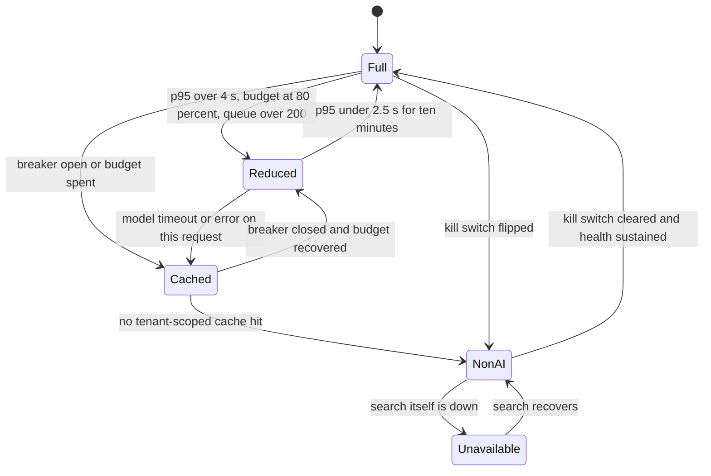

## TL;DR
When an agent's model path fails, slows, overspends or overloads, step down to a cheaper, simpler,
honestly labelled mode (fewer steps, read-only tools, cache, human handoff) instead of failing. Fallbacks
change the provider; degradation changes the function.

## For agent builders
- **Why it matters for agents.** Agents are the most expensive and most failure-prone path in a product:
  many calls, many tools, long runs. Under an incident or budget pressure you need predefined smaller
  modes, such as fewer steps, a smaller model, no write tools, or "here is what I found so far".
- **Where it shows up in your stack.** The agent's config per level (model alias, max steps, allowed
  tools), a feature-flag service for the level and kill switch, the step-budget and recursion limits in
  your framework (LangGraph has a recursion limit per run), and a human-handoff path.
- **What you control.** The ladder per agent, triggers with hysteresis, which tools are disabled first
  (writes before reads), what partial result the user gets when the budget ends, and the label that says
  so.
- **What you can skip.** Elaborate load-shedding infrastructure for an internal prototype. Even then, keep
  a kill switch and a step cap; they are cheap and stop the worst incidents.

## Decision case
### Scenario
A subscription software company runs a support agent that can look up accounts, search the knowledge
base and issue refunds. Figures are illustrative.
- **Normal day:** about 3,000 runs. Level 0 uses 12 strong-model steps at about $0.05 each, $0.60 a run
  and $1,800 a day. Launch weeks double traffic to 6,000 runs, which would be $3,600 a day.
- **Constraints:** a hard daily model budget of $2,000. Paying customers (40% of runs) have an SLO of 99%
  of sessions at Level 0. Refunds may only be issued while the policy-check tool is healthy and no
  prompt-injection alert is open.
- **Team:** one on-call engineer who must be able to mitigate without a deploy.
- **The free tier is the sales funnel,** so product will not accept free users losing the agent
  entirely.
- **Reduced level:** a fast model at about $0.01 a step with a 5-step cap, $0.05 a run.

### Options
| Option | How it works | Spike-day cost | Paying SLO | Refund safety and funnel |
|---|---|---|---|---|
| A. Kill switch at the cap | Agent turns off for everyone when $2,000 is spent | $2,000, then nothing | Breaks: if spend is even, the cap is reached after about 13 h, and everyone loses the agent for the rest of the day | Free users lose the agent too |
| B. Fallback provider only | Second provider on errors; no budget behaviour | $3,600, over the cap | Holds during outages only | Does not address refunds or budget |
| C. Global step-down on projected burn | Everyone moves to Reduced | 6,000 × $0.05 = $300 | Breaks: paying users drop to Reduced | Free users keep an answer |
| D. Tiered ladder | Paying runs stay at Level 0 and free runs drop to Reduced on projected burn. A read-only level removes refunds when the policy check or injection signal fails. Then cached answers, search results and a human handoff | 2,400 × $0.60 + 3,600 × $0.05 = $1,620 | Holds | Refunds drafted for a human when unsafe; free users still answered |

### Decision
Choose **D**.
- **Budget and SLO:** it is the only option that keeps the cap and the paying SLO at once. The
  projected-burn trigger (`spent + current_rate × hours_left > cap`) sees $3,600 against $2,000 within
  the first hour of a spike day. Stepping free runs down then holds the day near $1,620.
- **Refund safety:** write tools go before read tools. The refund constraint becomes the read-only
  level's trigger rather than a reason to switch the agent off.
- **On-call:** every level is a runtime flag named in the runbook, so the engineer can mitigate without
  a deploy.
- **Run pinning:** the level is read once per run, so no run loses its tools halfway through.

**What would change it:** if growth matters more than revenue this quarter, shed batch and background
agents before free users. If paying traffic alone exceeds the cap ($2,000 / $0.60 ≈ 3,333 paying runs a
day), the budget or the Level 0 step count must change; no ladder fixes that.

### Trade-offs accepted
- **Free users get visibly weaker answers on spike days.** Label them, and watch completion and handoff
  rates for free sessions at Reduced.
- **Several code paths to keep alive.** Run a synthetic check per level and a game day before each
  launch week.
- **Drafted refunds wait for humans in read-only mode.** Monitor the drafted-action backlog and approval
  latency.
- **Hysteresis keeps users one level down a little longer** after recovery; review the thresholds with
  the SLO.

### Review rubric
- Defines every level by what the user sees, what it costs and who gets it.
- Recomputes daily cost per option under the stated peak and compares it with the cap.
- Uses projected burn, not spend so far, and adds hysteresis with a dwell time.
- Sheds by priority class at admission, before any tokens are spent.
- Removes write tools before read tools, and pins the level per run.
- Labels degraded output and names the metric (share of sessions at Level 0) that proves the SLO.

## Why it exists
- **Most AI features enhance a product that already worked:** search, support, editors, dashboards. A
  model incident, an exhausted rate limit, a runaway cost day or a traffic spike will happen.
- **If the feature's failure breaks the workflow around it,** an enhancement becomes a new failure point
  and lowers the whole product's availability. Users who could have found the document themselves now see
  a spinner.
- **The naive responses each miss something.**
  - "Retry and show an error" makes the user wait and then gives them nothing.
  - "Fall back to another model" handles a provider outage, not overload, budget exhaustion or a latency
    SLO the fallback also misses.
  - "Turn the feature off" is one binary switch, so the smallest incident costs the whole feature.
- **AI adds a failure the others ignore:** a response that was produced but should not be trusted,
  because the grounding check failed or the judge rejected it. Show less and say why; do not fail.
- **AI adds an axis to SRE practice.** Load shedding and priority classes came from site reliability
  engineering; AI adds quality levels, because one request can be answered well, adequately, or not at
  all, at different costs. Degradation decides those levels before the incident.

## How it works
### Define the ladder per feature
| Level | What the user gets | Typical contents |
|---|---|---|
| **0, full** | The best answer | Strong model, tools, reranking, a verifier |
| **1, reduced** | Visibly still an answer; cheaper and faster | Smaller model, fewer retrieved passages, no reranker, lower `max_tokens`, agent loops capped at fewer steps (as few as one step) |
| **2, cached or precomputed** | A known-good answer | Cached answer to a similar question, precomputed summary, FAQ entry, scoped to the same tenant |
| **3, non-AI** | The product as it was before the feature | Keyword search results, a template, the raw documents, a form |
| **4, honest unavailability** | A way to proceed | A clear message, the rest of the product working, a human handoff, a link, try later |

For each level write down what the user sees, what it costs, and who gets it.

### Agent-specific levels
- **Shrink the loop first.** Lower max steps and tokens per run, then drop to a smaller model for
  executor steps, keeping the strong model for the final answer as long as budget allows.
- **Disable write tools before read tools.** A read-only agent ("I drafted the refund; an agent will
  apply it") keeps most value and removes the riskiest actions while the system is unhealthy.
- **Return progress, not nothing.** When the step or time budget ends, return what was gathered (sources,
  intermediate findings) with a label, and offer to continue later.
- **Queue instead of run.** Long background agent tasks can be deferred to off-peak with a promised
  completion time, which frees capacity for interactive users.

### Triggers
- **Dependency health:** breaker state, error rate, p95 latency.
- **Load:** queue depth, concurrency.
- **Budget burn:** spend today against the cap.
- **Rate-limit headroom.**
- **Quality signals:** a failed grounding check demotes *this* response to sources-only.
- **A human-operated kill switch.**

### Hysteresis
- **Evaluate triggers where the decision is made.**
- **Step down quickly on a bad signal; step back up only after sustained health,** *because* flapping
  between levels is worse for users than staying one level down.
- **Concretely:** separate enter and exit thresholds plus a minimum dwell time. Illustrative numbers: enter
  Reduced when p95 exceeds 4 s; leave only after p95 has stayed under 2.5 s for ten minutes.
- **The gap between 4 s and 2.5 s** stops a signal hovering near one threshold from toggling the level on
  every sample.
- **Pin the level per agent run.** Read it once at run start so one run does not switch models and tools
  halfway through.

### Budget triggers: projected burn, not spend so far
| Trigger | When it fires on a heavy day | Effect |
|---|---|---|
| `spent + current_rate × hours_left > cap` | Mid-morning | Step down one level gently |
| `spent ≥ cap` | Late in the day | Every user drops straight to the cached level for the rest of it |

### Shed by priority, isolate by class
1. **Classify requests:** interactive versus batch, paying versus free, critical versus nice-to-have.
2. **Shed batch and low tiers first.**
3. **Reserve capacity** for critical interactive traffic in its own bulkhead, so a batch backfill (or a
   fleet of background agents) can never starve the chat box.
4. **Shed at admission, before any tokens are spent.** A request abandoned after generation started has
   already paid for the work it throws away, and under overload that waste is exactly the capacity you
   were short of. For agents, admission means before step 1.

### Deadlines and partial results
- **Give each request a deadline** and return what you have when it expires: retrieved passages without
  the synthesis, or a streamed partial answer with a visible marker.
- **Streaming makes partial output useful** rather than confusing.
- **Partial answers are dangerous where a half-statement misleads;** there, sources-only is the right
  degraded form.

### Honesty in the interface
- **Label degraded output:** "Showing matching documents; the AI summary is unavailable".
- **Never present a Level 1 answer as Level 0** when the quality difference matters, since users act on
  outputs and silent degradation transfers the risk to them.

### Keep the degraded paths alive
- **Unused paths rot:** the non-AI path's index goes stale, its credentials expire, its flag is removed.
- **Exercise them:** send a small share of traffic through each level routinely, run synthetic checks, and
  hold game days.
- **Every level sits behind a flag** that flips without a deploy, and the runbook names the flags.

### Measure
- Time spent at each level and requests served per level.
- User outcomes per level (completion rate, handoff rate).
- Time to recover to full.
- **A good SLO:** "Percentage of sessions served at Level 0".

## Diagram
The ladder as states: each trigger steps down at once, a failure inside a level moves the request one level
down, and the only way back up to Full is sustained health for the dwell time.



## Examples
### Agent configuration per degradation level
The level is read once at run start and mapped to a config the agent loop obeys. Write tools go first;
the user always gets a labelled result. Model aliases and tool names are placeholders.

```python
from dataclasses import dataclass

@dataclass(frozen=True)
class AgentMode:
    model: str
    max_steps: int
    tools: frozenset
    label: str | None

READ = frozenset({"search_kb", "get_order"})
WRITE = frozenset({"issue_refund", "send_email"})
MODES = {
    0: AgentMode("strong", 15, READ | WRITE, None),
    1: AgentMode("fast", 5, READ | WRITE, "Reduced-quality answer"),
    2: AgentMode("fast", 3, READ, "Read-only mode: actions are drafted for a human to approve"),
}

def mode_for_run(level):
    return MODES.get(level)            # None: levels 3-4, no agent; show search results or a handoff

def on_budget_exhausted(findings, mode):
    """Never return nothing: return what the run gathered, labelled, with a way to continue."""
    return {"answer": None, "partial": findings[-5:],
            "label": f"Stopped after {mode.max_steps} steps; here is what was found so far",
            "actions": ["continue later", "hand off to a human"]}
```

### Worked scenario: a research agent under budget pressure
Illustrative: strong-model step ~$0.06, fast-model step ~$0.01; 2,000 runs a day; daily cap $1,500.

| Mode | Steps per run | Cost per run | Daily cost at 2,000 runs |
|---|---|---|---|
| Level 0, full | 15 | 15 × $0.06 = $0.90 | $1,800, over the cap |
| Level 1, reduced | 5 | 5 × $0.01 = $0.05 | $100 |
| Mixed: paying users full (1,200 runs), free users reduced (800 runs) | | | $1,080 + $40 = $1,120, under the cap |

- **Lesson:** priority shedding by tier keeps paying users at full quality all day, instead of a cliff for
  everyone when the cap is hit.

### Support-answer endpoint with a degradation ladder
A background task refreshes `h`, a health snapshot, every few seconds; the handler picks a level, enforces a
deadline, and steps down rather than raising when a stage fails. `keyword_or_vector_search`, `generate`,
`semantic_cache_lookup` and `ModelError` are your adapters.

```python
import asyncio, time
from enum import IntEnum

class Level(IntEnum):
    FULL = 0; REDUCED = 1; CACHED = 2; NON_AI = 3; UNAVAILABLE = 4

def current_level(h):                            # h: health snapshot refreshed by a background task
    if h.kill_switch:                                           return Level.NON_AI
    if h.budget_used >= 1.0 or h.llm_breaker_open:              return Level.CACHED
    if h.budget_used >= 0.8 or h.llm_p95_ms > 4000 or h.queue_depth > 200:
        return Level.REDUCED
    return Level.FULL

async def answer(q, user, h, deadline_s=6.0):
    level = current_level(h)
    if user.tier == "free" and h.queue_depth > 50:              # shed low priority first
        level = max(level, Level.REDUCED)
    t0 = time.monotonic()
    try:
        docs = await keyword_or_vector_search(q, k=20 if level == Level.FULL else 5)
    except Exception:                                           # even the non-AI path is down
        docs, level = [], Level.UNAVAILABLE
    if level <= Level.REDUCED:
        full = level == Level.FULL
        try:
            remaining = deadline_s - (time.monotonic() - t0)
            text = await asyncio.wait_for(
                generate("strong" if full else "small", q, docs if full else docs[:3],
                         max_tokens=600 if full else 200), remaining)
            return {"level": int(level), "answer": text, "sources": docs[:5],
                    "label": None if full else "Reduced-quality answer"}
        except (asyncio.TimeoutError, ModelError):
            level = Level.CACHED                                # step down, do not raise
    if level == Level.CACHED:
        hit = await semantic_cache_lookup(q, tenant=user.tenant)
        if hit:
            return {"level": 2, "answer": hit.answer, "sources": hit.sources, "label": "Cached answer"}
        level = Level.NON_AI
    if level == Level.NON_AI:
        return {"level": 3, "answer": None, "sources": docs[:5],
                "label": "AI assistant unavailable; showing matching documents"}
    return {"level": 4, "answer": None, "sources": [], "label": "Search is temporarily unavailable"}
```

- **The `level` field in every response is the metric:** a histogram of it over time shows whether the
  product has been quietly running degraded.
- **Hysteresis lives in the background task.** `current_level` is stateless for brevity; the task that
  builds `h` should hold a level until its exit condition has persisted for the dwell time, so every
  request in a window sees the same level.
- **Each step down is cheaper than the one above,** and a failure inside a level moves the request down
  rather than retrying, so an incident lowers spend instead of raising it.

### Hysteresis controller for the background task
Runnable, pure Python, using the illustrative 4 s / 2.5 s / ten-minute thresholds.

```python
class Hysteresis:
    """Enter REDUCED fast when p95 > enter_ms; leave only after p95 < exit_ms for dwell_s straight."""
    def __init__(self, enter_ms=4000, exit_ms=2500, dwell_s=600):
        self.enter_ms, self.exit_ms, self.dwell_s = enter_ms, exit_ms, dwell_s
        self.reduced, self.healthy_since = False, None

    def update(self, p95_ms, now_s):
        if p95_ms > self.enter_ms:
            self.reduced, self.healthy_since = True, None      # step down immediately
        elif self.reduced and p95_ms < self.exit_ms:
            self.healthy_since = self.healthy_since or now_s
            if now_s - self.healthy_since >= self.dwell_s:
                self.reduced, self.healthy_since = False, None  # step up after sustained health
        elif self.reduced:
            self.healthy_since = None                           # in the gap: hold the level, reset dwell
        return "REDUCED" if self.reduced else "FULL"

h = Hysteresis()
samples = [3000, 4200, 3800, 4100, 2400, 3000, 2300] + [2000] * 10   # one sample per minute
print(" ".join(h.update(p, 60 * i)[0] for i, p in enumerate(samples)))
# F R R R R R R R R R R R R R R R F : no flapping around 4 s; full only after 10 healthy minutes
```

A single 4 s threshold on the same samples would flip F R F R F F F, which users read as randomness.

### Worked scenario: projected-burn budget trigger
Illustrative: daily cap $500, a heavy day where spend reaches $150 by 10:00 and runs at $40 per hour.

| Trigger | Fires at | What users get |
|---|---|---|
| Projected: 150 + 40 × 14 h left = $710 > $500 | 10:00 | Step to Reduced; if the smaller model halves the rate, 150 + 20 × 14 = $430 and the cap holds |
| Spend so far: $150 + $40/h reaches $500 | about 18:45 | Everyone drops straight to Cached for the rest of the day |

## Production patterns
- **Levels as runtime flags.** Read the forced level and the kill switch per request (per agent run) from
  your feature-flag service or a config key, never from code, so mitigation is a flag flip, not a deploy.
  Name each flag in the runbook. Monitor flag changes with who and when, and time from alert to flip.
- **Read-only switch for agents.** Keep a flag that removes write tools from every agent's tool list and
  routes drafted actions to a human approval queue. Flip it during incidents, suspected prompt injection
  or a bad deploy. Monitor drafted-action backlog and approval latency.
- **Admission-time bulkheads.** Give each request class its own concurrency pool (for example a separate
  semaphore or worker pool for batch and background agents with a hard cap) and reject over-limit batch
  work with 503 and a `Retry-After` before any model call. Monitor shed rate per class and interactive p95
  during batch runs.
- **Projected-burn budget job.** Every few minutes compute `spent + current_rate × hours_left` per feature
  and tenant, and write the resulting level into the health snapshot. Monitor projected versus actual
  end-of-day spend and hours spent at each budget-driven level.
- **Synthetic checks per level.** Run a canary query or agent task against each level on a schedule by
  forcing the level with a test-only header or flag, and fail the check if the non-AI index is stale or a
  credential is expired. Monitor canary success per level, not only for Level 0.
- **Level-mix SLO.** Emit the served level as a metric label on every response and agent run, and set an
  SLO on the share of sessions at Level 0, alerting on burn rate. Monitor the level histogram per tenant,
  so one noisy tenant's degradation is visible.

## Trade-offs
- **Survival vs code-path cost.** The product survives incidents, but you maintain several code paths and
  an eval for each. When the AI feature (the agent) *is* the product, degrade within AI levels and then be
  honest, since no non-AI path exists.
- **Trust vs visible degradation.** Honest labelling preserves trust but shows degradation to users and
  competitors; where outputs are acted on, visibility is the correct default and the trade is rarely worth
  reversing.
- **Protecting paying users vs the funnel.** Priority shedding protects paying and critical users at the
  expense of the free tier, which may be the acquisition funnel; if growth is the KPI, shed batch work
  before shedding free users.
- **Partial results vs misleading halves.** Partial results at the deadline beat nothing, but a half
  answer can mislead; in medical, legal or financial contexts return sources only rather than a truncated
  synthesis.
- **Eager triggers vs permanent degradation.** Eager triggers save cost and latency, but set too low they
  keep the product one level down most of the day without anyone noticing; hysteresis thresholds need the
  same review as the SLO.

## Pitfalls
- **Degraded paths never exercised.** Symptom: the non-AI path fails with an expired credential or stale
  index at the exact moment of the incident.
- **Silent degradation with no time-in-level metric.** Symptom: weeks of reduced answers discovered from
  quality complaints or a bill that dropped for no known reason.
- **Flapping between levels.** Symptom: a user gets a fast reduced answer, then a slow full one, then a
  cached one within a single session, which reads as randomness.
- **Switching level mid agent run.** Symptom: a run plans with the strong model's tools and then executes
  without them, producing half-finished actions. Fix: pin the level at run start.
- **Degrading to something more expensive,** such as retries or a larger fallback model. Symptom: cost
  rises during the incident instead of falling.
- **A kill switch that requires a deploy.** Symptom: a 40-minute mitigation for a 2-minute decision.
- **Triggers measured globally when load is per tenant.** Symptom: one noisy tenant degrades everyone, or
  nobody is degraded while that tenant's queue grows unbounded.

## When to use
- **Use for** any user-facing AI feature or agent with an SLO; design the ladder alongside the
  non-functional requirements, because the levels shape the architecture (what stays deterministic, where
  caches live, which flags exist).
- **Skip the ladder for** offline batch work, which usually needs only retry-later.
- **Agree degraded behaviour before go-live** with product and, in customer deployments, with the customer,
  including which agent actions become drafts in read-only mode.
- **Measure:** time per level, outcomes per level and recovery time; set an SLO on the share of sessions
  served at full quality.
- **Interviews:** distinguish degradation from fallback, then describe the ladder, triggers with
  hysteresis, priority shedding, honest labelling and the discipline of exercising the degraded paths.

## Role lens
- **Engineer:** Implements levels as flagged code paths with deadlines, emits the level on every response,
  and keeps a test per level in CI so the non-AI path cannot rot unnoticed.
- **Architect:** Writes the ladder and priority classes into the NFRs, decides what "acceptable degraded"
  means per feature, and owns the kill-switch and hysteresis policy.
- **FDE:** Agrees with the customer what their users will see when the model is down, configures the
  tenant-level triggers, and runs the drill before launch.

## Check yourself
**Q:** A customer says "the assistant must never show an error". Design the degradation for a support
assistant and say what you would push back on.
**A:** Propose a ladder: full RAG with the strong model; reduced with a small model and three passages;
cached answers scoped to the tenant; search results with canned links; and a human handoff form.
Triggers come from breaker state, p95 latency, queue depth and the daily budget, with hysteresis so the
level steps down fast and recovers slowly; free-tier and batch traffic shed first; every level labelled
in the interface and recorded as a metric. Push back on "never": at the bottom of the ladder the product
must show a clear message and a path to a human, because an unlabelled, ungrounded answer is worse than
an honest unavailability and the customer will own the consequences of it. Replace the absolute with an
SLO, for example the share of sessions served at full quality, and agree the drill that proves each level
works.

## Interview questions
### Why is a model fallback not enough on its own to keep an agent available?
- **A fallback changes the provider, not the function:** it handles a provider outage, but not overload,
  budget exhaustion or a latency SLO the fallback also misses.
- **Degradation changes the function** to something cheaper and simpler (fewer steps, smaller model, cache,
  non-AI path, honest message), so an incident lowers spend instead of raising it.
- **AI adds a trust failure** too: a produced answer that failed its grounding check should be demoted to
  sources-only, not shown.

### Design the degradation ladder for a support agent that can issue refunds.
- **Level 0:** strong model, full tool set, 15-step budget. **Level 1:** fast model for executor steps,
  5-step budget, same tools.
- **Level 2, read-only:** write tools removed; refunds are drafted for a human to approve, which keeps
  most value while the system is unhealthy.
- **Below that:** knowledge-base search results, then an honest handoff to a human; pin the level per run
  and label every degraded answer.

### Users report answers flipping between fast and slow, short and full, within one session. What is wrong?
- **No hysteresis:** a single threshold near the signal's typical value toggles the level on every sample,
  which users read as randomness.
- **Fix:** separate enter and exit thresholds plus a dwell time, for example enter Reduced above a p95 of
  4 s and leave only after ten minutes under 2.5 s.
- **Compute the level in one background task** so every request in a window sees the same level.

### Why trigger on projected budget burn rather than spend so far?
- **Spend so far fires too late:** on a heavy day at $40 per hour from $150 at 10:00, a $500 cap is hit around
  18:45 and everyone drops straight to Cached.
- **Projected burn fires at 10:00:** 150 + 40 × 14 = $710 exceeds the cap, so stepping to Reduced early (halving
  the rate gives $430) keeps the cap without a cliff.

### When would you not build a full degradation ladder?
- **Offline batch work** usually needs only retry-later, since no user is waiting.
- **When the AI feature is the product,** no non-AI path exists, so degrade within AI levels and then be
  honest.
- **In medical, legal or financial contexts,** skip partial synthesis as a level and return sources only,
  because a half answer can mislead.

### How do you prove each degraded level actually works before an incident?
- **Exercise it routinely:** send a small share of traffic (and canary agent tasks) through each level and
  run synthetic checks that fail on a stale non-AI index or an expired credential.
- **Make every level a runtime flag** named in the runbook, so mitigation is a flag flip, not a deploy.
- **Hold game days** and track time per level, outcomes per level and time to recover to full.

## Quiz
### Q: What is the difference between a fallback and graceful degradation?
- [ ] Fallbacks are automatic, degradation is manual
- [x] A fallback keeps the same function on a different target; degradation changes the function to a reduced, honest form
- [ ] Fallbacks apply to models, degradation applies only to databases
- [ ] They are the same thing with different names
> Switching provider or region preserves what the user gets. Degradation steps down to a smaller model,
> a cache, a non-AI path or a clear message. Both can be automatic and both apply to any dependency.

### Q: Why do degradation triggers need hysteresis?
- [ ] To reduce the cost of the health checks
- [ ] To make the full level recover as fast as possible
- [x] To stop the system flapping between levels, stepping down quickly but stepping up only after sustained health
- [ ] To ensure free-tier users are always degraded first
> A trigger that flips on every noisy sample produces alternating fast and slow, reduced and full
> answers inside one session. Asymmetric thresholds keep the system stable one level down until the
> signal has genuinely recovered.

### Q: Which practice most determines whether degradation actually works during an incident?
- [ ] Choosing the largest available fallback model
- [ ] Increasing timeouts so more requests complete
- [x] Routinely exercising every degraded path and controlling levels with flags that need no deploy
- [ ] Adding more retries before stepping down
> Unused paths rot and deploy-gated switches are slow. Routine traffic through each level, synthetic
> checks and runtime flags are what make the ladder real; bigger models, longer timeouts and more
> retries typically make the incident worse.

## Use cases & projects
### Use cases
- **Incident modes for agents.** Under provider trouble the agent drops to a smaller model and fewer steps,
  with a label telling the user it is in a reduced mode.
- **Read-only fallback.** Write tools are disabled first, so the agent can still look things up while
  nothing irreversible happens.
- **Budget exhaustion.** When the step budget ends, the agent returns what it found so far instead of an
  error.
- **Kill switch and handoff.** A runtime flag turns the agent off and routes users to a human or a static
  answer without a deploy.

### Mini project
**Add a three-level degradation ladder to an agent (1-3 hours).**
- **Goal:** give an agent predefined smaller modes controlled by a runtime flag.
- **Steps:** define levels in config (full: strong model, 15 steps, all tools; reduced: small model, 5
  steps, read tools only; off: static handoff message); read the level from a flag at the start of each
  run; return a labelled partial answer when the step cap is hit; run the same tasks at each level.
- **Done when:** flipping the flag changes behaviour without a restart, write tools never run in reduced
  mode, and you have a table of success rate and cost per level.
