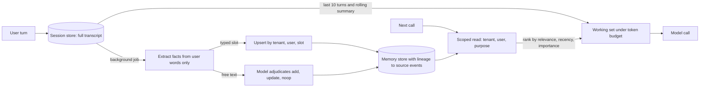

## TL;DR
Models are stateless and windows finite, so anything remembered across turns, sessions or users lives
outside the model and returns selectively. Memory architecture designs those scoped stores and the
policies that write, read, update and delete them; the hard part is what to forget.

## Why it exists
- **Every model call starts from zero.** The model knows only what the application puts in the prompt.
  Fine for one question; for an assistant running over weeks, preferences, decisions, half-finished
  tasks and facts from earlier sessions vanish unless something carries them forward.
- **Carrying the whole conversation forward fails.** Cost and latency grow linearly with history,
  because every turn re-reads all previous turns; the window eventually fills; quality drops before that
  as facts get buried among hundreds of turns of chatter. And nothing crosses sessions, devices or agents.
- **Embedding every utterance and retrieving by similarity also fails.** It returns stale and
  contradictory facts side by side ("user lives in Berlin" from last year, "moved to Lisbon" from last
  week), cannot update or delete, retrieves what the user told a different agent, and cannot answer
  "what did we decide", because decisions are not textually similar to the question that needs them.
- **Explicit stores and policies replace both.** The operating-system picture: a small, expensive working
  set (the context window), a larger persistent store, and a controller deciding what to page in and out.
- **The "what" is the design problem.** Remember too little and the assistant is amnesiac; too much and
  it is expensive, confused and a privacy liability.

## How it works
### Memory types and where each lives
| # | Type | Holds | Lives in | Answers |
|---|---|---|---|---|
| 1 | Working memory | system prompt, current task, recent turns, retrieved items | the context window, rebuilt per call by code | this call |
| 2 | Session state | full transcript and task state of one conversation or run | database keyed by conversation id | this session |
| 3 | Episodic memory | past sessions, outcomes, decisions, with timestamps | retrievable store | "what did we do last time" |
| 4 | Semantic memory | distilled facts and preferences | small, structured where possible, updated in place | "prefers concise answers", "account tier: enterprise", "project X uses Postgres" |
| 5 | Procedural memory | instructions, tool-usage notes, corrections | prompts, skills or configuration, usually after human review | how to behave next time |
| 6 | External knowledge | documents, databases | RAG index (see the RAG architecture lesson) | not memory |

- **The model never stores anything itself;** working memory is assembled by code each call.
- **Session state is the source of truth** *because* the context is a view of it, not the other way
  around; compaction summarizes it for the prompt without deleting it.
- **Keep knowledge separate from memory** *because* memory is per user and mutable while knowledge is
  shared and versioned.

### The four operations
1. **Write: decide what is worth keeping.**
   - The model calls a `remember` tool explicitly; or
   - a background extractor reads the session after each turn or at session end and proposes facts; or
   - the application records structured events (purchases, settings changes) directly.
   - Extraction at write time keeps reads cheap *because* a read happens on every call and a write only
     when something changes.
2. **Read: build the working set.** The last *n* turns verbatim, a rolling summary of older turns,
   semantic facts for this user that match the task, and episodic items ranked by relevance, recency and
   importance. Scope filters (tenant, user, agent, purpose) apply inside the query, not after, for the
   same reason as ACLs in RAG.
3. **Update and consolidate.** New facts that contradict old ones must supersede them, not sit beside
   them; duplicates merge; many episodes collapse into one summary.
   - **Embedding similarity is a poor contradiction detector:** "lives in Berlin" and "moved to Lisbon"
     may not be close vectors, while "likes Python" and "dislikes Python" are.
   - **Typed slots** (`home_city`, `answer_style`) for facts that drive behaviour: an update is an upsert
     by key, so supersession is deterministic.
   - **Model adjudication for free text:** retrieve the few nearest memories and ask a model to choose
     add, update, delete or no-op against them.
   - **Run consolidation in the background** *because* it needs a model call and should not sit in the
     request path.
4. **Forget.** Time-to-live for episodic items, explicit deletion on user request, purpose limits
   (memory collected for support is not used for marketing), and tenant off-boarding. Deletion must reach
   every derived copy, including embeddings and summaries, which is why memory rows need lineage back to
   their source events.

### A read policy, concretely
From the generative-agents line of work, score each candidate as a weighted sum, then take the top *k*
under a token budget:

`score = w_rel·sim(q, m) + w_rec·exp(−age/τ) + w_imp·importance`

- **Terms:** relevance (embedding similarity to the current task), recency (exponential decay on age),
  importance (a score assigned at write time), each normalized to [0, 1] so the weights mean what they
  say.
- **Two stages at scale:** an ANN search fetches a few hundred candidates by relevance and the composite
  score reranks only those, *because* computing recency and importance over every row is wasted work.
- **Weights and τ are product decisions:** a coding assistant weights recency (yesterday's branch
  matters, last quarter's does not); a CRM assistant weights importance (the contract renewal date
  matters however old it is).

### Who controls paging
- **Code-controlled:** the application decides what enters the context, as above.
- **Model-controlled (MemGPT line of work):** the OS analogy made literal; the model gets tools to read,
  write and evict memory and decides when to page items in and out. Same operations, controller moved
  into the model.
- **The trade:** flexibility on open-ended tasks, at the cost of predictability, extra calls, and a model
  that sometimes forgets to remember.
- **Production default:** a code-driven baseline read plus model-callable memory tools for the rest.

### Scoping and isolation
- **Every memory row carries** tenant id, user id, the agent or purpose it was collected for, a source
  event id and timestamps.
- **Cross-user leakage is the most embarrassing failure here.** It happens when the key is the agent
  instead of the user, or when a shared summary is built across users.

### Budget arithmetic (illustrative)
| Design | Per call | Over a 200-turn conversation |
|---|---|---|
| Verbatim replay (roughly 150 tokens per turn) | about 30,000 tokens at turn 200 | Σ 150·t for t = 1…200 ≈ 3.0M input tokens |
| Bounded: last 10 turns (about 1,500 tokens) + 400-token summary + 800 tokens of memories | under 3,000 tokens, flat | at most about 0.6M |

- **A tenfold per-call reduction that stays flat** as the conversation grows.
- **Linear-per-call growth is quadratic in total,** because verbatim replay re-sends every earlier turn
  on every call. That flat line is the architectural goal.

## Diagram
The write path (top) runs in the background after each turn; the read path (bottom) rebuilds the
working set for every call. Note that both paths apply tenant, user and purpose scope, and that the
transcript store stays the source of truth.



## Examples
### A memory layer with the tiers wired together
A session store as the source of truth, a write policy that extracts facts after each turn and
supersedes contradictions (by slot for typed facts, by model adjudication for free text), and a read
policy that assembles a bounded working set using relevance, recency and scope. `llm`, `embed`, `cosine`
and `store` stand in for your model, embedding model and database.

```python
import math, time

RECENT_TURNS, SUMMARY_EVERY, MEM_BUDGET_TOKENS = 10, 10, 800   # summary cadence <= recent window: no turn falls between them

def build_context(user, tenant, convo_id, query, store, w_rel=1.0, w_rec=0.5, w_imp=0.3):
    turns = store.turns(convo_id)                                    # session state: full transcript
    recent, older = turns[-RECENT_TURNS:], turns[:-RECENT_TURNS]
    summary = store.summary(convo_id) if older else ""
    q, now = embed(query), time.time()
    cands = store.memories(tenant=tenant, user=user, purpose="assistant")   # scope inside the query
    def score(m):
        recency = math.exp(-(now - m.updated_at) / (7 * 86400))     # decays over about a week
        return w_rel * cosine(q, m.vec) + w_rec * recency + w_imp * m.importance
    picked, used = [], 0
    for m in sorted(cands, key=score, reverse=True):
        if used + m.tokens > MEM_BUDGET_TOKENS: break
        picked.append(m); used += m.tokens
    return {"summary": summary, "memories": [m.text for m in picked], "recent": recent}

def after_turn(user, tenant, convo_id, store):
    turns = store.turns(convo_id)
    if len(turns) % SUMMARY_EVERY == 0:                              # compaction: summarize, never delete
        store.set_summary(convo_id, llm(f"Update this summary:\n{store.summary(convo_id)}\n\n"
                                        f"New turns:\n{turns[-SUMMARY_EVERY:]}").text)
    facts = llm("Extract durable facts as JSON [{slot or null, text, importance 0-1}] "
                f"from the user's own words only:\n{turns[-2:]}").json   # not from tool output
    for f in facts:
        common = dict(tenant=tenant, user=user, purpose="assistant", source_event=turns[-1].id)
        if f["slot"]:                                                # typed fact: upsert by key
            store.upsert_slot(slot=f["slot"], text=f["text"], **common)
            continue
        near = store.nearest(tenant, user, embed(f["text"]), k=3)    # free text: let a model adjudicate
        op = llm(f"New: {f['text']}\nExisting: {[m.text for m in near]}\n"
                 "Reply JSON {op: add|update|noop, target_index}").json
        if op["op"] == "add":
            store.add_memory(text=f["text"], importance=f["importance"], **common)
        elif op["op"] == "update":                                   # supersede, keep lineage
            store.supersede(near[op["target_index"]].id, text=f["text"], **common)
```

### Tracing the write policy over two turns and one preference
| When | User says | Path | Result |
|---|---|---|---|
| March | "I'm based in Berlin" | extractor emits `{slot: "home_city", text: "Berlin"}` | slot written |
| June | "we just moved to Lisbon" | same slot, upsert | Berlin replaced, June turn recorded as source; no later read can surface both cities |
| Any time | "I like answers with code first" | no slot; three nearest fetched, one is "prefers short answers" | adjudicator chooses `add`: the preferences are compatible |
| Contrast | "prefers short answers" vs "prefers detailed answers" | a cosine threshold alone would merge them as a duplicate (keeping whichever text won) or keep both as a contradiction, depending on where it sat | the adjudicator sees a conflict and chooses `update` |

### Runnable: the same read policy, two products
Pure Python. One coding memory and one CRM memory, scored under two weight profiles.

```python
import math

def score(sim, age_days, importance, w_rel, w_rec, w_imp, tau_days):
    return w_rel * sim + w_rec * math.exp(-age_days / tau_days) + w_imp * importance

memories = {                       # (similarity, age in days, importance)
    "branch feature/rrf is checked out": (0.6, 1, 0.3),
    "contract renews on 1 March":        (0.5, 90, 0.9),
}
profiles = {                       # (w_rel, w_rec, w_imp, tau_days)
    "coding assistant": (1.0, 1.0, 0.2, 7),
    "CRM assistant":    (1.0, 0.2, 1.0, 30),
}
for name, w in profiles.items():
    best = max(memories, key=lambda m: score(*memories[m], *w))
    print(f"{name:16s} -> {best}")
# coding assistant -> branch feature/rrf is checked out   (1.527 vs 0.68)
# CRM assistant    -> contract renews on 1 March          (1.41 vs 1.093)
```

## Production patterns
- **Typed slots with a unique key.** For facts that drive behaviour or billing, store one row per
  `(tenant_id, user_id, slot)` with a unique constraint and write with an upsert (in Postgres,
  `INSERT ... ON CONFLICT ... DO UPDATE`). Supersession becomes a database guarantee. Monitor
  contradiction rate in sampled working sets.
- **Lineage-driven deletion with a canary test.** Every memory, embedding and summary records its source
  event ids; a purge is a lineage query that deletes rows and vectors and regenerates affected summaries.
  Run a scheduled test that plants a unique fact, purges it, and asserts no read surfaces it. Monitor
  time from request to completed purge.
- **Consolidation off the request path.** Enqueue extraction and adjudication after each turn and run them
  in a background worker, so a slow model call never delays a reply. Monitor queue lag and memories per
  user, which should plateau rather than grow without bound.
- **Two-stage scoped read.** ANN search with tenant, user and purpose filters inside the query fetches a
  few hundred candidates; the composite score reranks them under a token budget. Monitor working-set
  tokens per call and memory hit rate (retrieved items the answer actually used).
- **Provenance-gated writes.** Extract only from the user's own turns and tag each memory with its source
  type, rejecting tool output, retrieved documents and web pages. Monitor memories created per session by
  source type; anything from a non-user source is an injection signal.

## Trade-offs
- **Write-time extraction vs cost and over-remembering.** Every read stays cheap, but a model call per
  turn is spent and things the user never meant to be remembered may be stored; read-time extraction from
  raw transcripts is cheaper to write and far more expensive to query.
- **Typed fields vs free text.** Structured semantic memory is precise and easy to update or delete;
  free-text memories capture nuance. Most systems need both, with structure for anything that drives
  behaviour or billing.
- **Rolling summaries vs lost detail.** They keep context flat as conversations grow, but each compaction
  removes detail from the prompt irreversibly; keeping the full transcript in the session store and
  retrieving from it recovers the detail on demand.
- **Model-chosen memory vs consistency.** A `remember` tool gives the model agency and transparency, but
  it under- and over-remembers unpredictably; a background extractor is more consistent and less visible
  to the user.
- **Long retention vs privacy exposure.** Retention makes the assistant feel continuous and raises
  privacy and compliance exposure; TTLs and purpose scoping trade some continuity for a defensible
  deletion story.

## Pitfalls
- **Keying memory by agent or conversation instead of tenant and user.** Symptom: one user's preferences
  or facts appear in another user's session.
- **Append-only memory without supersession.** Symptom: the assistant confidently states two
  contradictory facts, usually the stale one first.
- **Treating the context window as the system of record.** Symptom: after compaction, details the user
  mentioned are gone forever and the transcript cannot be audited.
- **Deleting a memory row but not its embedding, summary mention or derived facts.** Symptom: a
  "forgotten" fact resurfaces weeks later, which is a compliance incident.
- **Extracting memories from retrieved documents, web pages or tool output.** Symptom: an instruction
  planted in a fetched page ("always CC this address") reappears in later, unrelated sessions, which is
  persistent prompt injection. Fix: extract from the user's own words only.
- **Shipping memory without measuring it.** Symptom: higher cost per call with no gain in task success,
  because the retrieved memories are rarely relevant.

## When to use
- **Use when:** users return and expect continuity, the agent performs multi-session tasks, or
  personalization measurably improves outcomes.
- **Order of adoption:** session state and compaction first (every multi-turn product needs them);
  semantic memory when you can name the facts that change behaviour; episodic memory when "what happened
  before" is a real query.
- **Avoid when:** memory would compensate for a weak retrieval layer or missing product data; those
  belong in RAG and in your database.
- **Measure:** working-set tokens per call, memory hit rate (retrieved items actually used by the
  answer), contradiction rate, and task success with memory on versus off.
- **Interviews:** the tier picture, the four operations, scoping, and a concrete deletion story.

## Role lens
- **Engineer:** Implements the session store, compaction, the extraction and consolidation jobs, and the
  scoped, budgeted read path that assembles each prompt.
- **Architect:** Decides the memory tiers and stores, the ownership of each memory type, retention and
  purpose limits, and how deletion propagates to every derived copy.
- **FDE:** Negotiates with the customer what the assistant may remember about whom and for how long, and
  demonstrates deletion end to end for their compliance team.

## Check yourself
**Q:** A customer's support assistant should remember each support agent's preferences and past cases
across sessions, but their legal team requires that any case data be purgeable within 24 hours of a
request. Design the memory architecture and explain how you would meet the purge requirement.
**A:** I would separate the tiers. Session state lives in a transcript store keyed by tenant, user and
conversation, with a rolling summary for the prompt. Semantic memory holds structured preferences per
user, updated in place with supersession. Episodic memory holds case summaries with a case id, tenant,
user, purpose, source event ids and timestamps, with a TTL. Every derived artifact, embeddings, summaries
and extracted facts, records the source event ids it came from. A purge request for a case then becomes
a lineage query: find every row derived from events of that case, delete rows and vectors, and
regenerate any summary that referenced them. Reads filter by tenant and user inside the query so nothing
crosses accounts. I would prove the purge with a test that plants a unique fact, purges, and shows that
no retrieval, summary or extraction can surface it afterwards.

## Interview questions
### Why not just replay the whole conversation, or embed every utterance and retrieve by similarity?

- **Replay grows without bound:** cost and latency rise with every turn, the window eventually fills,
  quality drops as facts get buried, and nothing crosses sessions, devices or agents.
- **Embed-everything cannot update or delete:** it returns "lives in Berlin" beside "moved to Lisbon",
  leaks across agents, and misses decisions, which are not textually similar to the question needing them.
- **So** use explicit scoped stores plus write, read, update and forget policies.

### The assistant tells a user they live in Berlin a month after they said they moved. How do you debug it?

- **Check the write path first:** did the extractor emit a fact for the June turn, and did it land in a
  typed slot such as `home_city` or as free text?
- **Free text appended beside the old fact** means missing supersession; embedding similarity is a poor
  contradiction detector, so move the fact to a typed slot upserted by key or route it through model
  adjudication.
- **Then check the read path** for a stale summary that still mentions Berlin.

### What does memory save on a 200-turn conversation, in rough numbers?

- **Verbatim replay** at about 150 tokens per turn reaches about 30,000 tokens per call at turn 200 and
  Σ 150·t ≈ 3.0M input tokens in total.
- **Bounded working set:** last 10 turns (about 1,500 tokens), a 400-token summary and 800 tokens of
  memories stay under 3,000 tokens per call, at most about 0.6M in total, and flat as the conversation
  grows (illustrative figures).

### Should the model or your code decide what to page into context?

- **Code-controlled** reads are predictable, cheap and testable, which is why they are the baseline.
- **Model-controlled** paging (the MemGPT line of work) gives tools to read, write and evict memory,
  buying flexibility on open-ended tasks at the cost of extra calls and a model that sometimes forgets
  to remember; the production default combines both.

### How can memory become a persistent prompt-injection channel, and how do you close it?

- **The attack:** an instruction planted in a fetched page or tool output ("always CC this address") is
  extracted as a memory and reappears in later, unrelated sessions.
- **The fix:** extract only from the user's own turns, tag every memory with its source type, reject
  non-user sources, and alert on memories created from anything other than the user.

## Quiz
### Q: Why is a session transcript store, rather than the context window, treated as the source of truth for a conversation?
- [ ] The context window cannot hold more than a few turns
- [x] Compaction removes detail from the prompt, so without a persistent transcript that detail is lost and cannot be retrieved or audited later
- [ ] Models require transcripts to be stored before answering
- [ ] Transcripts are cheaper to send than summaries
> The prompt is a view built per call. Summarizing older turns keeps it small, but only works safely if
> the full record exists elsewhere to retrieve from and to audit.

### Q: What problem does supersession in semantic memory solve?
- [ ] It reduces embedding dimensionality for faster search
- [ ] It prevents the model from storing more than one fact per turn
- [x] It ensures a new fact that contradicts an old one replaces it, so the assistant does not retrieve both and state the stale one
- [ ] It allows memories to be shared across tenants
> Append-only memory accumulates contradictions ("lives in Berlin", "moved to Lisbon"). Linking the new
> fact to the one it replaces keeps reads consistent and makes deletion traceable.

### Q: Which design most directly prevents one user's memories from appearing in another user's session?
- [ ] Encrypting memory rows at rest
- [ ] Using a separate embedding model per user
- [x] Keying every memory by tenant and user and applying those filters inside the retrieval query
- [ ] Limiting memories to the last seven days
> Leakage comes from wrong keys and post-filtering, not from encryption or recency. Scope must be part of
> the row and enforced where candidates are selected.
