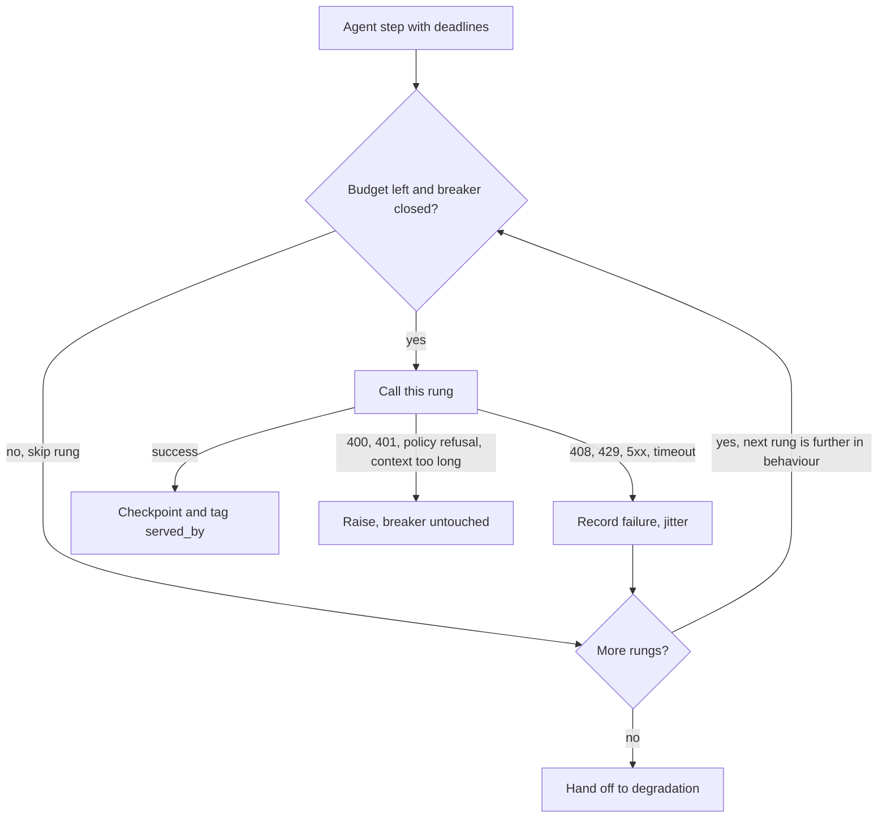

## TL;DR
A fallback strategy decides in advance which model an agent step calls instead, in what order and on which
errors, so a provider's bad hour is not your outage. Substitutes behave differently, retries amplify
incidents, and mid-run failover can replay tool side effects.

## For agent builders
- **Why it matters for agents.** A long agent run makes dozens of calls, so it is far more likely than a
  single chat turn to meet a 429, a 5xx or a timeout mid-task. Failing over must resume from the last
  completed step, never replay a tool that already sent an email or wrote a record.
- **Where it shows up in your stack.** `fallbacks` in LiteLLM's router or a Portkey fallback config,
  `with_fallbacks` on a LangChain runnable, per-node retry policies and checkpointers in LangGraph, and
  idempotency keys on your own tools.
- **What you control.** The error-to-action map, the ladder order, one deadline per step and per run,
  circuit breakers, checkpointing after each step, idempotency keys, and validating the fallback model's
  tool calls against the same schemas.
- **What you can skip.** Writing your own breaker if your gateway's cooldowns cover it. You cannot skip
  equivalence testing of the fallback model on your tools and prompts.

## Why it exists
- **Model endpoints fail in several distinct ways:** outages and hard errors (5xx, connection resets),
  throttling (429, sometimes with a `Retry-After`), latency spikes that blow the deadline when the provider
  is overloaded, capability changes (a deprecated or retired model id, behaviour shifted by a silent
  update), and regional capacity limits or exhausted quota while another region has capacity. Each reaches
  the user as an error or a spinner that never resolves; in an agent, as a run that dies halfway.
- **The arithmetic needs a second path.** If your availability target is higher than the provider's, two
  paths that each succeed 99.5% of the time give 1 − 0.005² = 99.9975% *if their failures are
  independent*.
- **They rarely are.** Two resellers of the same upstream model, two deployments in one cloud region, or
  two keys on one organisation quota fail together. The real gain is set by how independent the rungs are,
  so independence is the property to design for.
- **"Retry with backoff" makes real incidents worse.** It only covers transient blips on the same
  endpoint. In an incident every client retries, load on the failing provider multiplies, and each user
  waits through several timeouts before seeing an error.
- **"Add a second provider" fails quietly.** The backup returns malformed JSON, ignores the tool schema, or
  truncates at a smaller context window, so the error rate looks fine while the product silently breaks.

## How it works
### Retry vs fallback vs degradation
| Mechanism | What changes | Example |
|---|---|---|
| *Retry* | Nothing: repeats the call on the same target | Same endpoint after jittered backoff |
| *Fallback* | The target, keeping the function | Another region, provider or model |
| *Degradation* | The function itself | Cache, non-AI path, honest unavailability |

Confusing the three is how teams end up with a fallback chain slower than the outage it was meant to hide.

### Classify the failure first
Every error maps to one action; the mapping is the heart of the design.
- **Retry the same target** for 429 (honour `Retry-After`), 5xx, connection errors and timeouts on
  idempotent calls: once or twice, with jittered backoff, never unbounded.
- **Fail over** on repeated 5xx or timeouts, an open circuit, a 404 for a retired model id, or regional
  capacity errors.
- **Neither** for 400 invalid request, 401, content-policy refusals and context-too-long. These recur
  identically on every target, so failing over multiplies latency and cost. They say nothing about the
  target's health, so they must not count towards its circuit breaker. For an agent, context-too-long is a
  cue to compact the transcript, not to switch model.
- **Escalate on invalid output.** A response that fails schema validation (including an invalid tool call)
  after one repair attempt is a legitimate reason to try the next rung, usually a stronger model. This is
  the cascade idea applied to reliability. Count it separately from error-triggered fallback, because it
  signals a prompt or model-fit problem rather than an outage.

### The ladder, ordered by behavioural distance
1. **Same model, another deployment or region:** identical behaviour, different capacity.
2. **Same model through another provider** (a cloud platform serving the same weights): identical weights,
   possibly different limits and features.
3. **Same family, adjacent version:** small drift in style and formatting.
4. **Comparable model from another vendor:** prompts, tool-call formats, structured output and tokeniser
   limits must all be re-validated, and the agent's transcript (earlier tool calls and results) must
   translate into the new vendor's message format.
5. **A smaller model:** a quality drop, but still the same function.
6. **Hand off to graceful degradation:** cache, non-AI path, honest unavailability.

Order *because* each rung down changes behaviour more; you want the first rung that works to be the one
users cannot tell from normal.

### Deadlines, not timeouts
- **Each attempt has its own timeout,** and all attempts fit inside one user-facing deadline.
- **Without that,** a 10 s primary timeout plus a 10 s fallback is a 20 s worst case nobody signed off.
- **Pass the remaining budget down the ladder** and skip rungs that cannot complete in time.
- **Agents need two budgets:** one per step and one for the whole run, so a slow ladder on step 3 cannot
  starve the remaining steps.

### Circuit breakers
1. **Closed:** per target, count failures in a window.
2. **Open:** after N failures the target is skipped for a cooldown.
3. **Half-open:** a single probe decides whether to close it.

Without a breaker, every request during an outage waits the full primary timeout *before* falling back.
Latency equals timeout plus fallback for the whole incident, and the failing provider keeps receiving
your traffic. An agent pays that penalty on every remaining step.

### Hedging for latency
- **What:** Dean and Barroso's hedged request sends the same call to a second target after the p95 delay
  and takes whichever answers first.
- **Cost:** it trims the tail for roughly 5% extra calls.
- **Only for idempotent calls,** and never once a stream has been committed to the user. An agent's model
  call is idempotent; the tool it triggers usually is not.
- **Switch it off when the breaker shows the primary is overloaded,** or it doubles the load that caused
  the problem.

### Equivalence is a test, not an assumption
- **Validate outputs against a schema** regardless of which model served them, including every tool call.
- **Keep per-model prompt variants** when formats differ.
- **Send a small continuous slice (around 1%) through each fallback** so it is exercised in daily traffic.
- **Run game days** where the primary is blocked on purpose.
- **Tag every response with its serving target and alert when the fallback share rises,** otherwise the
  primary can be down for a week and the only signal is the bill.

### Side effects and streams
- **A retry or failover after a tool call executed** (an email sent, a record written) duplicates the side
  effect. Tool calls need idempotency keys; agent state needs checkpoints so the fallback resumes after
  the action rather than replaying it.
- **A stream that fails midway restarts on the fallback** with the partial output discarded; models do not
  reliably continue each other's text.

### Capacity and cost
- **Secondary rate limits:** failing all traffic over hits them unless quota was provisioned in advance;
  you cannot buy it during the incident.
- **Larger fallback models** are a cost spike.
- **Both belong in the runbook** before the first outage.

## Diagram
One agent step walking the ladder: the breaker and remaining deadline decide whether a rung is tried, with
a timeout of the smaller of its own and what remains. Request errors raise without tripping the breaker
(every rung would fail alike); success checkpoints the step with `served_by` and `fallback_depth`.



## Examples
### Resuming an agent run on a fallback without replaying tools
Each step is checkpointed after it completes; tools take an idempotency key derived from the logical
action (run, step, call index, tool), so a failover that re-runs a step returns the stored result instead
of acting twice.

The key leaves out the arguments on purpose: a fallback model redoing the step may phrase the same
action's arguments differently. `complete` is the ladder below; `store` is any durable key-value store.

```python
import hashlib, json

def idem_key(run_id, step, call_index, tool):
    raw = json.dumps([run_id, step, call_index, tool])   # the action, not its wording
    return hashlib.sha256(raw.encode()).hexdigest()

async def run_tool_once(store, key, tool_fn, args):
    if (prior := await store.get(f"tool:{key}")) is not None:
        return prior                                   # already executed: never send the email twice
    result = await tool_fn(**args, idempotency_key=key)  # pass the key to APIs that accept one
    await store.set(f"tool:{key}", result)
    return result

async def run_agent(store, run_id, task, tools, tool_schemas, max_steps=20):
    state = (await store.get(f"ckpt:{run_id}")                                   # resume point
             or {"step": 0, "messages": [{"role": "user", "content": task}]})
    while state["step"] < max_steps:
        resp = await complete(state["messages"], tools=tool_schemas, deadline=10.0)  # walks the ladder
        msg = resp["message"]
        state["messages"].append(msg)
        if not msg.get("tool_calls"):
            return msg["content"]
        for i, tc in enumerate(msg["tool_calls"]):
            name = tc["function"]["name"]
            args = json.loads(tc["function"]["arguments"])   # validate against the schema here too
            key = idem_key(run_id, state["step"], i, name)
            out = await run_tool_once(store, key, tools[name], args)
            state["messages"].append({"role": "tool", "tool_call_id": tc["id"], "content": json.dumps(out)})
        state["step"] += 1
        await store.set(f"ckpt:{run_id}", state)            # checkpoint after the step, not before
    raise RuntimeError("step cap reached")
```

- **LangGraph users get the checkpoint half from a checkpointer** keyed by thread id; the idempotency half
  is still yours, inside each tool.

### Worked scenario: primary dies at step 7 of a 12-step agent run
Illustrative: each step costs ~$0.05 and ~4 s; steps 3 and 6 send customer emails.

| Recovery design | What happens after the failure | Cost and effect |
|---|---|---|
| Restart the run on the fallback | Steps 1-6 run again before step 7 | ~$0.30 and ~24 s wasted; both emails sent twice |
| Retry the step on the dead primary | Waits out timeouts until the run deadline | Run fails, user sees an error |
| Checkpoint per step plus idempotency keys | Step 7 re-runs on the fallback rung | One extra call (~$0.05, ~4 s); no duplicate emails |

### Fallback ladder with breakers and a shared deadline
Per-target circuit breakers (closed, open, half-open with a single probe), error classification and one
deadline. `call_model`, `ModelError` (with an HTTP `status`) and `ServiceDegraded` are the adapter types
your client layer provides; the point is the control flow.

```python
import asyncio, random, time

class Breaker:                       # closed -> open (after N failures in window) -> half-open (one probe)
    def __init__(self, fails=5, window=30, cooldown=60):
        self.fails, self.window, self.cooldown = fails, window, cooldown
        self.errors, self.open_until, self.probing = [], 0.0, False
    def allow(self):
        now = time.time()
        if now < self.open_until: return False          # open: skip this target without waiting
        if self.open_until and self.probing: return False   # half-open: one probe is already in flight
        if self.open_until: self.probing = True         # cooldown over: let exactly one probe through
        return True
    def record(self, ok):
        now = time.time()
        if self.probing:                                # half-open: the probe alone decides
            self.probing = False
            self.open_until, self.errors = (0.0, []) if ok else (now + self.cooldown, [])
            return
        self.errors = [t for t in self.errors if now - t < self.window] + ([] if ok else [now])
        if len(self.errors) >= self.fails:
            self.open_until, self.errors = now + self.cooldown, []

FAILOVER_ON = {408, 429, 500, 502, 503, 504}   # target-side failures; same-target retries live in call_model
LADDER = [("primary-us", 3.0), ("primary-eu", 3.0), ("vendor-b-equivalent", 6.0)]   # (target, timeout s)
breakers = {t: Breaker() for t, _ in LADDER}

async def complete(messages, tools=None, deadline=10.0):
    start, last_err = time.time(), None
    for depth, (target, timeout) in enumerate(LADDER):
        remaining = deadline - (time.time() - start)
        if remaining <= 0 or not breakers[target].allow():
            continue                                    # out of budget, or breaker open: skip this rung
        try:
            resp = await asyncio.wait_for(call_model(target, messages, tools),
                                          timeout=min(timeout, remaining))
            breakers[target].record(ok=True)
            return {"served_by": target, "fallback_depth": depth, **resp}
        except ModelError as e:
            if e.status not in FAILOVER_ON:             # 400/401/policy: the request is bad, not the target,
                breakers[target].record(ok=True)        # so it must not trip the breaker...
                raise                                   # ...and it would fail identically on every rung
            breakers[target].record(ok=False); last_err = e
            await asyncio.sleep(random.uniform(0, 0.2))  # jitter before the next rung
        except asyncio.TimeoutError:
            breakers[target].record(ok=False); last_err = "timeout"
    raise ServiceDegraded(last_err)                     # hand off to the graceful-degradation layer
```

- **`served_by` and `fallback_depth` go into metrics and traces;** the alert on fallback depth greater than
  zero tells you the primary is unhealthy before customers do.
- **Client errors are recorded as healthy,** because a burst of malformed requests from one buggy caller
  must not open the breaker and push everyone else's traffic to a worse rung.
- **The per-rung timeouts (3 s, 3 s, 6 s) sum to more than the 10 s deadline,** so the third rung gets only
  what is left: if both primaries time out, it has just under 4 s of its 6 s. A rung that cannot finish in
  that time is better skipped (`remaining <= 0` is the crude version of that check).
- **Release the half-open probe slot on every exit path** in a production breaker, including cancellation
  when the client disconnects, or a target can stay skipped indefinitely.

### Availability when rungs share a cause
Pure Python: how much of the 99.9975% survives when some failures are shared.

```python
def both_fail(p_each, common_share):
    """P(both rungs fail) when a share of each rung's failures comes from a shared cause."""
    q = p_each * common_share                     # shared-cause outage: takes down both rungs
    r = (p_each - q) / (1 - q)                    # independent failures, so each rung still fails p_each
    return q + (1 - q) * r * r

for share in (0.0, 0.1, 0.5, 1.0):
    print(f"shared cause {share:>4.0%}: availability {1 - both_fail(0.005, share):.4%}")
# 0%: 99.9975%   10%: 99.9480%   50%: 99.7494%   100%: 99.5000% (the second rung bought nothing)
```

### Hedged request
Start the primary; if it has not answered by the hedge delay (set it near your p95), start the secondary
and take the first success.

```python
import asyncio

async def hedged(call, primary, secondary, hedge_after):
    """Start primary; if no answer by hedge_after seconds, also start secondary. First success wins."""
    tasks = {asyncio.create_task(call(primary))}
    done, _ = await asyncio.wait(tasks, timeout=hedge_after)
    if not done:                                         # slow tail: send the hedge
        tasks.add(asyncio.create_task(call(secondary)))  # (a fast error is the ladder's job, not this)
    errors = []
    while tasks:
        done, tasks = await asyncio.wait(tasks, return_when=asyncio.FIRST_COMPLETED)
        for t in done:
            if t.exception() is None:
                for p in tasks: p.cancel()               # stop the loser
                return t.result()
            errors.append(t.exception())
    raise errors[-1]

async def fake(target):                                  # demo: primary stalls, secondary is quick
    await asyncio.sleep(2.0 if target == "primary" else 0.3)
    return f"answer from {target}"

print(asyncio.run(hedged(fake, "primary", "secondary", hedge_after=0.8)))   # answer from secondary, ~1.1 s
```

### Worked incident: a 40-minute primary outage
Illustrative traffic of 50 requests per second, `primary-us` hard down, breaker defaults from the ladder
code (5 failures, 60 s cooldown).

| | No breaker | With breaker |
|---|---|---|
| Requests sent to the dead primary | 50 × 2,400 s = 120,000 | ~5 to open it if it fails fast (up to ~150 if it times out, since 3 s × 50/s are in flight before any timeout lands), then one probe per 60 s cooldown: about 40 more |
| Added latency per request | The full 3 s primary timeout, every request | None once open; only probes pay it |
| Load on the failing provider | All your traffic, plus retries | Near zero |
| Signal | Error rate looks flat | `fallback_depth` > 0 alert fires as soon as traffic shifts to the next rung |

## Production patterns
- **Declare the ladder in the gateway.** When several agents and services share providers, put fallbacks
  in gateway config rather than app code: LiteLLM's `router_settings` takes `fallbacks`, and it also has
  separate fallback lists for context-window and content-policy errors. Monitor fallback rate per rung and
  success rate after fallback.
- **Checkpoint every agent step.** Persist state after each completed step (a LangGraph checkpointer, or
  your own store keyed by run id) so a failover or crash resumes at the failed step. Monitor resumed runs,
  steps re-executed per resume and run success after fallback.
- **Idempotency keys on side-effecting tools.** Generate one key per logical action, store it with the
  result, and make the tool return the stored result on a repeat. Monitor duplicate-key hits during
  incidents; a spike shows the ladder replaying actions.
- **Keep a live slice on every rung.** Route around 1% of normal traffic to each fallback continuously
  with a weighted deployment or a hash of the request id. Monitor schema pass rate, tool-call validity and
  judged quality per serving target, so a broken fallback shows up on a quiet Tuesday, not during an
  outage.
- **Game-day the primary.** In staging, then production off-peak, block the primary on purpose (an egress
  rule or an alias pointed at an unreachable endpoint) and watch the ladder take over mid-run. Monitor
  time-to-detect, latency by rung, error rate and on-call actions taken.
- **Pre-provision and watch secondary headroom.** Size secondary quota for 100% failover before launch and
  load-test it. Read the provider's rate-limit response headers (OpenAI's `x-ratelimit-remaining-requests`,
  Anthropic's `anthropic-ratelimit-requests-remaining`) and alert when headroom on the secondary drops.
- **Propagate the deadline.** Pass the absolute deadline from the edge to every service (a request header
  or context value), and compute each rung's timeout as `min(rung_timeout, remaining)`. Monitor rungs
  skipped for lack of budget and end-to-end p99 against the deadline.

## Trade-offs
- **Availability vs output consistency.** Consistency falls as the ladder descends to other vendors. For
  audited or regulated outputs, restrict the ladder to same-model rungs and degrade honestly after that.
- **Shorter tails vs load during overload.** Hedged requests cut tail latency for a few per cent extra
  calls, yet double load exactly when the provider is struggling; disable hedging whenever the breaker
  indicates overload.
- **Longer ladder vs worst-case latency.** More rungs raise the chance of success but stretch the
  worst case; with a tight deadline a short ladder with a breaker beats a long one.
- **Cross-vendor resilience vs data exposure.** Cross-vendor fallback sends data to a second processor; it
  flips from asset to liability when that vendor is not on the approved list for the data class involved.
- **Idle quota cost vs failover that works.** Pre-provisioned secondary quota costs money while idle, but
  without it the fallback fails with 429s at the exact moment it is needed.
- **Mid-run model switch vs coherence.** Switching vendor mid-run keeps the agent alive, but the new model
  reads another model's plan and tool history; for short runs, restarting cleanly on one model can be more
  reliable, provided tools are idempotent.

## Pitfalls
- **A fallback never exercised in normal traffic.** Symptom: the first real outage reveals expired
  credentials, a wrong model id or a schema mismatch on the secondary.
- **Retrying or failing over after a side effect.** Symptom: duplicate emails, tickets or payments during
  provider incidents.
- **Restarting agent runs from step 0 on failover.** Symptom: cost and latency spikes during incidents and
  repeated tool actions. Fix: checkpoint per step and resume.
- **No circuit breaker.** Symptom: every request during an outage takes primary timeout plus fallback
  time, and the failing provider is hammered by your retries.
- **Silent fallback with no metric.** Symptom: discovering the primary has been down for days from the
  invoice or from a slow drift in answer quality.
- **Failing over on non-retryable errors.** Symptom: a single bad request produces identical 400s from
  three providers with triple the latency and cost.
- **Ignoring context-window and limit differences.** Symptom: context-length errors appear only on long
  requests (long agent transcripts) and only when the fallback is active.

## When to use
- **Always:** every production call should have at least the first two rungs and a documented ladder;
  every agent with side-effecting tools also needs checkpoints and idempotency keys.
- **Depth depends on** the SLO, the audit constraints on outputs and the cost you can absorb during an
  incident.
- **Decide per use case:** the error classification, the deadline and the breaker thresholds; provision
  secondary quota before launch.
- **Measure:** fallback rate by rung, success rate after fallback, latency by rung, the cost delta during
  failover and the quality of fallback-served responses on your eval.
- **Interviews:** distinguish retry, fallback and degradation cleanly, then cover error classification,
  breakers, deadline propagation and equivalence testing; that sequence is the expected depth.

## Role lens
- **Engineer:** Implements error classification, breakers and deadline propagation, tags responses with
  the serving target, and writes the game-day test that blocks the primary on purpose.
- **Architect:** Defines the ladder per use case under governance constraints, provisions secondary
  quota and hedging policy, and sets the SLO the fallback path itself must meet.
- **FDE:** Builds the ladder from models and regions the customer has approved, often inside their cloud
  platform, and runs a failover drill with them before go-live.

## Check yourself
**Q:** Your primary provider had a 40-minute outage. The fallback to a second vendor "worked" and the
error rate stayed flat, but the next morning support reports a spike in malformed outputs and several
customers received duplicate emails from the agent. What went wrong, and how do you fix it?
**A:** Two independent failures. First, the fallback model was never validated for these prompts: its
tool-call format or JSON adherence differs, so outputs that passed through unvalidated were malformed.
Fix with schema validation that runs regardless of model, per-model prompt variants where formats
differ, a permanent small slice of traffic through the fallback, and a quality metric split by serving
target. Second, the agent retried or failed over after a tool had already executed, replaying the
send-email step. Fix with idempotency keys on tool calls, a rule that non-idempotent steps are never
retried blindly, and checkpointed agent state so the fallback resumes after the completed action. Add an
alert on fallback share so someone is watching during the outage, not the morning after.

## Interview questions
### What is the difference between a retry, a fallback and graceful degradation?
- **Retry** repeats the call on the same target after jittered backoff; it only covers transient blips.
- **Fallback** changes the target while keeping the function: another region, provider or model.
- **Degradation** changes the function itself: a cache, a non-AI path or honest unavailability. Confusing them
  produces a fallback chain slower than the outage it was meant to hide.

### Two providers each succeed 99.5% of the time. What availability do you get with both?
- **If failures are independent:** 1 − 0.005² = 99.9975%.
- **They rarely are:** two resellers of the same upstream model, one cloud region or one organisation quota
  fail together; with half the failures shared, availability falls to about 99.75%.
- **So design for independence** of rungs, not just their count.

### Design the fallback ladder for an agent that sends emails and writes records.
- **Order by behavioural distance:** same model in another region, same weights via another provider, then a
  re-validated model from another vendor, then degradation.
- **One deadline:** each attempt's timeout fits inside the user-facing budget, passed down the ladder.
- **Protect side effects:** idempotency keys on tool calls and checkpointed agent state, so a failover resumes
  after the email instead of sending it twice.

### Your agent fails over to another vendor at step 7 of 12. What can break, and how do you guard it?
- **Transcript translation:** earlier tool calls and results must map into the new vendor's message format,
  and the new model must parse another model's plan; test this on recorded runs.
- **Tool-call fidelity and limits:** validate every tool call against its schema and check the fallback's
  context window fits the transcript so far.
- **Side effects:** resume from the step-6 checkpoint with idempotency keys so steps 3 and 6 are not replayed.

### When is hedging a bad idea?
- **When the primary is overloaded,** because a hedge doubles load exactly when the provider is struggling;
  disable it when the breaker indicates overload.
- **For non-idempotent calls,** where two concurrent attempts duplicate side effects.
- **Once a stream is committed** to the user, since models do not reliably continue each other's text.

### During an outage, latency rose to primary timeout plus fallback time for every request. What was missing?
- **A per-target circuit breaker:** without one, each request waits the full primary timeout before falling
  back, for the whole incident.
- **With a breaker** (5 failures, 60 s cooldown in the example), the dead primary receives a few requests
  to open it (about 5 on fast errors, up to one timeout's worth of traffic if it hangs) and then one probe
  per cooldown, instead of 120,000 over 40 minutes at 50 requests per second.
- **Also check** that client errors are not counted, so one buggy caller cannot open the breaker.

## Quiz
### Q: Which error should not trigger failover to another provider?
- [ ] A 503 from the primary endpoint
- [ ] A timeout after the per-attempt budget expired
- [x] A 400 invalid-request error or a content-policy refusal
- [ ] A 429 after the Retry-After period was honoured once
> Invalid requests and policy refusals are properties of the request, not the provider, so every rung
> returns the same error; failing over only multiplies latency and cost. The other three are capacity or
> transient failures that a different target can resolve.

### Q: What does a per-target circuit breaker add to a fallback ladder?
- [ ] It lowers the token cost of fallback calls
- [x] It skips a failing target immediately instead of waiting out its timeout on every request, and stops hammering it
- [ ] It guarantees identical outputs across targets
- [ ] It removes the need for retries
> Without a breaker, each request during an outage pays the primary's full timeout before falling back,
> and the retries add load to a provider that is already struggling. The breaker turns a slow failure into
> a fast one.

### Q: Which statement about hedged requests is correct?
- [ ] They halve the cost of the request
- [ ] They guarantee the p99 equals the p95
- [x] They trim tail latency for a few per cent extra calls and must be disabled when the primary is overloaded
- [ ] They are safe for calls with non-idempotent side effects
> Sending a second request after the p95 delay helps only the slow tail and costs roughly the fraction
> of requests that exceed that delay. During provider overload the extra load makes things worse, and
> duplicated side effects make hedging unsafe for non-idempotent calls.

## Use cases & projects
### Use cases
- **Long-running agent runs.** A provider 429 or 5xx at step 18 fails over to a second provider and resumes
  from the last checkpoint instead of restarting.
- **Side-effecting tools.** Idempotency keys make a retried step safe when the email or record write may
  already have happened.
- **Provider outages.** A circuit breaker stops sending agent traffic to a failing provider and probes it
  before switching back.
- **Fallback qualification.** The fallback model runs the same tool-call eval suite as the primary, so a
  failover does not silently break tool schemas.

### Mini project
**Make an agent survive a provider failure mid-run (2-3 hours).**
- **Goal:** fail over without replaying completed tool calls.
- **Steps:** build a 5-step agent with one write tool that records an idempotency key; checkpoint after
  each step; wrap the model call in a fallback ladder of primary then secondary; inject a 429 or timeout at
  step 3; validate the secondary's tool calls against the same schemas.
- **Done when:** the run finishes on the secondary, the write tool executed exactly once, and the trace
  shows which step failed over and why.
